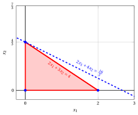
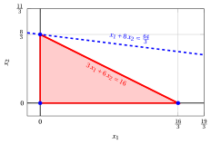
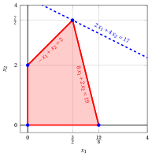
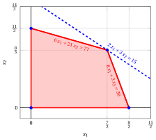
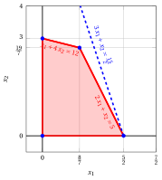
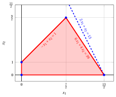
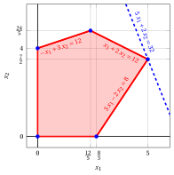

# Problemi LP con due variabili – Tipo A

**Catalogo dei problemi** · [:material-file-pdf-box: Catalogo dei problemi (PDF)](../pdf/catalogo-problemi.pdf)

## Problema LP $P0$

!!! chiave ""

    $$
    \begin{array}{rrrrrrrrrrrrr}
    {\max} & 2 \, {x_1} & {+} & 4 \, {x_2} \\[2ex]
    \text{soggetto a} & 2 \, {x_1} & {+} & 3 \, {x_2} & {\le} & 4 \\[2ex]
    & {x_1,} &  & {x_2} & { \ge} & { 0 }
    \end{array}
    $$

{ .fig .ovale loading=lazy style="width:76%" }

## Problema LP $P1$

!!! chiave ""

    $$
    \begin{array}{rrrrrrrrrrrrr}
    {\max} & {x_1} & {+} & 8 \, {x_2} \\[2ex]
    \text{soggetto a} & {3} \, {x_1} & {+} & {6} \, {x_2} & {\le} & {16} \\[2ex]
    & {x_1,} &  & {x_2} & { \ge} & {0 }
    \end{array}
    $$

{ .fig .ovale loading=lazy style="width:76%" }

## Problema LP $P2$

!!! chiave ""

    $$
    \begin{array}{rrrrrrrrrrrrr}
    {\max} & {x_1} & {+} & 3 \, {x_2} \\[2ex]
    \text{soggetto a} & {-}4 \, {x_1} & {+} & 10 \, {x_2} & {\le} & 35 \\[2ex]
    & 3 \, {x_1} & {+} & \, {x_2} & {\le} & 12 \\[2ex]
    & {x_1,} &  & {x_2} & { \ge} & { 0 }
    \end{array}
    $$

{ .fig .ovale loading=lazy style="width:76%" }

## Problema LP $P3$

!!! chiave ""

    $$
    \begin{array}{rrrrrrrrrrrrr}
    {\max} & {2} \, {x_1} & {+} & {4} \, {x_2} \\[2ex]
    \text{soggetto a} & {-} \, {x_1} & {+} & \, {x_2} & {\le} & {2} \\[2ex]
    & {8} \, {x_1} & {+} & {2} \, {x_2} & {\le} & {19} \\[2ex]
    & {x_1,} &  & {x_2} & { \ge} & { 0 }
    \end{array}
    $$

{ .fig .ovale loading=lazy style="width:76%" }

## Problema LP $P4$

!!! chiave ""

    $$
    \begin{array}{rrrrrrrrrrrrr}
    {\max} & 5 {x_1} & {+} & 3 \, {x_2} \\[2ex]
    \text{soggetto a} & 2 \, {x_1} & {+} & \, {x_2} & {\le} & 14 \\[2ex]
    & \, {x_1} & {+} & 8 \, {x_2} & {\le} & 32 \\[2ex]
    & {x_1,} &  & {x_2} & { \ge} & { 0 }
    \end{array}
    $$

{ .fig .ovale loading=lazy style="width:82%" }

## Problema LP $P5$

!!! chiave ""

    $$
    \begin{array}{rrrrrrrrrrrrr}
    {\max} & 2 {x_1} & {+} & 3 \, {x_2} \\[2ex]
    \text{soggetto a} & 6 \, {x_1} & {+} & 21 \, {x_2} & {\le} & 77 \\[2ex]
    & 8 \, {x_1} & {+} & 3 \, {x_2} & {\le} & 36 \\[2ex]
    & {x_1,} &  & {x_2} & { \ge} & { 0 }
    \end{array}
    $$

{ .fig .ovale loading=lazy style="width:76%" }

## Problema ILP $P6$

!!! chiave ""

    $$
    \begin{array}{rrrrrrrrrrrrr}
    {\max} & {x_1} & {+} & \, {x_2} \\[2ex]
    \text{soggetto a} & {4} \, {x_1} & {+} & {15} \, {x_2} & {\le} & {70} \\[2ex]
    & {12} \, {x_1} & {+} & {3} \, {x_2} & {\le} & {52} \\[2ex]
    & {x_1,} &  & {x_2} & {\in} & {\mathbb{Z}_{\ge 0}}
    \end{array}
    $$

{ .fig .ovale loading=lazy style="width:76%" }

## Problema LP $P7$

!!! chiave ""

    $$
    \begin{array}{rrrrrrrrrrrrr}
    {\max} & 3 \, {x_1} & {+} & {x_2} \\[2ex]
    \text{soggetto a} & {x_1} & {+} & {4} \, {x_2} & {\le} & {12} \\[2ex]
    & 2 \, {x_1} & {+} & \, {x_2} & {\le} & 5 \\[2ex]
    & {x_1,} &  & {x_2} & {\ge} & {0}
    \end{array}
    $$

{ .fig .ovale loading=lazy style="width:76%" }

## Problema LP $P8$

!!! chiave ""

    $$
    \begin{array}{rrrrrrrrrrrrr}
    {\max} & \, {x_1} & {+} & 2 \, {x_2} \\[2ex]
    \text{soggetto a} & {-} {x_1} & {+} & {2} \, {x_2} & {\le} & {2} \\[2ex]
    & \, {x_1} & {+} & \, {x_2} & {\le} & 3 \\[2ex]
    & \, {x_1,} &  & {x_2} & { \ge } & { 0 }
    \end{array}
    $$

{ .fig .ovale loading=lazy style="width:76%" }

## Problema LP $P9$

!!! chiave ""

    $$
    \begin{array}{rrrrrrrrrrrrr}
    {\max} & 2 \, {x_1} & {+} & {x_2} \\[2ex]
    \text{soggetto a} & {-} \, {x_1} & {+} & \, {x_2} & {\le} & 1 \\[2ex]
    & {6} \, {x_1} & {+} & {4} \, {x_2} & {\le} & {39} \\[2ex]
    & {x_1,} &  & {x_2} & { \ge} & {0}
    \end{array}
    $$

{ .fig .ovale loading=lazy style="width:76%" }

## Problema LP $P10$

!!! chiave ""

    $$
    \begin{array}{rrrrrrrrrrrrr}
    {\max} & 5 \, {x_1} & {+} & 2 \, {x_2} \\[2ex]
    \text{soggetto a} & {-} \, {x_1} & {+} & 3 \, {x_2} & {\le} & 12 \\[2ex]
    & {x_1} & {+} & 2 \, {x_2} & {\le} & 12 \\[2ex]
    & {3} \, {x_1} & {-} & 2 \, {x_2} & {\le} & {8} \\[2ex]
    & {x_1,} &  & {x_2} & { \ge} & {0}
    \end{array}
    $$

{ .fig .ovale loading=lazy style="width:76%" }
