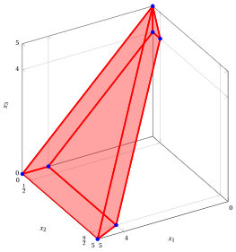
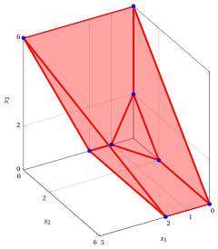
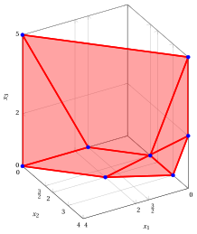
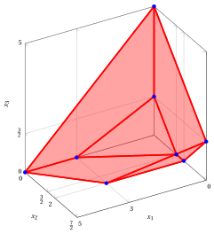
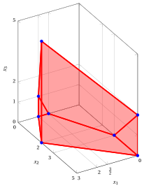
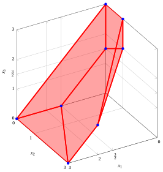

# Problemi LP con tre variabili – Tipo C

**Catalogo dei problemi** · [:material-file-pdf-box: Catalogo dei problemi (PDF)](../pdf/catalogo-problemi.pdf)

## Problema LP $P61$

!!! chiave ""

    $$
    \begin{array}{rrrrrrrrrrrrrrrr}
    {\max} &  & {3\,x_1} & {+} & {\,x_2} & {+} & {2\,x_3} &  &  \\[2ex]
    \text{soggetto a} &  & {\,x_1} &  &  & {+} & {\,x_3} & {\le} & {5} \\[2ex]
    & {-} & {\,x_1} &  &  & {-} & {\,x_3} & {\le} & {-4} \\[2ex]
    & {-} & {\,x_1} & {+} & {2\,x_2} & {+} & {\,x_3} & {\le} & {5} \\[2ex]
    &  & {x_1,} &  & {x_2,} &  & {x_3} & { \ge} & { 0 }
    \end{array}
    $$

{ .fig .ovale loading=lazy style="width:79%" }

## Problema LP $P62$

!!! chiave ""

    $$
    \begin{array}{rrrrrrrrrrrrrrrr}
    {\max} &  & {2\,x_1} & {+} & {3\,x_2} & {+} & {\,x_3} &  &  \\[2ex]
    \text{soggetto a} &  &  &  & {\,x_2} & {+} & {\,x_3} & {\le} & {6} \\[2ex]
    & {-} & {2\,x_1} & {-} & {\,x_2} & {-} & {\,x_3} & {\le} & {-2} \\[2ex]
    &  & {2\,x_1} &  &  & {-} & {\,x_3} & {\le} & {4} \\[2ex]
    &  & {x_1,} &  & {x_2,} &  & {x_3} & { \ge} & { 0 }
    \end{array}
    $$

{ .fig .ovale loading=lazy style="width:79%" }

## Problema LP $P63$

!!! chiave ""

    $$
    \begin{array}{rrrrrrrrrrrrrrrr}
    {\max} &  & {\,x_1} & {+} & {2\,x_2} & {+} & {2\,x_3} &  &  \\[2ex]
    \text{soggetto a} &  & {\,x_1} & {+} & {\,x_2} &  &  & {\le} & {4} \\[2ex]
    &  & {\,x_1} & {+} & {2\,x_2} & {-} & {\,x_3} & {\le} & {6} \\[2ex]
    & {-} & {2\,x_1} & {-} & {2\,x_2} & {+} & {\,x_3} & {\le} & {-3} \\[2ex]
    &  & {x_1,} &  & {x_2,} &  & {x_3} & { \ge} & { 0 }
    \end{array}
    $$

{ .fig .ovale loading=lazy style="width:79%" }

## Problema LP $P64$

!!! chiave ""

    $$
    \begin{array}{rrrrrrrrrrrrrrrr}
    {\max} &  & {3\,x_1} & {+} & {2\,x_2} & {+} & {\,x_3} &  &  \\[2ex]
    \text{soggetto a} & {-} & {\,x_1} & {-} & {2\,x_2} & {-} & {2\,x_3} & {\le} & {-3} \\[2ex]
    &  & {\,x_1} & {+} & {\,x_2} & {+} & {\,x_3} & {\le} & {5} \\[2ex]
    &  &  &  & {\,x_2} & {-} & {\,x_3} & {\le} & {2} \\[2ex]
    &  & {x_1,} &  & {x_2,} &  & {x_3} & { \ge} & { 0 }
    \end{array}
    $$

{ .fig .ovale loading=lazy style="width:79%" }

## Problema LP $P65$

!!! chiave ""

    $$
    \begin{array}{rrrrrrrrrrrrrrrr}
    {\max} &  & {2\,x_1} & {+} & {3\,x_2} & {+} & {3\,x_3} &  &  \\[2ex]
    \text{soggetto a} &  & {\,x_1} & {+} & {\,x_2} &  &  & {\le} & {5} \\[2ex]
    &  & {2\,x_1} & {-} & {\,x_2} &  &  & {\le} & {4} \\[2ex]
    & {-} & {2\,x_1} & {-} & {\,x_2} & {+} & {\,x_3} & {\le} & {-3} \\[2ex]
    &  & {x_1,} &  & {x_2,} &  & {x_3} & { \ge} & { 0 }
    \end{array}
    $$

{ .fig .ovale loading=lazy style="width:71%" }

## Problema LP $P66$

!!! chiave ""

    $$
    \begin{array}{rrrrrrrrrrrrrrrr}
    {\max} &  & {2\,x_1} & {+} & {\,x_2} & {+} & {\,x_3} &  &  \\[2ex]
    \text{soggetto a} & {-} & {2\,x_1} & {+} & {\,x_2} & {-} & {2\,x_3} & {\le} & {-3} \\[2ex]
    &  & {\,x_1} &  &  & {+} & {\,x_3} & {\le} & {3} \\[2ex]
    & {-} & {2\,x_1} & {+} & {2\,x_2} &  &  & {\le} & {2} \\[2ex]
    &  & {x_1,} &  & {x_2,} &  & {x_3} & { \ge} & { 0 }
    \end{array}
    $$

{ .fig .ovale loading=lazy style="width:79%" }
