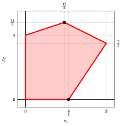
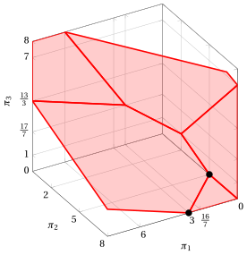
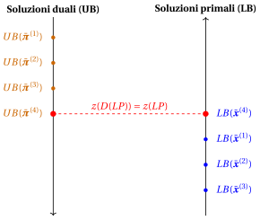
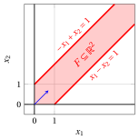
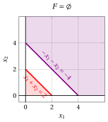
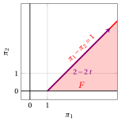
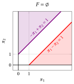
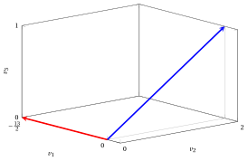

# Teoria della dualità

**Parte 3 · Dualità e simplesso duale · Capitolo 9** · [:material-file-pdf-box: Dispensa, volume 3 (PDF)](../pdf/dispensa-3-dualita.pdf) · [:material-pencil: Esercizi](../esercizi/es-09-dualita.md)

## 9.1 Problema duale di un problema LP in forma canonica di massimo

!!! definizione "Definizione 9.1: problema duale di un problema LP in forma canonica di massimo"

    Dato un problema di programmazione lineare (LP) in forma canonica di massimo con $n$ variabili non negative e $m$ vincoli lineari di minore o uguale (detto <strong>problema primale</strong> e indicato con $LP$):

    

    \begin{align*}
    &&   \max \;\;{\sum_{j =1}^n c_j \, x_j}                               \label{ObjFunc_P} \tag{9.1a}\\[0.5ex]
    && \text{soggetto a} \quad  {\sum_{j =1}^n a_{ij} \, x_j}  &\leq b_i,   & \forall i \in \{1,2,\dots,m\},                    \label{Cons_P} \tag{9.1b}\\[0.5ex]
    &&x_j                        &\ge  0, & \forall j \in \{1,2,\dots,n\},\label{NonNegCons_P} \tag{9.1c}
    \end{align*}

    il seguente problema LP con $m$ variabili non negative e $n$ vincoli lineari di maggiore o uguale

    

    \begin{align*}
    &&   \min \;\;{\sum_{i =1}^m b_i \, \pi_i}                               \label{ObjFunc_D}  \tag{9.2a}\\[0.5ex]
    && \text{soggetto a} \quad  {\sum_{i =1}^m a_{ij} \, \pi_i}  &\geq c_j,   & \forall j \in \{1,2,\dots,n\},                    \label{Cons_D}  \tag{9.2b}\\[0.5ex]
    &&\pi_i                        &\ge  0, & \forall i \in \{1,2,\dots,m\}, \label{NonNegCons_D} \tag{9.2c}
    \end{align*}

    si chiama <strong>problema duale</strong> e si indica con $D(LP)$.

!!! esempio "Esempio 9.1: coppia di problemi primale e duale"

    Consideriamo il seguente problema primale $LP$ in forma canonica di massimo con $n=2$ variabili non negative e $m=3$ vincoli lineari di minore o uguale ([Esempio 9.1](#box-2-ex-dual-1)):

    $$
    \begin{array}{rrrrrrrrrrrrr}
    {\max} & 5 \, {x_1} & {+} & 2 \, {x_2} \\[2ex]
    \text{soggetto a} & {-} \, {x_1} & {+} & 3 \, {x_2} & {\le} & 12 \\[2ex]
    & {x_1} & {+} & 2 \, {x_2} & {\le} & 12 \\[2ex]
    & {3} \, {x_1} & {-} & 2 \, {x_2} & {\le} & {8} \\[2ex]
    & {x_1,} &  & {x_2} & { \ge} & {0}
    \end{array}
    $$

    Il problema duale $D(LP)$, con $m=3$ variabili non negative e $n=2$ vincoli lineari di maggiore o uguale, è il seguente:

    $$
    \begin{array}{rrrrrrrrrrrrr}
    {\min} & 12\, {\pi_1} & {+} & 12 \, {\pi_2} & {+} & 8 \, {\pi_3} \\[2ex]
    \text{soggetto a} & {-} \, {\pi_1} & {+} & \, {\pi_2} & {+} & 3 \, {\pi_3} & {\ge} & 5 \\[2ex]
    & 3 \, {\pi_1} & {+} & 2 \, {\pi_2} & {-} & 2\, {\pi_3} & {\ge} & 2 \\[2ex]
    & {\pi_1,} &  & {\pi_2,} &  & \, {\pi_3} & { \ge} & { 0 }
    \end{array}
    $$

!!! chiave ""

    Si ottengono upper bound sul valore ottimo $z(LP)$ del problema primale prendendo combinazioni lineari non negative dei vincoli, con i moltiplicatori scelti in modo che il coefficiente di ciascuna variabile nel membro sinistro risultante sia maggiore o uguale al suo coefficiente nella funzione obiettivo. Il membro destro della disuguaglianza risultante fornisce allora un upper bound su $z(LP)$.

!!! esempio "Esempio 9.2: Calcolo di upper bound tramite combinazioni lineari dei vincoli"

    Consideriamo il problema primale dell'[Esempio 9.1](#box-2-ex-dual-1).

    - Ad esempio, moltiplicando il secondo vincolo per $5$, otteniamo:

        $$
        5 \; x_1 + 10 \; x_2  ~~\le~~ 60
        $$

        Quindi, ogni soluzione ammissibile del problema primale soddisfa questa disuguaglianza, che è una sovrastima della funzione obiettivo, poiché abbiamo:

        $$
        5 \;x_{1}  + 2 \; x_{2}  ~~\le~~ 5 \; x_1 + 10 \;x_2 ~~\le~~ 60
        $$

        In particolare, queste disuguaglianze valgono per la soluzione ottima, quindi $z(\,LP\,) \le 60$.

    - Ad esempio, moltiplicando il secondo vincolo per $\frac{5}{2}$ e sommandolo poi al terzo vincolo, otteniamo:

        $$
        \frac{5}{2}\,(x_1 + 2\,x_2) + (3\,x_1 - 2\,x_2) \le 12 \cdot \frac{5}{2} + 8 ~~\Rightarrow~~ \frac{11}{2}\,x_1 + 3\,x_2 \le 38
        $$

        Quindi, ogni soluzione ammissibile del problema primale soddisfa questa disuguaglianza, che è una sovrastima della funzione obiettivo, poiché abbiamo:

        $$
        5 \;x_{1}  + 2 \; x_{2}  ~~\le~~ \frac{11}{2}\,x_1 + 3\,x_2 ~~\le~~ 38
        $$

        In particolare, queste disuguaglianze valgono per la soluzione ottima, quindi $z(\,LP\,) \le 38$.

    - Ad esempio, moltiplicando il primo, il secondo e il terzo vincolo rispettivamente per $2$, $1$ e $2$, e poi sommandoli, otteniamo:

        $$
        2\,(-x_1 + 3\,x_2) + (x_1 + 2\,x_2) + 2\,(3\,x_1 - 2\,x_2) \le 12 \cdot 2 + 12 + 8 \cdot 2 ~~\Rightarrow~~ 5\,x_1 + 4\,x_2 \le 52
        $$

        Quindi, ogni soluzione ammissibile del problema primale soddisfa questa disuguaglianza, che è una sovrastima della funzione obiettivo, poiché abbiamo:

        $$
        5 \;x_{1}  + 2 \; x_{2}  ~~\le~~ 5 \;x_{1}  + 4 \; x_{2} ~~\le~~ 52
        $$

        In particolare, queste disuguaglianze valgono per la soluzione ottima, quindi $z(\,LP\,) \le 52$.

!!! esempio "Esempio 9.3: Calcolo di upper bound tramite combinazioni lineari dei vincoli"

    Consideriamo il problema primale dell'[Esempio 9.1](#box-2-ex-dual-1).

    Poiché abbiamo tre vincoli, introduciamo tre moltiplicatori: $\pi_1$, $\pi_2$ e $\pi_3$. Moltiplicando ciascun vincolo per il suo moltiplicatore, otteniamo:

    \begin{align*}
    (-x_1 + 3\,x_2) \; \pi_1 &\le 12 \; \pi_1 \\[1ex]
    (x_1 + 2\,x_2) \; \pi_2 &\le 12 \; \pi_2 \\[1ex]
    (3\,x_1 - 2\,x_2) \; \pi_3 &\le 8 \; \pi_3
    \end{align*}

    Sommando le tre disuguaglianze, otteniamo:

    \begin{align*}
    (-x_1 + 3\,x_2)\,\pi_1 + (x_1 + 2\,x_2)\,\pi_2 + (3\,x_1 - 2\,x_2)\,\pi_3 &\le 12\,\pi_1 + 12\,\pi_2 + 8\,\pi_3
    \end{align*}

    Raggruppando per variabile, otteniamo:

    \begin{align*}
    (-\pi_1 + \pi_2 + 3\,\pi_3)\,x_1 + (3\,\pi_1 + 2\,\pi_2 - 2\,\pi_3)\,x_2 &\le 12\,\pi_1 + 12\,\pi_2 + 8\,\pi_3
    \end{align*}

    Il membro destro di questa disuguaglianza fornisce un upper bound valido su $z(\, LP\,)$ se e solo se il coefficiente di ciascuna variabile è almeno pari al coefficiente corrispondente nella funzione obiettivo:

    \begin{align*}
    -\pi_1 + \pi_2 + 3\,\pi_3 &\ge 5 \\[1ex]
    3\,\pi_1 + 2\,\pi_2 - 2\,\pi_3 &\ge 2
    \end{align*}

    Ogni moltiplicatore deve essere non negativo:

    $$
    \pi_1,~ \pi_2,~ \pi_3 \ge 0
    $$

    altrimenti il verso della disuguaglianza corrispondente si invertirebbe. Poiché vogliamo ottenere il miglior upper bound possibile, cioè il più piccolo, dobbiamo minimizzare il membro destro della disuguaglianza che fornisce l'upper bound su $z(\,LP\,)$.

!!! chiave ""

    Il problema duale $D(LP)$ è il problema LP di trovare il miglior upper bound possibile sul valore ottimo $z(\, LP\,)$ del problema primale $LP$ tramite combinazioni lineari dei vincoli.

- Una proprietà importante della trasformazione di dualità è che restituisce il problema di partenza se applicata due volte.

!!! teorema "Osservazione 9.2"

    Il problema duale del problema duale [(9.2)](#eq-DUAL) è il problema primale [(9.1)](#eq-PRIMAL).

??? dimostrazione "Dimostrazione"

    Partendo dal problema duale [(9.2)](#eq-DUAL),

    \begin{align*}
    && \min \;\; \sum_{i=1}^m b_i \pi_i \\[1ex]
    && \text{soggetto a} \quad \sum_{i=1}^m a_{ij}\pi_i &\ge c_j,
    & \forall j \in \{1,2,\dots,n\}, \\[1ex]
    && \pi_i &\ge 0,
    & \forall i \in \{1,2,\dots,m\},
    \end{align*}

    consideriamo il problema LP equivalente ottenuto moltiplicando per $-1$ la funzione obiettivo e ciascun vincolo:

    \begin{align*}
    && \max \;\; \sum_{i=1}^m (-b_i)\pi_i \\[1ex]
    && \text{soggetto a} \quad \sum_{i=1}^m (-a_{ij})\pi_i &\le -c_j,
    & \forall j \in \{1,2,\dots,n\}, \\[1ex]
    && \pi_i &\ge 0,
    & \forall i \in \{1,2,\dots,m\}.
    \end{align*}

    Questo problema è ora in forma canonica di massimo. Quindi, il suo duale è

    \begin{align*}
    && \min \;\; \sum_{j=1}^n (-c_j)x_j \\[1ex]
    && \text{soggetto a} \quad \sum_{j=1}^n (-a_{ij})x_j &\ge -b_i,
    & \forall i \in \{1,2,\dots,m\}, \\[1ex]
    && x_j &\ge 0,
    & \forall j \in \{1,2,\dots,n\}.
    \end{align*}

    Infine, moltiplicando per $-1$ la funzione obiettivo e ciascun vincolo, otteniamo il problema equivalente

    \begin{align*}
    && \max \;\; \sum_{j=1}^n c_j x_j \\[1ex]
    && \text{soggetto a} \quad \sum_{j=1}^n a_{ij}x_j &\le b_i,
    & \forall i \in \{1,2,\dots,m\}, \\[1ex]
    && x_j &\ge 0,
    & \forall j \in \{1,2,\dots,n\},
    \end{align*}

    che è esattamente il problema primale [(9.1)](#eq-PRIMAL). Pertanto, il duale del problema duale [(9.2)](#eq-DUAL) è il problema primale [(9.1)](#eq-PRIMAL). □

### 9.1.1 Dualità debole

- Il seguente teorema, detto della <strong>dualità debole</strong>, afferma che il valore di qualunque soluzione ammissibile del problema primale [(9.1)](#eq-PRIMAL) è minore o uguale al valore di qualunque soluzione ammissibile del problema duale [(9.2)](#eq-DUAL).

!!! teorema "Teorema 9.3: Dualità debole"

    Per ogni soluzione ammissibile $(\bar x_1,\bar x_2,\dots,\bar x_n)$ del problema primale [(9.1)](#eq-PRIMAL) e ogni soluzione ammissibile $(\bar \pi_1,\bar \pi_2,\dots,\bar \pi_m)$ del problema duale [(9.2)](#eq-DUAL), abbiamo

    \begin{equation*}
    \label{WD}
    \sum_{j=1}^n c_j \bar x_j \le \sum_{i=1}^m b_i \bar \pi_i. \tag{9.3}
    \end{equation*}

- L'idea della dimostrazione è usare l'ammissibilità primale e duale delle due soluzioni per mostrare che il valore della soluzione primale è al più uguale al valore della soluzione duale.

??? dimostrazione "Dimostrazione"

    Abbiamo:

    \begin{align*}
    \sum_{j=1}^{n} c_j \; \bar x_j
    &\le \sum_{j=1}^{n} \left( \sum_{i=1}^{m} a_{ij} \; \bar \pi_i \right) \bar x_j
    && \text{\begin{array}{l}
    \text{(per }\eqref {\text{Cons_D}}\text{ e }\eqref {\text{NonNegCons_P}}: \\
    {\textstyle c_j \le \sum_{i=1}^{m} a_{ij} \bar \pi_i,~\bar x_j \ge 0, \forall j \in \{1,2,\dots,n\}})
    \end{array}} \\[2ex]
    &= \sum_{i=1}^{m} \left( \sum_{j=1}^{n} a_{ij} \; \bar x_j \right) \bar \pi_i
    && \\[2ex]
    &\le \sum_{i=1}^{m} b_i \; \bar \pi_i
    && \text{\begin{array}{l}
    \text{(per }\eqref {\text{Cons_P}}\text{ e }\eqref {\text{NonNegCons_D}}: \\
    {\textstyle \sum_{j=1}^{n} a_{ij} \bar x_j \le b_i,~ \bar \pi_i \ge 0, \forall i \in \{1,2,\dots,m\}})
    \end{array}}
    \end{align*}

    
□

- Il teorema della dualità debole afferma che il valore di qualunque soluzione ammissibile $(\bar \pi_1,\bar \pi_2,\dots,\bar \pi_m)$ di un problema duale [(9.2)](#eq-DUAL) fornisce un <strong>upper bound</strong> valido sul valore ottimo $z(\,LP\,)$ del problema primale [(9.1)](#eq-PRIMAL):

    $$
    z(\, LP\,) \le \sum_{i=1}^m b_i \; \bar \pi_i
    $$

    Inoltre, il valore di qualunque soluzione ammissibile $(\bar x_1,\bar x_2, \dots,\bar x_n)$ di un problema primale [(9.1)](#eq-PRIMAL) fornisce un <strong>lower bound</strong> valido sul valore ottimo $z(~ D(LP)~)$ del problema duale [(9.2)](#eq-DUAL):

    $$
    \sum_{j=1}^n c_j \; \bar x_j \le z(  ~D(LP)~)
    $$

!!! esempio "Esempio 9.4: Soluzioni ammissibili primali e duali"

    Consideriamo la seguente coppia di problemi LP primale e duale:

    $$
    \begin{array}{rrrrrrrrrrrrr}
    {\max} & 5 \, {x_1} & {+} & 2 \, {x_2} \\[2ex]
    \text{soggetto a} & {-} \, {x_1} & {+} & 3 \, {x_2} & {\le} & 12 \\[2ex]
    & {x_1} & {+} & 2 \, {x_2} & {\le} & 12 \\[2ex]
    & {3} \, {x_1} & {-} & 2 \, {x_2} & {\le} & {8} \\[2ex]
    & {x_1,} &  & {x_2} & { \ge} & {0}
    \end{array}
    $$

    $$
    \begin{array}{rrrrrrrrrrrrr}
    {\min} & 12\, {\pi_1} & {+} & 12 \, {\pi_2} & {+} & 8 \, {\pi_3} \\[2ex]
    \text{soggetto a} & {-} \, {\pi_1} & {+} & \, {\pi_2} & {+} & 3 \, {\pi_3} & {\ge} & 5 \\[2ex]
    & 3 \, {\pi_1} & {+} & 2 \, {\pi_2} & {-} & 2\, {\pi_3} & {\ge} & 2 \\[2ex]
    & {\pi_1,} &  & {\pi_2,} &  & \, {\pi_3} & { \ge} & { 0 }
    \end{array}
    $$

    

    Una soluzione primale ammissibile è:

    $$
    \bar{x}_1=\frac{12}{5},~~\bar{x}_2=\frac{24}{5}
    $$

    Essa fornisce il seguente lower bound sul valore ottimo:

    $$
    LB(\bar{\boldsymbol x})= 5 \cdot \frac{12}{5} + 2 \cdot \frac{24}{5} = \frac{108}{5}
    $$

    Un'altra soluzione primale ammissibile è:

    $$
    \bar{x}_1=\frac{8}{3},~~\bar{x}_2=0
    $$

    Essa fornisce il seguente lower bound sul valore ottimo:

    $$
    LB(\bar{\boldsymbol x})= 5 \cdot \frac{8}{3} + 2 \cdot 0 = \frac{40}{3}
    $$

    

    

    { .fig .ovale loading=lazy style="width:90%" }

    

    

    Una soluzione duale ammissibile è:

    $$
    \bar{\pi}_1=0,~~\bar{\pi}_2=5,~~\bar{\pi}_3=0
    $$

    Essa fornisce il seguente upper bound sul valore ottimo:

    $$
    UB(\bar{\boldsymbol\pi})= 12 \cdot 0 + 12 \cdot 5 + 8 \cdot 0 = 60
    $$

    Un'altra soluzione duale ammissibile è:

    $$
    \bar{\pi}_1=3,~~\bar{\pi}_2=8,~~\bar{\pi}_3=0
    $$

    Essa fornisce il seguente upper bound sul valore ottimo:

    $$
    UB(\bar{\boldsymbol\pi})= 12 \cdot 3 + 12 \cdot 8 + 8 \cdot 0 = 132
    $$

    

    

    { .fig .ovale loading=lazy style="width:94%" }

    

- Grazie alla dualità debole, possiamo mostrare che $(\tilde x_1,\tilde x_2,\dots,\tilde x_n)$ è una soluzione ottima del problema primale [(9.1)](#eq-PRIMAL) e $(\tilde \pi_1,\tilde \pi_2,\dots,\tilde \pi_m)$ è una soluzione ottima del problema duale [(9.2)](#eq-DUAL) se sono ammissibili per i rispettivi problemi e soddisfano

    $$
    \sum_{j=1}^n c_j \tilde x_j = \sum_{i=1}^m b_i \tilde \pi_i.
    $$

    Ciò discende dalla dualità debole nel modo seguente:

    1. Per la dualità debole, per ogni soluzione ammissibile $(\bar x_1,\bar x_2,\dots,\bar x_n)$ del problema primale [(9.1)](#eq-PRIMAL) e per la soluzione duale ammissibile $(\tilde \pi_1,\tilde \pi_2,\dots,\tilde \pi_m)$, abbiamo

        $$
        \sum_{j=1}^n c_j \bar x_j \le \sum_{i=1}^m b_i \tilde \pi_i.
        $$

        Se, inoltre,

        $$
        \sum_{j=1}^n c_j \tilde x_j = \sum_{i=1}^m b_i \tilde \pi_i,
        $$

        allora

        $$
        \sum_{j=1}^n c_j \bar x_j \le \sum_{j=1}^n c_j \tilde x_j
        $$

        per ogni soluzione ammissibile $(\bar x_1,\bar x_2,\dots,\bar x_n)$ del problema primale. Di conseguenza, $(\tilde x_1,\tilde x_2,\dots,\tilde x_n)$ è una soluzione ottima del problema primale [(9.1)](#eq-PRIMAL).

    2. Per la dualità debole, per ogni soluzione ammissibile $(\bar \pi_1,\bar \pi_2,\dots,\bar \pi_m)$ del problema duale [(9.2)](#eq-DUAL) e per la soluzione primale ammissibile $(\tilde x_1,\tilde x_2,\dots,\tilde x_n)$, abbiamo

        $$
        \sum_{j=1}^n c_j \tilde x_j \le \sum_{i=1}^m b_i \bar \pi_i.
        $$

        Se, inoltre,

        $$
        \sum_{j=1}^n c_j \tilde x_j = \sum_{i=1}^m b_i \tilde \pi_i,
        $$

        allora

        $$
        \sum_{i=1}^m b_i \tilde \pi_i \le \sum_{i=1}^m b_i \bar \pi_i
        $$

        per ogni soluzione ammissibile $(\bar \pi_1,\bar \pi_2,\dots,\bar \pi_m)$ del problema duale. Di conseguenza, $(\tilde \pi_1,\tilde \pi_2,\dots,\tilde \pi_m)$ è una soluzione ottima del problema duale [(9.2)](#eq-DUAL).

!!! esempio "Esempio 9.5: Soluzioni ottime primali e duali"

    Consideriamo la seguente coppia di problemi LP primale e duale:

    $$
    \begin{array}{rrrrrrrrrrrrr}
    {\max} & 5 \, {x_1} & {+} & 2 \, {x_2} \\[2ex]
    \text{soggetto a} & {-} \, {x_1} & {+} & 3 \, {x_2} & {\le} & 12 \\[2ex]
    & {x_1} & {+} & 2 \, {x_2} & {\le} & 12 \\[2ex]
    & {3} \, {x_1} & {-} & 2 \, {x_2} & {\le} & {8} \\[2ex]
    & {x_1,} &  & {x_2} & { \ge} & {0}
    \end{array}
    $$

    $$
    \begin{array}{rrrrrrrrrrrrr}
    {\min} & 12\, {\pi_1} & {+} & 12 \, {\pi_2} & {+} & 8 \, {\pi_3} \\[2ex]
    \text{soggetto a} & {-} \, {\pi_1} & {+} & \, {\pi_2} & {+} & 3 \, {\pi_3} & {\ge} & 5 \\[2ex]
    & 3 \, {\pi_1} & {+} & 2 \, {\pi_2} & {-} & 2\, {\pi_3} & {\ge} & 2 \\[2ex]
    & {\pi_1,} &  & {\pi_2,} &  & \, {\pi_3} & { \ge} & { 0 }
    \end{array}
    $$

    Per mostrare che

    $$
    \tilde{x}_1=5,\qquad \tilde{x}_2=\frac{7}{2}
    $$

    è una soluzione ottima del problema primale [(9.1)](#eq-PRIMAL), e che

    $$
    \tilde \pi_1=0,\qquad \tilde \pi_2=2,\qquad \tilde \pi_3=1
    $$

    è una soluzione ottima del problema duale [(9.2)](#eq-DUAL), possiamo procedere come segue.

    Innanzitutto, verifichiamo di avere una soluzione ammissibile per il problema primale:

    \begin{align*}
    -\tilde x_1 + 3\tilde x_2 &= -5 + 3\cdot \frac{7}{2} = \frac{11}{2} \le 12,\\[1ex]
    \tilde x_1 + 2\tilde x_2 &= 5 + 2\cdot \frac{7}{2} = 12 \le 12,\\[1ex]
    3\tilde x_1 - 2\tilde x_2 &= 3\cdot 5 - 2\cdot \frac{7}{2} = 8 \le 8,\\[1ex]
    \tilde x_1 &= 5 \ge 0,\qquad \tilde x_2=\frac{7}{2} \ge 0.
    \end{align*}

    In secondo luogo, verifichiamo di avere una soluzione ammissibile per il problema duale:

    \begin{align*}
    -\tilde \pi_1 + \tilde \pi_2 + 3\tilde \pi_3 &= -0 + 2 + 3\cdot 1 = 5 \ge 5,\\[1ex]
    3\tilde \pi_1 + 2\tilde \pi_2 - 2\tilde \pi_3 &= 3\cdot 0 + 2\cdot 2 - 2\cdot 1 = 2 \ge 2,\\[1ex]
    \tilde \pi_1 &= 0 \ge 0,\qquad \tilde \pi_2=2 \ge 0,\qquad \tilde \pi_3=1 \ge 0.
    \end{align*}

    Infine, calcoliamo i valori della funzione obiettivo:

    $$
    5\tilde x_1 + 2\tilde x_2
    =
    5\cdot 5 + 2\cdot \frac{7}{2}
    =
    25+7
    =
    32,
    $$

    e

    $$
    12\tilde \pi_1 + 12\tilde \pi_2 + 8\tilde \pi_3
    =
    12\cdot 0 + 12\cdot 2 + 8\cdot 1
    =
    24+8
    =
    32.
    $$

    Poiché entrambe le soluzioni sono ammissibili per i rispettivi problemi e i loro valori obiettivo sono uguali, per la dualità debole sono entrambe ottime.

### 9.1.2 Dualità forte

- Il seguente teorema, detto della <strong>dualità forte</strong>, afferma che il problema primale [(9.1)](#eq-PRIMAL) ha una soluzione ottima se e solo se il problema duale [(9.2)](#eq-DUAL) ha una soluzione ottima, e in tal caso i valori ottimi dei due problemi coincidono.

!!! teorema "Teorema 9.4: Dualità forte"

    Il problema primale [(9.1)](#eq-PRIMAL) ha una soluzione ottima $(\tilde x_1,\tilde x_2,\dots,\tilde x_n)$ se e solo se il problema duale [(9.2)](#eq-DUAL) ha una soluzione ottima $(\tilde \pi_1,\tilde \pi_2,\dots,\tilde \pi_m)$, e in tal caso

    \begin{equation*}
    \label{SD}
    \sum_{j=1}^n c_j \tilde x_j = \sum_{i=1}^m b_i \tilde \pi_i. \tag{9.4}
    \end{equation*}

- L'esistenza di una soluzione ottima non ne implica l'unicità. Il teorema afferma soltanto che esiste almeno una soluzione ottima del problema primale se e solo se esiste almeno una soluzione ottima del problema duale (possono esserci più soluzioni ottime da una parte o da entrambe, ma i valori ottimi coincidono).

- La dualità forte implica che

    $$
    \begin{array}{c}
    \text{il problema primale ha una soluzione ottima}\\[1ex]
    \Updownarrow \\[1ex]
    \text{il problema duale ha una soluzione ottima}
    \end{array}
    $$

    quindi  “il problema primale ha una soluzione ottima” è condizione necessaria e sufficiente per  “il problema duale ha una soluzione ottima” e viceversa.

- I passi principali della dimostrazione del teorema della dualità forte sono i seguenti:

    1. Mostriamo prima che, se il problema primale ha una soluzione ottima, allora il problema duale ha una soluzione ottima e i valori ottimi dei due problemi coincidono.

        Per farlo si usa un dizionario ottimo del problema primale, prodotto dall'algoritmo del simplesso, per costruire una soluzione ammissibile del problema duale che soddisfa $\eqref{SD}$.

        Per la dualità debole, tale soluzione duale è necessariamente ottima, il che dimostra un'implicazione.

    2. L'implicazione inversa si ottiene applicando il ragionamento precedente al problema duale (equivalentemente, scambiando i ruoli di primale e duale, poiché il duale del duale è il problema primale).

??? dimostrazione "Dimostrazione"

    Supponiamo che il problema primale [(9.1)](#eq-PRIMAL) abbia una soluzione ottima e consideriamo un dizionario ottimo prodotto dall'algoritmo del simplesso. La sua ultima riga si può scrivere come

    \begin{equation*}
    \sum_{j=1}^n c_j x_j
    =
    \bar z + \sum_{j=1}^{n+m} \hat c_j x_j,
    \qquad
    \text{dove}
    \qquad
    \hat c_j =
    \begin{cases}
    \bar c_j & \text{se } j \in \pazocal{N},\\
    0 & \text{altrimenti}.
    \end{cases}
    \end{equation*}

    Quindi $\hat c_j$ è uguale al costo ridotto della variabile $x_j$ se $j \in \pazocal{N}$ (l'insieme degli indici delle variabili fuori base), ed è uguale a $0$ altrimenti.

    Riordinando i termini, otteniamo

    \begin{equation*}
    \sum_{j=1}^n c_j x_j
    =
    \bar z
    + \sum_{j=1}^{n} \hat c_j x_j
    + \sum_{i=1}^{m} \hat c_{n+i} x_{n+i},
    \end{equation*}

    dove la somma è stata suddivisa nelle variabili originali e nelle variabili di scarto. Ricordiamo che, per le variabili di scarto, abbiamo

    $$
    x_{n+i} = b_i - \sum_{j=1}^n a_{ij}x_j,
    \qquad
    \forall i \in \{1,2,\dots,m\}.
    $$

    Sostituendo queste espressioni nell'identità precedente, otteniamo

    \begin{align*}
    \sum_{j=1}^n c_j x_j
    &=
    \bar z
    + \sum_{j=1}^{n} \hat c_j x_j
    + \sum_{i=1}^{m} \hat c_{n+i}
    \left(
    b_i - \sum_{j=1}^n a_{ij}x_j
    \right)
    \\[1.5ex]
    &=
    \bar z
    + \sum_{j=1}^{n} \hat c_j x_j
    + \sum_{i=1}^{m} b_i \hat c_{n+i}
    - \sum_{i=1}^{m} \hat c_{n+i}\sum_{j=1}^{n} a_{ij}x_j
    \\[1.5ex]
    &=
    \bar z
    + \sum_{j=1}^{n} \hat c_j x_j
    + \sum_{i=1}^{m} b_i \hat c_{n+i}
    - \sum_{j=1}^{n}\left(\sum_{i=1}^{m} a_{ij}\hat c_{n+i}\right)x_j
    \\[1.5ex]
    &=
    \bar z
    + \sum_{i=1}^{m} b_i \hat c_{n+i}
    + \sum_{j=1}^{n}
    \left(
    \hat c_j - \sum_{i=1}^{m} a_{ij}\hat c_{n+i}
    \right)x_j.
    \tag{A}\label{A}
    \end{align*}

    Poiché $\eqref{A}$ è un'identità nelle variabili $x_1,x_2,\dots,x_n$, vale per ogni scelta di queste variabili. Pertanto i termini costanti dei due membri devono coincidere, e devono coincidere anche i coefficienti di ciascuna variabile. Quindi

    \begin{equation*}
    \tag{B}\label{B}
    \bar z + \sum_{i=1}^{m} b_i \hat c_{n+i}  = 0
    \qquad \Longrightarrow \qquad
    \bar z = -\sum_{i=1}^{m} b_i \hat c_{n+i},
    \end{equation*}

    e

    \begin{equation*}
    \tag{C}\label{C}
    c_j
    =
    \hat c_j - \sum_{i=1}^{m} a_{ij} \hat c_{n+i},
    \qquad
    \forall j \in \{1,2,\dots,n\}.
    \end{equation*}

    Definiamo ora

    \begin{equation*}
    \tag{D}\label{D}
    \tilde \pi_i = -\hat c_{n+i},
    \qquad
    \forall i \in \{1,2,\dots,m\},
    \end{equation*}

    e mostriamo che $(\tilde \pi_1,\tilde \pi_2,\dots,\tilde \pi_m)$ è una soluzione ottima del problema duale [(9.2)](#eq-DUAL) che soddisfa $\eqref{SD}$.

    Poiché il dizionario è ottimo, abbiamo $\hat c_j \le 0$ per ogni $j \in \{1,2,\dots,n+m\}$. Quindi da $\eqref{D}$ otteniamo

    $$
    \tilde \pi_i = -\hat c_{n+i} \ge 0,
    \qquad
    \forall i \in \{1,2,\dots,m\},
    $$

    e da $\eqref{C}$ otteniamo

    $$
    \sum_{i=1}^{m} a_{ij}\tilde \pi_i
    =
    c_j - \hat c_j
    \ge c_j,
    \qquad
    \forall j \in \{1,2,\dots,n\}.
    $$

    Pertanto $(\tilde \pi_1,\tilde \pi_2,\dots,\tilde \pi_m)$ è ammissibile per il problema duale [(9.2)](#eq-DUAL).

    Inoltre, poiché $(\tilde x_1,\tilde x_2,\dots,\tilde x_n)$ è una soluzione ottima del problema primale [(9.1)](#eq-PRIMAL), il suo valore obiettivo è uguale al valore ottimo $\bar z$ del problema primale [(9.1)](#eq-PRIMAL). Quindi, per $\eqref{B}$, abbiamo

    $$
    \sum_{j=1}^{n} c_j \tilde x_j
    =
    \bar z
    =
    \sum_{i=1}^{m} b_i \tilde \pi_i.
    $$

    Quindi la soluzione duale ammissibile $(\tilde \pi_1,\tilde \pi_2,\dots,\tilde \pi_m)$ soddisfa $\eqref{SD}$.

    Infine, la dualità debole implica che, per ogni soluzione duale ammissibile $(\bar \pi_1,\bar \pi_2,\dots,\bar \pi_m)$,

    $$
    \sum_{j=1}^{n} c_j \tilde x_j
    \le
    \sum_{i=1}^{m} b_i \bar \pi_i.
    $$

    Poiché per la soluzione duale ammissibile $(\tilde \pi_1,\tilde \pi_2,\dots,\tilde \pi_m)$ abbiamo

    $$
    \sum_{j=1}^{n} c_j \tilde x_j
    =
    \sum_{i=1}^{m} b_i \tilde \pi_i,
    $$

    ne segue che

    $$
    \sum_{i=1}^{m} b_i \tilde \pi_i
    \le
    \sum_{i=1}^{m} b_i \bar \pi_i
    $$

    per ogni soluzione duale ammissibile $(\bar \pi_1,\bar \pi_2,\dots,\bar \pi_m)$. Quindi $(\tilde \pi_1,\tilde \pi_2,\dots,\tilde \pi_m)$ è una soluzione ottima del problema duale [(9.2)](#eq-DUAL).

    L'implicazione inversa si ottiene applicando il ragionamento precedente al problema duale (dopo averlo riscritto nella corrispondente forma canonica, se necessario). Poiché il duale del problema duale è il problema primale, ne segue che se il problema duale [(9.2)](#eq-DUAL) ha una soluzione ottima, allora anche il problema primale [(9.1)](#eq-PRIMAL) ha una soluzione ottima. □

- La figura seguente illustra la relazione tra bound primali e duali per un problema LP in forma di <strong>massimo</strong>. A titolo di esempio, la figura considera quattro soluzioni primali ammissibili

    $$
    \bar{\boldsymbol x}^{(1)}, \bar{\boldsymbol x}^{(2)}, \bar{\boldsymbol x}^{(3)}, \bar{\boldsymbol x}^{(4)},
    $$

    e quattro soluzioni duali ammissibili

    $$
    \bar{\boldsymbol\pi}^{(1)}, \bar{\boldsymbol\pi}^{(2)}, \bar{\boldsymbol\pi}^{(3)}, \bar{\boldsymbol\pi}^{(4)}.
    $$

    Le soluzioni primali ammissibili forniscono <strong>lower bound</strong> sul valore ottimo, mentre le soluzioni duali ammissibili forniscono <strong>upper bound</strong> sul valore ottimo per il teorema della dualità debole $\eqref{WD}$.

    La quarta soluzione di ciascuna sequenza raggiunge il valore ottimo e, per il teorema della dualità forte $\eqref{SD}$, i due bound coincidono: $z(\,{ LP}\,) = z(~{ D(LP)}~)$.

{ .fig .cornice loading=lazy style="width:62%" }

!!! esempio "Esempio 9.6: soluzioni duali ottime dai dizionari primali ottimi"

    Consideriamo il problema primale dell'[Esempio 9.1](#box-2-ex-dual-1) (con $n=2$ e $m=3$). La forma standard del problema primale è

    $$
    \begin{array}{rrrrrrrrrrrr}
    {\max} & 5 \, {x_1} & {+} & 2 \, {x_2} &  &  &  &  &  &  &  &  \\[2ex]
    \text{soggetto a} & {-} \, {x_1} & {+} & 3 \, {x_2} & {+} & {x_3} &  &  &  &  & {=} & {12} \\[2ex]
    & {x_1} & {+} & 2 \, {x_2} &  &  & {+} & {x_4} &  &  & {=} & {12} \\[2ex]
    & {3} \, {x_1} & {-} & 2 \, {x_2} &  &  &  &  & {+} & {x_5} & {=} & {8} \\[2ex]
    & {x_1,} &  & {x_2,} &  & {x_3,} &  & {x_4,} &  & {x_5} & {\geq} & {0}
    \end{array}
    $$

    dove $x_3$, $x_4$ e $x_5$ sono le variabili di scarto associate ai tre vincoli. Un dizionario ottimo è il seguente:

    \begin{equation*}
    \begin{cases}
    \begin{array}{rrrrrrrrrrrrr}
    {x_1=5} & {-} & {\frac{1}{4}} \, {x_4} & {-} & {\frac{1}{4}}\, {x_5} \\[2ex]
    {x_2=\frac{7}{2}} & {-} & {\frac{3}{8}}\, {x_4} & {+} & {\frac{1}{8}}\, {x_5} \\[2ex]
    {x_3=\frac{13}{2}} & {+} & {\frac{7}{8}}\, {x_4} & {-} & {\frac{5}{8}}\, {x_5} \\[2ex]
    {z= 32} & {-} & {2} \, {x_4} & {-} & \, {x_5}
    \end{array}
    \end{cases}
    \end{equation*}

    dove le variabili in base sono $x_1$, $x_2$ e $x_3$, e le variabili fuori base sono $x_4$ e $x_5$. La soluzione primale ottima è $\tilde{x}_1=5$, $\tilde{x}_2=\frac{7}{2}$, $\tilde{x}_3=\frac{13}{2}$, $\tilde{x}_4=0$ e $\tilde{x}_5=0$, e il valore ottimo è $32$.

    Il problema duale è

    $$
    \begin{array}{rrrrrrrrrrrrr}
    {\min} & 12\, {\pi_1} & {+} & 12 \, {\pi_2} & {+} & 8 \, {\pi_3} \\[2ex]
    \text{soggetto a} & {-} \, {\pi_1} & {+} & \, {\pi_2} & {+} & 3 \, {\pi_3} & {\ge} & 5 \\[2ex]
    & 3 \, {\pi_1} & {+} & 2 \, {\pi_2} & {-} & 2\, {\pi_3} & {\ge} & 2 \\[2ex]
    & {\pi_1,} &  & {\pi_2,} &  & \, {\pi_3} & { \ge} & { 0 }
    \end{array}
    $$

    I valori $\hat{c}_j$ con $j \in \{1,2,3,4,5\}$ usati nella dimostrazione del teorema della dualità forte sono:

    $$
    \hat{c}_1=0,~~\hat{c}_2=0,~~\hat{c}_3=0,~~\hat{c}_4=-2,~~\hat{c}_5=-1
    $$

    La soluzione duale ottima si ottiene assegnando alle variabili duali corrispondenti i valori $\hat{c}_j$ cambiati di segno, come in $\eqref{D}$, ed è la seguente:

    $$
    \tilde{\pi}_1 = -\hat{c}_3 = 0,~~ \tilde{\pi}_2 = -\hat{c}_4 =2,~~\tilde{\pi}_3 = -\hat{c}_5 = 1
    $$

    La soluzione è ammissibile per il problema duale, poiché $\tilde{\pi}_1$, $\tilde{\pi}_2$ e $\tilde{\pi}_3$ sono non negative e

    $$
    -\tilde{\pi}_1 + \tilde{\pi}_2 + 3 \tilde{\pi}_3 = -0 + 2 + 3 \cdot 1 = 5 \ge 5, \qquad
    3 \tilde{\pi}_1 + 2 \tilde{\pi}_2 - 2 \tilde{\pi}_3 = 3 \cdot 0 + 2 \cdot 2 - 2 \cdot 1 = 2 \ge 2.
    $$

    Il valore della funzione obiettivo di questa soluzione è:

    $$
    12 \cdot 0  + 12 \cdot 2 + 8 \cdot 1 = 32
    $$

## 9.2 Problemi primale e duale: esiti possibili

- I teoremi della dualità debole e della dualità forte mettono in relazione i valori ottimi del problema primale [(9.1)](#eq-PRIMAL) e del problema duale [(9.2)](#eq-DUAL) ogni volta che entrambi ammettono una soluzione ottima. Descriviamo ora cosa succede quando uno dei due problemi è inammissibile o illimitato.

!!! teorema "Corollario 9.5: problemi illimitati e problemi inammissibili"

    Per una coppia di problemi primale [(9.1)](#eq-PRIMAL) e duale [(9.2)](#eq-DUAL):

    1. se il problema primale è <strong>illimitato</strong>, allora il problema duale è <strong>inammissibile</strong>;

    2. se il problema duale è <strong>illimitato</strong>, allora il problema primale è <strong>inammissibile</strong>.

- L'idea della dimostrazione è che una sola soluzione ammissibile di uno dei due problemi limiterebbe il valore obiettivo dell'altro, per la dualità debole.

??? dimostrazione "Dimostrazione"

    Dimostriamo il primo punto; il secondo si ottiene scambiando i ruoli dei due problemi.

    Supponiamo, per assurdo, che il problema primale [(9.1)](#eq-PRIMAL) sia illimitato e che il problema duale [(9.2)](#eq-DUAL) ammetta una soluzione ammissibile $(\bar \pi_1,\bar \pi_2,\dots,\bar \pi_m)$. Per la dualità debole $\eqref{WD}$, per ogni soluzione ammissibile $(\bar x_1,\bar x_2,\dots,\bar x_n)$ del problema primale abbiamo

    $$
    \sum_{j=1}^n c_j \bar x_j \le \underbrace{\sum_{i=1}^m b_i \bar \pi_i}_{= \, M} ,
    $$

    dove $M$ è un numero reale <u>fissato</u>, poiché la soluzione duale ammissibile è fissata. Di conseguenza, nessuna soluzione ammissibile del problema primale ha valore obiettivo maggiore di $M$, il che contraddice l'ipotesi che il problema primale sia illimitato. □

!!! teorema "Teorema 9.6: esiti possibili di una coppia di problemi primale e duale"

    Per una coppia di problemi primale [(9.1)](#eq-PRIMAL) e duale [(9.2)](#eq-DUAL), si verifica esattamente uno dei quattro casi seguenti:

    1. entrambi i problemi ammettono una <strong>soluzione ottima</strong>, e i due valori ottimi coincidono;

    2. il problema primale è <strong>illimitato</strong> e il problema duale è <strong>inammissibile</strong>;

    3. il problema primale è <strong>inammissibile</strong> e il problema duale è <strong>illimitato</strong>;

    4. entrambi i problemi sono <strong>inammissibili</strong>.

??? dimostrazione "Dimostrazione"

    Per il Teorema Fondamentale della programmazione lineare, ciascuno dei due problemi è inammissibile, è illimitato, oppure ammette una soluzione ottima, e quindi ci sono nove combinazioni possibili. Mostriamo che cinque di esse non possono verificarsi.

    1. Se il problema primale ammette una soluzione ottima, allora per la dualità forte $\eqref{SD}$ il problema duale ammette anch'esso una soluzione ottima. Questo esclude le due combinazioni in cui il problema primale ammette una soluzione ottima e il problema duale è illimitato o inammissibile. Simmetricamente, sono escluse anche le due combinazioni in cui il problema duale ammette una soluzione ottima e il problema primale è illimitato o inammissibile.

    2. Se il problema primale è illimitato, allora per il [Corollario 9.5](#box-11-cor-outcomes) il problema duale è inammissibile. Questo esclude la combinazione in cui entrambi i problemi sono illimitati.

    Le quattro combinazioni rimanenti sono quelle dell'enunciato. □

!!! chiave ""

    Gli esiti possibili di una coppia di problemi primale e duale sono riassunti nella tabella seguente, dove i quattro casi del [Teorema 9.6](#box-12-theo-outcomes) sono marcati con ✓:

    
<table>
    <tr>
    <th></th>
    <th colspan="3"><strong>problema duale</strong> \(D(LP)\)</th>
    </tr>
    <tr>
    <td><strong>problema primale</strong> \(LP\)</td>
    <td>soluzione ottima</td>
    <td>illimitato</td>
    <td>inammissibile</td>
    </tr>
    <tr>
    <td>soluzione ottima</td>
    <td>✓</td>
    <td></td>
    <td></td>
    </tr>
    <tr>
    <td>illimitato</td>
    <td></td>
    <td></td>
    <td>✓</td>
    </tr>
    <tr>
    <td>inammissibile</td>
    <td></td>
    <td>✓</td>
    <td>✓</td>
    </tr>
    </table>

    In particolare, il duale di un problema primale inammissibile può essere illimitato oppure inammissibile: l'inammissibilità del problema primale, da sola, <u>non</u> determina l'esito del problema duale.

!!! esempio "Esempio 9.7: problema primale illimitato e problema duale inammissibile"

    Consideriamo la seguente coppia di problemi primale e duale, con $n=2$ e $m=2$ (detta [Esempio 9.7](#box-13-ex-out-1)):

    

    $$
    \begin{array}{rrrrrrrrrrrrr}
    {\max} & \, {x_1} & {+} & \, {x_2} \\[1.5ex]
    \text{soggetto a} & {-} \, {x_1} & {+} & \, {x_2} & {\le} & {1} \\[1.5ex]
    & \, {x_1} & {-} & \, {x_2} & {\le} & {1} \\[1.5ex]
    & {x_1,} &  & {x_2} & { \ge} & {0}
    \end{array}
    $$

    

    

    $$
    \begin{array}{rrrrrrrrrrrrr}
    {\min} & \, {\pi_1} & {+} & \, {\pi_2} \\[1.5ex]
    \text{soggetto a} & {-} \, {\pi_1} & {+} & \, {\pi_2} & {\ge} & {1} \\[1.5ex]
    & \, {\pi_1} & {-} & \, {\pi_2} & {\ge} & {1} \\[1.5ex]
    & {\pi_1,} &  & {\pi_2} & { \ge} & {0}
    \end{array}
    $$

    

    Il problema primale è <strong>illimitato</strong>: per ogni valore $t \ge 0$, il punto $\bar x_1 = \bar x_2 = t$ è una soluzione ammissibile di valore obiettivo $2 \, t$.

    Il problema duale è <strong>inammissibile</strong>: sommando i suoi due vincoli otteniamo

    $$
    \underbrace{(-\pi_1 + \pi_2)}_{\ge \, 1} + \underbrace{(\pi_1 - \pi_2)}_{\ge \, 1} = 0 \ge 2 ,
    $$

    che non è mai soddisfatta.

    

    { .fig .cornice loading=lazy style="width:83%" }

    

    

    { .fig .cornice loading=lazy style="width:83%" }

    

    Nella prima figura la regione ammissibile del problema primale, nella seconda i due semipiani definiti dai vincoli duali, la cui intersezione è vuota.

!!! esempio "Esempio 9.8: problema primale inammissibile e problema duale illimitato"

    Consideriamo la seguente coppia di problemi primale e duale, con $n=2$ e $m=2$ (detta [Esempio 9.8](#box-14-ex-out-2)):

    

    $$
    \begin{array}{rrrrrrrrrrrrr}
    {\max} & \, {x_1} & {+} & \, {x_2} \\[1.5ex]
    \text{soggetto a} & \, {x_1} & {+} & \, {x_2} & {\le} & {2} \\[1.5ex]
    & {-} \, {x_1} & {-} & \, {x_2} & {\le} & {-4} \\[1.5ex]
    & {x_1,} &  & {x_2} & { \ge} & {0}
    \end{array}
    $$

    

    

    $$
    \begin{array}{rrrrrrrrrrrrr}
    {\min} & {2} \, {\pi_1} & {-} & {4} \, {\pi_2} \\[1.5ex]
    \text{soggetto a} & \, {\pi_1} & {-} & \, {\pi_2} & {\ge} & {1} \\[1.5ex]
    & \, {\pi_1} & {-} & \, {\pi_2} & {\ge} & {1} \\[1.5ex]
    & {\pi_1,} &  & {\pi_2} & { \ge} & {0}
    \end{array}
    $$

    

    Il problema primale è <strong>inammissibile</strong>: il primo vincolo impone $x_1 + x_2 \le 2$ e il secondo impone $x_1 + x_2 \ge 4$.

    Il problema duale è <strong>illimitato</strong>: per ogni valore $t \ge 0$, il punto $\bar \pi_1 = 1 + t$ e $\bar \pi_2 = t$ è una soluzione ammissibile, poiché $\bar \pi_1 - \bar \pi_2 = 1 \ge 1$, e il suo valore obiettivo è

    $$
    2 \, (1 + t) - 4 \, t = 2 - 2 \, t ,
    $$

    che tende a $-\infty$ al crescere di $t$. Poiché il problema duale è in forma di minimo, esso è illimitato.

    

    { .fig .cornice loading=lazy style="width:83%" }

    

    

    { .fig .cornice loading=lazy style="width:83%" }

    

    Nella prima figura i due semipiani definiti dai vincoli primali, la cui intersezione è vuota; nella seconda la regione ammissibile del problema duale e, in viola, la famiglia di soluzioni ammissibili lungo la quale il suo valore obiettivo tende a $-\infty$.

!!! esempio "Esempio 9.9: problema primale inammissibile e problema duale inammissibile"

    Consideriamo la seguente coppia di problemi primale e duale, con $n=2$ e $m=2$ (detta [Esempio 9.9](#box-15-ex-out-3)):

    

    $$
    \begin{array}{rrrrrrrrrrrrr}
    {\max} & \, {x_1} & {+} & \, {x_2} \\[1.5ex]
    \text{soggetto a} & \, {x_1} & {-} & \, {x_2} & {\le} & {1} \\[1.5ex]
    & {-} \, {x_1} & {+} & \, {x_2} & {\le} & {-2} \\[1.5ex]
    & {x_1,} &  & {x_2} & { \ge} & {0}
    \end{array}
    $$

    

    

    $$
    \begin{array}{rrrrrrrrrrrrr}
    {\min} & \, {\pi_1} & {-} & {2} \, {\pi_2} \\[1.5ex]
    \text{soggetto a} & \, {\pi_1} & {-} & \, {\pi_2} & {\ge} & {1} \\[1.5ex]
    & {-} \, {\pi_1} & {+} & \, {\pi_2} & {\ge} & {1} \\[1.5ex]
    & {\pi_1,} &  & {\pi_2} & { \ge} & {0}
    \end{array}
    $$

    

    Il problema primale è <strong>inammissibile</strong>: i due vincoli impongono $x_1 - x_2 \le 1$ e $x_1 - x_2 \ge 2$.

    Anche il problema duale è <strong>inammissibile</strong>: sommando i suoi due vincoli otteniamo $0 \ge 2$, che non è mai soddisfatta.

    

    { .fig .cornice loading=lazy style="width:83%" }

    

    

    { .fig .cornice loading=lazy style="width:83%" }

    

    Nella prima figura il problema primale e nella seconda il problema duale: entrambe le regioni ammissibili sono vuote.

!!! chiave ""

    Il [Teorema 9.6](#box-12-theo-outcomes) si può usare per <strong>certificare</strong> l'esito di un problema LP:

    1. una soluzione ammissibile del problema duale dimostra che il problema primale <u>non</u> è illimitato;

    2. una soluzione ammissibile del problema primale dimostra che il problema duale <u>non</u> è illimitato;

    3. una soluzione ammissibile di ciascuno dei due problemi dimostra che <u>entrambi</u> ammettono una soluzione ottima.

## 9.3 Scarti complementari

- Il seguente teorema, detto degli <strong>scarti complementari</strong>, afferma che una soluzione ammissibile del problema primale [(9.1)](#eq-PRIMAL) e una soluzione ammissibile del problema duale [(9.2)](#eq-DUAL) sono entrambe ottime se e solo se valgono le condizioni degli scarti complementari.

!!! teorema "Teorema 9.7: Scarti complementari"

    Una soluzione ammissibile $(\bar x_1,\bar x_2,\dots,\bar x_n)$ del problema primale [(9.1)](#eq-PRIMAL) e una soluzione ammissibile $(\bar \pi_1,\bar \pi_2,\dots,\bar \pi_m)$ del problema duale [(9.2)](#eq-DUAL) sono soluzioni ottime dei rispettivi problemi se e solo se valgono le condizioni seguenti:

    

    \begin{align*}
    \label{WW}
    \sum_{j=1}^n a_{ij}\bar x_j = b_i
    \quad \text{oppure} \quad
    \bar \pi_i = 0,
    \qquad
    \forall i \in \{1,\dots,m\}, \tag{9.5a}\\[2ex]
    \label{QQ}
    \sum_{i=1}^m a_{ij}\bar \pi_i = c_j
    \quad \text{oppure} \quad
    \bar x_j = 0,
    \qquad
    \forall j \in \{1,\dots,n\}. \tag{9.5b}
    \end{align*}

- In $\eqref{WW}$ e $\eqref{QQ}$, la congiunzione “oppure” è inclusiva, cioè entrambe le condizioni possono valere simultaneamente.

!!! definizione "Definizione 9.8: Condizioni degli scarti complementari"

    Le condizioni $\eqref{WW}$ e $\eqref{QQ}$ si chiamano <strong>condizioni degli scarti complementari</strong> e si possono riscrivere in modo equivalente come:

    

    \begin{align*}
    \label{WW_bis}
    \bar \pi_i \: \left( \sum_{j=1}^n a_{ij}\bar x_j - b_i \right) = 0,
    \qquad
    \forall i \in \{1,\dots,m\}, \tag{9.6a}\\[2ex]
    \label{QQ_bis}
    \bar x_j \: \left(c_j - \sum_{i=1}^m a_{ij}\bar \pi_i   \right) = 0,
    \qquad
    \forall j \in \{1,\dots,n\}. \tag{9.6b}
    \end{align*}

- Gli scarti complementari implicano che

    $$
    \begin{array}{c}
    \text{due soluzioni ammissibili primale e duale sono ottime}\\[1ex]
    \Updownarrow \\[1ex]
    \text{valgono le condizioni degli scarti complementari}
    \end{array}
    $$

    quindi “valgono le condizioni degli scarti complementari” è condizione necessaria e sufficiente per “due soluzioni ammissibili primale e duale sono ottime” e viceversa.

!!! definizione "Definizione 9.9: vincoli attivi"

    Un vincolo primale o duale si dice:

    1. <strong>attivo</strong> se è soddisfatto all'uguaglianza da una data soluzione (non c'è scarto);

    2. <strong>non attivo</strong> se non è soddisfatto all'uguaglianza da una data soluzione (c'è uno scarto).

- La condizione $\eqref{WW}$ (o, equivalentemente, $\eqref{WW_bis}$) implica che se un vincolo primale non è attivo, cioè c'è uno scarto, la corrispondente variabile duale deve essere nulla.

- La condizione $\eqref{QQ}$ (o, equivalentemente, $\eqref{QQ_bis}$) implica che se un vincolo duale non è attivo, cioè c'è uno scarto, la corrispondente variabile primale deve essere nulla.

!!! esempio "Esempio 9.10: Scarti complementari"

    Consideriamo la seguente coppia di problemi LP primale e duale:

    $$
    \begin{array}{rrrrrrrrrrrrr}
    {\max} & 5 \, {x_1} & {+} & 2 \, {x_2} \\[2ex]
    \text{soggetto a} & {-} \, {x_1} & {+} & 3 \, {x_2} & {\le} & 12 \\[2ex]
    & {x_1} & {+} & 2 \, {x_2} & {\le} & 12 \\[2ex]
    & {3} \, {x_1} & {-} & 2 \, {x_2} & {\le} & {8} \\[2ex]
    & {x_1,} &  & {x_2} & { \ge} & {0}
    \end{array}
    $$

    $$
    \begin{array}{rrrrrrrrrrrrr}
    {\min} & 12\, {\pi_1} & {+} & 12 \, {\pi_2} & {+} & 8 \, {\pi_3} \\[2ex]
    \text{soggetto a} & {-} \, {\pi_1} & {+} & \, {\pi_2} & {+} & 3 \, {\pi_3} & {\ge} & 5 \\[2ex]
    & 3 \, {\pi_1} & {+} & 2 \, {\pi_2} & {-} & 2\, {\pi_3} & {\ge} & 2 \\[2ex]
    & {\pi_1,} &  & {\pi_2,} &  & \, {\pi_3} & { \ge} & { 0 }
    \end{array}
    $$

    Una soluzione ottima primale è

    $$
    \tilde{x}_1=5,\qquad \tilde{x}_2=\frac{7}{2}.
    $$

    Scarti primali:

    \begin{align*}
    12-(-\tilde x_1+3\tilde x_2)=12-\left(-5+3\cdot\frac{7}{2}\right)=\frac{13}{2}>0
    \quad\Rightarrow\quad \tilde\pi_1=0,\\[1ex]
    12-(\tilde x_1+2\tilde x_2)=12-(5+7)=0
    \quad\Rightarrow\quad \tilde\pi_2\textrm{ può essere } >0,\\[1ex]
    8-(3\tilde x_1-2\tilde x_2)=8-(15-7)=0
    \quad\Rightarrow\quad \tilde\pi_3\textrm{ può essere } >0.
    \end{align*}

    Il primo vincolo primale non è attivo, cioè c'è uno scarto. Quindi la variabile duale corrispondente $\tilde\pi_1$ deve essere nulla.

    Il secondo e il terzo vincolo primale sono attivi, cioè non ci sono scarti. Quindi le variabili duali corrispondenti $\tilde\pi_2$ e $\tilde\pi_3$ possono essere positive.

    Una soluzione ottima duale è

    $$
    \tilde{\pi}_1=0,\qquad \tilde{\pi}_2=2,\qquad \tilde{\pi}_3=1.
    $$

    Scarti duali:

    \begin{align*}
    (-\tilde\pi_1+\tilde\pi_2+3\tilde\pi_3)-5
    =(-0+2+3\cdot 1)-5=0
    \quad\Rightarrow\quad \tilde x_1\textrm{ può essere } >0,\\[1ex]
    (3\tilde\pi_1+2\tilde\pi_2-2\tilde\pi_3)-2
    =(3\cdot 0+2\cdot 2-2\cdot 1)-2=0
    \quad\Rightarrow\quad \tilde x_2\textrm{ può essere } >0.
    \end{align*}

    Tutti i vincoli duali sono attivi, cioè non ci sono scarti. Quindi le variabili primali corrispondenti $\tilde x_1$ e $\tilde x_2$ possono essere positive.

- Dal punto di vista geometrico, le condizioni degli scarti complementari significano che, data una soluzione ottima ($\tilde x_1,\tilde x_2,\dots,\tilde x_n$) di un problema primale [(9.1)](#eq-PRIMAL) e una soluzione ottima ($\tilde \pi_1,\tilde \pi_2,\dots,\tilde \pi_m$) del suo problema duale [(9.2)](#eq-DUAL), abbiamo due coppie di vettori perpendicolari:

    $$
    \begin{pmatrix}
    \tilde{\pi}_1 \\
    \tilde{\pi}_2 \\
    \vdots \\
    \tilde{\pi}_m
    \end{pmatrix}, ~~~~~~
    \begin{pmatrix}
    \displaystyle \sum_{j=1}^n a_{1j} \tilde  x_j - b_1
    \\
    \displaystyle \sum_{j=1}^n a_{2j} \tilde  x_j - b_2
    \\
    \vdots
    \\
    \displaystyle \sum_{j=1}^n a_{mj} \tilde  x_j - b_m
    \end{pmatrix}
    {\rm ~~~~e~~~~}
    \begin{pmatrix}
    \tilde{x}_1 \\
    \tilde{x}_2 \\
    \vdots \\
    \tilde{x}_n
    \end{pmatrix}, ~~~~~
    \begin{pmatrix}
    c_1 - \displaystyle \sum_{i=1}^m a_{i1} \tilde \pi_i
    \\
    c_2 - \displaystyle \sum_{i=1}^m a_{i2} \tilde \pi_i
    \\
    \vdots
    \\
    c_n - \displaystyle \sum_{i=1}^m a_{in} \tilde  \pi_i
    \end{pmatrix}
    $$

!!! esempio "Esempio 9.11: Scarti complementari"

    Consideriamo di nuovo la coppia di problemi LP primale e duale precedente e le loro soluzioni ottime.

    La prima coppia di vettori perpendicolari (caso non nullo) è

    $$
    \begin{pmatrix}
    \tilde{\pi}_1 \\
    \tilde{\pi}_2 \\
    \tilde{\pi}_3
    \end{pmatrix}
    =
    \begin{pmatrix}
    0 \\
    2 \\
    1
    \end{pmatrix}
    {\rm ~~~~e~~~~}
    \begin{pmatrix}
    -\tilde x_1 + 3\tilde x_2 - 12 \\
    \tilde x_1 + 2\tilde x_2 - 12 \\
    3\tilde x_1 - 2\tilde x_2 - 8
    \end{pmatrix}
    =
    \begin{pmatrix}
    -\frac{13}{2} \\
    0 \\
    0
    \end{pmatrix}.
    $$

    Verifica dell'ortogonalità:

    $$
    \begin{pmatrix}0 & 2 & 1\end{pmatrix}
    \begin{pmatrix}
    -\frac{13}{2} \\
    0 \\
    0
    \end{pmatrix}
    =0\cdot\left(-\frac{13}{2}\right)+2\cdot 0+1\cdot 0=0.
    $$

    { .fig .ovale loading=lazy style="width:59%" }

    I due vettori sono disegnati nello stesso spazio $\R^3$ con coordinate generiche $(v_1, v_2, v_3)$: in blu la soluzione duale ottima $\tilde{\boldsymbol \pi}$, in rosso il vettore dei valori dei vincoli primali meno i termini noti, $\left(-\frac{13}{2}, 0, 0\right)$.

    La seconda coppia di vettori perpendicolari è

    $$
    \begin{pmatrix}
    \tilde x_1 \\
    \tilde x_2
    \end{pmatrix}
    =
    \begin{pmatrix}
    5 \\
    \frac{7}{2}
    \end{pmatrix}
    {\rm ~~~~e~~~~}
    \begin{pmatrix}
    5-(-\tilde\pi_1+\tilde\pi_2+3\tilde\pi_3) \\
    2-(3\tilde\pi_1+2\tilde\pi_2-2\tilde\pi_3)
    \end{pmatrix}
    =
    \begin{pmatrix}
    5-(-0+2+3\cdot1) \\
    2-(3\cdot0+2\cdot2-2\cdot1)
    \end{pmatrix}
    =
    \begin{pmatrix}
    0 \\
    0
    \end{pmatrix}.
    $$

    Verifica dell'ortogonalità:

    $$
    \begin{pmatrix}5 & \frac{7}{2}\end{pmatrix}
    \begin{pmatrix}
    0 \\
    0
    \end{pmatrix}
    =0.
    $$

??? dimostrazione "Dimostrazione"

    Poiché $(\bar x_1,\bar x_2,\dots,\bar x_n)$ è una soluzione ammissibile del problema primale [(9.1)](#eq-PRIMAL) e $(\bar \pi_1,\bar \pi_2,\dots,\bar \pi_m)$ è una soluzione ammissibile del problema duale [(9.2)](#eq-DUAL), con lo stesso argomento usato nella dimostrazione della dualità debole abbiamo

    \begin{equation*}
    \label{KKK}
    \tag{A}
    \sum_{j=1}^{n} c_j \bar x_j
    \le
    \sum_{j=1}^{n} \left( \sum_{i=1}^{m} a_{ij}\bar \pi_i \right)\bar x_j
    =
    \sum_{i=1}^{m} \left( \sum_{j=1}^{n} a_{ij}\bar x_j \right)\bar \pi_i
    \le
    \sum_{i=1}^{m} b_i \bar \pi_i.
    \end{equation*}

    La prima disuguaglianza di $\eqref{KKK}$ si può riscrivere come

    $$
    0 \le \sum_{j=1}^{n} \left( \sum_{i=1}^{m} a_{ij}\bar \pi_i - c_j\right)\bar x_j,
    $$

    e, per l'ammissibilità duale e l'ammissibilità primale, per ogni $j \in \{1,2,\dots,n\}$ abbiamo

    $$
    \sum_{i=1}^{m} a_{ij}\bar \pi_i - c_j \ge 0
    \qquad\text{e}\qquad
    \bar x_j \ge 0.
    $$

    Una somma di termini non negativi è uguale a zero se e solo se ogni termine è zero. Pertanto, nella prima disuguaglianza di $\eqref{KKK}$ vale l'uguaglianza se e solo se

    $$
    \sum_{i=1}^{m} a_{ij}\bar \pi_i = c_j
    \quad \text{oppure} \quad
    \bar x_j = 0,
    \qquad
    \forall j \in \{1,2,\dots,n\},
    $$

    cioè se e solo se vale la condizione $\eqref{QQ}$.

    Analogamente, la seconda disuguaglianza di $\eqref{KKK}$ si può riscrivere come

    $$
    0 \le \sum_{i=1}^{m} \left( b_i - \sum_{j=1}^{n} a_{ij}\bar x_j\right)\bar \pi_i,
    $$

    e, per l'ammissibilità primale e l'ammissibilità duale, per ogni $i \in \{1,2,\dots,m\}$ abbiamo

    $$
    b_i - \sum_{j=1}^{n} a_{ij}\bar x_j \ge 0
    \qquad\text{e}\qquad
    \bar \pi_i \ge 0.
    $$

    Una somma di termini non negativi è uguale a zero se e solo se ogni termine è zero. Pertanto, nella seconda disuguaglianza di $\eqref{KKK}$ vale l'uguaglianza se e solo se

    $$
    \sum_{j=1}^{n} a_{ij}\bar x_j = b_i
    \quad \text{oppure} \quad
    \bar \pi_i = 0,
    \qquad
    \forall i \in \{1,2,\dots,m\},
    $$

    cioè se e solo se vale la condizione $\eqref{WW}$.

    Supponiamo prima che $(\bar x_1,\bar x_2,\dots,\bar x_n)$ e $(\bar \pi_1,\bar \pi_2,\dots,\bar \pi_m)$ siano soluzioni ottime dei rispettivi problemi. Allora, per la dualità forte,

    $$
    \sum_{j=1}^{n} c_j \bar x_j
    =
    \sum_{i=1}^{m} b_i \bar \pi_i.
    $$

    Pertanto, entrambe le disuguaglianze in $\eqref{KKK}$ devono valere con uguaglianza, e quindi valgono le condizioni $\eqref{WW}$ e $\eqref{QQ}$.

    Viceversa, supponiamo che valgano le condizioni $\eqref{WW}$ e $\eqref{QQ}$. Allora entrambe le disuguaglianze in $\eqref{KKK}$ valgono con uguaglianza, e quindi

    $$
    \sum_{j=1}^{n} c_j \bar x_j
    =
    \sum_{i=1}^{m} b_i \bar \pi_i.
    $$

    Poiché $(\bar x_1,\bar x_2,\dots,\bar x_n)$ e $(\bar \pi_1,\bar \pi_2,\dots,\bar \pi_m)$ sono soluzioni ammissibili, la dualità debole implica che sono soluzioni ottime dei rispettivi problemi. □

- Il seguente teorema (derivato dal precedente) permette di verificare se una soluzione ammissibile di un problema primale [(9.1)](#eq-PRIMAL) è ottima costruendo (se possibile) una soluzione ammissibile del problema duale [(9.2)](#eq-DUAL) con lo stesso valore della funzione obiettivo, cioè è un test di ottimalità.

!!! teorema "Corollario 9.10"

    Una soluzione ammissibile $(\bar x_1,\bar x_2,\dots,\bar x_n)$ del problema primale [(9.1)](#eq-PRIMAL) è ottima se e solo se esiste $(\bar \pi_1,\bar \pi_2,\dots,\bar \pi_m)$ tale che:

    

    \begin{align*}
    \label{ZZ1}
    &\sum_{i=1}^m a_{ij} \bar  \pi_i = c_j \quad \text{se} \quad  \bar  x_j>0, \qquad \forall j \in \{1,\dots,n\}, \tag{9.7a}\\[2ex]
    \label{ZZ2}
    &\bar  \pi_i = 0 \quad \text{se} \quad  \sum_{j=1}^n a_{ij} \bar  x_j < b_i, \qquad \forall i \in \{1,\dots,m\}, \tag{9.7b}\\[2ex]
    \label{ZZ3}
    &\sum_{i=1}^m a_{ij} \bar  \pi_i \ge c_j, \qquad \forall j \in \{1,\dots,n\}, \tag{9.7c}\\[2ex]
    \label{ZZ4}
    &\bar  \pi_i \ge 0, \qquad \forall i\in \{1,\dots,m\}. \tag{9.7d}
    \end{align*}

??? dimostrazione "Dimostrazione"

    Supponiamo prima che $(\bar x_1,\bar x_2,\dots,\bar x_n)$ sia una soluzione ottima del problema [(9.1)](#eq-PRIMAL). 

    Per la dualità forte esiste una soluzione ottima $(\bar \pi_1,\bar \pi_2,\dots,\bar \pi_m)$ del problema duale [(9.2)](#eq-DUAL). Poiché $(\bar \pi_1,\bar \pi_2,\dots,\bar \pi_m)$ è ammissibile per il problema duale, soddisfa $\eqref{ZZ3}$ e $\eqref{ZZ4}$. Inoltre, poiché le soluzioni primale e duale sono entrambe ottime, per il teorema degli scarti complementari soddisfano $\eqref{ZZ1}$ e $\eqref{ZZ2}$. 

    Quindi esiste $(\bar \pi_1,\bar \pi_2,\dots,\bar \pi_m)$ che soddisfa $\eqref{ZZ1}$–$\eqref{ZZ4}$.

    Viceversa, supponiamo che esista $(\bar \pi_1,\bar \pi_2,\dots,\bar \pi_m)$ che soddisfa $\eqref{ZZ1}$–$\eqref{ZZ4}$.

    Poiché $(\bar x_1,\bar x_2,\dots,\bar x_n)$ è ammissibile per il problema primale per ipotesi, e $\eqref{ZZ3}$–$\eqref{ZZ4}$ implicano che $(\bar \pi_1,\bar \pi_2,\dots,\bar \pi_m)$ è ammissibile per il problema duale, entrambi i vettori sono ammissibili per i rispettivi problemi. Inoltre, $\eqref{ZZ1}$ implica la condizione $\eqref{QQ}$.  Infine, l'ammissibilità primale insieme a $\eqref{ZZ2}$ implica la condizione $\eqref{WW}$.

    Pertanto le soluzioni ammissibili primale e duale soddisfano le condizioni degli scarti complementari e, per il teorema degli scarti complementari, sono ottime per i rispettivi problemi. □

!!! esempio "Esempio 9.12: Scarti complementari"

    Verifichiamo se la soluzione ammissibile

    $$
    \bar {x}_1=5,~~\bar{x}_2=\frac{7}{2}
    $$

    del problema LP dell'[Esempio 9.1](#box-2-ex-dual-1) è ottima.

    1. Poiché

        $$
        \sum_{i=1}^m a_{ij} \bar  \pi_i = c_j \text{   se   }\bar  x_j>0,~\forall
        j \in \{1,2,\dots,n\}
        $$

        costruiamo il seguente sistema di due equazioni lineari in tre variabili:

        $$
        \begin{array}{rrrrrrrrrrrrr}
        & {-} \, {\bar \pi_1} & {+} & \, {\bar \pi_2} & {+} & 3 \, {\bar \pi_3} & {=} & 5 &  & {\left(\bar x_1=5>0\right)} \\[2ex]
        & 3\, {\bar \pi_1} & {+} & 2 \, {\bar \pi_2} & {-} & 2 \, {\bar \pi_3} & {=} & 2 &  & {\left(\bar x_2=\frac{7}{2}>0\right)}
        \end{array}
        $$

    2. Poiché

        $$
        \bar \pi_i = 0  \text{       se       } \sum_{j=1}^n a_{ij} \bar  x_j < b_i,~\forall
        i \in \{1,2,\dots,m\}
        $$

        calcoliamo:

        $$
        \begin{array}{rrrrrrrrrrrrr}
        & {-1} {\cdot} {5} & {+} & 3 {\cdot} {\frac{7}{2}} & {=} & {\frac{11}{2}< 12} & { \text{       quindi       } \bar \pi_1 = 0} \\[2ex]
        & 1 {\cdot} {5} & {+} & 2 {\cdot} {\frac{7}{2}} & {=} & {12 \nless 12} &  \\[2ex]
        & 3 {\cdot} {5} & {-} & 2 {\cdot} {\frac{7}{2}} & {=} & {8 \nless 8} &
        \end{array}
        $$

        Risolviamo quindi il sistema precedente di due equazioni in due variabili e otteniamo:

        $$
        \bar{\pi}_1=0,~~ \bar{\pi}_2=2,~~\bar{\pi}_3=1
        $$

    3. Dobbiamo verificare

        $$
        \sum_{i=1}^m a_{ij} \bar  \pi_i \ge c_j, \quad \forall j \in \{1,2,\dots,n\}
        $$

        quindi calcoliamo:

        $$
        \begin{array}{rrrrrrrrrrrrr}
        & {-1} {\cdot} {0} & {+} & 1 {\cdot} {2} & {+} & 3 {\cdot} {1} & {=} & 5 { \ge 5} \\[2ex]
        & {3} {\cdot} {0} & {+} & 2 {\cdot} {2} & {-} & 2 {\cdot} {1} & {=} & 2 { \ge 2}
        \end{array}
        $$

    4. Dobbiamo verificare

        $$
        \bar  \pi_i \ge 0, \quad \forall i \in \{1,2,\dots,m\}
        $$

        e poiché

        $$
        \bar \pi_1=0 \ge 0, ~~\bar \pi_2=2 \ge 0, ~~\bar \pi_3=1 \ge 0
        $$

        la soluzione è ottima.

!!! esempio "Esempio 9.13: Scarti complementari"

    Verifichiamo se la soluzione ammissibile

    $$
    \bar {x}_1=\frac{12}{5},~~\bar{x}_2=\frac{24}{5}
    $$

    del problema LP dell'[Esempio 9.1](#box-2-ex-dual-1) è ottima.

    1. Poiché

        $$
        \sum_{i=1}^m a_{ij} \bar  \pi_i = c_j \text{   se   }\bar  x_j>0,~\forall
        j \in \{1,2,\dots,n\}
        $$

        costruiamo il seguente sistema di due equazioni lineari in tre variabili:

        $$
        \begin{array}{rrrrrrrrrrrrr}
        & {-} \, {\bar \pi_1} & {+} & \, {\bar \pi_2} & {+} & 3 \, {\bar \pi_3} & {=} & 5 &  & {\left(\bar x_1=\frac{12}{5}>0\right)} \\[2ex]
        & 3\, {\bar \pi_1} & {+} & 2 \, {\bar \pi_2} & {-} & 2 \, {\bar \pi_3} & {=} & 2 &  & {\left(\bar x_2=\frac{24}{5}>0\right)}
        \end{array}
        $$

    2. Poiché

        $$
        \bar \pi_i = 0  \text{       se       } \sum_{j=1}^n a_{ij} \bar  x_j < b_i,~\forall
        i \in \{1,2,\dots,m\}
        $$

        calcoliamo:

        $$
        \begin{array}{rrrrrrrrrrrrr}
        & {-1} {\cdot} {\frac{12}{5}} & {+} & 3 {\cdot} {\frac{24}{5}} & {=} & {12 \nless 12} &  \\[2ex]
        & 1 {\cdot} {\frac{12}{5}} & {+} & 2 {\cdot} {\frac{24}{5}} & {=} & {12 \nless 12} &  \\[2ex]
        & 3 {\cdot} {\frac{12}{5}} & {-} & 2 {\cdot} {\frac{24}{5}} & {=} & {-\frac{12}{5}< 8} & { \text{       quindi       } \bar \pi_3 = 0}
        \end{array}
        $$

        Risolviamo quindi il sistema precedente di due equazioni in due variabili e otteniamo:

        $$
        \bar{\pi}_1 = -\frac{8}{5},~~\bar{\pi}_2 = \frac{17}{5},~~\bar{\pi}_3=0
        $$

    3. Dobbiamo verificare

        $$
        \sum_{i=1}^m a_{ij} \bar  \pi_i \ge c_j, \quad \forall j \in \{1,2,\dots,n\}
        $$

        quindi calcoliamo:

        $$
        \begin{array}{rrrrrrrrrrrrr}
        & {-1} {\cdot} {\left(-\frac{8}{5}\right)} & {+} & 1 {\cdot} {\frac{17}{5}} & {+} & 3 {\cdot} {0} & {=} & 5 { \ge 5} \\[2ex]
        & {3} {\cdot} {\left(-\frac{8}{5}\right)} & {+} & 2 {\cdot} {\frac{17}{5}} & {-} & 2 {\cdot} {0} & {=} & 2 { \ge 2}
        \end{array}
        $$

    4. Dobbiamo verificare

        $$
        \bar  \pi_i \ge 0, \quad \forall i \in \{1,2,\dots,m\}
        $$

        ma poiché

        $$
        \bar \pi_1=-\frac{8}{5} < 0
        $$

        la soluzione non è ottima.

### 9.3.1 Problema duale in notazione matriciale

- I dati di un problema LP in forma canonica di massimo con $n$ variabili e $m$ vincoli di minore o uguale si possono rappresentare in notazione matriciale con un <strong>vettore dei costi</strong> ${\boldsymbol c} \in \R^n$ di $n$ righe, con un <strong>vettore dei termini noti</strong> ${\boldsymbol b} \in \R^m$ di $m$ righe e con una <strong>matrice dei vincoli</strong> ${\boldsymbol A} \in \R^{m \times n}$ di $m$ righe e $n$ colonne:

    $$
    {\boldsymbol c}=
    \begin{pmatrix}
    c_{1} \\
    c_{2} \\
    \vdots  \\
    \vdots  \\
    c_{n} \\
    \end{pmatrix}
    \qquad\qquad
    {\boldsymbol A}=
    \begin{pmatrix}
    a_{11} & a_{12} & \dots& \dots & a_{1n}\\
    a_{21} & a_{22} & \dots& \dots & a_{2n}\\
    \vdots  & \vdots  & \dots& \dots & \vdots \\
    a_{m1} & a_{m2} & \dots& \dots & a_{mn}\\
    \end{pmatrix}
    \qquad\qquad
    {\boldsymbol b}=
    \begin{pmatrix}
    b_{1} \\
    b_{2} \\
    \vdots  \\
    b_{m} \\
    \end{pmatrix}
    $$

- Le $n$ variabili primali si possono rappresentare con un vettore colonna ${\boldsymbol x} \in \R^n$ di $n$ righe che contiene le $n$ variabili, e le $m$ variabili duali con un vettore colonna $\boldsymbol{\pi} \in \R^m$ di $m$ righe che contiene le $m$ variabili:

    $$
    {\boldsymbol x}=
    \begin{pmatrix}
    x_{1} \\
    x_{2} \\
    \vdots  \\
    \vdots  \\
    x_{n} \\
    \end{pmatrix}
    \qquad\qquad
    \boldsymbol{\pi} =
    \begin{pmatrix}
    \pi_{1} \\
    \pi_{2} \\
    \vdots  \\
    \pi_{m} \\
    \end{pmatrix}
    $$

- In notazione matriciale, un problema primale in forma canonica di massimo e il suo problema duale si scrivono come segue:

    

    \begin{align*}
    &&   \max \;\;{\boldsymbol c}'\;  {\boldsymbol x}                               \\[2ex]
    && \text{soggetto a} \quad  {\boldsymbol A} \; {\boldsymbol x}  &\leq {\boldsymbol b}, \\[2ex]
    && {\boldsymbol x}                        &\ge  {\boldsymbol 0}.
    \end{align*}

    

    

    \begin{align*}
    &&  \min \;\;{\boldsymbol b}' \; \boldsymbol{\pi}                                \\[2ex]
    && \text{soggetto a} \quad  {\boldsymbol A}' \; \boldsymbol{\pi}  &\geq {\boldsymbol c}, \\[2ex]
    && \boldsymbol{\pi}                        &\ge  {\boldsymbol 0}.
    \end{align*}

    

!!! esempio "Esempio 9.14: notazione matriciale"

    Per il problema LP dell'[Esempio 9.1](#box-2-ex-dual-1), con $n=2$ variabili e $m=3$ vincoli, i dati sono:

    $$
    {\boldsymbol c}=
    \begin{pmatrix}
    5 \\[2ex]
    2
    \end{pmatrix} ~~
    {\boldsymbol A}=
    \begin{pmatrix}
    -1 & 3  \\[2ex]
    1 & 2   \\[2ex]
    3 & -2
    \end{pmatrix} ~~
    {\boldsymbol A}'=
    \begin{pmatrix}
    -1 & 1 & 3 \\[2ex]
    3 & 2 & -2
    \end{pmatrix} ~~
    {\boldsymbol b}=
    \begin{pmatrix}
    12 \\[2ex]
    12\\[2ex]
    8
    \end{pmatrix}
    $$

    e le variabili sono:

    $$
    {\boldsymbol x}=
    \begin{pmatrix}
    x_1 \\[2ex]
    x_2
    \end{pmatrix} ~~~
    \boldsymbol{\pi}=
    \begin{pmatrix}
    \pi_1 \\[2ex]
    \pi_2 \\[2ex]
    \pi_3
    \end{pmatrix}
    $$

## 9.4 Problema duale di un problema LP generico

!!! definizione "Definizione 9.11: problema duale di un problema LP generico"

    Consideriamo il seguente problema LP generico:

    

    \begin{align*}
    &&   \max \;\;{\sum_{j \in N} c_j \, x_j}                                \tag{9.8a}\\[1ex]
    && \text{soggetto a} \quad  {\sum_{j \in N} a_{ij} \, x_j}  &\leq b_i,   & \forall i \in M_{\le},                      \tag{9.8b}\\[1ex]
    && {\sum_{j \in N} a_{ij} \, x_j}  &= b_i,   & \forall i \in M_{=},                      \tag{9.8c}\\[1ex]
    && {\sum_{j \in N} a_{ij} \, x_j}  &\ge b_i,   & \forall i \in M_{\ge},                      \tag{9.8d}\\[1ex]
    &&x_j                        &\ge  0, & \forall j \in N_{\ge 0}, \tag{9.8e}\\[1ex]
    &&x_j                        &\gtreqless  0, & \forall j \in N_{\gtreqless 0}, \tag{9.8f}\\[1ex]
    &&x_j                        &\le  0, & \forall j \in N_{\le 0}, \tag{9.8g}
    \end{align*}

    dove

    1. $N_{\ge 0}$, $N_{\gtreqless 0}$ e $N_{\le 0}$ sono i sottoinsiemi disgiunti degli indici delle variabili rispettivamente non negative, libere e non positive, e $N= N_{\ge 0} \cup  N_{\gtreqless 0} \cup N_{\le 0}$;

    2. $M_{\le}$, $M_{=}$ e $M_{\ge}$ sono i sottoinsiemi disgiunti degli indici dei vincoli rispettivamente di minore o uguale, di uguaglianza e di maggiore o uguale, e $M= M_{\le } \cup  M_{=} \cup M_{\ge}$.

    il <strong>problema duale</strong> $D(LP)$ del problema LP [(9.8)](#eq-GEN_PRIMAL) è il seguente problema LP:

    

    \begin{align*}
    &&   \min \;\;{\sum_{i \in M} b_i \, \pi_i}                                \tag{9.9a}\\[1ex]
    && \text{soggetto a} \quad  {\sum_{i \in M} a_{ij} \, \pi_i}  &\geq c_j,   & \forall j \in N_{\ge 0},                     \tag{9.9b}\\[1ex]
    && {\sum_{i \in M} a_{ij} \, \pi_i}  &= c_j,   & \forall j \in N_{\gtreqless 0},                     \tag{9.9c}\\[1ex]
    && {\sum_{i \in M} a_{ij} \, \pi_i}  &\le c_j,   & \forall j \in N_{\le 0},                     \tag{9.9d}\\[1ex]
    &&\pi_i                        &\ge  0, & \forall i \in M_{\le}, \tag{9.9e}\\[1ex]
    &&\pi_i                        &\gtreqless  0, & \forall i \in M_{=}, \tag{9.9f}\\[1ex]
    &&\pi_i                        &\le  0, & \forall i \in M_{\ge}. \tag{9.9g}
    \end{align*}

!!! esempio "Esempio 9.15: problema duale di un problema LP generico"

    Consideriamo il seguente problema LP generico:

    $$
    \begin{array}{rrrrrrrrrrrrr}
    {\max} & 4 \, {x_1} & {+} & \, {x_2} & {+} & 5 \, {x_3} & {+} & 3 \, {x_4} \\[1ex]
    \text{soggetto a} & \, {x_1} & {-} & \, {x_2} & {-} & \, {x_3} & {+} & 3 \, {x_4} & {\le} & 1 \\[1ex]
    & 5 \, {x_1} & {+} & \, {x_2} & {+} & 3 \, {x_3} & {+} & 8 \, {x_4} & {=} & 55 \\[1ex]
    & {-} \, {x_1} & {+} & 2 \, {x_2} & {+} & 3 \, {x_3} & {-} & 5 \, {x_4} & {\ge} & 3 \\[1ex]
    & \, {x_1} & {+} & 3 \, {x_2} & {-} & 2 \, {x_3} & {+} & 2 \, {x_4} & {\ge} & 6 \\[1ex]
    & {x_1,} &  & {x_2} &  &  &  &  & { \ge} & { 0 } \\[1ex]
    &  &  &  &  & {x_3} &  &  & { \gtreqless} & { 0 } \\[1ex]
    &  &  &  &  &  &  & {x_4} & { \le} & { 0 }
    \end{array}
    $$

    Per quanto riguarda gli indici delle variabili, abbiamo:

    $$
    N_{\ge 0}=\{1,2\},~~~ N_{\gtreqless 0}=\{3\},~~~ N_{\le 0}=\{4\},~~~N=\{1,2,3,4\}
    $$

    Per quanto riguarda gli indici dei vincoli, abbiamo:

    $$
    M_{\le }=\{1\},~~~ M_{=}=\{2\},~~~  M_{\ge}=\{3,4\},~~~M=\{1,2,3,4\}
    $$

    Il problema duale $D(LP)$ del problema LP è:

    $$
    \begin{array}{rrrrrrrrrrrrr}
    {\min} & \, {\pi_1} & {+} & 55 \, {\pi_2} & {+} & 3 \, {\pi_3} & {+} & {6\;\pi_4} &  \\[1ex]
    \text{soggetto a} & \, {\pi_1} & {+} & 5 \, {\pi_2} & {-} & \, {\pi_3} & {+} & {\pi_4} &  & {\ge} & 4 \\[1ex]
    & {-} \, {\pi_1} & {+} & \, {\pi_2} & {+} & 2\, {\pi_3} & {+} & {3\;\pi_4} &  & {\ge} & 1 \\[1ex]
    & {-} \, {\pi_1} & {+} & 3 \, {\pi_2} & {+} & 3 \, {\pi_3} & {-} & {2\;\pi_4} &  & {=} & 5 \\[1ex]
    & 3 \, {\pi_1} & {+} & 8 \, {\pi_2} & {-} & 5 \, {\pi_3} & {+} & {2\;\pi_4} &  & {\le} & 3 \\[1ex]
    & {\pi_1} &  &  &  &  &  &  &  & { \ge} & { 0 } \\[1ex]
    &  &  & {\pi_2} &  &  &  &  &  & { \gtreqless} & { 0 } \\[1ex]
    &  &  &  &  & {\pi_3} &  &  &  & { \le} & { 0 } \\[1ex]
    &  &  &  &  &  &  & {\pi_4} &  & { \le} & { 0 }
    \end{array}
    $$

!!! chiave ""

    Poiché da un problema LP in forma generica di massimo si può ottenere un problema LP equivalente in forma canonica di massimo, la dualità debole, la dualità forte e il teorema degli scarti complementari valgono anche nel caso generico.
