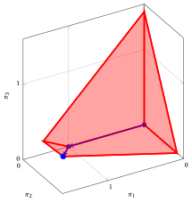

# Algoritmo del simplesso duale

**Parte 3 · Dualità e simplesso duale · Capitolo 10** · [:material-file-pdf-box: Dispensa, volume 3 (PDF)](../pdf/dispensa-3-dualita.pdf) · [:material-presentation: Slide](../pdf/slide-10-simplesso-duale.pdf) · [:material-pencil: Esercizi: Algoritmo del simplesso duale](../esercizi/es-10-simplesso-duale.md)

## 10.1 Coppia di problemi primale e duale

- Consideriamo la forma standard di massimo del problema duale, ottenuta aggiungendo $n$ variabili di surplus non negative a un problema LP duale con $m$ variabili non negative e $n$ vincoli lineari di maggiore o uguale:

    

    \begin{align*}
    &&   \max \;\;-{\boldsymbol b}' \, {\boldsymbol \pi}  \label{DUAL_OBJ} \tag{10.1a}\\[2ex]
    && \text{soggetto a} \quad  {\boldsymbol A}' \; {\boldsymbol \pi}  &= {\boldsymbol c},  & \phantom{j=1111}  \label{DUAL_CONS1} \tag{10.1b}\\[2ex]
    && {\boldsymbol \pi}                        &\ge  {\boldsymbol 0}. \label{DUAL_CONS2} \tag{10.1c}
    \end{align*}

    Le $n$ variabili di surplus non negative si aggiungono <em>prima</em> delle $m$ variabili duali, in modo da traslare di $n$ gli indici delle variabili duali e ottenere la seguente corrispondenza tra indici:

    - le $n$ variabili di surplus $\pi_1,\pi_2,\dots,\pi_n$ del problema duale si possono associare alle $n$ variabili primali $x_1,\dots,x_n$;

    - le $m$ variabili duali $\pi_{n+1},\pi_{n+2},\dots,\pi_{n+m}$ del problema duale si possono associare alle $m$ variabili di scarto $x_{n+1},\dots,x_{n+m}$ del problema primale.

    I dati del problema duale sono:

    $$
    {\boldsymbol  b}=
    \begin{pmatrix}
    b_{1} \\
    b_{2} \\
    \vdots  \\
    b_{n} \\
    b_{n+1} \\
    b_{n+2} \\
    \vdots  \\
    b_{n+m} \\
    \end{pmatrix} ~~~~~~
    {\boldsymbol  A}'=
    \begin{pmatrix}
    a'_{11} & a'_{12} & \cdots & a'_{1n} & a'_{1(n+1)} & a'_{1(n+2)} & \cdots & a'_{1(n+m)}\\
    a'_{21} & a'_{22} & \cdots & a'_{2n} & a'_{2(n+1)} & a'_{2(n+2)} & \cdots & a'_{2(n+m)}\\
    \vdots & \vdots & \ddots & \vdots & \vdots & \vdots & \ddots & \vdots \\
    a'_{n1} & a'_{n2} & \cdots & a'_{nn} & a'_{n(n+1)} & a'_{n(n+2)} & \cdots & a'_{n(n+m)}\\
    \end{pmatrix}
    $$

    $$
    {\boldsymbol c}=
    \begin{pmatrix}
    c_{1} \\
    c_{2} \\
    \vdots  \\
    c_{n} \\
    \end{pmatrix}
    $$

    Le $n+m$ variabili duali non negative si possono scrivere come un vettore colonna ${\boldsymbol \pi}$  di $n+m$ righe.

    $$
    {\boldsymbol \pi} = \begin{pmatrix}
    \pi_1 \\
    \pi_2 \\
    \vdots  \\
    \pi_n \\
    \pi_{n+1} \\
    \pi_{n+2} \\
    \vdots  \\
    \pi_{n+m} \\
    \end{pmatrix}
    $$

    Poiché il problema duale [(10.1)](#eq-DUAL_STD) si ottiene aggiungendo $n$ variabili di surplus a un problema LP duale con $n$ vincoli di maggiore o uguale,  abbiamo:

    $$
    \begin{pmatrix}
    a'_{11} & a'_{12} & \cdots   &a'_{1n}\\
    a'_{21} & a'_{22} & \cdots   &a'_{2n}\\
    \vdots & \vdots & \ddots & \vdots \\
    a'_{n1} & a'_{n2} & \cdots   &a'_{nn}\\
    \end{pmatrix}
    =\begin{pmatrix}
    -1 & 0 & \cdots & 0\\
    0 & -1 & \cdots & 0\\
    \vdots  & \vdots  & \ddots & \vdots \\
    0 &  0&  \cdots & -1
    \end{pmatrix}
    $$

    che è l'opposta della matrice identità $-{\boldsymbol  I}$ di ordine $n$. Inoltre, per lo stesso motivo, abbiamo:

    $$
    \begin{pmatrix}
    b_{1} \\
    b_{2} \\
    \vdots  \\
    b_{n} \\
    \end{pmatrix}
    =
    \begin{pmatrix}
    0 \\
    0 \\
    \vdots  \\
    0 \\
    \end{pmatrix}
    $$

!!! esempio "Esempio 10.1: coppia di problemi primale e duale"

    Consideriamo il seguente problema LP in forma canonica di massimo con $n=2$ variabili e $m=3$ vincoli:

    $$
    \begin{array}{rrrrrrrrrrrrr}
    {\max} & {-} \, {x_1} & {-} & {3} \, {x_2} \\[1.5ex]
    \text{soggetto a} & {-} \, {x_1} & {-} & {2}\, {x_2} & {\le} & {-6} \\[1.5ex]
    & \, {x_1} & {-} & {4} \, {x_2} & {\le} & {-6} \\[1.5ex]
    & {2} \, {x_1} & {-} & {2} \, {x_2} & {\le} & {3} \\[1.5ex]
    & {x_1,} &  & {x_2} & { \ge} & { 0 }
    \end{array}
    $$

    

    { .fig .ovale loading=lazy style="width:92%" }

    

    

    Una soluzione ottima ${\tilde{\boldsymbol x}}(\,LP\,)$  è:

    $$
    \tilde{x}_1=2,~~\tilde{x}_2=2
    $$

    e il valore ottimo è:

    $$
    z(~LP~)  = -8
    $$

    

    Chiamiamo questo problema LP [Esempio 10.1](#box-1-ex-dsimplex-1).

!!! esempio "Esempio 10.2: coppia di problemi primale e duale"

    Aggiungendo $m=3$ variabili di scarto, la forma standard del problema LP dell'[Esempio 10.1](#box-1-ex-dsimplex-1) con $n+m=5$ variabili e $m=3$ vincoli è la seguente:

    $$
    \begin{array}{rrrrrrrrrrrrr}
    {\max} & {-} \, {x_1} & {-} & {3} \, {x_2} \\[1.5ex]
    \text{soggetto a} & {-} \, {x_1} & {-} & {2} \, {x_2} & {+} & {x_3} &  &  &  &  & {=} & {-6} \\[1.5ex]
    & \, {x_1} & {-} & {4} \, {x_2} &  &  & {+} & {x_4} &  &  & {=} & {-6} \\[1.5ex]
    & {2} \, {x_1} & {-} & {2} \, {x_2} &  &  &  &  & {+} & {x_5} & {=} & {3} \\[1.5ex]
    & {x_1}, &  & {x_2}, &  & {x_3}, &  & {x_4}, &  & {x_5} & { \ge} & { 0 }
    \end{array}
    $$

    Il problema duale del problema LP dell'[Esempio 10.1](#box-1-ex-dsimplex-1) è il seguente problema LP in forma canonica di minimo con $m=3$ variabili e $n=2$ vincoli:

    $$
    \begin{array}{rrrrrrrrrrrrr}
    {\min} & {-6}\, {\pi_1} & {-} & {6} \, {\pi_2} & {+} & {3} \, {\pi_3} \\[2ex]
    \text{soggetto a} & {-} \, {\pi_1} & {+} & \, {\pi_2} & {+} & {2}\, {\pi_3} & {\ge} & {-1} \\[1.5ex]
    & {-2} {\pi_1} & {-} & {4} \, {\pi_2} & {-} & {2} \, {\pi_3} & {\ge} & {-3} \\[1.5ex]
    & {\pi_1}, &  & {\pi_2}, &  & {\pi_3} & { \ge} & { 0 }
    \end{array}
    $$

    Traslando di $n=2$ gli indici delle variabili duali e aggiungendo $n=2$ variabili di surplus, otteniamo quindi la seguente forma standard di massimo:

    $$
    \begin{array}{rrrrrrrrrrrrr}
    {\max} &  &  &  &  &  & {6}\, {\pi_3} & {+} & {6} \, {\pi_4} & {-} & {3} \, {\pi_5} \\[2ex]
    \text{soggetto a} & {-} & \, {\pi_1} &  &  & {-} & \, {\pi_3} & {+} & \, {\pi_4} & {+} & {2} \, {\pi_5} & {=} & {-1} \\[1.5ex]
    &  &  & {-} & \, {\pi_2} & {-} & {2} \, {\pi_3} & {-} & {4} \, {\pi_4} & {-} & {2} \, {\pi_5} & {=} & {-3} \\[1.5ex]
    &  & {\pi_1}, &  & {\pi_2}, &  & {\pi_3}, &  & {\pi_4}, &  & {\pi_5} & { \ge} & { 0 }
    \end{array}
    $$

    In questo problema duale in forma standard, abbiamo:

    $$
    {\boldsymbol  b}=
    \begin{pmatrix}
    0 \\[0.5ex]
    0 \\[0.5ex]
    -6  \\[0.5ex]
    -6  \\[0.5ex]
    3
    \end{pmatrix}
    \quad
    {\boldsymbol  A}'=
    \begin{pmatrix}
    -1 & 0 & -1 & 1 & 2 \\[1ex]
    0 & -1 & -2 & -4 & -2
    \end{pmatrix}
    \quad
    {\boldsymbol c}=
    \begin{pmatrix}
    -1 \\[1ex]
    -3
    \end{pmatrix}
    {\rm ~~~~~e~~~~~}  {\boldsymbol  \pi}=
    \begin{pmatrix}
    \pi_{1} \\[0.5ex]
    \pi_{2} \\[0.5ex]
    \pi_{3}  \\[0.5ex]
    \pi_{4}  \\[0.5ex]
    \pi_{5}
    \end{pmatrix}
    $$

    Una soluzione ottima ${\tilde{\boldsymbol \pi}}(\,D(LP)\,)$ di questo problema LP è: $\tilde{\pi}_1=0,~~\tilde{\pi}_2=0,~~\tilde{\pi}_3=\frac{7}{6},~~\tilde{\pi}_4=\frac{1}{6},~~\tilde{\pi}_5=0$.

## 10.2 Basi primali e duali ammissibili

- L'algoritmo del simplesso parte da una base associata a una <strong>soluzione di base ammissibile</strong>, cioè da una base con $\bar{\boldsymbol b} \ge {\boldsymbol 0}$, ed esegue operazioni di pivot finché tutti i costi ridotti diventano non positivi. Durante tutta l'esecuzione, la soluzione di base è sempre ammissibile per il problema primale e il valore obiettivo non diminuisce mai.

- L'<strong>algoritmo del simplesso duale</strong> fa il contrario: parte da una base i cui costi ridotti sono tutti non positivi, ed esegue operazioni di pivot finché la soluzione di base diventa ammissibile.

!!! definizione "Definizione 10.1: basi primali ammissibili e duali ammissibili"

    Data una base ${\boldsymbol A}_{\pazocal{B}}$ del problema LP in forma standard di massimo e il dizionario associato, la base si chiama:

    1. <strong>primale ammissibile</strong> se $~\bar{\boldsymbol b} \ge {\boldsymbol 0}$;

    2. <strong>duale ammissibile</strong> se $~\bar{\boldsymbol c} \le {\boldsymbol 0}$.

!!! chiave ""

    Se una base è <u>sia</u> primale ammissibile sia duale ammissibile, cioè

    $$
    \bar{\boldsymbol b} \ge {\boldsymbol 0}
    \qquad {\rm e} \qquad
    \bar{\boldsymbol c} \le {\boldsymbol 0} ,
    $$

    allora la soluzione di base ammissibile associata è una <strong>soluzione ottima</strong>. Viceversa, se il problema LP ha una soluzione ottima, allora <u>esiste</u> una base che è sia primale ammissibile sia duale ammissibile. Una soluzione di base ottima degenere può essere associata anche a una base che non è duale ammissibile, cioè con qualche $\bar c_j > 0$.

### 10.2.1 La soluzione duale associata a una base

- Il nome “duale ammissibile” si giustifica come segue. Data una base ${\boldsymbol A}_{\pazocal{B}}$ del problema LP in forma standard di massimo, le associamo il vettore riga di $m$ componenti

    \begin{equation*}
    \label{DUAL_SOL}
    {\boldsymbol \pi} = {\boldsymbol c}'_{\pazocal{B}} \; {\boldsymbol A}_{\pazocal{B}}^{-1} , \tag{10.2}
    \end{equation*}

    che è esattamente il vettore che compare nella definizione dei costi ridotti e del valore obiettivo del dizionario:

    $$
    \bar{c}_j = c_j - \underbrace{{\boldsymbol c}'_{\pazocal{B}} \; {\boldsymbol A}_{\pazocal{B}}^{-1}}_{= \, {\boldsymbol \pi}} \; {\boldsymbol A}_j , \qquad \forall j \in \pazocal{N},
    \qquad {\rm e} \qquad
    \bar{z} = \underbrace{{\boldsymbol c}'_{\pazocal{B}} \; {\boldsymbol A}_{\pazocal{B}}^{-1}}_{= \, {\boldsymbol \pi}} \; {\boldsymbol b} = {\boldsymbol \pi} \; {\boldsymbol b} .
    $$

- Le $m$ componenti di ${\boldsymbol \pi}$ sono i valori delle $m$ variabili duali originali, cioè delle variabili $\pi_{n+1},\pi_{n+2},\dots,\pi_{n+m}$ del problema duale [(10.1)](#eq-DUAL_STD). Mostriamo ora che ${\boldsymbol \pi}$ è una soluzione <u>ammissibile</u> del problema duale se e solo se la base è duale ammissibile.

- <strong>I costi ridotti delle variabili in base sono nulli.</strong> Infatti, per definizione di ${\boldsymbol \pi}$ abbiamo

    $$
    {\boldsymbol \pi} \; {\boldsymbol A}_{\pazocal{B}}
    = {\boldsymbol c}'_{\pazocal{B}} \; \underbrace{{\boldsymbol A}_{\pazocal{B}}^{-1} \; {\boldsymbol A}_{\pazocal{B}}}_{= \, {\boldsymbol I}}
    = {\boldsymbol c}'_{\pazocal{B}} ,
    $$

    cioè ${\boldsymbol \pi} \, {\boldsymbol A}_i = c_i$ per ogni $i \in \pazocal{B}$, e quindi $\bar{c}_i = 0$ per ogni $i \in \pazocal{B}$.

- <strong>I costi ridotti delle variabili fuori base sono gli scarti duali.</strong> Per ogni $j \in \pazocal{N}$ abbiamo

    $$
    \bar{c}_j \le 0
    \qquad \Longleftrightarrow \qquad
    c_j - {\boldsymbol \pi} \; {\boldsymbol A}_j \le 0
    \qquad \Longleftrightarrow \qquad
    {\boldsymbol \pi} \; {\boldsymbol A}_j \ge c_j .
    $$

    Mettendo insieme i due punti precedenti, la condizione $\bar{\boldsymbol c} \le {\boldsymbol 0}$ equivale a

    $$
    {\boldsymbol \pi} \; {\boldsymbol A}_j \ge c_j , \qquad \forall j \in \{1,2,\dots,n+m\} ,
    $$

    che è proprio l'insieme dei vincoli del problema duale scritti per tutte le colonne del problema LP in forma standard di massimo.

- <strong>La non negatività di ${\boldsymbol \pi}$ è contenuta in queste disuguaglianze.</strong> Le ultime $m$ colonne del problema LP in forma standard di massimo sono le colonne delle variabili di scarto, cioè ${\boldsymbol A}_{n+i} = {\boldsymbol e}_i$ con $c_{n+i} = 0$ per ogni $i \in \{1,2,\dots,m\}$. Di conseguenza, la disuguaglianza scritta per la colonna $n+i$ diventa

    $$
    {\boldsymbol \pi} \; {\boldsymbol e}_i \ge 0
    \qquad \Longleftrightarrow \qquad
    \pi_i \ge 0 .
    $$

!!! chiave ""

    Una base ${\boldsymbol A}_{\pazocal{B}}$ è <strong>duale ammissibile</strong> se e solo se il vettore associato

    $$
    {\boldsymbol \pi} = {\boldsymbol c}'_{\pazocal{B}} \; {\boldsymbol A}_{\pazocal{B}}^{-1}
    $$

    è una <strong>soluzione ammissibile del problema duale</strong>. In questo caso, per il teorema di dualità debole, il valore

    $$
    \bar{z} = {\boldsymbol \pi} \; {\boldsymbol b}
    $$

    è un <strong>upper bound</strong> sul valore ottimo del problema LP.

- Questa è l'esatta immagine speculare di ciò che accade nell'algoritmo del simplesso: lì, ogni base visitata è primale ammissibile e quindi $\bar{z}$ è il valore di una soluzione ammissibile del problema LP, cioè un <u>lower</u> bound sul valore ottimo, e l'algoritmo lo aumenta finché non diventa anche un upper bound. Qui, ogni base visitata è duale ammissibile e quindi $\bar{z}$ è un <u>upper</u> bound sul valore ottimo, e l'algoritmo lo diminuisce finché non diventa anche un lower bound.

- Di conseguenza, i due algoritmi si possono descrivere come segue:

    
<table>
    <tr>
    <th></th>
    <th><strong>algoritmo del simplesso</strong></th>
    <th><strong>algoritmo del simplesso duale</strong></th>
    </tr>
    <tr>
    <td>parte da una base che è</td>
    <td>primale ammissibile</td>
    <td>duale ammissibile</td>
    </tr>
    <tr>
    <td>mantiene a ogni iterazione</td>
    <td>l'ammissibilità primale</td>
    <td>l'ammissibilità duale</td>
    </tr>
    <tr>
    <td>termina quando la base è anche</td>
    <td>duale ammissibile</td>
    <td>primale ammissibile</td>
    </tr>
    <tr>
    <td>oppure quando rileva che il problema è</td>
    <td>illimitato</td>
    <td>inammissibile</td>
    </tr>
    <tr>
    <td>il valore \(\bar z\) è</td>
    <td>un lower bound</td>
    <td>un upper bound</td>
    </tr>
    <tr>
    <td>e lungo l'esecuzione è</td>
    <td>non decrescente</td>
    <td>non crescente</td>
    </tr>
    </table>

!!! esempio "Esempio 10.3: le soluzioni duali associate a tre basi"

    Per il problema LP dell'[Esempio 10.1](#box-1-ex-dsimplex-1) in forma standard di massimo, consideriamo la partizione $\pazocal{B}= \{3,~~4,~~5\}$ e $\pazocal{N}= \{1,~~2\}$ delle variabili di scarto. Abbiamo:

    $$
    {\boldsymbol A}_{\pazocal{B}} =
    \begin{pmatrix}
    1 & 0 & 0 \\
    0 & 1 & 0 \\
    0 & 0 & 1
    \end{pmatrix}
    = {\boldsymbol A}_{\pazocal{B}}^{-1}
    \qquad {\rm e} \qquad
    {\boldsymbol c}'_{\pazocal{B}} =
    \begin{pmatrix}
    0 & 0 & 0
    \end{pmatrix}
    \qquad \Longrightarrow \qquad
    {\boldsymbol \pi} =
    \begin{pmatrix}
    0 & 0 & 0
    \end{pmatrix}
    $$

    che è una soluzione ammissibile del problema duale, e $\bar{z} = {\boldsymbol \pi} \, {\boldsymbol b} = 0$ è un upper bound sul valore ottimo. Coerentemente, i costi ridotti $\bar{\boldsymbol c}' = {\boldsymbol c}'_{\pazocal{N}} = \begin{pmatrix} -1 & -3 \end{pmatrix}$ sono tutti non positivi.

    Dopo la prima operazione di pivot duale otteniamo $\pazocal{B}= \{1,~~4,~~5\}$ e $\pazocal{N}= \{2,~~3\}$, con

    $$
    {\boldsymbol A}_{\pazocal{B}} =
    \begin{pmatrix}
    -1 & 0 & 0 \\
    1 & 1 & 0 \\
    2 & 0 & 1
    \end{pmatrix} ,
    \qquad
    {\boldsymbol A}_{\pazocal{B}}^{-1} =
    \begin{pmatrix}
    -1 & 0 & 0 \\
    1 & 1 & 0 \\
    2 & 0 & 1
    \end{pmatrix}
    \qquad {\rm e} \qquad
    {\boldsymbol c}'_{\pazocal{B}} =
    \begin{pmatrix}
    -1 & 0 & 0
    \end{pmatrix} ,
    $$

    e quindi

    $$
    {\boldsymbol \pi} = {\boldsymbol c}'_{\pazocal{B}} \; {\boldsymbol A}_{\pazocal{B}}^{-1} =
    \begin{pmatrix}
    1 & 0 & 0
    \end{pmatrix}
    \qquad {\rm e} \qquad
    \bar{z} = {\boldsymbol \pi} \; {\boldsymbol b} =
    \begin{pmatrix}
    1 & 0 & 0
    \end{pmatrix}
    \begin{pmatrix}
    -6 \\ -6 \\ 3
    \end{pmatrix}
    = -6 .
    $$

    Dopo la seconda operazione di pivot duale otteniamo $\pazocal{B}= \{1,~~2,~~5\}$ e $\pazocal{N}= \{3,~~4\}$, con

    $$
    {\boldsymbol \pi} =
    \begin{pmatrix}
    \frac{7}{6} & \frac{1}{6} & 0
    \end{pmatrix}
    \qquad {\rm e} \qquad
    \bar{z} = {\boldsymbol \pi} \; {\boldsymbol b} = -8 .
    $$

    I tre upper bound $0 \longrightarrow -6 \longrightarrow -8$ sono non crescenti, e l'ultimo è raggiunto da una soluzione primale ammissibile: è quindi il valore ottimo.

## 10.3 Determinare una soluzione di base duale ammissibile iniziale

- L'algoritmo del simplesso duale richiede in input una <strong>base duale ammissibile</strong>, cioè una base il cui dizionario soddisfa $\bar{\boldsymbol c} \le {\boldsymbol 0}$. È l'immagine speculare del requisito dell'algoritmo del simplesso, che richiede in input una base primale ammissibile e, quando non ne è immediatamente disponibile alcuna, ricorre alla Fase $0$.

- In questa sezione descriviamo prima le situazioni in cui una base duale ammissibile è disponibile <strong>gratuitamente</strong>, cioè senza alcun calcolo, e poi cosa si può fare nel caso generale.

### 10.3.1 Quando una base duale ammissibile è disponibile gratuitamente

- <strong>Primo caso: un vettore dei costi non positivo.</strong> Per un problema LP in forma canonica di massimo con ${\boldsymbol c} \le {\boldsymbol 0}$, la partizione delle variabili di scarto è duale ammissibile. Infatti, con

    $$
    \pazocal{B}=\{n+1,n+2,\dots,n+m\} {\rm ~~~e~~~} \pazocal{N}=\{1,2,\dots,n\}
    $$

    abbiamo ${\boldsymbol A}_{\pazocal{B}} = {\boldsymbol I}$ e ${\boldsymbol c}_{\pazocal{B}} = {\boldsymbol 0}$, e quindi

    $$
    {\boldsymbol \pi} = {\boldsymbol c}'_{\pazocal{B}} \; {\boldsymbol A}_{\pazocal{B}}^{-1} = {\boldsymbol 0}
    \qquad {\rm e} \qquad
    \bar{\boldsymbol c}' = {\boldsymbol c}'_{\pazocal{N}} - \underbrace{{\boldsymbol c}'_{\pazocal{B}} \; {\boldsymbol A}_{\pazocal{B}}^{-1}}_{= \, {\boldsymbol 0}} \; {\boldsymbol A}_{\pazocal{N}} = {\boldsymbol c}' \le {\boldsymbol 0} .
    $$

!!! chiave ""

    Per un problema LP in forma canonica di massimo, se

    $$
    {\boldsymbol c} \le {\boldsymbol 0}
    \qquad {\rm e} \qquad
    b_i < 0 \text{ per qualche } i \in \{1,2,\dots,m\} ,
    $$

    allora la partizione $\pazocal{B}=\{n+1,\dots,n+m\}$ e $\pazocal{N}=\{1,\dots,n\}$ delle variabili di scarto è <strong>duale ammissibile ma non primale ammissibile</strong>: l'algoritmo del simplesso duale si può applicare direttamente, mentre l'algoritmo del simplesso richiederebbe la Fase $0$.

- <strong>Secondo caso: riottimizzazione dopo una modifica del vettore dei termini noti.</strong> Supponiamo che sia nota una base ottima ${\boldsymbol A}_{\pazocal{B}}$ di un problema LP e che il vettore dei termini noti ${\boldsymbol b}$ sia sostituito da un nuovo vettore $\hat{\boldsymbol b}$. I costi ridotti

    $$
    \bar{c}_j = c_j - {\boldsymbol c}'_{\pazocal{B}} \; {\boldsymbol A}_{\pazocal{B}}^{-1} \; {\boldsymbol A}_j ,
    \qquad \forall j \in \pazocal{N},
    $$

    <u>non dipendono</u> da ${\boldsymbol b}$, e quindi restano tutti non positivi: la base <strong>resta duale ammissibile</strong>. Al contrario, i valori delle variabili in base

    $$
    \bar{\boldsymbol b} = {\boldsymbol A}_{\pazocal{B}}^{-1} \; \hat{\boldsymbol b}
    $$

    cambiano e possono diventare negativi: la base può perdere l'ammissibilità primale. L'algoritmo del simplesso duale può allora partire dalla vecchia base ottima e tipicamente ripristina l'ottimalità in pochissime iterazioni.

- <strong>Terzo caso: aggiunta di un vincolo a una base ottima.</strong> Supponiamo che sia nota una base ottima ${\boldsymbol A}_{\pazocal{B}}$ di un problema LP, con soluzione ottima $\tilde{\boldsymbol x}$, e che un nuovo vincolo

    $$
    {\boldsymbol a}' \, {\boldsymbol x} \le \beta
    $$

    sia aggiunto al problema, insieme alla sua variabile di scarto $x_{n+m+1}$. Consideriamo la nuova partizione

    $$
    \hat{\pazocal{B}} = \pazocal{B} \cup \{n+m+1\}
    {\rm ~~~e~~~}
    \hat{\pazocal{N}} = \pazocal{N} .
    $$

    - **a.** La nuova matrice di base e la sua inversa sono

        $$
        {\boldsymbol A}_{\hat{\pazocal{B}}} =
        \begin{pmatrix}
        {\boldsymbol A}_{\pazocal{B}} & {\boldsymbol 0} \\[1ex]
        {\boldsymbol a}'_{\pazocal{B}} & 1
        \end{pmatrix}
        \qquad {\rm e} \qquad
        {\boldsymbol A}_{\hat{\pazocal{B}}}^{-1} =
        \begin{pmatrix}
        {\boldsymbol A}_{\pazocal{B}}^{-1} & {\boldsymbol 0} \\[1ex]
        - \, {\boldsymbol a}'_{\pazocal{B}} \; {\boldsymbol A}_{\pazocal{B}}^{-1} & 1
        \end{pmatrix} ,
        $$

        dove ${\boldsymbol a}'_{\pazocal{B}}$ raccoglie le componenti di ${\boldsymbol a}'$ associate alle variabili in base. In particolare, ${\boldsymbol A}_{\hat{\pazocal{B}}}$ è invertibile e quindi è una base.

    - **b.** Poiché la nuova variabile di scarto ha coefficiente nullo nella funzione obiettivo, abbiamo ${\boldsymbol c}'_{\hat{\pazocal{B}}} = \begin{pmatrix} {\boldsymbol c}'_{\pazocal{B}} & 0\end{pmatrix}$ e quindi

        $$
        \hat{\boldsymbol \pi} = {\boldsymbol c}'_{\hat{\pazocal{B}}} \; {\boldsymbol A}_{\hat{\pazocal{B}}}^{-1}
        = \begin{pmatrix} {\boldsymbol c}'_{\pazocal{B}} \; {\boldsymbol A}_{\pazocal{B}}^{-1} & 0 \end{pmatrix}
        = \begin{pmatrix} {\boldsymbol \pi} & 0 \end{pmatrix} ,
        $$

        cioè la variabile duale del nuovo vincolo vale zero e tutte le altre variabili duali restano invariate. Di conseguenza, per ogni $j \in \hat{\pazocal{N}}$,

        $$
        \hat{c}_j = c_j - \begin{pmatrix} {\boldsymbol \pi} & 0 \end{pmatrix}
        \begin{pmatrix} {\boldsymbol A}_j \\[1ex] a_j \end{pmatrix}
        = c_j - {\boldsymbol \pi} \; {\boldsymbol A}_j = \bar{c}_j \le 0 :
        $$

        i costi ridotti sono <u>invariati</u> e la nuova base è <strong>duale ammissibile</strong>.

    - **c.** Il valore della nuova variabile in base è

        $$
        \bar{b}_{n+m+1} = \beta - {\boldsymbol a}' \, \tilde{\boldsymbol x} ,
        $$

        che è negativo se e solo se la vecchia soluzione ottima $\tilde{\boldsymbol x}$ <u>viola</u> il nuovo vincolo. In questo caso l'algoritmo del simplesso duale parte da $\hat{\pazocal{B}}$.

- <strong>Quarto caso: branch-and-bound e piani di taglio.</strong> Il terzo caso è esattamente ciò che accade quando si risolve un problema di programmazione lineare intera: a ogni nodo dell'albero di branch-and-bound un vincolo come

    $$
    x_j \le \lfloor \tilde{x}_j \rfloor
    \qquad \text{oppure} \qquad
    x_j \ge \lceil \tilde{x}_j \rceil
    $$

    viene aggiunto al rilassamento LP risolto nel nodo padre, e lo stesso accade ogni volta che si aggiunge un piano di taglio. La base ottima del nodo padre è duale ammissibile per il nodo figlio, e l'algoritmo del simplesso duale la riottimizza con poche operazioni di pivot invece di risolvere il nuovo problema LP da zero. È uno dei motivi principali per cui l'algoritmo del simplesso duale è tra gli algoritmi più usati nei moderni solutori LP, e quello usato tipicamente per riottimizzare all'interno del branch-and-bound.

!!! esempio "Esempio 10.4: riottimizzazione dopo una modifica di ${\boldsymbol b}$"

    Consideriamo il problema LP dell'[Esempio 10.1](#box-1-ex-dsimplex-1) e la sua base ottima $\pazocal{B}= \{1,~~2,~~5\}$ e $\pazocal{N}= \{3,~~4\}$, con il dizionario ottimo:

    \begin{equation*}
    \begin{cases}
    \begin{array}{rrrrrrrrrrrrr}
    {x_1} & {=} & {2} & {+} & {\frac{2}{3}\,x_3} & {-} & {\frac{1}{3}\,x_4} \\[2ex]
    {x_2} & {=} & {2} & {+} & {\frac{1}{6}\,x_3} & {+} & {\frac{1}{6}\,x_4} \\[2ex]
    {x_5} & {=} & {3} & {-} & {x_3} & {+} & {x_4} \\[2ex]
    {z} & {=} & {-8} & {-} & {\frac{7}{6}\,x_3} & {-} & {\frac{1}{6}\,x_4}
    \end{array}
    \end{cases}
    \end{equation*}

    Supponiamo ora che il termine noto del primo vincolo passi da $-6$ a $-12$, cioè che

    $$
    {\boldsymbol b} =
    \begin{pmatrix}
    -6 \\ -6 \\ 3
    \end{pmatrix}
    \qquad \longrightarrow \qquad
    \hat{\boldsymbol b} =
    \begin{pmatrix}
    -12 \\ -6 \\ 3
    \end{pmatrix} .
    $$

    I costi ridotti non dipendono dal vettore dei termini noti, e quindi $\bar{\boldsymbol c}' = \begin{pmatrix} -\frac{7}{6} & -\frac{1}{6}\end{pmatrix}$ è invariato e la base resta <strong>duale ammissibile</strong>. I valori delle variabili in base, invece, diventano

    $$
    \bar{\boldsymbol b} = {\boldsymbol A}_{\pazocal{B}}^{-1} \; \hat{\boldsymbol b} =
    \begin{pmatrix}
    -\frac{2}{3} & \frac{1}{3} & 0 \\[1ex]
    -\frac{1}{6} & -\frac{1}{6} & 0 \\[1ex]
    1 & -1 & 1
    \end{pmatrix}
    \begin{pmatrix}
    -12 \\ -6 \\ 3
    \end{pmatrix}
    =
    \begin{pmatrix}
    6 \\ 3 \\ -3
    \end{pmatrix} ,
    $$

    e il dizionario diventa:

    \begin{equation*}
    \begin{cases}
    \begin{array}{rrrrrrrrrrrrr}
    {x_1} & {=} & {6} & {+} & {\frac{2}{3}\,x_3} & {-} & {\frac{1}{3}\,x_4} \\[2ex]
    {x_2} & {=} & {3} & {+} & {\frac{1}{6}\,x_3} & {+} & {\frac{1}{6}\,x_4} \\[2ex]
    {x_5} & {=} & {-3} & {-} & {x_3} & {+} & {x_4} \\[2ex]
    {z} & {=} & {-15} & {-} & {\frac{7}{6}\,x_3} & {-} & {\frac{1}{6}\,x_4}
    \end{array}
    \end{cases}
    \end{equation*}

    La base non è più primale ammissibile, poiché $\bar b_5 = -3 < 0$. Eseguiamo quindi un'operazione di pivot duale con riga pivot $x_5$. I valori della sua riga sono $\bar a_{53} = 1 \ge 0$ e $\bar a_{54} = -1 < 0$, e quindi $x_4$ è l'unico candidato ed è la colonna pivot, con

    $$
    s_m = \frac{\bar c_4}{\bar a_{54}} = \frac{-\frac{1}{6}}{-1} = \frac{1}{6} .
    $$

    Aggiornando il dizionario, con $\pazocal{B}= \{1,~~2,~~4\}$ e $\pazocal{N}= \{3,~~5\}$, otteniamo:

    \begin{equation*}
    \begin{cases}
    \begin{array}{rrrrrrrrrrrrr}
    {x_1} & {=} & {5} & {+} & {\frac{1}{3}\,x_3} & {-} & {\frac{1}{3}\,x_5} \\[2ex]
    {x_2} & {=} & {\frac{7}{2}} & {+} & {\frac{1}{3}\,x_3} & {+} & {\frac{1}{6}\,x_5} \\[2ex]
    {x_4} & {=} & {3} & {+} & {x_3} & {+} & {x_5} \\[2ex]
    {z} & {=} & {-\frac{31}{2}} & {-} & {\frac{4}{3}\,x_3} & {-} & {\frac{1}{6}\,x_5}
    \end{array}
    \end{cases}
    \end{equation*}

    Ora $\bar{\boldsymbol b} \ge {\boldsymbol 0}$ e $\bar{\boldsymbol c} \le {\boldsymbol 0}$: dopo <u>una sola</u> operazione di pivot duale la nuova soluzione ottima è

    $$
    \tilde{\boldsymbol x}(\, LP \,) =
    \begin{pmatrix}
    5 \\[0.5ex]
    \frac{7}{2}
    \end{pmatrix}
    \qquad {\rm e} \qquad
    z(\, LP \,) = -\frac{31}{2} .
    $$

!!! esempio "Esempio 10.5: aggiunta di un vincolo a una base ottima"

    Consideriamo di nuovo il problema LP dell'[Esempio 10.1](#box-1-ex-dsimplex-1) con la sua base ottima $\pazocal{B}= \{1,~~2,~~5\}$ e la sua soluzione ottima $\tilde x_1 = 2$ e $\tilde x_2 = 2$, e aggiungiamo il nuovo vincolo

    $$
    x_1 + x_2 \le 3 ,
    $$

    insieme alla sua variabile di scarto $x_6$. La nuova base è $\hat{\pazocal{B}}= \{1,~~2,~~5,~~6\}$ e $\hat{\pazocal{N}}= \{3,~~4\}$.

    I costi ridotti sono <u>invariati</u>, e quindi la nuova base è duale ammissibile. Il valore della nuova variabile in base è

    $$
    \bar b_6 = 3 - (\tilde x_1 + \tilde x_2) = 3 - 4 = -1 < 0 ,
    $$

    poiché la vecchia soluzione ottima viola il nuovo vincolo. L'equazione di $x_6$ nel nuovo dizionario si ottiene sostituendo le equazioni di $x_1$ e $x_2$:

    $$
    x_6 = 3 - x_1 - x_2
    = 3 - \left(2 + \frac{2}{3}\,x_3 - \frac{1}{3}\,x_4\right) - \left(2 + \frac{1}{6}\,x_3 + \frac{1}{6}\,x_4\right)
    = -1 - \frac{5}{6}\,x_3 + \frac{1}{6}\,x_4 ,
    $$

    e il nuovo dizionario è:

    \begin{equation*}
    \begin{cases}
    \begin{array}{rrrrrrrrrrrrr}
    {x_1} & {=} & {2} & {+} & {\frac{2}{3}\,x_3} & {-} & {\frac{1}{3}\,x_4} \\[2ex]
    {x_2} & {=} & {2} & {+} & {\frac{1}{6}\,x_3} & {+} & {\frac{1}{6}\,x_4} \\[2ex]
    {x_5} & {=} & {3} & {-} & {x_3} & {+} & {x_4} \\[2ex]
    {x_6} & {=} & {-1} & {-} & {\frac{5}{6}\,x_3} & {+} & {\frac{1}{6}\,x_4} \\[2ex]
    {z} & {=} & {-8} & {-} & {\frac{7}{6}\,x_3} & {-} & {\frac{1}{6}\,x_4}
    \end{array}
    \end{cases}
    \end{equation*}

    Eseguiamo un'operazione di pivot duale con riga pivot $x_6$. I valori della sua riga sono $\bar a_{63} = \frac{5}{6} \ge 0$ e $\bar a_{64} = -\frac{1}{6} < 0$, e quindi $x_4$ è la colonna pivot, con

    $$
    s_m = \frac{\bar c_4}{\bar a_{64}} = \frac{-\frac{1}{6}}{-\frac{1}{6}} = 1 .
    $$

    Aggiornando il dizionario, con $\pazocal{B}= \{1,~~2,~~4,~~5\}$ e $\pazocal{N}= \{3,~~6\}$, otteniamo:

    \begin{equation*}
    \begin{cases}
    \begin{array}{rrrrrrrrrrrrr}
    {x_1} & {=} & {0} & {-} & {x_3} & {-} & {2\,x_6} \\[2ex]
    {x_2} & {=} & {3} & {+} & {x_3} & {+} & {x_6} \\[2ex]
    {x_4} & {=} & {6} & {+} & {5\,x_3} & {+} & {6\,x_6} \\[2ex]
    {x_5} & {=} & {9} & {+} & {4\,x_3} & {+} & {6\,x_6} \\[2ex]
    {z} & {=} & {-9} & {-} & {2\,x_3} & {-} & {x_6}
    \end{array}
    \end{cases}
    \end{equation*}

    Di nuovo <u>una sola</u> operazione di pivot duale ripristina l'ottimalità, e la nuova soluzione ottima è

    $$
    \tilde{\boldsymbol x}(\, LP \,) =
    \begin{pmatrix}
    0 \\[0.5ex]
    3
    \end{pmatrix}
    \qquad {\rm e} \qquad
    z(\, LP \,) = -9 .
    $$

    Il nuovo valore ottimo $-9$ <u>non è maggiore</u> del vecchio $-8$, come deve essere, poiché aggiungere un vincolo a un problema di massimo può solo ridurre il valore ottimo.

### 10.3.2 Il caso generale

- Quando né ${\boldsymbol b} \ge {\boldsymbol 0}$ né ${\boldsymbol c} \le {\boldsymbol 0}$, la partizione delle variabili di scarto non è né primale ammissibile né duale ammissibile, e nessuna base è disponibile gratuitamente. Oltre alla Fase $0$, l'algoritmo del simplesso duale offre la seguente alternativa.

!!! chiave ""

    <strong>Determinare una base primale ammissibile con l'algoritmo del simplesso duale.</strong>

    - **a.** Sostituire il vettore dei costi ${\boldsymbol c}$ con un qualsiasi vettore $\hat{\boldsymbol c} \le {\boldsymbol 0}$, per esempio $\hat{\boldsymbol c} = {\boldsymbol 0}$ oppure $\hat{c}_j = \min\{c_j,0\}$. La regione ammissibile è <u>invariata</u>.

    - **b.** La partizione delle variabili di scarto è duale ammissibile per il problema modificato. Eseguire su di essa l'algoritmo del simplesso duale, con la regola dell'indice minimo (regola di Bland) della Sezione [10.4.3](#sez-sec-dsx-bland).

    - **c.** Se termina con il certificato di inammissibilità, il problema modificato è inammissibile e quindi anche il problema <u>originale</u> è inammissibile, poiché hanno la stessa regione ammissibile. <code>STOP</code>.

    - **d.** Altrimenti termina con una base $\pazocal{B}$ che è primale ammissibile per il problema modificato, e quindi <u>anche per il problema originale</u>.

    - **e.** Ripristinare il vettore originale ${\boldsymbol c}$, ricalcolare i costi ridotti $\bar{\boldsymbol c}$ e il valore $\bar z$ della base $\pazocal{B}$, ed eseguire l'algoritmo del simplesso a partire da essa.

- È una vera alternativa alla Fase $0$: svolge esattamente lo stesso ruolo, cioè fornisce una base primale ammissibile iniziale oppure una prova che non ne esiste alcuna, ma lo fa senza introdurre la variabile ausiliaria $x_0$ e senza risolvere un problema ausiliario.

- Con $\hat{\boldsymbol c} = {\boldsymbol 0}$ tutti i costi ridotti sono nulli a ogni iterazione, tutti i rapporti del test dei rapporti sono nulli e la colonna pivot è sempre scelta dal solo criterio di spareggio della regola di Bland, cioè come il candidato con indice minimo. Poiché la regola di Bland impedisce il ciclaggio, la procedura termina.

!!! esempio "Esempio 10.6: determinare una base primale ammissibile con l'algoritmo del simplesso duale"

    Consideriamo il seguente problema LP in forma canonica di massimo con $n=2$ variabili non negative e $m=3$ vincoli lineari di minore o uguale (detto [Esempio 10.6](#box-7-ex-dsx-phase)):

    $$
    \begin{array}{rrrrrrrrrrrrr}
    {\max} & {3} \, {x_1} & {+} & \, {x_2} \\[1ex]
    \text{soggetto a} & {-} \, {x_1} & {-} & \, {x_2} & {\le} & {-2} \\[1ex]
    & \, {x_1} & {+} & {2} \, {x_2} & {\le} & {8} \\[1ex]
    & {2} \, {x_1} & {+} & \, {x_2} & {\le} & {10} \\[1ex]
    & {x_1,} &  & {x_2} & { \ge} & {0}
    \end{array}
    $$

    Qui ${\boldsymbol c} \not\le {\boldsymbol 0}$ e ${\boldsymbol b} \not\ge {\boldsymbol 0}$: la partizione $\pazocal{B}= \{3,~~4,~~5\}$ e $\pazocal{N}= \{1,~~2\}$ delle variabili di scarto non è né primale ammissibile né duale ammissibile.

    <strong>Passo a.</strong> Sostituiamo il vettore dei costi con $\hat{\boldsymbol c} = {\boldsymbol 0}$. Il dizionario del problema modificato è:

    \begin{equation*}
    \begin{cases}
    \begin{array}{rrrrrrrrrrrrr}
    {x_3} & {=} & {-2} & {+} & {x_1} & {+} & {x_2} \\[2ex]
    {x_4} & {=} & {8} & {-} & {x_1} & {-} & {2\,x_2} \\[2ex]
    {x_5} & {=} & {10} & {-} & {2\,x_1} & {-} & {x_2} \\[2ex]
    {\hat z} & {=} & {0} & {+} & {0\,x_1} & {+} & {0\,x_2}
    \end{array}
    \end{cases}
    \end{equation*}

    Tutti i costi ridotti sono non positivi, e quindi la base è duale ammissibile.

    <strong>Passo b.</strong> La riga pivot è $x_3$, poiché $\bar b_3 = -2 < 0$. I valori della sua riga sono $\bar a_{31} = -1 < 0$ e $\bar a_{32} = -1 < 0$, e quindi entrambe le variabili fuori base sono candidate:

    $$
    s_m = \min \left\{~\underbrace{\frac{0}{-1}}_{= \, 0},~\underbrace{\frac{0}{-1}}_{= \, 0}~\right\} = 0 ,
    $$

    e i due rapporti sono uguali. Per la regola di Bland scegliamo l'indice minimo, cioè $x_1$ è la colonna pivot. Aggiornando il dizionario, con $\pazocal{B}= \{1,~~4,~~5\}$ e $\pazocal{N}= \{2,~~3\}$, otteniamo:

    \begin{equation*}
    \begin{cases}
    \begin{array}{rrrrrrrrrrrrr}
    {x_1} & {=} & {2} & {-} & {x_2} & {+} & {x_3} \\[2ex]
    {x_4} & {=} & {6} & {-} & {x_2} & {-} & {x_3} \\[2ex]
    {x_5} & {=} & {6} & {+} & {x_2} & {-} & {2\,x_3} \\[2ex]
    {\hat z} & {=} & {0} & {+} & {0\,x_2} & {+} & {0\,x_3}
    \end{array}
    \end{cases}
    \end{equation*}

    <strong>Passo d.</strong> Ora $\bar{\boldsymbol b} = \begin{pmatrix} 2 & 6 & 6 \end{pmatrix}' \ge {\boldsymbol 0}$: la base $\pazocal{B}= \{1,~~4,~~5\}$ è <strong>primale ammissibile</strong>, sia per il problema modificato sia per quello originale.

    <strong>Passo e.</strong> Ripristiniamo la funzione obiettivo originale e ricalcoliamo la riga della funzione obiettivo sostituendo l'equazione di $x_1$:

    $$
    z = 3\,x_1 + x_2 = 3 \, (2 - x_2 + x_3) + x_2 = 6 - 2\,x_2 + 3\,x_3 ,
    $$

    che fornisce il dizionario:

    \begin{equation*}
    \begin{cases}
    \begin{array}{rrrrrrrrrrrrr}
    {x_1} & {=} & {2} & {-} & {x_2} & {+} & {x_3} \\[2ex]
    {x_4} & {=} & {6} & {-} & {x_2} & {-} & {x_3} \\[2ex]
    {x_5} & {=} & {6} & {+} & {x_2} & {-} & {2\,x_3} \\[2ex]
    {z} & {=} & {6} & {-} & {2\,x_2} & {+} & {3\,x_3}
    \end{array}
    \end{cases}
    \end{equation*}

    Il costo ridotto è $\bar c_3 = 3 > 0$, e quindi eseguiamo un'operazione di pivot (primale) con colonna pivot $x_3$. Troviamo il massimo $t$ tale che $\bar{\boldsymbol b} - t \; \bar{\boldsymbol A}_3 \ge {\boldsymbol 0}$:

    $$
    \begin{cases}
    \underbrace{2 -t \cdot (-1)\ge 0}_{x_1 \ge 0} \\[1ex]
    \underbrace{6 -t \cdot 1\ge 0}_{x_4 \ge 0} \\[1ex]
    \underbrace{6 -t \cdot 2\ge 0}_{x_5 \ge 0} \\
    \end{cases}
    \qquad
    \begin{cases}
    t\ge -2  \\[1ex]
    t\le 6  \\[1ex]
    t\le 3
    \end{cases}
    \text{   quindi   } t_{m}=3
    $$

    e la riga pivot è $x_5$. Aggiornando il dizionario, con $\pazocal{B}= \{1,~~3,~~4\}$ e $\pazocal{N}= \{2,~~5\}$, otteniamo:

    \begin{equation*}
    \begin{cases}
    \begin{array}{rrrrrrrrrrrrr}
    {x_1} & {=} & {5} & {-} & {\frac{1}{2}\,x_2} & {-} & {\frac{1}{2}\,x_5} \\[2ex]
    {x_3} & {=} & {3} & {+} & {\frac{1}{2}\,x_2} & {-} & {\frac{1}{2}\,x_5} \\[2ex]
    {x_4} & {=} & {3} & {-} & {\frac{3}{2}\,x_2} & {+} & {\frac{1}{2}\,x_5} \\[2ex]
    {z} & {=} & {15} & {-} & {\frac{1}{2}\,x_2} & {-} & {\frac{3}{2}\,x_5}
    \end{array}
    \end{cases}
    \end{equation*}

    Tutti i costi ridotti sono non positivi: la base è ottima e

    $$
    \tilde{\boldsymbol x}(\, LP \,) =
    \begin{pmatrix}
    5 \\[0.5ex]
    0
    \end{pmatrix}
    \qquad {\rm e} \qquad
    z(\, LP \,) = 15 .
    $$

## 10.4 Operazioni di pivot duali

- Data una base duale ammissibile ${\boldsymbol A}_{\pazocal{B}}$ del problema LP in forma standard di massimo, se nel dizionario associato esiste $r \in \pazocal{B}$ tale che $\bar{b}_r < 0$ (un valore di base negativo), è necessario eseguire un'operazione di pivot duale.

- L'algoritmo del simplesso duale lavora sul dizionario <u>primale</u>, esattamente lo stesso oggetto usato dall'algoritmo del simplesso. Ciò che cambia è l'<strong>ordine</strong> delle due scelte.

!!! definizione "Definizione 10.2: operazione di pivot duale"

    Un'<strong>operazione di pivot duale</strong> consiste nel determinare una <strong>nuova base duale ammissibile</strong> con lo scopo di ripristinare la non negatività di una variabile in base, <strong>scambiando una variabile in base e una variabile fuori base</strong>.

    - La variabile in base che esce dalla base si chiama <strong>riga pivot</strong>, e si sceglie <u>per prima</u>;

    - La variabile fuori base che entra in base si chiama <strong>colonna pivot</strong>, e si sceglie <u>per seconda</u>.

- L'ordine delle due scelte è il contrario di quello dell'algoritmo del simplesso.

### 10.4.1 Determinare la riga pivot

!!! chiave ""

    <strong>La riga pivot è una variabile in base con valore negativo</strong>, cioè una variabile in base

    $$
    x_r \text{  con  } r \in \pazocal{B}
    \text{  tale che  } \bar{b}_r < 0 .
    $$

- La variabile $x_r$ esce dalla base e diventa fuori base, e quindi assume il valore $0$: è proprio questo che ne ripristina la non negatività. Se più variabili in base hanno valore negativo, una qualsiasi di esse preserva l'ammissibilità duale. In queste note scegliamo sempre quella con <strong>indice minimo</strong>:

    $$
    r = \min \left\{~ i \in \pazocal{B} : \bar b_i < 0 ~\right\} .
    $$

    I solutori LP scelgono spesso invece il valore $\bar b_r$ più negativo, o criteri più raffinati; la scelta dell'indice minimo fa parte della regola di Bland (Sezione [10.4.3](#sez-sec-dsx-bland)), che garantisce che l'algoritmo termini.

### 10.4.2 Determinare la colonna pivot

- La colonna pivot si sceglie in modo che <u>l'ammissibilità duale sia preservata</u>, cioè in modo che tutti i costi ridotti restino non positivi dopo l'operazione di pivot duale. Ricaviamo ora la regola.

- L'equazione della riga pivot nel dizionario e l'equazione della funzione obiettivo sono

    $$
    x_r = \bar{b}_r - \sum_{j \in \pazocal{N}} \bar{a}_{rj} \; x_j
    \qquad {\rm e} \qquad
    z = \bar{z} + \sum_{j \in \pazocal{N}} \bar{c}_{j} \; x_j .
    $$

    La prima si può riscrivere come l'identità

    $$
    0 = \bar{b}_r - \sum_{j \in \pazocal{N}} \bar{a}_{rj} \; x_j - x_r ,
    $$

    che vale per ogni punto che soddisfa i vincoli di uguaglianza. Di conseguenza, per ogni valore $s \in \R$, possiamo sommare $s$ volte questa identità all'equazione della funzione obiettivo senza modificarla:

    \begin{equation*}
    \label{DUAL_STEP}
    z = \underbrace{\bar{z} + s \; \bar{b}_r}_{\text{nuovo } \bar z}
    + \sum_{j \in \pazocal{N}} \underbrace{\big( \bar{c}_{j} - s \; \bar{a}_{rj} \big)}_{\text{nuovo } \bar c_j} \; x_j
    + \underbrace{( - \, s )}_{\text{nuovo } \bar c_r} \; x_r . \tag{10.3}
    \end{equation*}

- Questi $|\pazocal{N}|+1$ coefficienti sono i costi ridotti del nuovo dizionario, in cui $x_r$ è diventata fuori base. <strong>Il valore di $s$ si aumenta il più possibile mantenendo allo stesso tempo non positivi tutti i costi ridotti</strong>. In questo modo si determina una nuova base duale ammissibile. Imponendo la non positività di tutti i coefficienti di $\eqref{DUAL_STEP}$, otteniamo:

    $$
    \begin{cases}
    - \, s \le 0 \\[1ex]
    \bar{c}_{j} - s \; \bar{a}_{rj} \le 0, \qquad \forall j \in \pazocal{N}
    \end{cases}
    \qquad
    \begin{cases}
    s \ge 0 \\[1ex]
    s \le \dfrac{\bar c_j}{\bar a_{rj}}, \qquad \forall j \in \pazocal{N} \text{ con } \bar a_{rj} < 0
    \end{cases}
    $$

    dove le disuguaglianze con $\bar a_{rj} > 0$ sono soddisfatte per ogni $s \ge 0$, poiché $\bar{c}_{j} \le 0$, e quelle con $\bar a_{rj} = 0$ si riducono a $\bar{c}_{j} \le 0$, che vale per ipotesi. Il verso della disuguaglianza si inverte dividendo per $\bar a_{rj} < 0$. Di conseguenza, il valore di $s$ diventa il valore massimo, chiamato $s_m$, tale che:

    $$
    s_m = \min \left\{~\frac{\bar c_j}{\bar a_{rj}}: j\in\pazocal{N},~\bar a_{rj}<0 ~\right\} \; \ge \; 0 .
    $$

- Con questo valore di $s$, il nuovo costo ridotto della variabile $x_p$ che realizza il minimo diventa

    $$
    \bar{c}_{p} - s_m \; \bar{a}_{rp} = \bar{c}_{p} - \frac{\bar c_p}{\bar a_{rp}} \; \bar{a}_{rp} = 0 ,
    $$

    e una variabile con costo ridotto nullo può entrare in base: $x_p$ è la colonna pivot.

!!! chiave ""

    <strong>La colonna pivot è una variabile fuori base il cui costo ridotto si annulla ponendo il passo duale pari a $s_m$</strong>, cioè una variabile fuori base

    $$
    x_p \text{  con  } p \in \pazocal{N}
    \text{  tale che  }
    \frac{\bar{c}_p}{\bar{a}_{rp}}
    = s_m = \min \left\{~\frac{\bar c_j}{\bar a_{rj}}: j\in\pazocal{N},~\bar a_{rj}<0 ~\right\} ,
    $$

    dove $\bar{a}_{rp}$ è il valore della riga $\bar{\boldsymbol a}_{r}$ associato alla colonna pivot $x_p$.

- Dati $s_m$ e la riga $\bar{\boldsymbol a}_{r}$, <strong>i nuovi costi ridotti</strong> (che determinano il nuovo vettore $\bar{\boldsymbol c}$) e <strong>il nuovo valore obiettivo</strong> si ottengono come segue:

    \begin{equation*}
    \label{DUAL_UPDATED2}
    \bar c_j \; \leftarrow \; \bar{c}_{j} - s_m \; \bar{a}_{rj} ,
    \quad \forall j \in \pazocal{N} \setminus \{p\},
    \qquad
    \bar c_r \; \leftarrow \; - \, s_m ,
    \qquad
    \bar c_p \; \leftarrow \; 0 ,
    \qquad
    \bar z \; \leftarrow \; \bar{z} + s_m \; \bar{b}_r . \tag{10.4}
    \end{equation*}

- Poiché $s_m \ge 0$ e $\bar b_r < 0$, abbiamo

    $$
    \bar{z} + s_m \; \bar{b}_r \; \le \; \bar z :
    $$

    <strong>il valore obiettivo non aumenta mai</strong>, che è l'immagine speculare di ciò che accade nell'algoritmo del simplesso, dove il valore obiettivo non diminuisce mai. Per la sezione precedente, $\bar z$ è a ogni iterazione un upper bound sul valore ottimo, e l'algoritmo del simplesso duale lo diminuisce.

- Date una riga pivot $x_r$ con $r \in \pazocal{B}$ e una colonna pivot $x_p$ con $p \in \pazocal{N}$, <strong>la nuova partizione degli indici delle variabili</strong> si aggiorna come segue:

    \begin{equation*}
    \label{DUAL_UPDATED1}
    \pazocal{B} \leftarrow \big(\pazocal{B} \setminus \{ r \} \big) \cup \{ p \}
    {\rm ~~~e~~~}
    \pazocal{N} \leftarrow \big(\pazocal{N} \setminus \{ p \} \big) \cup \{ r \} \tag{10.5}
    \end{equation*}

    Per costruzione ${\boldsymbol A}_{\pazocal{B}}$ resta una base, poiché $\bar a_{rp} \ne 0$.

### 10.4.3 La regola dell'indice minimo (regola di Bland) { #sez-sec-dsx-bland }

- La riga pivot e la colonna pivot non sono sempre uniche: più variabili in base possono avere valore negativo, e più variabili fuori base possono realizzare il minimo $s_m$. Se $s_m = 0$ (un'operazione di pivot duale <strong>degenere</strong>) il valore $\bar z$ non cambia e, con una scelta arbitraria, l'algoritmo potrebbe ciclare. In queste note risolviamo sempre i pareggi come segue.

!!! chiave ""

    <strong>Regola di Bland per l'algoritmo del simplesso duale.</strong>

    - **a.** La riga pivot è la variabile in base con valore negativo di <strong>indice minimo</strong>:

        $$
        r = \min \left\{~ i \in \pazocal{B} : \bar b_i < 0 ~\right\} .
        $$

    - **b.** La colonna pivot è il candidato che realizza $s_m$ di <strong>indice minimo</strong>:

        $$
        p = \min \left\{~ j \in \pazocal{N} : \bar a_{rj} < 0, ~ \frac{\bar c_j}{\bar a_{rj}} = s_m ~\right\} .
        $$

    Per la corrispondenza $\pi_j \leftrightarrow x_j$, questa è esattamente la regola di Bland dell'algoritmo del simplesso applicata al problema duale, e quindi l'algoritmo del simplesso duale con questa regola termina sempre.

### 10.4.4 Certificato di inammissibilità

- Se $\bar a_{rj} \ge 0$ per ogni $j \in \pazocal{N}$, allora il test dei rapporti non ha candidati: il valore di $s$ si può aumentare illimitatamente mantenendo non positivi tutti i costi ridotti. In questo caso il problema LP è inammissibile.

!!! chiave ""

    <strong>Certificato di inammissibilità.</strong> Data una base duale ammissibile ${\boldsymbol A}_{\pazocal{B}}$, se esiste una variabile in base $x_r$ con $r \in \pazocal{B}$ tale che

    $$
    \bar{b}_r < 0
    \qquad {\rm e} \qquad
    \bar{a}_{rj} \ge 0, \quad \forall j \in \pazocal{N},
    $$

    allora il problema LP in forma standard di massimo è <strong>inammissibile</strong>.

- <strong>Prima dimostrazione (sul primale).</strong> L'equazione della riga pivot nel dizionario è

    $$
    x_r = \bar{b}_r - \sum_{j \in \pazocal{N}} \bar{a}_{rj} \; x_j ,
    $$

    e ogni soluzione ammissibile soddisfa $x_j \ge 0$ per ogni $j \in \pazocal{N}$. Poiché $\bar{a}_{rj} \ge 0$ per ogni $j \in \pazocal{N}$, ogni termine della somma è non negativo e otteniamo

    $$
    x_r \le \bar{b}_r < 0 ,
    $$

    che contraddice la non negatività di $x_r$. Di conseguenza, non esiste alcuna soluzione ammissibile.

- <strong>Seconda dimostrazione (sul duale).</strong> Per ogni valore $s \ge 0$, i coefficienti di $\eqref{DUAL_STEP}$ sono tutti non positivi, e quindi sono i costi ridotti di una soluzione duale ammissibile di valore

    $$
    \bar{z} + s \; \bar{b}_r .
    $$

    Poiché $\bar b_r < 0$, questo valore tende a $- \, \infty$ al crescere di $s$: il problema duale è <strong>illimitato</strong>. Per il teorema di dualità debole, il problema primale è quindi <strong>inammissibile</strong>. È l'esatta immagine speculare del certificato di illimitatezza dell'algoritmo del simplesso.

### 10.4.5 Aggiornamento del dizionario

!!! chiave ""

    Una volta determinate la riga pivot $x_r$ con $r \in \pazocal{B}$ e la colonna pivot $x_p$ con $p \in \pazocal{N}$, il nuovo dizionario si ottiene con <strong>esattamente le stesse operazioni sulle righe dell'algoritmo del simplesso</strong>.

- Siano $x_p$ la variabile entrante e $x_r$ la variabile uscente. Dall'equazione della riga pivot, abbiamo:

    $$
    x_r=\bar b_r-\bar a_{rp}x_p-\sum_{j\in\pazocal{N}\setminus\{p\}}\bar a_{rj}x_j .
    $$

    Risolvendo rispetto a $x_p$ si ottiene l'equazione della colonna pivot nel nuovo dizionario:

    \begin{equation*}
    x_p=\frac{\bar b_r}{\bar a_{rp}}
    -\sum_{j\in\pazocal{N}\setminus\{p\}}
    \frac{\bar a_{rj}}{\bar a_{rp}}x_j
    -\frac{1}{\bar a_{rp}}x_r .
    \label{eq:dual-pivot-equation} \tag{10.6}
    \end{equation*}

    Per ogni altra variabile in base $i\in\pazocal{B}\setminus\{r\}$, sostituendo con $\eqref{eq:dual-pivot-equation}$ si ottengono le sue equazioni nel nuovo dizionario, e sostituendo nell'equazione della funzione obiettivo si ottiene la nuova riga della funzione obiettivo, i cui coefficienti sono esattamente quelli di $\eqref{DUAL_UPDATED2}$.

- Il nuovo valore della colonna pivot è

    $$
    \bar b_p = \frac{\bar b_r}{\bar a_{rp}} \; \ge \; 0 ,
    $$

    poiché $\bar b_r < 0$ e $\bar a_{rp} < 0$: la variabile che entra in base assume un valore non negativo. I valori delle altre variabili in base, invece, possono essere negativi, e sono quindi necessarie ulteriori operazioni di pivot duali.

!!! esempio "Esempio 10.7: operazioni di pivot duali"

    Per il problema LP dell'[Esempio 10.1](#box-1-ex-dsimplex-1), con $\pazocal{B}= \{3,~~4,~~5\}$ e $\pazocal{N}= \{1,~~2\}$, abbiamo il dizionario:

    \begin{equation*}
    \begin{cases}
    \begin{array}{rrrrrrrrrrrrr}
    {x_3} & {=} & {-6} & {+} & {x_1} & {+} & {2\,x_2} \\[2ex]
    {x_4} & {=} & {-6} & {-} & {x_1} & {+} & {4\,x_2} \\[2ex]
    {x_5} & {=} & {3} & {-} & {2\,x_1} & {+} & {2\,x_2} \\[2ex]
    {z} & {=} & {0} & {-} & {x_1} & {-} & {3\,x_2}
    \end{array}
    \end{cases}
    \end{equation*}

    Tutti i costi ridotti sono non positivi, e quindi la base è duale ammissibile. Due variabili in base hanno valore negativo, $\bar b_3 = -6 < 0$ e $\bar b_4 = -6 < 0$, e per la regola dell'indice minimo scegliamo $x_3$ come <u>riga pivot</u>.

    Troviamo quindi il massimo $s$ tale che tutti i costi ridotti di $\eqref{DUAL_STEP}$ restino non positivi:

    $$
    \begin{cases}
    \underbrace{- \, s \le 0}_{\bar c_3 \le 0} \\[1ex]
    \underbrace{-1 -s \cdot (-1) \le 0}_{\bar c_1 \le 0} \\[1ex]
    \underbrace{-3 -s \cdot (-2) \le 0}_{\bar c_2 \le 0} \\
    \end{cases}
    \qquad
    \begin{cases}
    s\ge 0  \\[1ex]
    s\le 1  \\[1ex]
    s\le \frac{3}{2}
    \end{cases}
    \text{   quindi   } s_{m}=\min \left\{~\underbrace{\frac{-1}{-1}}_{= \, 1},~\underbrace{\frac{-3}{-2}}_{= \, \frac{3}{2}}~\right\} = 1
    $$

    Il passo duale diventa $s_{m}=1$, il costo ridotto di $x_1$ si annulla e $x_1$ è la <u>colonna pivot</u>. Gli altri costi ridotti e il valore obiettivo diventano $\bar c_j - s_m \, \bar a_{3j}$ e $\bar z + s_m \, \bar b_3$, quindi abbiamo:

    $$
    \bar c_2 = -3 - 1 \cdot (-2) = -1 ,
    \qquad
    \bar c_3 = - \, 1 ,
    \qquad
    \bar z = 0 + 1 \cdot (-6) = -6 ,
    $$

    e di conseguenza

    $$
    \begin{pmatrix}
    \bar c_2 \\[1ex]
    \bar c_3
    \end{pmatrix}
    =
    \begin{pmatrix}
    -1 \\[1ex]
    -1
    \end{pmatrix}
    \le
    \begin{pmatrix}
    0 \\[1ex]
    0
    \end{pmatrix} .
    $$

    La nuova partizione degli indici delle variabili è $\pazocal{B}=\{1,4,5\}$ e $\pazocal{N}=\{2,3\}$.

!!! esempio "Esempio 10.8: aggiornamento del dizionario"

    Per il problema LP dell'[Esempio 10.1](#box-1-ex-dsimplex-1), eseguendo l'operazione di pivot duale dell'[Esempio 10.7](#box-9-ex-dsx-pivot), con $x_3$ come riga pivot e $x_1$ come colonna pivot, abbiamo:

    $$
    x_3 = -6 + x_1 + 2\,x_2 \quad \text{quindi} \quad x_1 = 6 - 2\,x_2 + x_3
    $$

    Sostituendo nelle altre equazioni del dizionario, otteniamo:

    \begin{gather*}
    x_4 = -6 - x_1 + 4\,x_2 = -6 - \left(6 - 2\,x_2 + x_3\right) + 4\,x_2 = -12 + 6\,x_2 - x_3\\[1ex]
    x_5 = 3 - 2\,x_1 + 2\,x_2 = 3 - 2\left(6 - 2\,x_2 + x_3\right) + 2\,x_2 = -9 + 6\,x_2 - 2\,x_3\\[1ex]
    z = - \, x_1 - 3\,x_2 = - \left(6 - 2\,x_2 + x_3\right) - 3\,x_2 = -6 - x_2 - x_3
    \end{gather*}

    e quindi il nuovo dizionario, con $\pazocal{B}= \{1,~~4,~~5\}$ e $\pazocal{N}= \{2,~~3\}$, è:

    \begin{equation*}
    \begin{cases}
    \begin{array}{rrrrrrrrrrrrr}
    {x_1} & {=} & {6} & {-} & {2\,x_2} & {+} & {x_3} \\[2ex]
    {x_4} & {=} & {-12} & {+} & {6\,x_2} & {-} & {x_3} \\[2ex]
    {x_5} & {=} & {-9} & {+} & {6\,x_2} & {-} & {2\,x_3} \\[2ex]
    {z} & {=} & {-6} & {-} & {x_2} & {-} & {x_3}
    \end{array}
    \end{cases}
    \end{equation*}

    I costi ridotti e il valore obiettivo coincidono con quelli calcolati nell'[Esempio 10.7](#box-9-ex-dsx-pivot), come previsto, e il valore della variabile entrante è $\bar b_1 = \frac{\bar b_3}{\bar a_{31}} = \frac{-6}{-1} = 6 \ge 0$.

## 10.5 Pseudocodice dell'algoritmo del simplesso duale

!!! algoritmo "Algoritmo"

    - <strong>Input</strong>

        Un problema LP in forma standard di massimo e una base <strong>duale ammissibile</strong>, cioè una base il cui dizionario soddisfa $\bar{\boldsymbol c} \le {\boldsymbol 0}$.

    - <strong>Output</strong>

        Una soluzione ottima del problema LP, se esiste; altrimenti, un certificato che il problema LP è inammissibile.

    - **Passo 0:** <strong>Inizializzazione</strong>

        Considerare la base duale ammissibile data e il dizionario associato. Andare al <u>Passo $1$</u>.

    - **Passo 1:** <strong>Test di ammissibilità</strong>

        Rispetto al dizionario corrente, se

        $$
        \bar b_i \ge 0,
        \qquad \forall i\in\pazocal B ,
        $$

        allora la base è primale ammissibile e duale ammissibile, la soluzione di base ammissibile $x_i=\bar b_i$, $\forall i\in\pazocal B$, e $x_j=0$, $\forall j\in\pazocal N$, è una soluzione ottima e $\bar z$ è il valore ottimo. In questo caso <code>STOP</code>.

    - **Passo 2:** <strong>Operazioni di pivot duali</strong>

        La <strong>riga pivot</strong> è la variabile in base $x_r$ con valore negativo di indice minimo:

        $$
        r = \min \left\{~ i \in \pazocal{B} : \bar b_i < 0 ~\right\} .
        $$

        - **a.** Se

            $$
            \bar a_{rj}\ge 0,
            ~~~~ \forall j\in\pazocal{N},
            $$

            allora il problema LP è <strong>inammissibile</strong>. <code>STOP</code>.

        - **b.** Determinare la <strong>colonna pivot</strong>, cioè una variabile fuori base $x_p$ con $p \in \pazocal{N}$ tale che

            $$
            \frac{\bar{c}_p}{\bar{a}_{rp}} = s_m
            = \min \left\{~\frac{\bar c_j}{\bar a_{rj}}: j\in\pazocal{N},~\bar a_{rj}<0 ~\right\} ;
            $$

            in caso di pareggio, scegliere il candidato con indice $p$ minimo.

        - **c.** Aggiornare il dizionario con le stesse operazioni sulle righe dell'algoritmo del simplesso. In particolare, $\bar z \leftarrow \bar z + s_m \, \bar b_r$.

        - **d.** Aggiornare la base:

            $$
            \pazocal{B} \leftarrow \big(\pazocal{B} \setminus \{ r \} \big) \cup \{ p \}
            {\rm ~~~e~~~}
            \pazocal{N} \leftarrow \big(\pazocal{N} \setminus \{ p \} \big) \cup \{ r \} .
            $$

        Andare al <u>Passo $1$</u>.

!!! esempio "Esempio 10.9: esecuzione dell'algoritmo del simplesso duale"

    Consideriamo il problema LP dell'[Esempio 10.1](#box-1-ex-dsimplex-1) in forma standard di massimo. Il suo vettore dei costi soddisfa ${\boldsymbol c} \le {\boldsymbol 0}$, e quindi la partizione $\pazocal{B}= \{3,~~4,~~5\}$ e $\pazocal{N}= \{1,~~2\}$ delle variabili di scarto è <strong>duale ammissibile</strong>. Il dizionario associato è:

    \begin{equation*}
    \begin{cases}
    \begin{array}{rrrrrrrrrrrrr}
    {x_3} & {=} & {-6} & {+} & {x_1} & {+} & {2\,x_2} \\[2ex]
    {x_4} & {=} & {-6} & {-} & {x_1} & {+} & {4\,x_2} \\[2ex]
    {x_5} & {=} & {3} & {-} & {2\,x_1} & {+} & {2\,x_2} \\[2ex]
    {z} & {=} & {0} & {-} & {x_1} & {-} & {3\,x_2}
    \end{array}
    \end{cases}
    \end{equation*}

    Tutti i costi ridotti sono non positivi, ma la soluzione di base <u>non</u> è ammissibile, poiché $\bar b_3 = -6 < 0$ e $\bar b_4 = -6 < 0$.

    <strong>Prima operazione di pivot duale.</strong> La riga pivot è $x_3$, la variabile in base con valore negativo di indice minimo. I valori della sua riga sono $\bar a_{31} = -1 < 0$ e $\bar a_{32} = -2 < 0$, e quindi entrambe le variabili fuori base sono candidate:

    $$
    \min \left\{~\underbrace{\frac{-1}{-1}}_{= \, 1},~\underbrace{\frac{-3}{-2}}_{= \, \frac{3}{2}}~\right\} = s_m = 1
    $$

    e la colonna pivot è $x_1$. Il nuovo valore obiettivo è $\bar z + s_m \, \bar b_3 = 0 + 1 \cdot (-6) = -6$. Il nuovo dizionario, con $\pazocal{B}= \{1,~~4,~~5\}$ e $\pazocal{N}= \{2,~~3\}$, è:

    \begin{equation*}
    \begin{cases}
    \begin{array}{rrrrrrrrrrrrr}
    {x_1} & {=} & {6} & {-} & {2\,x_2} & {+} & {x_3} \\[2ex]
    {x_4} & {=} & {-12} & {+} & {6\,x_2} & {-} & {x_3} \\[2ex]
    {x_5} & {=} & {-9} & {+} & {6\,x_2} & {-} & {2\,x_3} \\[2ex]
    {z} & {=} & {-6} & {-} & {x_2} & {-} & {x_3}
    \end{array}
    \end{cases}
    \end{equation*}

    I costi ridotti sono ancora tutti non positivi, come previsto, ma la soluzione di base non è ancora ammissibile.

    <strong>Seconda operazione di pivot duale.</strong> La riga pivot è $x_4$, la variabile in base con valore negativo di indice minimo ($\bar b_4 = -12$, $\bar b_5 = -9$). L'unico valore negativo della sua riga è $\bar a_{42} = -6$, e quindi la colonna pivot è $x_2$, con passo duale $s_m = \frac{\bar c_2}{\bar a_{42}} = \frac{-1}{-6} = \frac{1}{6}$ e nuovo valore obiettivo $\bar z + s_m \, \bar b_4 = -6 + \frac{1}{6} \cdot (-12) = -8$. Il nuovo dizionario, con $\pazocal{B}= \{1,~~2,~~5\}$ e $\pazocal{N}= \{3,~~4\}$, è:

    \begin{equation*}
    \begin{cases}
    \begin{array}{rrrrrrrrrrrrr}
    {x_1} & {=} & {2} & {+} & {\frac{2}{3}\,x_3} & {-} & {\frac{1}{3}\,x_4} \\[2ex]
    {x_2} & {=} & {2} & {+} & {\frac{1}{6}\,x_3} & {+} & {\frac{1}{6}\,x_4} \\[2ex]
    {x_5} & {=} & {3} & {-} & {x_3} & {+} & {x_4} \\[2ex]
    {z} & {=} & {-8} & {-} & {\frac{7}{6}\,x_3} & {-} & {\frac{1}{6}\,x_4}
    \end{array}
    \end{cases}
    \end{equation*}

    Ora $\bar{\boldsymbol b} \ge {\boldsymbol 0}$ e $\bar{\boldsymbol c} \le {\boldsymbol 0}$: la base è primale ammissibile e duale ammissibile, e quindi è ottima. Una soluzione ottima del problema LP dell'[Esempio 10.1](#box-1-ex-dsimplex-1) è

    $$
    \tilde{\boldsymbol x}(\, LP \,) =
    \begin{pmatrix}
    2 \\[0.5ex]
    2
    \end{pmatrix}
    $$

    e il valore ottimo è $z(\, LP \,) = -8$, in accordo con l'esecuzione riportata nelle pagine precedenti.

    Le tre basi visitate dall'algoritmo corrispondono a tre soluzioni ammissibili del problema <strong>duale</strong>, date da ${\boldsymbol \pi} = {\boldsymbol c}'_{\pazocal{B}} \, {\boldsymbol A}_{\pazocal{B}}^{-1}$:

    $$
    \begin{pmatrix} 0 \\ 0 \\ 0 \end{pmatrix}
    ~ \longrightarrow ~
    \begin{pmatrix} 1 \\ 0 \\ 0 \end{pmatrix}
    ~ \longrightarrow ~
    \begin{pmatrix} \frac{7}{6} \\[0.5ex] \frac{1}{6} \\[0.5ex] 0 \end{pmatrix} ,
    $$

    i cui valori obiettivo duali ${\boldsymbol b}' {\boldsymbol \pi}$ sono

    $$
    0 ~ \longrightarrow ~ -6 ~ \longrightarrow ~ -8 ,
    $$

    non crescenti, come deve essere per un problema di minimo (qui decrescono addirittura strettamente, ma un'operazione di pivot duale degenere con $s_m = 0$ lascia il valore invariato). Sono <u>vertici del poliedro duale</u>, e l'algoritmo del simplesso duale si sposta da uno di essi a uno adiacente: è l'algoritmo del simplesso eseguito sul problema duale.

    Nella figura seguente gli assi sono le tre variabili duali <u>originali</u>, chiamate $\pi_1,\pi_2,\pi_3$ nel problema duale dell'[Esempio 10.1](#box-1-ex-dsimplex-1); ricordando che nella forma standard di massimo i loro indici sono traslati di $n=2$, esse corrispondono a $\pi_3,\pi_4,\pi_5$.

    { .fig .cornice loading=lazy style="width:62%" }

    In viola i primi due vertici duali visitati dall'algoritmo, in blu quello ottimo. Le corrispondenti soluzioni di base primali invece <u>non</u> sono ammissibili fino all'ultima iterazione.

!!! esempio "Esempio 10.10: certificato di inammissibilità"

    Consideriamo il seguente problema LP in forma canonica di massimo con $n=2$ variabili non negative e $m=3$ vincoli lineari di minore o uguale (detto [Esempio 10.10](#box-12-ex-dsx-inf)):

    $$
    \begin{array}{rrrrrrrrrrrrr}
    {\max} & {-2} \, {x_1} & {-} & \, {x_2} \\[1ex]
    \text{soggetto a} & {-} \, {x_1} & {-} & {2} \, {x_2} & {\le} & {-6} \\[1ex]
    & {-2} \, {x_1} & {-} & \, {x_2} & {\le} & {-6} \\[1ex]
    & \, {x_1} & {+} & \, {x_2} & {\le} & {2} \\[1ex]
    & {x_1,} &  & {x_2} & { \ge} & {0}
    \end{array}
    $$

    Poiché ${\boldsymbol c} \le {\boldsymbol 0}$, la partizione $\pazocal{B}= \{3,~~4,~~5\}$ e $\pazocal{N}= \{1,~~2\}$ è duale ammissibile. Il dizionario iniziale è:

    \begin{equation*}
    \begin{cases}
    \begin{array}{rrrrrrrrrrrrr}
    {x_3} & {=} & {-6} & {+} & {x_1} & {+} & {2\,x_2} \\[2ex]
    {x_4} & {=} & {-6} & {+} & {2\,x_1} & {+} & {x_2} \\[2ex]
    {x_5} & {=} & {2} & {-} & {x_1} & {-} & {x_2} \\[2ex]
    {z} & {=} & {0} & {-} & {2\,x_1} & {-} & {x_2}
    \end{array}
    \end{cases}
    \end{equation*}

    <strong>Prima operazione di pivot duale.</strong> Per la regola dell'indice minimo la riga pivot è $x_3$, il cui valore è $\bar b_3 = -6 < 0$. I valori della sua riga sono $\bar a_{31} = -1 < 0$ e $\bar a_{32} = -2 < 0$, e quindi entrambe le variabili fuori base sono candidate:

    $$
    \min \left\{~\underbrace{\frac{-2}{-1}}_{= \, 2},~\underbrace{\frac{-1}{-2}}_{= \, \frac{1}{2}}~\right\} = \frac{1}{2}
    $$

    e la colonna pivot è $x_2$. Il nuovo dizionario, con $\pazocal{B}= \{2,~~4,~~5\}$ e $\pazocal{N}= \{1,~~3\}$, è:

    \begin{equation*}
    \begin{cases}
    \begin{array}{rrrrrrrrrrrrr}
    {x_2} & {=} & {3} & {-} & {\frac{1}{2}\,x_1} & {+} & {\frac{1}{2}\,x_3} \\[2ex]
    {x_4} & {=} & {-3} & {+} & {\frac{3}{2}\,x_1} & {+} & {\frac{1}{2}\,x_3} \\[2ex]
    {x_5} & {=} & {-1} & {-} & {\frac{1}{2}\,x_1} & {-} & {\frac{1}{2}\,x_3} \\[2ex]
    {z} & {=} & {-3} & {-} & {\frac{3}{2}\,x_1} & {-} & {\frac{1}{2}\,x_3}
    \end{array}
    \end{cases}
    \end{equation*}

    <strong>Seconda operazione di pivot duale.</strong> Due variabili in base hanno valore negativo, $x_4$ e $x_5$: per la regola dell'indice minimo la riga pivot è $x_4$. I valori della sua riga sono $\bar a_{41} = -\frac{3}{2} < 0$ e $\bar a_{43} = -\frac{1}{2} < 0$, e quindi entrambe le variabili fuori base sono candidate:

    $$
    \min \left\{~\underbrace{\frac{-\frac{3}{2}}{-\frac{3}{2}}}_{= \, 1},~\underbrace{\frac{-\frac{1}{2}}{-\frac{1}{2}}}_{= \, 1}~\right\} = 1 .
    $$

    I due rapporti sono uguali e, per la regola dell'indice minimo, la colonna pivot è $x_1$. Abbiamo:

    $$
    x_4 = -3 + \frac{3}{2}\,x_1 + \frac{1}{2}\,x_3 \quad \text{quindi} \quad x_1 = 2 - \frac{1}{3}\,x_3 + \frac{2}{3}\,x_4 ,
    $$

    e, sostituendo nelle altre equazioni del dizionario:

    $$
    x_2 = 3 - \frac{1}{2}\left(2 - \frac{1}{3}\,x_3 + \frac{2}{3}\,x_4\right) + \frac{1}{2}\,x_3 = 2 + \frac{2}{3}\,x_3 - \frac{1}{3}\,x_4
    $$

    $$
    x_5 = -1 - \frac{1}{2}\left(2 - \frac{1}{3}\,x_3 + \frac{2}{3}\,x_4\right) - \frac{1}{2}\,x_3 = -2 - \frac{1}{3}\,x_3 - \frac{1}{3}\,x_4
    $$

    $$
    z = -3 - \frac{3}{2}\left(2 - \frac{1}{3}\,x_3 + \frac{2}{3}\,x_4\right) - \frac{1}{2}\,x_3 = -6 + 0\,x_3 - x_4 .
    $$

    Il nuovo dizionario, con $\pazocal{B}= \{1,~~2,~~5\}$ e $\pazocal{N}= \{3,~~4\}$, è:

    \begin{equation*}
    \begin{cases}
    \begin{array}{rrrrrrrrrrrrr}
    {x_1} & {=} & {2} & {-} & {\frac{1}{3}\,x_3} & {+} & {\frac{2}{3}\,x_4} \\[2ex]
    {x_2} & {=} & {2} & {+} & {\frac{2}{3}\,x_3} & {-} & {\frac{1}{3}\,x_4} \\[2ex]
    {x_5} & {=} & {-2} & {-} & {\frac{1}{3}\,x_3} & {-} & {\frac{1}{3}\,x_4} \\[2ex]
    {z} & {=} & {-6} & {+} & {0\,x_3} & {-} & {x_4}
    \end{array}
    \end{cases}
    \end{equation*}

    A causa del pareggio nel test dei rapporti, anche il costo ridotto $\bar c_3$ diventa $0$: è ancora non positivo e la base è ancora duale ammissibile, con $\bar z = -3 + 1 \cdot (-3) = -6$.

    <strong>Terza operazione di pivot duale.</strong> L'unica variabile in base con valore negativo è $x_5$, la cui riga ha valori

    $$
    \bar a_{53} = \frac{1}{3} \ge 0
    \qquad {\rm e} \qquad
    \bar a_{54} = \frac{1}{3} \ge 0 ,
    $$

    cioè <u>tutti non negativi</u>. Per il certificato di inammissibilità, il problema LP dell'[Esempio 10.10](#box-12-ex-dsx-inf) è <strong>inammissibile</strong>.

    Infatti, l'equazione di $x_5$ in questo dizionario è

    $$
    x_5 = -2 - \frac{1}{3} \, x_3 - \frac{1}{3} \, x_4 ,
    $$

    e ogni soluzione ammissibile soddisfa $x_3 \ge 0$ e $x_4 \ge 0$, da cui

    $$
    x_5 \le -2 < 0 ,
    $$

    in contraddizione con la non negatività di $x_5$. Di conseguenza, non esiste alcuna soluzione ammissibile.

    Il certificato era già disponibile nel dizionario precedente, dove la riga di $x_5$ era $x_5 = -1 - \frac{1}{2}\,x_1 - \frac{1}{2}\,x_3$ con valori $\bar a_{51}, \bar a_{53}$ tutti non negativi: la regola dell'indice minimo ha selezionato prima $x_4$. Un certificato di inammissibilità si può leggere in qualsiasi riga con $\bar b_r < 0$ e $\bar a_{rj} \ge 0$ per ogni $j \in \pazocal{N}$, anche se non è la riga pivot.

## 10.6 Risoluzione del problema duale con l'algoritmo del simplesso

- In questa sezione eseguiamo l'<strong>algoritmo del simplesso sul problema duale</strong> del problema LP dell'[Esempio 10.1](#box-1-ex-dsimplex-1) e, in parallelo, riportiamo a ogni iterazione il corrispondente dizionario del problema primale. Le due esecuzioni sono due modi diversi di descrivere la <u>stessa</u> sequenza di basi: l'algoritmo del simplesso duale applicato al problema primale è esattamente l'algoritmo del simplesso applicato al problema duale.

!!! esempio "Esempio 10.11: l'algoritmo del simplesso sul problema duale"

    - <strong>Inizializzazione</strong>

        Trasliamo gli indici delle variabili duali originali di $n=2$ e aggiungiamo in testa $n=2$ variabili di surplus. Otteniamo quindi la seguente forma standard di massimo:

        $$
        \begin{array}{rrrrrrrrrrrrr}
        {\max} &  &  &  &  &  & {6}\, {\pi_3} & {+} & {6} \, {\pi_4} & {-} & {3} \, {\pi_5} \\[2ex]
        \text{soggetto a} & {-} & \, {\pi_1} &  &  & {-} & \, {\pi_3} & {+} & \, {\pi_4} & {+} & {2} \, {\pi_5} & {=} & {-1} \\[1.5ex]
        &  &  & {-} & \, {\pi_2} & {-} & {2} \, {\pi_3} & {-} & {4} \, {\pi_4} & {-} & {2} \, {\pi_5} & {=} & {-3} \\[1.5ex]
        &  & {\pi_1}, &  & {\pi_2}, &  & {\pi_3}, &  & {\pi_4}, &  & {\pi_5} & { \ge} & { 0 }
        \end{array}
        $$

        Il dizionario duale iniziale è:

        \begin{equation*}
        \begin{cases}
        \begin{array}{rrrrrrrrrrrrr}
        {\pi_1=} & {1} & {-} & \, {\pi_3} & {+} & \, {\pi_4} & {+} & {2} \, {\pi_5} \\[2ex]
        {\pi_2=} & {3} & {-} & {2} \, {\pi_3} & {-} & {4} \, {\pi_4} & {-} & {2} \, {\pi_5} \\[2ex]
        {-w=} & {0} & {+} & {6} \, {\pi_3} & {+} & {6} \, {\pi_4} & {-} & {3} \, {\pi_5}
        \end{array}
        \end{cases}
        \end{equation*}

        dove  $\pazocal{B}=\{1,2\}$ e $\pazocal{N}=\{3,4,5\}$. La soluzione di base duale ammissibile è:

        $$
        \bar \pi_1=1,~~
        \bar \pi_2=3,~~~~~
        \bar \pi_3=0,~~
        \bar \pi_4=0,~~
        \bar \pi_5=0
        $$

        con $-w=0$, cioè $w=0$.

        Dopo aver aggiunto le variabili di scarto al problema primale, otteniamo la seguente forma standard:

        $$
        \begin{array}{rrrrrrrrrrrrr}
        {\max} & {-} \, {x_1} & {-} & {3} \, {x_2} \\[1.5ex]
        \text{soggetto a} & {-} \, {x_1} & {-} & {2} \, {x_2} & {+} & {x_3} &  &  &  &  & {=} & {-6} \\[1.5ex]
        & \, {x_1} & {-} & {4} \, {x_2} &  &  & {+} & {x_4} &  &  & {=} & {-6} \\[1.5ex]
        & {2} \, {x_1} & {-} & {2} \, {x_2} &  &  &  &  & {+} & {x_5} & {=} & {3} \\[1.5ex]
        & {x_1,} &  & {x_2,} &  & {x_3,} &  & {x_4,} &  & {x_5} & { \ge} & { 0 }
        \end{array}
        $$

        Il dizionario primale iniziale è:

        \begin{equation*}
        \begin{cases}
        \begin{array}{rrrrrrrrrrrrr}
        {x_3=} & {-6} & {+} & \, {x_1} & {+} & {2} \, {x_2} \\[2ex]
        {x_4=} & {-6} & {-} & \, {x_1} & {+} & {4} \, {x_2} \\[2ex]
        {x_5=} & {3} & {-} & {2} \, {x_1} & {+} & {2} \, {x_2} \\[2ex]
        {z=} & {0} & {-} & \, {x_1} & {-} & {3} \, {x_2}
        \end{array}
        \end{cases}
        \end{equation*}

        dove $\pazocal{B}=\{3,4,5\}$ e $\pazocal{N}=\{1,2\}$. La soluzione di base primale non ammissibile è:

        $$
        \bar x_3=-6,~~
        \bar x_4=-6,~~
        \bar x_5=3,~~~~~~
        \bar x_1=0,~~
        \bar x_2=0~~
        \text{  di valore   }0
        $$

    - <strong>Iterazione 1</strong>

        Se aumentiamo il valore della variabile $\pi_3$, possiamo ottenere una soluzione duale migliore. Abbiamo:

        $$
        \begin{cases}
        \pi_1 =& 1 - \, \pi_3 \\[2ex]
        \pi_2 =& 3 - 2 \,\pi_3
        \end{cases}
        \qquad
        \qquad
        \begin{cases}
        \underbrace{ 1 - \, \pi_3 \ge 0}_{\pi_1 \ge 0} \\[2ex]
        \underbrace{ 3 - 2 \, \pi_3 \ge 0}_{\pi_2 \ge 0}
        \end{cases}
        \qquad
        \qquad
        \begin{cases}
        \pi_3 \le&  1 \\[2ex]
        \pi_3 \le&  \frac{3}{2}
        \end{cases}
        $$

        Aumentando il valore di $\pi_3$ fino a $1$, il valore di $\pi_1$ scende a $0$. Abbiamo quindi che:

        - $\pi_3$ entra nella base duale e, di conseguenza, $x_3$ esce dalla base primale;

        - $\pi_1$ esce dalla base duale e, di conseguenza, $x_1$ entra nella base primale.

        - Per il problema LP duale, abbiamo:

            $$
            \pi_1= 1 - \, \pi_3 + \, \pi_4 + 2 \,\pi_5
            \text{    quindi     } \pi_3 = 1 - \pi_1 + \pi_4 + 2 \, \pi_5 .
            $$

            Sostituendo nelle altre equazioni del dizionario duale, otteniamo:

            $$
            \pi_2 = 3 -  2 \left(1 - \pi_1 + \pi_4 + 2 \, \pi_5 \right) - 4 \, \pi_4 - 2 \, \pi_5 = 1 + 2 \, \pi_1 - 6 \, \pi_4 - 6 \, \pi_5
            $$

            $$
            -w = 0 + 6 \; \left(1 - \pi_1 + \pi_4 + 2 \, \pi_5 \right) + 6 \, \pi_4 - 3 \, \pi_5 = 6 - 6 \, \pi_1  + 12 \, \pi_4 + 9 \, \pi_5
            $$

            Di conseguenza, abbiamo ora il seguente dizionario duale:

            \begin{equation*}
            \begin{cases}
            \begin{array}{rrrrrrrrrrrrr}
            {\pi_2=} & {1} & {+} & {2} \, {\pi_1} & {-} & {6} \, {\pi_4} & {-} & {6} \, {\pi_5} \\[2ex]
            {\pi_3=} & {1} & {-} & \, {\pi_1} & {+} & \, {\pi_4} & {+} & {2} \, {\pi_5} \\[2ex]
            {-w=} & {6} & {-} & {6} \, {\pi_1} & {+} & {12} \, {\pi_4} & {+} & {9} \, {\pi_5}
            \end{array}
            \end{cases}
            \end{equation*}

            dove  $\pazocal{B}=\{2,3\}$ e $\pazocal{N}=\{1,4,5\}$. La soluzione di base duale ammissibile è:

            $$
            \bar  \pi_2=1,~~
            \bar \pi_3=1,~~~~~~
            \bar \pi_1=0,~~
            \bar \pi_4=0,~~
            \bar \pi_5=0,
            ~~~ -w=6, \quad w=-6.
            $$

        - Per il problema LP primale, abbiamo:

            $$
            x_3 = - 6 + x_1 + 2 \, x_2 \text{    quindi     } x_1 = 6 - 2 x_2 + x_3 .
            $$

            Sostituendo nelle altre equazioni del dizionario primale, otteniamo:

            $$
            x_4 = - 6 - \left( 6 - 2 x_2 + x_3 \right) +  4\, x_2 = - 12  + 6 \,x_2 - x_3
            $$

            $$
            x_5 = 3 - 2 \, \left( 6 - 2 x_2 + x_3 \right) + 2 \, x_2 = - 9 + 6 \, x_2 - 2 \, x_3
            $$

            $$
            z = 0 -  \, \left( 6 - 2 x_2 + x_3 \right) -  3 \; x_2= - 6 - \,x_2 - \,x_3
            $$

            Di conseguenza, abbiamo ora il seguente dizionario primale:

            \begin{equation*}
            \begin{cases}
            \begin{array}{rrrrrrrrrrrrr}
            {x_1=} & {6} & {-} & {2} \, {x_2} & {+} & {x_3} &  \\[2ex]
            {x_4=} & {-12} & {+} & {6} \, {x_2} & {-} & \, {x_3} \\[2ex]
            {x_5=} & {-9} & {+} & {6} \, {x_2} & {-} & {2} \, {x_3} \\[2ex]
            {z=} & {-6} & {-} & \, {x_2} & {-} & \, {x_3}
            \end{array}
            \end{cases}
            \end{equation*}

            dove $\pazocal{B}=\{1,4,5\}$ e $\pazocal{N}=\{2,3\}$. La soluzione di base primale non ammissibile è:

            $$
            \bar x_1=6,~~
            \bar x_4=-12,~~
            \bar x_5=-9,~~~~~~
            \bar x_2=0,~~
            \bar x_3=0~~
            \text{  di valore   }-6
            $$

    - <strong>Iterazione 2</strong>

        Se aumentiamo il valore della variabile $\pi_4$, possiamo ottenere una soluzione duale migliore. Abbiamo:

        $$
        \begin{cases}
        \pi_2 =& 1 -6\, \pi_4\\[2ex]
        \pi_3 =& 1 +  \pi_4
        \end{cases}
        \qquad
        \qquad
        \begin{cases}
        \underbrace{ 1 -6\, \pi_4 \ge 0}_{\pi_2 \ge 0}\\[2ex]
        \underbrace{ 1 + \pi_4 \ge 0}_{\pi_3 \ge 0}
        \end{cases}
        \qquad
        \qquad
        \begin{cases}
        \pi_4 \le&  \frac{1}{6} \\[2ex]
        \pi_4 \ge&  -1
        \end{cases}
        $$

        Aumentando il valore di $\pi_4$ fino a $\frac{1}{6}$, il valore di $\pi_2$ scende a $0$. Abbiamo quindi che:

        - $\pi_4$ entra nella base duale e, di conseguenza, $x_4$ esce dalla base primale;

        - $\pi_2$ esce dalla base duale e, di conseguenza, $x_2$ entra nella base primale.

        - Per il problema LP duale, abbiamo:

            $$
            \pi_2 =  1 + 2 \, \pi_1 - 6 \, \pi_4 - 6 \, \pi_5 \text{    quindi     } \pi_4 =  \frac{1}{6} + \frac{1}{3} \, \pi_1 - \frac{1}{6} \, \pi_2 - \, \pi_5.
            $$

            Sostituendo nelle altre equazioni del dizionario duale, otteniamo:

            $$
            \pi_3 = 1 - \pi_1 + \left( \frac{1}{6} + \frac{1}{3} \, \pi_1 - \frac{1}{6} \, \pi_2 - \, \pi_5 \right) + 2\, \pi_5 = \frac{7}{6} - \frac{2}{3}\: \pi_1 - \frac{1}{6} \, \pi_2 + \pi_5
            $$

            $$
            -w =  6  - 6 \, \pi_1 + 12 \;  \left( \frac{1}{6} + \frac{1}{3} \, \pi_1 - \frac{1}{6} \, \pi_2 - \, \pi_5 \right)  + 9 \, \pi_5 = 8 - 2 \, \pi_1 - 2\, \pi_2 - 3 \, \pi_5 .
            $$

            Di conseguenza, abbiamo ora il seguente dizionario duale ottimo:

            \begin{equation*}
            \begin{cases}
            \begin{array}{rrrrrrrrrrrrr}
            {\pi_3=} & {\frac{7}{6}} & {-} & {\frac{2}{3}\: \pi_1} & {-} & {\frac{1}{6} \, \pi_2} & {+} & \, {\pi_5} \\[2ex]
            {\pi_4=} & {\frac{1}{6}} & {+} & {\frac{1}{3} \, \pi_1} & {-} & {\frac{1}{6} \, \pi_2} & {-} & {\, \pi_5} \\[2ex]
            {-w =} & {8} & {-} & {2} \, {\pi_1} & {-} & {2} \, {\pi_2} & {-} & {3} \, {\pi_5}
            \end{array}
            \end{cases}
            \end{equation*}

            dove  $\pazocal{B}=\{3,4\}$ e $\pazocal{N}=\{1,2,5\}$. La soluzione di base duale ottima è:

            $$
            \tilde \pi_3=\frac{7}{6},~~
            \tilde \pi_4=\frac{1}{6},~~~~~~
            \tilde \pi_1=0,~~
            \tilde \pi_2=0,~~
            \tilde \pi_5=0,
            ~~~ -w=8,\quad w=-8.
            $$

        - Per il problema LP primale, abbiamo:

            $$
            x_4 = -12 + 6 \,x_2 - \, x_3 \text{    quindi     } x_2 = 2 + \frac{1}{6} \,x_3 + \frac{1}{6} \, x_4.
            $$

            Sostituendo nelle altre equazioni del dizionario, otteniamo:

            $$
            x_1 = 6 - 2 \, \left(  2 + \frac{1}{6} \,x_3 + \frac{1}{6} \, x_4 \right) + x_3 = 2 + \frac{2}{3} \,x_3 - \frac{1}{3} \,x_4
            $$

            $$
            x_5 = - 9 + 6 \, \left(  2 + \frac{1}{6} \,x_3 + \frac{1}{6} \, x_4 \right)  - 2 \, x_3 = 3 - \,x_3 + \,x_4
            $$

            $$
            z = -6 - \left(  2 + \frac{1}{6} \,x_3 + \frac{1}{6} \, x_4 \right) - x_3 = - 8 - \frac{7}{6} \, x_3 - \frac{1}{6} \, x_4
            $$

            Di conseguenza, abbiamo ora il seguente dizionario primale ottimo:

            \begin{equation*}
            \begin{cases}
            \begin{array}{rrrrrrrrrrrrr}
            {x_1=} & {2} & {+} & {\frac{2}{3}} \, {x_3} & {-} & {\frac{1}{3}}\, {x_4} \\[2ex]
            {x_2=} & {2} & {+} & {\frac{1}{6}} \, {x_3} & {+} & {\frac{1}{6}} \, {x_4} \\[2ex]
            {x_5=} & {3} & {-} & \, {x_3} & {+} & \, {x_4} \\[2ex]
            {z=} & {-8} & {-} & {\frac{7}{6}} \, {x_3} & {-} & {\frac{1}{6}} \, {x_4}
            \end{array}
            \end{cases}
            \end{equation*}

            dove $\pazocal{B}=\{1,2,5\}$ e $\pazocal{N}=\{3,4\}$. La soluzione di base primale ottima è:

            $$
            \tilde x_1=2,~~
            \tilde x_2=2,~~
            \tilde x_5=3,~~~~~~
            \tilde x_3=0,~~
            \tilde x_4=0~~
            \text{  di valore   } -8
            $$

---

**Esercizi su questo capitolo:** [:material-pencil: Algoritmo del simplesso duale](../esercizi/es-10-simplesso-duale.md)
