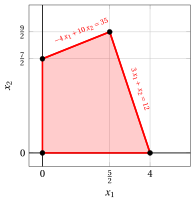
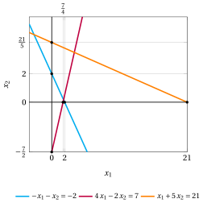
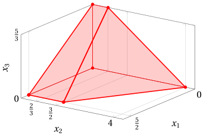
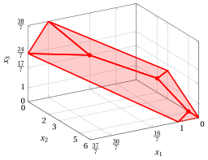

# Esercizi · Semispazi e poliedri

<div class="info-capitolo" markdown>

**Esercizi · Capitolo 2** · ogni soluzione si apre con un clic · [:material-book-open-variant: Capitolo 2](../problemi-pl/02-poliedri.md) · [:material-file-pdf-box: Eserciziario, volume 1 (PDF)](../pdf/esercizi-1-problemi-di-programmazione-lineare.pdf)

</div>

Negli esercizi di questo capitolo il punto di intersezione di due iperpiani di supporto in $\R^2$ si calcola risolvendo un sistema di due equazioni lineari in due variabili, con la seguente formula:

!!! nota ""

    Dati $a_{11},a_{12},a_{21},a_{22},b_1,b_2 \in \R$, se $(a_{11} \; a_{22} - a_{12} \; a_{21}) \neq 0$, abbiamo:

    \begin{equation*}
    \left\{ \begin{array}{ll}
    a_{11} \; {x}_1 + a_{12} \; {x}_2  & = b_1\\[2ex]
    a_{21} \; {x}_1 + a_{22} \; {x}_2  & = b_2
    \end{array} \right.
    ~~\Longrightarrow~~
    \begin{pmatrix}
    x_1 \\[0.5ex]
    x_2
    \end{pmatrix} = \begin{pmatrix}
    \frac{b_1 \; a_{22}-a_{12}\;b_2}{a_{11} \; a_{22} - a_{12} \; a_{21}} \\[2ex]
    \frac{a_{11}\;b_2  - b_{1} \; a_{21}}{a_{11} \; a_{22} - a_{12} \; a_{21}}
    \end{pmatrix}
    \end{equation*}

<a id="esercizio-2-1"></a>

!!! esercizio "Esercizio 2.1: Poliedri (P2)"

    Consideriamo i seguenti semispazi in $\R^2$:

    $$
    \begin{array}{rrrrrrrrrrrrr}
    & {-} 4\, {x_1} & {+} & 10 \, {x_2} & {\le} & 35 \\[2ex]
    & 3\, {x_1} & {+} & \, {x_2} & {\le} & 12 \\[2ex]
    & {x_1} &  &  & { \ge} & {0} \\[2ex]
    &  &  & {x_2} & { \ge} & {0}
    \end{array}
    $$

    **Domande**

    1. Disegnare i loro iperpiani di supporto.

    2. Disegnare il poliedro dato dall'intersezione dei semispazi. È un politopo?

??? soluzione "Soluzione"

    1. Gli iperpiani di supporto associati ai semispazi e i loro punti di intersezione con gli assi sono:

        <div class="tabella" markdown="0"><table>
        <tr>
        <td></td>
        <td><span style="color:#0c8599"><span class="arithmatex">\(-\)</span>4  <span class="arithmatex">\(x_1\)</span></span></td>
        <td><span style="color:#0c8599"><span class="arithmatex">\(+\)</span></span></td>
        <td><span style="color:#0c8599">10  <span class="arithmatex">\(x_2\)</span></span></td>
        <td><span style="color:#0c8599"><span class="arithmatex">\(=\)</span></span></td>
        <td><span style="color:#0c8599">35</span></td>
        <td></td>
        <td></td>
        <td></td>
        <td><span style="color:#0c8599"><span class="arithmatex">\(\begin{pmatrix} -\dfrac{35}{4} \\[0.5ex] 0 \end{pmatrix}\)</span>,  <span class="arithmatex">\(\begin{pmatrix} 0 \\[0.5ex] \dfrac{7}{2} \end{pmatrix}\)</span></span></td>
        </tr>
        <tr>
        <td></td>
        <td><span style="color:#7048e8">3  <span class="arithmatex">\(x_1\)</span></span></td>
        <td><span style="color:#7048e8"><span class="arithmatex">\(+\)</span></span></td>
        <td><span style="color:#7048e8"><span class="arithmatex">\(x_2\)</span></span></td>
        <td><span style="color:#7048e8"><span class="arithmatex">\(=\)</span></span></td>
        <td><span style="color:#7048e8">12</span></td>
        <td></td>
        <td></td>
        <td></td>
        <td><span style="color:#7048e8"><span class="arithmatex">\(\begin{pmatrix} 4 \\[0.5ex] 0 \end{pmatrix}\)</span>,  <span class="arithmatex">\(\begin{pmatrix} 0 \\[0.5ex] 12 \end{pmatrix}\)</span></span></td>
        </tr>
        <tr>
        <td></td>
        <td><span class="arithmatex">\(x_1\)</span></td>
        <td></td>
        <td></td>
        <td><span class="arithmatex">\(=\)</span></td>
        <td><span class="arithmatex">\(0\)</span></td>
        </tr>
        <tr>
        <td></td>
        <td></td>
        <td></td>
        <td><span class="arithmatex">\(x_2\)</span></td>
        <td><span class="arithmatex">\(=\)</span></td>
        <td><span class="arithmatex">\(0\)</span></td>
        </tr>
        </table></div>

        Il loro grafico è mostrato di seguito.

        { .fig .cornice loading=lazy style="width:65%" }

        Calcoliamo il punto di intersezione:

        \begin{equation*}
        \left\{ \begin{array}{ll}
        -4 \; {x}_1 + 10 \; {x}_2  & = 35\\[2ex]
        3 \; {x}_1 +  \; {x}_2  & = 12
        \end{array} \right.
        ~~\Longrightarrow~~
        \begin{pmatrix}
        x_1 \\[0.5ex]
        x_2
        \end{pmatrix} = \begin{pmatrix}
        \frac{35 \cdot 1 - 10 \cdot 12}{(-4) \cdot 1 - 10 \cdot 3} \\[2ex]
        \frac{(-4) \cdot 12  - 35 \cdot 3}{(-4) \cdot 1 - 10 \cdot 3 }
        \end{pmatrix}
        = \begin{pmatrix}
        \frac{5}{2} \\[0.5ex]
        \frac{9}{2}
        \end{pmatrix}
        \end{equation*}

    2. Il poliedro, dato dall'intersezione dei semispazi, è:

        { .fig .cornice loading=lazy style="width:65%" }

        Un poliedro è un <strong>politopo</strong> se è limitato (definizioni di poliedro limitato e di politopo nel capitolo «Semispazi e poliedri»); equivalentemente, se esistono ${\boldsymbol \alpha},{\boldsymbol \beta} \in \R^n$ tali che $\alpha_j \le x_j \le \beta_j$ per ogni ${\boldsymbol x} \in P$ e per ogni $j \in \{1,2,\dots,n\}$.

        Questo poliedro $P$ è limitato poiché per ogni $\begin{pmatrix} x_1 \\[0.5ex] x_2 \end{pmatrix} \in P$, abbiamo ad esempio:

        \begin{align*}
        0 \le & ~~x_1~ \le 4\\[1ex]
        0 \le & ~~x_2~ \le \frac{9}{2}
        \end{align*}

        Di conseguenza questo poliedro è anche un politopo.

<a id="esercizio-2-2"></a>

!!! esercizio "Esercizio 2.2: Poliedri (P10)"

    Consideriamo i seguenti semispazi in $\R^2$:

    $$
    \begin{array}{rrrrrrrrrrrrr}
    & {-} \, {x_1} & {+} & 3 \, {x_2} & {\le} & 12 \\[2ex]
    & {x_1} & {+} & 2 \, {x_2} & {\le} & 12 \\[2ex]
    & {3} \, {x_1} & {-} & 2 \, {x_2} & {\le} & {8} \\[2ex]
    & {x_1} &  &  & { \ge} & {0} \\[2ex]
    &  &  & {x_2} & { \ge} & {0}
    \end{array}
    $$

    **Domande**

    1. Disegnare i loro iperpiani di supporto.

    2. Disegnare il poliedro dato dall'intersezione dei semispazi. È un politopo?

    3. Cosa succede se aggiungiamo al poliedro il vincolo $~ x_1 \ge 5 ~$? E se aggiungiamo il vincolo $~ x_1 \le 5 ~$?

??? soluzione "Soluzione"

    1. Gli iperpiani di supporto associati ai semispazi e i loro punti di intersezione con gli assi sono:

        <div class="tabella" markdown="0"><table>
        <tr>
        <td></td>
        <td><span style="color:#0c8599"><span class="arithmatex">\(-\)</span>  <span class="arithmatex">\(x_1\)</span></span></td>
        <td><span style="color:#0c8599"><span class="arithmatex">\(+\)</span></span></td>
        <td><span style="color:#0c8599">3  <span class="arithmatex">\(x_2\)</span></span></td>
        <td><span style="color:#0c8599"><span class="arithmatex">\(=\)</span></span></td>
        <td><span style="color:#0c8599">12</span></td>
        <td></td>
        <td></td>
        <td></td>
        <td><span style="color:#0c8599"><span class="arithmatex">\(\begin{pmatrix} -12 \\[0.5ex] 0 \end{pmatrix}\)</span>,  <span class="arithmatex">\(\begin{pmatrix} 0 \\[0.5ex] 4 \end{pmatrix}\)</span></span></td>
        </tr>
        <tr>
        <td></td>
        <td><span style="color:#7048e8"><span class="arithmatex">\(x_1\)</span></span></td>
        <td><span style="color:#7048e8"><span class="arithmatex">\(+\)</span></span></td>
        <td><span style="color:#7048e8">2  <span class="arithmatex">\(x_2\)</span></span></td>
        <td><span style="color:#7048e8"><span class="arithmatex">\(=\)</span></span></td>
        <td><span style="color:#7048e8">12</span></td>
        <td></td>
        <td></td>
        <td></td>
        <td><span style="color:#7048e8"><span class="arithmatex">\(\begin{pmatrix} 12 \\[0.5ex] 0 \end{pmatrix}\)</span>,  <span class="arithmatex">\(\begin{pmatrix} 0 \\[0.5ex] 6 \end{pmatrix}\)</span></span></td>
        </tr>
        <tr>
        <td></td>
        <td><span style="color:#e8590c">3  <span class="arithmatex">\(x_1\)</span></span></td>
        <td><span style="color:#e8590c"><span class="arithmatex">\(-\)</span></span></td>
        <td><span style="color:#e8590c">2  <span class="arithmatex">\(x_2\)</span></span></td>
        <td><span style="color:#e8590c"><span class="arithmatex">\(=\)</span></span></td>
        <td><span style="color:#e8590c">8</span></td>
        <td></td>
        <td></td>
        <td></td>
        <td><span style="color:#e8590c"><span class="arithmatex">\(\begin{pmatrix} \dfrac{8}{3} \\[0.5ex] 0 \end{pmatrix}\)</span>,  <span class="arithmatex">\(\begin{pmatrix} 0 \\[0.5ex] -4 \end{pmatrix}\)</span></span></td>
        </tr>
        <tr>
        <td></td>
        <td><span class="arithmatex">\(x_1\)</span></td>
        <td></td>
        <td></td>
        <td><span class="arithmatex">\(=\)</span></td>
        <td><span class="arithmatex">\(0\)</span></td>
        </tr>
        <tr>
        <td></td>
        <td></td>
        <td></td>
        <td><span class="arithmatex">\(x_2\)</span></td>
        <td><span class="arithmatex">\(=\)</span></td>
        <td><span class="arithmatex">\(0\)</span></td>
        </tr>
        </table></div>

        Il loro grafico è mostrato di seguito.

        { .fig .cornice loading=lazy style="width:65%" }

        Calcoliamo i punti di intersezione:

        \begin{equation*}
        \left\{ \begin{array}{ll}
        -\; {x}_1 + 3 \; {x}_2  & = 12\\[2ex]
        \; {x}_1 + 2 \; {x}_2  & = 12
        \end{array} \right.
        ~~\Longrightarrow~~
        \begin{pmatrix}
        x_1 \\[0.5ex]
        x_2
        \end{pmatrix} = \begin{pmatrix}
        \frac{12 \cdot 2 - 3\cdot 12}{(-1) \cdot 2 - 3 \cdot 1} \\[2ex]
        \frac{(-1) \cdot 12  - 12 \cdot 1}{(-1) \cdot 2 - 3 \cdot 1}
        \end{pmatrix}
        = \begin{pmatrix}
        \frac{12}{5} \\[0.5ex]
        \frac{24}{5}
        \end{pmatrix}
        \end{equation*}

        \begin{equation*}
        \left\{ \begin{array}{ll}
        \; {x}_1 + 2 \; {x}_2  & = 12\\[2ex]
        3 \; {x}_1 - 2 \; {x}_2  & = 8
        \end{array} \right.
        ~~\Longrightarrow~~
        \begin{pmatrix}
        x_1 \\[0.5ex]
        x_2
        \end{pmatrix} = \begin{pmatrix}
        \frac{12 \cdot (-2)-2 \cdot 8}{1 \cdot (-2) - 2 \cdot 3} \\[2ex]
        \frac{1 \cdot 8  - 12 \cdot 3}{1 \cdot (-2) - 2 \cdot 3}
        \end{pmatrix}
        = \begin{pmatrix}
        5 \\[0.5ex]
        \frac{7}{2}
        \end{pmatrix}
        \end{equation*}

    2. Il poliedro, dato dall'intersezione dei semispazi, è:

        { .fig .cornice loading=lazy style="width:65%" }

        Un poliedro è un <strong>politopo</strong> se è limitato (definizioni di poliedro limitato e di politopo nel capitolo «Semispazi e poliedri»); equivalentemente, se esistono ${\boldsymbol \alpha},{\boldsymbol \beta} \in \R^n$ tali che $\alpha_j \le x_j \le \beta_j$ per ogni ${\boldsymbol x} \in P$ e per ogni $j \in \{1,2,\dots,n\}$.

        Questo poliedro $P$ è limitato poiché per ogni $\begin{pmatrix} x_1 \\[0.5ex] x_2 \end{pmatrix} \in P$, abbiamo ad esempio:

        \begin{align*}
        0 \le & ~~x_1~ \le 5\\[1ex]
        0 \le & ~~x_2~ \le \frac{24}{5}
        \end{align*}

        Di conseguenza questo poliedro è anche un politopo.

    3. Se aggiungiamo il vincolo $~x_1 \ge 5~$ il poliedro si riduce al punto $\left (~5,~ \frac{7}{2}~\right)$. Se aggiungiamo il vincolo $~x_1 \le 5~$ il poliedro non cambia.

<a id="esercizio-2-3"></a>

!!! esercizio "Esercizio 2.3: Poliedri (P21)"

    Consideriamo i seguenti semispazi in $\R^2$:

    $$
    \begin{array}{rrrrrrrrrrrrr}
    & {- }\, {x_1} & {-} & \, {x_2} & {\le} & {-2} \\[2ex]
    & {4} \, {x_1} & {-} & {2} \, {x_2} & {\le} & {7} \\[2ex]
    & {x_1} & {+} & {5} \, {x_2} & {\le} & {21} \\[2ex]
    & {x_1} &  &  & { \ge} & {0} \\[2ex]
    &  &  & {x_2} & { \ge} & {0}
    \end{array}
    $$

    **Domande**

    1. Disegnare i loro iperpiani di supporto.

    2. Disegnare il poliedro dato dall'intersezione dei semispazi. È un politopo?

??? soluzione "Soluzione"

    1. Gli iperpiani di supporto associati ai semispazi e i loro punti di intersezione con gli assi sono:

        <div class="tabella" markdown="0"><table>
        <tr>
        <td></td>
        <td><span style="color:#0c8599"><span class="arithmatex">\(-\)</span>  <span class="arithmatex">\(x_1\)</span></span></td>
        <td><span style="color:#0c8599"><span class="arithmatex">\(-\)</span></span></td>
        <td><span style="color:#0c8599"><span class="arithmatex">\(x_2\)</span></span></td>
        <td><span style="color:#0c8599"><span class="arithmatex">\(=\)</span></span></td>
        <td><span style="color:#0c8599"><span class="arithmatex">\(-2\)</span></span></td>
        <td></td>
        <td></td>
        <td></td>
        <td><span style="color:#0c8599"><span class="arithmatex">\(\begin{pmatrix} 2 \\[0.5ex] 0 \end{pmatrix}\)</span>,  <span class="arithmatex">\(\begin{pmatrix} 0 \\[0.5ex] 2 \end{pmatrix}\)</span></span></td>
        </tr>
        <tr>
        <td></td>
        <td><span style="color:#7048e8">4  <span class="arithmatex">\(x_1\)</span></span></td>
        <td><span style="color:#7048e8"><span class="arithmatex">\(-\)</span></span></td>
        <td><span style="color:#7048e8">2  <span class="arithmatex">\(x_2\)</span></span></td>
        <td><span style="color:#7048e8"><span class="arithmatex">\(=\)</span></span></td>
        <td><span style="color:#7048e8">7</span></td>
        <td></td>
        <td></td>
        <td></td>
        <td><span style="color:#7048e8"><span class="arithmatex">\(\begin{pmatrix} \dfrac{7}{4} \\[0.5ex] 0 \end{pmatrix}\)</span>,  <span class="arithmatex">\(\begin{pmatrix} 0 \\[0.5ex] -\dfrac{7}{2} \end{pmatrix}\)</span></span></td>
        </tr>
        <tr>
        <td></td>
        <td><span style="color:#e8590c"><span class="arithmatex">\(x_1\)</span></span></td>
        <td><span style="color:#e8590c"><span class="arithmatex">\(+\)</span></span></td>
        <td><span style="color:#e8590c">5  <span class="arithmatex">\(x_2\)</span></span></td>
        <td><span style="color:#e8590c"><span class="arithmatex">\(=\)</span></span></td>
        <td><span style="color:#e8590c">21</span></td>
        <td></td>
        <td></td>
        <td></td>
        <td><span style="color:#e8590c"><span class="arithmatex">\(\begin{pmatrix} 21 \\[0.5ex] 0 \end{pmatrix}\)</span>,  <span class="arithmatex">\(\begin{pmatrix} 0 \\[0.5ex] \dfrac{21}{5} \end{pmatrix}\)</span></span></td>
        </tr>
        <tr>
        <td></td>
        <td><span class="arithmatex">\(x_1\)</span></td>
        <td></td>
        <td></td>
        <td><span class="arithmatex">\(=\)</span></td>
        <td><span class="arithmatex">\(0\)</span></td>
        </tr>
        <tr>
        <td></td>
        <td></td>
        <td></td>
        <td><span class="arithmatex">\(x_2\)</span></td>
        <td><span class="arithmatex">\(=\)</span></td>
        <td><span class="arithmatex">\(0\)</span></td>
        </tr>
        </table></div>

        Il loro grafico è mostrato di seguito.

        { .fig .cornice loading=lazy style="width:79%" }

        Calcoliamo i punti di intersezione:

        \begin{equation*}
        \left\{ \begin{array}{ll}
        {x}_1 + 5 \; {x}_2  & = 21\\[2ex]
        4\; {x}_1 - 2 \; {x}_2  & = 7
        \end{array} \right.
        ~~\Longrightarrow~~
        \begin{pmatrix}
        x_1 \\[0.5ex]
        x_2
        \end{pmatrix} = \begin{pmatrix}
        \frac{21 \cdot (-2) - 5\cdot 7}{ 1 \cdot (-2) - 5 \cdot 4} \\[2ex]
        \frac{1 \cdot 7  - 21  \cdot 4}{1 \cdot (-2) - 5 \cdot 4}
        \end{pmatrix}
        = \begin{pmatrix}
        \frac{7}{2} \\[0.5ex]
        \frac{7}{2}
        \end{pmatrix}
        \end{equation*}

        \begin{equation*}
        \left\{ \begin{array}{ll}
        -\; {x}_1 - \; {x}_2  & = -2\\[2ex]
        4 \; {x}_1 - 2 \; {x}_2  & = 7
        \end{array} \right.
        ~~\Longrightarrow~~
        \begin{pmatrix}
        x_1 \\[0.5ex]
        x_2
        \end{pmatrix} = \begin{pmatrix}
        \frac{(-2) \cdot (-2)-(-1) \cdot 7}{(-1) \cdot (-2)-(-1) \cdot 4} \\[2ex]
        \frac{(-1) \cdot 7  - (-2) \cdot 4}{(-1) \cdot (-2)-(-1) \cdot 4}
        \end{pmatrix}
        = \begin{pmatrix}
        \frac{11}{6} \\[0.5ex]
        \frac{1}{6}
        \end{pmatrix}
        \end{equation*}

    2. Il poliedro, dato dall'intersezione dei semispazi, è:

        { .fig .cornice loading=lazy style="width:65%" }

        Un poliedro è un <strong>politopo</strong> se è limitato (definizioni di poliedro limitato e di politopo nel capitolo «Semispazi e poliedri»); equivalentemente, se esistono ${\boldsymbol \alpha},{\boldsymbol \beta} \in \R^n$ tali che $\alpha_j \le x_j \le \beta_j$ per ogni ${\boldsymbol x} \in P$ e per ogni $j \in \{1,2,\dots,n\}$.

        Questo poliedro $P$ è limitato poiché per ogni $\begin{pmatrix} x_1 \\[0.5ex] x_2 \end{pmatrix} \in P$, abbiamo ad esempio:

        \begin{align*}
        0 \le & ~~x_1~ \le \frac{7}{2}\\[1ex]
        0 \le & ~~x_2~ \le \frac{21}{5}
        \end{align*}

        Di conseguenza questo poliedro è anche un politopo.

<a id="esercizio-2-4"></a>

!!! esercizio "Esercizio 2.4: Poliedri (P41)"

    Consideriamo i seguenti semispazi in $\R^3$:

    $$
    \begin{array}{rrrrrrrrrrrrr}
    & \, {x_1} & {+} & \, {x_2} & {+} & \, {x_3} & {\le} & {4} \\[1.5ex]
    &  &  & \, {x_2} &  &  & {\le} & {2} \\[1.5ex]
    &  &  &  &  & \, {x_3} & {\le} & {3} \\[1.5ex]
    & 3\, {x_1} &  &  & {+} & \, {x_3} & {\le} & {6} \\[1.5ex]
    & {x_1} &  &  &  &  & {\ge} & {0} \\[1.5ex]
    &  &  & {x_2} &  &  & {\ge} & {0} \\[1.5ex]
    &  &  &  &  & {x_3} & {\ge} & {0}
    \end{array}
    $$

    **Domande**

    1. Disegnare i loro iperpiani di supporto.

    2. Disegnare il poliedro dato dall'intersezione dei semispazi. È un politopo?

??? soluzione "Soluzione"

    1. Gli iperpiani di supporto associati ai semispazi e i loro punti di intersezione con gli assi sono:

        <div class="tabella" markdown="0"><table>
        <tr>
        <td></td>
        <td><span style="color:#0c8599"><span class="arithmatex">\(x_1\)</span></span></td>
        <td><span style="color:#0c8599"><span class="arithmatex">\(+\)</span></span></td>
        <td><span style="color:#0c8599"><span class="arithmatex">\(x_2\)</span></span></td>
        <td><span style="color:#0c8599"><span class="arithmatex">\(+\)</span></span></td>
        <td><span style="color:#0c8599"><span class="arithmatex">\(x_3\)</span></span></td>
        <td><span style="color:#0c8599"><span class="arithmatex">\(=\)</span></span></td>
        <td><span style="color:#0c8599">4</span></td>
        <td></td>
        <td><span style="color:#0c8599"><span class="arithmatex">\(\begin{pmatrix} 4 \\[0.5ex] 0 \\[0.5ex] 0 \end{pmatrix}\)</span>,  <span class="arithmatex">\(\begin{pmatrix} 0 \\[0.5ex] 4 \\[0.5ex] 0 \end{pmatrix}\)</span>,  <span class="arithmatex">\(\begin{pmatrix} 0 \\[0.5ex] 0 \\[0.5ex] 4 \end{pmatrix}\)</span></span></td>
        </tr>
        <tr>
        <td></td>
        <td></td>
        <td></td>
        <td><span style="color:#9c36b5"><span class="arithmatex">\(x_2\)</span></span></td>
        <td></td>
        <td></td>
        <td><span style="color:#9c36b5"><span class="arithmatex">\(=\)</span></span></td>
        <td><span style="color:#9c36b5">2</span></td>
        <td></td>
        <td><span style="color:#9c36b5"><span class="arithmatex">\(\begin{pmatrix} 0 \\[0.5ex] 2 \\[0.5ex] 0 \end{pmatrix}\)</span></span></td>
        </tr>
        <tr>
        <td></td>
        <td></td>
        <td></td>
        <td></td>
        <td></td>
        <td><span style="color:#e8590c"><span class="arithmatex">\(x_3\)</span></span></td>
        <td><span style="color:#e8590c"><span class="arithmatex">\(=\)</span></span></td>
        <td><span style="color:#e8590c">3</span></td>
        <td></td>
        <td><span style="color:#e8590c"><span class="arithmatex">\(\begin{pmatrix} 0 \\[0.5ex] 0 \\[0.5ex] 3 \end{pmatrix}\)</span></span></td>
        </tr>
        <tr>
        <td></td>
        <td><span style="color:#1971c2">3  <span class="arithmatex">\(x_1\)</span></span></td>
        <td></td>
        <td></td>
        <td><span style="color:#1971c2"><span class="arithmatex">\(+\)</span></span></td>
        <td><span style="color:#1971c2"><span class="arithmatex">\(x_3\)</span></span></td>
        <td><span style="color:#1971c2"><span class="arithmatex">\(=\)</span></span></td>
        <td><span style="color:#1971c2">6</span></td>
        <td></td>
        <td><span style="color:#1971c2"><span class="arithmatex">\(\begin{pmatrix} 2 \\[0.5ex] 0 \\[0.5ex] 0 \end{pmatrix}\)</span>,  <span class="arithmatex">\(\begin{pmatrix} 0 \\[0.5ex] 0 \\[0.5ex] 6 \end{pmatrix}\)</span></span></td>
        </tr>
        <tr>
        <td></td>
        <td><span class="arithmatex">\(x_1\)</span></td>
        <td></td>
        <td></td>
        <td></td>
        <td></td>
        <td><span class="arithmatex">\(=\)</span></td>
        <td><span class="arithmatex">\(0\)</span></td>
        </tr>
        <tr>
        <td></td>
        <td></td>
        <td></td>
        <td><span class="arithmatex">\(x_2\)</span></td>
        <td></td>
        <td></td>
        <td><span class="arithmatex">\(=\)</span></td>
        <td><span class="arithmatex">\(0\)</span></td>
        </tr>
        <tr>
        <td></td>
        <td></td>
        <td></td>
        <td></td>
        <td></td>
        <td><span class="arithmatex">\(x_3\)</span></td>
        <td><span class="arithmatex">\(=\)</span></td>
        <td><span class="arithmatex">\(0\)</span></td>
        </tr>
        </table></div>

        Il loro grafico è mostrato di seguito.

        { .fig .cornice loading=lazy style="width:53%" }

    2. Il poliedro dato dall'intersezione dei semispazi in $\R^3$ è:

        { .fig .cornice loading=lazy style="width:53%" }

        Un poliedro è un <strong>politopo</strong> se è limitato (definizioni di poliedro limitato e di politopo nel capitolo «Semispazi e poliedri»); equivalentemente, se esistono ${\boldsymbol \alpha},{\boldsymbol \beta} \in \R^n$ tali che $\alpha_j \le x_j \le \beta_j$ per ogni ${\boldsymbol x} \in P$ e per ogni $j \in \{1,2,\dots,n\}$.

        Questo poliedro $P$ è limitato poiché per ogni $\begin{pmatrix} x_1 \\[0.5ex] x_2 \\[0.5ex] x_3 \end{pmatrix} \in P$, abbiamo ad esempio:

        \begin{align*}
        0 \le & ~~x_1~ \le 2\\[1ex]
        0 \le & ~~x_2~ \le 2\\[1ex]
        0 \le & ~~x_3~ \le 3
        \end{align*}

        Di conseguenza questo poliedro è anche un politopo.

<a id="esercizio-2-5"></a>

!!! esercizio "Esercizio 2.5: Poliedri (P42)"

    Consideriamo i seguenti semispazi in $\R^3$:

    $$
    \begin{array}{rrrrrrrrrrrrr}
    & \, {x_1} & {+} & \, {x_2} & {+} & 2 \, {x_3} & {\le} & 4 \\[1.5ex]
    & 2 \, {x_1} &  &  & {+} & 3 \, {x_3} & {\le} & 5 \\[1.5ex]
    & 2 \, {x_1} & {+} & \, {x_2} & {+} & 3 \, {x_3} & {\le} & 7 \\[1.5ex]
    & {x_1} &  &  &  &  & {\ge} & {0} \\[1.5ex]
    &  &  & {x_2} &  &  & {\ge} & {0} \\[1.5ex]
    &  &  &  &  & {x_3} & {\ge} & {0}
    \end{array}
    $$

    **Domande**

    1. Disegnare i loro iperpiani di supporto.

    2. Disegnare il poliedro dato dall'intersezione dei semispazi. È un politopo?

??? soluzione "Soluzione"

    1. Gli iperpiani di supporto associati ai semispazi e i loro punti di intersezione con gli assi sono:

        <div class="tabella" markdown="0"><table>
        <tr>
        <td></td>
        <td><span style="color:#1971c2"><span class="arithmatex">\(x_1\)</span></span></td>
        <td><span style="color:#1971c2"><span class="arithmatex">\(+\)</span></span></td>
        <td><span style="color:#1971c2"><span class="arithmatex">\(x_2\)</span></span></td>
        <td><span style="color:#1971c2"><span class="arithmatex">\(+\)</span></span></td>
        <td><span style="color:#1971c2">2  <span class="arithmatex">\(x_3\)</span></span></td>
        <td><span style="color:#1971c2"><span class="arithmatex">\(=\)</span></span></td>
        <td><span style="color:#1971c2">4</span></td>
        <td></td>
        <td><span style="color:#1971c2"><span class="arithmatex">\(\begin{pmatrix} 4 \\[0.5ex] 0 \\[0.5ex] 0 \end{pmatrix}\)</span>,  <span class="arithmatex">\(\begin{pmatrix} 0 \\[0.5ex] 4 \\[0.5ex] 0 \end{pmatrix}\)</span>,  <span class="arithmatex">\(\begin{pmatrix} 0 \\[0.5ex] 0 \\[0.5ex] 2 \end{pmatrix}\)</span></span></td>
        </tr>
        <tr>
        <td></td>
        <td><span style="color:#9c36b5">2  <span class="arithmatex">\(x_1\)</span></span></td>
        <td></td>
        <td></td>
        <td><span style="color:#9c36b5"><span class="arithmatex">\(+\)</span></span></td>
        <td><span style="color:#9c36b5">3  <span class="arithmatex">\(x_3\)</span></span></td>
        <td><span style="color:#9c36b5"><span class="arithmatex">\(=\)</span></span></td>
        <td><span style="color:#9c36b5">5</span></td>
        <td></td>
        <td><span style="color:#9c36b5"><span class="arithmatex">\(\begin{pmatrix} \tfrac{5}{2} \\[0.5ex] 0 \\[0.5ex] 0 \end{pmatrix}\)</span>,  <span class="arithmatex">\(\begin{pmatrix} 0 \\[0.5ex] 0 \\[0.5ex] \tfrac{5}{3} \end{pmatrix}\)</span></span></td>
        </tr>
        <tr>
        <td></td>
        <td><span style="color:#7048e8">2  <span class="arithmatex">\(x_1\)</span></span></td>
        <td><span style="color:#7048e8"><span class="arithmatex">\(+\)</span></span></td>
        <td><span style="color:#7048e8"><span class="arithmatex">\(x_2\)</span></span></td>
        <td><span style="color:#7048e8"><span class="arithmatex">\(+\)</span></span></td>
        <td><span style="color:#7048e8">3  <span class="arithmatex">\(x_3\)</span></span></td>
        <td><span style="color:#7048e8"><span class="arithmatex">\(=\)</span></span></td>
        <td><span style="color:#7048e8">7</span></td>
        <td></td>
        <td><span style="color:#7048e8"><span class="arithmatex">\(\begin{pmatrix} \tfrac{7}{2} \\[0.5ex] 0 \\[0.5ex] 0 \end{pmatrix}\)</span>,  <span class="arithmatex">\(\begin{pmatrix} 0 \\[0.5ex] 7 \\[0.5ex] 0 \end{pmatrix}\)</span>,  <span class="arithmatex">\(\begin{pmatrix} 0 \\[0.5ex] 0 \\[0.5ex] \tfrac{7}{3} \end{pmatrix}\)</span></span></td>
        </tr>
        <tr>
        <td></td>
        <td><span class="arithmatex">\(x_1\)</span></td>
        <td></td>
        <td></td>
        <td></td>
        <td></td>
        <td><span class="arithmatex">\(=\)</span></td>
        <td><span class="arithmatex">\(0\)</span></td>
        </tr>
        <tr>
        <td></td>
        <td></td>
        <td></td>
        <td><span class="arithmatex">\(x_2\)</span></td>
        <td></td>
        <td></td>
        <td><span class="arithmatex">\(=\)</span></td>
        <td><span class="arithmatex">\(0\)</span></td>
        </tr>
        <tr>
        <td></td>
        <td></td>
        <td></td>
        <td></td>
        <td></td>
        <td><span class="arithmatex">\(x_3\)</span></td>
        <td><span class="arithmatex">\(=\)</span></td>
        <td><span class="arithmatex">\(0\)</span></td>
        </tr>
        </table></div>

        Il loro grafico è mostrato di seguito.

        { .fig .cornice loading=lazy style="width:76%" }

    2. Il poliedro dato dall'intersezione dei semispazi in $\R^3$ è:

        { .fig .cornice loading=lazy style="width:76%" }

        Un poliedro è un <strong>politopo</strong> se è limitato (definizioni di poliedro limitato e di politopo nel capitolo «Semispazi e poliedri»); equivalentemente, se esistono ${\boldsymbol \alpha},{\boldsymbol \beta} \in \R^n$ tali che $\alpha_j \le x_j \le \beta_j$ per ogni ${\boldsymbol x} \in P$ e per ogni $j \in \{1,2,\dots,n\}$.

        Questo poliedro $P$ è limitato poiché per ogni $\begin{pmatrix} x_1 \\[0.5ex] x_2 \\[0.5ex] x_3 \end{pmatrix} \in P$, abbiamo ad esempio:

        \begin{align*}
        0 \le & ~~x_1~ \le 10\\[1ex]
        0 \le & ~~x_2~ \le 10\\[1ex]
        0 \le & ~~x_3~ \le 10
        \end{align*}

        Di conseguenza questo poliedro è anche un politopo.

<a id="esercizio-2-6"></a>

!!! esercizio "Esercizio 2.6: Poliedri (P44)"

    Consideriamo i seguenti semispazi in $\R^3$:

    $$
    \begin{array}{rrrrrrrrrrrrr}
    & {x_1} & {+} & 2 \, {x_2} & {-} & 2 \, {x_3} & {\le} & 1 \\[1.5ex]
    & 2 \, {x_1} & {-} & \, {x_2} & {-} & 3 \, {x_3} & {\le} & 4 \\[1.5ex]
    & {x_1} & {+} & 2 \, {x_2} & {+} & 5 \, {x_3} & {\le} & 2 \\[1.5ex]
    & {x_1} &  &  &  &  & {\ge} & {0} \\[1.5ex]
    &  &  & {x_2} &  &  & {\ge} & {0} \\[1.5ex]
    &  &  &  &  & {x_3} & {\ge} & {0}
    \end{array}
    $$

    **Domande**

    1. Disegnare i loro iperpiani di supporto.

    2. Disegnare il poliedro dato dall'intersezione dei semispazi. È un politopo?

??? soluzione "Soluzione"

    1. Gli iperpiani di supporto associati ai semispazi e i loro punti di intersezione con gli assi sono:

        <div class="tabella" markdown="0"><table>
        <tr>
        <td></td>
        <td><span style="color:#1971c2"><span class="arithmatex">\(x_1\)</span></span></td>
        <td><span style="color:#1971c2"><span class="arithmatex">\(+\)</span></span></td>
        <td><span style="color:#1971c2">2  <span class="arithmatex">\(x_2\)</span></span></td>
        <td><span style="color:#1971c2"><span class="arithmatex">\(-\)</span></span></td>
        <td><span style="color:#1971c2">2  <span class="arithmatex">\(x_3\)</span></span></td>
        <td><span style="color:#1971c2"><span class="arithmatex">\(=\)</span></span></td>
        <td><span style="color:#1971c2">1</span></td>
        <td></td>
        <td><span style="color:#1971c2"><span class="arithmatex">\(\begin{pmatrix} 1 \\[0.5ex] 0 \\[0.5ex] 0 \end{pmatrix}\)</span>,  <span class="arithmatex">\(\begin{pmatrix} 0 \\[0.5ex] \tfrac{1}{2} \\[0.5ex] 0 \end{pmatrix}\)</span>,  <span class="arithmatex">\(\begin{pmatrix} 0 \\[0.5ex] 0 \\[0.5ex] -\tfrac{1}{2} \end{pmatrix}\)</span></span></td>
        </tr>
        <tr>
        <td></td>
        <td><span style="color:#9c36b5">2  <span class="arithmatex">\(x_1\)</span></span></td>
        <td><span style="color:#9c36b5"><span class="arithmatex">\(-\)</span></span></td>
        <td><span style="color:#9c36b5"><span class="arithmatex">\(x_2\)</span></span></td>
        <td><span style="color:#9c36b5"><span class="arithmatex">\(-\)</span></span></td>
        <td><span style="color:#9c36b5">3  <span class="arithmatex">\(x_3\)</span></span></td>
        <td><span style="color:#9c36b5"><span class="arithmatex">\(=\)</span></span></td>
        <td><span style="color:#9c36b5">4</span></td>
        <td></td>
        <td><span style="color:#9c36b5"><span class="arithmatex">\(\begin{pmatrix} 2 \\[0.5ex] 0 \\[0.5ex] 0 \end{pmatrix}\)</span>,  <span class="arithmatex">\(\begin{pmatrix} 0 \\[0.5ex] -4 \\[0.5ex] 0 \end{pmatrix}\)</span>,  <span class="arithmatex">\(\begin{pmatrix} 0 \\[0.5ex] 0 \\[0.5ex] -\tfrac{4}{3} \end{pmatrix}\)</span></span></td>
        </tr>
        <tr>
        <td></td>
        <td><span style="color:#2f9e44"><span class="arithmatex">\(x_1\)</span></span></td>
        <td><span style="color:#2f9e44"><span class="arithmatex">\(+\)</span></span></td>
        <td><span style="color:#2f9e44">2  <span class="arithmatex">\(x_2\)</span></span></td>
        <td><span style="color:#2f9e44"><span class="arithmatex">\(+\)</span></span></td>
        <td><span style="color:#2f9e44">5  <span class="arithmatex">\(x_3\)</span></span></td>
        <td><span style="color:#2f9e44"><span class="arithmatex">\(=\)</span></span></td>
        <td><span style="color:#2f9e44">2</span></td>
        <td></td>
        <td><span style="color:#2f9e44"><span class="arithmatex">\(\begin{pmatrix} 2 \\[0.5ex] 0 \\[0.5ex] 0 \end{pmatrix}\)</span>,  <span class="arithmatex">\(\begin{pmatrix} 0 \\[0.5ex] 1 \\[0.5ex] 0 \end{pmatrix}\)</span>,  <span class="arithmatex">\(\begin{pmatrix} 0 \\[0.5ex] 0 \\[0.5ex] \tfrac{2}{5} \end{pmatrix}\)</span></span></td>
        </tr>
        <tr>
        <td></td>
        <td><span class="arithmatex">\(x_1\)</span></td>
        <td></td>
        <td></td>
        <td></td>
        <td></td>
        <td><span class="arithmatex">\(=\)</span></td>
        <td><span class="arithmatex">\(0\)</span></td>
        </tr>
        <tr>
        <td></td>
        <td></td>
        <td></td>
        <td><span class="arithmatex">\(x_2\)</span></td>
        <td></td>
        <td></td>
        <td><span class="arithmatex">\(=\)</span></td>
        <td><span class="arithmatex">\(0\)</span></td>
        </tr>
        <tr>
        <td></td>
        <td></td>
        <td></td>
        <td></td>
        <td></td>
        <td><span class="arithmatex">\(x_3\)</span></td>
        <td><span class="arithmatex">\(=\)</span></td>
        <td><span class="arithmatex">\(0\)</span></td>
        </tr>
        </table></div>

        Il loro grafico è mostrato di seguito.

        { .fig .cornice loading=lazy style="width:79%" }

    2. Il poliedro dato dall'intersezione dei semispazi in $\R^3$ è:

        { .fig .cornice loading=lazy style="width:79%" }

        Un poliedro è un <strong>politopo</strong> se è limitato (definizioni di poliedro limitato e di politopo nel capitolo «Semispazi e poliedri»); equivalentemente, se esistono ${\boldsymbol \alpha},{\boldsymbol \beta} \in \R^n$ tali che $\alpha_j \le x_j \le \beta_j$ per ogni ${\boldsymbol x} \in P$ e per ogni $j \in \{1,2,\dots,n\}$.

        Questo poliedro $P$ è limitato poiché per ogni $\begin{pmatrix} x_1 \\[0.5ex] x_2 \\[0.5ex] x_3 \end{pmatrix} \in P$, abbiamo ad esempio:

        \begin{align*}
        0 \le & ~~x_1~ \le 10\\[1ex]
        0 \le & ~~x_2~ \le 10\\[1ex]
        0 \le & ~~x_3~ \le 10
        \end{align*}

        Di conseguenza questo poliedro è anche un politopo.

<a id="esercizio-2-7"></a>

!!! esercizio "Esercizio 2.7: Poliedri (P51)"

    Consideriamo i seguenti semispazi in $\R^3$:

    $$
    \begin{array}{rrrrrrrrrrrrr}
    &  & \, {x_1} & {-} & {x_2} & {-} & 3 \, {x_3} & {\le} & {-} 5 \\[2ex]
    & {-} & 3 \, {x_1} & {-} & 2 \, {x_2} & {+} & 2 \, {x_3} & {\le} & {-}2 \\[2ex]
    &  & {x_1} &  &  &  &  & {\ge} & {0} \\[1.5ex]
    &  &  &  & {x_2} &  &  & {\ge} & {0} \\[1.5ex]
    &  &  &  &  &  & {x_3} & {\ge} & {0}
    \end{array}
    $$

    **Domande**

    1. Disegnare i loro iperpiani di supporto.

    2. Disegnare il poliedro dato dall'intersezione dei semispazi. È un politopo?

??? soluzione "Soluzione"

    1. Gli iperpiani di supporto associati ai semispazi e i loro punti di intersezione con gli assi sono:

        <div class="tabella" markdown="0"><table>
        <tr>
        <td></td>
        <td><span style="color:#1971c2"><span class="arithmatex">\(x_1\)</span></span></td>
        <td><span style="color:#1971c2"><span class="arithmatex">\(-\)</span></span></td>
        <td><span style="color:#1971c2"><span class="arithmatex">\(x_2\)</span></span></td>
        <td><span style="color:#1971c2"><span class="arithmatex">\(-\)</span></span></td>
        <td><span style="color:#1971c2">3  <span class="arithmatex">\(x_3\)</span></span></td>
        <td><span style="color:#1971c2"><span class="arithmatex">\(=\)</span></span></td>
        <td><span style="color:#1971c2"><span class="arithmatex">\(-5\)</span></span></td>
        <td></td>
        <td><span style="color:#1971c2"><span class="arithmatex">\(\begin{pmatrix} \!-5 \\[0.5ex] 0 \\[0.5ex] 0 \end{pmatrix}\)</span>,  <span class="arithmatex">\(\begin{pmatrix} 0 \\[0.5ex] 5 \\[0.5ex] 0 \end{pmatrix}\)</span>,  <span class="arithmatex">\(\begin{pmatrix} 0 \\[0.5ex] 0 \\[0.5ex] \tfrac{5}{3} \end{pmatrix}\)</span></span></td>
        </tr>
        <tr>
        <td></td>
        <td><span style="color:#e03131"><span class="arithmatex">\(-3\, x_1\)</span></span></td>
        <td><span style="color:#e03131"><span class="arithmatex">\(-\)</span></span></td>
        <td><span style="color:#e03131">2  <span class="arithmatex">\(x_2\)</span></span></td>
        <td><span style="color:#e03131"><span class="arithmatex">\(+\)</span></span></td>
        <td><span style="color:#e03131">2  <span class="arithmatex">\(x_3\)</span></span></td>
        <td><span style="color:#e03131"><span class="arithmatex">\(=\)</span></span></td>
        <td><span style="color:#e03131"><span class="arithmatex">\(-2\)</span></span></td>
        <td></td>
        <td><span style="color:#e03131"><span class="arithmatex">\(\begin{pmatrix} \tfrac{2}{3} \\[0.5ex] 0 \\[0.5ex] 0 \end{pmatrix}\)</span>,  <span class="arithmatex">\(\begin{pmatrix} 0 \\[0.5ex] 1 \\[0.5ex] 0 \end{pmatrix}\)</span>,  <span class="arithmatex">\(\begin{pmatrix} 0 \\[0.5ex] 0 \\[0.5ex] -1 \end{pmatrix}\)</span></span></td>
        </tr>
        <tr>
        <td></td>
        <td><span class="arithmatex">\(x_1\)</span></td>
        <td></td>
        <td></td>
        <td></td>
        <td></td>
        <td><span class="arithmatex">\(=\)</span></td>
        <td><span class="arithmatex">\(0\)</span></td>
        </tr>
        <tr>
        <td></td>
        <td></td>
        <td></td>
        <td><span class="arithmatex">\(x_2\)</span></td>
        <td></td>
        <td></td>
        <td><span class="arithmatex">\(=\)</span></td>
        <td><span class="arithmatex">\(0\)</span></td>
        </tr>
        <tr>
        <td></td>
        <td></td>
        <td></td>
        <td></td>
        <td></td>
        <td><span class="arithmatex">\(x_3\)</span></td>
        <td><span class="arithmatex">\(=\)</span></td>
        <td><span class="arithmatex">\(0\)</span></td>
        </tr>
        </table></div>

        Il loro grafico è mostrato di seguito.

        { .fig .cornice loading=lazy style="width:79%" }

    2. Il poliedro dato dall'intersezione dei semispazi in $\R^3$ è:

        { .fig .cornice loading=lazy style="width:79%" }

        Un poliedro è un <strong>politopo</strong> se è limitato (definizioni di poliedro limitato e di politopo nel capitolo «Semispazi e poliedri»); equivalentemente, se esistono ${\boldsymbol \alpha},{\boldsymbol \beta} \in \R^n$ tali che $\alpha_j \le x_j \le \beta_j$ per ogni ${\boldsymbol x} \in P$ e per ogni $j \in \{1,2,\dots,n\}$.

        Questo poliedro $P$ non è limitato, di conseguenza non è un politopo.

## 2.1 Approfondimento: disegnare i poliedri con SageMath

- I poliedri degli esercizi si possono disegnare con SageMath, utilizzabile online all'indirizzo [sagecell.sagemath.org/](https://sagecell.sagemath.org/), senza installare nulla.

- Un poliedro è dato dall'elenco dei suoi semispazi (la <strong>H-rappresentazione</strong>). SageMath scrive ogni semispazio nella forma

    $$
    b + a_1\,x_1 + a_2\,x_2 + \dots + a_n\,x_n \ge 0
    $$

    e lo descrive con la tupla $(b, a_1, a_2, \dots, a_n)$. Un vincolo ${\boldsymbol a}'{\boldsymbol x} \le b$ viene prima scritto come $b - {\boldsymbol a}'{\boldsymbol x} \ge 0$, quindi la sua tupla è $(b, -a_1, \dots, -a_n)$; un vincolo di non negatività $x_j \ge 0$ ha la tupla con $0$ in prima posizione e $1$ in posizione $j+1$.

- Il metodo <code>Hrepresentation()</code> elenca i semispazi, <code>Vrepresentation()</code> elenca i punti estremi e i raggi estremi, e <code>plot()</code> disegna il poliedro (in $\R^2$ o in $\R^3$).

<strong>Esempio in $\R^2$</strong> (esercizio con il poliedro $P2$).

??? codice "Codice SageMath: un poliedro in $\R^2$"

    ```python
    # Define the polyhedron using inequalities (Hyperplane Representation)
    p = Polyhedron(ieqs=[
        (35,  4, -10),     # ( 4, -10) x + 35 >= 0
        (12, -3, -1),      # (-3,  -1) x + 12 >= 0
        (0,   1,  0),      # ( 1,   0) x + 0 >= 0
        (0,   0,  1)       # ( 0,   1) x + 0 >= 0
    ])

    # Display the inequalities of the polyhedron
    p.Hrepresentation()

    # Display the extreme points and extreme rays of the polyhedron
    p.Vrepresentation()

    # Plot the polyhedron (2D)
    p.plot()
    ```

<strong>Esempio in $\R^3$</strong> (esercizio con il poliedro $P41$).

??? codice "Codice SageMath: un poliedro in $\R^3$"

    ```python
    # Define the polyhedron using inequalities (Hyperplane Representation)
    p = Polyhedron(ieqs=[
        (4, -1, -1, -1),   # (-1, -1, -1) x + 4 >= 0
        (2,  0, -1,  0),   # (0, -1, 0) x + 2 >= 0
        (3,  0,  0, -1),   # (0, 0, -1) x + 3 >= 0
        (6, -3,  0, -1),   # (-3, 0, -1) x + 6 >= 0
        (0,  1,  0,  0),   # (1, 0, 0) x + 0 >= 0
        (0,  0,  1,  0),   # (0, 1, 0) x + 0 >= 0
        (0,  0,  0,  1)    # (0, 0, 1) x + 0 >= 0
    ])

    # Display the inequalities of the polyhedron
    p.Hrepresentation()

    # Display the extreme points and extreme rays of the polyhedron
    p.Vrepresentation()

    # Plot the polyhedron (3D)
    p.plot()
    ```

Gli altri poliedri di questo capitolo si disegnano allo stesso modo, cambiando l'elenco delle tuple.
