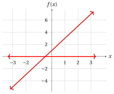
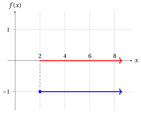
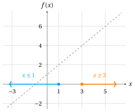

# Esercizi · Problemi di ottimizzazione lineare

**Esercizi · Capitolo 3** · ogni soluzione si apre con un clic · [:material-book-open-variant: Capitolo 3](../problemi-pl/03-problemi-ottimizzazione-lineare.md) · [:material-file-pdf-box: Eserciziario, volume 1 (PDF)](../pdf/esercizi-1-problemi-di-programmazione-lineare.pdf)

!!! esercizio "Esercizio 3.1: Problema di ottimizzazione lineare (E1)"

    Consideriamo la seguente funzione obiettivo lineare e la seguente regione ammissibile:

    $$
    f:\R \to \R,~ f: x \mapsto 3x - 2
    \qquad \text{e} \qquad
    F=\Big\{\, x \in \R : -\frac{1}{2} \le x \le \frac{9}{2} \,\Big\} = \left[-\frac{1}{2},\frac{9}{2}\right].
    $$

    **Domande**

    1. Scrivere i problemi di ottimizzazione associati in forma di minimo e di massimo.

    2. Disegnare il grafico della funzione obiettivo sulla regione ammissibile.

    3. Trovare tutte le soluzioni ottime e il valore ottimo per entrambe le forme.

??? soluzione "Soluzione"

    1. I problemi di ottimizzazione associati in forma di minimo e di massimo sono:

        \begin{equation*}
        \min \bigg\{\, 3x - 2 \ \text{ soggetto a } -\frac{1}{2} \le x \le \frac{9}{2} \,\bigg\}
        \end{equation*}

        \begin{equation*}
        \max \bigg\{\, 3x - 2 \ \text{ soggetto a } -\frac{1}{2} \le x \le \frac{9}{2} \,\bigg\}
        \end{equation*}

    2. Il grafico della funzione obiettivo sulla regione ammissibile è rosso; la regione ammissibile è la parte rossa dell'asse $x$ e le soluzioni ottime sono segnate in blu.

        { .fig .ovale loading=lazy style="width:50%" }

    3. La regione ammissibile è l'intervallo $F=\left[-\frac{1}{2},\frac{9}{2}\right]$ e la funzione lineare $f$ è strettamente crescente: se $x$ aumenta di $1$, $f(x)$ aumenta di $3$.

        - Per la forma di minimo, poiché per ogni $x$ ammissibile abbiamo $x \ge -\frac{1}{2}$ e quindi $f(x) = 3x - 2 \ge -\frac{3}{2} - 2 = -\frac{7}{2} = f\big(-\frac{1}{2}\big)$, l'unica soluzione ottima e il valore ottimo sono:

            $$
            \tilde{\boldsymbol x}(LP) = \left(-\frac{1}{2}\right)
            \quad \text{e} \quad
            z(LP) = -\frac{7}{2}.
            $$

        - Per la forma di massimo, poiché per ogni $x$ ammissibile abbiamo $x \le \frac{9}{2}$ e quindi $f(x) = 3x - 2 \le \frac{27}{2} - 2 = \frac{23}{2} = f\big(\frac{9}{2}\big)$, l'unica soluzione ottima e il valore ottimo sono:

            $$
            \tilde{\boldsymbol x}(LP) = \left(\frac{9}{2}\right)
            \quad \text{e} \quad
            z(LP) = \frac{23}{2}.
            $$

!!! esercizio "Esercizio 3.2: Problema di ottimizzazione lineare (E2)"

    Consideriamo la seguente funzione obiettivo lineare e la seguente regione ammissibile:

    $$
    f:\R \to \R,~ f: x \mapsto 3 - \frac{1}{2}\,x
    \qquad \text{e} \qquad
    F=\{\, x \in \R : x \ge -2 \,\} = [-2,+\infty).
    $$

    **Domande**

    1. Scrivere i problemi di ottimizzazione associati in forma di minimo e di massimo.

    2. Disegnare il grafico della funzione obiettivo sulla regione ammissibile.

    3. Trovare tutte le soluzioni ottime e il valore ottimo per entrambe le forme.

??? soluzione "Soluzione"

    1. I problemi di ottimizzazione associati in forma di minimo e di massimo sono:

        \begin{equation*}
        \min \bigg\{\, 3 - \frac{1}{2}\,x \ \text{ soggetto a } x \ge -2 \,\bigg\}
        \end{equation*}

        \begin{equation*}
        \max \bigg\{\, 3 - \frac{1}{2}\,x \ \text{ soggetto a } x \ge -2 \,\bigg\}
        \end{equation*}

    2. Il grafico della funzione obiettivo sulla regione ammissibile è rosso; la regione ammissibile è la parte rossa dell'asse $x$ e le soluzioni ottime sono segnate in blu. La regione ammissibile è una semiretta: le frecce indicano che il grafico e la regione ammissibile proseguono verso destra.

        { .fig .ovale loading=lazy style="width:50%" }

    3. La regione ammissibile è la semiretta $F=[-2,+\infty)$ e la funzione lineare $f$ è strettamente decrescente: se $x$ aumenta di $2$, $f(x)$ diminuisce di $1$.

        - Per la forma di minimo, la funzione obiettivo decresce indefinitamente sulla regione ammissibile: per ogni $k \in \{1,2,3,\dots\}$ il punto $x = 2k$ è ammissibile e $f(2k) = 3 - k$. Il problema è <strong>illimitato</strong>, non esiste soluzione ottima e

            $$
            \argmin \Big\{\, 3 - \frac{1}{2}\,x \ \text{ soggetto a } x \ge -2 \,\Big\} = \emptyset
            \quad \text{e} \quad
            z(LP) = -\infty.
            $$

        - Per la forma di massimo, poiché per ogni $x$ ammissibile abbiamo $x \ge -2$ e quindi $f(x) = 3 - \frac{1}{2}\,x \le 3 + 1 = 4 = f(-2)$, l'unica soluzione ottima e il valore ottimo sono:

            $$
            \tilde{\boldsymbol x}(LP) = \left(-2\right)
            \quad \text{e} \quad
            z(LP) = 4.
            $$

!!! esercizio "Esercizio 3.3: Problema di ottimizzazione lineare (E3)"

    Consideriamo la seguente funzione obiettivo lineare e la seguente regione ammissibile:

    $$
    f:\R \to \R,~ f: x \mapsto 2x + 1
    \qquad \text{e} \qquad
    F=\R.
    $$

    **Domande**

    1. Scrivere i problemi di ottimizzazione associati in forma di minimo e di massimo.

    2. Disegnare il grafico della funzione obiettivo sulla regione ammissibile.

    3. Trovare tutte le soluzioni ottime e il valore ottimo per entrambe le forme.

??? soluzione "Soluzione"

    1. I problemi di ottimizzazione associati in forma di minimo e di massimo sono:

        \begin{equation*}
        \min \bigg\{\, 2x + 1 \ \text{ soggetto a } x \in \R \,\bigg\}
        \end{equation*}

        \begin{equation*}
        \max \bigg\{\, 2x + 1 \ \text{ soggetto a } x \in \R \,\bigg\}
        \end{equation*}

    2. Il grafico della funzione obiettivo sulla regione ammissibile è rosso; la regione ammissibile è l'intero asse $x$ (rosso). Le frecce indicano che il grafico e la regione ammissibile proseguono in entrambe le direzioni.

        { .fig .ovale loading=lazy style="width:50%" }

    3. La regione ammissibile è l'intera retta $F=\R$ e la funzione lineare $f$ è strettamente crescente: se $x$ aumenta di $1$, $f(x)$ aumenta di $2$.

        - Per la forma di minimo, la funzione obiettivo decresce indefinitamente sulla regione ammissibile: per ogni $k \in \{1,2,3,\dots\}$ il punto $x = -k$ è ammissibile e $f(-k) = 1 - 2k$. Il problema è <strong>illimitato</strong>, non esiste soluzione ottima e

            $$
            \argmin \big\{\, 2x + 1 \ \text{ soggetto a } x \in \R \,\big\} = \emptyset
            \quad \text{e} \quad
            z(LP) = -\infty.
            $$

        - Per la forma di massimo, la funzione obiettivo cresce indefinitamente sulla regione ammissibile: per ogni $k \in \{1,2,3,\dots\}$ il punto $x = k$ è ammissibile e $f(k) = 2k + 1$. Il problema è <strong>illimitato</strong>, non esiste soluzione ottima e

            $$
            \argmax \big\{\, 2x + 1 \ \text{ soggetto a } x \in \R \,\big\} = \emptyset
            \quad \text{e} \quad
            z(LP) = +\infty.
            $$

!!! esercizio "Esercizio 3.4: Problema di ottimizzazione lineare (E4)"

    Consideriamo la seguente funzione obiettivo lineare e la seguente regione ammissibile:

    $$
    f:\R \to \R,~ f: x \mapsto 3
    \qquad \text{e} \qquad
    F=\{\, x \in \R : 1 \le x \le 4 \,\} = [1,4].
    $$

    **Domande**

    1. Scrivere i problemi di ottimizzazione associati in forma di minimo e di massimo.

    2. Disegnare il grafico della funzione obiettivo sulla regione ammissibile.

    3. Trovare tutte le soluzioni ottime e il valore ottimo per entrambe le forme.

??? soluzione "Soluzione"

    1. I problemi di ottimizzazione associati in forma di minimo e di massimo sono:

        \begin{equation*}
        \min \bigg\{\, 3 \ \text{ soggetto a } 1 \le x \le 4 \,\bigg\}
        \end{equation*}

        \begin{equation*}
        \max \bigg\{\, 3 \ \text{ soggetto a } 1 \le x \le 4 \,\bigg\}
        \end{equation*}

    2. Il grafico della funzione obiettivo sulla regione ammissibile è un segmento orizzontale, blu perché ogni punto ammissibile è una soluzione ottima; la regione ammissibile è la parte rossa dell'asse $x$.

        { .fig .ovale loading=lazy style="width:50%" }

    3. La regione ammissibile è l'intervallo $F=[1,4]$ e la funzione obiettivo è costante: $f(x) = 3$ per ogni $x \in F$ (una funzione lineare il cui coefficiente di $x$ è $0$).

        - Per la forma di minimo, poiché $f(x) = 3 \le 3 = f(y)$ per ogni $x, y \in F$, ogni soluzione ammissibile è ottima: il problema ha <strong>infinite</strong> soluzioni ottime e

            $$
            \argmin \big\{\, 3 \ \text{ soggetto a } 1 \le x \le 4 \,\big\} = [1,4]
            \quad \text{e} \quad
            z(LP) = 3.
            $$

        - Per la forma di massimo, poiché $f(x) = 3 \ge 3 = f(y)$ per ogni $x, y \in F$, ogni soluzione ammissibile è ottima: il problema ha <strong>infinite</strong> soluzioni ottime e

            $$
            \argmax \big\{\, 3 \ \text{ soggetto a } 1 \le x \le 4 \,\big\} = [1,4]
            \quad \text{e} \quad
            z(LP) = 3.
            $$

        - Ogni punto di $[1,4]$ è allo stesso tempo un punto di minimo e un punto di massimo di $f$ in $F$, e il minimo e il massimo di $f$ in $F$ coincidono.

!!! esercizio "Esercizio 3.5: Problema di ottimizzazione lineare (E5)"

    Consideriamo la seguente funzione obiettivo lineare e la seguente regione ammissibile:

    $$
    f:\R \to \R,~ f: x \mapsto -1
    \qquad \text{e} \qquad
    F=\{\, x \in \R : x \ge 2 \,\} = [2,+\infty).
    $$

    **Domande**

    1. Scrivere i problemi di ottimizzazione associati in forma di minimo e di massimo.

    2. Disegnare il grafico della funzione obiettivo sulla regione ammissibile.

    3. Trovare tutte le soluzioni ottime e il valore ottimo per entrambe le forme.

??? soluzione "Soluzione"

    1. I problemi di ottimizzazione associati in forma di minimo e di massimo sono:

        \begin{equation*}
        \min \bigg\{\, -1 \ \text{ soggetto a } x \ge 2 \,\bigg\}
        \end{equation*}

        \begin{equation*}
        \max \bigg\{\, -1 \ \text{ soggetto a } x \ge 2 \,\bigg\}
        \end{equation*}

    2. Il grafico della funzione obiettivo sulla regione ammissibile è una semiretta orizzontale, blu perché ogni punto ammissibile è una soluzione ottima; la regione ammissibile è la parte rossa dell'asse $x$. Le frecce indicano che il grafico e la regione ammissibile proseguono verso destra.

        { .fig .ovale loading=lazy style="width:50%" }

    3. La regione ammissibile è la semiretta $F=[2,+\infty)$ e la funzione obiettivo è costante: $f(x) = -1$ per ogni $x \in F$. Sebbene la regione ammissibile sia illimitata, la funzione obiettivo non decresce né cresce indefinitamente.

        - Per la forma di minimo, poiché $f(x) = -1 \le -1 = f(y)$ per ogni $x, y \in F$, ogni soluzione ammissibile è ottima: il problema ha <strong>infinite</strong> soluzioni ottime e

            $$
            \argmin \big\{\, -1 \ \text{ soggetto a } x \ge 2 \,\big\} = [2,+\infty)
            \quad \text{e} \quad
            z(LP) = -1.
            $$

        - Per la forma di massimo, poiché $f(x) = -1 \ge -1 = f(y)$ per ogni $x, y \in F$, ogni soluzione ammissibile è ottima: il problema ha <strong>infinite</strong> soluzioni ottime e

            $$
            \argmax \big\{\, -1 \ \text{ soggetto a } x \ge 2 \,\big\} = [2,+\infty)
            \quad \text{e} \quad
            z(LP) = -1.
            $$

        - Lo stesso vale con la regione ammissibile $F = \R$: ogni $x \in \R$ è ottimo in entrambe le forme e $z(LP) = -1$. Confrontiamo con i due esercizi precedenti, in cui una funzione obiettivo lineare non costante su una semiretta o su tutta la retta rende il problema illimitato.

!!! esercizio "Esercizio 3.6: Problema di ottimizzazione lineare (E6)"

    Consideriamo la seguente funzione obiettivo lineare e la seguente regione ammissibile:

    $$
    f:\R \to \R,~ f: x \mapsto x + 1
    \qquad \text{e} \qquad
    F=\{\, x \in \R : x \ge 3 \text{ e } x \le 1 \,\}.
    $$

    **Domande**

    1. Scrivere i problemi di ottimizzazione associati in forma di minimo e di massimo.

    2. Disegnare il grafico della funzione obiettivo sulla regione ammissibile.

    3. Trovare tutte le soluzioni ottime e il valore ottimo per entrambe le forme.

??? soluzione "Soluzione"

    1. I problemi di ottimizzazione associati in forma di minimo e di massimo sono:

        \begin{equation*}
        \min \bigg\{\, x + 1 \ \text{ soggetto a } x \ge 3,~ x \le 1 \,\bigg\}
        \end{equation*}

        \begin{equation*}
        \max \bigg\{\, x + 1 \ \text{ soggetto a } x \ge 3,~ x \le 1 \,\bigg\}
        \end{equation*}

    2. I due vincoli definiscono le semirette $[3,+\infty)$ (arancione) e $(-\infty,1]$ (azzurro) sull'asse $x$: non hanno punti in comune, quindi la regione ammissibile è vuota e anche il grafico della funzione obiettivo sulla regione ammissibile è vuoto. La linea tratteggiata è il grafico di $f$ su tutta la retta, che nessun punto ammissibile raggiunge.

        { .fig .ovale loading=lazy style="width:50%" }

    3. La regione ammissibile è vuota: nessun $x \in \R$ soddisfa contemporaneamente $x \ge 3$ e $x \le 1$ (si avrebbe $3 \le x \le 1$). Quindi $F = \emptyset$.

        - Per la forma di minimo, il problema è <strong>inammissibile</strong>: non esistono soluzioni ammissibili, quindi nemmeno soluzioni ottime, e

            $$
            \argmin \big\{\, x + 1 \ \text{ soggetto a } x \ge 3,~ x \le 1 \,\big\} = \emptyset
            \quad \text{e} \quad
            z(LP) \text{ non è definito}.
            $$

        - Per la forma di massimo, il problema è <strong>inammissibile</strong>: non esistono soluzioni ammissibili, quindi nemmeno soluzioni ottime, e

            $$
            \argmax \big\{\, x + 1 \ \text{ soggetto a } x \ge 3,~ x \le 1 \,\big\} = \emptyset
            \quad \text{e} \quad
            z(LP) \text{ non è definito}.
            $$
