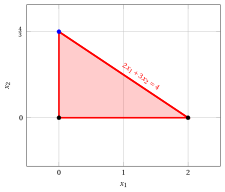
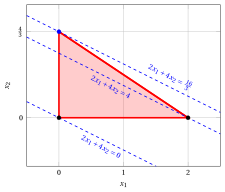
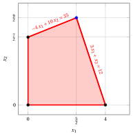
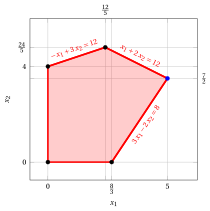
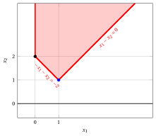
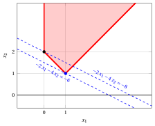
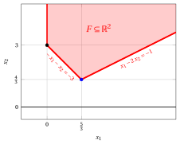
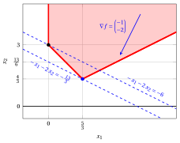
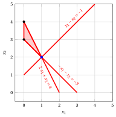
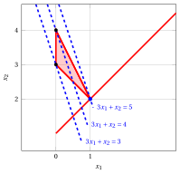

# Esercizi · Problemi di programmazione lineare

**Esercizi · Capitolo 4** · ogni soluzione si apre con un clic · [:material-book-open-variant: Capitolo 4: Problemi di programmazione lineare](../problemi-pl/04-problemi-pl.md) · [:material-file-pdf-box: Eserciziario, volume 1 (PDF)](../pdf/esercizi-1-problemi-di-programmazione-lineare.pdf)

!!! esercizio "Esercizio 4.1: Metodo grafico (P0)"

    Consideriamo il seguente problema LP in forma canonica di massimo con $n=2$ variabili e $m=2$ vincoli:

    $$
    \begin{array}{rrrrrrrrrrrrr}
    {\max} & 2 \, {x_1} & {+} & 4 \, {x_2} \\[2ex]
    \text{soggetto a} & 2 \, {x_1} & {+} & 3 \, {x_2} & {\le} & 4 \\[2ex]
    & {x_1,} &  & {x_2} & { \ge} & { 0 }
    \end{array}
    $$

    **Domande**

    1. Scrivere la funzione obiettivo del problema LP e calcolarne il gradiente.

    2. Scrivere la regione ammissibile del problema LP.

    3. Trovare graficamente una soluzione ottima di questo problema LP. Determinare il valore ottimo.

??? soluzione "Soluzione"

    - La funzione obiettivo del problema LP è la funzione lineare scalare:

        $$
        f: \R^2 \rr \R, \quad
        f\!:\!
        \begin{pmatrix}
        x_1 \\[1ex]
        x_2
        \end{pmatrix}
        \mapsto
        2\,x_1 + 4\,x_2
        \quad
        \textrm{il suo gradiente è}
        \quad
        \nabla f\!\left(
        \begin{pmatrix}
        x_1\\[1ex]
        x_2
        \end{pmatrix}
        \right)
        =
        \begin{pmatrix}
        2 \\[1ex] 4
        \end{pmatrix}.
        $$

    - La regione ammissibile del problema LP è il poliedro:

        $$
        F = \left\{~
        \begin{pmatrix}
        x_1 \\[0.5ex]
        x_2
        \end{pmatrix}
        \in \R^2 :
        2\,x_1+3\,x_2 \le 4,~~
        x_1 \ge 0,~~
        x_2 \ge 0
        ~\right\}.
        $$

        È un poliedro limitato poiché, per esempio, abbiamo:

        $$
        0\le x_1 \le 2,~~ \forall {\boldsymbol x} \in F
        $$

        $$
        0\le x_2 \le \frac{4}{3},~~ \forall {\boldsymbol x} \in F
        $$

        quindi è anche un politopo.

    - Questo è il poliedro della regione ammissibile:

        { .fig .cornice loading=lazy style="width:65%" }

        Queste sono le curve di livello passanti per i vertici del poliedro:

        { .fig .cornice loading=lazy style="width:65%" }

        Una soluzione ottima del problema LP ${\tilde{\boldsymbol x}}(\, LP \,)$ è:

        $$
        \tilde{x}_1=0,~~\tilde{x}_2=\frac{4}{3}
        $$

        il valore ottimo $z(\, LP \,)$ è $\frac{16}{3}$.

!!! esercizio "Esercizio 4.2: Metodo grafico (P2)"

    Consideriamo il seguente problema LP in forma canonica di massimo con $n=2$ variabili e $m=2$ vincoli:

    $$
    \begin{array}{rrrrrrrrrrrrr}
    {\max} & {x_1} & {+} & 3 \, {x_2} \\[2ex]
    \text{soggetto a} & {-}4 \, {x_1} & {+} & 10 \, {x_2} & {\le} & 35 \\[2ex]
    & 3 \, {x_1} & {+} & \, {x_2} & {\le} & 12 \\[2ex]
    & {x_1,} &  & {x_2} & { \ge} & { 0 }
    \end{array}
    $$

    **Domande**

    1. Scrivere la funzione obiettivo del problema LP e calcolarne il gradiente.

    2. Scrivere la regione ammissibile del problema LP.

    3. Trovare graficamente una soluzione ottima di questo problema LP. Determinare il valore ottimo.

??? soluzione "Soluzione"

    - La funzione obiettivo del problema LP è la funzione lineare scalare:

        $$
        f: \R^2 \rr \R, \quad
        f\!:\!
        \begin{pmatrix}
        x_1 \\[1ex]
        x_2
        \end{pmatrix}
        \mapsto
        x_1 + 3\,x_2
        \quad
        \textrm{il suo gradiente è}
        \quad
        \nabla f\!\left(
        \begin{pmatrix}
        x_1\\[1ex]
        x_2
        \end{pmatrix}
        \right)
        =
        \begin{pmatrix}
        1 \\[1ex] 3
        \end{pmatrix}.
        $$

    - La regione ammissibile del problema LP è il poliedro:

        $$
        F = \left\{~
        \begin{pmatrix}
        x_1 \\[0.5ex]
        x_2
        \end{pmatrix}
        \in \R^2 :
        -4\,x_1 +10\,x_2 \le 35,~~
        3\,x_1+x_2 \le 12,~~
        x_1 \ge 0,~~
        x_2 \ge 0
        ~\right\}.
        $$

        È un poliedro limitato poiché, per esempio, abbiamo:

        $$
        0\le x_1 \le 4,~~ \forall {\boldsymbol x} \in F
        $$

        $$
        0\le x_2 \le 5,~~ \forall {\boldsymbol x} \in F
        $$

        quindi è anche un politopo.

    - Questo è il poliedro della regione ammissibile:

        { .fig .cornice loading=lazy style="width:63%" }

        Queste sono le curve di livello passanti per i vertici del poliedro:

        { .fig .cornice loading=lazy style="width:63%" }

        Una soluzione ottima ${\tilde{\boldsymbol x}}(\, LP \,)$ è:

        $$
        \tilde{x}_1=\frac{5}{2},~~\tilde{x}_2=\frac{9}{2}
        $$

        il valore ottimo $z(\, LP \,)$ è $16$.

!!! esercizio "Esercizio 4.3: Metodo grafico (P3)"

    Consideriamo il seguente problema LP in forma canonica di massimo con $n=2$ variabili e $m=2$ vincoli:

    $$
    \begin{array}{rrrrrrrrrrrrr}
    {\max} & {2} \, {x_1} & {+} & {4} \, {x_2} \\[2ex]
    \text{soggetto a} & {-} \, {x_1} & {+} & \, {x_2} & {\le} & {2} \\[2ex]
    & {8} \, {x_1} & {+} & {2} \, {x_2} & {\le} & {19} \\[2ex]
    & {x_1,} &  & {x_2} & { \ge} & { 0 }
    \end{array}
    $$

    **Domande**

    1. Scrivere la funzione obiettivo del problema LP e calcolarne il gradiente.

    2. Scrivere la regione ammissibile del problema LP.

    3. Trovare graficamente una soluzione ottima di questo problema LP. Determinare il valore ottimo.

??? soluzione "Soluzione"

    - La funzione obiettivo del problema LP è la funzione lineare scalare:

        $$
        f: \R^2 \rr \R, \quad
        f\!:\!
        \begin{pmatrix}
        x_1 \\[1ex]
        x_2
        \end{pmatrix}
        \mapsto
        2\,x_1 + 4\,x_2
        \quad
        \textrm{il suo gradiente è}
        \quad
        \nabla f\!\left(
        \begin{pmatrix}
        x_1\\[1ex]
        x_2
        \end{pmatrix}
        \right)
        =
        \begin{pmatrix}
        2 \\[1ex] 4
        \end{pmatrix}.
        $$

    - La regione ammissibile del problema LP è il poliedro:

        $$
        F = \left\{~
        \begin{pmatrix}
        x_1 \\[0.5ex]
        x_2
        \end{pmatrix}
        \in \R^2 :
        -x_1+ x_2 \le 2,~~
        8\,x_1+2\,x_2 \le 19,~~
        x_1 \ge 0,~~
        x_2 \ge 0
        ~\right\}.
        $$

        È un poliedro limitato poiché, per esempio, abbiamo:

        $$
        0\le x_1 \le 4,~~ \forall {\boldsymbol x} \in F
        $$

        $$
        0\le x_2 \le 4,~~ \forall {\boldsymbol x} \in F
        $$

        quindi è anche un politopo.

    - Questo è il poliedro della regione ammissibile:

        { .fig .cornice loading=lazy style="width:65%" }

        Queste sono le curve di livello passanti per i vertici del poliedro:

        { .fig .cornice loading=lazy style="width:65%" }

        Una soluzione ottima del problema LP ${\tilde{\boldsymbol x}}(\, LP \,)$ è:

        $$
        \tilde{x}_1=\frac{3}{2},~~\tilde{x}_2=\frac{7}{2}
        $$

        il valore ottimo $z(\, LP \,)$ è $17$.

!!! esercizio "Esercizio 4.4: Metodo grafico (P10)"

    Consideriamo il seguente problema LP in forma canonica di massimo con $n=2$ variabili e $m=3$ vincoli:

    $$
    \begin{array}{rrrrrrrrrrrrr}
    {\max} & 5 \, {x_1} & {+} & 2 \, {x_2} \\[2ex]
    \text{soggetto a} & {-} \, {x_1} & {+} & 3 \, {x_2} & {\le} & 12 \\[2ex]
    & {x_1} & {+} & 2 \, {x_2} & {\le} & 12 \\[2ex]
    & {3} \, {x_1} & {-} & 2 \, {x_2} & {\le} & {8} \\[2ex]
    & {x_1,} &  & {x_2} & { \ge} & {0}
    \end{array}
    $$

    **Domande**

    1. Scrivere la funzione obiettivo del problema LP e calcolarne il gradiente.

    2. Scrivere la regione ammissibile del problema LP.

    3. Trovare graficamente una soluzione ottima di questo problema LP. Determinare il valore ottimo.

??? soluzione "Soluzione"

    - La funzione obiettivo del problema LP è la funzione lineare scalare:

        $$
        f: \R^2 \rr \R, \quad
        f\!:\!
        \begin{pmatrix}
        x_1 \\[1ex]
        x_2
        \end{pmatrix}
        \mapsto
        5\,x_1 + 2\,x_2
        \quad
        \textrm{il suo gradiente è}
        \quad
        \nabla f\!\left(
        \begin{pmatrix}
        x_1\\[1ex]
        x_2
        \end{pmatrix}
        \right)
        =
        \begin{pmatrix}
        5 \\[1ex] 2
        \end{pmatrix}.
        $$

    - La regione ammissibile del problema LP è il poliedro:

        $$
        F = \left\{~
        \begin{pmatrix}
        x_1 \\[0.5ex]
        x_2
        \end{pmatrix}
        \in \R^2 :~
        \begin{array}{l}
        -x_1+3\,x_2 \le 12,~~
        x_1+2\,x_2 \le 12,~~
        3\,x_1-2\,x_2 \le 8,\\[0.5ex]
        x_1 \ge 0,~~
        x_2 \ge 0
        \end{array}
        ~\right\}.
        $$

        È un poliedro limitato poiché, per esempio, abbiamo:

        $$
        0\le x_1 \le 5,~~ \forall {\boldsymbol x} \in F
        $$

        $$
        0\le x_2 \le 5,~~ \forall {\boldsymbol x} \in F
        $$

        quindi è anche un politopo.

    - Questo è il poliedro della regione ammissibile:

        { .fig .cornice loading=lazy style="width:65%" }

        Queste sono le curve di livello passanti per i vertici del poliedro:

        { .fig .cornice loading=lazy style="width:65%" }

        Una soluzione ottima del problema LP ${\tilde{\boldsymbol x}}(\, LP \,)$ è:

        $$
        \tilde{x}_1=5,~~\tilde{x}_2=\frac{7}{2}
        $$

        il valore ottimo $z(\, LP \,)$ è $32$.

!!! esercizio "Esercizio 4.5: Metodo grafico (P11)"

    Consideriamo il seguente problema LP in forma canonica di massimo con $n=2$ variabili e $m=2$ vincoli:

    $$
    \begin{array}{rrrrrrrrrrrrr}
    {\max} & {-2} \, {x_1} & {-} & {4} \, {x_2} \\[2ex]
    \text{soggetto a} & {-} \, {x_1} & {-} & \, {x_2} & {\le} & {-2} \\[2ex]
    & \, {x_1} & {-} & \, {x_2} & {\le} & {0} \\[2ex]
    & {x_1,} &  & {x_2} & { \ge} & { 0 }
    \end{array}
    $$

    **Domande**

    1. Scrivere la funzione obiettivo del problema LP e calcolarne il gradiente.

    2. Scrivere la regione ammissibile del problema LP.

    3. Trovare graficamente una soluzione ottima di questo problema LP. Determinare il valore ottimo.

    4. Verificare che $\bar{\boldsymbol x} = (1,~2)'$ è una soluzione ammissibile e calcolare il lower bound che essa fornisce sul valore ottimo.

??? soluzione "Soluzione"

    - La funzione obiettivo del problema LP è la funzione lineare scalare:

        $$
        f: \R^2 \rr \R, \quad
        f\!:\!
        \begin{pmatrix}
        x_1 \\[1ex]
        x_2
        \end{pmatrix}
        \mapsto
        -2\,x_1 -4\,x_2
        \quad
        \textrm{il suo gradiente è}
        \quad
        \nabla f\!\left(
        \begin{pmatrix}
        x_1\\[1ex]
        x_2
        \end{pmatrix}
        \right)
        =
        \begin{pmatrix}
        -2 \\[1ex] -4
        \end{pmatrix}.
        $$

    - La regione ammissibile del problema LP è il poliedro:

        $$
        F = \left\{~
        \begin{pmatrix}
        x_1 \\[0.5ex]
        x_2
        \end{pmatrix}
        \in \R^2 :
        -x_1 -x_2 \le -2,~~
        x_1-x_2 \le 0,~~
        x_1 \ge 0,~~
        x_2 \ge 0
        ~\right\}.
        $$

        Non è un poliedro limitato, quindi non è un politopo.

    - Questo è il poliedro della regione ammissibile:

        { .fig .cornice loading=lazy style="width:65%" }

        Queste sono le curve di livello passanti per i vertici del poliedro:

        { .fig .cornice loading=lazy style="width:65%" }

        Una soluzione ottima ${\tilde{\boldsymbol x}}(\, LP \,)$ è:

        $$
        \tilde{x}_1=1,~~\tilde{x}_2=1
        $$

        il valore ottimo $z(\, LP \,)$ è $-6$.

    - Il punto ${\bar{\boldsymbol x}}(\, LP \,)=\begin{pmatrix} 1 \\ 2 \end{pmatrix}$  (dove $\bar{x}_1=1$ e $\bar{x}_2=2$) è una soluzione ammissibile, poiché:

        $$
        - 1 - 2 = -3 \le -2,~~~  1 - 2 = -1 \le 0,~~~ 1\ge 0 {\rm ~~~e~~~} 2 \ge 0 .
        $$

        Di conseguenza, un lower bound $LB(\bar{\boldsymbol x})$ sul valore ottimo $z(\, LP \,)$ del problema LP è:

        $$
        LB(\bar{\boldsymbol x})= -2 \cdot 1 - 4 \cdot 2 = -10 \le z(\, LP \,) = -6 .
        $$

!!! esercizio "Esercizio 4.6: Metodo grafico (P12)"

    Consideriamo il seguente problema LP in forma canonica di massimo con $n=2$ variabili e $m=2$ vincoli:

    $$
    \begin{array}{rrrrrrrrrrrrr}
    {\max} & {-} \, {x_1} & {-} & {2} \, {x_2} \\[1.5ex]
    \text{soggetto a} & {-} \, {x_1} & {-} & \, {x_2} & {\le} & {-3} \\[1.5ex]
    & \, {x_1} & {-} & {2} \, {x_2} & {\le} & {-1} \\[1.5ex]
    & {x_1,} &  & {x_2} & { \ge} & { 0 }
    \end{array}
    $$

    **Domande**

    1. Scrivere la funzione obiettivo del problema LP e calcolarne il gradiente.

    2. Scrivere la regione ammissibile del problema LP.

    3. Trovare graficamente una soluzione ottima di questo problema LP. Determinare il valore ottimo.

??? soluzione "Soluzione"

    - La funzione obiettivo del problema LP è la funzione lineare scalare:

        $$
        f: \R^2 \rr \R, \quad
        f\!:\!
        \begin{pmatrix}
        x_1 \\[1ex]
        x_2
        \end{pmatrix}
        \mapsto
        -\,x_1 - 2\,x_2
        \quad
        \textrm{il suo gradiente è}
        \quad
        \nabla f\!\left(
        \begin{pmatrix}
        x_1\\[1ex]
        x_2
        \end{pmatrix}
        \right)
        =
        \begin{pmatrix}
        -1 \\[1ex] -2
        \end{pmatrix}.
        $$

    - La regione ammissibile del problema LP è il poliedro:

        $$
        F = \left\{~
        \begin{pmatrix}
        x_1 \\[0.5ex]
        x_2
        \end{pmatrix}
        \in \R^2 :
        -x_1 -x_2 \le -3,~~
        x_1-2\,x_2 \le -1,~~
        x_1 \ge 0,~~
        x_2 \ge 0
        ~\right\}.
        $$

        Non è un poliedro limitato poiché, per esempio, i punti $\begin{pmatrix} t \\ t \end{pmatrix}$ appartengono a $F$ per ogni valore $t \ge 3$, quindi non è un politopo.

    - Questo è il poliedro della regione ammissibile:

        { .fig .cornice loading=lazy style="width:65%" }

        Queste sono le curve di livello passanti per i vertici del poliedro:

        { .fig .cornice loading=lazy style="width:65%" }

        Poiché $-x_1 - 2\,x_2 \le 0$ lungo ogni direzione in cui $F$ è illimitato, la funzione obiettivo raggiunge il suo massimo in un vertice di $F$. Una soluzione ottima ${\tilde{\boldsymbol x}}(\, LP \,)$ è:

        $$
        \tilde{x}_1=\frac{5}{3},~~\tilde{x}_2=\frac{4}{3}
        $$

        il valore ottimo $z(\, LP \,)$ è:

        $$
        z(\, LP \,) = -\frac{5}{3} - 2 \cdot \frac{4}{3} = -\frac{13}{3}.
        $$

!!! esercizio "Esercizio 4.7: Metodo grafico (P21)"

    Consideriamo il seguente problema LP in forma canonica di massimo con $n=2$ variabili e $m=3$ vincoli:

    $$
    \begin{array}{rrrrrrrrrrrrr}
    {\max} & \, {x_1} & {+} & {2} \, {x_2} \\[2ex]
    \text{soggetto a} & {- }\, {x_1} & {-} & \, {x_2} & {\le} & {-2} \\[2ex]
    & {4} \, {x_1} & {-} & {2} \, {x_2} & {\le} & {7} \\[2ex]
    & {x_1} & {+} & {5} \, {x_2} & {\le} & {21} \\[2ex]
    & {x_1,} &  & {x_2} & { \ge} & {0 }
    \end{array}
    $$

    **Domande**

    1. Scrivere la funzione obiettivo del problema LP e calcolarne il gradiente.

    2. Scrivere la regione ammissibile del problema LP.

    3. Trovare graficamente una soluzione ottima di questo problema LP. Determinare il valore ottimo.

??? soluzione "Soluzione"

    - La funzione obiettivo del problema LP è la funzione lineare scalare:

        $$
        f: \R^2 \rr \R, \quad
        f\!:\!
        \begin{pmatrix}
        x_1 \\[1ex]
        x_2
        \end{pmatrix}
        \mapsto
        x_1 + 2\,x_2
        \quad
        \textrm{il suo gradiente è}
        \quad
        \nabla f\!\left(
        \begin{pmatrix}
        x_1\\[1ex]
        x_2
        \end{pmatrix}
        \right)
        =
        \begin{pmatrix}
        1 \\[1ex] 2
        \end{pmatrix}.
        $$

    - La regione ammissibile del problema LP è il poliedro:

        $$
        F = \left\{~
        \begin{pmatrix}
        x_1 \\[0.5ex]
        x_2
        \end{pmatrix}
        \in \R^2 :~
        \begin{array}{l}
        -x_1 -x_2 \le -2,~~
        4\,x_1-2\,x_2 \le 7,~~
        x_1+5\,x_2 \le 21,\\[0.5ex]
        x_1 \ge 0,~~
        x_2 \ge 0
        \end{array}
        ~\right\}.
        $$

        È un poliedro limitato poiché, per esempio, abbiamo:

        $$
        0\le x_1 \le 5,~~ \forall {\boldsymbol x} \in F
        $$

        $$
        0\le x_2 \le 5,~~ \forall {\boldsymbol x} \in F
        $$

        quindi è anche un politopo.

    - Questo è il poliedro della regione ammissibile:

        { .fig .cornice loading=lazy style="width:65%" }

        Queste sono le curve di livello passanti per i vertici del poliedro:

        { .fig .cornice loading=lazy style="width:65%" }

        Una soluzione ottima ${\tilde{\boldsymbol x}}(\, LP \,)$ è:

        $$
        \tilde{x}_1=\frac{7}{2},~~\tilde{x}_2=\frac{7}{2}
        $$

        il valore ottimo $z(\, LP \,)$ è $\frac{21}{2}.$

!!! esercizio "Esercizio 4.8: Metodo grafico (P22)"

    Consideriamo il seguente problema LP in forma canonica di massimo con $n=2$ variabili e $m=3$ vincoli:

    $$
    \begin{array}{rrrrrrrrrrrrr}
    {\max} & {3\; x_1} & {+} & {x_2} \\[2ex]
    \text{soggetto a} & {x_1} & {-} & {x_2} & {\le} & {-}1 \\[2ex]
    & {-} \, {x_1} & {-} & \, {x_2} & {\le} & {-}3 \\[2ex]
    & {2\;x_1} & {+} & {x_2} & {\le} & 4 \\[2ex]
    & {x_1,} &  & {x_2} & { \ge} & { 0 }
    \end{array}
    $$

    **Domande**

    1. Scrivere la funzione obiettivo del problema LP e calcolarne il gradiente.

    2. Scrivere la regione ammissibile del problema LP.

    3. Trovare graficamente una soluzione ottima di questo problema LP. Determinare il valore ottimo.

??? soluzione "Soluzione"

    - La funzione obiettivo del problema LP è la funzione lineare scalare:

        $$
        f: \R^2 \rr \R, \quad
        f\!:\!
        \begin{pmatrix}
        x_1 \\[1ex]
        x_2
        \end{pmatrix}
        \mapsto
        3\,x_1 + x_2
        \quad
        \textrm{il suo gradiente è}
        \quad
        \nabla f\!\left(
        \begin{pmatrix}
        x_1\\[1ex]
        x_2
        \end{pmatrix}
        \right)
        =
        \begin{pmatrix}
        3 \\[1ex] 1
        \end{pmatrix}.
        $$

    - La regione ammissibile del problema LP è il poliedro:

        $$
        F = \left\{~
        \begin{pmatrix}
        x_1 \\[0.5ex]
        x_2
        \end{pmatrix}
        \in \R^2 :~
        \begin{array}{l}
        x_1 -x_2 \le -1,~~
        -x_1-x_2 \le -3,~~
        2\,x_1+x_2 \le 4,\\[0.5ex]
        x_1 \ge 0,~~
        x_2 \ge 0
        \end{array}
        ~\right\}.
        $$

        È un poliedro limitato poiché, per esempio, abbiamo:

        $$
        0\le x_1 \le 5,~~ \forall {\boldsymbol x} \in F
        $$

        $$
        0\le x_2 \le 5,~~ \forall {\boldsymbol x} \in F
        $$

        quindi è anche un politopo.

    - Questo è il poliedro della regione ammissibile:

        { .fig .cornice loading=lazy style="width:65%" }

        Queste sono le curve di livello passanti per i vertici del poliedro:

        { .fig .cornice loading=lazy style="width:65%" }

        Una soluzione ottima ${\tilde{\boldsymbol x}}(\, LP \,)$ è:

        $$
        \tilde{x}_1=1,~~\tilde{x}_2=2
        $$

        il valore ottimo $z(\, LP \,)$ è $5$.
