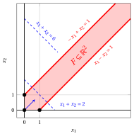

# Esercizi · Esiti possibili e formulazioni equivalenti

**Esercizi · Capitolo 5** · ogni soluzione si apre con un clic · [:material-book-open-variant: Capitolo 5: Esiti possibili e formulazioni equivalenti](../problemi-pl/05-esiti-equivalenze.md) · [:material-file-pdf-box: Eserciziario, volume 1 (PDF)](../pdf/esercizi-1-problemi-di-programmazione-lineare.pdf)

## Metodo grafico

!!! esercizio "Esercizio 5.1: Metodo grafico (P31)"

    Consideriamo il seguente problema LP in forma canonica di massimo con $n=2$ variabili e $m=2$ vincoli:

    $$
    \begin{array}{rrrrrrrrrrrrr}
    {\max} & {x_1} & {+} & \, {x_2} \\[2ex]
    \text{soggetto a} & {-} \, {x_1} & {+} & \, {x_2} & {\le} & {1} \\[2ex]
    & \, {x_1} & {-} & \, {x_2} & {\le} & {1} \\[2ex]
    & {x_1,} &  & {x_2} & { \ge} & { 0 }
    \end{array}
    $$

    **Domande**

    1. Scrivere la funzione obiettivo del problema LP e calcolarne il gradiente.

    2. Scrivere la regione ammissibile del problema LP.

    3. Determinare graficamente se il problema LP ammette una soluzione ottima. In caso affermativo, trovare una soluzione ottima e il valore ottimo; altrimenti, stabilire se il problema LP è inammissibile o illimitato.

??? soluzione "Soluzione"

    - La funzione obiettivo del problema LP è la funzione lineare scalare:

        $$
        f: \R^2 \rr \R, \quad
        f\!:\!
        \begin{pmatrix} x_1 \\[1ex] x_2 \end{pmatrix}
        \mapsto
        x_1 + x_2
        \quad
        \textrm{il suo gradiente è}
        \quad
        \nabla f\!\left( \begin{pmatrix} x_1\\[1ex] x_2 \end{pmatrix} \right)
        =
        \begin{pmatrix} 1 \\[1ex] 1 \end{pmatrix}.
        $$

    - La regione ammissibile del problema LP è il poliedro:

        $$
        F = \left\{~
        \begin{pmatrix} x_1 \\[0.5ex] x_2 \end{pmatrix} \in \R^2 :
        -\,x_1 + x_2 \le 1,~~ x_1 - x_2 \le 1,~~ x_1 \ge 0,~~ x_2 \ge 0 ~\right\}.
        $$

    - Per ogni valore $t \ge 0$, il punto $\bar{\boldsymbol x}(\, LP \,) = \begin{pmatrix} t \\[0.5ex] t \end{pmatrix}$ è una soluzione ammissibile, poiché

        $$
        - t + t = 0 \le 1, \qquad t - t = 0 \le 1, \qquad t \ge 0 {\rm ~~~e~~~} t \ge 0,
        $$

        e il suo valore obiettivo è $LB(\bar{\boldsymbol x}) = t + t = 2 \, t$. Di conseguenza, per ogni valore $M \in \R$, la soluzione ammissibile ottenuta con $t > \frac{M}{2}$ ha un valore obiettivo maggiore di $M$, e quindi questo problema LP è <strong>illimitato</strong>.

        { .fig .cornice loading=lazy style="width:59%" }

!!! esercizio "Esercizio 5.2: Metodo grafico (P33)"

    Consideriamo il seguente problema LP in forma canonica di massimo con $n=2$ variabili e $m=2$ vincoli:

    $$
    \begin{array}{rrrrrrrrrrrrr}
    {\max} & {x_1} & {+} & \, {x_2} \\[2ex]
    \text{soggetto a} & \, {x_1} & {+} & \, {x_2} & {\le} & {2} \\[2ex]
    & {-} \, {x_1} & {-} & \, {x_2} & {\le} & {-4} \\[2ex]
    & {x_1,} &  & {x_2} & { \ge} & { 0 }
    \end{array}
    $$

    **Domande**

    1. Scrivere la funzione obiettivo del problema LP e calcolarne il gradiente.

    2. Scrivere la regione ammissibile del problema LP.

    3. Determinare graficamente se il problema LP ammette una soluzione ottima. In caso affermativo, trovare una soluzione ottima e il valore ottimo; altrimenti, stabilire se il problema LP è inammissibile o illimitato.

??? soluzione "Soluzione"

    - La funzione obiettivo del problema LP è la funzione lineare scalare:

        $$
        f: \R^2 \rr \R, \quad
        f\!:\!
        \begin{pmatrix} x_1 \\[1ex] x_2 \end{pmatrix}
        \mapsto
        x_1 + x_2
        \quad
        \textrm{il suo gradiente è}
        \quad
        \nabla f\!\left( \begin{pmatrix} x_1\\[1ex] x_2 \end{pmatrix} \right)
        =
        \begin{pmatrix} 1 \\[1ex] 1 \end{pmatrix}.
        $$

    - La regione ammissibile del problema LP è il poliedro:

        $$
        F = \left\{~
        \begin{pmatrix} x_1 \\[0.5ex] x_2 \end{pmatrix} \in \R^2 :
        x_1 + x_2 \le 2,~~ -\,x_1 - x_2 \le -4,~~ x_1 \ge 0,~~ x_2 \ge 0 ~\right\}.
        $$

    - Il primo vincolo impone $x_1 + x_2 \le 2$, mentre il secondo, moltiplicato per $-1$, impone $x_1 + x_2 \ge 4$. Nessun punto di $\R^2$ li soddisfa entrambi, e quindi abbiamo $F = \emptyset$: questo problema LP è <strong>inammissibile</strong>.

        { .fig .cornice loading=lazy style="width:59%" }

!!! esercizio "Esercizio 5.3: Metodo grafico (P36)"

    Consideriamo il seguente problema LP in forma canonica di massimo con $n=2$ variabili e $m=2$ vincoli:

    $$
    \begin{array}{rrrrrrrrrrrrr}
    {\max} & {-} \, {x_1} & {-} & \, {x_2} \\[2ex]
    \text{soggetto a} & {-} \, {x_1} & {-} & \, {x_2} & {\le} & {-2} \\[2ex]
    & \, {x_1} & {-} & \, {x_2} & {\le} & {2} \\[2ex]
    & {x_1,} &  & {x_2} & { \ge} & { 0 }
    \end{array}
    $$

    **Domande**

    1. Scrivere la funzione obiettivo del problema LP e calcolarne il gradiente.

    2. Scrivere la regione ammissibile del problema LP.

    3. Determinare graficamente se il problema LP ammette una soluzione ottima. In caso affermativo, trovare una soluzione ottima e il valore ottimo; altrimenti, stabilire se il problema LP è inammissibile o illimitato.

??? soluzione "Soluzione"

    - La funzione obiettivo del problema LP è la funzione lineare scalare:

        $$
        f: \R^2 \rr \R, \quad
        f\!:\!
        \begin{pmatrix} x_1 \\[1ex] x_2 \end{pmatrix}
        \mapsto
        -\,x_1 - x_2
        \quad
        \textrm{il suo gradiente è}
        \quad
        \nabla f\!\left( \begin{pmatrix} x_1\\[1ex] x_2 \end{pmatrix} \right)
        =
        \begin{pmatrix} -1 \\[1ex] -1 \end{pmatrix}.
        $$

    - La regione ammissibile del problema LP è il poliedro:

        $$
        F = \left\{~
        \begin{pmatrix} x_1 \\[0.5ex] x_2 \end{pmatrix} \in \R^2 :
        -\,x_1 - x_2 \le -2,~~ x_1 - x_2 \le 2,~~ x_1 \ge 0,~~ x_2 \ge 0 ~\right\}.
        $$

    - La regione ammissibile $F$ è illimitata, ma il problema LP non è illimitato. Il primo vincolo impone $x_1 + x_2 \ge 2$ per ogni soluzione ammissibile, e quindi

        $$
        - x_1 - x_2 \le -2, \qquad \forall \begin{pmatrix} x_1 \\ x_2\end{pmatrix} \in F .
        $$

        Le due soluzioni ammissibili $\begin{pmatrix} 0 \\ 2\end{pmatrix}$ e $\begin{pmatrix} 2 \\ 0\end{pmatrix}$ raggiungono questo valore, e quindi sono due <strong>soluzioni ottime</strong> e il valore ottimo è $z(\, LP \,) = -2$. Inoltre, ogni punto del segmento che le congiunge è anch'esso una soluzione ottima, e quindi questo problema LP ammette <strong>infinite soluzioni ottime</strong>.

        { .fig .cornice loading=lazy style="width:59%" }

## Equivalenze

!!! esercizio "Esercizio 5.4: Riformulazioni equivalenti (E1)"

    Consideriamo il seguente problema LP in forma di minimo con $n=2$ variabili non negative e $m=2$ vincoli lineari di maggiore o uguale:

    $$
    \begin{array}{rrrrrrrrrrrrr}
    {\min} & {2} \, {x_1} & {+} & {3} \, {x_2} \\[2ex]
    \text{soggetto a} & \, {x_1} & {+} & {2} \, {x_2} & {\ge} & {4} \\[2ex]
    & {3} \, {x_1} & {+} & \, {x_2} & {\ge} & {6} \\[2ex]
    & {x_1,} &  & {x_2} & { \ge} & { 0 }
    \end{array}
    $$

    **Domande**

    1. Scrivere un problema LP equivalente in forma canonica di massimo.

    2. Scrivere un problema LP equivalente in forma standard di massimo.

    3. Sapendo che una soluzione ottima del problema LP in forma canonica di massimo è $\tilde{\boldsymbol x}(\, LP \,) = \begin{pmatrix} \frac{8}{5} \\[0.5ex] \frac{6}{5} \end{pmatrix}$, determinare il valore ottimo del problema LP originale in forma di minimo.

??? soluzione "Soluzione"

    - La funzione obiettivo è da minimizzare, e quindi massimizziamo la funzione obiettivo opposta. I due vincoli lineari sono vincoli di maggiore o uguale, e quindi moltiplichiamo ciascuno di essi per $-1$. Otteniamo il seguente problema LP equivalente in forma canonica di massimo con $n=2$ variabili non negative e $m=2$ vincoli lineari di minore o uguale:

        $$
        \begin{array}{rrrrrrrrrrrrr}
        {-} {\max} & {-2} \, {x_1} & {-} & {3} \, {x_2} \\[2ex]
        \text{soggetto a} & {-} \, {x_1} & {-} & {2} \, {x_2} & {\le} & {-4} \\[2ex]
        & {-3} \, {x_1} & {-} & \, {x_2} & {\le} & {-6} \\[2ex]
        & {x_1,} &  & {x_2} & { \ge} & { 0 }
        \end{array}
        $$

    - Aggiungendo $m=2$ variabili di scarto $x_3$ e $x_4$, otteniamo il seguente problema LP equivalente in forma standard di massimo con $n+m=4$ variabili non negative e $m=2$ vincoli lineari di uguaglianza:

        $$
        \begin{array}{rrrrrrrrrrrrr}
        {-} {\max} & {-2} \, {x_1} & {-} & {3} \, {x_2} \\[2ex]
        \text{soggetto a} & {-} \, {x_1} & {-} & {2} \, {x_2} & {+} & {x_3} &  &  & {=} & {-4} \\[2ex]
        & {-3} \, {x_1} & {-} & \, {x_2} &  &  & {+} & {x_4} & {=} & {-6} \\[2ex]
        & {x_1,} &  & {x_2,} &  & {x_3,} &  & {x_4} & { \ge} & { 0 }
        \end{array}
        $$

    - I due problemi LP hanno le stesse soluzioni ottime, e i loro valori ottimi sono numeri opposti. Il valore ottimo del problema LP in forma canonica di massimo è:

        $$
        z(\, LP_{\max} \,) = -2 \cdot \frac{8}{5} - 3 \cdot \frac{6}{5} = -\frac{16}{5} - \frac{18}{5} = -\frac{34}{5},
        $$

        e quindi il valore ottimo del problema LP originale in forma di minimo è:

        $$
        z(\, LP_{\min} \,) = - \, z(\, LP_{\max} \,) = \frac{34}{5}.
        $$

!!! esercizio "Esercizio 5.5: Riformulazioni equivalenti (E2)"

    Consideriamo il seguente problema LP con $n=2$ variabili non negative e tre vincoli lineari di tre tipi diversi:

    $$
    \begin{array}{rrrrrrrrrrrrr}
    {\max} & {3} \, {x_1} & {+} & \, {x_2} \\[2ex]
    \text{soggetto a} & \, {x_1} & {+} & \, {x_2} & {\le} & {5} \\[2ex]
    & \, {x_1} & {-} & \, {x_2} & {\ge} & {1} \\[2ex]
    & {2} \, {x_1} & {+} & \, {x_2} & {=} & {8} \\[2ex]
    & {x_1,} &  & {x_2} & { \ge} & { 0 }
    \end{array}
    $$

    **Domande**

    1. Scrivere un problema LP equivalente in forma canonica di massimo.

    2. Scrivere un problema LP equivalente in forma standard di massimo.

    3. Verificare che $\bar{\boldsymbol x}(\, LP \,) = \begin{pmatrix} 4 \\ 0 \end{pmatrix}$ sia una soluzione ammissibile del problema LP originale e calcolare i valori delle variabili di scarto e di surplus associate a essa nella forma standard di massimo.

??? soluzione "Soluzione"

    - La funzione obiettivo è già da massimizzare e le variabili sono già non negative. Il primo vincolo è un vincolo di minore o uguale e resta invariato; il secondo è un vincolo di maggiore o uguale e lo moltiplichiamo per $-1$; il terzo è un vincolo di uguaglianza e lo sdoppiamo in due vincoli di minore o uguale. Otteniamo il seguente problema LP equivalente in forma canonica di massimo con $n=2$ variabili non negative e $m=4$ vincoli lineari di minore o uguale:

        $$
        \begin{array}{rrrrrrrrrrrrr}
        {\max} & {3} \, {x_1} & {+} & \, {x_2} \\[2ex]
        \text{soggetto a} & \, {x_1} & {+} & \, {x_2} & {\le} & {5} \\[2ex]
        & {-} \, {x_1} & {+} & \, {x_2} & {\le} & {-1} \\[2ex]
        & {2} \, {x_1} & {+} & \, {x_2} & {\le} & {8} \\[2ex]
        & {-2} \, {x_1} & {-} & \, {x_2} & {\le} & {-8} \\[2ex]
        & {x_1,} &  & {x_2} & { \ge} & { 0 }
        \end{array}
        $$

    - Partendo dal problema LP originale, aggiungiamo una variabile di scarto $x_3$ al primo vincolo, sottraiamo una variabile di surplus $x_4$ dal secondo vincolo, e lasciamo invariato il terzo vincolo. Otteniamo il seguente problema LP equivalente in forma standard di massimo con $4$ variabili non negative e $3$ vincoli lineari di uguaglianza:

        $$
        \begin{array}{rrrrrrrrrrrrr}
        {\max} & {3} \, {x_1} & {+} & \, {x_2} \\[2ex]
        \text{soggetto a} & \, {x_1} & {+} & \, {x_2} & {+} & {x_3} &  &  & {=} & {5} \\[2ex]
        & \, {x_1} & {-} & \, {x_2} &  &  & {-} & {x_4} & {=} & {1} \\[2ex]
        & {2} \, {x_1} & {+} & \, {x_2} &  &  &  &  & {=} & {8} \\[2ex]
        & {x_1,} &  & {x_2,} &  & {x_3,} &  & {x_4} & { \ge} & { 0 }
        \end{array}
        $$

        !!! chiave ""

            Il vincolo di uguaglianza <u>non</u> richiede alcuna variabile aggiuntiva: la richiedono solo i vincoli di disuguaglianza.

    - Il punto $\bar{\boldsymbol x}(\, LP \,) = \begin{pmatrix} 4 \\ 0 \end{pmatrix}$ è una soluzione ammissibile, poiché:

        $$
        4 + 0 = 4 \le 5, \qquad 4 - 0 = 4 \ge 1, \qquad 2 \cdot 4 + 0 = 8 = 8, \qquad 4 \ge 0 {\rm ~~~e~~~} 0 \ge 0 .
        $$

        I valori della variabile di scarto $x_3$ e della variabile di surplus $x_4$ si ottengono dai due vincoli di uguaglianza della forma standard di massimo:

        $$
        \bar x_3 = 5 - \bar x_1 - \bar x_2 = 5 - 4 - 0 = 1
        \qquad {\rm e} \qquad
        \bar x_4 = \bar x_1 - \bar x_2 - 1 = 4 - 0 - 1 = 3 .
        $$

!!! esercizio "Esercizio 5.6: Riformulazioni equivalenti (E3)"

    Consideriamo il seguente problema LP con una variabile non negativa $x_1 \ge 0$, una variabile non positiva $x_2 \le 0$ e una variabile libera $x_3 \gtreqless 0$:

    $$
    \begin{array}{rrrrrrrrrrrrr}
    {\max} & \, {x_1} & {-} & {2} \, {x_2} & {+} & \, {x_3} \\[2ex]
    \text{soggetto a} & \, {x_1} & {+} & \, {x_2} & {+} & {x_3} & {=} & {3} \\[2ex]
    & \, {x_1} &  &  & {-} & {x_3} & {\le} & {2} \\[2ex]
    & {x_1} &  &  &  &  & { \ge} & { 0 } \\[2ex]
    &  &  & {x_2} &  &  & { \le} & { 0 } \\[2ex]
    &  &  &  &  & {x_3} & { \gtreqless} & { 0 }
    \end{array}
    $$

    **Domande**

    1. Scrivere un problema LP equivalente con sole variabili non negative.

    2. Scrivere un problema LP equivalente in forma standard di massimo.

    3. Verificare che $\bar x_1 = 1$, $\bar x_2 = -1$, $\bar x_3 = 3$ sia una soluzione ammissibile del problema LP originale e calcolare la corrispondente soluzione ammissibile del problema LP della prima domanda.

??? soluzione "Soluzione"

    - La variabile $x_2$ è non positiva, e quindi poniamo $x_2 = -\,x_2^{+}$ con $x_2^{+} \ge 0$. La variabile $x_3$ è libera, e quindi poniamo $x_3 = x_3^{+} - x_3^{-}$ con $x_3^{+}, x_3^{-} \ge 0$. Effettuando queste sostituzioni nella funzione obiettivo e nei due vincoli lineari, otteniamo il seguente problema LP equivalente con sole variabili non negative:

        $$
        \begin{array}{rrrrrrrrrrrrr}
        {\max} & \, {x_1} & {+} & {2} \, {x_2^{+}} & {+} & \, {x_3^{+}} & {-} & \, {x_3^{-}} \\[2ex]
        \text{soggetto a} & \, {x_1} & {-} & \, {x_2^{+}} & {+} & {x_3^{+}} & {-} & {x_3^{-}} & {=} & {3} \\[2ex]
        & \, {x_1} &  &  & {-} & {x_3^{+}} & {+} & {x_3^{-}} & {\le} & {2} \\[2ex]
        & {x_1,} &  & {x_2^{+},} &  & {x_3^{+},} &  & {x_3^{-}} & { \ge} & { 0 }
        \end{array}
        $$

    - Il primo vincolo è già un vincolo di uguaglianza. Aggiungendo una variabile di scarto $x_5$ al secondo vincolo, otteniamo il seguente problema LP equivalente in forma standard di massimo con $5$ variabili non negative e $2$ vincoli lineari di uguaglianza:

        $$
        \begin{array}{rrrrrrrrrrrrrrr}
        {\max} & \, {x_1} & {+} & {2} \, {x_2^{+}} & {+} & \, {x_3^{+}} & {-} & \, {x_3^{-}} \\[2ex]
        \text{soggetto a} & \, {x_1} & {-} & \, {x_2^{+}} & {+} & {x_3^{+}} & {-} & {x_3^{-}} &  &  & {=} & {3} \\[2ex]
        & \, {x_1} &  &  & {-} & {x_3^{+}} & {+} & {x_3^{-}} & {+} & {x_5} & {=} & {2} \\[2ex]
        & {x_1,} &  & {x_2^{+},} &  & {x_3^{+},} &  & {x_3^{-},} &  & {x_5} & { \ge} & { 0 }
        \end{array}
        $$

    - Il punto $\bar x_1 = 1$, $\bar x_2 = -1$, $\bar x_3 = 3$ è una soluzione ammissibile del problema LP originale, poiché:

        $$
        1 - 1 + 3 = 3 = 3, \qquad 1 - 3 = -2 \le 2, \qquad 1 \ge 0, \qquad -1 \le 0 .
        $$

        La corrispondente soluzione ammissibile del problema LP con sole variabili non negative si ottiene ponendo:

        $$
        \bar x_1 = 1, \qquad \bar x_2^{+} = - \bar x_2 = 1, \qquad \bar x_3^{+} = 3, \qquad \bar x_3^{-} = 0 .
        $$

        Le due soluzioni hanno lo stesso valore obiettivo:

        $$
        1 - 2 \cdot (-1) + 3 = 6
        \qquad {\rm e} \qquad
        1 + 2 \cdot 1 + 3 - 0 = 6 .
        $$

        !!! chiave ""

            I valori di $x_3^{+}$ e $x_3^{-}$ non sono unici: ogni coppia di numeri non negativi la cui differenza è $\bar x_3 = 3$ dà una soluzione ammissibile con lo stesso valore obiettivo.

!!! esercizio "Esercizio 5.7: Riformulazioni equivalenti (E4)"

    Consideriamo il seguente problema LP generico con una variabile non positiva $x_1 \le 0$, una variabile non negativa $x_2 \ge 0$ e una variabile libera $x_3 \gtreqless 0$:

    $$
    \begin{array}{rrrrrrrrrrrrr}
    {\min} & {4} \, {x_1} & {-} & \, {x_2} & {+} & {2} \, {x_3} \\[2ex]
    \text{soggetto a} & {-} \, {x_1} & {+} & \, {x_2} &  &  & {\ge} & {2} \\[2ex]
    & {2} \, {x_1} &  &  & {+} & {x_3} & {=} & {5} \\[2ex]
    & \, {x_1} & {+} & \, {x_2} & {+} & {x_3} & {\le} & {8} \\[2ex]
    & {x_1} &  &  &  &  & { \le} & { 0 } \\[2ex]
    &  &  & {x_2} &  &  & { \ge} & { 0 } \\[2ex]
    &  &  &  &  & {x_3} & { \gtreqless} & { 0 }
    \end{array}
    $$

    **Domande**

    1. Scrivere un problema LP equivalente in forma canonica di massimo.

    2. Scrivere un problema LP equivalente in forma standard di massimo.

    3. Verificare che $\bar x_1 = -2$, $\bar x_2 = 0$, $\bar x_3 = 9$ sia una soluzione ammissibile del problema LP originale, calcolare la corrispondente soluzione ammissibile del problema LP in forma canonica di massimo e controllare che i due valori obiettivo siano numeri opposti.

??? soluzione "Soluzione"

    - Applichiamo le trasformazioni una alla volta:

        1. la funzione obiettivo è da minimizzare, e quindi massimizziamo la funzione obiettivo opposta;

        2. la variabile $x_1$ è non positiva, e quindi poniamo $x_1 = -\,x_1^{+}$ con $x_1^{+} \ge 0$;

        3. la variabile $x_3$ è libera, e quindi poniamo $x_3 = x_3^{+} - x_3^{-}$ con $x_3^{+}, x_3^{-} \ge 0$;

        4. il primo vincolo è un vincolo di maggiore o uguale, e quindi lo moltiplichiamo per $-1$;

        5. il secondo vincolo è un vincolo di uguaglianza, e quindi lo sdoppiamo in due vincoli di minore o uguale;

        6. il terzo vincolo è un vincolo di minore o uguale, e resta invariato.

        Otteniamo il seguente problema LP equivalente in forma canonica di massimo con $n=4$ variabili non negative e $m=4$ vincoli lineari di minore o uguale:

        $$
        \begin{array}{rrrrrrrrrrrrr}
        {-} {\max} & {4} \, {x_1^{+}} & {+} & \, {x_2} & {-} & {2} \, {x_3^{+}} & {+} & {2} \, {x_3^{-}} \\[2ex]
        \text{soggetto a} & {-} \, {x_1^{+}} & {-} & \, {x_2} &  &  &  &  & {\le} & {-2} \\[2ex]
        & {-2} \, {x_1^{+}} &  &  & {+} & {x_3^{+}} & {-} & {x_3^{-}} & {\le} & {5} \\[2ex]
        & {2} \, {x_1^{+}} &  &  & {-} & {x_3^{+}} & {+} & {x_3^{-}} & {\le} & {-5} \\[2ex]
        & {-} \, {x_1^{+}} & {+} & \, {x_2} & {+} & {x_3^{+}} & {-} & {x_3^{-}} & {\le} & {8} \\[2ex]
        & {x_1^{+},} &  & {x_2,} &  & {x_3^{+},} &  & {x_3^{-}} & { \ge} & { 0 }
        \end{array}
        $$

    - Aggiungendo $m=4$ variabili di scarto $x_5, x_6, x_7, x_8$, otteniamo un problema LP equivalente in forma standard di massimo con $8$ variabili non negative e $4$ vincoli lineari di uguaglianza:

        $$
        \begin{array}{rrcrcrcrcrcrcrcrcr}
        {-} {\max} & {4} \, {x_1^{+}} & {+} & \, {x_2} & {-} & {2} \, {x_3^{+}} & {+} & {2} \, {x_3^{-}} &  &  &  &  &  &  &  &  &  &  \\[2ex]
        \text{subject to} & {-} \, {x_1^{+}} & {-} & \, {x_2} &  &  &  &  & {+} & {x_5} &  &  &  &  &  &  & {=} & {-2} \\[2ex]
        & {-2} \, {x_1^{+}} &  &  & {+} & {x_3^{+}} & {-} & {x_3^{-}} &  &  & {+} & {x_6} &  &  &  &  & {=} & {5} \\[2ex]
        & {2} \, {x_1^{+}} &  &  & {-} & {x_3^{+}} & {+} & {x_3^{-}} &  &  &  &  & {+} & {x_7} &  &  & {=} & {-5} \\[2ex]
        & {-} \, {x_1^{+}} & {+} & \, {x_2} & {+} & {x_3^{+}} & {-} & {x_3^{-}} &  &  &  &  &  &  & {+} & {x_8} & {=} & {8} \\[2ex]
        & {x_1^{+},} &  & {x_2,} &  & {x_3^{+},} &  & {x_3^{-},} &  & {x_5,} &  & {x_6,} &  & {x_7,} &  & {x_8} & {\ge} & {0}
        \end{array}
        $$

    - Il punto $\bar x_1 = -2$, $\bar x_2 = 0$, $\bar x_3 = 9$ è una soluzione ammissibile del problema LP originale, poiché:

        $$
        - (-2) + 0 = 2 \ge 2, \qquad 2 \cdot (-2) + 9 = 5 = 5, \qquad -2 + 0 + 9 = 7 \le 8,
        $$

        $$
        -2 \le 0, \qquad 0 \ge 0 .
        $$

        La corrispondente soluzione ammissibile del problema LP in forma canonica di massimo è:

        $$
        \bar x_1^{+} = - \bar x_1 = 2, \qquad \bar x_2 = 0, \qquad \bar x_3^{+} = 9, \qquad \bar x_3^{-} = 0 ,
        $$

        ed è ammissibile, poiché:

        $$
        -2 - 0 = -2 \le -2, \qquad -4 + 9 - 0 = 5 \le 5,
        $$

        $$
        4 - 9 + 0 = -5 \le -5, \qquad -2 + 0 + 9 - 0 = 7 \le 8 .
        $$

        Infine, i due valori obiettivo sono numeri opposti:

        $$
        4 \cdot (-2) - 0 + 2 \cdot 9 = 10
        \qquad {\rm e} \qquad
        4 \cdot 2 + 0 - 2 \cdot 9 + 2 \cdot 0 = -10 .
        $$
