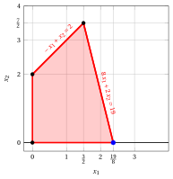
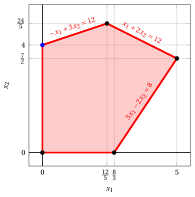
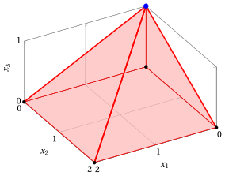
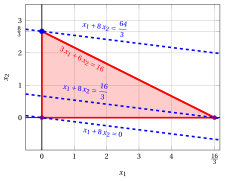
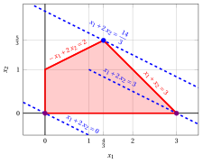
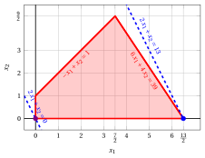
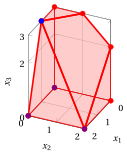
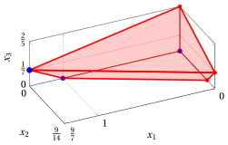

# Esercizi · Algoritmo del simplesso

<div class="info-capitolo" markdown>

**Esercizi · Capitolo 6** · ogni soluzione si apre con un clic · [:material-book-open-variant: Capitolo 6](../simplesso/06-simplesso.md) · [:material-file-pdf-box: Eserciziario, volume 2 (PDF)](../pdf/esercizi-2-simplesso.pdf)

</div>

## Dizionari

<a id="esercizio-6-1"></a>

!!! esercizio "Esercizio 6.1: Dizionari del simplesso (P3)"

    Consideriamo il seguente problema LP in forma canonica di massimo con $n=2$ variabili e $m=2$ vincoli:

    $$
    \begin{array}{rrrrrrrrrrrrr}
    {\max} & {2} \, {x_1} & {+} & {4} \, {x_2} \\[2ex]
    \text{soggetto a} & {-} \, {x_1} & {+} & \, {x_2} & {\le} & {2} \\[2ex]
    & {8} \, {x_1} & {+} & {2} \, {x_2} & {\le} & {19} \\[2ex]
    & {x_1,} &  & {x_2} & { \ge} & { 0 }
    \end{array}
    $$

    Introducendo le variabili di scarto, otteniamo la sua forma standard con $n+m=4$ variabili e $m=2$ vincoli:

    $$
    \begin{array}{rrrrrrrrrrrrr}
    {\max} & {2} \, {x_1} & {+} & {4} \, {x_2} \\[2ex]
    \text{soggetto a} & {-} \, {x_1} & {+} & \, {x_2} & {+} & {x_3} &  &  & {=} & 2 \\[2ex]
    & {8} \, {x_1} & {+} & {2} \, {x_2} &  &  & {+} & {x_4} & {=} & {19} \\[2ex]
    & {x_1,} &  & {x_2,} &  & {x_3,} &  & {x_4} & { \ge} & { 0 }
    \end{array}
    $$

    **Domande**

    1. Considerando la seguente partizione degli indici delle variabili

        $$
        \pazocal{B}= \{1,~~3\} {\rm ~~~~e~~~} \pazocal{N}= \{2,~~4\}
        $$

        verificare che la matrice

        $$
        {\boldsymbol  A}_{\pazocal{B}}=
        \begin{pmatrix}
        -1 & 1\\
        8 & 0\\
        \end{pmatrix}
        $$

        è una base del problema LP.

    2. Calcolare la matrice inversa ${\boldsymbol  A}_{\pazocal{B}}^{-1}$ e scrivere il dizionario associato.

    !!! nota ""

        Un <strong>dizionario del simplesso</strong> è un sistema di equazioni lineari in cui le variabili in base e la funzione obiettivo sono scritte in funzione delle variabili fuori base:

        \begin{equation*}
        \begin{cases} {\boldsymbol  x}_{\pazocal{B}} = {{\bar{\boldsymbol b}}} - {{\bar{\boldsymbol A}}} \; {{\boldsymbol  x}_{\pazocal{N}}}\\[2ex]
        z = {\bar{z}} + { \bar{\boldsymbol c}}' \; {{\boldsymbol  x}_{\pazocal{N}}} \end{cases}
        \qquad \text{dove} \qquad \qquad
        \begin{cases}
        {{\bar{\boldsymbol b}}} = {\boldsymbol  A}_{\pazocal{B}}^{-1} \; {\boldsymbol b}\\[2ex]
        {{\bar{\boldsymbol A}}} =  {{\boldsymbol  A}_{\pazocal{B}}^{-1} \;{\boldsymbol  A}_{\pazocal{N}}}\\[2ex]
        {\bar{z}} =
        {\boldsymbol c}'_{\pazocal{B}} \; {\boldsymbol  A}_{\pazocal{B}}^{-1} \; {\boldsymbol b}   \\[2ex]
        {{ \bar{\boldsymbol c}}'}  = {\boldsymbol c}'_{\pazocal{N}} -  {\boldsymbol c}'_{\pazocal{B}} \; {\boldsymbol  A}_{\pazocal{B}}^{-1} \;{\boldsymbol  A}_{\pazocal{N}}
        \end{cases}
        \end{equation*}

??? soluzione "Soluzione"

    1. Nel problema LP i dati sono:

        $$
        {\boldsymbol  c}=
        \begin{pmatrix}
        2 \\[0.1ex]
        4 \\[0.1ex]
        0  \\[0.1ex]
        0
        \end{pmatrix}
        \quad
        {\boldsymbol  A}=
        \begin{pmatrix}
        -1 & 1 & 1 & 0\\[1ex]
        8 & 2 & 0 & 1\\
        \end{pmatrix}
        \quad
        {\boldsymbol b}=
        \begin{pmatrix}
        2 \\[1ex]
        19 \\
        \end{pmatrix}
        $$

        Con $\pazocal{B}= \{1,~~3\}$ e $\pazocal{N}= \{2,~~4\}$, abbiamo:

        $$
        {\boldsymbol  x}_{\pazocal{B}}=
        \begin{pmatrix}
        x_1 \\
        x_3 \\
        \end{pmatrix} ~~~
        {\boldsymbol  x}_{\pazocal{N}}=
        \begin{pmatrix}
        x_2 \\
        x_4 \\
        \end{pmatrix} ~~~
        {\boldsymbol  A}_{\pazocal{B}}=
        \begin{pmatrix}
        -1 & 1\\
        8 & 0\\
        \end{pmatrix} ~~~
        {\boldsymbol  A}_{\pazocal{N}}=
        \begin{pmatrix}
        1 & 0\\
        2 & 1\\
        \end{pmatrix} ~~~
        {\boldsymbol c}_{\pazocal{B}}=
        \begin{pmatrix}
        2 \\
        0 \\
        \end{pmatrix} ~~~
        {\boldsymbol c}_{\pazocal{N}}=
        \begin{pmatrix}
        4 \\
        0 \\
        \end{pmatrix}
        $$

        Abbiamo:

        $$
        {\boldsymbol  A}_{\pazocal{B}}=
        \begin{pmatrix}
        -1 & 1\\
        8 & 0\\
        \end{pmatrix}
        {\rm ~~~e~}
        \det
        \left(
        {\boldsymbol  A}_{\pazocal{B}}
        \right)
        =
        -1 \cdot 0 - 1 \cdot 8 = -8 \neq 0 \text{   quindi  } \rank({\boldsymbol  A}_{\pazocal{B}}) = 2
        $$

        di conseguenza, la matrice ${\boldsymbol  A}_{\pazocal{B}}$ è invertibile ed è una base del problema LP.

    2. Calcoliamo la matrice inversa:

        \begin{align*}
        &\left(
        \begin{array}{cc|cc}
        {-1} & {1} & {1} & {0} \\[1ex]
        {8} & {0} & {0} & {1}
        \end{array}
        \right) \\[2ex]
        &\left(
        \begin{array}{cc|cc}
        {1} & {-1} & {-1} & {0} \\[1ex]
        {8} & {0} & {0} & {1}
        \end{array}
        \right) \hspace{1em} \text{(} R_1 \leftarrow -R_1 \text{)} \\[2ex]
        &\left(
        \begin{array}{cc|cc}
        {1} & {-1} & {-1} & {0} \\[1ex]
        {0} & {8} & {8} & {1}
        \end{array}
        \right) \hspace{1em} \text{(} R_2 \leftarrow R_2 - 8 R_1 \text{)} \\[2ex]
        &\left(
        \begin{array}{cc|cc}
        {1} & {-1} & {-1} & {0} \\[1ex]
        {0} & {1} & {1} & {\tfrac{1}{8}}
        \end{array}
        \right) \hspace{1em} \text{(} R_2 \leftarrow \tfrac{1}{8} R_2 \text{)} \\[2ex]
        &\left(
        \begin{array}{cc|cc}
        {1} & {0} & {0} & {\tfrac{1}{8}} \\[1ex]
        {0} & {1} & {1} & {\tfrac{1}{8}}
        \end{array}
        \right) \hspace{1em} \text{(} R_1 \leftarrow R_1 + R_2 \text{)}
        \end{align*}

        Di conseguenza, abbiamo:

        $$
        {\boldsymbol A}_{\pazocal{B}}^{-1} =
        \begin{pmatrix}
        0 & \tfrac{1}{8} \\[1ex]
        1 & \tfrac{1}{8}
        \end{pmatrix}
        $$

        e possiamo calcolare:

        \begin{align*}
        {{\bar{\boldsymbol b}}} &= {\boldsymbol  A}_{\pazocal{B}}^{-1} \; {\boldsymbol b} = \begin{pmatrix}
        0 & \frac{1}{8}\\[1ex]
        1 & \frac{1}{8}\\
        \end{pmatrix} \begin{pmatrix}
        2 \\[1ex]
        19 \\
        \end{pmatrix} = \begin{pmatrix}
        \frac{19}{8} \\[1ex]
        \frac{35}{8} \\
        \end{pmatrix}\\[2ex]
        {{\bar{\boldsymbol A}}} &=  {{\boldsymbol  A}_{\pazocal{B}}^{-1} \;{\boldsymbol  A}_{\pazocal{N}}} = \begin{pmatrix}
        0 & \frac{1}{8}\\[1ex]
        1 & \frac{1}{8}\\
        \end{pmatrix} \begin{pmatrix}
        1 & 0\\[1ex]
        2 & 1\\
        \end{pmatrix}
        =
        \begin{pmatrix}
        \frac{1}{4} & \frac{1}{8}\\[1ex]
        \frac{5}{4} & \frac{1}{8}\\
        \end{pmatrix}
        \\[2ex]
        {\bar{z}} &=
        {\boldsymbol c}'_{\pazocal{B}} \; {\boldsymbol  A}_{\pazocal{B}}^{-1} \; {\boldsymbol b}    =
        \begin{pmatrix}
        2 & 0\\
        \end{pmatrix}
        \begin{pmatrix}
        0 & \frac{1}{8}\\[1ex]
        1 & \frac{1}{8}\\
        \end{pmatrix} \begin{pmatrix}
        2 \\[1ex]
        19 \\
        \end{pmatrix} =  \begin{pmatrix}
        0 & \frac{1}{4}
        \end{pmatrix} \begin{pmatrix}
        2 \\[1ex]
        19 \\
        \end{pmatrix} = \frac{19}{4}
        \\[2ex]
        {{ \bar{\boldsymbol c}}'}  &= {\boldsymbol c}'_{\pazocal{N}} -  {\boldsymbol c}'_{\pazocal{B}} \; {\boldsymbol  A}_{\pazocal{B}}^{-1} \;{\boldsymbol  A}_{\pazocal{N}} = \begin{pmatrix}
        4 & 0\\
        \end{pmatrix}
        -
        \begin{pmatrix}
        2 & 0\\
        \end{pmatrix}
        \begin{pmatrix}
        0 & \frac{1}{8}\\[1ex]
        1 & \frac{1}{8}\\
        \end{pmatrix}
        \begin{pmatrix}
        1 & 0\\[1ex]
        2 & 1\\
        \end{pmatrix} \\[2ex]
        &= \begin{pmatrix}
        4 & 0 \\
        \end{pmatrix} - \begin{pmatrix}
        0 & \frac{1}{4} \\
        \end{pmatrix} \begin{pmatrix}
        1 & 0\\[1ex]
        2 & 1\\
        \end{pmatrix} \\[2ex]
        &=
        \begin{pmatrix}
        4 & 0
        \end{pmatrix}
        -
        \begin{pmatrix}
        \frac{1}{2} & \frac{1}{4}
        \end{pmatrix}
        =
        \begin{pmatrix}
        \frac{7}{2} & -\frac{1}{4}
        \end{pmatrix}
        \end{align*}

        Il dizionario è:

        \begin{equation*}
        \begin{cases}
        \begin{pmatrix}
        x_1 \\[1ex]
        x_3 \\
        \end{pmatrix}=\begin{pmatrix}
        \frac{19}{8} \\[1ex]
        \frac{35}{8} \\
        \end{pmatrix} - \begin{pmatrix}
        \frac{1}{4} & \frac{1}{8}\\[1ex]
        \frac{5}{4} & \frac{1}{8}\\
        \end{pmatrix} \;\begin{pmatrix}
        x_2 \\[1ex]
        x_4 \\
        \end{pmatrix}\\[4ex]
        z=  \frac{19}{4}  + \begin{pmatrix}
        \frac{7}{2} & -\frac{1}{4}
        \end{pmatrix} \;\begin{pmatrix}
        x_2 \\[1ex]
        x_4 \\
        \end{pmatrix}\\[2ex]
        \end{cases}
        \end{equation*}

        o, equivalentemente:

        \begin{equation*}
        \begin{cases}
        \begin{array}{rrrrrrrrrrrrr}
        {x_1=\frac{19}{8}} & {-} & {\frac{1}{4}} \, {x_2} & {-} & {\frac{1}{8}}\, {x_4} \\[2ex]
        {x_3=\frac{35}{8}} & {-} & {\frac{5}{4}}\, {x_2} & {-} & {\frac{1}{8}}\, {x_4} \\[2ex]
        {z =\frac{19}{4}} & {+} & {\frac{7}{2}} \, {x_2} & {-} & {\frac{1}{4}} \, {x_4}
        \end{array}
        \end{cases}
        \end{equation*}

        dove $\pazocal{B}=\{1,3\}$ e $\pazocal{N}=\{2,4\}$. La soluzione di base ammissibile è:

        $$
        \bar x_1=\dfrac{19}{8},~~
        \bar x_3=\dfrac{35}{8},~~~~
        \bar x_2=0,~~
        \bar x_4=0
        ~~~\text{di valore   } \dfrac{19}{4}
        $$

    <strong>Soluzione grafica:</strong>

    La regione ammissibile del problema LP (in forma canonica) è il poliedro ombreggiato in rosso: 

    { .fig .ovale loading=lazy style="width:65%" }

    In blu la soluzione di base ammissibile associata alla base $\pazocal{B}=\{1,3\}$, cioè il vertice:

    $$
    \begin{pmatrix} \frac{19}{8} \\[1ex] 0 \end{pmatrix}.
    $$

<a id="esercizio-6-2"></a>

!!! esercizio "Esercizio 6.2: Dizionari del simplesso (P10)"

    Consideriamo il seguente problema LP in forma canonica di massimo con $n=2$ variabili e $m=3$ vincoli:

    $$
    \begin{array}{rrrrrrrrrrrrr}
    {\max} & 5 \, {x_1} & {+} & 2 \, {x_2} \\[2ex]
    \text{soggetto a} & {-} \, {x_1} & {+} & 3 \, {x_2} & {\le} & 12 \\[2ex]
    & {x_1} & {+} & 2 \, {x_2} & {\le} & 12 \\[2ex]
    & {3} \, {x_1} & {-} & 2 \, {x_2} & {\le} & {8} \\[2ex]
    & {x_1,} &  & {x_2} & { \ge} & {0}
    \end{array}
    $$

    Introducendo le variabili di scarto otteniamo la sua forma standard con $n+m=5$ variabili e $m=3$ vincoli:

    $$
    \begin{array}{rrrrrrrrrrrrrrr}
    {\max} & 5 \, {x_1} & {+} & 2 \, {x_2} \\[2ex]
    \text{soggetto a} & {-} \, {x_1} & {+} & 3 \, {x_2} & {+} & {x_3} &  &  &  &  & {=} & 12 \\[2ex]
    & {x_1} & {+} & 2 \, {x_2} &  &  & {+} & {x_4} &  &  & {=} & 12 \\[2ex]
    & 3 \, {x_1} & {-} & 2 \, {x_2} &  &  &  &  & {+} & {x_5} & {=} & 8 \\[2ex]
    & {x_1,} &  & {x_2,} &  & {x_3,} &  & {x_4,} &  & {x_5} & {\ge} & {0}
    \end{array}
    $$

    **Domande**

    1. Considerando la seguente partizione degli indici delle variabili

        $$
        \pazocal{B}= \{2,~~4,~~5\} {\rm ~~~~e~~~} \pazocal{N}= \{1,~~3\}
        $$

        verificare che la matrice

        $$
        {\boldsymbol  A}_{\pazocal{B}}=
        \begin{pmatrix}
        3 & 0 & 0 \\
        2 & 1 & 0 \\
        -2 & 0 & 1 \\
        \end{pmatrix}
        $$

        è una base del problema LP.

    2. Calcolare la matrice inversa ${\boldsymbol  A}_{\pazocal{B}}^{-1}$ e scrivere il dizionario associato. La soluzione di base associata è ammissibile?

    !!! nota ""

        Un <strong>dizionario del simplesso</strong> è un sistema di equazioni lineari in cui le variabili in base e la funzione obiettivo sono scritte in funzione delle variabili fuori base:

        \begin{equation*}
        \begin{cases} {\boldsymbol  x}_{\pazocal{B}} = {{\bar{\boldsymbol b}}} - {{\bar{\boldsymbol A}}} \; {{\boldsymbol  x}_{\pazocal{N}}}\\[2ex]
        z = {\bar{z}} + { \bar{\boldsymbol c}}' \; {{\boldsymbol  x}_{\pazocal{N}}} \end{cases}
        \qquad \text{dove} \qquad \qquad
        \begin{cases}
        {{\bar{\boldsymbol b}}} = {\boldsymbol  A}_{\pazocal{B}}^{-1} \; {\boldsymbol b}\\[2ex]
        {{\bar{\boldsymbol A}}} =  {{\boldsymbol  A}_{\pazocal{B}}^{-1} \;{\boldsymbol  A}_{\pazocal{N}}}\\[2ex]
        {\bar{z}} =
        {\boldsymbol c}'_{\pazocal{B}} \; {\boldsymbol  A}_{\pazocal{B}}^{-1} \; {\boldsymbol b}   \\[2ex]
        {{ \bar{\boldsymbol c}}'}  = {\boldsymbol c}'_{\pazocal{N}} -  {\boldsymbol c}'_{\pazocal{B}} \; {\boldsymbol  A}_{\pazocal{B}}^{-1} \;{\boldsymbol  A}_{\pazocal{N}}
        \end{cases}
        \end{equation*}

??? soluzione "Soluzione"

    1. Nel problema LP i dati sono:

        $$
        {\boldsymbol  c}=
        \begin{pmatrix}
        5 \\[0.5ex]
        2 \\[0.5ex]
        0  \\[0.5ex]
        0  \\[0.5ex]
        0
        \end{pmatrix}
        \quad
        {\boldsymbol  A}=
        \begin{pmatrix}
        -1 & 3 & 1 & 0 & 0\\[1ex]
        1 & 2 & 0 & 1 & 0\\[1ex]
        3 & -2 & 0 & 0 & 1\\
        \end{pmatrix}
        \quad
        {\boldsymbol b}=
        \begin{pmatrix}
        12 \\[1ex]
        12 \\[1ex]
        8 \\
        \end{pmatrix}
        $$

        Con $\pazocal{B}= \{2,~~4,~~5\}$, abbiamo:

        $$
        {\boldsymbol  A}_{\pazocal{B}}=
        \begin{pmatrix}
        3 & 0 & 0 \\
        2 & 1 & 0 \\
        -2 & 0 & 1 \\
        \end{pmatrix}
        $$

        e

        \begin{align*}
        \det
        \left(
        {\boldsymbol  A}_{\pazocal{B}}
        \right)
        &=
        3 \cdot (1 \cdot 1 - 0 \cdot 0) - 0 \cdot (2 \cdot 1 - 0 \cdot (-2)) + 0 \cdot (2 \cdot 0 - 1 \cdot (-2)) \\
        &= 3 \cdot 1 = 3 \neq 0
        \end{align*}

        e quindi $\rank({\boldsymbol  A}_{\pazocal{B}}) = 3$. Di conseguenza, la matrice ${\boldsymbol  A}_{\pazocal{B}}$ è invertibile ed è una base del problema LP.

    2. Calcoliamo la matrice inversa ${\boldsymbol  A}_{\pazocal{B}}^{-1}$ con il metodo di Gauss-Jordan:

        \begin{align*}
        &\left(
        \begin{array}{ccc|ccc}
        {3} & {0} & {0} & {1} & {0} & {0} \\
        {2} & {1} & {0} & {0} & {1} & {0} \\
        {-2} & {0} & {1} & {0} & {0} & {1}
        \end{array}
        \right) \\[1ex]
        &\left(
        \begin{array}{ccc|ccc}
        {1} & {0} & {0} & {\frac{1}{3}} & {0} & {0} \\
        {2} & {1} & {0} & {0} & {1} & {0} \\
        {-2} & {0} & {1} & {0} & {0} & {1}
        \end{array}
        \right) \hspace{1em} \text{(} R_1 \leftarrow \tfrac{1}{3} R_1 \text{)} \\[1ex]
        &\left(
        \begin{array}{ccc|ccc}
        {1} & {0} & {0} & {\frac{1}{3}} & {0} & {0} \\[0.5ex]
        {0} & {1} & {0} & {-\frac{2}{3}} & {1} & {0} \\[0.5ex]
        {0} & {0} & {1} & {\frac{2}{3}} & {0} & {1}
        \end{array}
        \right) \hspace{1em} \text{(} R_2 \leftarrow R_2 - 2R_1,\ R_3 \leftarrow R_3 + 2R_1 \text{)}
        \end{align*}

        Poiché $\pazocal{B}= \{2,~~4,~~5\}$, abbiamo:

        $$
        {\boldsymbol x}_{\pazocal{B}}=
        \begin{pmatrix}
        x_2 \\[1ex]
        x_4 \\[1ex]
        x_5 \\
        \end{pmatrix}
        \quad\quad
        {\boldsymbol A}_{\pazocal{B}}=
        \begin{pmatrix}
        3 & 0 & 0 \\[1ex]
        2 & 1 & 0 \\[1ex]
        -2 & 0 & 1 \\
        \end{pmatrix}
        \quad\quad
        {\boldsymbol c}_{\pazocal{B}}=
        \begin{pmatrix}
        2 \\[1ex]
        0 \\[1ex]
        0 \\
        \end{pmatrix}
        $$

        e

        $$
        \boldsymbol{A}_{\pazocal{B}}^{-1} =
        \begin{pmatrix}
        \frac{1}{3} & 0 & 0 \\[1ex]
        -\frac{2}{3} & 1 & 0 \\[1ex]
        \frac{2}{3} & 0 & 1
        \end{pmatrix}
        $$

        di conseguenza $\pazocal{N}= \{1,~~3\}$ e abbiamo:

        $$
        {\boldsymbol x}_{\pazocal{N}}=
        \begin{pmatrix}
        x_1 \\[1ex]
        x_3 \\
        \end{pmatrix}
        \quad\quad
        {\boldsymbol A}_{\pazocal{N}}=
        \begin{pmatrix}
        -1 & 1 \\[1ex]
        1 & 0 \\[1ex]
        3 & 0 \\
        \end{pmatrix}
        \quad\quad
        {\boldsymbol c}_{\pazocal{N}}=
        \begin{pmatrix}
        5 \\[1ex]
        0 \\
        \end{pmatrix}
        $$

        Possiamo calcolare:

        \begin{align*}
        {{{\bar{\boldsymbol b}}}} &= {\boldsymbol  A}_{\pazocal{B}}^{-1} \; {\boldsymbol b} = \begin{pmatrix}
        \frac{1}{3} & 0 & 0\\[1ex]
        -\frac{2}{3} & 1 & 0\\[1ex]
        \frac{2}{3} & 0 & 1\\
        \end{pmatrix} \begin{pmatrix}
        12 \\[1ex]
        12 \\[1ex]
        8 \\
        \end{pmatrix} = \begin{pmatrix}
        4 \\[1ex]
        4 \\[1ex]
        16 \\
        \end{pmatrix}\\[2ex]
        {{\bar{\boldsymbol A}}} &=  {{{\boldsymbol  A}_{\pazocal{B}}^{-1} \;{\boldsymbol  A}_{\pazocal{N}}}} = \begin{pmatrix}
        \frac{1}{3} & 0 & 0\\[1ex]
        -\frac{2}{3} & 1 & 0\\[1ex]
        \frac{2}{3} & 0 & 1\\
        \end{pmatrix} \begin{pmatrix}
        -1 & 1 \\[1ex]
        1 & 0 \\[1ex]
        3 & 0 \\
        \end{pmatrix}
        =
        \begin{pmatrix}
        -\frac{1}{3} & \frac{1}{3}\\[1ex]
        \frac{5}{3} & -\frac{2}{3}\\[1ex]
        \frac{7}{3} & \frac{2}{3}
        \end{pmatrix}
        \\[2ex]
        {\bar{z}} &=
        {\boldsymbol c}'_{\pazocal{B}} \; {\boldsymbol  A}_{\pazocal{B}}^{-1} \; {\boldsymbol b}    =
        \begin{pmatrix}
        2 & 0 & 0\\
        \end{pmatrix}
        \begin{pmatrix}
        \frac{1}{3} & 0 & 0\\[1ex]
        -\frac{2}{3} & 1 & 0\\[1ex]
        \frac{2}{3} & 0 & 1\\
        \end{pmatrix} \begin{pmatrix}
        12 \\[1ex]
        12 \\[1ex]
        8
        \end{pmatrix} =  \begin{pmatrix}
        \frac{2}{3} & 0 & 0
        \end{pmatrix} \begin{pmatrix}
        12 \\[1ex]
        12 \\[1ex]
        8 \\
        \end{pmatrix} = 8
        \end{align*}

        \begin{align*}
        {{ \bar{\boldsymbol c}}'}  &= {\boldsymbol c}'_{\pazocal{N}} -  {\boldsymbol c}'_{\pazocal{B}} \; {\boldsymbol  A}_{\pazocal{B}}^{-1} \;{\boldsymbol  A}_{\pazocal{N}} = \begin{pmatrix}
        5 & 0\\
        \end{pmatrix}
        -
        \begin{pmatrix}
        2 & 0 & 0\\
        \end{pmatrix}
        \begin{pmatrix}
        \frac{1}{3} & 0 & 0\\[1ex]
        -\frac{2}{3} & 1 & 0\\[1ex]
        \frac{2}{3} & 0 & 1\\
        \end{pmatrix}
        \begin{pmatrix}
        -1 & 1 \\[1ex]
        1 & 0 \\[1ex]
        3 & 0 \\
        \end{pmatrix}\\[1ex]
        &= \begin{pmatrix}
        5 & 0 \\
        \end{pmatrix} - \begin{pmatrix}
        \frac{2}{3} & 0 & 0 \\
        \end{pmatrix} \begin{pmatrix}
        -1 & 1 \\[1ex]
        1 & 0 \\[1ex]
        3 & 0 \\
        \end{pmatrix} =
        \begin{pmatrix}
        5 & 0  \\
        \end{pmatrix}
        -
        \begin{pmatrix}
        -\frac{2}{3} & \frac{2}{3} \\
        \end{pmatrix}
        =
        \begin{pmatrix}
        \frac{17}{3} & -\frac{2}{3} \\
        \end{pmatrix}
        \end{align*}

        Di conseguenza, il dizionario associato è:

        \begin{equation*}
        \begin{cases}
        \begin{pmatrix}
        x_2 \\[1ex]
        x_4 \\[1ex]
        x_5 \\
        \end{pmatrix}=\begin{pmatrix}
        4 \\[1ex]
        4 \\[1ex]
        16 \\
        \end{pmatrix} - \begin{pmatrix}
        -\frac{1}{3} & \frac{1}{3}\\[1ex]
        \frac{5}{3} & -\frac{2}{3}\\[1ex]
        \frac{7}{3} & \frac{2}{3}
        \end{pmatrix} \;\begin{pmatrix}
        x_1 \\[1ex]
        x_3 \\
        \end{pmatrix}\\[5ex]
        z=  8  + \begin{pmatrix}
        \frac{17}{3} & -\frac{2}{3}
        \end{pmatrix} \;\begin{pmatrix}
        x_1 \\[1ex]
        x_3 \\
        \end{pmatrix}\\[2ex]
        \end{cases}
        \end{equation*}

        o, equivalentemente:

        \begin{equation*}
        \begin{cases}
        \begin{array}{rrrrrrrrrrrrr}
        {x_2} & {=} & {4} & {+} & {\frac{1}{3}}\, {x_1} & {-} & {\frac{1}{3}}\, {x_3} \\[2ex]
        {x_4} & {=} & {4} & {-} & {\frac{5}{3}}\, {x_1} & {+} & {\frac{2}{3}}\, {x_3} \\[2ex]
        {x_5} & {=} & {16} & {-} & {\frac{7}{3}}\, {x_1} & {-} & {\frac{2}{3}}\, {x_3} \\[2ex]
        {z} & {=} & {8} & {+} & {\frac{17}{3}}\, {x_1} & {-} & {\frac{2}{3}}\, \, {x_3}
        \end{array}
        \end{cases}
        \end{equation*}

        dove $\pazocal{B}=\{2,4,5\}$ e $\pazocal{N}=\{1,3\}$. Poiché ${\bar{\boldsymbol b}} \ge {\boldsymbol 0}$, la soluzione di base associata è ammissibile. La soluzione di base ammissibile è:

        $$
        \bar x_2=4,~~
        \bar x_4=4,~~
        \bar x_5=16,~~~~
        \bar x_1=0,~~
        \bar x_3=0
        ~~~\text{di valore   } 8
        $$

    <strong>Soluzione grafica:</strong>

    La regione ammissibile del problema LP (in forma canonica) è il poliedro ombreggiato in rosso: 

    { .fig .ovale loading=lazy style="width:65%" }

    In blu la soluzione di base ammissibile associata alla base $\pazocal{B}=\{2,4,5\}$, cioè il vertice:

    $$
    \begin{pmatrix} 0 \\[1ex] 4 \end{pmatrix}.
    $$

<a id="esercizio-6-3"></a>

!!! esercizio "Esercizio 6.3: Dizionari del simplesso (P11)"

    Consideriamo il seguente problema LP in forma canonica di massimo con $n=2$ variabili e $m=2$ vincoli:

    $$
    \begin{array}{rrrrrrrrrrrrr}
    {\max} & {-2} \, {x_1} & {-} & {4} \, {x_2} \\[2ex]
    \text{soggetto a} & {-} \, {x_1} & {-} & \, {x_2} & {\le} & {-2} \\[2ex]
    & \, {x_1} & {-} & \, {x_2} & {\le} & {0} \\[2ex]
    & {x_1,} &  & {x_2} & { \ge} & { 0 }
    \end{array}
    $$

    Introducendo le variabili di scarto, otteniamo la sua forma standard con $n+m=4$ variabili e $m=2$ vincoli:

    $$
    \begin{array}{rrrrrrrrrrrrr}
    {\max} & {-2} \, {x_1} & {-} & {4} \, {x_2} \\[2ex]
    \text{soggetto a} & {-} \, {x_1} & {-} & \, {x_2} & {+} & {x_3} &  &  & {=} & {-2} \\[2ex]
    & {x_1} & {-} & {x_2} &  &  & {+} & {x_4} & {=} & {0} \\[2ex]
    & {x_1,} &  & {x_2,} &  & {x_3,} &  & {x_4} & { \ge} & { 0 }
    \end{array}
    $$

    **Domande**

    1. Considerando la seguente partizione degli indici delle variabili

        $$
        \pazocal{B}= \{1,~~2\} {\rm ~~~~e~~~} \pazocal{N}= \{3,~~4\}
        $$

        verificare che la matrice

        $$
        {\boldsymbol  A}_{\pazocal{B}}=
        \begin{pmatrix}
        -1 & -1\\
        1 & -1\\
        \end{pmatrix}
        $$

        è una base del problema LP.

    2. Calcolare la matrice inversa ${\boldsymbol  A}_{\pazocal{B}}^{-1}$ e scrivere il dizionario associato.

    !!! nota ""

        Un <strong>dizionario del simplesso</strong> è un sistema di equazioni lineari in cui le variabili in base e la funzione obiettivo sono scritte in funzione delle variabili fuori base:

        \begin{equation*}
        \begin{cases} {\boldsymbol  x}_{\pazocal{B}} = {{\bar{\boldsymbol b}}} - {{\bar{\boldsymbol A}}} \; {{\boldsymbol  x}_{\pazocal{N}}}\\[2ex]
        z = {\bar{z}} + { \bar{\boldsymbol c}}' \; {{\boldsymbol  x}_{\pazocal{N}}} \end{cases}
        \qquad \text{dove} \qquad \qquad
        \begin{cases}
        {{\bar{\boldsymbol b}}} = {\boldsymbol  A}_{\pazocal{B}}^{-1} \; {\boldsymbol b}\\[2ex]
        {{\bar{\boldsymbol A}}} =  {{\boldsymbol  A}_{\pazocal{B}}^{-1} \;{\boldsymbol  A}_{\pazocal{N}}}\\[2ex]
        {\bar{z}} =
        {\boldsymbol c}'_{\pazocal{B}} \; {\boldsymbol  A}_{\pazocal{B}}^{-1} \; {\boldsymbol b}   \\[2ex]
        {{ \bar{\boldsymbol c}}'}  = {\boldsymbol c}'_{\pazocal{N}} -  {\boldsymbol c}'_{\pazocal{B}} \; {\boldsymbol  A}_{\pazocal{B}}^{-1} \;{\boldsymbol  A}_{\pazocal{N}}
        \end{cases}
        \end{equation*}

??? soluzione "Soluzione"

    1. Nel problema LP i dati sono:

        $$
        {\boldsymbol  c}=
        \begin{pmatrix}
        -2 \\[0.1ex]
        -4 \\[0.1ex]
        0  \\[0.1ex]
        0
        \end{pmatrix}
        \quad
        {\boldsymbol  A}=
        \begin{pmatrix}
        -1 & -1 & 1 & 0\\[1ex]
        1 & -1 & 0 & 1\\
        \end{pmatrix}
        \quad
        {\boldsymbol b}=
        \begin{pmatrix}
        -2 \\[1ex]
        0 \\
        \end{pmatrix}
        $$

        Con $\pazocal{B}= \{1,~~2\}$ e $\pazocal{N}= \{3,~~4\}$, abbiamo:

        $$
        {\boldsymbol  x}_{\pazocal{B}}=
        \begin{pmatrix}
        x_1 \\
        x_2 \\
        \end{pmatrix} ~~~
        {\boldsymbol  x}_{\pazocal{N}}=
        \begin{pmatrix}
        x_3 \\
        x_4 \\
        \end{pmatrix} ~~~
        {\boldsymbol  A}_{\pazocal{B}}=
        \begin{pmatrix}
        -1 & -1\\
        1 & -1\\
        \end{pmatrix}
        $$

        $$
        {\boldsymbol  A}_{\pazocal{N}}=
        \begin{pmatrix}
        1 & 0\\
        0 & 1\\
        \end{pmatrix} ~~~
        {\boldsymbol c}_{\pazocal{B}}=
        \begin{pmatrix}
        -2 \\
        -4 \\
        \end{pmatrix} ~~~
        {\boldsymbol c}_{\pazocal{N}}=
        \begin{pmatrix}
        0 \\
        0 \\
        \end{pmatrix}
        $$

        Abbiamo:

        $$
        {\boldsymbol  A}_{\pazocal{B}}=
        \begin{pmatrix}
        -1 & -1\\
        1 & -1\\
        \end{pmatrix}
        {\rm ~~e~~}
        \det
        \left(
        {\boldsymbol  A}_{\pazocal{B}}
        \right)
        =
        -1 \cdot (-1) - (-1) \cdot 1 = 2 \neq 0 \text{  quindi  } \rank({\boldsymbol  A}_{\pazocal{B}}) = 2
        $$

        di conseguenza, la matrice ${\boldsymbol  A}_{\pazocal{B}}$ è invertibile ed è una base del problema LP.

    2. Calcoliamo la matrice inversa:

        \begin{align*}
        &\left(
        \begin{array}{cc|cc}
        {-1} & {-1} & {1} & {0} \\[1ex]
        {1} & {-1} & {0} & {1}
        \end{array}
        \right) \\[2ex]
        &\left(
        \begin{array}{cc|cc}
        {1} & {1} & {-1} & {0} \\[1ex]
        {1} & {-1} & {0} & {1}
        \end{array}
        \right) \hspace{1em} \text{(} R_1 \leftarrow -R_1 \text{)} \\[2ex]
        &\left(
        \begin{array}{cc|cc}
        {1} & {1} & {-1} & {0} \\[1ex]
        {0} & {-2} & {1} & {1}
        \end{array}
        \right) \hspace{1em} \text{(} R_2 \leftarrow R_2 - R_1 \text{)} \\[2ex]
        &\left(
        \begin{array}{cc|cc}
        {1} & {1} & {-1} & {0} \\[1ex]
        {0} & {1} & {-\tfrac{1}{2}} & {-\tfrac{1}{2}}
        \end{array}
        \right) \hspace{1em} \text{(} R_2 \leftarrow -\tfrac{1}{2} R_2 \text{)} \\[2ex]
        &\left(
        \begin{array}{cc|cc}
        {1} & {0} & {-\tfrac{1}{2}} & {\tfrac{1}{2}} \\[1ex]
        {0} & {1} & {-\tfrac{1}{2}} & {-\tfrac{1}{2}}
        \end{array}
        \right) \hspace{1em} \text{(} R_1 \leftarrow R_1 - R_2 \text{)}
        \end{align*}

        Di conseguenza, abbiamo:

        $$
        \boldsymbol{A}_{\pazocal{B}}^{-1} =
        \begin{pmatrix}
        -\tfrac{1}{2} & \tfrac{1}{2} \\[1ex]
        -\tfrac{1}{2} & -\tfrac{1}{2}
        \end{pmatrix}
        $$

        e possiamo calcolare:

        \begin{align*}
        {{\bar{\boldsymbol b}}} &= {\boldsymbol  A}_{\pazocal{B}}^{-1} \; {\boldsymbol b} = \begin{pmatrix}
        -\frac{1}{2} & \frac{1}{2}\\[1ex]
        -\frac{1}{2} & -\frac{1}{2}
        \end{pmatrix} \begin{pmatrix}
        -2 \\[1ex]
        0 \\
        \end{pmatrix} = \begin{pmatrix}
        1 \\[1ex]
        1 \\
        \end{pmatrix}\\[2ex]
        {{\bar{\boldsymbol A}}} &=  {{\boldsymbol  A}_{\pazocal{B}}^{-1} \;{\boldsymbol  A}_{\pazocal{N}}} = \begin{pmatrix}
        -\frac{1}{2} & \frac{1}{2}\\[1ex]
        -\frac{1}{2} & -\frac{1}{2}
        \end{pmatrix} \begin{pmatrix}
        1 & 0\\[1ex]
        0 & 1\\
        \end{pmatrix}
        =
        \begin{pmatrix}
        -\frac{1}{2} & \frac{1}{2}\\[1ex]
        -\frac{1}{2} & -\frac{1}{2}
        \end{pmatrix}
        \\[2ex]
        {\bar{z}} &=
        {\boldsymbol c}'_{\pazocal{B}} \; {\boldsymbol  A}_{\pazocal{B}}^{-1} \; {\boldsymbol b}    =
        \begin{pmatrix}
        -2 & -4\\
        \end{pmatrix}
        \begin{pmatrix}
        -\frac{1}{2} & \frac{1}{2}\\[1ex]
        -\frac{1}{2} & -\frac{1}{2}
        \end{pmatrix} \begin{pmatrix}
        -2 \\[1ex]
        0 \\
        \end{pmatrix} =  \begin{pmatrix}
        3 & 1
        \end{pmatrix} \begin{pmatrix}
        -2 \\[1ex]
        0 \\
        \end{pmatrix} = -6
        \\[2ex]
        {{ \bar{\boldsymbol c}}'}  &= {\boldsymbol c}'_{\pazocal{N}} -  {\boldsymbol c}'_{\pazocal{B}} \; {\boldsymbol  A}_{\pazocal{B}}^{-1} \;{\boldsymbol  A}_{\pazocal{N}} = \begin{pmatrix}
        0 & 0\\
        \end{pmatrix}
        -
        \begin{pmatrix}
        -2 & -4\\
        \end{pmatrix}
        \begin{pmatrix}
        -\frac{1}{2} & \frac{1}{2}\\[1ex]
        -\frac{1}{2} & -\frac{1}{2}
        \end{pmatrix}
        \begin{pmatrix}
        1 & 0\\[1ex]
        0 & 1\\
        \end{pmatrix} \\[2ex]
        &= \begin{pmatrix}
        0 & 0 \\
        \end{pmatrix} - \begin{pmatrix}
        3 & 1 \\
        \end{pmatrix} \begin{pmatrix}
        1 & 0\\[1ex]
        0 & 1\\
        \end{pmatrix} \\[2ex]
        &=
        \begin{pmatrix}
        0 & 0
        \end{pmatrix}
        -
        \begin{pmatrix}
        3 & 1
        \end{pmatrix}
        =
        \begin{pmatrix}
        -3 & -1
        \end{pmatrix}
        \end{align*}

        Il dizionario è:

        \begin{equation*}
        \begin{cases}
        \begin{pmatrix}
        x_1 \\[1ex]
        x_2 \\
        \end{pmatrix}=\begin{pmatrix}
        1 \\[1ex]
        1 \\
        \end{pmatrix} - \begin{pmatrix}
        -\frac{1}{2} & \frac{1}{2}\\[1ex]
        -\frac{1}{2} & -\frac{1}{2}\\
        \end{pmatrix} \;\begin{pmatrix}
        x_3 \\[1ex]
        x_4 \\
        \end{pmatrix}\\[4ex]
        z=  -6  + \begin{pmatrix}
        -3 & -1
        \end{pmatrix} \;\begin{pmatrix}
        x_3 \\[1ex]
        x_4 \\
        \end{pmatrix}\\[2ex]
        \end{cases}
        \end{equation*}

        o, equivalentemente:

        \begin{equation*}
        \begin{cases}
        \begin{array}{rrrrrrrrrrrrr}
        {x_1=1} & {+} & {\frac{1}{2}} \, {x_3} & {-} & {\frac{1}{2}}\, {x_4} \\[2ex]
        {x_2=1} & {+} & {\frac{1}{2}} \, {x_3} & {+} & {\frac{1}{2}} \, {x_4} \\[2ex]
        {z=-6} & {-} & 3\, {x_3} & {-} & \, {x_4}
        \end{array}
        \end{cases}
        \end{equation*}

        dove $\pazocal{B}=\{1,2\}$ e $\pazocal{N}=\{3,4\}$. La soluzione di base ammissibile è:

        $$
        \bar x_1=1,~~
        \bar x_2=1,~~~~
        \bar x_3=0,~~
        \bar x_4=0
        ~~~\text{di valore   } -6
        $$

    <strong>Soluzione grafica:</strong>

    La regione ammissibile del problema LP (in forma canonica) è il poliedro ombreggiato in rosso: 

    { .fig .ovale loading=lazy style="width:65%" }

    In blu la soluzione di base ammissibile associata alla base $\pazocal{B}=\{1,2\}$, cioè il vertice:

    $$
    \begin{pmatrix} 1 \\[1ex] 1 \end{pmatrix}.
    $$

<a id="esercizio-6-4"></a>

!!! esercizio "Esercizio 6.4: Dizionari del simplesso (P43)"

    Consideriamo il seguente problema LP in forma canonica di massimo con $n=3$ variabili e $m=2$ vincoli:

    $$
    \begin{array}{rrrrrrrrrrrrr}
    {\max} & {x_1} & {+} & 2 \, {x_2} & {+} & 7 \, {x_3} \\[2ex]
    \text{soggetto a} & {x_1} &  &  & {+} & 2 \, {x_3} & {\le} 2 \\[2ex]
    &  &  & {x_2} & {+} & 2 \, {x_3} & {\le} 2 \\[2ex]
    & {x_1,} &  & {x_2,} &  & {x_3} & { \ge} {0}
    \end{array}
    $$

    Introducendo le variabili di scarto, otteniamo la sua forma standard con $n+m=5$ variabili e $m=2$ vincoli:

    $$
    \begin{array}{rrrrrrrrrrrrr}
    {\max} & {x_1} & {+} & 2 \, {x_2} & {+} & 7 \, {x_3} \\[2ex]
    \text{soggetto a} & {x_1} &  &  & {+} & 2 \, {x_3} & {+} \, {x_4} &  & {=} 2 \\[2ex]
    &  &  & {x_2} & {+} & 2 \, {x_3} &  & {+} \, {x_5} & {=} 2 \\[2ex]
    & {x_1,} &  & {x_2,} &  & {x_3,} & {x_4,} & {x_5} & { \ge} {0}
    \end{array}
    $$

    **Domande**

    1. Considerando le seguenti partizioni degli indici delle variabili

        $$
        \pazocal{B}= \{2,~~3\},~~ \pazocal{N}= \{1,~~4,~~5\} {\rm ~~~~e~~~}  \pazocal{B}= \{3,~~5\},~~ \pazocal{N}= \{1,~~2,~~4\}
        $$

        verificare che le matrici

        $$
        {\boldsymbol  A}_{\pazocal{B}}=
        \begin{pmatrix}
        0 & 2\\
        1 & 2\\
        \end{pmatrix}
        {\rm ~~~~e~~~}
        {\boldsymbol  A}_{\pazocal{B}}=
        \begin{pmatrix}
        2 & 0\\
        2 & 1\\
        \end{pmatrix}
        $$

        sono basi del problema LP.

    2. Calcolare le matrici inverse ${\boldsymbol  A}_{\pazocal{B}}^{-1}$ e scrivere i dizionari associati.

    !!! nota ""

        Un <strong>dizionario del simplesso</strong> è un sistema di equazioni lineari in cui le variabili in base e la funzione obiettivo sono scritte in funzione delle variabili fuori base:

        \begin{equation*}
        \begin{cases} {\boldsymbol  x}_{\pazocal{B}} = {{\bar{\boldsymbol b}}} - {{\bar{\boldsymbol A}}} \; {{\boldsymbol  x}_{\pazocal{N}}}\\[2ex]
        z = {\bar{z}} + { \bar{\boldsymbol c}}' \; {{\boldsymbol  x}_{\pazocal{N}}} \end{cases}
        \qquad \text{dove} \qquad \qquad
        \begin{cases}
        {{\bar{\boldsymbol b}}} = {\boldsymbol  A}_{\pazocal{B}}^{-1} \; {\boldsymbol b}\\[2ex]
        {{\bar{\boldsymbol A}}} =  {{\boldsymbol  A}_{\pazocal{B}}^{-1} \;{\boldsymbol  A}_{\pazocal{N}}}\\[2ex]
        {\bar{z}} =
        {\boldsymbol c}'_{\pazocal{B}} \; {\boldsymbol  A}_{\pazocal{B}}^{-1} \; {\boldsymbol b}   \\[2ex]
        {{ \bar{\boldsymbol c}}'}  = {\boldsymbol c}'_{\pazocal{N}} -  {\boldsymbol c}'_{\pazocal{B}} \; {\boldsymbol  A}_{\pazocal{B}}^{-1} \;{\boldsymbol  A}_{\pazocal{N}}
        \end{cases}
        \end{equation*}

??? soluzione "Soluzione"

    Nel problema LP i dati sono:

    $$
    {\boldsymbol  c} =
    \begin{pmatrix}
    1 \\[0.1ex]
    2 \\[0.1ex]
    7 \\[0.1ex]
    0 \\[0.1ex]
    0
    \end{pmatrix}
    \quad
    {\boldsymbol  A} =
    \begin{pmatrix}
    1 & 0 & 2 & 1 & 0 \\[1ex]
    0 & 1 & 2 & 0 & 1
    \end{pmatrix}
    \quad
    {\boldsymbol b} =
    \begin{pmatrix}
    2 \\[1ex]
    2
    \end{pmatrix}
    $$

    1. Con

        $$
        \pazocal{B} = \{2,~~3\} \quad \text{e} \quad \pazocal{N} = \{1,~~4,~~5\}
        $$

        abbiamo:

        $$
        {\boldsymbol  x}_{\pazocal{B}} =
        \begin{pmatrix}
        x_2 \\
        x_3
        \end{pmatrix}
        \qquad
        {\boldsymbol  x}_{\pazocal{N}} =
        \begin{pmatrix}
        x_1 \\
        x_4 \\
        x_5
        \end{pmatrix}
        \qquad
        {\boldsymbol  A}_{\pazocal{B}} =
        \begin{pmatrix}
        0 & 2 \\
        1 & 2
        \end{pmatrix}
        \qquad
        {\boldsymbol  A}_{\pazocal{N}} =
        \begin{pmatrix}
        1 & 1 & 0 \\
        0 & 0 & 1
        \end{pmatrix}
        $$

        $$
        {\boldsymbol c}_{\pazocal{B}} =
        \begin{pmatrix}
        2 \\
        7
        \end{pmatrix}
        \qquad
        {\boldsymbol c}_{\pazocal{N}} =
        \begin{pmatrix}
        1 \\
        0 \\
        0
        \end{pmatrix}
        $$

        Abbiamo:

        $$
        {\boldsymbol  A}_{\pazocal{B}} =
        \begin{pmatrix}
        0 & 2 \\
        1 & 2
        \end{pmatrix}
        \qquad \text{e} \qquad
        \det\left( {\boldsymbol  A}_{\pazocal{B}} \right)
        = 0 \cdot 2 - 1 \cdot 2 = -2 \neq 0
        $$

        quindi $\rank({\boldsymbol  A}_{\pazocal{B}}) = 2$, di conseguenza la matrice ${\boldsymbol  A}_{\pazocal{B}}$ è invertibile ed è una base del problema LP.

        Calcoliamo la matrice inversa:

        \begin{align*}
        &\left(
        \begin{array}{cc|cc}
        {0} & {2} & {1} & {0} \\[1ex]
        {1} & {2} & {0} & {1}
        \end{array}
        \right) \\[2ex]
        &\left(
        \begin{array}{cc|cc}
        {1} & {2} & {0} & {1} \\[1ex]
        {0} & {2} & {1} & {0}
        \end{array}
        \right) \hspace{1em} \text{(scambio $R_1 \leftrightarrow R_2$)} \\[2ex]
        &\left(
        \begin{array}{cc|cc}
        {1} & {2} & {0} & {1} \\[1ex]
        {0} & {1} & {\tfrac{1}{2}} & {0}
        \end{array}
        \right) \hspace{1em} \text{(} R_2 \leftarrow \tfrac{1}{2} R_2 \text{)} \\[2ex]
        &\left(
        \begin{array}{cc|cc}
        {1} & {0} & {-1} & {1} \\[1ex]
        {0} & {1} & {\tfrac{1}{2}} & {0}
        \end{array}
        \right) \hspace{1em} \text{(} R_1 \leftarrow R_1 - 2 R_2 \text{)}
        \end{align*}

        Di conseguenza, abbiamo:

        $$
        {\boldsymbol A}_{\pazocal{B}}^{-1} =
        \begin{pmatrix}
        -1 & 1 \\[1ex]
        \frac{1}{2} & 0
        \end{pmatrix}
        $$

        e possiamo calcolare:

        \begin{align*}
        {{\bar{\boldsymbol b}}} &= {\boldsymbol  A}_{\pazocal{B}}^{-1} \; {\boldsymbol b} = \begin{pmatrix}
        -1 & 1 \\[1ex]
        \frac{1}{2} & 0
        \end{pmatrix}
        \begin{pmatrix}
        2 \\[1ex]
        2
        \end{pmatrix} = \begin{pmatrix}
        0 \\[1ex]
        1
        \end{pmatrix}\\[3ex]
        {{\bar{\boldsymbol A}}} &=  {{\boldsymbol  A}_{\pazocal{B}}^{-1} \;{\boldsymbol  A}_{\pazocal{N}}} = {{\boldsymbol  A}_{\pazocal{B}}^{-1} \;{\boldsymbol  A}_{\pazocal{N}}} = \begin{pmatrix}
        -1 & 1 \\[1ex]
        \frac{1}{2} & 0
        \end{pmatrix} \begin{pmatrix}
        1 & 1 & 0 \\[1ex]
        0 & 0 & 1
        \end{pmatrix}
        =
        \begin{pmatrix}
        -1 & -1 & 1\\[1ex]
        \frac{1}{2} & \frac{1}{2} & 0
        \end{pmatrix}
        \\[3ex]
        {\bar{z}} &=
        {\boldsymbol c}'_{\pazocal{B}} \; {\boldsymbol  A}_{\pazocal{B}}^{-1} \; {\boldsymbol b}    =
        \begin{pmatrix}
        2 & 7 \\
        \end{pmatrix}
        \begin{pmatrix}
        -1 & 1 \\[1ex]
        \frac{1}{2} & 0
        \end{pmatrix}
        \begin{pmatrix}
        2 \\[1ex]
        2
        \end{pmatrix}
        =
        \begin{pmatrix}
        \frac{3}{2} & 2 \\
        \end{pmatrix}
        \begin{pmatrix}
        2 \\[1ex]
        2
        \end{pmatrix}
        =7
        \end{align*}

        \begin{align*}
        {{ \bar{\boldsymbol c}}'}  &= {\boldsymbol c}'_{\pazocal{N}} -  {\boldsymbol c}'_{\pazocal{B}} \; {\boldsymbol  A}_{\pazocal{B}}^{-1} \;{\boldsymbol  A}_{\pazocal{N}} = \begin{pmatrix}
        1 & 0 & 0\\
        \end{pmatrix}
        -
        \begin{pmatrix}
        2 & 7 \\
        \end{pmatrix}
        \begin{pmatrix}
        -1 & 1 \\[1ex]
        \frac{1}{2} & 0
        \end{pmatrix}
        \begin{pmatrix}
        1 & 1 & 0 \\[1ex]
        0 & 0 & 1
        \end{pmatrix}\\[1ex]
        &= \begin{pmatrix}
        1 & 0 & 0
        \end{pmatrix}
        -
        \begin{pmatrix}
        \frac{3}{2} & 2 \\
        \end{pmatrix}
        \begin{pmatrix}
        1 & 1 & 0 \\[1ex]
        0 & 0 & 1
        \end{pmatrix}
        =
        \begin{pmatrix}
        1 & 0 & 0
        \end{pmatrix}
        -
        \begin{pmatrix}
        \frac{3}{2} & \frac{3}{2} & 2
        \end{pmatrix}
        =
        \begin{pmatrix}
        -\frac{1}{2} & -\frac{3}{2} & -2
        \end{pmatrix}
        \end{align*}

        Il dizionario è:

        \begin{equation*}
        \begin{cases}
        \begin{pmatrix}
        x_2 \\[1ex]
        x_3
        \end{pmatrix}
        =
        \begin{pmatrix}
        0 \\[1ex]
        1
        \end{pmatrix}
        -
        \begin{pmatrix}
        -1 & -1 & 1 \\[1ex]
        \frac{1}{2} & \frac{1}{2} & 0
        \end{pmatrix}
        \begin{pmatrix}
        x_1 \\[1ex]
        x_4 \\[1ex]
        x_5
        \end{pmatrix}
        \\[4ex]
        z = 7 +
        \begin{pmatrix}
        -\frac{1}{2} & -\frac{3}{2} & -2
        \end{pmatrix}
        \begin{pmatrix}
        x_1 \\[1ex]
        x_4 \\[1ex]
        x_5
        \end{pmatrix}
        \end{cases}
        \end{equation*}

        o, equivalentemente:

        \begin{equation*}
        \begin{cases}
        \begin{array}{rrrrrrrrrrrr}
        {x_2 = 0} & {+} & \, {x_1} & {+} & \, {x_4} & {-} & \, {x_5} \\[2ex]
        {x_3 = 1} & {-} & {\frac{1}{2}}\, {x_1} & {-} & {\frac{1}{2}}\, {x_4} \\[2ex]
        {z = 7} & {-} & {\frac{1}{2}}\, {x_1} & {-} & {\frac{3}{2}}\, {x_4} & {-} & {2}\, {x_5}
        \end{array}
        \end{cases}
        \end{equation*}

        dove $\pazocal{B}=\{2,3\}$ e $\pazocal{N}=\{1,4,5\}$. La soluzione di base ammissibile è:

        $$
        \bar x_2=0,~~
        \bar x_3=1,~~~~
        \bar x_1=0,~~
        \bar x_4=0,~~
        \bar x_5=0
        ~~~\text{di valore   } 7
        $$

    2. Con

        $$
        \pazocal{B} = \{3,~~5\} \quad \text{e} \quad \pazocal{N} = \{1,~~2,~~4\}
        $$

        abbiamo:

        $$
        {\boldsymbol  x}_{\pazocal{B}} =
        \begin{pmatrix}
        x_3 \\
        x_5
        \end{pmatrix}
        \qquad
        {\boldsymbol  x}_{\pazocal{N}} =
        \begin{pmatrix}
        x_1 \\
        x_2 \\
        x_4
        \end{pmatrix}
        \qquad
        {\boldsymbol  A}_{\pazocal{B}} =
        \begin{pmatrix}
        2 & 0 \\
        2 & 1
        \end{pmatrix}
        \qquad
        {\boldsymbol  A}_{\pazocal{N}} =
        \begin{pmatrix}
        1 & 0 & 1 \\
        0 & 1 & 0
        \end{pmatrix}
        $$

        $$
        {\boldsymbol c}_{\pazocal{B}} =
        \begin{pmatrix}
        7 \\
        0
        \end{pmatrix}
        \qquad
        {\boldsymbol c}_{\pazocal{N}} =
        \begin{pmatrix}
        1 \\
        2 \\
        0
        \end{pmatrix}
        $$

        Abbiamo:

        $$
        {\boldsymbol  A}_{\pazocal{B}} =
        \begin{pmatrix}
        2 & 0 \\
        2 & 1
        \end{pmatrix}
        \qquad \text{e} \qquad
        \det\left( {\boldsymbol  A}_{\pazocal{B}} \right)
        = 2 \cdot 1 - 2 \cdot 0 = 2 \neq 0
        $$

        quindi $\rank({\boldsymbol  A}_{\pazocal{B}}) = 2$, di conseguenza la matrice ${\boldsymbol  A}_{\pazocal{B}}$ è invertibile ed è una base del problema LP.

        Calcoliamo la matrice inversa:

        \begin{align*}
        &\left(
        \begin{array}{cc|cc}
        {2} & {0} & {1} & {0} \\[1ex]
        {2} & {1} & {0} & {1}
        \end{array}
        \right) \\[2ex]
        &\left(
        \begin{array}{cc|cc}
        {1} & {0} & {\tfrac{1}{2}} & {0} \\[1ex]
        {2} & {1} & {0} & {1}
        \end{array}
        \right)
        \hspace{1em} \text{(} R_1 \leftarrow \tfrac{1}{2} R_1 \text{)} \\[2ex]
        &\left(
        \begin{array}{cc|cc}
        {1} & {0} & {\tfrac{1}{2}} & {0} \\[1ex]
        {0} & {1} & {-1} & {1}
        \end{array}
        \right)
        \hspace{1em} \text{(} R_2 \leftarrow R_2 - 2 R_1 \text{)}
        \end{align*}

        Di conseguenza, abbiamo:

        $$
        {\boldsymbol A}_{\pazocal{B}}^{-1} =
        \begin{pmatrix}
        \frac{1}{2} & 0 \\[1ex]
        -1 & 1
        \end{pmatrix}
        $$

        e possiamo calcolare:

        \begin{align*}
        {{\bar{\boldsymbol b}}} &= {\boldsymbol  A}_{\pazocal{B}}^{-1} \; {\boldsymbol b} = \begin{pmatrix}
        \frac{1}{2} & 0 \\[1ex]
        -1 & 1
        \end{pmatrix}
        \begin{pmatrix}
        2 \\[1ex]
        2
        \end{pmatrix} = \begin{pmatrix}
        1 \\[1ex]
        0
        \end{pmatrix}\\[3ex]
        {{\bar{\boldsymbol A}}} &=  {{\boldsymbol  A}_{\pazocal{B}}^{-1} \;{\boldsymbol  A}_{\pazocal{N}}} = {{\boldsymbol  A}_{\pazocal{B}}^{-1} \;{\boldsymbol  A}_{\pazocal{N}}}=  \begin{pmatrix}
        \frac{1}{2} & 0 \\[1ex]
        -1 & 1
        \end{pmatrix} \begin{pmatrix}
        1 & 0 & 1 \\[1ex]
        0 & 1 & 0
        \end{pmatrix}
        =
        \begin{pmatrix}
        \frac{1}{2} & 0 & \frac{1}{2}\\[1ex]
        -1 & 1 & -1
        \end{pmatrix}
        \\[3ex]
        {\bar{z}} &=
        {\boldsymbol c}'_{\pazocal{B}} \; {\boldsymbol  A}_{\pazocal{B}}^{-1} \; {\boldsymbol b}    =
        \begin{pmatrix}
        7 & 0 \\
        \end{pmatrix}
        \begin{pmatrix}
        \frac{1}{2} & 0 \\[1ex]
        -1 & 1
        \end{pmatrix}
        \begin{pmatrix}
        2 \\[1ex]
        2
        \end{pmatrix}
        =
        \begin{pmatrix}
        \frac{7}{2} & 0 \\
        \end{pmatrix}
        \begin{pmatrix}
        2 \\[1ex]
        2
        \end{pmatrix}
        =7
        \end{align*}

        \begin{align*}
        {{ \bar{\boldsymbol c}}'}  &= {\boldsymbol c}'_{\pazocal{N}} -  {\boldsymbol c}'_{\pazocal{B}} \; {\boldsymbol  A}_{\pazocal{B}}^{-1} \;{\boldsymbol  A}_{\pazocal{N}} = \begin{pmatrix}
        1 & 2 & 0\\
        \end{pmatrix}
        -
        \begin{pmatrix}
        7 & 0 \\
        \end{pmatrix}
        \begin{pmatrix}
        \frac{1}{2} & 0 \\[1ex]
        -1 & 1
        \end{pmatrix}
        \begin{pmatrix}
        1 & 0 & 1 \\[1ex]
        0 & 1 & 0
        \end{pmatrix}\\[1ex]
        &= \begin{pmatrix}
        1 & 2 & 0
        \end{pmatrix}
        -
        \begin{pmatrix}
        \frac{7}{2} & 0 \\
        \end{pmatrix}
        \begin{pmatrix}
        1 & 0 & 1 \\[1ex]
        0 & 1 & 0
        \end{pmatrix}
        =
        \begin{pmatrix}
        1 & 2 & 0
        \end{pmatrix}
        -
        \begin{pmatrix}
        \frac{7}{2} & 0 & \frac{7}{2}
        \end{pmatrix}
        =
        \begin{pmatrix}
        -\frac{5}{2} & 2 & -\frac{7}{2}
        \end{pmatrix}
        \end{align*}

        Il dizionario è:

        \begin{equation*}
        \begin{cases}
        \begin{pmatrix}
        x_3 \\[1ex]
        x_5
        \end{pmatrix}
        =
        \begin{pmatrix}
        1 \\[1ex]
        0
        \end{pmatrix}
        -
        \begin{pmatrix}
        \frac{1}{2} & 0 & \frac{1}{2} \\[1ex]
        -1 & 1 & -1
        \end{pmatrix}
        \begin{pmatrix}
        x_1 \\[1ex]
        x_2 \\[1ex]
        x_4
        \end{pmatrix}
        \\[4ex]
        z = 7 +
        \begin{pmatrix}
        -\frac{5}{2} & 2 & -\frac{7}{2}
        \end{pmatrix}
        \begin{pmatrix}
        x_1 \\[1ex]
        x_2 \\[1ex]
        x_4
        \end{pmatrix}
        \end{cases}
        \end{equation*}

        o, equivalentemente:

        \begin{equation*}
        \begin{cases}
        \begin{array}{rrrrrrrrrrrr}
        {x_3 = 1} & {-} & {\frac{1}{2}}\, {x_1} &  &  & {-} & {\frac{1}{2}}\, {x_4} \\[2ex]
        {x_5 = 0} & {+} & \, {x_1} & {-} & \, {x_2} & {+} & \, {x_4} \\[2ex]
        {z = 7} & {-} & {\frac{5}{2}}\, {x_1} & {+} & {2}\, {x_2} & {-} & {\frac{7}{2}}\, {x_4}
        \end{array}
        \end{cases}
        \end{equation*}

        dove $\pazocal{B}=\{3,5\}$ e $\pazocal{N}=\{1,2,4\}$. La soluzione di base ammissibile è:

        $$
        \bar x_3=1,~~
        \bar x_5=0,~~~~
        \bar x_1=0,~~
        \bar x_2=0,~~
        \bar x_4=0
        ~~~\text{di valore   } 7
        $$

    <strong>Soluzione grafica:</strong>

    La regione ammissibile del problema LP (in forma canonica) è il poliedro ombreggiato in rosso: 

    { .fig .ovale loading=lazy style="width:71%" }

    In blu la soluzione di base ammissibile associata a entrambe le basi $\pazocal{B}=\{2,3\}$ e $\pazocal{B}=\{3,5\}$, cioè il vertice

    $$
    \begin{pmatrix} 0 \\[1ex] 0 \\[1ex] 1 \end{pmatrix}
    $$

    del poliedro: le due basi sono associate alla stessa soluzione di base (con $\pazocal{B}=\{2,3\}$ la variabile in base $x_2$ assume il valore $0$, con $\pazocal{B}=\{3,5\}$ la variabile in base $x_5$ assume il valore $0$).

## Problemi con due variabili

<a id="esercizio-6-5"></a>

!!! esercizio "Esercizio 6.5: Algoritmo del simplesso (P0)"

    Consideriamo il seguente problema LP in forma canonica di massimo con $n=2$ variabili e $m=1$ vincolo:

    $$
    \begin{array}{rrrrrrrrrrrrr}
    {\max} & 2 \, {x_1} & {+} & 4 \, {x_2} \\[2ex]
    \text{soggetto a} & 2 \, {x_1} & {+} & 3 \, {x_2} & {\le} & 4 \\[2ex]
    & {x_1,} &  & {x_2} & { \ge} & { 0 }
    \end{array}
    $$

    Introducendo la variabile di scarto, otteniamo il seguente dizionario iniziale:

    \begin{equation*}
    \begin{cases}
    \begin{array}{rrrrrrrrrrrrr}
    {x_3} & {=} & {4} & {-} & 2\, {x_1} & {-} & 3\, {x_2} \\[2ex]
    {z} & {=} & {0} & {+} & 2\, {x_1} & {+} & 4 \, {x_2}
    \end{array}
    \end{cases}
    \end{equation*}

    La soluzione ammissibile associata è:

    $$
    \bar x_1=0,~~
    \bar x_2=0,~~
    \bar x_3=4~~
    ~~~\text{di valore   } 0
    $$

    **Domande**

    - Eseguire l'algoritmo del simplesso per trovare una soluzione ottima di questo problema LP.

??? soluzione "Soluzione"

    - <span style="color:#e03131"><strong>Inizializzazione</strong></span>

        Consideriamo il dizionario iniziale:

        \begin{equation*}
        \begin{cases}
        \begin{array}{rrrrrrrrrrrrr}
        {x_3} & {=} & {4} & {-} & 2\, {x_1} & {-} & 3\, {x_2} \\[2ex]
        {z} & {=} & {0} & {+} & 2\, {x_1} & {+} & 4 \, {x_2}
        \end{array}
        \end{cases}
        \end{equation*}

        dove $\pazocal{B}=\{3\}$ e $\pazocal{N}=\{1,2\}$. La soluzione di base ammissibile è:

        $$
        \bar x_3=4,~~~~~~
        \bar x_1=0,~~
        \bar x_2=0~~
        ~~~\text{di valore   } 0
        $$

    - <span style="color:#e03131"><strong>Iterazione 1</strong></span>

        Se aumentiamo il valore della variabile $x_1$, possiamo ottenere una soluzione migliore. Abbiamo:

        $$
        x_3 = 4 - 2\: x_1
        \qquad
        \qquad
        \underbrace{ 4 - 2\: x_1 \ge 0}_{x_3 \ge 0}
        \qquad
        \qquad
        x_1 \le 2
        $$

        Aumentando il valore di $x_1$ fino a $2$,  il valore di $x_3$ scende a 0.

        Abbiamo quindi che:

        - $x_1$ entra in base e di conseguenza $x_3$ esce dalla base

        Abbiamo:

        $$
        x_3 = 4 - 2\; x_1 - 3\; x_2 \text{    quindi     } x_1= 2 -\dfrac{3}{2}\: x_2 -\dfrac{1}{2}\: x_3.
        $$

        Sostituendo nell'altra equazione del dizionario, otteniamo:

        $$
        z =  2 \; \left(2 -\dfrac{3}{2}\: x_2 -\dfrac{1}{2}\: x_3 \right) + 4 \:x_2= 4  + x_2 - x_3
        $$

        Di conseguenza, abbiamo ora il seguente dizionario:

        \begin{equation*}
        \begin{cases}
        \begin{array}{rrrrrrrrrrrrr}
        {x_1} & {=} & {2} & {-} & {\dfrac{3}{2}}\, {x_2} & {-} & {\dfrac{1}{2}}\, {x_3} \\[2ex]
        {z} & {=} & {4} & {+} & \, {x_2} & {-} & \, \, {x_3}
        \end{array}
        \end{cases}
        \end{equation*}

        dove $\pazocal{B}=\{1\}$ e $\pazocal{N}=\{2,3\}$. La soluzione di base ammissibile è:

        $$
        \bar x_1=2,~~~~
        \bar x_2=0,~~
        \bar x_3=0~~
        ~~~\text{di valore   } 4
        $$

    - <span style="color:#e03131"><strong>Iterazione 2</strong></span>

        Se aumentiamo il valore della variabile $x_2$, possiamo ottenere una soluzione migliore. Abbiamo:

        $$
        x_1 = 2 - \dfrac{3}{2}\: x_2
        \qquad
        \qquad
        \underbrace{ 2 - \dfrac{3}{2}\: x_2 \ge 0}_{x_1 \ge 0}
        \qquad
        \qquad
        x_2 \le \dfrac{4}{3}
        $$

        Aumentando il valore di $x_2$ fino a $\dfrac{4}{3}$,  il valore di $x_1$ scende a 0.

        Abbiamo quindi che:

        - $x_2$ entra in base e di conseguenza $x_1$ esce dalla base

        Abbiamo:

        $$
        x_1 = 2 - \dfrac{3}{2}\; x_2 - \dfrac{1}{2}\; x_3 \text{    quindi     } x_2= \dfrac{4}{3} -\dfrac{2}{3}\: x_1 -\dfrac{1}{3}\: x_3.
        $$

        Sostituendo nell'altra equazione del dizionario, otteniamo:

        $$
        z = 4 + \left( \dfrac{4}{3} -\dfrac{2}{3}\: x_1 -\dfrac{1}{3}\: x_3 \right) -  \:x_3= \dfrac{16}{3}  - \dfrac{2}{3}  x_1 - \dfrac{4}{3} x_3
        $$

        Di conseguenza, abbiamo ottenuto una soluzione ottima (non è possibile alcun ulteriore miglioramento) e questo è un dizionario ottimo:

        \begin{equation*}
        \begin{cases}
        \begin{array}{rrrrrrrrrrrrr}
        {x_2} & {=} & {\dfrac{4}{3}} & {-} & {\dfrac{2}{3}}\, {x_1} & {-} & {\dfrac{1}{3}}\, {x_3} \\[2ex]
        {z} & {=} & {\dfrac{16}{3}} & {-} & {\dfrac{2}{3}}\, {x_1} & {-} & {\dfrac{4}{3}}\, {x_3}
        \end{array}
        \end{cases}
        \end{equation*}

        dove $\pazocal{B}=\{2\}$ e $\pazocal{N}=\{1,3\}$. La soluzione di base ottima è:

        $$
        \tilde x_2=\dfrac{4}{3},~~~~
        \tilde x_1=0,~~
        \tilde x_3=0~~
        ~~~\text{di valore   } \dfrac{16}{3}
        $$

    <strong>Soluzione grafica:</strong>

    La regione ammissibile del problema LP (in forma canonica) è il poliedro ombreggiato in rosso: 

    { .fig .ovale loading=lazy style="width:76%" }

    Una soluzione ottima ${ \tilde{\boldsymbol x}}(\, LP\,)$   è:

    $$
    \tilde{x}_1=0,~~\tilde{x}_2=\dfrac{4}{3}
    $$

    il valore ottimo $z(\, LP\,)$ è $\dfrac{16}{3}.$

    In viola il primo e il secondo vertice esplorati dalla precedente esecuzione dell'algoritmo del simplesso (prima di raggiungere quello ottimo, rappresentato in blu).

    In blu tratteggiato, le curve di livello della funzione obiettivo associate ai valori assunti nei tre vertici.

<a id="esercizio-6-6"></a>

!!! esercizio "Esercizio 6.6: Algoritmo del simplesso (P1)"

    Consideriamo il seguente problema LP in forma canonica di massimo con $n=2$ variabili e $m=1$ vincolo:

    $$
    \begin{array}{rrrrrrrrrrrrr}
    {\max} & {x_1} & {+} & 8 \, {x_2} \\[2ex]
    \text{soggetto a} & 3 \, {x_1} & {+} & 6 \, {x_2} & {\le} & 16 \\[2ex]
    & {x_1,} &  & {x_2} & { \ge} & { 0 }
    \end{array}
    $$

    Introducendo la variabile di scarto, otteniamo il seguente dizionario iniziale:

    \begin{equation*}
    \begin{cases}
    \begin{array}{rrrrrrrrrrrrr}
    {x_3} & {=} & {16} & {-} & 3\, {x_1} & {-} & 6\, {x_2} \\[2ex]
    {z} & {=} & {0} & {+} & {x_1} & {+} & 8 \, {x_2}
    \end{array}
    \end{cases}
    \end{equation*}

    La soluzione ammissibile associata è:

    $$
    \bar x_1=0,~~
    \bar x_2=0,~~
    \bar x_3=16~~
    ~~~\text{di valore   } 0
    $$

    **Domande**

    - Eseguire l'algoritmo del simplesso per trovare una soluzione ottima di questo problema LP.

??? soluzione "Soluzione"

    - <span style="color:#e03131"><strong>Inizializzazione</strong></span>

        Consideriamo il dizionario iniziale:

        \begin{equation*}
        \begin{cases}
        \begin{array}{rrrrrrrrrrrrr}
        {x_3} & {=} & {16} & {-} & 3\, {x_1} & {-} & 6\, {x_2} \\[2ex]
        {z} & {=} & {0} & {+} & {x_1} & {+} & 8 \, {x_2}
        \end{array}
        \end{cases}
        \end{equation*}

        dove $\pazocal{B}=\{3\}$ e $\pazocal{N}=\{1,2\}$. La soluzione di base ammissibile è:

        $$
        \bar x_3=16,~~~~~~
        \bar x_1=0,~~
        \bar x_2=0~~
        ~~~\text{di valore   } 0
        $$

    - <span style="color:#e03131"><strong>Iterazione 1</strong></span>

        Se aumentiamo il valore della variabile $x_1$, possiamo ottenere una soluzione migliore. Abbiamo:

        $$
        x_3 = 16 - 3\: x_1
        \qquad
        \qquad
        \underbrace{ 16 - 3\: x_1 \ge 0}_{x_3 \ge 0}
        \qquad
        \qquad
        x_1 \le \dfrac{16}{3}
        $$

        Aumentando il valore di $x_1$ fino a $\dfrac{16}{3}$,  il valore di $x_3$ scende a 0.

        Abbiamo quindi che:

        - $x_1$ entra in base e di conseguenza $x_3$ esce dalla base

        Abbiamo:

        $$
        x_3 = 16 - 3\; x_1 - 6\; x_2 \text{    quindi     } x_1 = \dfrac{16}{3} - 2x_2 - \dfrac{1}{3}x_3.
        $$

        Sostituendo nell'altra equazione del dizionario, otteniamo:

        \begin{align*}
        z &= \left(\dfrac{16}{3} - 2x_2 - \dfrac{1}{3}x_3 \right) + 8x_2
        = \dfrac{16}{3} + 6x_2 - \dfrac{1}{3}x_3
        \end{align*}

        Di conseguenza, abbiamo ora il seguente dizionario:

        \begin{equation*}
        \begin{cases}
        \begin{array}{rrrrrrrrrrrrr}
        {x_1} & {=} & {\dfrac{16}{3}} & {-} & {2}\, {x_2} & {-} & {\dfrac{1}{3}}\, {x_3} \\[2ex]
        {z} & {=} & {\dfrac{16}{3}} & {+} & {6}\, {x_2} & {-} & {\dfrac{1}{3}}\, {x_3}
        \end{array}
        \end{cases}
        \end{equation*}

        dove $\pazocal{B}=\{1\}$ e $\pazocal{N}=\{2,3\}$. La soluzione di base ammissibile corrente è:

        $$
        \bar x_1=\dfrac{16}{3},~~~~
        \bar x_2=0,~~
        \bar x_3=0~~
        ~~~\text{di valore   } \dfrac{16}{3}
        $$

    - <span style="color:#e03131"><strong>Iterazione 2</strong></span>

        Se aumentiamo il valore della variabile $x_2$, possiamo ottenere una soluzione migliore. Abbiamo:

        $$
        x_1 = \dfrac{16}{3} - 2\: x_2
        \qquad
        \qquad
        \underbrace{ \dfrac{16}{3} - 2\: x_2 \ge 0}_{x_1 \ge 0}
        \qquad
        \qquad
        x_2 \le \dfrac{8}{3}
        $$

        Aumentando il valore di $x_2$ fino a $\dfrac{8}{3}$,  il valore di $x_1$ scende a 0.

        Abbiamo quindi che:

        - $x_2$ entra in base e di conseguenza $x_1$ esce dalla base

        Abbiamo:

        $$
        x_1 = \dfrac{16}{3} - 2x_2 - \dfrac{1}{3}x_3 \text{    quindi     } x_2 = \dfrac{8}{3} - \dfrac{1}{2}x_1 - \dfrac{1}{6}x_3.
        $$

        Sostituendo nell'altra equazione del dizionario, otteniamo:

        \begin{align*}
        z &= \dfrac{16}{3} + 6 \left( \dfrac{8}{3} - \dfrac{1}{2}x_1 - \dfrac{1}{6}x_3 \right) - \dfrac{1}{3}x_3
        = \dfrac{64}{3} - 3x_1 - \dfrac{4}{3}x_3
        \end{align*}

        Di conseguenza, abbiamo ottenuto una soluzione ottima (non è possibile alcun ulteriore miglioramento) e questo è un dizionario ottimo:

        \begin{equation*}
        \begin{cases}
        \begin{array}{rrrrrrrrrrrrr}
        {x_2} & {=} & {\dfrac{8}{3}} & {-} & {\dfrac{1}{2}}\, {x_1} & {-} & {\dfrac{1}{6}}\, {x_3} \\[2ex]
        {z} & {=} & {\dfrac{64}{3}} & {-} & {3}\, {x_1} & {-} & {\dfrac{4}{3}}\, {x_3}
        \end{array}
        \end{cases}
        \end{equation*}

        dove $\pazocal{B}=\{2\}$ e $\pazocal{N}=\{1,3\}$. La soluzione di base ottima è:

        $$
        \tilde x_2=\dfrac{8}{3},~~~~
        \tilde x_1=0,~~
        \tilde x_3=0~~
        ~~~\text{di valore   } \dfrac{64}{3}
        $$

    <strong>Soluzione grafica:</strong>

    La regione ammissibile del problema LP (in forma canonica) è il poliedro ombreggiato in rosso: 

    { .fig .ovale loading=lazy style="width:82%" }

    Una soluzione ottima ${ \tilde{\boldsymbol x}}(\, LP\,)$   è:

    $$
    \tilde{x}_1=0,~~\tilde{x}_2=\dfrac{8}{3}
    $$

    il valore ottimo $z(\, LP\,)$ è $\dfrac{64}{3}.$

    In viola il primo e il secondo vertice esplorati dalla precedente esecuzione dell'algoritmo del simplesso (prima di raggiungere quello ottimo, rappresentato in blu).

    In blu tratteggiato, le curve di livello della funzione obiettivo associate ai valori assunti nei tre vertici.

<a id="esercizio-6-7"></a>

!!! esercizio "Esercizio 6.7: Algoritmo del simplesso (P2)"

    Consideriamo il seguente problema LP in forma canonica di massimo con $n=2$ variabili e $m=2$ vincoli:

    $$
    \begin{array}{rrrrrrrrrrrrr}
    {\max} & {x_1} & {+} & 3 \, {x_2} \\[2ex]
    \text{soggetto a} & {-}4 \, {x_1} & {+} & 10 \, {x_2} & {\le} & 35 \\[2ex]
    & 3 \, {x_1} & {+} & \, {x_2} & {\le} & 12 \\[2ex]
    & {x_1,} &  & {x_2} & { \ge} & { 0 }
    \end{array}
    $$

    Introducendo le variabili di scarto, otteniamo il seguente dizionario iniziale:

    \begin{equation*}
    \begin{cases}
    \begin{array}{rrrrrrrrrrrrr}
    {x_3} & {=} & {35} & {+} & 4\, {x_1} & {-} & 10\, {x_2} \\[2ex]
    {x_4} & {=} & {12} & {-} & 3\, {x_1} & {-} & {x_2} \\[2ex]
    {z} & {=} & {0} & {+} & {x_1} & {+} & 3 \, {x_2}
    \end{array}
    \end{cases}
    \end{equation*}

    La soluzione ammissibile associata è:

    $$
    \bar x_1=0,~~
    \bar x_2=0,~~
    \bar x_3=35,~~
    \bar x_4=12
    ~~~\text{di valore   } 0
    $$

    **Domande**

    - Eseguire l'algoritmo del simplesso per trovare una soluzione ottima di questo problema LP.

??? soluzione "Soluzione"

    - <span style="color:#e03131"><strong>Inizializzazione</strong></span>

        Consideriamo il dizionario iniziale:

        \begin{equation*}
        \begin{cases}
        \begin{array}{rrrrrrrrrrrrr}
        {x_3} & {=} & {35} & {+} & 4\, {x_1} & {-} & 10\, {x_2} \\[2ex]
        {x_4} & {=} & {12} & {-} & 3\, {x_1} & {-} & {x_2} \\[2ex]
        {z} & {=} & {0} & {+} & {x_1} & {+} & 3 \, {x_2}
        \end{array}
        \end{cases}
        \end{equation*}

        dove $\pazocal{B}=\{3,4\}$ e $\pazocal{N}=\{1,2\}$. La soluzione di base ammissibile è:

        $$
        \bar x_3=35,~~
        \bar x_4=12,~~~~
        \bar x_1=0,~~
        \bar x_2=0~~
        ~~~\text{di valore   } 0
        $$

    - <span style="color:#e03131"><strong>Iterazione 1</strong></span>

        Se aumentiamo il valore della variabile $x_1$, possiamo ottenere una soluzione migliore. Abbiamo:

        $$
        \begin{cases}
        x_3 &= 35 + 4\: x_1 \\[2ex]
        x_4 &= 12 - 3\: x_1
        \end{cases}
        \qquad
        \qquad
        \begin{cases}
        \underbrace{ 35 + 4\: x_1 \ge 0}_{x_3 \ge 0} \\[2ex]
        \underbrace{  12 - 3\: x_1 \ge 0}_{x_4 \ge 0}
        \end{cases}
        \qquad
        \qquad
        \begin{cases}
        x_1 &\ge - \dfrac{35}{4} \\[2ex]
        x_1 &\le 4
        \end{cases}
        $$

        Aumentando il valore di $x_1$ fino a $4$,  il valore di $x_4$ scende a 0.

        Abbiamo quindi che:

        - $x_1$ entra in base e di conseguenza $x_4$ esce dalla base

        Abbiamo:

        $$
        x_4 = 12 - 3\; x_1 -  x_2 \text{    quindi     } x_1= 4 -\dfrac{1}{3}\: x_2 -\dfrac{1}{3}\: x_4.
        $$

        Sostituendo nelle altre equazioni del dizionario, otteniamo:

        $$
        x_3 = 35 + 4 \; \left(4 -\dfrac{1}{3}\: x_2 -\dfrac{1}{3}\: x_4 \right) - 10 \:x_2= 51  -\dfrac{34}{3}\: x_2 -\dfrac{4}{3}\: x_4
        $$

        $$
        z = 4 -\dfrac{1}{3}\: x_2 -\dfrac{1}{3}\: x_4 + 3 \: x_2 = 4 +\dfrac{8}{3}\: x_2 -\dfrac{1}{3}\: x_4
        $$

        Di conseguenza, abbiamo ora il seguente dizionario:

        \begin{equation*}
        \begin{cases}
        \begin{array}{rrrrrrrrrrrrr}
        {x_1} & {=} & {4} & {-} & {\dfrac{1}{3}}\, {x_2} & {-} & {\dfrac{1}{3}}\, {x_4} \\[2ex]
        {x_3} & {=} & {51} & {-} & {\dfrac{34}{3}}\, {x_2} & {-} & {\dfrac{4}{3}}\, {x_4} \\[2ex]
        {z} & {=} & {4} & {+} & {\dfrac{8}{3}}\, {x_2} & {-} & {\dfrac{1}{3}}\, \, {x_4}
        \end{array}
        \end{cases}
        \end{equation*}

        dove $\pazocal{B}=\{1,3\}$ e $\pazocal{N}=\{2,4\}$. La soluzione di base ammissibile è:

        $$
        \bar x_1=4,~~
        \bar x_3=51,~~~~
        \bar x_2=0,~~
        \bar x_4=0
        ~~~\text{di valore   } 4
        $$

    - <span style="color:#e03131"><strong>Iterazione 2</strong></span>

        Se aumentiamo il valore della variabile $x_2$, possiamo ottenere una soluzione migliore. Abbiamo:

        $$
        \begin{cases}
        x_1 &= 4 - \dfrac{1}{3}\: x_2 \\[2ex]
        x_3 &= 51 - \dfrac{34}{3}\: x_2
        \end{cases}
        \qquad
        \qquad
        \begin{cases}
        \overbrace{ 4 - \dfrac{1}{3}\: x_2 \ge 0}^{x_1 \ge 0} \\[2ex]
        \underbrace{  51 - \dfrac{34}{3}\: x_2 \ge 0}_{x_3 \ge 0}
        \end{cases}
        \qquad
        \qquad
        \begin{cases}
        x_2 &\le  12 \\[2ex]
        x_2 &\le  \dfrac{9}{2}
        \end{cases}
        $$

        Aumentando il valore di $x_2$ fino a $\min \left\{12,\dfrac{9}{2}\right\}=\dfrac{9}{2}$,  il valore di $x_3$ scende a 0.

        Abbiamo quindi che:

        - $x_2$ entra in base e di conseguenza $x_3$ esce dalla base

        Abbiamo:

        $$
        x_3 = 51  -\dfrac{34}{3}\: x_2 -\dfrac{4}{3}\: x_4 \text{    quindi     } x_2= \dfrac{9}{2} -\dfrac{3}{34}\: x_3 -\dfrac{4}{34}\: x_4.
        $$

        Sostituendo nelle altre equazioni del dizionario, otteniamo:

        $$
        x_1 = 4 - \dfrac{1}{3} \; \left( \dfrac{9}{2} -\dfrac{3}{34}\: x_3 -\dfrac{4}{34}\: x_4 \right) - \dfrac{1}{3} \:x_4= \dfrac{5}{2}  +\dfrac{1}{34}\: x_3 - \dfrac{5}{17}\: x_4
        $$

        $$
        z =  4  + \dfrac{8}{3} \; \left( \dfrac{9}{2} -\dfrac{3}{34}\: x_3 -\dfrac{4}{34}\: x_4 \right) -\dfrac{1}{3}\: x_4 = 16 -\dfrac{4}{17}\: x_3  -\dfrac{11}{17}\: x_4
        $$

        Di conseguenza, abbiamo ottenuto una soluzione ottima (non è possibile alcun ulteriore miglioramento) e questo è un dizionario ottimo:

        \begin{equation*}
        \begin{cases}
        \begin{array}{rrrrrrrrrrrrr}
        {x_1=\dfrac{5}{2}} & {+} & {\dfrac{1}{34}} \, {x_3} & {-} & {\dfrac{5}{17}}\, {x_4} \\[2ex]
        {x_2=\dfrac{9}{2}} & {-} & {\dfrac{3}{34}}\, {x_3} & {-} & {\dfrac{4}{34}}\, {x_4} \\[2ex]
        {z= 16} & {-} & {\dfrac{4}{17}} \, {x_3} & {-} & {\dfrac{11}{17}} \, {x_4}
        \end{array}
        \end{cases}
        \end{equation*}

        dove $\pazocal{B}=\{1,2\}$ e $\pazocal{N}=\{3,4\}$. La soluzione di base ottima è:

        $$
        \tilde{x}_1=\dfrac{5}{2},~~
        \tilde{x}_2=\dfrac{9}{2},~~~~
        \tilde{x}_3=0,~~
        \tilde{x}_4=0
        ~~~\text{di valore   } 16
        $$

    <strong>Soluzione grafica:</strong>

    La regione ammissibile del problema LP (in forma canonica) è il poliedro ombreggiato in rosso: 

    { .fig .ovale loading=lazy style="width:65%" }

    Una soluzione ottima ${ \tilde{\boldsymbol x}}(\, LP\,)$   è:

    $$
    \tilde{x}_1=\dfrac{5}{2},~~\tilde{x}_2=\dfrac{9}{2}
    $$

    il valore ottimo $z(\, LP\,)$ è $16.$

    In viola il primo e il secondo vertice esplorati dalla precedente esecuzione dell'algoritmo del simplesso (prima di raggiungere quello ottimo, rappresentato in blu).

    In blu tratteggiato, le curve di livello della funzione obiettivo associate ai valori assunti nei tre vertici.

<a id="esercizio-6-8"></a>

!!! esercizio "Esercizio 6.8: Algoritmo del simplesso (P3)"

    Consideriamo il seguente problema LP in forma canonica di massimo con $n=2$ variabili e $m=2$ vincoli:

    $$
    \begin{array}{rrrrrrrrrrrrr}
    {\max} & {2} \, {x_1} & {+} & {4} \, {x_2} \\[2ex]
    \text{soggetto a} & {-} \, {x_1} & {+} & \, {x_2} & {\le} & {2} \\[2ex]
    & {8} \, {x_1} & {+} & {2} \, {x_2} & {\le} & {19} \\[2ex]
    & {x_1,} &  & {x_2} & { \ge} & { 0 }
    \end{array}
    $$

    Introducendo le variabili di scarto, otteniamo il seguente dizionario iniziale:

    \begin{equation*}
    \begin{cases}
    \begin{array}{rrrrrrrrrrrrr}
    {x_3} & {=} & {2} & {+} & {x_1} & {-} & {x_2} \\[2ex]
    {x_4} & {=} & {19} & {-} & 8\; {x_1} & {-} & {2\;x_2} \\[2ex]
    {z} & {=} & {0} & {+} & {2\,x_1} & {+} & {4\,x_2}
    \end{array}
    \end{cases}
    \end{equation*}

    La soluzione ammissibile associata è:

    $$
    \bar x_1=0,~~
    \bar x_2=0,~~
    \bar x_3=2,~~
    \bar x_4=19~~
    ~~~\text{di valore   } 0
    $$

    **Domande**

    - Eseguire l'algoritmo del simplesso per trovare una soluzione ottima di questo problema LP.

??? soluzione "Soluzione"

    - <span style="color:#e03131"><strong>Inizializzazione</strong></span>

        Consideriamo il dizionario iniziale:

        \begin{equation*}
        \begin{cases}
        \begin{array}{rrrrrrrrrrrrr}
        {x_3} & {=} & {2} & {+} & {x_1} & {-} & {x_2} \\[2ex]
        {x_4} & {=} & {19} & {-} & 8\; {x_1} & {-} & {2\;x_2} \\[2ex]
        {z} & {=} & {0} & {+} & {2\,x_1} & {+} & {4\,x_2}
        \end{array}
        \end{cases}
        \end{equation*}

        dove $\pazocal{B}=\{3,4\}$ e $\pazocal{N}=\{1,2\}$. La soluzione di base ammissibile è:

        $$
        \bar x_3=2,~~
        \bar x_4=19,~~~~
        \bar x_1=0,~~
        \bar x_2=0~~
        ~~~\text{di valore   } 0
        $$

    - <span style="color:#e03131"><strong>Iterazione 1</strong></span>

        Se aumentiamo il valore della variabile $x_1$, possiamo ottenere una soluzione migliore. Abbiamo:

        $$
        \begin{cases}
        x_3 &= 2 + x_1 \\[2ex]
        x_4 &= 19 - 8\: x_1
        \end{cases}
        \qquad
        \qquad
        \begin{cases}
        \underbrace{ 2 + x_1 \ge 0}_{x_3 \ge 0} \\[2ex]
        \underbrace{  19 - 8\: x_1 \ge 0}_{x_4 \ge 0}
        \end{cases}
        \qquad
        \qquad
        \begin{cases}
        x_1 &\ge  -2 \\[2ex]
        x_1 &\le  \dfrac{19}{8}
        \end{cases}
        $$

        Aumentando il valore di $x_1$ fino a $\dfrac{19}{8}$,  il valore di $x_4$ scende a 0.

        Abbiamo quindi che:

        - $x_1$ entra in base e di conseguenza $x_4$ esce dalla base

        Abbiamo:

        $$
        x_4 = 19 - 8\; x_1 - 2\; x_2 \text{    quindi     } x_1= \dfrac{19}{8} -\dfrac{1}{4}\: x_2 -\dfrac{1}{8}\: x_4.
        $$

        Sostituendo nelle altre equazioni del dizionario, otteniamo:

        $$
        x_3 = 2 +  \left( \dfrac{19}{8} -\dfrac{1}{4}\: x_2 -\dfrac{1}{8}\: x_4 \right) -  \:x_2= \dfrac{35}{8}  -\dfrac{5}{4}\: x_2 -\dfrac{1}{8}\: x_4
        $$

        $$
        z = 2\; \left(\dfrac{19}{8} -\dfrac{1}{4}\: x_2 -\dfrac{1}{8}\: x_4 \right) + 4 \: x_2 = \dfrac{19}{4} +\dfrac{7}{2}\: x_2 -\dfrac{1}{4}\: x_4
        $$

        Di conseguenza, otteniamo il seguente dizionario:

        \begin{equation*}
        \begin{cases}
        \begin{array}{rrrrrrrrrrrrr}
        {x_1=\dfrac{19}{8}} & {-} & {\dfrac{1}{4}} \, {x_2} & {-} & {\dfrac{1}{8}}\, {x_4} \\[2ex]
        {x_3=\dfrac{35}{8}} & {-} & {\dfrac{5}{4}}\, {x_2} & {-} & {\dfrac{1}{8}}\, {x_4} \\[2ex]
        {z =\dfrac{19}{4}} & {+} & {\dfrac{7}{2}} \, {x_2} & {-} & {\dfrac{1}{4}} \, {x_4}
        \end{array}
        \end{cases}
        \end{equation*}

        dove $\pazocal{B}=\{1,3\}$ e $\pazocal{N}=\{2,4\}$. La soluzione di base ammissibile è:

        $$
        \bar x_1=\dfrac{19}{8},~~
        \bar x_3=\dfrac{35}{8},~~~~
        \bar x_2=0,~~
        \bar x_4=0
        ~~~\text{di valore   } \dfrac{19}{4}
        $$

    - <span style="color:#e03131"><strong>Iterazione 2</strong></span>

        Se aumentiamo il valore della variabile $x_2$, possiamo ottenere una soluzione migliore. Abbiamo:

        $$
        \begin{cases}
        x_1 &= \dfrac{19}{8} - \dfrac{1}{4}\: x_2\\[2ex]
        x_3 &= \dfrac{35}{8} -  \dfrac{5}{4}\, x_2
        \end{cases}
        \qquad
        \qquad
        \begin{cases}
        \overbrace{  \dfrac{19}{8} - \dfrac{1}{4}\: x_2 \ge 0}^{x_1 \ge 0}\\[2ex]
        \underbrace{ \dfrac{35}{8} -  \dfrac{5}{4}\, x_2 \ge 0}_{x_3 \ge 0}
        \end{cases}
        \qquad
        \qquad
        \begin{cases}
        x_2 &\le  \dfrac{19}{2}\\[2ex]
        x_2 &\le  \dfrac{7}{2}
        \end{cases}
        $$

        Aumentando il valore di $x_2$ fino a $\min \left\{\dfrac{7}{2},\dfrac{19}{2}\right\}=\dfrac{7}{2}$,  il valore di $x_3$ scende a 0.

        Abbiamo quindi che:

        - $x_2$ entra in base e di conseguenza $x_3$ esce dalla base

        Abbiamo:

        $$
        x_3 = \dfrac{35}{8}  -\dfrac{5}{4}\: x_2 -\dfrac{1}{8}\: x_4 \text{    quindi     } x_2= \dfrac{7}{2} -\dfrac{4}{5}\: x_3 -\dfrac{1}{10}\: x_4.
        $$

        Sostituendo nelle altre equazioni del dizionario, otteniamo:

        $$
        x_1 = \dfrac{19}{8} - \dfrac{1}{4} \; \left( \dfrac{7}{2} -\dfrac{4}{5}\: x_3 -\dfrac{1}{10}\: x_4 \right) - \dfrac{1}{8} \:x_4= \dfrac{3}{2}  +\dfrac{1}{5}\: x_3 - \dfrac{1}{10}\: x_4
        $$

        $$
        z =  \dfrac{19}{4}  + \dfrac{7}{2} \; \left( \dfrac{7}{2} -\dfrac{4}{5}\: x_3 -\dfrac{1}{10}\: x_4 \right) -\dfrac{1}{4}\: x_4 = 17 -\dfrac{14}{5}\: x_3  -\dfrac{3}{5}\: x_4
        $$

        Di conseguenza, abbiamo una soluzione ottima (non è possibile alcun ulteriore miglioramento) e questo è un dizionario ottimo:

        \begin{equation*}
        \begin{cases}
        \begin{array}{rrrrrrrrrrrrr}
        {x_1=\dfrac{3}{2}} & {+} & {\dfrac{1}{5}} \, {x_3} & {-} & {\dfrac{1}{10}}\, {x_4} \\[2ex]
        {x_2=\dfrac{7}{2}} & {-} & {\dfrac{4}{5}}\, {x_3} & {-} & {\dfrac{1}{10}}\, {x_4} \\[2ex]
        {z = 17} & {-} & {\dfrac{14}{5}} \, {x_3} & {-} & {\dfrac{3}{5}} \, {x_4}
        \end{array}
        \end{cases}
        \end{equation*}

        dove $\pazocal{B}=\{1,2\}$ e $\pazocal{N}=\{3,4\}$. La soluzione di base ottima è:

        $$
        \tilde x_1=\dfrac{3}{2},~~
        \tilde x_2=\dfrac{7}{2},~~~~
        \tilde x_3=0,~~
        \tilde x_4=0
        ~~~\text{di valore   } 17
        $$

    <strong>Soluzione grafica:</strong>

    La regione ammissibile del problema LP (in forma canonica) è il poliedro ombreggiato in rosso: 

    { .fig .ovale loading=lazy style="width:65%" }

    Una soluzione ottima ${ \tilde{\boldsymbol x}}(\, LP \,)$   è:

    $$
    \tilde{x}_1=\dfrac{3}{2},~~\tilde{x}_2=\dfrac{7}{2}
    $$

    il valore ottimo $z(\, LP\,)$ è $17.$

    In viola il primo e il secondo vertice esplorati dalla precedente esecuzione dell'algoritmo del simplesso (prima di raggiungere quello ottimo, rappresentato in blu).

    In blu tratteggiato, le curve di livello della funzione obiettivo associate ai valori assunti nei tre vertici.

<a id="esercizio-6-9"></a>

!!! esercizio "Esercizio 6.9: Algoritmo del simplesso (P4)"

    Consideriamo il seguente problema LP in forma canonica di massimo con $n=2$ variabili e $m=2$ vincoli:

    $$
    \begin{array}{rrrrrrrrrrrrr}
    {\max} & 5 {x_1} & {+} & 3 \, {x_2} \\[2ex]
    \text{soggetto a} & 2 \, {x_1} & {+} & \, {x_2} & {\le} & 14 \\[2ex]
    & \, {x_1} & {+} & 8 \, {x_2} & {\le} & 32 \\[2ex]
    & {x_1,} &  & {x_2} & { \ge} & { 0 }
    \end{array}
    $$

    Introducendo le variabili di scarto, otteniamo il seguente dizionario iniziale:

    \begin{equation*}
    \begin{cases}
    \begin{array}{rrrrrrrrrrrrr}
    {x_3} & {=} & {14} & {-} & 2\, {x_1} & {-} & \, {x_2} \\[2ex]
    {x_4} & {=} & {32} & {-} & \, {x_1} & {-} & 8\, {x_2} \\[2ex]
    {z} & {=} & {0} & {+} & 5\, {x_1} & {+} & 3 \, {x_2}
    \end{array}
    \end{cases}
    \end{equation*}

    La soluzione ammissibile associata è:

    $$
    \bar x_1=0,~~
    \bar x_2=0,~~
    \bar x_3=14,~~
    \bar x_4=32
    ~~~\text{di valore   } 0
    $$

    **Domande**

    - Eseguire l'algoritmo del simplesso per trovare una soluzione ottima di questo problema LP.

??? soluzione "Soluzione"

    - <span style="color:#e03131"><strong>Inizializzazione</strong></span>

        Consideriamo il dizionario iniziale:

        \begin{equation*}
        \begin{cases}
        \begin{array}{rrrrrrrrrrrrr}
        {x_3} & {=} & {14} & {-} & 2\, {x_1} & {-} & \, {x_2} \\[2ex]
        {x_4} & {=} & {32} & {-} & \, {x_1} & {-} & 8 \, {x_2} \\[2ex]
        {z} & {=} & {0} & {+} & 5 \, {x_1} & {+} & 3 \, {x_2}
        \end{array}
        \end{cases}
        \end{equation*}

        dove $\pazocal{B}=\{3,4\}$ e $\pazocal{N}=\{1,2\}$. La soluzione di base ammissibile è:

        $$
        \bar x_3=14,~~
        \bar x_4=32,~~~
        \bar x_1=0,~~
        \bar x_2=0~~
        ~~~\text{di valore   } 0
        $$

    - <span style="color:#e03131"><strong>Iterazione 1</strong></span>

        Aumentando il valore della variabile $x_1$, possiamo ottenere una soluzione migliore. Abbiamo:

        $$
        \begin{cases}
        x_3 &= 14 - 2\: x_1 \\[2ex]
        x_4 &= 32 - \: x_1
        \end{cases}
        \qquad
        \qquad
        \begin{cases}
        \underbrace{ 14 - 2\: x_1 \ge 0}_{x_3 \ge 0} \\[2ex]
        \underbrace{ 32 - \: x_1 \ge 0}_{x_4 \ge 0}
        \end{cases}
        \qquad
        \qquad
        \begin{cases}
        x_1 &\le 7 \\[2ex]
        x_1 &\le 32
        \end{cases}
        $$

        Aumentando il valore di $x_1$ fino a $7$, il valore di $x_3$ scende a 0.

        Abbiamo quindi che:

        - $x_1$ entra in base e di conseguenza $x_3$ esce dalla base

        Abbiamo:

        $$
        x_3 = 14 - 2\; x_1 -  \,x_2 \text{    quindi     } x_1= 7 -\dfrac{1}{2}\: x_2 -\dfrac{1}{2}\: x_3.
        $$

        Sostituendo nelle altre equazioni del dizionario, otteniamo:

        $$
        x_4 = 32 -  \; \left(7 -\dfrac{1}{2}\: x_2 -\dfrac{1}{2}\: x_3 \right) - 8\:x_2 = 25  - \dfrac{15}{2}\: x_2 + \dfrac{1}{2}\: x_3
        $$

        $$
        z = 5 \, \left(7 -\dfrac{1}{2}\: x_2 -\dfrac{1}{2}\: x_3 \right) + 3 \: x_2 = 35 + \dfrac{1}{2}\,x_2 - \dfrac{5}{2} \, x_3
        $$

        Di conseguenza, abbiamo ora il seguente dizionario:

        \begin{equation*}
        \begin{cases}
        \begin{array}{rrrrrrrrrrrrr}
        {x_1} & {=} & {7} & {-} & {\dfrac{1}{2}}\, {x_2} & {-} & {\dfrac{1}{2}}\, {x_3} \\[2ex]
        {x_4} & {=} & {25} & {-} & {\dfrac{15}{2}}\, {x_2} & {+} & {\dfrac{1}{2}}\, {x_3} \\[2ex]
        {z} & {=} & {35} & {+} & {\dfrac{1}{2}}\, {x_2} & {-} & {\dfrac{5}{2}}\, \, {x_3}
        \end{array}
        \end{cases}
        \end{equation*}

        dove $\pazocal{B}=\{1,4\}$ e $\pazocal{N}=\{2,3\}$. La soluzione di base ammissibile è:

        $$
        \bar x_1=7,~~
        \bar x_4=25,~~~~
        \bar x_2=0,~~
        \bar x_3=0
        ~~~\text{di valore   } 35
        $$

    - <span style="color:#e03131"><strong>Iterazione 2</strong></span>

        Aumentando il valore della variabile $x_2$, possiamo ottenere una soluzione migliore. Abbiamo:

        $$
        \begin{cases}
        x_1 &= 7 - \dfrac{1}{2}\: x_2 \\[2ex]
        x_4 &= 25 - \dfrac{15}{2}\: x_2
        \end{cases}
        \qquad
        \qquad
        \begin{cases}
        \overbrace{ 7 - \dfrac{1}{2}\: x_2 \ge 0}^{x_1 \ge 0} \\[2ex]
        \underbrace{  25 - \dfrac{15}{2}\: x_2 \ge 0}_{x_4 \ge 0}
        \end{cases}
        \qquad
        \qquad
        \begin{cases}
        x_2 &\le  14 \\[2ex]
        x_2 &\le  \dfrac{10}{3}
        \end{cases}
        $$

        Aumentando il valore di $x_2$ fino a $\min \left\{14,\dfrac{10}{3}\right\}=\dfrac{10}{3}$, il valore di $x_4$ scende a 0.

        Abbiamo quindi che:

        - $x_2$ entra in base e di conseguenza $x_4$ esce dalla base

        Abbiamo:

        $$
        x_4 = 25  -\dfrac{15}{2}\: x_2 +\dfrac{1}{2}\: x_3 \text{    quindi     } x_2 = \dfrac{10}{3} +\dfrac{1}{15}\: x_3 - \dfrac{2}{15}\: x_4.
        $$

        Sostituendo nelle altre equazioni del dizionario, otteniamo:

        $$
        x_1 = 7 - \dfrac{1}{2} \; \left( \dfrac{10}{3} +\dfrac{1}{15}\: x_3 - \dfrac{2}{15}\: x_4 \right) - \dfrac{1}{2} \:x_3= \dfrac{16}{3}  - \dfrac{8}{15}\: x_3 + \dfrac{1}{15}\: x_4
        $$

        $$
        z =  35  + \dfrac{1}{2} \; \left( \dfrac{10}{3} +\dfrac{1}{15}\: x_3 - \dfrac{2}{15}\: x_4 \right) -\dfrac{5}{2}\: x_3 = \dfrac{110}{3} -\dfrac{37}{15}\: x_3  -\dfrac{1}{15}\: x_4
        $$

        Di conseguenza, abbiamo ottenuto una soluzione ottima (non sono possibili ulteriori miglioramenti) e questo è un dizionario ottimo:

        \begin{equation*}
        \begin{cases}
        \begin{array}{rrrrrrrrrrrrr}
        {x_1=\dfrac{16}{3}} & {-} & {\dfrac{8}{15}} \, {x_3} & {+} & {\dfrac{1}{15}}\, {x_4} \\[2ex]
        {x_2=\dfrac{10}{3}} & {+} & {\dfrac{1}{15}}\, {x_3} & {-} & {\dfrac{2}{15}}\, {x_4} \\[2ex]
        {z= \dfrac{110}{3}} & {-} & {\dfrac{37}{15}} \, {x_3} & {-} & {\dfrac{1}{15}} \, {x_4}
        \end{array}
        \end{cases}
        \end{equation*}

        dove $\pazocal{B}=\{1,2\}$ e $\pazocal{N}=\{3,4\}$. La soluzione di base ottima è:

        $$
        \tilde{x}_1=\dfrac{16}{3},~~
        \tilde{x}_2=\dfrac{10}{3},~~~~
        \tilde{x}_3=0,~~
        \tilde{x}_4=0
        ~~~\text{di valore   } \dfrac{110}{3}
        $$

    <strong>Soluzione grafica:</strong>

    La regione ammissibile del problema LP (in forma canonica) è il poliedro ombreggiato in rosso: 

    { .fig .ovale loading=lazy style="width:82%" }

    Una soluzione ottima ${ \tilde{\boldsymbol x}}(\, LP\,)$   è:

    $$
    \tilde{x}_1=\dfrac{16}{3},~~\tilde{x}_2=\dfrac{10}{3}
    $$

    il valore ottimo $z(\, LP\,)$ è $\dfrac{110}{3}.$

    In viola i primi due vertici esplorati dalla precedente esecuzione dell'algoritmo del simplesso (prima di raggiungere quello ottimo, rappresentato in blu).

    Tratteggiate in blu, le curve di livello della funzione obiettivo associate ai valori assunti nei tre vertici.

<a id="esercizio-6-10"></a>

!!! esercizio "Esercizio 6.10: Algoritmo del simplesso (P5)"

    Consideriamo il seguente problema LP in forma canonica di massimo con $n=2$ variabili e $m=2$ vincoli:

    $$
    \begin{array}{rrrrrrrrrrrrr}
    {\max} & 2 {x_1} & {+} & 3 \, {x_2} \\[2ex]
    \text{soggetto a} & 6 \, {x_1} & {+} & 21 \, {x_2} & {\le} & 77 \\[2ex]
    & 8 \, {x_1} & {+} & 3 \, {x_2} & {\le} & 36 \\[2ex]
    & {x_1,} &  & {x_2} & { \ge} & { 0 }
    \end{array}
    $$

    Introducendo le variabili di scarto, otteniamo il seguente dizionario iniziale:

    \begin{equation*}
    \begin{cases}
    \begin{array}{rrrrrrrrrrrrr}
    {x_3} & {=} & {77} & {-} & 6\, {x_1} & {-} & 21\, {x_2} \\[2ex]
    {x_4} & {=} & {36} & {-} & 8\, {x_1} & {-} & 3\, {x_2} \\[2ex]
    {z} & {=} & {0} & {+} & 2\, {x_1} & {+} & 3 \, {x_2}
    \end{array}
    \end{cases}
    \end{equation*}

    La soluzione ammissibile associata è:

    $$
    \bar x_1=0,~~
    \bar x_2=0,~~
    \bar x_3=77,~~
    \bar x_4=36
    ~~~\text{di valore   } 0
    $$

    **Domande**

    - Eseguire l'algoritmo del simplesso per trovare una soluzione ottima di questo problema LP.

??? soluzione "Soluzione"

    - <span style="color:#e03131"><strong>Inizializzazione</strong></span>

        Consideriamo il dizionario iniziale:

        \begin{equation*}
        \begin{cases}
        \begin{array}{rrrrrrrrrrrrr}
        {x_3} & {=} & {77} & {-} & 6\, {x_1} & {-} & 21\, {x_2} \\[2ex]
        {x_4} & {=} & {36} & {-} & 8\, {x_1} & {-} & 3 \, {x_2} \\[2ex]
        {z} & {=} & {0} & {+} & 2 \, {x_1} & {+} & 3 \, {x_2}
        \end{array}
        \end{cases}
        \end{equation*}

        dove $\pazocal{B}=\{3,4\}$ e $\pazocal{N}=\{1,2\}$. La soluzione di base ammissibile è:

        $$
        \bar x_3=77,~~
        \bar x_4=36,~~~~
        \bar x_1=0,~~
        \bar x_2=0~~
        ~~~\text{di valore   } 0
        $$

    - <span style="color:#e03131"><strong>Iterazione 1</strong></span>

        Aumentando il valore della variabile $x_1$, possiamo ottenere una soluzione migliore. Abbiamo:

        $$
        \begin{cases}
        x_3 &= 77 - 6\: x_1 \\[2ex]
        x_4 &= 36 - 8\: x_1
        \end{cases}
        \qquad
        \qquad
        \begin{cases}
        \underbrace{ 77 - 6\: x_1 \ge 0}_{x_3 \ge 0} \\[2ex]
        \underbrace{ 36 - 8\: x_1 \ge 0}_{x_4 \ge 0}
        \end{cases}
        \qquad
        \qquad
        \begin{cases}
        x_1 &\le \dfrac{77}{6} \\[2ex]
        x_1 &\le \dfrac{9}{2}
        \end{cases}
        $$

        Aumentando il valore di $x_1$ fino a $\dfrac{9}{2}$, il valore di $x_4$ scende a 0.

        Abbiamo quindi che:

        - $x_1$ entra in base e di conseguenza $x_4$ esce dalla base

        Abbiamo:

        $$
        x_4 = 36 - 8\; x_1 -  3\,x_2 \text{    quindi     } x_1= \dfrac{9}{2} -\dfrac{3}{8}\: x_2 -\dfrac{1}{8}\: x_4.
        $$

        Sostituendo nelle altre equazioni del dizionario, otteniamo:

        $$
        x_3 = 77 - 6 \; \left(\dfrac{9}{2} -\dfrac{3}{8}\: x_2 -\dfrac{1}{8}\: x_4 \right) - 21 \:x_2= 50  -\dfrac{75}{4}\: x_2 +\dfrac{3}{4}\: x_4
        $$

        $$
        z = 2 \, \left(\dfrac{9}{2} -\dfrac{3}{8}\: x_2 -\dfrac{1}{8}\: x_4 \right) + 3 \: x_2 = 9 + \dfrac{9}{4}\,x_2 - \dfrac{1}{4} \, x_4
        $$

        Di conseguenza, abbiamo ora il seguente dizionario:

        \begin{equation*}
        \begin{cases}
        \begin{array}{rrrrrrrrrrrrr}
        {x_1} & {=} & {\dfrac{9}{2}} & {-} & {\dfrac{3}{8}}\, {x_2} & {-} & {\dfrac{1}{8}}\, {x_4} \\[2ex]
        {x_3} & {=} & {50} & {-} & {\dfrac{75}{4}}\, {x_2} & {+} & {\dfrac{3}{4}}\, {x_4} \\[2ex]
        {z} & {=} & {9} & {+} & {\dfrac{9}{4}}\, {x_2} & {-} & {\dfrac{1}{4}}\, \, {x_4}
        \end{array}
        \end{cases}
        \end{equation*}

        dove $\pazocal{B}=\{1,3\}$ e $\pazocal{N}=\{2,4\}$. La soluzione di base ammissibile è:

        $$
        \bar x_1=\dfrac{9}{2},~~
        \bar x_3=50,~~~~
        \bar x_2=0,~~
        \bar x_4=0
        ~~~\text{di valore   } 9
        $$

    - <span style="color:#e03131"><strong>Iterazione 2</strong></span>

        Aumentando il valore della variabile $x_2$, possiamo ottenere una soluzione migliore. Abbiamo:

        $$
        \begin{cases}
        x_1 &= \dfrac{9}{2} - \dfrac{3}{8}\: x_2 \\[2ex]
        x_3 &= 50 - \dfrac{75}{4}\: x_2
        \end{cases}
        \qquad
        \qquad
        \begin{cases}
        \overbrace{ \dfrac{9}{2} - \dfrac{3}{8}\: x_2 \ge 0}^{x_1 \ge 0} \\[2ex]
        \underbrace{  50 - \dfrac{75}{4}\: x_2 \ge 0}_{x_3 \ge 0}
        \end{cases}
        \qquad
        \qquad
        \begin{cases}
        x_2 &\le  12 \\[2ex]
        x_2 &\le  \dfrac{8}{3}
        \end{cases}
        $$

        Aumentando il valore di $x_2$ fino a $\min \left\{12,\dfrac{8}{3}\right\}=\dfrac{8}{3}$, il valore di $x_3$ scende a 0.

        Abbiamo quindi che:

        - $x_2$ entra in base e di conseguenza $x_3$ esce dalla base

        Abbiamo:

        $$
        x_3 = 50  -\dfrac{75}{4}\: x_2 +\dfrac{3}{4}\: x_4 \text{    quindi     } x_2= \dfrac{8}{3} -\dfrac{4}{75}\: x_3 +\dfrac{1}{25}\: x_4.
        $$

        Sostituendo nelle altre equazioni del dizionario, otteniamo:

        $$
        x_1 = \dfrac{9}{2} - \dfrac{3}{8} \; \left( \dfrac{8}{3} -\dfrac{4}{75}\: x_3 +\dfrac{1}{25}\: x_4 \right) - \dfrac{1}{8} \:x_4= \dfrac{7}{2}  +\dfrac{1}{50}\: x_3 - \dfrac{7}{50}\: x_4
        $$

        $$
        z =  9  + \dfrac{9}{4} \; \left( \dfrac{8}{3} -\dfrac{4}{75}\: x_3 +\dfrac{1}{25}\: x_4 \right) -\dfrac{1}{4}\: x_4 = 15 -\dfrac{3}{25}\: x_3  -\dfrac{4}{25}\: x_4
        $$

        Di conseguenza, abbiamo ottenuto una soluzione ottima (non sono possibili ulteriori miglioramenti) e questo è un dizionario ottimo:

        \begin{equation*}
        \begin{cases}
        \begin{array}{rrrrrrrrrrrrr}
        {x_1=\dfrac{7}{2}} & {+} & {\dfrac{1}{50}} \, {x_3} & {-} & {\dfrac{7}{50}}\, {x_4} \\[2ex]
        {x_2=\dfrac{8}{3}} & {-} & {\dfrac{4}{75}}\, {x_3} & {+} & {\dfrac{1}{25}}\, {x_4} \\[2ex]
        {z= 15} & {-} & {\dfrac{3}{25}} \, {x_3} & {-} & {\dfrac{4}{25}} \, {x_4}
        \end{array}
        \end{cases}
        \end{equation*}

        dove $\pazocal{B}=\{1,2\}$ e $\pazocal{N}=\{3,4\}$. La soluzione di base ottima è:

        $$
        \tilde{x}_1=\dfrac{7}{2},~~
        \tilde{x}_2=\dfrac{8}{3},~~~~
        \tilde{x}_3=0,~~
        \tilde{x}_4=0
        ~~~\text{di valore   } 15
        $$

    <strong>Soluzione grafica:</strong>

    La regione ammissibile del problema LP (in forma canonica) è il poliedro ombreggiato in rosso: 

    { .fig .ovale loading=lazy style="width:76%" }

    Una soluzione ottima ${ \tilde{\boldsymbol x}}(\,LP\,)$   è:

    $$
    \tilde{x}_1=\dfrac{7}{2},~~\tilde{x}_2=\dfrac{8}{3}
    $$

    il valore ottimo $z(\, LP\,)$ è $15.$

    In viola i primi due vertici esplorati dalla precedente esecuzione dell'algoritmo del simplesso (prima di raggiungere quello ottimo, rappresentato in blu).

    Tratteggiate in blu, le curve di livello della funzione obiettivo associate ai valori assunti nei tre vertici.

<a id="esercizio-6-11"></a>

!!! esercizio "Esercizio 6.11: Algoritmo del simplesso (P6)"

    Consideriamo il seguente problema LP in forma canonica di massimo con $n=2$ variabili e $m=2$ vincoli:

    $$
    \begin{array}{rrrrrrrrrrrrr}
    {\max} & {x_1} & {+} & {x_2} \\[2ex]
    \text{soggetto a} & {4} \, {x_1} & {+} & {15} \, {x_2} & {\le} & {70} \\[2ex]
    & {12}\, {x_1} & {+} & {3} \, {x_2} & {\le} & {52} \\[2ex]
    & {x_1,} &  & {x_2} & { \ge} & {0}
    \end{array}
    $$

    Introducendo le variabili di scarto, otteniamo il seguente dizionario iniziale:

    \begin{equation*}
    \begin{cases}
    \begin{array}{rrrrrrrrrrrrr}
    {x_3} & {=} & {70} & {-} & {4\,x_1} & {-} & {15\,x_2} \\[2ex]
    {x_4} & {=} & {52} & {-} & {12\,x_1} & {-} & {3\,x_2} \\[2ex]
    {z} & {=} & {0} & {+} & {x_1} & {+} & {x_2}
    \end{array}
    \end{cases}
    \end{equation*}

    La soluzione ammissibile associata è:

    $$
    \bar x_1=0,~~
    \bar x_2=0,~~
    \bar x_3=70,~~
    \bar x_4=52
    ~~~\text{di valore   } 0
    $$

    **Domande**

    - Eseguire l'algoritmo del simplesso per trovare una soluzione ottima di questo problema LP.

??? soluzione "Soluzione"

    - <span style="color:#e03131"><strong>Inizializzazione</strong></span>

        Consideriamo il dizionario iniziale:

        \begin{equation*}
        \begin{cases}
        \begin{array}{rrrrrrrrrrrrr}
        {x_3} & {=} & {70} & {-} & {4\,x_1} & {-} & {15\,x_2} \\[2ex]
        {x_4} & {=} & {52} & {-} & {12\,x_1} & {-} & {3\,x_2} \\[2ex]
        {z} & {=} & {0} & {+} & {x_1} & {+} & {x_2}
        \end{array}
        \end{cases}
        \end{equation*}

        dove $\pazocal{B}=\{3,4\}$ e $\pazocal{N}=\{1,2\}$. La soluzione di base ammissibile è:

        $$
        \bar x_3=70,~~
        \bar x_4=52,~~~~~
        \bar x_1=0,~~
        \bar x_2=0~~
        ~~~\text{di valore   } 0
        $$

    - <span style="color:#e03131"><strong>Iterazione 1</strong></span>

        Aumentando il valore della variabile $x_1$, possiamo ottenere una soluzione migliore. Abbiamo:

        $$
        \begin{cases}
        x_3 &= 70 - 4\: x_1 \\[2ex]
        x_4 &= 52 - 12\: x_1
        \end{cases}
        \qquad
        \qquad
        \begin{cases}
        \underbrace{ 70 - 4\: x_1 \ge 0}_{x_3 \ge 0} \\[2ex]
        \underbrace{ 52 - 12\: x_1 \ge 0}_{x_4 \ge 0}
        \end{cases}
        \qquad
        \qquad
        \begin{cases}
        x_1 &\le  \dfrac{35}{2} \\[2ex]
        x_1 &\le \dfrac{13}{3}
        \end{cases}
        $$

        Aumentando il valore di $x_1$ fino a $\min \left\{\dfrac{35}{2},\dfrac{13}{3}\right\}=\dfrac{13}{3}$, il valore di $x_4$ scende a 0.

        Abbiamo quindi che:

        - $x_1$ entra in base e di conseguenza $x_4$ esce dalla base

        We have:

        $$
        x_4 = 52 - 12\; x_1 - 3\; x_2 \text{    quindi     } x_1= \dfrac{13}{3} -\dfrac{1}{4}\: x_2 -\dfrac{1}{12}\: x_4.
        $$

        Sostituendo nelle altre equazioni del dizionario, otteniamo:

        $$
        x_3 = 70 - 4\left(\dfrac{13}{3} -\dfrac{1}{4}\: x_2 -\dfrac{1}{12}\: x_4 \right) - 15 \:x_2= \dfrac{158}{3}  -14\: x_2 +\dfrac{1}{3}\: x_4
        $$

        $$
        z =  \left(\dfrac{13}{3} -\dfrac{1}{4}\: x_2 -\dfrac{1}{12}\: x_4 \right) + x_2 = \dfrac{13}{3} +\dfrac{3}{4}\: x_2 -\dfrac{1}{12}\: x_4
        $$

        Di conseguenza, abbiamo ora il seguente dizionario:

        \begin{equation*}
        \begin{cases}
        \begin{array}{rrrrrrrrrrrrr}
        {x_1} & {=} & {\dfrac{13}{3}} & {-} & {\dfrac{1}{4}}\, {x_2} & {-} & {\dfrac{1}{12}}\, {x_4} \\[2ex]
        {x_3} & {=} & {\dfrac{158}{3}} & {-} & {14}\, {x_2} & {+} & {\dfrac{1}{3}}\, {x_4} \\[2ex]
        {z} & {=} & {\dfrac{13}{3}} & {+} & {\dfrac{3}{4}}\, {x_2} & {-} & {\dfrac{1}{12}}\, \, {x_4}
        \end{array}
        \end{cases}
        \end{equation*}

        dove $\pazocal{B}=\{1,3\}$ e $\pazocal{N}=\{2,4\}$. La soluzione di base ammissibile è:

        $$
        \bar x_1=\dfrac{13}{3},~~
        \bar x_3=\dfrac{158}{3},~~~~
        \bar x_2=0,~~
        \bar x_4=0
        ~~~\text{di valore   } \dfrac{13}{3}
        $$

    - <span style="color:#e03131"><strong>Iterazione 2</strong></span>

        Aumentando il valore della variabile $x_2$, possiamo ottenere una soluzione migliore. Abbiamo:

        $$
        \begin{cases}
        x_1 &= \dfrac{13}{3} - \dfrac{1}{4}\: x_2 \\[2ex]
        x_3 &= \dfrac{158}{3} - 14\: x_2
        \end{cases}
        \qquad
        \qquad
        \begin{cases}
        \underbrace{ \dfrac{13}{3} - \dfrac{1}{4}\: x_2 \ge 0}_{x_1 \ge 0} \\[2ex]
        \underbrace{  \dfrac{158}{3} - 14\: x_2 \ge 0}_{x_3 \ge 0}
        \end{cases}
        \qquad
        \qquad
        \begin{cases}
        x_2 &\le  \dfrac{52}{3} \\[2ex]
        x_2 &\le  \dfrac{79}{21}
        \end{cases}
        $$

        Aumentando il valore di $x_2$ fino a $\min \left\{\dfrac{52}{3},\dfrac{79}{21}\right\}=\dfrac{79}{21}$, il valore di $x_3$ scende a 0.

        Abbiamo quindi che:

        - $x_2$ entra in base e di conseguenza $x_3$ esce dalla base

        Abbiamo:

        $$
        x_3 = \dfrac{158}{3}  -14\: x_2 +\dfrac{1}{3}\: x_4 \text{    quindi     } x_2= \dfrac{79}{21} -\dfrac{1}{14}\: x_3 +\dfrac{1}{42}\: x_4.
        $$

        Sostituendo nelle altre equazioni del dizionario, otteniamo:

        $$
        x_1 = \dfrac{13}{3} - \dfrac{1}{4} \; \left(  \dfrac{79}{21} -\dfrac{1}{14}\: x_3 +\dfrac{1}{42}\: x_4 \right) - \dfrac{1}{12} \:x_4= \dfrac{95}{28}  +\dfrac{1}{56}\: x_3 - \dfrac{5}{56}\: x_4
        $$

        $$
        z =  \dfrac{13}{3}  + \dfrac{3}{4} \; \left(  \dfrac{79}{21} -\dfrac{1}{14}\: x_3 +\dfrac{1}{42}\: x_4 \right) -\dfrac{1}{12}\: x_4 = \dfrac{601}{84} -\dfrac{3}{56}\: x_3  -\dfrac{11}{168}\: x_4
        $$

        Di conseguenza, abbiamo ottenuto una soluzione ottima (non sono possibili ulteriori miglioramenti) e questo è un dizionario ottimo:

        \begin{equation*}
        \begin{cases}
        \begin{array}{rrrrrrrrrrrrr}
        {x_1=\dfrac{95}{28}} & {+} & {\dfrac{1}{56}} \, {x_3} & {-} & {\dfrac{5}{56}}\, {x_4} \\[2ex]
        {x_2=\dfrac{79}{21}} & {-} & {\dfrac{1}{14}}\, {x_3} & {+} & {\dfrac{1}{42}}\, {x_4} \\[2ex]
        {z= \dfrac{601}{84}} & {-} & {\dfrac{3}{56}} \, {x_3} & {-} & {\dfrac{11}{168}} \, {x_4}
        \end{array}
        \end{cases}
        \end{equation*}

        dove $\pazocal{B}=\{1,2\}$ e $\pazocal{N}=\{3,4\}$. La soluzione di base ottima è:

        $$
        \tilde{x}_1=\dfrac{95}{28},~~
        \tilde{x}_2=\dfrac{79}{21},~~~~~
        \tilde{x}_3=0,~~
        \tilde{x}_4=0
        ~~~\text{di valore   } \dfrac{601}{84}
        $$

    <strong>Soluzione grafica:</strong>

    La regione ammissibile del problema LP (in forma canonica) è il poliedro ombreggiato in rosso: 

    { .fig .ovale loading=lazy style="width:76%" }

    Una soluzione ottima ${ \tilde{\boldsymbol x}}(\,LP\,)$   è:

    $$
    \tilde{x}_1=\dfrac{95}{28},~~\tilde{x}_2=\dfrac{79}{21}
    $$

    il valore ottimo $z(\, LP\,)$ è $\dfrac{601}{84}.$

    In viola i primi due vertici esplorati dalla precedente esecuzione dell'algoritmo del simplesso (prima di raggiungere quello ottimo, rappresentato in blu).

    Tratteggiate in blu, le curve di livello della funzione obiettivo associate ai valori assunti nei tre vertici.

<a id="esercizio-6-12"></a>

!!! esercizio "Esercizio 6.12: Algoritmo del simplesso (P7)"

    Consideriamo il seguente problema LP in forma canonica di massimo con $n=2$ variabili e $m=2$ vincoli:

    $$
    \begin{array}{rrrrrrrrrrrrr}
    {\max} & 3 \, {x_1} & {+} & \, {x_2} \\[2ex]
    \text{soggetto a} & \, {x_1} & {+} & 4 \, {x_2} & {\le} & 12 \\[2ex]
    & 2 \, {x_1} & {+} & \, {x_2} & {\le} & 5 \\[2ex]
    & {x_1,} &  & {x_2} & { \ge} & { 0 }
    \end{array}
    $$

    Introducendo le variabili di scarto, otteniamo il seguente dizionario iniziale:

    \begin{equation*}
    \begin{cases}
    \begin{array}{rrrrrrrrrrrrr}
    {x_3} & {=} & {12} & {-} & \, {x_1} & {-} & 4\, {x_2} \\[2ex]
    {x_4} & {=} & {5} & {-} & 2\, {x_1} & {-} & \, {x_2} \\[2ex]
    {z} & {=} & {0} & {+} & 3\, {x_1} & {+} & \, {x_2}
    \end{array}
    \end{cases}
    \end{equation*}

    La soluzione ammissibile associata è:

    $$
    \bar x_1=0,~~
    \bar x_2=0,~~
    \bar x_3=12,~~
    \bar x_4=5
    ~~~\text{di valore   } 0
    $$

    **Domande**

    - Eseguire l'algoritmo del simplesso per trovare una soluzione ottima di questo problema LP.

??? soluzione "Soluzione"

    - <span style="color:#e03131"><strong>Inizializzazione</strong></span>

        Consideriamo il dizionario iniziale:

        \begin{equation*}
        \begin{cases}
        \begin{array}{rrrrrrrrrrrrr}
        {x_3} & {=} & {12} & {-} & \, {x_1} & {-} & 4\, {x_2} \\[2ex]
        {x_4} & {=} & {5} & {-} & 2\, {x_1} & {-} & \, {x_2} \\[2ex]
        {z} & {=} & {0} & {+} & 3\, {x_1} & {+} & \, {x_2}
        \end{array}
        \end{cases}
        \end{equation*}

        dove $\pazocal{B}=\{3,4\}$ e $\pazocal{N}=\{1,2\}$. La soluzione di base ammissibile è:

        $$
        \bar x_3=12~~
        \bar x_4=5,~~~~
        \bar x_1=0,~~
        \bar x_2=0~~
        ~~~\text{di valore   } 0
        $$

    - <span style="color:#e03131"><strong>Iterazione 1</strong></span>

        Aumentando il valore della variabile $x_1$, possiamo ottenere una soluzione migliore. Abbiamo:

        $$
        \begin{cases}
        x_3 &= 12 - \: x_1 \\[2ex]
        x_4 &= 5 - 2\: x_1
        \end{cases}
        \qquad
        \qquad
        \begin{cases}
        \underbrace{ 12 - \: x_1 \ge 0}_{x_3 \ge 0} \\[2ex]
        \underbrace{  5 - 2\: x_1 \ge 0}_{x_4 \ge 0}
        \end{cases}
        \qquad
        \qquad
        \begin{cases}
        x_1 &\le 12 \\[2ex]
        x_1 &\le \dfrac{5}{2}
        \end{cases}
        $$

        Aumentando il valore di $x_1$ fino a $\dfrac{5}{2}$, il valore di $x_4$ scende a 0.

        Abbiamo quindi che:

        - $x_1$ entra in base e di conseguenza $x_4$ esce dalla base

        Abbiamo:

        $$
        x_4 = 5 - 2\; x_1 -  x_2 \text{    quindi     } x_1= \dfrac{5}{2} -\dfrac{1}{2}\: x_2 -\dfrac{1}{2}\: x_4.
        $$

        Sostituendo nelle altre equazioni del dizionario, otteniamo:

        $$
        x_3 = 12 - \; \left(\dfrac{5}{2} -\dfrac{1}{2}\: x_2 -\dfrac{1}{2}\: x_4 \right) - 4 \:x_2= \dfrac{19}{2}  -\dfrac{7}{2}\: x_2 +\dfrac{1}{2}\: x_4
        $$

        $$
        z = 3 \; \left(\dfrac{5}{2} -\dfrac{1}{2}\: x_2 -\dfrac{1}{2}\: x_4 \right) + \, x_2 = \dfrac{15}{2} - \dfrac{1}{2}\: x_2 -\dfrac{3}{2}\: x_4
        $$

        Di conseguenza, abbiamo ottenuto una soluzione ottima (non sono possibili ulteriori miglioramenti) e questo è un dizionario ottimo:

        \begin{equation*}
        \begin{cases}
        \begin{array}{rrrrrrrrrrrrr}
        {x_1= \dfrac{5}{2}} & {-} & {\dfrac{1}{2}} \, {x_2} & {-} & {\dfrac{1}{2}}\, {x_4} \\[2ex]
        {x_3=\dfrac{19}{2}} & {-} & {\dfrac{7}{2}}\, {x_2} & {+} & {\dfrac{1}{2}}\, {x_4} \\[2ex]
        {z= \dfrac{15}{2}} & {-} & {\dfrac{1}{2}} \, {x_2} & {-} & {\dfrac{3}{2}} \, {x_4}
        \end{array}
        \end{cases}
        \end{equation*}

        dove $\pazocal{B}=\{1,3\}$ e $\pazocal{N}=\{2,4\}$. La soluzione di base ottima è:

        $$
        \tilde{x}_1=\dfrac{5}{2},~~
        \tilde{x}_3=\dfrac{19}{2},~~~~
        \tilde{x}_2=0,~~
        \tilde{x}_4=0
        ~~~\text{di valore   } \dfrac{15}{2}
        $$

    <strong>Soluzione grafica:</strong>

    La regione ammissibile del problema LP (in forma canonica) è il poliedro ombreggiato in rosso: 

    { .fig .ovale loading=lazy style="width:65%" }

    Una soluzione ottima ${ \tilde{\boldsymbol x}}(\, LP\,)$   è:

    $$
    \tilde{x}_1=\dfrac{5}{2},~~\tilde{x}_2=0
    $$

    il valore ottimo $z(\, LP\,)$ è $\dfrac{15}{2}.$

    In viola il primo vertice esplorato dalla precedente esecuzione dell'algoritmo del simplesso (prima di raggiungere quello ottimo, rappresentato in blu).

    Tratteggiate in blu, le curve di livello della funzione obiettivo associate ai valori assunti nei due vertici.

<a id="esercizio-6-13"></a>

!!! esercizio "Esercizio 6.13: Algoritmo del simplesso (P8)"

    Consideriamo il seguente problema LP in forma canonica di massimo con $n=2$ variabili e $m=2$ vincoli:

    $$
    \begin{array}{rrrrrrrrrrrrr}
    {\max} & {x_1} & {+} & 2 \, {x_2} \\[2ex]
    \text{soggetto a} & {-} \, {x_1} & {+} & {2} \, {x_2} & {\le} & {2} \\[2ex]
    & {x_1} & {+} & {x_2} & {\le} & {3} \\[2ex]
    & {x_1,} &  & {x_2} & { \ge} & {0}
    \end{array}
    $$

    Introducendo le variabili di scarto, otteniamo il seguente dizionario iniziale:

    \begin{equation*}
    \begin{cases}
    \begin{array}{rrrrrrrrrrrrr}
    {x_3} & {=} & {2} & {+} & {x_1} & {-} & {2\,x_2} \\[2ex]
    {x_4} & {=} & {3} & {-} & {x_1} & {-} & {x_2} \\[2ex]
    {z} & {=} & {0} & {+} & {x_1} & {+} & {2\,x_2}
    \end{array}
    \end{cases}
    \end{equation*}

    La soluzione ammissibile associata è:

    $$
    \bar x_1=0,~~
    \bar x_2=0,~~
    \bar x_3=2,~~
    \bar x_4=3
    ~~~\text{di valore   } 0
    $$

    **Domande**

    - Eseguire l'algoritmo del simplesso per trovare una soluzione ottima di questo problema LP.

??? soluzione "Soluzione"

    - <span style="color:#e03131"><strong>Inizializzazione</strong></span>

        Consideriamo il dizionario iniziale:

        \begin{equation*}
        \begin{cases}
        \begin{array}{rrrrrrrrrrrrr}
        {x_3} & {=} & {2} & {+} & {x_1} & {-} & {2\,x_2} \\[2ex]
        {x_4} & {=} & {3} & {-} & {x_1} & {-} & {x_2} \\[2ex]
        {z} & {=} & {0} & {+} & {x_1} & {+} & {2\,x_2}
        \end{array}
        \end{cases}
        \end{equation*}

        dove $\pazocal{B}=\{3,4\}$ e $\pazocal{N}=\{1,2\}$. La soluzione di base ammissibile è:

        $$
        \bar x_3=2,~~
        \bar x_4=3,~~~~~
        \bar x_1=0,~~
        \bar x_2=0~~
        ~~~\text{di valore   } 0
        $$

    - <span style="color:#e03131"><strong>Iterazione 1</strong></span>

        Aumentando il valore della variabile $x_1$, possiamo ottenere una soluzione migliore. Abbiamo:

        $$
        \begin{cases}
        x_3 &= 2 + x_1 \\[2ex]
        x_4 &= 3 - x_1
        \end{cases}
        \qquad
        \qquad
        \begin{cases}
        \overbrace{ 2 + x_1 \ge 0}^{x_3 \ge 0} \\[2ex]
        \underbrace{ 3 - x_1 \ge 0}_{x_4 \ge 0}
        \end{cases}
        \qquad
        \qquad
        \begin{cases}
        x_1 &\ge  -2 \\[2ex]
        x_1 &\le 3
        \end{cases}
        $$

        Aumentando il valore di $x_1$ fino a $3$, il valore di $x_4$ scende a 0.

        Abbiamo quindi che:

        - $x_1$ entra in base e di conseguenza $x_4$ esce dalla base

        We have:

        $$
        x_4 = 3 - x_1 - x_2 \text{    quindi     } x_1= 3 - x_2 - x_4.
        $$

        Sostituendo nelle altre equazioni del dizionario, otteniamo:

        $$
        x_3 = 2 + \left( 3 - x_2 - x_4 \right) - 2 \:x_2= 5  -3\: x_2 - x_4
        $$

        $$
        z =  \left( 3 - x_2 - x_4 \right) + 2\: x_2 = 3 + x_2 - x_4
        $$

        Di conseguenza, abbiamo ora il seguente dizionario:

        \begin{equation*}
        \begin{cases}
        \begin{array}{rrrrrrrrrrrrr}
        {x_1} & {=} & {3} & {-} & {x_2} & {-} & {x_4} \\[2ex]
        {x_3} & {=} & {5} & {-} & {3}\, {x_2} & {-} & {x_4} \\[2ex]
        {z} & {=} & {3} & {+} & {x_2} & {-} & {x_4}
        \end{array}
        \end{cases}
        \end{equation*}

        dove $\pazocal{B}=\{1,3\}$ e $\pazocal{N}=\{2,4\}$. La soluzione di base ammissibile è:

        $$
        \bar x_1=3,~~
        \bar x_3=5,~~~~
        \bar x_2=0,~~
        \bar x_4=0
        ~~~\text{di valore   } 3
        $$

    - <span style="color:#e03131"><strong>Iterazione 2</strong></span>

        Aumentando il valore della variabile $x_2$, possiamo ottenere una soluzione migliore. Abbiamo:

        $$
        \begin{cases}
        x_1 &= 3 - x_2 \\[2ex]
        x_3 &= 5 - 3\: x_2
        \end{cases}
        \qquad
        \qquad
        \begin{cases}
        \underbrace{ 3 - x_2 \ge 0}_{x_1 \ge 0} \\[2ex]
        \underbrace{  5 - 3\: x_2 \ge 0}_{x_3 \ge 0}
        \end{cases}
        \qquad
        \qquad
        \begin{cases}
        x_2 &\le  3 \\[2ex]
        x_2 &\le  \dfrac{5}{3}
        \end{cases}
        $$

        Aumentando il valore di $x_2$ fino a $\min \left\{3,\dfrac{5}{3}\right\}=\dfrac{5}{3}$, il valore di $x_3$ scende a 0.

        Abbiamo quindi che:

        - $x_2$ entra in base e di conseguenza $x_3$ esce dalla base

        Abbiamo:

        $$
        x_3 = 5  -3\: x_2 - x_4 \text{    quindi     } x_2= \dfrac{5}{3} -\dfrac{1}{3}\: x_3 -\dfrac{1}{3}\: x_4.
        $$

        Sostituendo nelle altre equazioni del dizionario, otteniamo:

        $$
        x_1 = 3 - \left( \dfrac{5}{3} -\dfrac{1}{3}\: x_3 -\dfrac{1}{3}\: x_4 \right) - x_4= \dfrac{4}{3}  +\dfrac{1}{3}\: x_3 - \dfrac{2}{3}\: x_4
        $$

        $$
        z =  3  + \left(  \dfrac{5}{3} -\dfrac{1}{3}\: x_3 -\dfrac{1}{3}\: x_4 \right) - x_4 = \dfrac{14}{3} -\dfrac{1}{3}\: x_3  -\dfrac{4}{3}\: x_4
        $$

        Di conseguenza, abbiamo ottenuto una soluzione ottima (non sono possibili ulteriori miglioramenti) e questo è un dizionario ottimo:

        \begin{equation*}
        \begin{cases}
        \begin{array}{rrrrrrrrrrrrr}
        {x_1=\dfrac{4}{3}} & {+} & {\dfrac{1}{3}} \, {x_3} & {-} & {\dfrac{2}{3}}\, {x_4} \\[2ex]
        {x_2=\dfrac{5}{3}} & {-} & {\dfrac{1}{3}}\, {x_3} & {-} & {\dfrac{1}{3}}\, {x_4} \\[2ex]
        {z= \dfrac{14}{3}} & {-} & {\dfrac{1}{3}} \, {x_3} & {-} & {\dfrac{4}{3}} \, {x_4}
        \end{array}
        \end{cases}
        \end{equation*}

        dove $\pazocal{B}=\{1,2\}$ e $\pazocal{N}=\{3,4\}$. La soluzione di base ottima è:

        $$
        \tilde{x}_1=\dfrac{4}{3},~~
        \tilde{x}_2=\dfrac{5}{3},~~~~~
        \tilde{x}_3=0,~~
        \tilde{x}_4=0
        ~~~\text{di valore   } \dfrac{14}{3}
        $$

    <strong>Soluzione grafica:</strong>

    La regione ammissibile del problema LP (in forma canonica) è il poliedro ombreggiato in rosso: 

    { .fig .ovale loading=lazy style="width:76%" }

    Una soluzione ottima ${ \tilde{\boldsymbol x}}(\,LP\,)$   è:

    $$
    \tilde{x}_1=\dfrac{4}{3},~~\tilde{x}_2=\dfrac{5}{3}
    $$

    il valore ottimo $z(\, LP\,)$ è $\dfrac{14}{3}.$

    In viola i primi due vertici esplorati dalla precedente esecuzione dell'algoritmo del simplesso (prima di raggiungere quello ottimo, rappresentato in blu).

    Tratteggiate in blu, le curve di livello della funzione obiettivo associate ai valori assunti nei tre vertici.

<a id="esercizio-6-14"></a>

!!! esercizio "Esercizio 6.14: Algoritmo del simplesso (P9)"

    Consideriamo il seguente problema LP in forma canonica di massimo con $n=2$ variabili e $m=2$ vincoli:

    $$
    \begin{array}{rrrrrrrrrrrrr}
    {\max} & {2}\, {x_1} & {+} & {x_2} \\[2ex]
    \text{soggetto a} & {-} \, {x_1} & {+} & {x_2} & {\le} & {1} \\[2ex]
    & {6}\, {x_1} & {+} & {4}\, {x_2} & {\le} & {39} \\[2ex]
    & {x_1,} &  & {x_2} & { \ge} & {0}
    \end{array}
    $$

    Introducendo le variabili di scarto, otteniamo il seguente dizionario iniziale:

    \begin{equation*}
    \begin{cases}
    \begin{array}{rrrrrrrrrrrrr}
    {x_3} & {=} & {1} & {+} & {x_1} & {-} & {x_2} \\[2ex]
    {x_4} & {=} & {39} & {-} & {6\,x_1} & {-} & {4\,x_2} \\[2ex]
    {z} & {=} & {0} & {+} & {2\,x_1} & {+} & {x_2}
    \end{array}
    \end{cases}
    \end{equation*}

    La soluzione ammissibile associata è:

    $$
    \bar x_1=0,~~
    \bar x_2=0,~~
    \bar x_3=1,~~
    \bar x_4=39
    ~~~\text{di valore   } 0
    $$

    **Domande**

    - Eseguire l'algoritmo del simplesso per trovare una soluzione ottima di questo problema LP.

??? soluzione "Soluzione"

    - <span style="color:#e03131"><strong>Inizializzazione</strong></span>

        Consideriamo il dizionario iniziale:

        \begin{equation*}
        \begin{cases}
        \begin{array}{rrrrrrrrrrrrr}
        {x_3} & {=} & {1} & {+} & {x_1} & {-} & {x_2} \\[2ex]
        {x_4} & {=} & {39} & {-} & {6\,x_1} & {-} & {4\,x_2} \\[2ex]
        {z} & {=} & {0} & {+} & {2\,x_1} & {+} & {x_2}
        \end{array}
        \end{cases}
        \end{equation*}

        dove $\pazocal{B}=\{3,4\}$ e $\pazocal{N}=\{1,2\}$. La soluzione di base ammissibile è:

        $$
        \bar x_3=1,~~
        \bar x_4=39,~~~~~
        \bar x_1=0,~~
        \bar x_2=0~~
        ~~~\text{di valore   } 0
        $$

    - <span style="color:#e03131"><strong>Iterazione 1</strong></span>

        Aumentando il valore della variabile $x_1$, possiamo ottenere una soluzione migliore. Abbiamo:

        $$
        \begin{cases}
        x_3 &= 1 + x_1 \\[2ex]
        x_4 &= 39 - 6\: x_1
        \end{cases}
        \qquad
        \qquad
        \begin{cases}
        \overbrace{ 1 + x_1 \ge 0}^{x_3 \ge 0} \\[2ex]
        \underbrace{ 39 - 6\: x_1 \ge 0}_{x_4 \ge 0}
        \end{cases}
        \qquad
        \qquad
        \begin{cases}
        x_1 &\ge  -1 \\[2ex]
        x_1 &\le \dfrac{13}{2}
        \end{cases}
        $$

        Aumentando il valore di $x_1$ fino a $\dfrac{13}{2}$, il valore di $x_4$ scende a 0.

        Abbiamo quindi che:

        - $x_1$ entra in base e di conseguenza $x_4$ esce dalla base

        We have:

        $$
        x_4 = 39 - 6\; x_1 - 4\; x_2 \text{    quindi     } x_1= \dfrac{13}{2} -\dfrac{2}{3}\: x_2 -\dfrac{1}{6}\: x_4.
        $$

        Sostituendo nelle altre equazioni del dizionario, otteniamo:

        $$
        x_3 = 1 +  \left(\dfrac{13}{2} -\dfrac{2}{3}\: x_2 -\dfrac{1}{6}\: x_4 \right) - x_2= \dfrac{15}{2}  -\dfrac{5}{3}\: x_2 -\dfrac{1}{6}\: x_4
        $$

        $$
        z = 2 \: \left(\dfrac{13}{2} -\dfrac{2}{3}\: x_2 -\dfrac{1}{6}\: x_4 \right) + x_2 = 13 -\dfrac{1}{3}\: x_2 -\dfrac{1}{3}\: x_4
        $$

        Di conseguenza, abbiamo ottenuto una soluzione ottima (non sono possibili ulteriori miglioramenti) e questo è un dizionario ottimo:

        \begin{equation*}
        \begin{cases}
        \begin{array}{rrrrrrrrrrrrr}
        {x_1=\dfrac{13}{2}} & {-} & {\dfrac{2}{3}} \, {x_2} & {-} & {\dfrac{1}{6}}\, {x_4} \\[2ex]
        {x_3=\dfrac{15}{2}} & {-} & {\dfrac{5}{3}}\, {x_2} & {-} & {\dfrac{1}{6}}\, {x_4} \\[2ex]
        {z= 13} & {-} & {\dfrac{1}{3}} \, {x_2} & {-} & {\dfrac{1}{3}} \, {x_4}
        \end{array}
        \end{cases}
        \end{equation*}

        dove $\pazocal{B}=\{1,3\}$ e $\pazocal{N}=\{2,4\}$. La soluzione di base ottima è:

        $$
        \tilde{x}_1=\dfrac{13}{2},~~
        \tilde{x}_2=0,~~
        \tilde{x}_3=\dfrac{15}{2},~~~~~
        \tilde{x}_4=0
        ~~~\text{di valore   } 13
        $$

    <strong>Soluzione grafica:</strong>

    La regione ammissibile del problema LP (in forma canonica) è il poliedro ombreggiato in rosso: 

    { .fig .ovale loading=lazy style="width:76%" }

    Una soluzione ottima ${ \tilde{\boldsymbol x}}(\,LP\,)$   è:

    $$
    \tilde{x}_1=\dfrac{13}{2},~~\tilde{x}_2=0
    $$

    il valore ottimo $z(\, LP\,)$ è $13.$

    In viola il primo vertice esplorato dalla precedente esecuzione dell'algoritmo del simplesso (prima di raggiungere quello ottimo, rappresentato in blu).

    Tratteggiate in blu, le curve di livello della funzione obiettivo associate ai valori assunti nei due vertici.

<a id="esercizio-6-15"></a>

!!! esercizio "Esercizio 6.15: Algoritmo del simplesso (P10)"

    Consideriamo il seguente problema LP in forma canonica di massimo con $n=2$ variabili e $m=3$ vincoli:

    $$
    \begin{array}{rrrrrrrrrrrrr}
    {\max} & 5 \, {x_1} & {+} & 2 \, {x_2} \\[2ex]
    \text{soggetto a} & {-} \, {x_1} & {+} & 3 \, {x_2} & {\le} & 12 \\[2ex]
    & {x_1} & {+} & 2 \, {x_2} & {\le} & 12 \\[2ex]
    & {3} \, {x_1} & {-} & 2 \, {x_2} & {\le} & {8} \\[2ex]
    & {x_1,} &  & {x_2} & { \ge} & {0}
    \end{array}
    $$

    Introducendo le variabili di scarto, otteniamo il seguente dizionario iniziale:

    \begin{equation*}
    \begin{cases}
    \begin{array}{rrrrrrrrrrrrr}
    {x_3} & {=} & {12} & {+} & {x_1} & {-} & {3\,x_2} \\[2ex]
    {x_4} & {=} & {12} & {-} & {x_1} & {-} & {2\;x_2} \\[2ex]
    {x_5} & {=} & {8} & {-} & {3\,x_1} & {+} & {2\;x_2} \\[2ex]
    {z} & {=} & {0} & {+} & {5\,x_1} & {+} & {2\,x_2}
    \end{array}
    \end{cases}
    \end{equation*}

    La soluzione ammissibile associata è:

    $$
    \bar x_1=0,~~
    \bar x_2=0,~~
    \bar x_3=12,~~
    \bar x_4=12,~~
    \bar x_5=8
    ~~~\text{di valore   } 0
    $$

    **Domande**

    - Eseguire l'algoritmo del simplesso per trovare una soluzione ottima di questo problema LP.

??? soluzione "Soluzione"

    - <span style="color:#e03131"><strong>Inizializzazione</strong></span>

        Consideriamo il dizionario iniziale:

        \begin{equation*}
        \begin{cases}
        \begin{array}{rrrrrrrrrrrrr}
        {x_3} & {=} & {12} & {+} & {x_1} & {-} & {3\,x_2} \\[2ex]
        {x_4} & {=} & {12} & {-} & {x_1} & {-} & {2\;x_2} \\[2ex]
        {x_5} & {=} & {8} & {-} & {3\,x_1} & {+} & {2\;x_2} \\[2ex]
        {z} & {=} & {0} & {+} & {5\,x_1} & {+} & {2\,x_2}
        \end{array}
        \end{cases}
        \end{equation*}

        dove $\pazocal{B}=\{3,4,5\}$ e $\pazocal{N}=\{1,2\}$. La soluzione di base ammissibile è:

        $$
        \bar x_3=12,~~
        \bar x_4=12,~~
        \bar x_5=8,~~~~~
        \bar x_1=0,~~
        \bar x_2=0~~
        ~~~\text{di valore   } 0
        $$

    - <span style="color:#e03131"><strong>Iterazione 1</strong></span>

        Se aumentiamo il valore della variabile $x_1$, possiamo ottenere una soluzione migliore. Abbiamo:

        $$
        \begin{cases}
        x_3 &= 12 +  x_1 \\[2ex]
        x_4 &= 12 -  x_1 \\[2ex]
        x_5 &= 8 - 3\: x_1
        \end{cases}
        \qquad
        \qquad
        \begin{cases}
        \underbrace{ 12 +  x_1 \ge 0}_{x_3 \ge 0} \\[2ex]
        \underbrace{ 12 -  x_1 \ge 0}_{x_4 \ge 0} \\[2ex]
        \underbrace{  8 - 3\: x_1 \ge 0}_{x_5 \ge 0}
        \end{cases}
        \qquad
        \qquad
        \begin{cases}
        x_1 &\ge  -12 \\[2ex]
        x_1 &\le  12 \\[2ex]
        x_1 &\le \dfrac{8}{3}
        \end{cases}
        $$

        Aumentando il valore di $x_1$ fino a $\min \left\{12,\dfrac{8}{3}\right\}=\dfrac{8}{3}$,  il valore di $x_5$ scende a 0.

        Abbiamo quindi che:

        - $x_1$ entra in base e di conseguenza $x_5$ esce dalla base

        Abbiamo:

        $$
        x_5 = 8 - 3\; x_1 + 2\; x_2 \text{    quindi     } x_1= \dfrac{8}{3} +\dfrac{2}{3}\: x_2 -\dfrac{1}{3}\: x_5.
        $$

        Sostituendo nelle altre equazioni del dizionario, otteniamo:

        $$
        x_3 = 12 +  \left(\dfrac{8}{3} +\dfrac{2}{3}\: x_2 -\dfrac{1}{3}\: x_5 \right) - 3 \:x_2= \dfrac{44}{3}  -\dfrac{7}{3}\: x_2 -\dfrac{1}{3}\: x_5
        $$

        $$
        x_4 = 12 -  \left(\dfrac{8}{3} +\dfrac{2}{3}\: x_2 -\dfrac{1}{3}\: x_5 \right) - 2 \:x_2= \dfrac{28}{3}  -\dfrac{8}{3}\: x_2 +\dfrac{1}{3}\: x_5
        $$

        $$
        z = 5 \: \left(\dfrac{8}{3} +\dfrac{2}{3}\: x_2 -\dfrac{1}{3}\: x_5 \right) + 2 \: x_2 = \dfrac{40}{3} +\dfrac{16}{3}\: x_2 -\dfrac{5}{3}\: x_5
        $$

        Di conseguenza, abbiamo ora il seguente dizionario:

        \begin{equation*}
        \begin{cases}
        \begin{array}{rrrrrrrrrrrrr}
        {x_1} & {=} & {\dfrac{8}{3}} & {+} & {\dfrac{2}{3}}\, {x_2} & {-} & {\dfrac{1}{3}}\, {x_5} \\[2ex]
        {x_3} & {=} & {\dfrac{44}{3}} & {-} & {\dfrac{7}{3}}\, {x_2} & {-} & {\dfrac{1}{3}}\, {x_5} \\[2ex]
        {x_4} & {=} & {\dfrac{28}{3}} & {-} & {\dfrac{8}{3}}\, {x_2} & {+} & {\dfrac{1}{3}}\, {x_5} \\[2ex]
        {z} & {=} & {\dfrac{40}{3}} & {+} & {\dfrac{16}{3}}\, {x_2} & {-} & {\dfrac{5}{3}}\, \, {x_5}
        \end{array}
        \end{cases}
        \end{equation*}

        dove $\pazocal{B}=\{1,3,4\}$ e $\pazocal{N}=\{2,5\}$. La soluzione di base ammissibile è:

        $$
        \bar x_1=\dfrac{8}{3},~~
        \bar x_3=\dfrac{44}{3},~~
        \bar x_4=\dfrac{28}{3},~~~~
        \bar x_2=0,~~
        \bar x_5=0
        ~~~\text{di valore   } \dfrac{40}{3}
        $$

    - <span style="color:#e03131"><strong>Iterazione 2</strong></span>

        Se aumentiamo il valore della variabile $x_2$, possiamo ottenere una soluzione migliore. Abbiamo:

        $$
        \begin{cases}
        x_1 &= \dfrac{8}{3} + \dfrac{2}{3}\: x_2 \\[2ex]
        x_3 &= \dfrac{44}{3} - \dfrac{7}{3}\: x_2\\[2ex]
        x_4 &= \dfrac{28}{3} - \dfrac{8}{3}\: x_2
        \end{cases}
        \qquad
        \qquad
        \begin{cases}
        \overbrace{ \dfrac{8}{3} + \dfrac{2}{3}\: x_2 \ge 0}^{x_1 \ge 0} \\[2ex]
        \underbrace{  \dfrac{44}{3} - \dfrac{7}{3}\: x_2 \ge 0}_{x_3 \ge 0}\\[2ex]
        \underbrace{  \dfrac{28}{3} - \dfrac{8}{3}\: x_2 \ge 0}_{x_4 \ge 0}
        \end{cases}
        \qquad
        \qquad
        \begin{cases}
        x_2 &\ge  -4 \\[2ex]
        x_2 &\le  \dfrac{44}{7} \\[2ex]
        x_2 &\le  \dfrac{7}{2}
        \end{cases}
        $$

        Aumentando il valore di $x_2$ fino a $\min \left\{\dfrac{44}{7},\dfrac{7}{2}\right\}=\dfrac{7}{2}$,  il valore di $x_4$ scende a 0.

        Abbiamo quindi che:

        - $x_2$ entra in base e di conseguenza $x_4$ esce dalla base

        Abbiamo:

        $$
        x_4 = \dfrac{28}{3}  -\dfrac{8}{3}\: x_2 +\dfrac{1}{3}\: x_5 \text{    quindi     } x_2= \dfrac{7}{2} -\dfrac{3}{8}\: x_4 +\dfrac{1}{8}\: x_5.
        $$

        Sostituendo nelle altre equazioni del dizionario, otteniamo:

        $$
        x_1 = \dfrac{8}{3} + \dfrac{2}{3} \; \left(  \dfrac{7}{2} -\dfrac{3}{8}\: x_4 +\dfrac{1}{8}\: x_5 \right) - \dfrac{1}{3} \:x_5= 5  -\dfrac{1}{4}\: x_4 - \dfrac{1}{4}\: x_5
        $$

        $$
        x_3 = \dfrac{44}{3} - \dfrac{7}{3} \; \left(  \dfrac{7}{2} -\dfrac{3}{8}\: x_4 +\dfrac{1}{8}\: x_5 \right) - \dfrac{1}{3} \:x_5= \dfrac{13}{2}  +\dfrac{7}{8}\: x_4 - \dfrac{5}{8}\: x_5
        $$

        $$
        z =  \dfrac{40}{3}  + \dfrac{16}{3} \; \left(  \dfrac{7}{2} -\dfrac{3}{8}\: x_4 +\dfrac{1}{8}\: x_5 \right) -\dfrac{5}{3}\: x_5 = 32 -2\: x_4  -x_5
        $$

        Di conseguenza, abbiamo ottenuto una soluzione ottima (non è possibile alcun ulteriore miglioramento) e questo è un dizionario ottimo:

        \begin{equation*}
        \begin{cases}
        \begin{array}{rrrrrrrrrrrrr}
        {x_1=5} & {-} & {\dfrac{1}{4}} \, {x_4} & {-} & {\dfrac{1}{4}}\, {x_5} \\[2ex]
        {x_2=\dfrac{7}{2}} & {-} & {\dfrac{3}{8}}\, {x_4} & {+} & {\dfrac{1}{8}}\, {x_5} \\[2ex]
        {x_3=\dfrac{13}{2}} & {+} & {\dfrac{7}{8}}\, {x_4} & {-} & {\dfrac{5}{8}}\, {x_5} \\[2ex]
        {z= 32} & {-} & {2} \, {x_4} & {-} & \, {x_5}
        \end{array}
        \end{cases}
        \end{equation*}

        dove $\pazocal{B}=\{1,2,3\}$ e $\pazocal{N}=\{4,5\}$. La soluzione di base ottima è:

        $$
        \tilde{x}_1=5,~~
        \tilde{x}_2=\dfrac{7}{2},~~
        \tilde{x}_3=\dfrac{13}{2},~~~~~
        \tilde{x}_4=0,~~
        \tilde{x}_5=0
        ~~~\text{di valore   } 32
        $$

    <strong>Soluzione grafica:</strong>

    La regione ammissibile del problema LP (in forma canonica) è il poliedro ombreggiato in rosso: 

    { .fig .ovale loading=lazy style="width:76%" }

    Una soluzione ottima ${ \tilde{\boldsymbol x}}(\,LP\,)$   è:

    $$
    \tilde{x}_1=5,~~\tilde{x}_2=\dfrac{7}{2}
    $$

    il valore ottimo $z(\, LP\,)$ è $32.$

    In viola il primo e il secondo vertice esplorati dalla precedente esecuzione dell'algoritmo del simplesso (prima di raggiungere quello ottimo, rappresentato in blu).

    In blu tratteggiato, le curve di livello della funzione obiettivo associate ai valori assunti nei tre vertici.

<a id="esercizio-6-16"></a>

!!! esercizio "Esercizio 6.16: Algoritmo del simplesso con una diversa colonna pivot (P10)"

    Consideriamo il seguente problema LP in forma canonica di massimo con $n=2$ variabili e $m=3$ vincoli:

    $$
    \begin{array}{rrrrrrrrrrrrr}
    {\max} & 5 \, {x_1} & {+} & 2 \, {x_2} \\[2ex]
    \text{soggetto a} & {-} \, {x_1} & {+} & 3 \, {x_2} & {\le} & 12 \\[2ex]
    & {x_1} & {+} & 2 \, {x_2} & {\le} & 12 \\[2ex]
    & {3} \, {x_1} & {-} & 2 \, {x_2} & {\le} & {8} \\[2ex]
    & {x_1,} &  & {x_2} & { \ge} & {0}
    \end{array}
    $$

    Introducendo le variabili di scarto, otteniamo il seguente dizionario iniziale:

    \begin{equation*}
    \begin{cases}
    \begin{array}{rrrrrrrrrrrrr}
    {x_3} & {=} & {12} & {+} & {x_1} & {-} & {3\,x_2} \\[2ex]
    {x_4} & {=} & {12} & {-} & {x_1} & {-} & {2\;x_2} \\[2ex]
    {x_5} & {=} & {8} & {-} & {3\,x_1} & {+} & {2\;x_2} \\[2ex]
    {z} & {=} & {0} & {+} & {5\,x_1} & {+} & {2\,x_2}
    \end{array}
    \end{cases}
    \end{equation*}

    La soluzione ammissibile associata è:

    $$
    \bar x_1=0,~~
    \bar x_2=0,~~
    \bar x_3=12,~~
    \bar x_4=12,~~
    \bar x_5=8
    ~~~\text{di valore   } 0
    $$

    **Domande**

    1. Eseguire l'algoritmo del simplesso per trovare una soluzione ottima di questo problema LP, scegliendo $x_2$ come colonna pivot alla prima iterazione.

    2. Confrontare il numero di iterazioni con l'esecuzione dell'algoritmo del simplesso che sceglie $x_1$ come colonna pivot alla prima iterazione (esercizio <em>Algoritmo del simplesso</em> ($P10$)).

??? soluzione "Soluzione"

    1. - <span style="color:#e03131"><strong>Inizializzazione</strong></span>

            Consideriamo il dizionario:

            \begin{equation*}
            \begin{cases}
            \begin{array}{rrrrrrrrrrrrr}
            {x_3} & {=} & {12} & {+} & {x_1} & {-} & {3\,x_2} \\[2ex]
            {x_4} & {=} & {12} & {-} & {x_1} & {-} & {2\;x_2} \\[2ex]
            {x_5} & {=} & {8} & {-} & {3\,x_1} & {+} & {2\;x_2} \\[2ex]
            {z} & {=} & {0} & {+} & {5\,x_1} & {+} & {2\,x_2}
            \end{array}
            \end{cases}
            \end{equation*}

            dove $\pazocal{B}=\{3,4,5\}$ e $\pazocal{N}=\{1,2\}$. La soluzione di base ammissibile è:

            $$
            \bar x_3=12,~~
            \bar x_4=12,~~
            \bar x_5=8,~~~~~
            \bar x_1=0,~~
            \bar x_2=0~~
            ~~~\text{di valore   } 0
            $$

        - <span style="color:#e03131"><strong>Iterazione 1</strong></span>

            Se aumentiamo il valore della variabile $x_2$ (la colonna pivot richiesta dalla domanda), possiamo ottenere una soluzione migliore. Abbiamo:

            $$
            \begin{cases}
            x_3 &= 12 - 3\: x_2 \\[2ex]
            x_4 &= 12 - 2\: x_2 \\[2ex]
            x_5 &= 8 + 2\: x_2
            \end{cases}
            \qquad
            \qquad
            \begin{cases}
            \underbrace{ 12 - 3\: x_2 \ge 0}_{x_3 \ge 0} \\[2ex]
            \underbrace{ 12 - 2\: x_2 \ge 0}_{x_4 \ge 0} \\[2ex]
            \overbrace{  8 + 2\: x_2 \ge 0}^{x_5 \ge 0}
            \end{cases}
            \qquad
            \qquad
            \begin{cases}
            x_2 &\le  4 \\[2ex]
            x_2 &\le  6 \\[2ex]
            x_2 &\ge -4
            \end{cases}
            $$

            Aumentando il valore di $x_2$ fino a $\min \left\{4,6\right\}=4$,  il valore di $x_3$ scende a 0.

            Abbiamo quindi che:

            - $x_2$ entra in base e di conseguenza $x_3$ esce dalla base

            Abbiamo:

            $$
            x_3 = 12 + x_1 - 3\; x_2 \text{    quindi     } x_2= 4 +\dfrac{1}{3}\: x_1 -\dfrac{1}{3}\: x_3.
            $$

            Sostituendo nelle altre equazioni del dizionario, otteniamo:

            $$
            x_4 = 12 - x_1 - 2\,x_2 = 12 - x_1 - 2\left(4 + \dfrac{1}{3}\,x_1 - \dfrac{1}{3}\,x_3\right) = 4 - \dfrac{5}{3}\,x_1 + \dfrac{2}{3}\,x_3
            $$

            $$
            x_5 = 8 - 3\,x_1 + 2\,x_2 = 8 - 3\,x_1 + 2\left(4 + \dfrac{1}{3}\,x_1 - \dfrac{1}{3}\,x_3\right) = 16 - \dfrac{7}{3}\,x_1 - \dfrac{2}{3}\,x_3
            $$

            $$
            z = 5\,x_1 + 2\,x_2 = 5\,x_1 + 2\left(4 + \dfrac{1}{3}\,x_1 - \dfrac{1}{3}\,x_3\right) = 8 + \dfrac{17}{3}\,x_1 - \dfrac{2}{3}\,x_3
            $$

        - <span style="color:#e03131"><strong>Iterazione 2</strong></span>

            Consideriamo il dizionario:

            \begin{equation*}
            \begin{cases}
            \begin{array}{rrrrrrrrrrrrr}
            {x_2} & {=} & {4} & {+} & {\dfrac{1}{3}}\, {x_1} & {-} & {\dfrac{1}{3}}\, {x_3} \\[2ex]
            {x_4} & {=} & {4} & {-} & {\dfrac{5}{3}}\, {x_1} & {+} & {\dfrac{2}{3}}\, {x_3} \\[2ex]
            {x_5} & {=} & {16} & {-} & {\dfrac{7}{3}}\, {x_1} & {-} & {\dfrac{2}{3}}\, {x_3} \\[2ex]
            {z} & {=} & {8} & {+} & {\dfrac{17}{3}}\, {x_1} & {-} & {\dfrac{2}{3}}\, {x_3}
            \end{array}
            \end{cases}
            \end{equation*}

            dove $\pazocal{B}=\{2,4,5\}$ e $\pazocal{N}=\{1,3\}$. La soluzione di base ammissibile è:

            $$
            \bar x_2=4,~~
            \bar x_4=4,~~
            \bar x_5=16,~~~~
            \bar x_1=0,~~
            \bar x_3=0
            ~~~\text{di valore   } 8
            $$

            Se aumentiamo il valore della variabile $x_1$, possiamo ottenere una soluzione migliore. Abbiamo:

            $$
            \begin{cases}
            x_2 &= 4 + \dfrac{1}{3}\: x_1 \\[2ex]
            x_4 &= 4 - \dfrac{5}{3}\: x_1\\[2ex]
            x_5 &= 16 - \dfrac{7}{3}\: x_1
            \end{cases}
            \qquad
            \qquad
            \begin{cases}
            \overbrace{ 4 + \dfrac{1}{3}\: x_1 \ge 0}^{x_2 \ge 0} \\[2ex]
            \underbrace{  4 - \dfrac{5}{3}\: x_1 \ge 0}_{x_4 \ge 0}\\[2ex]
            \underbrace{  16 - \dfrac{7}{3}\: x_1 \ge 0}_{x_5 \ge 0}
            \end{cases}
            \qquad
            \qquad
            \begin{cases}
            x_1 &\ge  -12 \\[2ex]
            x_1 &\le  \dfrac{12}{5} \\[2ex]
            x_1 &\le  \dfrac{48}{7}
            \end{cases}
            $$

            Aumentando il valore di $x_1$ fino a $\min \left\{\dfrac{12}{5},\dfrac{48}{7}\right\}=\dfrac{12}{5}$,  il valore di $x_4$ scende a 0.

            Abbiamo quindi che:

            - $x_1$ entra in base e di conseguenza $x_4$ esce dalla base

            Abbiamo:

            $$
            x_4 = 4 - \dfrac{5}{3}\: x_1 +\dfrac{2}{3}\: x_3 \text{    quindi     } x_1= \dfrac{12}{5} +\dfrac{2}{5}\: x_3 -\dfrac{3}{5}\: x_4.
            $$

            Sostituendo nelle altre equazioni del dizionario, otteniamo:

            $$
            x_2 = 4 + \dfrac{1}{3}\left(\dfrac{12}{5} + \dfrac{2}{5}\,x_3 - \dfrac{3}{5}\,x_4\right) - \dfrac{1}{3}\,x_3 = \dfrac{24}{5} - \dfrac{1}{5}\,x_3 - \dfrac{1}{5}\,x_4
            $$

            $$
            x_5 = 16 - \dfrac{7}{3}\left(\dfrac{12}{5} + \dfrac{2}{5}\,x_3 - \dfrac{3}{5}\,x_4\right) - \dfrac{2}{3}\,x_3 = \dfrac{52}{5} - \dfrac{8}{5}\,x_3 + \dfrac{7}{5}\,x_4
            $$

            $$
            z = 8 + \dfrac{17}{3}\left(\dfrac{12}{5} + \dfrac{2}{5}\,x_3 - \dfrac{3}{5}\,x_4\right) - \dfrac{2}{3}\,x_3 = \dfrac{108}{5} + \dfrac{8}{5}\,x_3 - \dfrac{17}{5}\,x_4
            $$

        - <span style="color:#e03131"><strong>Iterazione 3</strong></span>

            Consideriamo il dizionario:

            \begin{equation*}
            \begin{cases}
            \begin{array}{rrrrrrrrrrrrr}
            {x_1} & {=} & {\dfrac{12}{5}} & {+} & {\dfrac{2}{5}}\, {x_3} & {-} & {\dfrac{3}{5}}\, {x_4} \\[2ex]
            {x_2} & {=} & {\dfrac{24}{5}} & {-} & {\dfrac{1}{5}}\, {x_3} & {-} & {\dfrac{1}{5}}\, {x_4} \\[2ex]
            {x_5} & {=} & {\dfrac{52}{5}} & {-} & {\dfrac{8}{5}}\, {x_3} & {+} & {\dfrac{7}{5}}\, {x_4} \\[2ex]
            {z} & {=} & {\dfrac{108}{5}} & {+} & {\dfrac{8}{5}}\, {x_3} & {-} & {\dfrac{17}{5}}\, {x_4}
            \end{array}
            \end{cases}
            \end{equation*}

            dove $\pazocal{B}=\{1,2,5\}$ e $\pazocal{N}=\{3,4\}$. La soluzione di base ammissibile è:

            $$
            \bar x_1=\dfrac{12}{5},~~
            \bar x_2=\dfrac{24}{5},~~
            \bar x_5=\dfrac{52}{5},~~~~
            \bar x_3=0,~~
            \bar x_4=0
            ~~~\text{di valore   } \dfrac{108}{5}
            $$

            Se aumentiamo il valore della variabile $x_3$, possiamo ottenere una soluzione migliore. Abbiamo:

            $$
            \begin{cases}
            x_1 &= \dfrac{12}{5} + \dfrac{2}{5}\: x_3 \\[2ex]
            x_2 &= \dfrac{24}{5} - \dfrac{1}{5}\: x_3\\[2ex]
            x_5 &= \dfrac{52}{5} - \dfrac{8}{5}\: x_3
            \end{cases}
            \qquad
            \qquad
            \begin{cases}
            \overbrace{ \dfrac{12}{5} + \dfrac{2}{5}\: x_3 \ge 0}^{x_1 \ge 0} \\[2ex]
            \underbrace{  \dfrac{24}{5} - \dfrac{1}{5}\: x_3 \ge 0}_{x_2 \ge 0}\\[2ex]
            \underbrace{  \dfrac{52}{5} - \dfrac{8}{5}\: x_3 \ge 0}_{x_5 \ge 0}
            \end{cases}
            \qquad
            \qquad
            \begin{cases}
            x_3 &\ge  -6 \\[2ex]
            x_3 &\le  24 \\[2ex]
            x_3 &\le  \dfrac{13}{2}
            \end{cases}
            $$

            Aumentando il valore di $x_3$ fino a $\min \left\{24,\dfrac{13}{2}\right\}=\dfrac{13}{2}$,  il valore di $x_5$ scende a 0.

            Abbiamo quindi che:

            - $x_3$ entra in base e di conseguenza $x_5$ esce dalla base

            Abbiamo:

            $$
            x_5 = \dfrac{52}{5} - \dfrac{8}{5}\: x_3 +\dfrac{7}{5}\: x_4 \text{    quindi     } x_3= \dfrac{13}{2} +\dfrac{7}{8}\: x_4 -\dfrac{5}{8}\: x_5.
            $$

            Sostituendo nelle altre equazioni del dizionario, otteniamo:

            $$
            x_1 = \dfrac{12}{5} + \dfrac{2}{5}\left(\dfrac{13}{2} + \dfrac{7}{8}\,x_4 - \dfrac{5}{8}\,x_5\right) - \dfrac{3}{5}\,x_4 = 5 - \dfrac{1}{4}\,x_4 - \dfrac{1}{4}\,x_5
            $$

            $$
            x_2 = \dfrac{24}{5} - \dfrac{1}{5}\left(\dfrac{13}{2} + \dfrac{7}{8}\,x_4 - \dfrac{5}{8}\,x_5\right) - \dfrac{1}{5}\,x_4 = \dfrac{7}{2} - \dfrac{3}{8}\,x_4 + \dfrac{1}{8}\,x_5
            $$

            $$
            z = \dfrac{108}{5} + \dfrac{8}{5}\left(\dfrac{13}{2} + \dfrac{7}{8}\,x_4 - \dfrac{5}{8}\,x_5\right) - \dfrac{17}{5}\,x_4 = 32 - 2\,x_4 - x_5
            $$

            Di conseguenza, abbiamo ottenuto una soluzione ottima e questo è il dizionario ottimo:

            \begin{equation*}
            \begin{cases}
            \begin{array}{rrrrrrrrrrrrr}
            {x_1=5} & {-} & {\dfrac{1}{4}} \, {x_4} & {-} & {\dfrac{1}{4}}\, {x_5} \\[2ex]
            {x_2=\dfrac{7}{2}} & {-} & {\dfrac{3}{8}}\, {x_4} & {+} & {\dfrac{1}{8}}\, {x_5} \\[2ex]
            {x_3=\dfrac{13}{2}} & {+} & {\dfrac{7}{8}}\, {x_4} & {-} & {\dfrac{5}{8}}\, {x_5} \\[2ex]
            {z= 32} & {-} & {2} \, {x_4} & {-} & \, {x_5}
            \end{array}
            \end{cases}
            \end{equation*}

            dove $\pazocal{B}=\{1,2,3\}$ e $\pazocal{N}=\{4,5\}$. La soluzione ottima è:

            $$
            \tilde{x}_1=5,~~
            \tilde{x}_2=\dfrac{7}{2},~~
            \tilde{x}_3=\dfrac{13}{2},~~~~~
            \tilde{x}_4=0,~~
            \tilde{x}_5=0
            ~~~\text{di valore   } 32
            $$

    2. L'esecuzione che sceglie $x_2$ come prima colonna pivot effettua tre operazioni di pivot e visita i vertici $(0,0)$, $(0,4)$ e $\left(\frac{12}{5},\frac{24}{5}\right)$ prima di raggiungere quello ottimo. L'esecuzione che sceglie $x_1$ come prima colonna pivot effettua solo due operazioni di pivot e visita i vertici $(0,0)$ e $\left(\frac{8}{3},0\right)$. Entrambe le esecuzioni raggiungono la stessa soluzione ottima di valore $32$: la scelta della colonna pivot cambia il cammino seguito sul poliedro, non il valore ottimo.

    <strong>Soluzione grafica:</strong>

    La regione ammissibile del problema LP (in forma canonica) è il poliedro ombreggiato in rosso: 

    { .fig .ovale loading=lazy style="width:76%" }

    Una soluzione ottima ${ \tilde{\boldsymbol x}}(\,LP\,)$   è:

    $$
    \tilde{x}_1=5,~~\tilde{x}_2=\dfrac{7}{2}
    $$

    il valore ottimo $z(\, LP\,)$ è $32.$

    In viola il primo, il secondo e il terzo vertice esplorati dall'esecuzione dell'algoritmo del simplesso (prima di raggiungere quello ottimo, rappresentato in blu).

    In blu tratteggiato, le curve di livello $5\,x_1 + 2\,x_2 = 0$, $5\,x_1 + 2\,x_2 = 8$, $5\,x_1 + 2\,x_2 = \frac{108}{5}$ e $5\,x_1 + 2\,x_2 = 32$ della funzione obiettivo associate ai valori assunti nei quattro vertici.

<a id="esercizio-6-17"></a>

!!! esercizio "Esercizio 6.17: Algoritmo del simplesso (B1)"

    Consideriamo il seguente problema LP in forma canonica di massimo con $n=2$ variabili e $m=2$ vincoli:

    $$
    \begin{array}{rrrrrrrrrrrrr}
    {\max} & 25\, {x_1} & {+} & 16 \, {x_2} \\[2ex]
    \text{soggetto a} & 50 \, {x_1} & {+} & 31 \, {x_2} & {\le} & 250 \\[2ex]
    & {-}3 \, {x_1} & {+} & 2 \, {x_2} & {\le} & 4 \\[2ex]
    & {x_1,} &  & {x_2} & { \ge} & { 0 }
    \end{array}
    $$

    Introducendo le variabili di scarto, otteniamo il seguente dizionario iniziale:

    \begin{equation*}
    \begin{cases}
    \begin{array}{rrrrrrrrrrrrr}
    {x_3} & {=} & {250} & {-} & 50\, {x_1} & {-} & 31\, {x_2} \\[2ex]
    {x_4} & {=} & {4} & {+} & 3\, {x_1} & {-} & 2\, {x_2} \\[2ex]
    {z} & {=} & {0} & {+} & 25 {x_1} & {+} & 16 \, {x_2}
    \end{array}
    \end{cases}
    \end{equation*}

    La soluzione ammissibile associata è:

    $$
    \bar x_1=0,~~
    \bar x_2=0,~~
    \bar x_3=250,~~
    \bar x_4=4
    ~~~\text{di valore   } 0
    $$

    **Domande**

    - Eseguire l'algoritmo del simplesso per trovare una soluzione ottima di questo problema LP.

??? soluzione "Soluzione"

    - <span style="color:#e03131"><strong>Inizializzazione</strong></span>

        Consideriamo il dizionario iniziale:

        \begin{equation*}
        \begin{cases}
        \begin{array}{rrrrrrrrrrrrr}
        {x_3} & {=} & {250} & {-} & 50\, {x_1} & {-} & 31\, {x_2} \\[2ex]
        {x_4} & {=} & {4} & {+} & 3\, {x_1} & {-} & 2\, {x_2} \\[2ex]
        {z} & {=} & {0} & {+} & 25 {x_1} & {+} & 16 \, {x_2}
        \end{array}
        \end{cases}
        \end{equation*}

        dove $\pazocal{B}=\{3,4\}$ e $\pazocal{N}=\{1,2\}$. La soluzione di base ammissibile è:

        $$
        \bar x_3=250,~~
        \bar x_4=4,~~~~
        \bar x_1=0,~~
        \bar x_2=0,~~
        ~~~\text{di valore   } 0
        $$

    - <span style="color:#e03131"><strong>Iterazione 1</strong></span>

        Se aumentiamo il valore della variabile $x_1$, possiamo ottenere una soluzione migliore. Abbiamo:

        $$
        \begin{cases}
        x_3 &= 250 - 50\: x_1 \\[2ex]
        x_4 &= 4 + 3\: x_1
        \end{cases}
        \qquad
        \qquad
        \begin{cases}
        \underbrace{ 250 - 50\: x_1 \ge 0}_{x_3 \ge 0} \\[2ex]
        \underbrace{  4 + 3\: x_1 \ge 0}_{x_4 \ge 0}
        \end{cases}
        \qquad
        \qquad
        \begin{cases}
        x_1 &\le  5 \\[2ex]
        x_1 &\ge - \dfrac{4}{3}
        \end{cases}
        $$

        Aumentando il valore di $x_1$ fino a $5$,  il valore di $x_3$ scende a 0.

        Abbiamo quindi che:

        - $x_1$ entra in base e di conseguenza $x_3$ esce dalla base

        Abbiamo:

        $$
        x_3 = 250 - 50\; x_1 - 31\; x_2 \text{    quindi     } x_1= 5 -\dfrac{31}{50}\: x_2 -\dfrac{1}{50}\: x_3.
        $$

        Sostituendo nelle altre equazioni del dizionario, otteniamo:

        $$
        x_4 = 4 + 3 \; \left( 5 -\dfrac{31}{50}\: x_2 -\dfrac{1}{50}\: x_3 \right) - 2 \:x_2= 19  -\dfrac{193}{50}\: x_2 -\dfrac{3}{50}\: x_3
        $$

        $$
        z = 25\; \left(5  -\dfrac{31}{50}\: x_2 -\dfrac{1}{50}\: x_3 \right) + 16 \: x_2 = 125 +\dfrac{1}{2}\: x_2 -\dfrac{1}{2}\: x_3
        $$

        Di conseguenza, abbiamo ora il seguente dizionario:

        \begin{equation*}
        \begin{cases}
        \begin{array}{rrrrrrrrrrrrr}
        {x_1=5} & {-} & {\dfrac{31}{50}} \, {x_2} & {-} & {\dfrac{1}{50}}\, {x_3} \\[2ex]
        {x_4=19} & {-} & {\dfrac{193}{50}}\, {x_2} & {-} & {\dfrac{3}{50}}\, {x_3} \\[2ex]
        {z=125} & {+} & {\dfrac{1}{2}} \, {x_2} & {-} & {\dfrac{1}{2}} \, {x_3}
        \end{array}
        \end{cases}
        \end{equation*}

        dove $\pazocal{B}=\{1,4\}$ e $\pazocal{N}=\{2,3\}$. La soluzione di base ammissibile è:

        $$
        \bar x_1=5,~~
        \bar x_4=19,~~~~~
        \bar x_2=0,~~
        \bar x_3=0~~
        ~~~\text{di valore   } 125
        $$

    - <span style="color:#e03131"><strong>Iterazione 2</strong></span>

        Se aumentiamo il valore della variabile $x_2$, possiamo ottenere una soluzione migliore. Abbiamo:

        $$
        \begin{cases}
        x_1 &= 5 - \dfrac{31}{50}\: x_2 \\[2ex]
        x_4 &= 19 - \dfrac{193}{50}\: x_2
        \end{cases}
        \qquad
        \qquad
        \begin{cases}
        \overbrace{ 5 - \dfrac{31}{50}\: x_2 \ge 0}^{x_1 \ge 0} \\[2ex]
        \underbrace{  19 - \dfrac{193}{50}\: x_2 \ge 0}_{x_4 \ge 0}
        \end{cases}
        \qquad
        \qquad
        \begin{cases}
        x_2 &\le  \dfrac{250}{31} \\[2ex]
        x_2 &\le  \dfrac{950}{193}
        \end{cases}
        $$

        Aumentando il valore di $x_2$ fino a $\min \left\{\dfrac{250}{31},\dfrac{950}{193}\right\}=\dfrac{950}{193}$,  il valore di $x_4$ scende a 0.

        Abbiamo quindi che:

        - $x_2$ entra in base e di conseguenza $x_4$ esce dalla base

        Abbiamo:

        $$
        x_4 = 19  -\dfrac{193}{50}\: x_2 -\dfrac{3}{50}\: x_3 \text{    quindi     } x_2= \dfrac{950}{193} -\dfrac{3}{193}\: x_3 -\dfrac{50}{193}\: x_4.
        $$

        Sostituendo nelle altre equazioni del dizionario, otteniamo:

        $$
        x_1 = 5 - \dfrac{31}{50} \; \left( \dfrac{950}{193} -\dfrac{3}{193}\: x_3 -\dfrac{50}{193}\: x_4 \right) - \dfrac{1}{50} \:x_3= \dfrac{376}{193}  -\dfrac{2}{193}\: x_3 + \dfrac{31}{193}\: x_4
        $$

        $$
        z =  125  + \dfrac{1}{2} \; \left( \dfrac{950}{193} -\dfrac{3}{193}\: x_3 -\dfrac{50}{193}\: x_4 \right) -\dfrac{1}{2}\: x_3 = \dfrac{24600}{193} -\dfrac{98}{193}\: x_3  -\dfrac{25}{193}\: x_4
        $$

        Di conseguenza, abbiamo ottenuto una soluzione ottima (non è possibile alcun ulteriore miglioramento) e questo è un dizionario ottimo:

        \begin{equation*}
        \begin{cases}
        \begin{array}{rrrrrrrrrrrrr}
        {x_1=\dfrac{376}{193}} & {-} & {\dfrac{2}{193}} \, {x_3} & {+} & {\dfrac{31}{193}}\, {x_4} \\[2ex]
        {x_2=\dfrac{950}{193}} & {-} & {\dfrac{3}{193}}\, {x_3} & {-} & {\dfrac{50}{193}}\, {x_4} \\[2ex]
        {z= \dfrac{24600}{193}} & {-} & {\dfrac{98}{193}} \, {x_3} & {-} & {\dfrac{25}{193}} \, {x_4}
        \end{array}
        \end{cases}
        \end{equation*}

        dove $\pazocal{B}=\{1,2\}$ e $\pazocal{N}=\{3,4\}$. La soluzione di base ottima è:

        $$
        \tilde{x}_1=\dfrac{376}{193},~~
        \tilde{x}_2=\dfrac{950}{193},~~
        \tilde{x}_3=0,~~
        \tilde{x}_4=0
        ~~~\text{di valore   } \dfrac{24600}{193}
        $$

    <strong>Soluzione grafica:</strong>

    La regione ammissibile del problema LP (in forma canonica) è il poliedro ombreggiato in rosso: 

    { .fig .ovale loading=lazy style="width:76%" }

    Una soluzione ottima ${ \tilde{\boldsymbol x}}(\,LP\,)$   è:

    $$
    \tilde{x}_1=\dfrac{376}{193},~~
    \tilde{x}_2=\dfrac{950}{193}
    $$

    il valore ottimo $z(\, LP\,)$ è $\dfrac{24600}{193}.$

    In viola il primo e il secondo vertice esplorati dalla precedente esecuzione dell'algoritmo del simplesso (prima di raggiungere quello ottimo, rappresentato in blu).

    In blu tratteggiato, le curve di livello della funzione obiettivo associate ai valori assunti nei tre vertici.

## Problemi con tre variabili

<a id="esercizio-6-18"></a>

!!! esercizio "Esercizio 6.18: Algoritmo del simplesso (P41)"

    Consideriamo il seguente problema LP in forma canonica di massimo con $n=3$ variabili e $m=4$ vincoli:

    $$
    \begin{array}{rrrrrrrrrrrrr}
    {\max} & 2\; {x_1} & {+} & {x_2} & {+} & 3\; {x_3} \\[1.5ex]
    \text{soggetto a} & \, {x_1} & {+} & \, {x_2} & {+} & \, {x_3} & {\le} & {4} \\[1.5ex]
    &  &  & \, {x_2} &  &  & {\le} & {2} \\[1.5ex]
    &  &  &  &  & \, {x_3} & {\le} & {3} \\[1.5ex]
    & 3\, {x_1} &  &  & {+} & \, {x_3} & {\le} & {6} \\[1.5ex]
    & {x_1,} &  & {x_2,} &  & {x_3} & { \ge} & { 0 }
    \end{array}
    $$

    Introducendo le variabili di scarto, otteniamo il seguente dizionario iniziale:

    \begin{equation*}
    \begin{cases}
    \begin{array}{rrrrrrrrrrrrr}
    {x_4=4} & {-} & \, {x_1} & {-} & \, {x_2} & {-} & {x_3} \\[2ex]
    {x_5=2} &  &  & {-} & \, {x_2} &  &  \\[2ex]
    {x_6=3} &  &  &  &  & {-} & {x_3} \\[2ex]
    {x_7=6} & {-} & 3\, {x_1} &  &  & {-} & \, {x_3} \\[2ex]
    {z=0} & {+} & 2\, {x_1} & {+} & {x_2} & {+} & 3\, {x_3}
    \end{array}
    \end{cases}
    \end{equation*}

    La soluzione ammissibile associata è:

    $$
    \bar x_1=0,~~
    \bar x_2=0,~~
    \bar x_3=0,~~
    \bar x_4=4,~~
    \bar x_5=2,~~
    \bar x_6=3,~~
    \bar x_7=6
    ~~~\text{di valore   } 0
    $$

    **Domande**

    - Eseguire l'algoritmo del simplesso per trovare una soluzione ottima di questo problema LP.

??? soluzione "Soluzione"

    - <span style="color:#e03131"><strong>Inizializzazione</strong></span>

        Consideriamo il dizionario iniziale:

        \begin{equation*}
        \begin{cases}
        \begin{array}{rrrrrrrrrrrrr}
        {x_4=4} & {-} & \, {x_1} & {-} & \, {x_2} & {-} & {x_3} \\[2ex]
        {x_5=2} &  &  & {-} & \, {x_2} &  &  \\[2ex]
        {x_6=3} &  &  &  &  & {-} & {x_3} \\[2ex]
        {x_7=6} & {-} & 3\, {x_1} &  &  & {-} & \, {x_3} \\[2ex]
        {z=0} & {+} & 2\, {x_1} & {+} & {x_2} & {+} & 3\, {x_3}
        \end{array}
        \end{cases}
        \end{equation*}

        dove $\pazocal{B}=\{4,5,6,7\}$ e $\pazocal{N}=\{1,2,3\}$. La soluzione di base ammissibile è:

        $$
        \bar x_4=4,~~
        \bar x_5=2,~~
        \bar x_6=3,~~
        \bar x_7=6,~~~~~
        \bar x_1=0,~~
        \bar x_2=0,~~
        \bar x_3=0~~
        ~~~\text{di valore   } 0
        $$

    - <span style="color:#e03131"><strong>Iterazione 1</strong></span>

        Se aumentiamo il valore della variabile $x_1$, possiamo ottenere una soluzione migliore. Abbiamo:

        $$
        \begin{cases}
        x_4 &= 4 -  x_1 \\[2ex]
        x_7 &= 6 - 3\: x_1
        \end{cases}
        \qquad
        \qquad
        \begin{cases}
        \underbrace{ 4 -  x_1 \ge 0}_{x_4 \ge 0} \\[2ex]
        \underbrace{ 6 - 3\: x_1 \ge 0}_{x_7 \ge 0}
        \end{cases}
        \qquad
        \qquad
        \begin{cases}
        x_1 &\le  4 \\[2ex]
        x_1 &\le 2
        \end{cases}
        $$

        Aumentando il valore di $x_1$ fino a $\min\left\{4,2\right\}=2$,  il valore di $x_7$ scende a 0.

        Abbiamo quindi che:

        - $x_1$ entra in base e di conseguenza $x_7$ esce dalla base

        Abbiamo:

        $$
        x_7 = 6 - 3\; x_1 -  x_3 \text{    quindi     } x_1= 2 -\dfrac{1}{3}\: x_3 -\dfrac{1}{3}\: x_7.
        $$

        Sostituendo nelle altre equazioni del dizionario, otteniamo:

        $$
        x_4 = 4 - \left( 2 -\dfrac{1}{3}\: x_3 -\dfrac{1}{3}\: x_7 \right) -x_2 -  x_3 = 2 -  x_2  - \dfrac{2}{3} x_3 + \dfrac{1}{3} x_7
        $$

        $$
        z =  2\: \left( 2 -\dfrac{1}{3}\: x_3 -\dfrac{1}{3}\: x_7 \right) + x_2 +3\; x_3 = 4 + x_2 + \dfrac{7}{3} \;x_3 - \dfrac{2}{3} \;x_7
        $$

        Di conseguenza, abbiamo ora il seguente dizionario:

        \begin{equation*}
        \begin{cases}
        \begin{array}{rrrrrrrrrrrrr}
        {x_1=2} &  &  & {-} & {\dfrac{1}{3}}\, {x_3} & {-} & {\dfrac{1}{3}}\; {x_7} \\[2ex]
        {x_4=2} & {-} & \, {x_2} & {-} & {\dfrac{2}{3}}\, {x_3} & {+} & {\dfrac{1}{3}}\; {x_7} \\[2ex]
        {x_5=2} & {-} & \, {x_2} &  &  \\[2ex]
        {x_6=3} &  &  & {-} & {x_3} \\[2ex]
        {z=4} & {+} & {x_2} & {+} & {\dfrac{7}{3}} \; {x_3} & {-} & {\dfrac{2}{3}} \, {x_7}
        \end{array}
        \end{cases}
        \end{equation*}

        dove $\pazocal{B}=\{1,4,5,6\}$ e $\pazocal{N}=\{2,3,7\}$. La soluzione di base ammissibile è:

        $$
        \bar x_1=2,~~
        \bar x_4=2,~~
        \bar x_5=2,~~
        \bar x_6=3,~~~~
        \bar x_2=0,~~
        \bar x_3=0,~~
        \bar x_7=0~~
        \text{  di valore   }4
        $$

    - <span style="color:#e03131"><strong>Iterazione 2</strong></span>

        Se aumentiamo il valore della variabile $x_2$, possiamo ottenere una soluzione migliore. Abbiamo:

        $$
        \begin{cases}
        x_4 &= 2 -  x_2 \\[2ex]
        x_5 &= 2 - \: x_2
        \end{cases}
        \qquad
        \qquad
        \begin{cases}
        \underbrace{ 2 -  x_2 \ge 0}_{x_4 \ge 0} \\[2ex]
        \underbrace{ 2 -  x_2 \ge 0}_{x_5 \ge 0}
        \end{cases}
        \qquad
        \qquad
        \begin{cases}
        x_2 &\le 2 \\[2ex]
        x_2 &\le 2
        \end{cases}
        $$

        Aumentando il valore di $x_2$ fino a $\min\left\{2,2\right\}=2$,  il valore di $x_4$ scende a 0.

        Abbiamo quindi che:

        - $x_2$ entra in base e di conseguenza $x_4$ esce dalla base

        Abbiamo:

        $$
        x_4 = 2 -  x_2 - \dfrac{2}{3} \; x_3 + \dfrac{1}{3} \; x_7 \text{    quindi     } x_2 = 2  - \dfrac{2}{3} \; x_3 - x_4 + \dfrac{1}{3} \; x_7.
        $$

        Sostituendo nelle altre equazioni del dizionario, otteniamo:

        $$
        x_5 = 2 - \left( 2  - \dfrac{2}{3} \; x_3 - x_4 + \dfrac{1}{3} \; x_7 \right) =
        \dfrac{2}{3} \; x_3 + x_4 -\dfrac{1}{3} \; x_7
        $$

        $$
        z =  4+ \left( 2  - \dfrac{2}{3} \; x_3 - x_4 + \dfrac{1}{3} \; x_7 \right) + \dfrac{7}{3} \; x_3 - \dfrac{2}{3} \; x_7 = 6  + \dfrac{5}{3} \; x_3 -x_4 - \dfrac{1}{3} \; x_7
        $$

        Di conseguenza, abbiamo ora il seguente dizionario:

        \begin{equation*}
        \begin{cases}
        \begin{array}{rrrrrrrrrrrrr}
        {x_1=2} & {-} & {\dfrac{1}{3}}\, {x_3} &  &  & {-} & {\dfrac{1}{3}}\; {x_7} \\[2ex]
        {x_2=2} & {-} & {\dfrac{2}{3}}\; {x_3} & {-} & \; {x_4} & {+} & {\dfrac{1}{3}} \, {x_7} \\[2ex]
        {x_5=0} & {+} & {\dfrac{2}{3}}\; {x_3} & {+} & \; {x_4} & {-} & {\dfrac{1}{3}} \, {x_7} \\[2ex]
        {x_6=3} & {-} & {x_3} \\[2ex]
        {z=6} & {+} & {\dfrac{5}{3}}\; {x_3} & {-} & \; {x_4} & {-} & {\dfrac{1}{3}} \, {x_7}
        \end{array}
        \end{cases}
        \end{equation*}

        dove $\pazocal{B}=\{1,2,5,6\}$ e $\pazocal{N}=\{3,4,7\}$. La soluzione di base ammissibile è:

        $$
        \bar x_1=2,~~
        \bar x_2=2,~~
        \bar x_5=0,~~
        \bar x_6=3,~~~~~
        \bar x_3=0,~~
        \bar x_4=0,~~
        \bar x_7=0~~
        \text{  di valore   }6
        $$

    - <span style="color:#e03131"><strong>Iterazione 3</strong></span>

        Se aumentiamo il valore della variabile $x_3$, possiamo ottenere una soluzione migliore. Abbiamo:

        $$
        \begin{cases}
        x_1 &= 2 - \dfrac{1}{3}\; x_3 \\[2ex]
        x_2 &= 2 - \dfrac{2}{3}\;  x_3 \\[2ex]
        x_5 &= 0 + \dfrac{2}{3}\;  x_3 \\[2ex]
        x_6 &= 3 - \: x_3
        \end{cases}
        \qquad
        \qquad
        \begin{cases}
        \underbrace{ 2 - \dfrac{1}{3}\; x_3 \ge 0}_{x_1 \ge 0} \\[2ex]
        \underbrace{ 2 - \dfrac{2}{3}\;  x_3 \ge 0}_{x_2 \ge 0} \\[2ex]
        \underbrace{ 0 + \dfrac{2}{3}\;  x_3 \ge 0}_{x_5 \ge 0} \\[2ex]
        \underbrace{ 3 -  x_3 \ge 0}_{x_6 \ge 0}
        \end{cases}
        \qquad
        \qquad
        \begin{cases}
        x_3 &\le 6 \\[2ex]
        x_3 &\le 3 \\[2ex]
        x_3 &\ge 0 \\[2ex]
        x_3 &\le 3
        \end{cases}
        $$

        Aumentando il valore di $x_3$ fino a $\min\left\{6,3,3\right\}=3$,  il valore di $x_2$ scende a 0.

        Abbiamo quindi che:

        - $x_3$ entra in base e di conseguenza $x_2$ esce dalla base

        Abbiamo:

        $$
        x_2 = 2 - \dfrac{2}{3} \; x_3 - x_4 + \dfrac{1}{3} \; x_7 \text{    quindi     } x_3 = 3  - \dfrac{3}{2} \; x_2 - \dfrac{3}{2} x_4 + \dfrac{1}{2} \; x_7.
        $$

        Sostituendo nelle altre equazioni del dizionario, otteniamo:

        $$
        x_1 =  2- \dfrac{1}{3} \; \left( 3  - \dfrac{3}{2} \; x_2 - \dfrac{3}{2} \;x_4 + \dfrac{1}{2} \; x_7 \right) - \dfrac{1}{3} \; x_7 =  1 + \dfrac{1}{2} \;x_2 + \dfrac{1}{2} \;x_4 - \dfrac{1}{2} \;x_7
        $$

        $$
        x_5 =   \dfrac{2}{3} \; \left( 3  - \dfrac{3}{2} \; x_2 - \dfrac{3}{2} \;x_4 + \dfrac{1}{2} \; x_7 \right) +x_4 - \dfrac{1}{3} \; x_7 =   2 - x_2
        $$

        $$
        x_6 =  3 - \; \left( 3  - \dfrac{3}{2} \; x_2 - \dfrac{3}{2} \;x_4 + \dfrac{1}{2} \; x_7 \right) =  \dfrac{3}{2} \; x_2 + \dfrac{3}{2} \;x_4 - \dfrac{1}{2} \; x_7
        $$

        $$
        z =  6+ \dfrac{5}{3} \; \left( 3  - \dfrac{3}{2} \; x_2 - \dfrac{3}{2} \;x_4 + \dfrac{1}{2} \; x_7 \right) - x_4 - \dfrac{1}{3} \; x_7 =  11 - \dfrac{5}{2} \;x_2 - \dfrac{7}{2} \;x_4 + \dfrac{1}{2} \;x_7
        $$

        Di conseguenza, abbiamo ora il seguente dizionario:

        \begin{equation*}
        \begin{cases}
        \begin{array}{rrrrrrrrrrrrr}
        {x_1=1} & {+} & {\dfrac{1}{2}}\; {x_2} & {+} & {\dfrac{1}{2}}\; \; {x_4} & {-} & {\dfrac{1}{2}} \, {x_7} \\[2ex]
        {x_3=3} & {-} & {\dfrac{3}{2}}\; {x_2} & {-} & {\dfrac{3}{2}}\; \; {x_4} & {+} & {\dfrac{1}{2}} \, {x_7} \\[2ex]
        {x_5=2} & {-} & {x_2} \\[2ex]
        {x_6=0} & {+} & {\dfrac{3}{2}}\; {x_2} & {+} & {\dfrac{3}{2}}\; \; {x_4} & {-} & {\dfrac{1}{2}} \, {x_7} \\[2ex]
        {z=11} & {-} & {\dfrac{5}{2}}\; {x_2} & {-} & {\dfrac{7}{2}}\; \; {x_4} & {+} & {\dfrac{1}{2}} \, {x_7}
        \end{array}
        \end{cases}
        \end{equation*}

        dove $\pazocal{B}=\{1,3,5,6\}$ e $\pazocal{N}=\{2,4,7\}$. La soluzione di base ammissibile è:

        $$
        \bar x_1=1,~~
        \bar x_3=3,~~
        \bar x_5=2,~~
        \bar x_6=0,~~~~~
        \bar x_2=0,~~
        \bar x_4=0,~~
        \bar x_7=0~~
        \text{  di valore   }11
        $$

    - <span style="color:#e03131"><strong>Iterazione 4</strong></span>

        Se aumentiamo il valore della variabile $x_7$, possiamo ottenere una soluzione migliore. Abbiamo:

        $$
        \begin{cases}
        x_1 &= 1 - \dfrac{1}{2}\; x_7 \\[2ex]
        x_3 &= 3 + \dfrac{1}{2}\;  x_7 \\[2ex]
        x_6 &= 0 - \dfrac{1}{2}\; x_7
        \end{cases}
        \qquad
        \qquad
        \begin{cases}
        \underbrace{ 1 - \dfrac{1}{2}\; x_7 \ge 0}_{x_1 \ge 0} \\[2ex]
        \underbrace{ 3 + \dfrac{1}{2}\;  x_7 \ge 0}_{x_3 \ge 0} \\[2ex]
        \underbrace{ 0 - \dfrac{1}{2}\; x_7 \ge 0}_{x_6 \ge 0}
        \end{cases}
        \qquad
        \qquad
        \begin{cases}
        x_7 &\le 2 \\[2ex]
        x_7 &\ge -6 \\[2ex]
        x_7 &\le 0
        \end{cases}
        $$

        Aumentando il valore di $x_7$ fino a $\min\left\{2,0\right\}=0$,  il valore di $x_6$ scende a 0.

        Abbiamo quindi che:

        - $x_7$ entra in base e di conseguenza $x_6$ esce dalla base

        Abbiamo:

        $$
        x_6 = \dfrac{3}{2} \; x_2 + \dfrac{3}{2} \; x_4 - \dfrac{1}{2} \; x_7 \text{    quindi     } x_7 = 3 \; x_2 + 3 x_4 - 2 \; x_6.
        $$

        Sostituendo nelle altre equazioni del dizionario, otteniamo:

        $$
        x_1 =  1 + \dfrac{1}{2} \; x_2 + \dfrac{1}{2} \; x_4  - \dfrac{1}{2} \; \left( 3 \; x_2 + 3 x_4 - 2 \; x_6 \right) = 1- x_2 - x_4 + x_6
        $$

        $$
        x_3 =  3 - \dfrac{3}{2} \; x_2 - \dfrac{3}{2} \; x_4  + \dfrac{1}{2} \; \left( 3 \; x_2 + 3 x_4 - 2 \; x_6 \right) = 3 - x_6
        $$

        $$
        z =  11 - \dfrac{5}{2} \; x_2 - \dfrac{7}{2} \; x_4  + \dfrac{1}{2} \; \left( 3 \; x_2 + 3 x_4 - 2 \; x_6 \right) = 11 - x_2 - 2\; x_4 - x_6
        $$

        Di conseguenza, abbiamo ottenuto una soluzione ottima (non è possibile alcun ulteriore miglioramento) e questo è un dizionario ottimo:

        \begin{equation*}
        \begin{cases}
        \begin{array}{rrrrrrrrrrrrr}
        {x_1=1} & {-} & {x_2} & {-} & \; {x_4} & {+} & \, {x_6} \\[2ex]
        {x_3=3} &  &  &  &  & {-} & {x_6} \\[2ex]
        {x_5=2} & {-} & {x_2} \\[2ex]
        {x_7=0} & {+} & {3}\; {x_2} & {+} & {3}\; \; {x_4} & {-} & {2} \, {x_6} \\[2ex]
        {z=11} & {-} & {x_2} & {-} & {2}\; \; {x_4} & {-} & {x_6}
        \end{array}
        \end{cases}
        \end{equation*}

        dove $\pazocal{B}=\{1,3,5,7\}$ e $\pazocal{N}=\{2,4,6\}$. La soluzione di base ottima è:

        $$
        \tilde{x}_1=1,~~
        \tilde{x}_3=3,~~
        \tilde{x}_5=2,~~
        \tilde{x}_7=0,~~~~~
        \tilde{x}_4=0,~~
        \tilde{x}_6=0,~~
        \tilde{x}_2=0~~
        \text{  di valore   } 11
        $$

    <strong>Soluzione grafica:</strong>

    La regione ammissibile del problema LP (in forma canonica) è il poliedro ombreggiato in rosso: 

    { .fig .ovale loading=lazy style="width:53%" }

    Una soluzione ottima ${ \tilde{\boldsymbol x}}(\, LP \,)$   è:

    $$
    \tilde{x}_1=1,~~
    \tilde{x}_2=0,~~
    \tilde{x}_3=3
    $$

    il valore ottimo $z(\, LP \,)$ è $11.$

    In viola il primo e il secondo vertice esplorati dalla precedente esecuzione dell'algoritmo (prima di raggiungere quello ottimo, rappresentato in blu).

    ??? codice "Codice SageMath: poliedri 3D (sagecell.sagemath.org/)"

        ```python
        # Define the polyhedron using inequalities (Hyperplane Representation)
        p = Polyhedron(ieqs=[
            (4, -1, -1, -1),   # (-1, -1, -1) x + 4 >= 0
            (2,  0, -1,  0),   # (0, -1, 0) x + 2 >= 0
            (3,  0,  0, -1),   # (0, 0, -1) x + 3 >= 0
            (6, -3,  0, -1),   # (-3, 0, -1) x + 6 >= 0
            (0,  1,  0,  0),   # (1, 0, 0) x + 0 >= 0
            (0,  0,  1,  0),   # (0, 1, 0) x + 0 >= 0
            (0,  0,  0,  1)    # (0, 0, 1) x + 0 >= 0
        ])

        # Display the inequalities of the polyhedron
        p.Hrepresentation()

        # Display the extreme points and extreme rays of the polyhedron
        p.Vrepresentation()

        # Plot the polyhedron (3D)
        p.plot()
        ```

<a id="esercizio-6-19"></a>

!!! esercizio "Esercizio 6.19: Algoritmo del simplesso (P42)"

    Consideriamo il seguente problema LP in forma canonica di massimo con $n=3$ variabili e $m=3$ vincoli:

    $$
    \begin{array}{rrrrrrrrrrrrr}
    {\max} & 3 \, {x_1} & {+} & 2 \, {x_2} & {+} & 4 \, {x_3} \\[2ex]
    \text{soggetto a} & \, {x_1} & {+} & \, {x_2} & {+} & 2 \, {x_3} & {\le} & 4 \\[2ex]
    & 2 \, {x_1} &  &  & {+} & 3 \, {x_3} & {\le} & 5 \\[2ex]
    & 2 \, {x_1} & {+} & \, {x_2} & {+} & 3 \, {x_3} & {\le} & 7 \\[2ex]
    & {x_1,} &  & {x_2,} &  & \, {x_3} & { \ge} & { 0 }
    \end{array}
    $$

    Introducendo le variabili di scarto, otteniamo il seguente dizionario iniziale:

    \begin{equation*}
    \begin{cases}
    \begin{array}{rrrrrrrrrrrrr}
    {x_4=4} & {-} & \, {x_1} & {-} & \, {x_2} & {-} & 2\, {x_3} \\[2ex]
    {x_5=5} & {-} & 2\, {x_1} &  &  & {-} & 3\, {x_3} \\[2ex]
    {x_6=7} & {-} & 2\, {x_1} & {-} & \, {x_2} & {-} & 3\, {x_3} \\[2ex]
    {z=0} & {+} & 3\, {x_1} & {+} & 2\, {x_2} & {+} & 4\, {x_3}
    \end{array}
    \end{cases}
    \end{equation*}

    La soluzione ammissibile associata è:

    $$
    \bar x_1=0,~~
    \bar x_2=0,~~
    \bar x_3=0,~~
    \bar x_4=4,~~
    \bar x_5=5,~~
    \bar x_6=7
    ~~~\text{di valore   } 0
    $$

    **Domande**

    - Eseguire l'algoritmo del simplesso per trovare una soluzione ottima di questo problema LP.

??? soluzione "Soluzione"

    - <span style="color:#e03131"><strong>Inizializzazione</strong></span>

        Consideriamo il dizionario iniziale:

        \begin{equation*}
        \begin{cases}
        \begin{array}{rrrrrrrrrrrrr}
        {x_4=4} & {-} & \, {x_1} & {-} & \, {x_2} & {-} & 2\, {x_3} \\[2ex]
        {x_5=5} & {-} & 2\, {x_1} &  &  & {-} & 3\, {x_3} \\[2ex]
        {x_6=7} & {-} & 2\, {x_1} & {-} & \, {x_2} & {-} & 3\, {x_3} \\[2ex]
        {z=0} & {+} & 3\, {x_1} & {+} & 2\, {x_2} & {+} & 4\, {x_3}
        \end{array}
        \end{cases}
        \end{equation*}

        dove $\pazocal{B}=\{4,5,6\}$ e $\pazocal{N}=\{1,2,3\}$. La soluzione di base ammissibile è:

        $$
        \bar x_4=4,~~
        \bar x_5=5,~~
        \bar x_6=7,~~~~
        \bar x_1=0,~~
        \bar x_2=0,~~
        \bar x_3=0~~
        ~~~\text{di valore   } 0
        $$

    - <span style="color:#e03131"><strong>Iterazione 1</strong></span>

        Aumentando il valore della variabile $x_1$, possiamo ottenere una soluzione migliore. Abbiamo:

        $$
        \begin{cases}
        x_4 &= 4 -  x_1 \\[2ex]
        x_5 &= 5 - 2\: x_1 \\[2ex]
        x_6 &= 7 - 2\: x_1
        \end{cases}
        \qquad
        \qquad
        \begin{cases}
        \underbrace{ 4 -  x_1 \ge 0}_{x_4 \ge 0} \\[2ex]
        \underbrace{ 5 - 2\: x_1 \ge 0}_{x_5 \ge 0} \\[2ex]
        \underbrace{ 7 - 2\: x_1 \ge 0}_{x_6 \ge 0}
        \end{cases}
        \qquad
        \qquad
        \begin{cases}
        x_1 &\le  4 \\[2ex]
        x_1 &\le \dfrac{5}{2} \\[2ex]
        x_1 &\le \dfrac{7}{2}
        \end{cases}
        $$

        Aumentando il valore di $x_1$ fino a $\min\left\{4,\dfrac{5}{2},\dfrac{7}{2}\right\}=\dfrac{5}{2}$, il valore di $x_5$ scende a 0.

        Abbiamo quindi che:

        - $x_1$ entra in base e di conseguenza $x_5$ esce dalla base

        We have:

        $$
        x_5 = 5 - 2\; x_1 - 3\; x_3 \text{    quindi     } x_1= \dfrac{5}{2} -\dfrac{3}{2}\: x_3 -\dfrac{1}{2}\: x_5.
        $$

        Sostituendo nelle altre equazioni del dizionario, otteniamo:

        $$
        x_4 = 4 - \left( \dfrac{5}{2} -\dfrac{3}{2}\: x_3 -\dfrac{1}{2}\: x_5 \right) -x_2 - 2\; x_3 = \dfrac{3}{2} - x_2 - \dfrac{1}{2} x_3  + \dfrac{1}{2} x_5
        $$

        $$
        x_6 = 7 - 2\: \left( \dfrac{5}{2} -\dfrac{3}{2}\: x_3 -\dfrac{1}{2}\: x_5 \right) -x_2 - 3 \;x_3 = 2 - x_2 + x_5
        $$

        $$
        z =  3\: \left( \dfrac{5}{2} -\dfrac{3}{2}\: x_3 -\dfrac{1}{2}\: x_5 \right) +2\: x_2 +4\; x_3 = \dfrac{15}{2} + 2\;x_2 - \dfrac{1}{2} \;x_3 - \dfrac{3}{2} \;x_5
        $$

        Di conseguenza, abbiamo ora il seguente dizionario:

        \begin{equation*}
        \begin{cases}
        \begin{array}{rrrrrrrrrrrrr}
        {x_1=\dfrac{5}{2}} &  &  & {-} & {\dfrac{3}{2}}\; {x_3} & {-} & {\dfrac{1}{2}} \, {x_5} \\[2ex]
        {x_4=\dfrac{3}{2}} & {-} & \, {x_2} & {-} & {\dfrac{1}{2}} \, {x_3} & {+} & {\dfrac{1}{2}} \, {x_5} \\[2ex]
        {x_6=2} & {-} & \, {x_2} &  &  & {+} & \, {x_5} \\[2ex]
        {z=\dfrac{15}{2}} & {+} & 2 \, {x_2} & {-} & {\dfrac{1}{2}}\, {x_3} & {-} & { \dfrac{3}{2}} \, {x_5}
        \end{array}
        \end{cases}
        \end{equation*}

        dove $\pazocal{B}=\{1,4,6\}$ e $\pazocal{N}=\{2,3,5\}$. La soluzione di base ammissibile è:

        $$
        \bar x_1=\dfrac{5}{2},~~
        \bar x_4=\dfrac{3}{2},~~
        \bar x_6=2,~~~~~
        \bar x_2=0,~~
        \bar x_3=0,~~
        \bar x_5=0~~
        \text{  di valore   } \dfrac{15}{2}
        $$

    - <span style="color:#e03131"><strong>Iterazione 2</strong></span>

        Aumentando il valore della variabile $x_2$, possiamo ottenere una soluzione migliore. Abbiamo:

        $$
        \begin{cases}
        x_4 &= \dfrac{3}{2} - \: x_2 \\[2ex]
        x_6 &= 2 -  x_2
        \end{cases}
        \qquad
        \qquad
        \begin{cases}
        \underbrace{ \dfrac{3}{2} - \: x_2 \ge 0}_{x_4 \ge 0} \\[2ex]
        \underbrace{  2 -  x_2 \ge 0}_{x_6 \ge 0}
        \end{cases}
        \qquad
        \qquad
        \begin{cases}
        x_2 &\le  \dfrac{3}{2} \\[2ex]
        x_2 &\le 2
        \end{cases}
        $$

        Aumentando il valore di $x_2$ fino a $\dfrac{3}{2}$, il valore di $x_4$ scende a 0.

        Abbiamo quindi che:

        - $x_2$ entra in base e di conseguenza $x_4$ esce dalla base

        Abbiamo:

        $$
        x_4 = \dfrac{3}{2} - x_2 - \dfrac{1}{2}\: x_3 + \dfrac{1}{2}\: x_5 \text{    quindi     } x_2= \dfrac{3}{2} -\dfrac{1}{2}\; x_3 - x_4 + \dfrac{1}{2}\: x_5
        $$

        Sostituendo nelle altre equazioni del dizionario, otteniamo:

        $$
        x_6 =  2 - \; \left( \dfrac{3}{2} -\dfrac{1}{2}\; x_3 - x_4 + \dfrac{1}{2}\: x_5 \right ) + x_5 = \dfrac{1}{2} + \dfrac{1}{2} \; x_3 + x_4 + \dfrac{1}{2} \; x_5
        $$

        $$
        z = \dfrac{15}{2}  + 2\; \left( \dfrac{3}{2} -\dfrac{1}{2}\; x_3 - x_4 + \dfrac{1}{2}\: x_5 \right ) - \dfrac{1}{2} \; x_3 - \dfrac{3}{2}\; x_5 = \dfrac{21}{2} - \dfrac{3}{2} \: x_3 - 2 \; x_4 - \dfrac{1}{2} \; x_5
        $$

        Di conseguenza, abbiamo ottenuto una soluzione ottima (non sono possibili ulteriori miglioramenti) e questo è un dizionario ottimo:

        \begin{equation*}
        \begin{cases}
        \begin{array}{rrrrrrrrrrrrr}
        {x_1=\dfrac{5}{2}} & {-} & { \dfrac{3}{2}} \, {x_3} &  &  & {-} & {\dfrac{1}{2}} \, {x_5} \\[2ex]
        {x_2=\dfrac{3}{2}} & {-} & {\dfrac{1}{2}} \, {x_3} & {-} & \, {x_4} & {+} & {\dfrac{1}{2}} \, {x_5} \\[2ex]
        {x_6=\dfrac{1}{2}} & {+} & {\dfrac{1}{2}} \: {x_3} & {+} & \, {x_4} & {+} & {\dfrac{1}{2}}\, {x_5} \\[2ex]
        {z=\dfrac{21}{2}} & {-} & {\dfrac{3}{2}} \, {x_3} & {-} & 2\, {x_4} & {-} & {\dfrac{1}{2}} \: {x_5}
        \end{array}
        \end{cases}
        \end{equation*}

        dove $\pazocal{B}=\{1,2,6\}$ e $\pazocal{N}=\{3,4,5\}$. La soluzione di base ottima è:

        $$
        \tilde{x}_1=\dfrac{5}{2},~~
        \tilde{x}_2=\dfrac{3}{2},~~
        \tilde{x}_3=0,~~
        \tilde{x}_4=0,~~
        \tilde{x}_5=0,~~
        \tilde{x}_6=\dfrac{1}{2}
        \text{  di valore   }  \dfrac{21}{2}
        $$

    <strong>Soluzione grafica:</strong>

    La regione ammissibile del problema LP (in forma canonica) è il poliedro ombreggiato in rosso: 

    { .fig .ovale loading=lazy style="width:76%" }

    Una soluzione ottima ${ \tilde{\boldsymbol x}}(\, LP \,)$   è:

    $$
    \tilde{x}_1=\dfrac{5}{2},~~
    \tilde{x}_2=\dfrac{3}{2},~~
    \tilde{x}_3=0
    $$

    il valore ottimo $z(\, LP \,)$ è $\dfrac{21}{2}.$

    In viola i primi due vertici esplorati dalla precedente esecuzione dell'algoritmo del simplesso (prima di raggiungere quello ottimo, rappresentato in blu).

    !!! nota ""

        Questa è un'altra possibile esecuzione dell'algoritmo del simplesso, in cui si selezionano le variabili fuori base con il massimo costo ridotto invece di seguire l'ordine naturale.

    - <span style="color:#e03131"><strong>Inizializzazione</strong></span>

        Consideriamo il dizionario iniziale:

        \begin{equation*}
        \begin{cases}
        \begin{array}{rrrrrrrrrrrrr}
        {x_4=4} & {-} & \, {x_1} & {-} & \, {x_2} & {-} & 2\, {x_3} \\[2ex]
        {x_5=5} & {-} & 2\, {x_1} &  &  & {-} & 3\, {x_3} \\[2ex]
        {x_6=7} & {-} & 2\, {x_1} & {-} & \, {x_2} & {-} & 3\, {x_3} \\[2ex]
        {z=0} & {+} & 3\, {x_1} & {+} & 2\, {x_2} & {+} & 4\, {x_3}
        \end{array}
        \end{cases}
        \end{equation*}

        dove $\pazocal{B}=\{4,5,6\}$ e $\pazocal{N}=\{1,2,3\}$. La soluzione di base ammissibile è:

        $$
        \bar x_4=4,~~
        \bar x_5=5,~~
        \bar x_6=7,~~~~
        \bar x_1=0,~~
        \bar x_2=0,~~
        \bar x_3=0~~
        ~~~\text{di valore   } 0
        $$

    - <span style="color:#e03131"><strong>Iterazione 1</strong></span>

        Aumentando il valore della variabile $x_3$, possiamo ottenere una soluzione migliore. Abbiamo:

        $$
        \begin{cases}
        x_4 &= 4 - 2\: x_3 \\[2ex]
        x_5 &= 5 - 3\: x_3 \\[2ex]
        x_6 &= 7 - 3\: x_3
        \end{cases}
        \qquad
        \qquad
        \begin{cases}
        \underbrace{ 4 - 2\: x_3 \ge 0}_{x_4 \ge 0} \\[2ex]
        \underbrace{  5 - 3\: x_3 \ge 0}_{x_5 \ge 0} \\[2ex]
        \underbrace{  7 - 3\: x_3 \ge 0}_{x_6 \ge 0}
        \end{cases}
        \qquad
        \qquad
        \begin{cases}
        x_3 &\le  2 \\[2ex]
        x_3 &\le \dfrac{5}{3} \\[2ex]
        x_3 &\le \dfrac{7}{3}
        \end{cases}
        $$

        Aumentando il valore di $x_3$ fino a $\dfrac{5}{3}$, il valore di $x_5$ scende a 0.

        Abbiamo quindi che:

        - $x_3$ entra in base e di conseguenza $x_5$ esce dalla base

        We have:

        $$
        x_5 = 5 - 2\; x_1 - 3\; x_3 \text{    quindi     } x_3= \dfrac{5}{3} -\dfrac{2}{3}\: x_1 -\dfrac{1}{3}\: x_5.
        $$

        Sostituendo nelle altre equazioni del dizionario, otteniamo:

        $$
        x_4 = 4 - x_1 -x_2 - 2\; \left( \dfrac{5}{3} -\dfrac{2}{3}\: x_1 -\dfrac{1}{3}\: x_5 \right)
        = \dfrac{2}{3} +\dfrac{1}{3} \: x_1 - x_2 + \dfrac{2}{3} \: x_5
        $$

        $$
        x_6 = 7 - 2\: x_1 -x_2 - 3\; \left( \dfrac{5}{3} -\dfrac{2}{3}\: x_1 -\dfrac{1}{3}\: x_5 \right)
        = 2 -  x_2 +  x_5
        $$

        $$
        z =  3\: x_1 +2\: x_2 +4\; \left( \dfrac{5}{3} -\dfrac{2}{3}\: x_1 -\dfrac{1}{3}\: x_5 \right)
        = \dfrac{20}{3} + \dfrac{1}{3} \: x_1 + 2\: x_2 - \dfrac{4}{3} \: x_5
        $$

        Di conseguenza, abbiamo ora il seguente dizionario:

        \begin{equation*}
        \begin{cases}
        \begin{array}{rrrrrrrrrrrrr}
        {x_3=\dfrac{5}{3}} & {-} & { \dfrac{2}{3}} \, {x_1} &  &  & {-} & {\dfrac{1}{3}} \, {x_5} \\[2ex]
        {x_4=\dfrac{2}{3}} & {+} & {\dfrac{1}{3}} \, {x_1} & {-} & \, {x_2} & {+} & {\dfrac{2}{3}} \, {x_5} \\[2ex]
        {x_6=2} &  &  & {-} & \, {x_2} & {+} & \, {x_5} \\[2ex]
        {z=\dfrac{20}{3}} & {+} & {\dfrac{1}{3}} \, {x_1} & {+} & 2\, {x_2} & {-} & { \dfrac{4}{3}} \, {x_5}
        \end{array}
        \end{cases}
        \end{equation*}

        dove $\pazocal{B}=\{3,4,6\}$ e $\pazocal{N}=\{1,2,5\}$. La soluzione di base ammissibile è:

        $$
        \bar x_3=\dfrac{5}{3},~~
        \bar x_4=\dfrac{2}{3},~~
        \bar x_6=2,~~~~~
        \bar x_1=0,~~
        \bar x_2=0,~~
        \bar x_5=0,~~
        \text{  di valore   } \dfrac{20}{3}
        $$

    - <span style="color:#e03131"><strong>Iterazione 2</strong></span>

        Aumentando il valore della variabile $x_2$, possiamo ottenere una soluzione migliore. Abbiamo:

        $$
        \begin{cases}
        x_4 &= \dfrac{2}{3} - \: x_2 \\[2ex]
        x_6 &= 2 -  x_2
        \end{cases}
        \qquad
        \qquad
        \begin{cases}
        \underbrace{ \dfrac{2}{3} - \: x_2 \ge 0}_{x_4 \ge 0} \\[2ex]
        \underbrace{  2 -  x_2 \ge 0}_{x_6 \ge 0}
        \end{cases}
        \qquad
        \qquad
        \begin{cases}
        x_2 &\le  \dfrac{2}{3} \\[2ex]
        x_2 &\le 2
        \end{cases}
        $$

        Aumentando il valore di $x_2$ fino a $\dfrac{2}{3}$, il valore di $x_4$ scende a 0.

        Abbiamo quindi che:

        - $x_2$ entra in base e di conseguenza $x_4$ esce dalla base

        We have:

        $$
        x_4 = \dfrac{2}{3} + \dfrac{1}{3}\; x_1 - x_2 + \dfrac{2}{3}\: x_5 \text{    quindi     } x_2= \dfrac{2}{3} + \dfrac{1}{3}\; x_1 - x_4 + \dfrac{2}{3}\: x_5
        $$

        Sostituendo nelle altre equazioni del dizionario, otteniamo:

        $$
        x_6 = 2 -  \left( \dfrac{2}{3} + \dfrac{1}{3}\; x_1 - x_4 + \dfrac{2}{3}\: x_5 \right) + x_5
        = \dfrac{4}{3} - \dfrac{1}{3} \; x_1 + x_4 +  \dfrac{1}{3} \:  x_5
        $$

        $$
        z = \dfrac{20}{3} +  \dfrac{1}{3}\: x_1 +2\: \left( \dfrac{2}{3} + \dfrac{1}{3}\; x_1 - x_4 + \dfrac{2}{3}\: x_5  \right) - \dfrac{4}{3} \: x_5
        = 8 +  x_1 - 2\: x_4
        $$

        Di conseguenza, abbiamo ora il seguente dizionario:

        \begin{equation*}
        \begin{cases}
        \begin{array}{rrrrrrrrrrrrr}
        {x_2=\dfrac{2}{3}} & {+} & {\dfrac{1}{3}} \, {x_1} & {-} & \, {x_4} & {+} & {\dfrac{2}{3}} \, {x_5} \\[2ex]
        {x_3=\dfrac{5}{3}} & {-} & { \dfrac{2}{3}} \, {x_1} &  &  & {-} & {\dfrac{1}{3}} \, {x_5} \\[2ex]
        {x_6=\dfrac{4}{3}} & {-} & {\dfrac{1}{3}} \: {x_1} & {+} & \, {x_4} & {+} & {\dfrac{1}{3}}\, {x_5} \\[2ex]
        {z=8} & {+} & \, {x_1} & {-} & 2\, {x_4} &  &
        \end{array}
        \end{cases}
        \end{equation*}

        dove $\pazocal{B}=\{2,3,6\}$ e $\pazocal{N}=\{1,4,5\}$. La soluzione di base ammissibile è:

        $$
        \bar x_2=\dfrac{2}{3},~~
        \bar x_3=\dfrac{5}{3},~~
        \bar x_6=\dfrac{4}{3}~~~~
        \bar x_1=0,~~
        \bar x_4=0,~~
        \bar x_5=0,~~
        \text{  di valore   } 8
        $$

    - <span style="color:#e03131"><strong>Iterazione 3</strong></span>

        Aumentando il valore della variabile $x_1$, possiamo ottenere una soluzione migliore. Abbiamo:

        $$
        \begin{cases}
        x_2 &= \dfrac{2}{3} + \dfrac{1}{3}\: x_1 \\[2ex]
        x_3 &= \dfrac{5}{3} - \dfrac{2}{3} \: x_1 \\[2ex]
        x_6 &= \dfrac{4}{3} - \dfrac{1}{3} x_1
        \end{cases}
        \qquad
        \qquad
        \begin{cases}
        \underbrace{ \dfrac{2}{3} + \dfrac{1}{3}\: x_1 \ge 0}_{x_2 \ge 0} \\[4ex]
        \underbrace{ \dfrac{5}{3} - \dfrac{2}{3} \: x_1 \ge 0}_{x_3 \ge 0} \\[4ex]
        \underbrace{  \dfrac{4}{3} - \dfrac{1}{3} x_1 \ge 0}_{x_6 \ge 0}
        \end{cases}
        \qquad
        \qquad
        \begin{cases}
        x_1 &\ge  -2 \\[2ex]
        x_1 &\le  \dfrac{5}{2} \\[2ex]
        x_1 &\le 4
        \end{cases}
        $$

        Aumentando il valore di $x_1$ fino a $\dfrac{5}{2}$, il valore di $x_3$ scende a 0.

        Abbiamo quindi che:

        - $x_1$ entra in base e di conseguenza $x_3$ esce dalla base

        We have:

        $$
        x_3 = \dfrac{5}{3} - \dfrac{2}{3}\; x_1 - \dfrac{1}{3}\: x_5 \text{    quindi     } x_1= \dfrac{5}{2} - \dfrac{3}{2}\; x_3 - \dfrac{1}{2}\: x_5
        $$

        Sostituendo nelle altre equazioni del dizionario, otteniamo:

        $$
        x_2 = \dfrac{2}{3} +\dfrac{1}{3}  \left(  \dfrac{5}{2} - \dfrac{3}{2}\; x_3 - \dfrac{1}{2}\: x_5  \right) - x_4 + \dfrac{2}{3} \: x_5
        = \dfrac{3}{2} - \dfrac{1}{2} \; x_3 - x_4 +  \dfrac{1}{2} \:  x_5
        $$

        $$
        x_6 = \dfrac{4}{3} -\dfrac{1}{3}  \left(  \dfrac{5}{2} - \dfrac{3}{2}\; x_3 - \dfrac{1}{2}\: x_5  \right) + x_4 + \dfrac{1}{3} \: x_5
        = \dfrac{1}{2} + \dfrac{1}{2} \; x_3 + x_4 +  \dfrac{1}{2} \:  x_5
        $$

        $$
        z = 8 +  \left(  \dfrac{5}{2} - \dfrac{3}{2}\; x_3 - \dfrac{1}{2}\: x_5  \right) - 2\: x_4
        = \dfrac{21}{2} - \dfrac{3}{2} \; x_3 - 2\:  x_4 -  \dfrac{1}{2} \:  x_5
        $$

        Di conseguenza, abbiamo ottenuto una soluzione ottima (non sono possibili ulteriori miglioramenti) e questo è un dizionario ottimo:

        \begin{equation*}
        \begin{cases}
        \begin{array}{rrrrrrrrrrrrr}
        {x_1=\dfrac{5}{2}} & {-} & { \dfrac{3}{2}} \, {x_3} &  &  & {-} & {\dfrac{1}{2}} \, {x_5} \\[2ex]
        {x_2=\dfrac{3}{2}} & {-} & {\dfrac{1}{2}} \, {x_3} & {-} & \, {x_4} & {+} & {\dfrac{1}{2}} \, {x_5} \\[2ex]
        {x_6=\dfrac{1}{2}} & {+} & {\dfrac{1}{2}} \: {x_3} & {+} & \, {x_4} & {+} & {\dfrac{1}{2}}\, {x_5} \\[2ex]
        {z=\dfrac{21}{2}} & {-} & {\dfrac{3}{2}} \, {x_3} & {-} & 2\, {x_4} & {-} & {\dfrac{1}{2}} \: {x_5}
        \end{array}
        \end{cases}
        \end{equation*}

        dove $\pazocal{B}=\{1,2,6\}$ e $\pazocal{N}=\{3,4,5\}$. La soluzione di base ottima è:

        $$
        \tilde{x}_1=\dfrac{5}{2},~~
        \tilde{x}_2=\dfrac{3}{2},~~
        \tilde{x}_6=\dfrac{1}{2},~~~~~
        \tilde{x}_3=0,~~
        \tilde{x}_4=0,~~
        \tilde{x}_5=0~~
        \text{  di valore   } \dfrac{21}{2}
        $$

    <strong>Soluzione grafica:</strong>

    La regione ammissibile del problema LP (in forma canonica) è il poliedro ombreggiato in rosso: 

    { .fig .ovale loading=lazy style="width:76%" }

    Una soluzione ottima ${ \tilde{\boldsymbol x}}(\, LP \,)$   è:

    $$
    \tilde{x}_1=\dfrac{5}{2},~~
    \tilde{x}_2=\dfrac{3}{2},~~
    \tilde{x}_3=0
    $$

    il valore ottimo $z(\, LP \,)$ è $\dfrac{21}{2}.$

    In viola i primi tre vertici esplorati dalla precedente esecuzione dell'algoritmo del simplesso (prima di raggiungere quello ottimo, rappresentato in blu).

    ??? codice "Codice SageMath: poliedri 3D (sagecell.sagemath.org/)"

        ```python
        # Definizione del poliedro tramite disuguaglianze (rappresentazione per iperpiani)
        p = Polyhedron(ieqs=[
            (4, -1, -1, -2),   # (-1, -1, -2) x + 4 >= 0    
            (5, -2,  0, -3),   # (-2,  0, -3) x + 5 >= 0    
            (7, -2, -1, -3),   # (-2, -1, -3) x + 7 >= 0    
            (0,  1,  0,  0),   # (1, 0, 0) x + 0 >= 0       
            (0,  0,  1,  0),   # (0, 1, 0) x + 0 >= 0       
            (0,  0,  0,  1)    # (0, 0, 1) x + 0 >= 0   
        ])

        # Disuguaglianze del poliedro
        p.Hrepresentation()

        # Punti estremi e raggi estremi del poliedro
        p.Vrepresentation()

        # Grafico del poliedro (3D)
        p.plot()
        ```

<a id="esercizio-6-20"></a>

!!! esercizio "Esercizio 6.20: Algoritmo del simplesso (P43)"

    Consideriamo il seguente problema LP in forma canonica di massimo con $n=3$ variabili e $m=2$ vincoli:

    $$
    \begin{array}{rrrrrrrrrrrrr}
    {\max} & {x_1} & {+} & 2 \, {x_2} & {+} & 7 \, {x_3} \\[2ex]
    \text{soggetto a} & {x_1} &  &  & {+} & 2 \, {x_3} & {\le} & {2} \\[2ex]
    &  &  & {x_2} & {+} & 2 \, {x_3} & {\le} & {2} \\[2ex]
    & {x_1,} &  & {x_2,} &  & {x_3} & { \ge} & {0}
    \end{array}
    $$

    Introducendo le variabili di scarto, otteniamo il seguente dizionario iniziale:

    \begin{equation*}
    \begin{cases}
    \begin{array}{rrrrrrrrrrrrr}
    {x_4=2} & {-} & \, {x_1} &  &  & {-} & 2\, {x_3} \\[2ex]
    {x_5=2} &  &  & {-} & \, {x_2} & {-} & 2\, {x_3} \\[2ex]
    {z=0} & {+} & \, {x_1} & {+} & 2\, {x_2} & {+} & 7\, {x_3}
    \end{array}
    \end{cases}
    \end{equation*}

    La soluzione ammissibile associata è:

    $$
    \bar x_1=0,~~
    \bar x_2=0,~~
    \bar x_3=0,~~
    \bar x_4=2,~~
    \bar x_5=2
    ~~~\text{di valore   } 0
    $$

    **Domande**

    - Eseguire l'algoritmo del simplesso per trovare una soluzione ottima di questo problema LP.

??? soluzione "Soluzione"

    - <span style="color:#e03131"><strong>Inizializzazione</strong></span>

        Consideriamo il dizionario iniziale:

        \begin{equation*}
        \begin{cases}
        \begin{array}{rrrrrrrrrrrrr}
        {x_4=2} & {-} & \, {x_1} &  &  & {-} & 2\, {x_3} \\[2ex]
        {x_5=2} &  &  & {-} & \, {x_2} & {-} & 2\, {x_3} \\[2ex]
        {z=0} & {+} & \, {x_1} & {+} & 2\, {x_2} & {+} & 7\, {x_3}
        \end{array}
        \end{cases}
        \end{equation*}

        dove $\pazocal{B}=\{4,5\}$ e $\pazocal{N}=\{1,2,3\}$. La soluzione di base ammissibile è:

        $$
        \bar x_4=2,~~
        \bar x_5=2,~~~~
        \bar x_1=0,~~
        \bar x_2=0,~~
        \bar x_3=0~~
        ~~~\text{di valore   } 0
        $$

    - <span style="color:#e03131"><strong>Iterazione 1</strong></span>

        Aumentando il valore della variabile $x_1$, possiamo ottenere una soluzione migliore. Abbiamo:

        $$
        \begin{cases}
        x_4 &= 2 -  x_1
        \end{cases}
        \qquad
        \qquad
        \begin{cases}
        \underbrace{ 2 -  x_1 \ge 0}_{x_4 \ge 0}
        \end{cases}
        \qquad
        \qquad
        \begin{cases}
        x_1 &\le  2
        \end{cases}
        $$

        Aumentando il valore di $x_1$ fino a $2$, il valore di $x_4$ scende a 0.

        Abbiamo quindi che:

        - $x_1$ entra in base e di conseguenza $x_4$ esce dalla base

        Abbiamo:

        $$
        x_4 = 2 - x_1 - 2\; x_3 \text{    quindi     } x_1= 2 -2\: x_3 - x_4.
        $$

        Sostituendo nelle altre equazioni del dizionario, otteniamo:

        $$
        z =  \left( 2 -2\: x_3 - x_4 \right) + 2\:x_2 +7\; x_3
        = 2 + 2\:x_2 +5\:x_3 - x_4
        $$

        Di conseguenza, abbiamo ora il seguente dizionario:

        \begin{equation*}
        \begin{cases}
        \begin{array}{rrrrrrrrrrrrr}
        {x_1=2} &  &  &  &  & {-} & 2\, {x_3} & {-} & \, {x_4} \\[2ex]
        {x_5=2} &  &  & {-} & \, {x_2} & {-} & 2\, {x_3} &  &  \\[2ex]
        {z=2} &  &  & {+} & 2\, {x_2} & {+} & 5\, {x_3} & {-} & \, {x_4}
        \end{array}
        \end{cases}
        \end{equation*}

        dove $\pazocal{B}=\{1,5\}$ e $\pazocal{N}=\{2,3,4\}$. La soluzione di base ammissibile è:

        $$
        \bar x_1=2,~~
        \bar x_5=2,~~~~
        \bar x_2=0,~~
        \bar x_3=0,~~
        \bar x_4=0~~
        \text{  di valore   }2
        $$

    - <span style="color:#e03131"><strong>Iterazione 2</strong></span>

        Aumentando il valore della variabile $x_2$, possiamo ottenere una soluzione migliore. Abbiamo:

        $$
        \begin{cases}
        x_5 &= 2 -  x_2
        \end{cases}
        \qquad
        \qquad
        \begin{cases}
        \underbrace{ 2 -  x_2 \ge 0}_{x_5 \ge 0}
        \end{cases}
        \qquad
        \qquad
        \begin{cases}
        x_2 &\le  2
        \end{cases}
        $$

        Aumentando il valore di $x_2$ fino a $2$, il valore di $x_5$ scende a 0.

        Abbiamo quindi che:

        - $x_2$ entra in base e di conseguenza $x_5$ esce dalla base

        Abbiamo:

        $$
        x_5 = 2 - x_2 - 2\; x_3 \text{    quindi     } x_2= 2 -2\: x_3 - x_5.
        $$

        Sostituendo nelle altre equazioni del dizionario, otteniamo:

        $$
        z = 2 +2\left(2 -2\:x_3 - x_5 \right) +5\:x_3 - x_4
        = 6 + x_3 - x_4 -2\:x_5
        $$

        Di conseguenza, abbiamo ora il seguente dizionario:

        \begin{equation*}
        \begin{cases}
        \begin{array}{rrrrrrrrrrrrr}
        {x_1=2} &  &  & {-} & 2\, {x_3} & {-} & \, {x_4} &  &  \\[2ex]
        {x_2=2} &  &  & {-} & 2\, {x_3} &  &  & {-} & \, {x_5} \\[2ex]
        {z=6} &  &  & {+} & \, {x_3} & {-} & \, {x_4} & {-} & 2\, {x_5}
        \end{array}
        \end{cases}
        \end{equation*}

        dove $\pazocal{B}=\{1,2\}$ e $\pazocal{N}=\{3,4,5\}$. La soluzione di base ammissibile è:

        $$
        \bar x_1=2,~~
        \bar x_2=2,~~~~
        \bar x_3=0,~~
        \bar x_4=0,~~
        \bar x_5=0~~
        \text{  di valore   }6
        $$

    - <span style="color:#e03131"><strong>Iterazione 3</strong></span>

        Aumentando il valore della variabile $x_3$, possiamo ottenere una soluzione migliore. Abbiamo:

        $$
        \begin{cases}
        x_1 &= 2 - 2\: x_3 \\[2ex]
        x_2 &= 2 - 2\: x_3
        \end{cases}
        \qquad
        \qquad
        \begin{cases}
        \underbrace{ 2 - 2\: x_3 \ge 0}_{x_1 \ge 0} \\[2ex]
        \underbrace{ 2 - 2\: x_3 \ge 0}_{x_2 \ge 0}
        \end{cases}
        \qquad
        \qquad
        \begin{cases}
        x_3 &\le  1 \\[2ex]
        x_3 &\le 1
        \end{cases}
        $$

        Aumentando il valore di $x_3$ fino a $1$, il valore di entrambe $x_1$ e $x_2$ scende a 0. Scegliamo $x_1$ come variabile uscente.

        Abbiamo quindi che:

        - $x_3$ entra in base e di conseguenza $x_1$ esce dalla base

        Abbiamo:

        $$
        x_1 = 2 - 2\: x_3 - x_4 \text{    quindi     } x_3= 1 -\dfrac{1}{2}\:x_1 -\dfrac{1}{2}\:x_4.
        $$

        Sostituendo nelle altre equazioni del dizionario, otteniamo:

        $$
        x_2 = 2 -2\left(1 -\dfrac{1}{2}\:x_1 -\dfrac{1}{2}\:x_4 \right) - x_5
        = x_1 + x_4 - x_5
        $$

        $$
        z = 6 + \left(1 -\dfrac{1}{2}\:x_1 -\dfrac{1}{2}\:x_4 \right) -x_4 -2\:x_5
        = 7 -\dfrac{1}{2}\:x_1 -\dfrac{3}{2}\:x_4 -2\:x_5
        $$

        Di conseguenza, abbiamo ottenuto una soluzione ottima (non sono possibili ulteriori miglioramenti) e questo è un dizionario ottimo:

        \begin{equation*}
        \begin{cases}
        \begin{array}{rrrrrrrrrrrrr}
        {x_2=0} & {+} & \, {x_1} & {+} & \, {x_4} & {-} & \, {x_5} \\[2ex]
        {x_3=1} & {-} & {\dfrac{1}{2}}\, {x_1} & {-} & {\dfrac{1}{2}}\, {x_4} &  &  \\[2ex]
        {z=7} & {-} & {\dfrac{1}{2}}\, {x_1} & {-} & {\dfrac{3}{2}}\, {x_4} & {-} & 2\, {x_5}
        \end{array}
        \end{cases}
        \end{equation*}

        dove $\pazocal{B}=\{2,3\}$ e $\pazocal{N}=\{1,4,5\}$. La soluzione di base ottima è:

        $$
        \tilde{x}_1=0,~~
        \tilde{x}_2=0,~~
        \tilde{x}_3=1,~~~~~
        \tilde{x}_4=0,~~
        \tilde{x}_5=0
        ~~~\text{di valore   } 7
        $$

    <strong>Soluzione grafica:</strong>

    La regione ammissibile del problema LP (in forma canonica) è il poliedro ombreggiato in rosso: 

    { .fig .ovale loading=lazy style="width:71%" }

    Una soluzione ottima ${ \tilde{\boldsymbol x}}(\, LP \,)$   è:

    $$
    \tilde{x}_1=0,~~\tilde{x}_2=0,~~\tilde{x}_3=1
    $$

    il valore ottimo $z(\, LP \,)$ è $7.$

    In viola i primi tre vertici esplorati dalla precedente esecuzione dell'algoritmo del simplesso (prima di raggiungere quello ottimo, rappresentato in blu).

    ??? codice "Codice SageMath: poliedri 3D (sagecell.sagemath.org/)"

        ```python
        # Definizione del poliedro tramite disuguaglianze (rappresentazione per iperpiani)
        p = Polyhedron(ieqs=[
            (2, -1,  0, -2),   # (-1, 0, -2) x + 2 >= 0
            (2,  0, -1, -2),   # (0, -1, -2) x + 2 >= 0
            (0,  1,  0,  0),   # (1, 0, 0) x + 0 >= 0
            (0,  0,  1,  0),   # (0, 1, 0) x + 0 >= 0
            (0,  0,  0,  1)    # (0, 0, 1) x + 0 >= 0
        ])

        # Disuguaglianze del poliedro
        p.Hrepresentation()

        # Punti estremi e raggi estremi del poliedro
        p.Vrepresentation()

        # Grafico del poliedro (3D)
        p.plot()
        ```

<a id="esercizio-6-21"></a>

!!! esercizio "Esercizio 6.21: Algoritmo del simplesso (P44)"

    Consideriamo il seguente problema LP in forma canonica di massimo con $n=3$ variabili e $m=3$ vincoli:

    $$
    \begin{array}{rrrrrrrrrrrrr}
    {\max} & {x_1} & {+} & 2 \, {x_2} & {+} & 3 \, {x_3} \\[2ex]
    \text{soggetto a} & {x_1} & {+} & 2 \, {x_2} & {-} & 2 \, {x_3} & {\le} & {1} \\[2ex]
    & 2 \, {x_1} & {-} & {x_2} & {-} & 3 \, {x_3} & {\le} & {4} \\[2ex]
    & {x_1} & {+} & 2 \, {x_2} & {+} & 5 \, {x_3} & {\le} & {2} \\[2ex]
    & {x_1,} &  & {x_2,} &  & {x_3} & { \ge} & {0}
    \end{array}
    $$

    Introducendo le variabili di scarto, otteniamo il seguente dizionario iniziale:

    \begin{equation*}
    \begin{cases}
    \begin{array}{rrrrrrrrrrrrr}
    {x_4=1} & {-} & \, {x_1} & {-} & 2\, {x_2} & {+} & 2\, {x_3} \\[2ex]
    {x_5=4} & {-} & 2\, {x_1} & {+} & \, {x_2} & {+} & 3\, {x_3} \\[2ex]
    {x_6=2} & {-} & \, {x_1} & {-} & 2\, {x_2} & {-} & 5\, {x_3} \\[2ex]
    {z=0} & {+} & \, {x_1} & {+} & 2\, {x_2} & {+} & 3\, {x_3}
    \end{array}
    \end{cases}
    \end{equation*}

    La soluzione ammissibile associata è:

    $$
    \bar x_1=0,~~
    \bar x_2=0,~~
    \bar x_3=0,~~
    \bar x_4=1,~~
    \bar x_5=4,~~
    \bar x_6=2
    ~~~\text{di valore   } 0
    $$

    **Domande**

    - Eseguire l'algoritmo del simplesso per trovare una soluzione ottima di questo problema LP.

??? soluzione "Soluzione"

    - <span style="color:#e03131"><strong>Inizializzazione</strong></span>

        Consideriamo il dizionario iniziale:

        \begin{equation*}
        \begin{cases}
        \begin{array}{rrrrrrrrrrrrr}
        {x_4=1} & {-} & \, {x_1} & {-} & 2\, {x_2} & {+} & 2\, {x_3} \\[2ex]
        {x_5=4} & {-} & 2\, {x_1} & {+} & \, {x_2} & {+} & 3\, {x_3} \\[2ex]
        {x_6=2} & {-} & \, {x_1} & {-} & 2\, {x_2} & {-} & 5\, {x_3} \\[2ex]
        {z=0} & {+} & \, {x_1} & {+} & 2\, {x_2} & {+} & 3\, {x_3}
        \end{array}
        \end{cases}
        \end{equation*}

        dove $\pazocal{B}=\{4,5,6\}$ e $\pazocal{N}=\{1,2,3\}$. La soluzione di base ammissibile è:

        $$
        \bar x_4=1,~~
        \bar x_5=4,~~
        \bar x_6=2,~~~~
        \bar x_1=0,~~
        \bar x_2=0,~~
        \bar x_3=0~~
        ~~~\text{di valore   } 0
        $$

    - <span style="color:#e03131"><strong>Iterazione 1</strong></span>

        Aumentando il valore della variabile $x_1$, possiamo ottenere una soluzione migliore. Abbiamo:

        $$
        \begin{cases}
        x_4 &= 1 -  x_1 \\[2ex]
        x_5 &= 4 - 2\: x_1 \\[2ex]
        x_6 &= 2 -  x_1
        \end{cases}
        \qquad
        \qquad
        \begin{cases}
        \underbrace{ 1 -  x_1 \ge 0}_{x_4 \ge 0} \\[2ex]
        \underbrace{ 4 - 2\: x_1 \ge 0}_{x_5 \ge 0} \\[2ex]
        \underbrace{ 2 -  x_1 \ge 0}_{x_6 \ge 0}
        \end{cases}
        \qquad
        \qquad
        \begin{cases}
        x_1 &\le  1 \\[2ex]
        x_1 &\le  2 \\[2ex]
        x_1 &\le  2
        \end{cases}
        $$

        Aumentando il valore di $x_1$ fino a $1$, il valore di $x_4$ scende a 0.

        Abbiamo quindi che:

        - $x_1$ entra in base e di conseguenza $x_4$ esce dalla base

        Abbiamo:

        $$
        x_4 = 1 - x_1 -2\:x_2 +2\:x_3 \text{    quindi     } x_1= 1 -2\:x_2 +2\:x_3 - x_4.
        $$

        Sostituendo nelle altre equazioni del dizionario, otteniamo:

        $$
        x_5 = 4 -2\left(1 -2\:x_2 +2\:x_3 - x_4 \right) +x_2+3\:x_3
        = 2 +5\:x_2 -x_3 +2\:x_4
        $$

        $$
        x_6 = 2 - \left(1 -2\:x_2 +2\:x_3 - x_4 \right) -2\:x_2 -5\:x_3
        = 1 -7\:x_3 +x_4
        $$

        $$
        z =  \left(1 -2\:x_2 +2\:x_3 - x_4 \right) +2\:x_2 +3\:x_3
        = 1 +5\:x_3 -x_4
        $$

        Di conseguenza, abbiamo ora il seguente dizionario:

        \begin{equation*}
        \begin{cases}
        \begin{array}{rrrrrrrrrrrrr}
        {x_1=1} & {-} & 2\, {x_2} & {+} & 2\, {x_3} & {-} & \, {x_4} \\[2ex]
        {x_5=2} & {+} & 5\, {x_2} & {-} & \, {x_3} & {+} & 2\, {x_4} \\[2ex]
        {x_6=1} &  &  & {-} & 7\, {x_3} & {+} & \, {x_4} \\[2ex]
        {z=1} &  &  & {+} & 5\, {x_3} & {-} & \, {x_4}
        \end{array}
        \end{cases}
        \end{equation*}

        dove $\pazocal{B}=\{1,5,6\}$ e $\pazocal{N}=\{2,3,4\}$. La soluzione di base ammissibile è:

        $$
        \bar x_1=1,~~
        \bar x_5=2,~~
        \bar x_6=1,~~~~
        \bar x_2=0,~~
        \bar x_3=0,~~
        \bar x_4=0~~
        \text{  di valore   }1
        $$

    - <span style="color:#e03131"><strong>Iterazione 2</strong></span>

        Aumentando il valore della variabile $x_3$, possiamo ottenere una soluzione migliore. Abbiamo:

        $$
        \begin{cases}
        x_1 &= 1 + 2\:x_3 \\[2ex]
        x_5 &= 2 - x_3 \\[2ex]
        x_6 &= 1 - 7\:x_3
        \end{cases}
        \qquad
        \qquad
        \begin{cases}
        \overbrace{ 1 + 2\:x_3 \ge 0}^{x_1 \ge 0} \\[2ex]
        \underbrace{ 2 - x_3 \ge 0}_{x_5 \ge 0} \\[2ex]
        \underbrace{ 1 - 7\:x_3 \ge 0}_{x_6 \ge 0}
        \end{cases}
        \qquad
        \qquad
        \begin{cases}
        x_3 &\ge  -\dfrac{1}{2} \\[2ex]
        x_3 &\le  2 \\[2ex]
        x_3 &\le  \dfrac{1}{7}
        \end{cases}
        $$

        Aumentando il valore di $x_3$ fino a $\dfrac{1}{7}$, il valore di $x_6$ scende a 0.

        Abbiamo quindi che:

        - $x_3$ entra in base e di conseguenza $x_6$ esce dalla base

        Abbiamo:

        $$
        x_6 = 1 -7\:x_3 +x_4 \text{    quindi     } x_3= \dfrac{1}{7} +\dfrac{1}{7}\:x_4 -\dfrac{1}{7}\:x_6.
        $$

        Sostituendo nelle altre equazioni del dizionario, otteniamo:

        $$
        x_1 = 1 -2\:x_2 +2\left(\dfrac{1}{7} +\dfrac{1}{7}\:x_4 -\dfrac{1}{7}\:x_6 \right) -x_4
        = \dfrac{9}{7} -2\:x_2 -\dfrac{5}{7}\:x_4 -\dfrac{2}{7}\:x_6
        $$

        $$
        x_5 = 2 +5\:x_2 -\left(\dfrac{1}{7} +\dfrac{1}{7}\:x_4 -\dfrac{1}{7}\:x_6 \right) +2\:x_4
        = \dfrac{13}{7} +5\:x_2 +\dfrac{13}{7}\:x_4 +\dfrac{1}{7}\:x_6
        $$

        $$
        z = 1 +5\left(\dfrac{1}{7} +\dfrac{1}{7}\:x_4 -\dfrac{1}{7}\:x_6 \right) -x_4
        = \dfrac{12}{7} -\dfrac{2}{7}\:x_4 -\dfrac{5}{7}\:x_6
        $$

        Di conseguenza, abbiamo ottenuto una soluzione ottima (non sono possibili ulteriori miglioramenti) e questo è un dizionario ottimo:

        \begin{equation*}
        \begin{cases}
        \begin{array}{rrrrrrrrrrrrr}
        {x_1=\dfrac{9}{7}} & {-} & 2\, {x_2} & {-} & {\dfrac{5}{7}}\, {x_4} & {-} & {\dfrac{2}{7}}\, {x_6} \\[2ex]
        {x_3=\dfrac{1}{7}} &  &  & {+} & {\dfrac{1}{7}}\, {x_4} & {-} & {\dfrac{1}{7}}\, {x_6} \\[2ex]
        {x_5=\dfrac{13}{7}} & {+} & 5\, {x_2} & {+} & {\dfrac{13}{7}}\, {x_4} & {+} & {\dfrac{1}{7}}\, {x_6} \\[2ex]
        {z=\dfrac{12}{7}} &  &  & {-} & {\dfrac{2}{7}}\, {x_4} & {-} & {\dfrac{5}{7}}\, {x_6}
        \end{array}
        \end{cases}
        \end{equation*}

        dove $\pazocal{B}=\{1,3,5\}$ e $\pazocal{N}=\{2,4,6\}$. La soluzione di base ottima è:

        $$
        \tilde{x}_1=\dfrac{9}{7},~~
        \tilde{x}_2=0,~~
        \tilde{x}_3=\dfrac{1}{7},~~~~~
        \tilde{x}_4=0,~~
        \tilde{x}_5=\dfrac{13}{7},~~
        \tilde{x}_6=0
        ~~~\text{di valore   } \dfrac{12}{7}
        $$

    - <span style="color:#e03131"><strong>Soluzioni ottime multiple</strong></span>

        Nel dizionario ottimo la variabile fuori base $x_2$ ha costo ridotto $\bar c_2 = 0$. Di conseguenza, aumentare il valore di $x_2$ non cambia il valore di $z$. Abbiamo:

        $$
        x_1 = \dfrac{9}{7} - 2\: x_2
        \qquad
        \qquad
        \underbrace{ \dfrac{9}{7} - 2\: x_2 \ge 0}_{x_1 \ge 0}
        \qquad
        \qquad
        x_2 \le \dfrac{9}{14}
        $$

        ($x_3=\tfrac{1}{7}$ non cambia e $x_5$ aumenta). Aumentando il valore di $x_2$ fino a $\tfrac{9}{14}$, il valore di $x_1$ scende a 0 e otteniamo il vertice

        $$
        \tilde{x}_1=0,~~
        \tilde{x}_2=\dfrac{9}{14},~~
        \tilde{x}_3=\dfrac{1}{7}
        ~~~\text{di valore   } \dfrac{12}{7}
        $$

        che è anch'esso ottimo. Quindi la soluzione ottima <strong>non è unica</strong>: ogni punto dello spigolo che congiunge $\left(\dfrac{9}{7},0,\dfrac{1}{7}\right)$ e $\left(0,\dfrac{9}{14},\dfrac{1}{7}\right)$ è ottimo, di valore $\dfrac{12}{7}$.

    <strong>Soluzione grafica:</strong>

    La regione ammissibile del problema LP (in forma canonica) è il poliedro ombreggiato in rosso: 

    { .fig .ovale loading=lazy style="width:71%" }

    Una soluzione ottima ${ \tilde{\boldsymbol x}}(\, LP \,)$   è:

    $$
    \tilde{x}_1=\dfrac{9}{7},~~\tilde{x}_2=0,~~\tilde{x}_3=\dfrac{1}{7}
    $$

    il valore ottimo $z(\, LP \,)$ è $\dfrac{12}{7}.$

    In viola i primi due vertici esplorati dalla precedente esecuzione dell'algoritmo del simplesso (prima di raggiungere quello ottimo, rappresentato in blu).

    ??? codice "Codice SageMath: poliedri 3D (sagecell.sagemath.org/)"

        ```python
        # Definizione del poliedro tramite disuguaglianze (rappresentazione per iperpiani)
        p = Polyhedron(ieqs=[
            (1, -1, -2,  2),   # 1 - x1 - 2*x2 + 2*x3 >= 0
            (4, -2,  1,  3),   # 4 - 2*x1 + x2 + 3*x3 >= 0
            (2, -1, -2, -5),   # 2 - x1 - 2*x2 - 5*x3 >= 0
            (0,  1,  0,  0),   # x1 >= 0
            (0,  0,  1,  0),   # x2 >= 0
            (0,  0,  0,  1)    # x3 >= 0
        ])

        # Disuguaglianze del poliedro
        p.Hrepresentation()

        # Punti estremi e raggi estremi del poliedro
        p.Vrepresentation()

        # Grafico del poliedro (3D)
        p.plot()
        ```

<a id="esercizio-6-22"></a>

!!! esercizio "Esercizio 6.22: Algoritmo del simplesso (P45)"

    Consideriamo il seguente problema LP in forma canonica di massimo con $n=3$ variabili e $m=2$ vincoli:

    $$
    \begin{array}{rrrrrrrrrrrrr}
    {\max} & {4} \, {x_1} & {-} & {13} \, {x_2} & {+} & {7} \, {x_3} \\[2ex]
    \text{soggetto a} & {3} \, {x_1} & {+} & {2} \, {x_2} & {+} & {5} \, {x_3} & {\le} & {5} \\[2ex]
    & {x_1} & {-} & {3} \, {x_2} & {+} & {5} \, {x_3} & {\le} & {3} \\[2ex]
    & {x_1,} &  & {x_2,} &  & {x_3} & { \ge} & {0}
    \end{array}
    $$

    Introducendo le variabili di scarto, otteniamo il seguente dizionario iniziale:

    \begin{equation*}
    \begin{cases}
    \begin{array}{rrrrrrrrrrrrr}
    {x_4=5} & {-} & 3\, {x_1} & {-} & 2\, {x_2} & {-} & 5\, {x_3} \\[2ex]
    {x_5=3} & {-} & \, {x_1} & {+} & 3\, {x_2} & {-} & 5\, {x_3} \\[2ex]
    {z=0} & {+} & 4\, {x_1} & {-} & 13\, {x_2} & {+} & 7\, {x_3}
    \end{array}
    \end{cases}
    \end{equation*}

    La soluzione ammissibile associata è:

    $$
    \bar x_1=0,~~
    \bar x_2=0,~~
    \bar x_3=0,~~
    \bar x_4=5,~~
    \bar x_5=3
    ~~~\text{di valore   } 0
    $$

    **Domande**

    - Eseguire l'algoritmo del simplesso per trovare una soluzione ottima di questo problema LP.

??? soluzione "Soluzione"

    - <span style="color:#e03131"><strong>Inizializzazione</strong></span>

        Consideriamo il dizionario iniziale:

        \begin{equation*}
        \begin{cases}
        \begin{array}{rrrrrrrrrrrrr}
        {x_4=5} & {-} & 3\, {x_1} & {-} & 2\, {x_2} & {-} & 5\, {x_3} \\[2ex]
        {x_5=3} & {-} & \, {x_1} & {+} & 3\, {x_2} & {-} & 5\, {x_3} \\[2ex]
        {z=0} & {+} & 4\, {x_1} & {-} & 13\, {x_2} & {+} & 7\, {x_3}
        \end{array}
        \end{cases}
        \end{equation*}

        dove $\pazocal{B}=\{4,5\}$ e $\pazocal{N}=\{1,2,3\}$. La soluzione di base ammissibile è:

        $$
        \bar x_4=5,~~
        \bar x_5=3,~~~~
        \bar x_1=0,~~
        \bar x_2=0,~~
        \bar x_3=0~~
        ~~~\text{di valore   } 0
        $$

    - <span style="color:#e03131"><strong>Iterazione 1</strong></span>

        Aumentando il valore della variabile $x_1$, possiamo ottenere una soluzione migliore. Abbiamo:

        $$
        \begin{cases}
        x_4 &= 5 - 3\: x_1 \\[2ex]
        x_5 &= 3 - x_1
        \end{cases}
        \qquad
        \qquad
        \begin{cases}
        \underbrace{ 5 - 3\: x_1 \ge 0}_{x_4 \ge 0} \\[2ex]
        \underbrace{ 3 - x_1 \ge 0}_{x_5 \ge 0}
        \end{cases}
        \qquad
        \qquad
        \begin{cases}
        x_1 &\le  \dfrac{5}{3} \\[2ex]
        x_1 &\le  3
        \end{cases}
        $$

        Aumentando il valore di $x_1$ fino a $\dfrac{5}{3}$, il valore di $x_4$ scende a 0.

        Abbiamo quindi che:

        - $x_1$ entra in base e di conseguenza $x_4$ esce dalla base

        Abbiamo:

        $$
        x_4 = 5 -3\:x_1 -2\:x_2 -5\:x_3 \text{    quindi     } x_1= \dfrac{5}{3} -\dfrac{2}{3}\:x_2 -\dfrac{5}{3}\:x_3 -\dfrac{1}{3}\:x_4.
        $$

        Sostituendo nelle altre equazioni del dizionario, otteniamo:

        $$
        x_5 = 3 -\left(\dfrac{5}{3} -\dfrac{2}{3}\:x_2 -\dfrac{5}{3}\:x_3 -\dfrac{1}{3}\:x_4 \right)+3\:x_2 -5\:x_3
        = \dfrac{4}{3}+\dfrac{11}{3}\:x_2-\dfrac{10}{3}\:x_3+\dfrac{1}{3}\:x_4
        $$

        $$
        z = 4\left(\dfrac{5}{3} -\dfrac{2}{3}\:x_2 -\dfrac{5}{3}\:x_3 -\dfrac{1}{3}\:x_4 \right)-13\:x_2+7\:x_3
        = \dfrac{20}{3}-\dfrac{47}{3}\:x_2+\dfrac{1}{3}\:x_3-\dfrac{4}{3}\:x_4
        $$

        Di conseguenza, abbiamo ora il seguente dizionario:

        \begin{equation*}
        \begin{cases}
        \begin{array}{rrrrrrrrrrrrr}
        {x_1=\dfrac{5}{3}} & {-} & {\dfrac{2}{3}}\, {x_2} & {-} & {\dfrac{5}{3}}\, {x_3} & {-} & {\dfrac{1}{3}}\, {x_4} \\[2ex]
        {x_5=\dfrac{4}{3}} & {+} & {\dfrac{11}{3}}\, {x_2} & {-} & {\dfrac{10}{3}}\, {x_3} & {+} & {\dfrac{1}{3}}\, {x_4} \\[2ex]
        {z=\dfrac{20}{3}} & {-} & {\dfrac{47}{3}}\, {x_2} & {+} & {\dfrac{1}{3}}\, {x_3} & {-} & {\dfrac{4}{3}}\, {x_4}
        \end{array}
        \end{cases}
        \end{equation*}

        dove $\pazocal{B}=\{1,5\}$ e $\pazocal{N}=\{2,3,4\}$. La soluzione di base ammissibile è:

        $$
        \bar x_1=\dfrac{5}{3},~~
        \bar x_5=\dfrac{4}{3},~~~~
        \bar x_2=0,~~
        \bar x_3=0,~~
        \bar x_4=0~~
        \text{  di valore   }\dfrac{20}{3}
        $$

    - <span style="color:#e03131"><strong>Iterazione 2</strong></span>

        Aumentando il valore della variabile $x_3$, possiamo ottenere una soluzione migliore. Abbiamo:

        $$
        \begin{cases}
        x_1 &= \dfrac{5}{3} - \dfrac{5}{3}\:x_3 \\[2ex]
        x_5 &= \dfrac{4}{3} - \dfrac{10}{3}\:x_3
        \end{cases}
        \qquad
        \qquad
        \begin{cases}
        \underbrace{ \dfrac{5}{3} - \dfrac{5}{3}\:x_3 \ge 0}_{x_1 \ge 0} \\[2ex]
        \underbrace{ \dfrac{4}{3} - \dfrac{10}{3}\:x_3 \ge 0}_{x_5 \ge 0}
        \end{cases}
        \qquad
        \qquad
        \begin{cases}
        x_3 &\le  1 \\[2ex]
        x_3 &\le  \dfrac{2}{5}
        \end{cases}
        $$

        Aumentando il valore di $x_3$ fino a $\dfrac{2}{5}$, il valore di $x_5$ scende a 0.

        Abbiamo quindi che:

        - $x_3$ entra in base e di conseguenza $x_5$ esce dalla base

        Abbiamo:

        $$
        x_5 = \dfrac{4}{3}+\dfrac{11}{3}\:x_2-\dfrac{10}{3}\:x_3+\dfrac{1}{3}\:x_4 \text{    quindi     } x_3= \dfrac{2}{5}+\dfrac{11}{10}\:x_2+\dfrac{1}{10}\:x_4-\dfrac{3}{10}\:x_5.
        $$

        Sostituendo nelle altre equazioni del dizionario, otteniamo:

        $$
        x_1 = \dfrac{5}{3}-\dfrac{2}{3}\:x_2-\dfrac{5}{3}\left(\dfrac{2}{5}+\dfrac{11}{10}\:x_2+\dfrac{1}{10}\:x_4-\dfrac{3}{10}\:x_5 \right)-\dfrac{1}{3}\:x_4
        = 1-\dfrac{5}{2}\:x_2-\dfrac{1}{2}\:x_4+\dfrac{1}{2}\:x_5
        $$

        $$
        z = \dfrac{20}{3}-\dfrac{47}{3}\:x_2+\dfrac{1}{3}\left(\dfrac{2}{5}+\dfrac{11}{10}\:x_2+\dfrac{1}{10}\:x_4-\dfrac{3}{10}\:x_5 \right)-\dfrac{4}{3}\:x_4
        = \dfrac{34}{5}-\dfrac{153}{10}\:x_2-\dfrac{13}{10}\:x_4-\dfrac{1}{10}\:x_5
        $$

        Di conseguenza, abbiamo ottenuto una soluzione ottima (non sono possibili ulteriori miglioramenti) e questo è un dizionario ottimo:

        \begin{equation*}
        \begin{cases}
        \begin{array}{rrrrrrrrrrrrr}
        {x_1=1} & {-} & {\dfrac{5}{2}}\, {x_2} & {-} & {\dfrac{1}{2}}\, {x_4} & {+} & {\dfrac{1}{2}}\, {x_5} \\[2ex]
        {x_3=\dfrac{2}{5}} & {+} & {\dfrac{11}{10}}\, {x_2} & {+} & {\dfrac{1}{10}}\, {x_4} & {-} & {\dfrac{3}{10}}\, {x_5} \\[2ex]
        {z=\dfrac{34}{5}} & {-} & {\dfrac{153}{10}}\, {x_2} & {-} & {\dfrac{13}{10}}\, {x_4} & {-} & {\dfrac{1}{10}}\, {x_5}
        \end{array}
        \end{cases}
        \end{equation*}

        dove $\pazocal{B}=\{1,3\}$ e $\pazocal{N}=\{2,4,5\}$. La soluzione di base ottima è:

        $$
        \tilde{x}_1=1,~~
        \tilde{x}_2=0,~~
        \tilde{x}_3=\dfrac{2}{5},~~~~~
        \tilde{x}_4=0,~~
        \tilde{x}_5=0
        ~~~\text{di valore   } \dfrac{34}{5}
        $$

    <strong>Soluzione grafica:</strong>

    La regione ammissibile del problema LP (in forma canonica) è il poliedro ombreggiato in rosso: 

    { .fig .ovale loading=lazy style="width:71%" }

    Una soluzione ottima ${ \tilde{\boldsymbol x}}(\, LP \,)$   è:

    $$
    \tilde{x}_1=1,~~\tilde{x}_2=0,~~\tilde{x}_3=\dfrac{2}{5}
    $$

    il valore ottimo $z(\, LP \,)$ è $\dfrac{34}{5}.$

    In viola i primi due vertici esplorati dalla precedente esecuzione dell'algoritmo del simplesso (prima di raggiungere quello ottimo, rappresentato in blu).

    ??? codice "Codice SageMath: poliedri 3D (sagecell.sagemath.org/)"

        ```python
        # Definizione del poliedro tramite disuguaglianze (rappresentazione per iperpiani)
        p = Polyhedron(ieqs=[
            (5, -3, -2, -5),   # 5 - 3*x1 - 2*x2 - 5*x3 >= 0
            (3, -1,  3, -5),   # 3 - x1 + 3*x2 - 5*x3 >= 0
            (0,  1,  0,  0),   # x1 >= 0
            (0,  0,  1,  0),   # x2 >= 0
            (0,  0,  0,  1)    # x3 >= 0
        ])

        # Disuguaglianze del poliedro
        p.Hrepresentation()

        # Punti estremi e raggi estremi del poliedro
        p.Vrepresentation()

        # Grafico del poliedro (3D)
        p.plot()
        ```

<a id="esercizio-6-23"></a>

!!! esercizio "Esercizio 6.23: Algoritmo del simplesso (P46)"

    Consideriamo il seguente problema LP in forma canonica di massimo con $n=3$ variabili e $m=3$ vincoli:

    $$
    \begin{array}{rrrrrrrrrrrrr}
    {\max} & {5} \, {x_1} & {+} & {6} \, {x_2} & {+} & {10} \, {x_3} \\[2ex]
    \text{soggetto a} & {9} \, {x_1} & {+} & {2} \, {x_2} & {+} & {2} \, {x_3} & {\le} & {11} \\[2ex]
    & {2} \, {x_1} & {+} & {6} \, {x_2} & {+} & {6} \, {x_3} & {\le} & {16} \\[2ex]
    & {4} \, {x_1} & {+} & {2} \, {x_2} & {+} & {7} \, {x_3} & {\le} & {10} \\[2ex]
    & {x_1,} &  & {x_2,} &  & {x_3} & { \ge} & {0}
    \end{array}
    $$

    Introducendo le variabili di scarto, otteniamo il seguente dizionario iniziale:

    \begin{equation*}
    \begin{cases}
    \begin{array}{rrrrrrrrrrrrr}
    {x_4=11} & {-} & 9\, {x_1} & {-} & 2\, {x_2} & {-} & 2\, {x_3} \\[2ex]
    {x_5=16} & {-} & 2\, {x_1} & {-} & 6\, {x_2} & {-} & 6\, {x_3} \\[2ex]
    {x_6=10} & {-} & 4\, {x_1} & {-} & 2\, {x_2} & {-} & 7\, {x_3} \\[2ex]
    {z=0} & {+} & 5\, {x_1} & {+} & 6\, {x_2} & {+} & 10\, {x_3}
    \end{array}
    \end{cases}
    \end{equation*}

    La soluzione ammissibile associata è:

    $$
    \bar x_1=0,~~
    \bar x_2=0,~~
    \bar x_3=0,~~
    \bar x_4=11,~~
    \bar x_5=16,~~
    \bar x_6=10
    ~~~\text{di valore   } 0
    $$

    **Domande**

    - Eseguire l'algoritmo del simplesso per trovare una soluzione ottima di questo problema LP.

??? soluzione "Soluzione"

    - <span style="color:#e03131"><strong>Inizializzazione</strong></span>

        Consideriamo il dizionario iniziale:

        \begin{equation*}
        \begin{cases}
        \begin{array}{rrrrrrrrrrrrr}
        {x_4=11} & {-} & 9\, {x_1} & {-} & 2\, {x_2} & {-} & 2\, {x_3} \\[2ex]
        {x_5=16} & {-} & 2\, {x_1} & {-} & 6\, {x_2} & {-} & 6\, {x_3} \\[2ex]
        {x_6=10} & {-} & 4\, {x_1} & {-} & 2\, {x_2} & {-} & 7\, {x_3} \\[2ex]
        {z=0} & {+} & 5\, {x_1} & {+} & 6\, {x_2} & {+} & 10\, {x_3}
        \end{array}
        \end{cases}
        \end{equation*}

        dove $\pazocal{B}=\{4,5,6\}$ e $\pazocal{N}=\{1,2,3\}$. La soluzione di base ammissibile è:

        $$
        \bar x_4=11,~~
        \bar x_5=16,~~
        \bar x_6=10,~~~~
        \bar x_1=0,~~
        \bar x_2=0,~~
        \bar x_3=0~~
        ~~~\text{di valore   } 0
        $$

    - <span style="color:#e03131"><strong>Iterazione 1</strong></span>

        Aumentando il valore della variabile $x_1$, possiamo ottenere una soluzione migliore. Abbiamo:

        $$
        \begin{cases}
        x_4 &= 11 - 9\: x_1 \\[2ex]
        x_5 &= 16 - 2\: x_1 \\[2ex]
        x_6 &= 10 - 4\: x_1
        \end{cases}
        \qquad
        \qquad
        \begin{cases}
        \underbrace{ 11 - 9\: x_1 \ge 0}_{x_4 \ge 0} \\[2ex]
        \underbrace{ 16 - 2\: x_1 \ge 0}_{x_5 \ge 0} \\[2ex]
        \underbrace{ 10 - 4\: x_1 \ge 0}_{x_6 \ge 0}
        \end{cases}
        \qquad
        \qquad
        \begin{cases}
        x_1 &\le  \dfrac{11}{9} \\[2ex]
        x_1 &\le  8 \\[2ex]
        x_1 &\le  \dfrac{5}{2}
        \end{cases}
        $$

        Aumentando il valore di $x_1$ fino a $\dfrac{11}{9}$, il valore di $x_4$ scende a 0.

        Abbiamo quindi che:

        - $x_1$ entra in base e di conseguenza $x_4$ esce dalla base

        Abbiamo:

        $$
        x_4 = 11 -9\:x_1 -2\:x_2 -2\:x_3 \text{    quindi     } x_1= \dfrac{11}{9} -\dfrac{2}{9}\:x_2 -\dfrac{2}{9}\:x_3 -\dfrac{1}{9}\:x_4.
        $$

        Sostituendo nelle altre equazioni del dizionario, otteniamo:

        $$
        x_5 = 16 -2\left(\dfrac{11}{9} -\dfrac{2}{9}\:x_2 -\dfrac{2}{9}\:x_3 -\dfrac{1}{9}\:x_4 \right)-6\:x_2-6\:x_3
        = \dfrac{122}{9}-\dfrac{50}{9}\:x_2-\dfrac{50}{9}\:x_3+\dfrac{2}{9}\:x_4
        $$

        $$
        x_6 = 10 -4\left(\dfrac{11}{9} -\dfrac{2}{9}\:x_2 -\dfrac{2}{9}\:x_3 -\dfrac{1}{9}\:x_4 \right)-2\:x_2-7\:x_3
        = \dfrac{46}{9}-\dfrac{10}{9}\:x_2-\dfrac{55}{9}\:x_3+\dfrac{4}{9}\:x_4
        $$

        $$
        z = 5\left(\dfrac{11}{9} -\dfrac{2}{9}\:x_2 -\dfrac{2}{9}\:x_3 -\dfrac{1}{9}\:x_4 \right)+6\:x_2+10\:x_3
        = \dfrac{55}{9}+\dfrac{44}{9}\:x_2+\dfrac{80}{9}\:x_3-\dfrac{5}{9}\:x_4
        $$

        Di conseguenza, abbiamo ora il seguente dizionario:

        \begin{equation*}
        \begin{cases}
        \begin{array}{rrrrrrrrrrrrr}
        {x_1=\dfrac{11}{9}} & {-} & {\dfrac{2}{9}}\, {x_2} & {-} & {\dfrac{2}{9}}\, {x_3} & {-} & {\dfrac{1}{9}}\, {x_4} \\[2ex]
        {x_5=\dfrac{122}{9}} & {-} & {\dfrac{50}{9}}\, {x_2} & {-} & {\dfrac{50}{9}}\, {x_3} & {+} & {\dfrac{2}{9}}\, {x_4} \\[2ex]
        {x_6=\dfrac{46}{9}} & {-} & {\dfrac{10}{9}}\, {x_2} & {-} & {\dfrac{55}{9}}\, {x_3} & {+} & {\dfrac{4}{9}}\, {x_4} \\[2ex]
        {z=\dfrac{55}{9}} & {+} & {\dfrac{44}{9}}\, {x_2} & {+} & {\dfrac{80}{9}}\, {x_3} & {-} & {\dfrac{5}{9}}\, {x_4}
        \end{array}
        \end{cases}
        \end{equation*}

        dove $\pazocal{B}=\{1,5,6\}$ e $\pazocal{N}=\{2,3,4\}$. La soluzione di base ammissibile è:

        $$
        \bar x_1=\dfrac{11}{9},~~
        \bar x_5=\dfrac{122}{9},~~
        \bar x_6=\dfrac{46}{9},~~~~
        \bar x_2=0,~~
        \bar x_3=0,~~
        \bar x_4=0~~
        \text{  di valore   }\dfrac{55}{9}
        $$

    - <span style="color:#e03131"><strong>Iterazione 2</strong></span>

        Aumentando il valore della variabile $x_2$, possiamo ottenere una soluzione migliore. Abbiamo:

        $$
        \begin{cases}
        x_1 &= \dfrac{11}{9} - \dfrac{2}{9}\:x_2 \\[2ex]
        x_5 &= \dfrac{122}{9} - \dfrac{50}{9}\:x_2 \\[2ex]
        x_6 &= \dfrac{46}{9} - \dfrac{10}{9}\:x_2
        \end{cases}
        \qquad
        \qquad
        \begin{cases}
        \underbrace{ \dfrac{11}{9} - \dfrac{2}{9}\:x_2 \ge 0}_{x_1 \ge 0} \\[2ex]
        \underbrace{ \dfrac{122}{9} - \dfrac{50}{9}\:x_2 \ge 0}_{x_5 \ge 0} \\[2ex]
        \underbrace{ \dfrac{46}{9} - \dfrac{10}{9}\:x_2 \ge 0}_{x_6 \ge 0}
        \end{cases}
        \qquad
        \qquad
        \begin{cases}
        x_2 &\le  \dfrac{11}{2} \\[2ex]
        x_2 &\le  \dfrac{61}{25} \\[2ex]
        x_2 &\le  \dfrac{23}{5}
        \end{cases}
        $$

        Aumentando il valore di $x_2$ fino a $\dfrac{61}{25}$, il valore di $x_5$ scende a 0.

        Abbiamo quindi che:

        - $x_2$ entra in base e di conseguenza $x_5$ esce dalla base

        Abbiamo:

        $$
        x_5 = \dfrac{122}{9}-\dfrac{50}{9}\:x_2-\dfrac{50}{9}\:x_3+\dfrac{2}{9}\:x_4 \text{    quindi     } x_2= \dfrac{61}{25}-x_3+\dfrac{1}{25}\:x_4-\dfrac{9}{50}\:x_5.
        $$

        Sostituendo nelle altre equazioni del dizionario, otteniamo:

        $$
        x_1 = \dfrac{11}{9}-\dfrac{2}{9}\left(\dfrac{61}{25}-x_3+\dfrac{1}{25}\:x_4-\dfrac{9}{50}\:x_5\right)-\dfrac{2}{9}\:x_3-\dfrac{1}{9}\:x_4
        = \dfrac{17}{25}-\dfrac{3}{25}\:x_4+\dfrac{1}{25}\:x_5
        $$

        $$
        x_6 = \dfrac{46}{9}-\dfrac{10}{9}\left(\dfrac{61}{25}-x_3+\dfrac{1}{25}\:x_4-\dfrac{9}{50}\:x_5\right)-\dfrac{55}{9}\:x_3+\dfrac{4}{9}\:x_4
        = \dfrac{12}{5}-5\:x_3+\dfrac{2}{5}\:x_4+\dfrac{1}{5}\:x_5
        $$

        $$
        z = \dfrac{55}{9}+\dfrac{44}{9}\left(\dfrac{61}{25}-x_3+\dfrac{1}{25}\:x_4-\dfrac{9}{50}\:x_5\right)+\dfrac{80}{9}\:x_3-\dfrac{5}{9}\:x_4
        = \dfrac{451}{25}+4\:x_3-\dfrac{9}{25}\:x_4-\dfrac{22}{25}\:x_5
        $$

        Di conseguenza, abbiamo ora il seguente dizionario:

        \begin{equation*}
        \begin{cases}
        \begin{array}{rrrrrrrrrrrrr}
        {x_1=\dfrac{17}{25}} &  &  &  &  & {-} & {\dfrac{3}{25}}\, {x_4} & {+} & {\dfrac{1}{25}}\, {x_5} \\[2ex]
        {x_2=\dfrac{61}{25}} &  &  & {-} & \, {x_3} & {+} & {\dfrac{1}{25}}\, {x_4} & {-} & {\dfrac{9}{50}}\, {x_5} \\[2ex]
        {x_6=\dfrac{12}{5}} &  &  & {-} & 5\, {x_3} & {+} & {\dfrac{2}{5}}\, {x_4} & {+} & {\dfrac{1}{5}}\, {x_5} \\[2ex]
        {z=\dfrac{451}{25}} &  &  & {+} & 4\, {x_3} & {-} & {\dfrac{9}{25}}\, {x_4} & {-} & {\dfrac{22}{25}}\, {x_5}
        \end{array}
        \end{cases}
        \end{equation*}

        dove $\pazocal{B}=\{1,2,6\}$ e $\pazocal{N}=\{3,4,5\}$. La soluzione di base ammissibile è:

        $$
        \bar x_1=\dfrac{17}{25},~~
        \bar x_2=\dfrac{61}{25},~~
        \bar x_6=\dfrac{12}{5},~~~~
        \bar x_3=0,~~
        \bar x_4=0,~~
        \bar x_5=0~~
        \text{  di valore   }\dfrac{451}{25}
        $$

    - <span style="color:#e03131"><strong>Iterazione 3</strong></span>

        Aumentando il valore della variabile $x_3$, possiamo ottenere una soluzione migliore. Abbiamo:

        $$
        \begin{cases}
        x_2 &= \dfrac{61}{25} - x_3 \\[2ex]
        x_6 &= \dfrac{12}{5} - 5\:x_3
        \end{cases}
        \qquad
        \qquad
        \begin{cases}
        \underbrace{ \dfrac{61}{25} - x_3 \ge 0}_{x_2 \ge 0} \\[2ex]
        \underbrace{ \dfrac{12}{5} - 5\:x_3 \ge 0}_{x_6 \ge 0}
        \end{cases}
        \qquad
        \qquad
        \begin{cases}
        x_3 &\le  \dfrac{61}{25} \\[2ex]
        x_3 &\le  \dfrac{12}{25}
        \end{cases}
        $$

        Aumentando il valore di $x_3$ fino a $\dfrac{12}{25}$, il valore di $x_6$ scende a 0.

        Abbiamo quindi che:

        - $x_3$ entra in base e di conseguenza $x_6$ esce dalla base

        Abbiamo:

        $$
        x_6 = \dfrac{12}{5}-5\:x_3+\dfrac{2}{5}\:x_4+\dfrac{1}{5}\:x_5 \text{    quindi     } x_3= \dfrac{12}{25}+\dfrac{2}{25}\:x_4+\dfrac{1}{25}\:x_5-\dfrac{1}{5}\:x_6.
        $$

        Sostituendo nelle altre equazioni del dizionario, otteniamo:

        $$
        x_2 = \dfrac{61}{25}-\left(\dfrac{12}{25}+\dfrac{2}{25}\:x_4+\dfrac{1}{25}\:x_5-\dfrac{1}{5}\:x_6\right)+\dfrac{1}{25}\:x_4-\dfrac{9}{50}\:x_5
        = \dfrac{49}{25}-\dfrac{1}{25}\:x_4-\dfrac{11}{50}\:x_5+\dfrac{1}{5}\:x_6
        $$

        $$
        z = \dfrac{451}{25}+4\left(\dfrac{12}{25}+\dfrac{2}{25}\:x_4+\dfrac{1}{25}\:x_5-\dfrac{1}{5}\:x_6\right)-\dfrac{9}{25}\:x_4-\dfrac{22}{25}\:x_5
        = \dfrac{499}{25}-\dfrac{1}{25}\:x_4-\dfrac{18}{25}\:x_5-\dfrac{4}{5}\:x_6
        $$

        Di conseguenza, abbiamo ottenuto una soluzione ottima (non sono possibili ulteriori miglioramenti) e questo è un dizionario ottimo:

        \begin{equation*}
        \begin{cases}
        \begin{array}{rrrrrrrrrrrrr}
        {x_1=\dfrac{17}{25}} &  &  & {-} & {\dfrac{3}{25}}\, {x_4} & {+} & {\dfrac{1}{25}}\, {x_5} &  &  \\[2ex]
        {x_2=\dfrac{49}{25}} &  &  & {-} & {\dfrac{1}{25}}\, {x_4} & {-} & {\dfrac{11}{50}}\, {x_5} & {+} & {\dfrac{1}{5}}\, {x_6} \\[2ex]
        {x_3=\dfrac{12}{25}} &  &  & {+} & {\dfrac{2}{25}}\, {x_4} & {+} & {\dfrac{1}{25}}\, {x_5} & {-} & {\dfrac{1}{5}}\, {x_6} \\[2ex]
        {z=\dfrac{499}{25}} &  &  & {-} & {\dfrac{1}{25}}\, {x_4} & {-} & {\dfrac{18}{25}}\, {x_5} & {-} & {\dfrac{4}{5}}\, {x_6}
        \end{array}
        \end{cases}
        \end{equation*}

        dove $\pazocal{B}=\{1,2,3\}$ e $\pazocal{N}=\{4,5,6\}$. La soluzione di base ottima è:

        $$
        \tilde{x}_1=\dfrac{17}{25},~~
        \tilde{x}_2=\dfrac{49}{25},~~
        \tilde{x}_3=\dfrac{12}{25},~~~~~
        \tilde{x}_4=0,~~
        \tilde{x}_5=0,~~
        \tilde{x}_6=0
        ~~~\text{di valore   } \dfrac{499}{25}
        $$

    <strong>Soluzione grafica:</strong>

    La regione ammissibile del problema LP (in forma canonica) è il poliedro ombreggiato in rosso: 

    { .fig .ovale loading=lazy style="width:71%" }

    Una soluzione ottima ${ \tilde{\boldsymbol x}}(\, LP \,)$   è:

    $$
    \tilde{x}_1=\dfrac{17}{25},~~\tilde{x}_2=\dfrac{49}{25},~~\tilde{x}_3=\dfrac{12}{25}
    $$

    il valore ottimo $z(\, LP \,)$ è $\dfrac{499}{25}.$

    In viola i primi tre vertici esplorati dalla precedente esecuzione dell'algoritmo del simplesso (prima di raggiungere quello ottimo, rappresentato in blu).

    ??? codice "Codice SageMath: poliedri 3D (sagecell.sagemath.org/)"

        ```python
        # Definizione del poliedro tramite disuguaglianze (rappresentazione per iperpiani)
        p = Polyhedron(ieqs=[
            (11, -9, -2, -2),   # 11 - 9*x1 - 2*x2 - 2*x3 >= 0
            (16, -2, -6, -6),   # 16 - 2*x1 - 6*x2 - 6*x3 >= 0
            (10, -4, -2, -7),   # 10 - 4*x1 - 2*x2 - 7*x3 >= 0
            (0,   1,  0,  0),   # x1 >= 0
            (0,   0,  1,  0),   # x2 >= 0
            (0,   0,  0,  1)    # x3 >= 0
        ])

        # Disuguaglianze del poliedro
        p.Hrepresentation()

        # Punti estremi e raggi estremi del poliedro
        p.Vrepresentation()

        # Grafico del poliedro (3D)
        p.plot()
        ```
