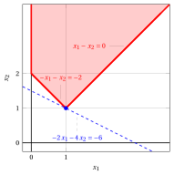
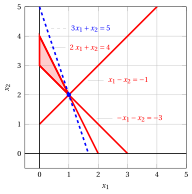
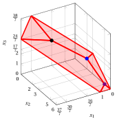

# Esercizi · Fase 0 dell'algoritmo del simplesso

<div class="info-capitolo" markdown>

**Esercizi · Capitolo 8** · ogni soluzione si apre con un clic · [:material-book-open-variant: Capitolo 8: Fase 0 dell'algoritmo del simplesso](../simplesso/08-fase-zero.md) · [:material-file-pdf-box: Eserciziario, volume 2 (PDF)](../pdf/esercizi-2-simplesso.pdf)

</div>

<a id="esercizio-8-1"></a>

!!! esercizio "Esercizio 8.1: Fase zero dell'algoritmo del simplesso (P11)"

    Consideriamo il seguente problema LP in forma canonica di massimo con $n=2$ variabili e $m=2$ vincoli:

    $$
    \begin{array}{rrrrrrrrrrrrr}
    {\max} & {-2} \, {x_1} & {-} & {4} \, {x_2} \\[2ex]
    \text{soggetto a} & {-} \, {x_1} & {-} & \, {x_2} & {\le} & {-2} \\[2ex]
    & \, {x_1} & {-} & \, {x_2} & {\le} & {0} \\[2ex]
    & {x_1,} &  & {x_2} & { \ge} & { 0 }
    \end{array}
    $$

    **Domande**

    1. Eseguire la fase zero dell'algoritmo del simplesso per ottenere una soluzione ammissibile e il dizionario associato del problema LP.

    2. A partire dal dizionario ottenuto, eseguire l'algoritmo del simplesso per risolvere il problema LP.

??? soluzione "Soluzione"

    1. <strong>Prima fase dell'algoritmo del simplesso</strong>

        Scriviamo il problema ausiliario in forma standard:

        $$
        \begin{array}{rrrrrrrrrrrrrrr}
        {\max} & {-} & {x_0} &  &  &  &  &  &  &  &  \\[2ex]
        \text{soggetto a} & {-} & {x_0} & {-} & {x_1} & {-} & {x_2} & {+} & {x_3} &  &  & {=} & {-2} \\[2ex]
        & {-} & {x_0} & {+} & {x_1} & {-} & {x_2} &  &  & {+} & {x_4} & {=} & {0} \\[2ex]
        &  & {x_0,} &  & {x_1,} &  & {x_2,} &  & {x_3,} &  & {x_4} & {\ge} & {0}
        \end{array}
        $$

        e il suo dizionario iniziale è:

        \begin{equation*}
        \begin{cases}
        \begin{array}{rrrrrrrrrrrrr}
        {x_3} & {=} & {-2} & {+} & \, {x_0} & {+} & \, {x_1} & {+} & \, {x_2} \\[2ex]
        {x_4} & {=} & {0} & {+} & \, {x_0} & {-} & \, {x_1} & {+} & \, {x_2} \\[2ex]
        {z} & {=} & {0} & {-} & \, {x_0}
        \end{array}
        \end{cases}
        \end{equation*}

        dove $\pazocal{B}=\{3,4\}$ e $\pazocal{N}=\{0,1,2\}$. La soluzione di base <strong>non ammissibile</strong> è:

        $$
        \bar x_3=-2,~~
        \bar x_4=0,~~~~~
        \bar x_0=0,~~
        \bar x_1=0,~~
        \bar x_2=0~~
        ~~~\text{di valore   } 0
        $$

        - <span style="color:#e03131"><strong>Inizializzazione</strong></span>

            Per ottenere una soluzione ammissibile del problema ausiliario aumentiamo il valore di $x_0$. Abbiamo:

            $$
            \begin{cases}
            x_3 &= -2 +  \:x_0 \\[2ex]
            x_4 &= \:x_0
            \end{cases}
            \qquad
            \qquad
            \begin{cases}
            \underbrace{ -2 + \: x_0 \ge 0}_{x_3 \ge 0} \\[2ex]
            \underbrace{ \: x_0 \ge 0}_{x_4 \ge 0}
            \end{cases}
            \qquad
            \qquad
            \begin{cases}
            x_0 & \ge  2 \\[2ex]
            x_0 & \ge  0
            \end{cases}
            $$

            Aumentando il valore di $x_0$ fino a $2$, il valore di $x_3$ sale a 0, quindi $x_3$ esce dalla base. 

            Abbiamo:

            $$
            x_3 = -2 + x_0 + x_1 + x_2 \text{    allora     } x_0= 2  - x_1 - x_2 + x_3
            $$

            Sostituendo nelle altre equazioni del dizionario, otteniamo:

            $$
            x_4 = \left(2  - x_1 - x_2 + x_3\right) -  \:x_1 + \:x_2 = 2 - 2\: x_1 + x_3
            $$

            $$
            z = - \left(2 - x_1 - x_2 + x_3 \right) = - 2 + x_1 + x_2 - x_3
            $$

            Di conseguenza, abbiamo ora il seguente dizionario:

            \begin{equation*}
            \begin{cases}
            \begin{array}{rrrrrrrrrrrrr}
            {x_0} & {=} & {2} & {-} & \, {x_1} & {-} & \, {x_2} & {+} & \, {x_3} \\[2ex]
            {x_4} & {=} & {2} & {-} & 2\, {x_1} &  &  & {+} & \, {x_3} \\[2ex]
            {z} & {=} & {-2} & {+} & \, {x_1} & {+} & \, {x_2} & {-} & \, {x_3}
            \end{array}
            \end{cases}
            \end{equation*}

            dove $\pazocal{B}=\{0,4\}$ e $\pazocal{N}=\{1,2,3\}$. La soluzione di base ammissibile è:

            $$
            \bar x_0=2,~~
            \bar x_4=2,~~~~~
            \bar x_1=0,~~
            \bar x_2=0,~~
            \bar x_3=0~~
            ~~~\text{di valore   } -2
            $$

        - <span style="color:#e03131"><strong>Iterazione 1</strong></span>

            Se aumentiamo il valore della variabile $x_1$, possiamo ottenere una soluzione migliore. Abbiamo:

            $$
            \begin{cases}
            x_0 &= 2 -  \:x_1 \\[2ex]
            x_4 &= 2 -  2\:x_1
            \end{cases}
            \qquad
            \qquad
            \begin{cases}
            \underbrace{ 2 - \: x_1 \ge 0}_{x_0 \ge 0} \\[2ex]
            \underbrace{ 2 - 2\: x_1 \ge 0}_{x_4 \ge 0}
            \end{cases}
            \qquad
            \qquad
            \begin{cases}
            x_1 & \le  2 \\[2ex]
            x_1 & \le  1
            \end{cases}
            $$

            Aumentando il valore di $x_1$ fino a $\min \left\{2, 1\right\}=1$, il valore di $x_4$ scende a 0.

            Abbiamo quindi che:

            - $x_1$ entra in base e di conseguenza $x_4$ esce dalla base

            Abbiamo:

            $$
            x_4 = 2 - 2\: x_1 + x_3 \text{    allora     } x_1=1 + \dfrac{1}{2}\: x_3 - \dfrac{1}{2}\: x_4.
            $$

            Sostituendo nelle altre equazioni del dizionario, otteniamo:

            \begin{align*}
            x_0 &= 2 - \left(1 + \dfrac{1}{2} x_3 - \dfrac{1}{2} x_4\right) - x_2 + x_3 = 1 - x_2 + \dfrac{1}{2} x_3 + \dfrac{1}{2} x_4\\
            z &= -2 + \left(1 + \dfrac{1}{2} x_3 - \dfrac{1}{2} x_4\right) + x_2 - x_3 = -1 + x_2 - \dfrac{1}{2} x_3 - \dfrac{1}{2} x_4
            \end{align*}

            Di conseguenza, abbiamo ora il seguente dizionario:

            \begin{equation*}
            \begin{cases}
            \begin{array}{rrrrrrrrrrrrrr}
            {x_0} & {=} & {1} & {-} & {x_2} & {+} & {\dfrac{1}{2} x_3} & {+} & {\dfrac{1}{2} x_4} \\[2ex]
            {x_1} & {=} & {1} &  &  & {+} & { \dfrac{1}{2} x_3} & {-} & {\dfrac{1}{2} x_4} \\[2ex]
            {z} & {=} & {-1} & {+} & { x_2} & {-} & {\dfrac{1}{2} x_3} & {-} & {\dfrac{1}{2} x_4}
            \end{array}
            \end{cases}
            \end{equation*}

            dove $\pazocal{B}=\{0,1\}$ e $\pazocal{N}=\{2,3,4\}$. La soluzione di base ammissibile è:

            $$
            \bar x_0=1,~~
            \bar x_1=1,~~~~~
            \bar x_2=0,~~
            \bar x_3=0,~~
            \bar x_4=0
            ~~~\text{di valore   } -1
            $$

        - <span style="color:#e03131"><strong>Iterazione 2</strong></span>

            Se aumentiamo il valore della variabile $x_2$, possiamo ottenere una soluzione migliore. Abbiamo:

            $$
            \begin{cases}
            x_0 &= 1 -  x_2 \\[2ex]
            x_1 &= 1
            \end{cases}
            \qquad
            \qquad
            \begin{cases}
            \underbrace{ 1 -  x_2 \ge 0}_{x_0 \ge 0} \\[2ex]
            \underbrace{ x_1 = 1 \ge 0}_{x_1 \ge 0}
            \end{cases}
            \qquad
            \qquad
            \begin{cases}
            x_2 & \le  1
            \end{cases}
            $$

            Aumentando il valore di $x_2$ fino a $1$, il valore di $x_0$ scende a 0.

            Abbiamo quindi che:

            - $x_2$ entra in base e di conseguenza $x_0$ esce dalla base

            Abbiamo:

            $$
            x_0 = 1 - x_2 + \dfrac{1}{2} x_3 + \dfrac{1}{2} x_4 \text{    allora     } x_2=1 - x_0 + \dfrac{1}{2} x_3 + \dfrac{1}{2} x_4
            $$

            Sostituendo nell'altra equazione del dizionario, otteniamo:

            \begin{align*}
            z &= -1 + \left(1 + \dfrac{1}{2} x_3 + \dfrac{1}{2} x_4 - x_0 \right) - \dfrac{1}{2} x_3 - \dfrac{1}{2} x_4 = - x_0
            \end{align*}

            Di conseguenza, abbiamo ottenuto una soluzione ottima del problema ausiliario (non è possibile alcun ulteriore miglioramento) e questo è un dizionario ottimo:

            \begin{equation*}
            \begin{cases}
            \begin{array}{rrrrrrrrrrrrr}
            {x_1} & {=} & {1} &  &  &  &  & {+} & {\dfrac{1}{2}}\, {x_3} & {-} & {\dfrac{1}{2}}\, {x_4} \\[2ex]
            {x_2} & {=} & {1} & {-} & {x_0} &  &  & {+} & {\dfrac{1}{2}}\, {x_3} & {+} & {\dfrac{1}{2}}\, {x_4} \\[2ex]
            {z} & {=} & {0} & {-} & {x_0} &
            \end{array}
            \end{cases}
            \end{equation*}

            dove $\pazocal{B}=\{1,2\}$ e $\pazocal{N}=\{0,3,4\}$. La soluzione di base ottima è:

            $$
            \tilde{x}_1=1,~~
            \tilde{x}_2=1,~~~~~~
            \tilde{x}_0=0,~~
            \tilde{x}_3=0,~~
            \tilde{x}_4=0
            ~~~\text{di valore   } 0
            $$

            !!! nota ""

                Dato un dizionario ottimo del problema ausiliario con valore ottimo zero, possiamo costruire un dizionario del problema LP originale che corrisponde a una soluzione ammissibile del problema LP originale.

            Eliminando la variabile ausiliaria $x_0$, otteniamo:

            $$
            x_1 = 1 + \dfrac{1}{2} \, x_3 - \dfrac{1}{2} \, x_4
            $$

            $$
            x_2 = 1 + \dfrac{1}{2} \, x_3 + \dfrac{1}{2} \, x_4
            $$

            Sostituendo nella funzione obiettivo del problema originale, possiamo esprimerla in funzione delle variabili fuori base $x_3$ e $x_4$:

            $$
            z = -2 x_1 - 4 x_2 = -2 \left(1 + \dfrac{1}{2} x_3 - \dfrac{1}{2} x_4 \right) - 4 \left(1 + \dfrac{1}{2} x_3 + \dfrac{1}{2} x_4 \right) = -6 - 3 x_3 - x_4
            $$

            Di conseguenza, abbiamo ottenuto una soluzione ottima (non è possibile alcun ulteriore miglioramento) e questo è un dizionario ottimo:

            \begin{equation*}
            \begin{cases}
            \begin{array}{rrrrrrrrrrrrr}
            {x_1 =} & {1} &  &  & {+} & {\dfrac{1}{2}}\, {x_3} & {-} & {\dfrac{1}{2}}\, {x_4} \\[2ex]
            {x_2 =} & {1} &  &  & {+} & {\dfrac{1}{2}}\, {x_3} & {+} & {\dfrac{1}{2}}\, {x_4} \\[2ex]
            {z =} & {-6} &  &  & {-} & {3}\, {x_3} & {-} & {x_4}
            \end{array}
            \end{cases}
            \end{equation*}

            dove $\pazocal{B}=\{1,2\}$ e $\pazocal{N}=\{3,4\}$. La soluzione di base ottima è:

            $$
            \tilde x_1 = 1,~~
            \tilde x_2 = 1,~~
            \tilde x_3 = 0,~~
            \tilde x_4 = 0
            ~~~\text{di valore   } -6
            $$

    2. <strong>Seconda fase dell'algoritmo del simplesso</strong>

        Un dizionario ottimo e una soluzione ottima del problema LP sono stati determinati nella prima fase dell'algoritmo del simplesso, quindi la seconda fase non viene eseguita.

        <strong>Soluzione grafica:</strong>

        La regione ammissibile del problema LP (in forma canonica) è il poliedro ombreggiato in rosso: 

        { .fig .ovale loading=lazy style="width:65%" }

        Una soluzione ottima ${\tilde{\boldsymbol x}}(\, LP \,)$ è:

        $$
        \tilde{x}_1=1,~~\tilde{x}_2=1
        $$

        il valore ottimo $z(\, LP \,)$ è $-6.$

        In blu il vertice ottimo ottenuto dalla prima fase dell'algoritmo del simplesso. In blu tratteggiato, la curva di livello della funzione obiettivo associata al valore assunto nel vertice.

<a id="esercizio-8-2"></a>

!!! esercizio "Esercizio 8.2: Fase zero dell'algoritmo del simplesso (P21)"

    Consideriamo il seguente problema LP in forma canonica di massimo con $n=2$ variabili e $m=3$ vincoli:

    $$
    \begin{array}{rrrrrrrrrrrrr}
    {\max} & \, {x_1} & {+} & {2} \, {x_2} \\[2ex]
    \text{soggetto a} & {- }\, {x_1} & {-} & \, {x_2} & {\le} & {-2} \\[2ex]
    & {4} \, {x_1} & {-} & {2} \, {x_2} & {\le} & {7} \\[2ex]
    & {x_1} & {+} & {5} \, {x_2} & {\le} & {21} \\[2ex]
    & {x_1,} &  & {x_2} & { \ge} & {0 }
    \end{array}
    $$

    **Domande**

    1. Eseguire la fase zero dell'algoritmo del simplesso per ottenere una soluzione ammissibile e il dizionario associato del problema LP.

    2. A partire dal dizionario ottenuto, eseguire l'algoritmo del simplesso per risolvere il problema LP.

??? soluzione "Soluzione"

    1. <strong>Prima fase dell'algoritmo del simplesso</strong>

        Scriviamo il problema ausiliario in forma standard:

        $$
        \begin{array}{rrrrrrrrrrrrrrr}
        {\max} & {-} & {x_0} &  &  &  &  &  &  &  &  \\[2ex]
        \text{soggetto a} & {-} & {x_0} & {- } & \, {x_1} & {-} & \, {x_2} & {+} & \, {x_3} &  &  &  &  & {=} & {-2} \\[2ex]
        & {-} & {x_0} & {+} & {4} \, {x_1} & {-} & {2} \, {x_2} &  &  & {+} & \, {x_4} &  &  & {=} & {7} \\[2ex]
        & {-} & {x_0} & {+} & {x_1} & {+} & {5} \, {x_2} &  &  &  &  & {+} & \, {x_5} & {=} & {21} \\[2ex]
        &  & {x_0,} &  & {x_1,} &  & {x_2,} &  & {x_3,} &  & {x_4,} &  & \, {x_5} & { \ge} & {0 }
        \end{array}
        $$

        e il suo dizionario iniziale è:

        \begin{equation*}
        \begin{cases}
        \begin{array}{rrrrrrrrrrrrr}
        {x_3} & {=} & {-2} & {+} & \, {x_0} & {+} & \, {x_1} & {+} & \, {x_2} \\[2ex]
        {x_4} & {=} & {7} & {+} & \, {x_0} & {-} & 4\, {x_1} & {+} & 2\, {x_2} \\[2ex]
        {x_5} & {=} & {21} & {+} & \, {x_0} & {-} & \, {x_1} & {-} & 5\, {x_2} \\[2ex]
        {z} & {=} & {0} & {-} & \, {x_0} &  &  &  &
        \end{array}
        \end{cases}
        \end{equation*}

        dove $\pazocal{B}=\{3,4,5\}$ e $\pazocal{N}=\{0,1,2\}$. La soluzione di base <strong>non ammissibile</strong> è:

        $$
        \bar x_3=-2,~~
        \bar x_4=7,~~
        \bar x_5=21,~~~~
        \bar x_0=0,~~
        \bar x_1=0,~~
        \bar x_2=0~~
        ~~~\text{di valore   } 0
        $$

        - <span style="color:#e03131"><strong>Inizializzazione</strong></span>

            Per ottenere una soluzione ammissibile del problema ausiliario aumentiamo il valore di $x_0$. Abbiamo:

            $$
            \begin{cases}
            x_3 &= -2 +  \:x_0 \\[2ex]
            x_4 &= 7  +  \:x_0 \\[2ex]
            x_5 &= 21 +  \:x_0
            \end{cases}
            \qquad
            \qquad
            \begin{cases}
            \underbrace{ -2 + \: x_0 \ge 0}_{x_3 \ge 0} \\[2ex]
            \underbrace{ 7 + \: x_0 \ge 0}_{x_4 \ge 0} \\[2ex]
            \underbrace{ 21 + \: x_0 \ge 0}_{x_5 \ge 0}
            \end{cases}
            \qquad
            \qquad
            \begin{cases}
            x_0 & \ge  2 \\[2ex]
            x_0 & \ge  -7 \\[2ex]
            x_0 & \ge  -21 \\[2ex]
            \end{cases}
            $$

            Aumentando il valore di $x_0$ fino a $2$, il valore di $x_3$ sale a 0, quindi $x_3$ esce dalla base. 

            Abbiamo:

            $$
            x_3 = -2 + x_0 + x_1 + x_2 \text{    allora     } x_0= 2  - x_1 - x_2 + x_3
            $$

            Sostituendo nelle altre equazioni del dizionario, otteniamo:

            $$
            x_4 = 7 + \left(2  - x_1 - x_2 + x_3\right) - 4 \:x_1 + 2\:x_2 = 9 - 5\: x_1 + x_2 +x_3
            $$

            $$
            x_5 = 21 + \left(2 - x_1 - x_2 + x_3 \right) -  \:x_1 - 5 \:x_2 = 23 - 2\: x_1 - 6\: x_2 + x_3
            $$

            $$
            z = - \left(2 - x_1 - x_2 + x_3 \right) = - 2 + x_1 + x_2 - x_3
            $$

            Di conseguenza, abbiamo ora il seguente dizionario:

            \begin{equation*}
            \begin{cases}
            \begin{array}{rrrrrrrrrrrrr}
            {x_0} & {=} & {2} & {-} & \, {x_1} & {-} & \, {x_2} & {+} & \, {x_3} \\[2ex]
            {x_4} & {=} & {9} & {-} & 5\, {x_1} & {+} & {x_2} & {+} & \, {x_3} \\[2ex]
            {x_5} & {=} & {23} & {-} & 2\, {x_1} & {-} & 6\, {x_2} & {+} & \, {x_3} \\[2ex]
            {z} & {=} & {-2} & {+} & \, {x_1} & {+} & \, {x_2} & {-} & \, {x_3}
            \end{array}
            \end{cases}
            \end{equation*}

            dove $\pazocal{B}=\{0,4,5\}$ e $\pazocal{N}=\{1,2,3\}$. La soluzione di base ammissibile è:

            $$
            \bar x_0=2,~~
            \bar x_4=9,~~
            \bar x_5=23,~~~~~
            \bar x_1=0,~~
            \bar x_2=0,~~
            \bar x_3=0~~
            ~~~\text{di valore   } -2
            $$

        - <span style="color:#e03131"><strong>Iterazione 1</strong></span>

            Se aumentiamo il valore della variabile $x_1$, possiamo ottenere una soluzione migliore. Abbiamo:

            $$
            \begin{cases}
            x_0 &= 2 -  \:x_1 \\[2ex]
            x_4 &= 9 -  5\:x_1 \\[2ex]
            x_5 &= 23 -  2\:x_1
            \end{cases}
            \qquad
            \qquad
            \begin{cases}
            \underbrace{ 2 - \: x_1 \ge 0}_{x_0 \ge 0} \\[2ex]
            \underbrace{ 9 - 5\: x_1 \ge 0}_{x_4 \ge 0} \\[2ex]
            \underbrace{ 23 - 2\: x_1 \ge 0}_{x_5 \ge 0}
            \end{cases}
            \qquad
            \qquad
            \begin{cases}
            x_1 & \le  2 \\[2ex]
            x_1 & \le  \dfrac{9}{5} \\[2ex]
            x_1 & \le  \dfrac{23}{2} \\[2ex]
            \end{cases}
            $$

            Aumentando il valore di $x_1$ fino a $\min \left\{2,\dfrac{9}{5},\dfrac{23}{2}\right\}=\dfrac{9}{5}$, il valore di $x_4$ scende a 0.

            Abbiamo quindi che:

            - $x_1$ entra in base e di conseguenza $x_4$ esce dalla base

            Abbiamo:

            $$
            x_4 = 9 - 5\: x_1 + x_2 +x_3 \text{    allora     } x_1= \dfrac{9}{5} + \dfrac{1}{5}\: x_2 + \dfrac{1}{5}\: x_3 - \dfrac{1}{5}\: x_4.
            $$

            Sostituendo nelle altre equazioni del dizionario, otteniamo:

            $$
            x_0 = 2 - \left(\dfrac{9}{5} + \dfrac{1}{5}\: x_2 + \dfrac{1}{5}\: x_3 - \dfrac{1}{5}\: x_4\right) - \:x_2 + \:x_3 = \dfrac{1}{5} - \dfrac{6}{5} \: x_2 + \dfrac{4}{5} \: x_3 + \dfrac{1}{5} \: x_4
            $$

            $$
            x_5 = 23 - 2\: \left(\dfrac{9}{5} + \dfrac{1}{5}\: x_2 + \dfrac{1}{5}\: x_3 - \dfrac{1}{5}\: x_4 \right) - 6 \:x_2 + \:x_3 =
            \dfrac{97}{5} - \dfrac{32}{5}\: x_2 + \dfrac{3}{5}\: x_3 + \dfrac{2}{5} \: x_4
            $$

            $$
            z = - 2 + \left(\dfrac{9}{5} + \dfrac{1}{5}\: x_2 + \dfrac{1}{5}\: x_3 - \dfrac{1}{5}\: x_4 \right) + x_2 - x_3 = - \dfrac{1}{5} + \dfrac{6}{5} \; x_2 - \dfrac{4}{5} \: x_3 - \dfrac{1}{5}\: x_4
            $$

            Di conseguenza, abbiamo ora il seguente dizionario:

            \begin{equation*}
            \begin{cases}
            \begin{array}{rrrrrrrrrrrrrr}
            {x_0} & {=} & {\dfrac{1}{5}} & {-} & {\dfrac{6}{5} \: x_2} & {+} & {\dfrac{4}{5} \: x_3} & {+} & {\dfrac{1}{5}\: x_4} \\[2ex]
            {x_1} & {=} & {\dfrac{9}{5}} & {+} & { \dfrac{1}{5}\: x_2} & {+} & { \dfrac{1}{5}\: x_3} & {-} & {\dfrac{1}{5}\: x_4} \\[2ex]
            {x_5} & {=} & {\dfrac{97}{5}} & {-} & {\dfrac{32}{5}\: x_2} & {+} & {\dfrac{3}{5}\: x_3} & {+} & {\dfrac{2}{5} \: x_4} \\[2ex]
            {z} & {=} & {- \dfrac{1}{5} } & {+} & { \dfrac{6}{5} \; x_2} & {-} & {\dfrac{4}{5} \: x_3} & {-} & {\dfrac{1}{5}\: x_4}
            \end{array}
            \end{cases}
            \end{equation*}

            dove $\pazocal{B}=\{0,1,5\}$ e $\pazocal{N}=\{2,3,4\}$. La soluzione di base ammissibile è:

            $$
            \bar x_0=\dfrac{1}{5},~~
            \bar x_1=\dfrac{9}{5},~~
            \bar x_5=\dfrac{97}{5},~~~~~
            \bar x_2=0,~~
            \bar x_3=0,~~
            \bar x_4=0~~
            ~~~\text{di valore   } - \dfrac{1}{5}
            $$

        - <span style="color:#e03131"><strong>Iterazione 2</strong></span>

            Se aumentiamo il valore della variabile $x_2$, possiamo ottenere una soluzione migliore. Abbiamo:

            $$
            \begin{cases}
            x_0 &= \dfrac{1}{5} -  \dfrac{6}{5} \:x_2 \\[2ex]
            x_1 &= \dfrac{9}{5} +  \dfrac{1}{5}\:x_2 \\[2ex]
            x_5 &= \dfrac{97}{5} -  \dfrac{32}{5}\:x_2
            \end{cases}
            \qquad
            \qquad
            \begin{cases}
            \underbrace{ \dfrac{1}{5} -  \dfrac{6}{5}\:x_2 \ge 0}_{x_0 \ge 0} \\[2ex]
            \underbrace{\dfrac{9}{5} +  \dfrac{1}{5}\:x_2 \ge 0}_{x_1 \ge 0} \\[2ex]
            \underbrace{\dfrac{97}{5} -  \dfrac{32}{5}\:x_2 \ge 0}_{x_5 \ge 0}
            \end{cases}
            \qquad
            \qquad
            \begin{cases}
            x_2 & \le  \dfrac{1}{6}  \\[2ex]
            x_2 & \ge - 9 \\[2ex]
            x_2 & \le  \dfrac{97}{32} \\[2ex]
            \end{cases}
            $$

            Aumentando il valore di $x_2$ fino a $\min \left\{\dfrac{1}{6},\dfrac{97}{32}\right\}=\dfrac{1}{6}$, il valore di $x_0$ scende a 0.

            Abbiamo quindi che:

            - $x_2$ entra in base e di conseguenza $x_0$ esce dalla base

            Abbiamo:

            $$
            x_0 = \dfrac{1}{5} - \dfrac{6}{5} \: x_2 + \dfrac{4}{5} \: x_3 + \dfrac{1}{5} \: x_4 \text{    allora     } x_2= \dfrac{1}{6} - \dfrac{5}{6} \: x_0 + \dfrac{2}{3} \: x_3 + \dfrac{1}{6} \: x_4.
            $$

            Sostituendo nelle altre equazioni del dizionario, otteniamo:

            $$
            x_1 = \dfrac{9}{5} + \dfrac{1}{5} \: \left(\dfrac{1}{6} - \dfrac{5}{6} \: x_0 + \dfrac{2}{3} \: x_3 + \dfrac{1}{6} \: x_4 \right) + \dfrac{1}{5} \: x_3 - \dfrac{1}{5} \: x_4 = \dfrac{11}{6} - \dfrac{1}{6} \: x_0 + \dfrac{1}{3} \: x_3 - \dfrac{1}{6} \: x_4
            $$

            $$
            x_5 = \dfrac{97}{5} - \dfrac{32}{5}\: \left( \dfrac{1}{6} - \dfrac{5}{6} \: x_0 + \dfrac{2}{3} \: x_3 + \dfrac{1}{6} \: x_4  \right) + \dfrac{3}{5}\: x_3 + \dfrac{2}{5} \: x_4 = \dfrac{55}{3} + \dfrac{16}{3} \: x_0  - \dfrac{11}{3} \: x_3  - \dfrac{2}{3} \: x_4
            $$

            $$
            z = - \dfrac{1}{5} + \dfrac{6}{5} \; \left( \dfrac{1}{6} - \dfrac{5}{6} \: x_0 + \dfrac{2}{3} \: x_3 + \dfrac{1}{6} \: x_4  \right) - \dfrac{4}{5} \: x_3 - \dfrac{1}{5}\: x_4 =- x_0
            $$

            Di conseguenza, abbiamo ottenuto una soluzione ottima del problema ausiliario (non è possibile alcun ulteriore miglioramento) e questo è un dizionario ottimo:

            \begin{equation*}
            \begin{cases}
            \begin{array}{rrrrrrrrrrrrr}
            {x_1=} & {\dfrac{11}{6}} & {-} & {\dfrac{1}{6} \: x_0} & {+} & {\dfrac{1}{3}} \, {x_3} & {-} & {\dfrac{1}{6}}\, {x_4} \\[2ex]
            {x_2=} & {\dfrac{1}{6}} & {-} & {\dfrac{5}{6} \: x_0} & {+} & {\dfrac{2}{3}}\, {x_3} & {+} & {\dfrac{1}{6}}\, {x_4} \\[2ex]
            {x_5=} & {\dfrac{55}{3}} & {+} & {\dfrac{16}{3} \: x_0} & {-} & {\dfrac{11}{3}}\, {x_3} & {-} & {\dfrac{2}{3}}\, {x_4} \\[2ex]
            {z= } & {0} & {-} & {\: x_0} &  &  &  &  &
            \end{array}
            \end{cases}
            \end{equation*}

            dove $\pazocal{B}=\{1,2,5\}$ e $\pazocal{N}=\{0,3,4\}$. La soluzione di base ottima è:

            $$
            \tilde{x}_1=\dfrac{11}{6},~~
            \tilde{x}_2=\dfrac{1}{6},~~
            \tilde{x}_5=\dfrac{55}{3},~~~~
            \tilde{x}_0=0,~~
            \tilde{x}_3=0,~~
            \tilde{x}_4=0~~
            ~~~\text{di valore   } 0
            $$

            !!! nota ""

                Dato un dizionario ottimo del problema ausiliario con valore ottimo zero, possiamo costruire un dizionario del problema LP originale che corrisponde a una soluzione ammissibile del problema LP originale.

            Eliminando la variabile ausiliaria $x_0$, otteniamo:

            $$
            x_1= \dfrac{11}{6}   +  \dfrac{1}{3} \, x_3  -  \dfrac{1}{6}\, x_4
            $$

            $$
            x_2=\dfrac{1}{6}  +  \dfrac{2}{3}\, x_3  +  \dfrac{1}{6}\, x_4
            $$

            $$
            x_5=\dfrac{55}{3}  -  \dfrac{11}{3}\, x_3  -  \dfrac{2}{3}\, x_4
            $$

            Sostituendo nella funzione obiettivo del problema originale, possiamo esprimerla in funzione delle variabili fuori base $x_3$ e $x_4$:

            $$
            z = x_1 + 2\: x_2 = \dfrac{11}{6}   +  \dfrac{1}{3} \, x_3  -  \dfrac{1}{6}\, x_4 + 2 \left( \:\dfrac{1}{6}  +  \dfrac{2}{3}\, x_3  +  \dfrac{1}{6}\, x_4 \right) = \dfrac{13}{6} + \dfrac{5}{3} \, x_3 + \dfrac{1}{6}\, x_4
            $$

            Di conseguenza, abbiamo il seguente dizionario del problema LP originale:

            \begin{equation*}
            \begin{cases}
            \begin{array}{rrrrrrrrrrrrr}
            {x_1=} & {\dfrac{11}{6}} & {+} & {\dfrac{1}{3}} \, {x_3} & {-} & {\dfrac{1}{6}}\, {x_4} \\[2ex]
            {x_2=} & {\dfrac{1}{6}} & {+} & {\dfrac{2}{3}}\, {x_3} & {+} & {\dfrac{1}{6}}\, {x_4} \\[2ex]
            {x_5=} & {\dfrac{55}{3}} & {-} & {\dfrac{11}{3}}\, {x_3} & {-} & {\dfrac{2}{3}}\, {x_4} \\[2ex]
            {z= } & {\dfrac{13}{6}} & {+} & {\dfrac{5}{3}} \, {x_3} & {+} & {\dfrac{1}{6}}\, {x_4}
            \end{array}
            \end{cases}
            \end{equation*}

            dove $\pazocal{B}=\{1,2,5\}$ e $\pazocal{N}=\{3,4\}$. La soluzione di base ammissibile è:

            $$
            \bar x_1=\dfrac{11}{6},~~
            \bar x_2=\dfrac{1}{6},~~
            \bar x_5=\dfrac{55}{3},~~~~~~~
            \bar x_3=0,~~
            \bar x_4=0
            ~~~\text{di valore   } \dfrac{13}{6}
            $$

    2. <strong>Seconda fase dell'algoritmo del simplesso</strong>

        Eseguiamo l'algoritmo del simplesso per il problema LP originale.

        - <span style="color:#e03131"><strong>Inizializzazione</strong></span>

            Partiamo dal dizionario ottenuto dalla prima fase dell'algoritmo del simplesso.

        - <span style="color:#e03131"><strong>Iterazione 1</strong></span>

            Se aumentiamo il valore della variabile $x_3$, possiamo ottenere una soluzione migliore. Abbiamo:

            $$
            \begin{cases}
            x_1 =& \dfrac{11}{6} + \dfrac{1}{3} \, x_3\\[2ex]
            x_2 =& \dfrac{1}{6}  + \dfrac{2}{3} \, x_3 \\[2ex]
            x_5 =& \dfrac{55}{3} - \dfrac{11}{3} \, x_3
            \end{cases}
            \qquad
            \qquad
            \begin{cases}
            \underbrace{ \dfrac{11}{6} + \dfrac{1}{3} \, x_3 \ge 0}_{x_1 \ge 0} \\[2ex]
            \underbrace{  \dfrac{1}{6}  + \dfrac{2}{3} \, x_3 \ge 0}_{x_2 \ge 0} \\[2ex]
            \underbrace{ \dfrac{55}{3} - \dfrac{11}{3} \, x_3 \ge 0}_{x_5 \ge 0}
            \end{cases}
            \qquad
            \qquad
            \begin{cases}
            x_3 &\ge - \dfrac{11}{3} \\[2ex]
            x_3 &\ge  -\dfrac{1}{4} \\[2ex]
            x_3 &\le 5
            \end{cases}
            $$

            Aumentando il valore di $x_3$ fino a $5$, il valore di $x_5$ scende a 0.

            Abbiamo quindi che:

            - $x_3$ entra in base e di conseguenza $x_5$ esce dalla base

            Abbiamo:

            $$
            x_5 = \dfrac{55}{3} - \dfrac{11}{3}\, x_3 - \dfrac{2}{3}\, x_4  \text{    allora     } x_3 = 5 - \dfrac{2}{11}\: x_4 -\dfrac{3}{11}\: x_5~ .
            $$

            Sostituendo nelle altre equazioni del dizionario, otteniamo:

            $$
            x_1 = \dfrac{11}{6} + \dfrac{1}{3} \; \left(5 - \dfrac{2}{11}\: x_4 -\dfrac{3}{11}\: x_5 \right) - \dfrac{1}{6} \:x_4 =  \dfrac{7}{2}  -\dfrac{5}{22}\: x_4 -\dfrac{1}{11}\: x_5
            $$

            $$
            x_2 = \dfrac{1}{6} + \dfrac{2}{3} \; \left(5 - \dfrac{2}{11}\: x_4 -\dfrac{3}{11}\: x_5 \right) + \dfrac{1}{6} \:x_4 =  \dfrac{7}{2}  + \dfrac{1}{22}\: x_4 -\dfrac{2}{11}\: x_5
            $$

            $$
            z = \dfrac{13}{6} + \dfrac{5}{3}\: \; \left(5 - \dfrac{2}{11}\: x_4 -\dfrac{3}{11}\: x_5 \right) + \dfrac{1}{6} \: x_4 = \dfrac{21}{2} - \dfrac{3}{22}\: x_4 -\dfrac{5}{11}\: x_5
            $$

            Di conseguenza, abbiamo ottenuto una soluzione ottima (non è possibile alcun ulteriore miglioramento) e questo è un dizionario ottimo:

            \begin{equation*}
            \begin{cases}
            \begin{array}{rrrrrrrrrrrrr}
            {x_1} & {=} & {\dfrac{7}{2}} & {-} & {\dfrac{5}{22}}\, {x_4} & {-} & {\dfrac{1}{11}}\, {x_5} \\[2ex]
            {x_2} & {=} & {\dfrac{7}{2}} & {+} & {\dfrac{1}{22}}\, {x_4} & {-} & {\dfrac{2}{11}}\, {x_5} \\[2ex]
            {x_3} & {=} & {5} & {-} & {\dfrac{2}{11}}\, {x_4} & {-} & {\dfrac{3}{11}}\, {x_5} \\[2ex]
            {z} & {=} & {\dfrac{21}{2}} & {-} & {\dfrac{3}{22}}\, {x_4} & {-} & {\dfrac{5}{11}}\, {x_5}
            \end{array}
            \end{cases}
            \end{equation*}

            dove $\pazocal{B}=\{1,2,3\}$ e $\pazocal{N}=\{4,5\}$. La soluzione di base ottima è:

            $$
            \tilde{x}_1=\dfrac{7}{2},~~
            \tilde{x}_2=\dfrac{7}{2},~~
            \tilde{x}_3=5,~~~~~~
            \tilde{x}_4=0,~~
            \tilde{x}_5=0
            ~~~\text{di valore   } \dfrac{21}{2}
            $$

    <strong>Soluzione grafica:</strong>

    La regione ammissibile del problema LP (in forma canonica) è il poliedro ombreggiato in rosso: 

    { .fig .ovale loading=lazy style="width:65%" }

    Una soluzione ottima ${\tilde{\boldsymbol x}}(\, LP \,)$ è:

    $$
    \tilde{x}_1=\dfrac{7}{2},~~\tilde{x}_2=\dfrac{7}{2}
    $$

    il valore ottimo $z(\, LP \,)$ è $\dfrac{21}{2}.$

    In viola il primo vertice ottenuto dalla prima fase dell'algoritmo del simplesso, in blu quello ottimo. In blu tratteggiato, le curve di livello della funzione obiettivo associate ai valori assunti nei due vertici.

<a id="esercizio-8-3"></a>

!!! esercizio "Esercizio 8.3: Fase zero dell'algoritmo del simplesso (P22)"

    Consideriamo il seguente problema LP in forma canonica di massimo con $n=2$ variabili e $m=3$ vincoli:

    $$
    \begin{array}{rrrrrrrrrrrrr}
    {\max} & {3\; x_1} & {+} & {x_2} \\[2ex]
    \text{soggetto a} & {x_1} & {-} & {x_2} & {\le} & {-}1 \\[2ex]
    & {-} \, {x_1} & {-} & \, {x_2} & {\le} & {-}3 \\[2ex]
    & {2\;x_1} & {+} & {x_2} & {\le} & 4 \\[2ex]
    & {x_1,} &  & {x_2} & { \ge} & { 0 }
    \end{array}
    $$

    **Domande**

    1. Eseguire la fase zero dell'algoritmo del simplesso per ottenere una soluzione ammissibile e il dizionario associato del problema LP.

    2. A partire dal dizionario ottenuto, eseguire l'algoritmo del simplesso per risolvere il problema LP.

??? soluzione "Soluzione"

    1. <strong>Prima fase dell'algoritmo del simplesso</strong>

        Scriviamo il problema ausiliario in forma standard:

        $$
        \begin{array}{rrrrrrrrrrrrrrr}
        {\max} & {-} & {x_0} &  &  &  &  &  &  &  &  \\[2ex]
        \text{soggetto a} & {-} & {x_0} & {+} & \, {x_1} & {-} & {x_2} & {+} & \, {x_3} &  &  &  &  & {=} & {-1} \\[2ex]
        & {-} & {x_0} & {-} & \, {x_1} & {-} & {x_2} &  &  & {+} & \, {x_4} &  &  & {=} & {-3} \\[2ex]
        & {-} & {x_0} & {+} & {2}\, {x_1} & {+} & {x_2} &  &  &  &  & {+} & \, {x_5} & {=} & {4} \\[2ex]
        &  & {x_0,} &  & {x_1,} &  & {x_2,} &  & {x_3,} &  & {x_4,} &  & \, {x_5} & { \ge} & {0 }
        \end{array}
        $$

        e il suo dizionario iniziale è:

        \begin{equation*}
        \begin{cases}
        \begin{array}{rrrrrrrrrrrrr}
        {x_3} & {=} & {-1} & {+} & \, {x_0} & {-} & \, {x_1} & {+} & \, {x_2} \\[2ex]
        {x_4} & {=} & {-3} & {+} & \, {x_0} & {+} & \, {x_1} & {+} & \, {x_2} \\[2ex]
        {x_5} & {=} & {4} & {+} & \, {x_0} & {-} & 2\, {x_1} & {-} & \, {x_2} \\[2ex]
        {z} & {=} & {0} & {-} & \, {x_0}
        \end{array}
        \end{cases}
        \end{equation*}

        dove $\pazocal{B}=\{3,4,5\}$ e $\pazocal{N}=\{0,1,2\}$. La soluzione di base <strong>non ammissibile</strong> è:

        $$
        \bar x_3=-1,~~
        \bar x_4=-3,~~
        \bar x_5=4,~~~~~
        \bar x_0=0,~~
        \bar x_1=0,~~
        \bar x_2=0~~
        ~~~\text{di valore   } 0
        $$

        - <span style="color:#e03131"><strong>Inizializzazione</strong></span>

            Per ottenere una soluzione ammissibile del problema ausiliario aumentiamo il valore di $x_0$. Abbiamo:

            $$
            \begin{cases}
            x_3 &= -1 + x_0 \\[2ex]
            x_4 &= -3 + x_0 \\[2ex]
            x_5 &=  4 + x_0
            \end{cases}
            \qquad
            \qquad
            \begin{cases}
            \underbrace{ -1 + x_0 \ge 0}_{x_3 \ge 0} \\[2ex]
            \underbrace{ -3 + x_0 \ge 0}_{x_4 \ge 0} \\[2ex]
            \underbrace{ 4 + x_0 \ge 0}_{x_5 \ge 0}
            \end{cases}
            \qquad
            \qquad
            \begin{cases}
            x_0 \ge 1 \\[2ex]
            x_0 \ge 3 \\[2ex]
            x_0 \ge -4
            \end{cases}
            $$

            Aumentando il valore di $x_0$ fino a $3$, il valore di $x_4$ sale a $0$, quindi $x_4$ esce dalla base.

            Abbiamo:

            $$
            x_4 = -3 + x_0 + x_1 + x_2 \text{    allora     } x_0 = 3 - x_1 - x_2 + x_4
            $$

            Sostituendo nelle altre equazioni del dizionario, otteniamo:

            \begin{align*}
            x_3 &= -1 + (3 - x_1 - x_2 + x_4) - x_1 + x_2 = 2 - 2 x_1 + x_4 \\[1ex]
            x_5 &= 4 + (3 - x_1 - x_2 + x_4) - 2 x_1 - x_2 = 7 - 3 x_1 - 2 x_2 + x_4 \\[1ex]
            z &= - (3 - x_1 - x_2 + x_4) = -3 + x_1 + x_2 - x_4
            \end{align*}

            Di conseguenza, abbiamo ora il seguente dizionario:

            \begin{equation*}
            \begin{cases}
            \begin{array}{rrrrrrrrrrrrr}
            {x_0} & {=} & {3} & {-} & {x_1} & {-} & {x_2} & {+} & {x_4} \\[2ex]
            {x_3} & {=} & {2} & {-} & {2}\, {x_1} &  &  & {+} & {x_4} \\[2ex]
            {x_5} & {=} & {7} & {-} & {3}\, {x_1} & {-} & {2}\, {x_2} & {+} & {x_4} \\[2ex]
            {z} & {=} & {-3} & {+} & {x_1} & {+} & {x_2} & {-} & {x_4}
            \end{array}
            \end{cases}
            \end{equation*}

            dove $\pazocal{B}=\{0,3,5\}$ e $\pazocal{N}=\{1,2,4\}$. La soluzione di base ammissibile è:

            $$
            \bar x_0 = 3,~~
            \bar x_3 = 2,~~
            \bar x_5 = 7,~~~
            \bar x_1 = 0,~~
            \bar x_2 = 0,~~
            \bar x_4 = 0~~
            \qquad \text{di valore} \quad -3
            $$

        - <span style="color:#e03131"><strong>Iterazione 1</strong></span>

            Se aumentiamo il valore della variabile $x_1$, possiamo ottenere una soluzione migliore. Abbiamo:

            $$
            \begin{cases}
            x_0 &= 3 - x_1 \\[2ex]
            x_3 &= 2 - 2 x_1 \\[2ex]
            x_5 &= 7 - 3 x_1
            \end{cases}
            \qquad
            \qquad
            \begin{cases}
            \underbrace{ 3 - x_1 \ge 0}_{x_0 \ge 0} \\[2ex]
            \underbrace{ 2 - 2 x_1 \ge 0}_{x_3 \ge 0} \\[2ex]
            \underbrace{  7 - 3 x_1 \ge 0}_{x_5 \ge 0}
            \end{cases}
            \qquad
            \qquad
            \begin{cases}
            x_1 \le 3 \\[2ex]
            x_1 \le 1 \\[2ex]
            x_1 \le \dfrac{7}{3}
            \end{cases}
            $$

            Aumentando il valore di $x_1$ fino a $1$, il valore di $x_3$ scende a $0$, quindi $x_3$ esce dalla base.

            $$
            x_3 = 2 - 2 x_1 + x_4 \text{    allora     } x_1 = 1 + \dfrac{1}{2} x_4 - \dfrac{1}{2} x_3
            $$

            Sostituendo nelle altre equazioni del dizionario, otteniamo:

            \begin{align*}
            x_0 &= 3 - \left(1 + \dfrac{1}{2} x_4 - \dfrac{1}{2} x_3 \right) - x_2 + x_4
            = 2 - x_2 + \dfrac{1}{2} x_3 + \dfrac{1}{2} x_4 \\[1ex]
            x_5 &= 7 - 3\left(1 + \dfrac{1}{2} x_4 - \dfrac{1}{2} x_3 \right) - 2 x_2 + x_4
            = 4 - 2 x_2 + \dfrac{3}{2} x_3 - \dfrac{1}{2} x_4 \\[1ex]
            z &= -3 + \left(1 + \dfrac{1}{2} x_4 - \dfrac{1}{2} x_3 \right) + x_2 - x_4
            = -2 + x_2 - \dfrac{1}{2} x_3 - \dfrac{1}{2} x_4
            \end{align*}

            Di conseguenza, abbiamo ora il seguente dizionario:

            \begin{equation*}
            \begin{cases}
            \begin{array}{rrrrrrrrrrrrr}
            {x_0} & {=} & {2} & {-} & {x_2} & {+} & {\dfrac{1}{2}}\, {x_3} & {+} & {\dfrac{1}{2}}\, {x_4} \\[2ex]
            {x_1} & {=} & {1} &  &  & {-} & {\dfrac{1}{2}}\, {x_3} & {+} & {\dfrac{1}{2}}\, {x_4} \\[2ex]
            {x_5} & {=} & {4} & {-} & {2}\, {x_2} & {+} & {\dfrac{3}{2}}\, {x_3} & {-} & {\dfrac{1}{2}}\, {x_4} \\[2ex]
            {z} & {=} & {-2} & {+} & {x_2} & {-} & {\dfrac{1}{2}}\, {x_3} & {-} & {\dfrac{1}{2}}\, {x_4}
            \end{array}
            \end{cases}
            \end{equation*}

            dove $\pazocal{B}=\{0,1,5\}$ e $\pazocal{N}=\{2,3,4\}$. La soluzione di base ammissibile è:

            $$
            \bar x_0 = 2,~~
            \bar x_1 = 1,~~
            \bar x_5 = 4,~~~~
            \bar x_2 = 0,~~
            \bar x_3 = 0,~~
            \bar x_4 = 0~~
            \qquad \text{di valore } -2
            $$

        - <span style="color:#e03131"><strong>Iterazione 2</strong></span>

            Se aumentiamo il valore della variabile $x_2$, possiamo ottenere una soluzione migliore. Abbiamo:

            $$
            \begin{cases}
            x_0 &= 2 - x_2 \\[2ex]
            x_5 &= 4 - 2 x_2
            \end{cases}
            \qquad
            \qquad
            \begin{cases}
            \underbrace{ 2 - x_2 \ge 0}_{x_0 \ge 0} \\[2ex]
            \underbrace{  4 - 2 x_2 \ge 0}_{x_5 \ge 0}
            \end{cases}
            \qquad
            \qquad
            \begin{cases}
            x_2 \le 2 \\[2ex]
            x_2 \le 2
            \end{cases}
            $$

            Aumentando il valore di $x_2$ fino a $\min \left\{2, 2\right\}=2$, il valore sia di $x_0$ sia di $x_5$ scende a $0$. Scegliamo $x_0$ come variabile uscente, in modo che la variabile ausiliaria esca dalla base (di conseguenza, $x_5$ resta in base con valore $0$).

            Abbiamo quindi che:

            - $x_2$ entra in base e di conseguenza $x_0$ esce dalla base

            Abbiamo:

            $$
            x_0 = 2 - x_2 + \dfrac{1}{2} x_3 + \dfrac{1}{2} x_4
            \text{    allora     }
            x_2 = 2 - x_0 + \dfrac{1}{2} x_3 + \dfrac{1}{2} x_4
            $$

            Sostituendo nelle altre equazioni del dizionario, otteniamo:

            \begin{align*}
            x_5 &= 4 - 2 \left(2 - x_0 + \dfrac{1}{2} x_3 + \dfrac{1}{2} x_4 \right)
            + \dfrac{3}{2} x_3 - \dfrac{1}{2} x_4 = 2 x_0 + \dfrac{1}{2} x_3 - \dfrac{3}{2} x_4 \\[1ex]
            z &= -2 + \left(2 - x_0 + \dfrac{1}{2} x_3 + \dfrac{1}{2} x_4 \right)
            - \dfrac{1}{2} x_3 - \dfrac{1}{2} x_4 =  - x_0
            \end{align*}

            Di conseguenza, abbiamo ottenuto una soluzione ottima del problema ausiliario (non è possibile alcun ulteriore miglioramento) e questo è un dizionario ottimo:

            \begin{equation*}
            \begin{cases}
            \begin{array}{rrrrrrrrrrrrr}
            {x_1} & {=} & {1} &  &  & {-} & {\dfrac{1}{2}}\, {x_3} & {+} & {\dfrac{1}{2}}\, {x_4} \\[2ex]
            {x_2} & {=} & {2} & {-} & {x_0} & {+} & {\dfrac{1}{2}}\, {x_3} & {+} & {\dfrac{1}{2}}\, {x_4} \\[2ex]
            {x_5} & {=} & {0} & {+} & {2}\, {x_0} & {+} & {\dfrac{1}{2}}\, {x_3} & {-} & {\dfrac{3}{2}}\, {x_4} \\[2ex]
            {z} & {=} & {0} & {-} & {x_0}
            \end{array}
            \end{cases}
            \end{equation*}

            dove $\pazocal{B}=\{1,2,5\}$ e $\pazocal{N}=\{0,3,4\}$. La soluzione di base ottima è:

            $$
            \tilde{x}_1 = 1, \quad
            \tilde{x}_2 = 2, \quad
            \tilde{x}_5 = 0, \quad~~~~~
            \tilde{x}_0 = 0, \quad
            \tilde{x}_3 = 0, \quad
            \tilde{x}_4 = 0, \quad
            \qquad \text{di valore } 0
            $$

            !!! nota ""

                Dato un dizionario ottimo del problema ausiliario con valore ottimo zero, possiamo costruire un dizionario del problema LP originale che corrisponde a una soluzione ammissibile del problema LP originale.

            Eliminando la variabile ausiliaria $x_0$, mantenendo le variabili in base $x_1, x_2, x_5$, otteniamo:

            \begin{align*}
            x_1 &= 1 - \dfrac{1}{2} x_3 + \dfrac{1}{2} x_4 \\[1ex]
            x_2 &= 2 + \dfrac{1}{2} x_3 + \dfrac{1}{2} x_4 \\[1ex]
            x_5 &=  \dfrac{1}{2} x_3 - \dfrac{3}{2} x_4
            \end{align*}

            Sostituendo nella funzione obiettivo del problema originale, possiamo esprimerla in funzione delle variabili fuori base $x_3$ e $x_4$:

            \begin{align*}
            z = 3\left(1 - \dfrac{1}{2} x_3 + \dfrac{1}{2} x_4\right) + \left(2 + \dfrac{1}{2} x_3 + \dfrac{1}{2} x_4\right)
            = 5 - x_3 + 2 x_4
            \end{align*}

            Di conseguenza, abbiamo il seguente dizionario del problema LP originale:

            \begin{equation*}
            \begin{cases}
            \begin{array}{rrrrrrrrrrrrr}
            {x_1 =} & {1} & {-} & {\dfrac{1}{2}}\, {x_3} & {+} & {\dfrac{1}{2}}\, {x_4} \\[2ex]
            {x_2 =} & {2} & {+} & {\dfrac{1}{2}}\, {x_3} & {+} & {\dfrac{1}{2}}\, {x_4} \\[2ex]
            {x_5 =} & {0} & {+} & {\dfrac{1}{2}}\, {x_3} & {-} & {\dfrac{3}{2}}\, {x_4} \\[2ex]
            {z =} & {5} & {-} & {x_3} & {+} & {2}\, {x_4}
            \end{array}
            \end{cases}
            \end{equation*}

            dove $\pazocal{B}=\{1,2,5\}$ e $\pazocal{N}=\{3,4\}$. La soluzione di base ammissibile è:

            $$
            \bar x_1 = 1, \quad
            \bar x_2 = 2, \quad
            \bar x_3 = 0, \quad
            \bar x_4 = 0, \quad
            \bar x_5 = 0
            \qquad \text{di valore } 5
            $$

    2. <strong>Seconda fase dell'algoritmo del simplesso</strong>

        Eseguiamo l'algoritmo del simplesso per il problema LP originale.

        - <span style="color:#e03131"><strong>Inizializzazione</strong></span>

            Partiamo dal dizionario ottenuto dalla prima fase dell'algoritmo del simplesso.

        - <span style="color:#e03131"><strong>Iterazione 1</strong></span>

            Se aumentiamo il valore della variabile $x_4$, possiamo ottenere una soluzione migliore. Abbiamo:

            $$
            \begin{cases}
            x_1 &= 1 + \dfrac{1}{2}\, x_4 \\[2ex]
            x_2 &= 2 + \dfrac{1}{2}\, x_4 \\[2ex]
            x_5 &= - \dfrac{3}{2}\, x_4
            \end{cases}
            \qquad
            \qquad
            \begin{cases}
            \underbrace{1 + \dfrac{1}{2}\, x_4 \ge 0}_{x_1 \ge 0}\\[2ex]
            \underbrace{2 + \dfrac{1}{2}\, x_4 \ge 0}_{x_2 \ge 0}\\[2ex]
            \underbrace{- \dfrac{3}{2}\, x_4 \ge 0}_{x_5 \ge 0}
            \end{cases}
            \qquad
            \qquad
            \begin{cases}
            x_4 &\ge -2\\[2ex]
            x_4 &\ge -4\\[2ex]
            x_4 &\le 0
            \end{cases}
            $$

            Aumentando il valore di $x_4$ fino a $0$ (un'operazione di pivot <strong>degenere</strong>, $t_m=0$), il valore di $x_5$ resta $0$: l'unico vincolo su $x_4$ proviene da $x_5 \ge 0$, quindi $x_5$ esce dalla base.

            Abbiamo quindi che:

            - $x_4$ entra in base e di conseguenza $x_5$ esce dalla base

            Abbiamo:

            $$
            x_5 = \dfrac{1}{2} x_3 - \dfrac{3}{2} x_4 \text{    allora     } x_4 = \dfrac{1}{3} x_3 - \dfrac{2}{3} x_5
            $$

            Sostituendo nelle altre equazioni del dizionario, otteniamo:

            \begin{align*}
            x_1 &= 1 - \dfrac{1}{2} x_3 + \dfrac{1}{2} \left( \dfrac{1}{3} x_3 - \dfrac{2}{3} x_5 \right)
            = 1 - \dfrac{1}{3} x_3 - \dfrac{1}{3} x_5 \\[1ex]
            x_2 &= 2 + \dfrac{1}{2} x_3 + \dfrac{1}{2} \left( \dfrac{1}{3} x_3 - \dfrac{2}{3} x_5 \right)
            = 2 + \dfrac{2}{3} x_3 - \dfrac{1}{3} x_5 \\[1ex]
            z &= 5 - x_3 + 2 \left( \dfrac{1}{3} x_3 - \dfrac{2}{3} x_5 \right)
            = 5 - \dfrac{1}{3} x_3 - \dfrac{4}{3} x_5
            \end{align*}

            Di conseguenza, abbiamo ottenuto una soluzione ottima (non è possibile alcun ulteriore miglioramento) e questo è un dizionario ottimo:

            \begin{equation*}
            \begin{cases}
            \begin{array}{rrrrrrrrrrrrr}
            {x_1} & {=} & {1} & {-} & {\dfrac{1}{3}}\, {x_3} & {-} & {\dfrac{1}{3}}\, {x_5} \\[2ex]
            {x_2} & {=} & {2} & {+} & {\dfrac{2}{3}}\, {x_3} & {-} & {\dfrac{1}{3}}\, {x_5} \\[2ex]
            {x_4} & {=} & {0} & {+} & {\dfrac{1}{3}}\, {x_3} & {-} & {\dfrac{2}{3}}\, {x_5} \\[2ex]
            {z} & {=} & {5} & {-} & {\dfrac{1}{3}}\, {x_3} & {-} & {\dfrac{4}{3}}\, {x_5}
            \end{array}
            \end{cases}
            \end{equation*}

            dove $\pazocal{B}=\{1,2,4\}$ e $\pazocal{N}=\{3,5\}$. La soluzione di base ottima è:

            $$
            \tilde{x}_1 = 1, \quad
            \tilde{x}_2 = 2, \quad
            \tilde{x}_4 = 0,~~~~ \quad
            \tilde{x}_3 = 0, \quad
            \tilde{x}_5 = 0
            \qquad \text{di valore } 5
            $$

    <strong>Soluzione grafica:</strong>

    La regione ammissibile del problema LP (in forma canonica) è il poliedro ombreggiato in rosso: 

    { .fig .ovale loading=lazy style="width:65%" }

    Una soluzione ottima ${\tilde{\boldsymbol x}}(\, LP \,)$ è:

    $$
    \tilde{x}_1=1,~~\tilde{x}_2=2
    $$

    il valore ottimo $z(\, LP \,)$ è $5.$

    In blu il vertice ottimo ottenuto dalla prima fase dell'algoritmo del simplesso. In blu tratteggiato, la curva di livello della funzione obiettivo associata al valore assunto nel vertice.

<a id="esercizio-8-4"></a>

!!! esercizio "Esercizio 8.4: Fase zero dell'algoritmo del simplesso (P51)"

    Consideriamo il seguente problema LP in forma canonica di massimo con $n=3$ variabili e $m=2$ vincoli:

    $$
    \begin{array}{rrrrrrrrrrrrrrrr}
    {\max} & {-} & {2\,x_1} & {-} & {\,x_2} &  &  \\[2ex]
    \text{soggetto a} &  & \, {x_1} & {-} & {x_2} & {-} & 3 \, {x_3} & {\le} & {-} 5 \\[2ex]
    & {-} & 3 \, {x_1} & {-} & 2 \, {x_2} & {+} & 2 \, {x_3} & {\le} & {-}2 \\[2ex]
    &  & {x_1,} &  & {x_2,} &  & {x_3} & { \ge} & { 0 }
    \end{array}
    $$

    **Domande**

    1. Eseguire la fase zero dell'algoritmo del simplesso per ottenere una soluzione ammissibile e il dizionario associato del problema LP.

    2. A partire dal dizionario ottenuto, eseguire l'algoritmo del simplesso per risolvere il problema LP.

??? soluzione "Soluzione"

    1. <strong>Prima fase dell'algoritmo del simplesso</strong>

        Scriviamo il problema ausiliario in forma standard:

        $$
        \begin{array}{rrrrrrrrrrrrrrrr}
        {\max} & {-} & {x_0} &  \\[2ex]
        \text{soggetto a} & {-} & {x_0} & {+} & \, {x_1} & {-} & {x_2} & {-} & 3 \, {x_3} & {+} & \, {x_4} &  &  & {=} & {-}5 \\[2ex]
        & {-} & {x_0} & {-} & 3 \, {x_1} & {-} & 2 \, {x_2} & {+} & 2 \, {x_3} &  &  & {+} & \, {x_5} & {=} & {-}2 \\[2ex]
        &  & {x_0,} &  & {x_1,} &  & {x_2,} &  & {x_3,} &  & {x_4,} &  & {x_5} & { \ge} & { 0 }
        \end{array}
        $$

        e il suo dizionario iniziale è:

        \begin{equation*}
        \begin{cases}
        \begin{array}{rrrrrrrrrrrrr}
        {x_4} & = & {-5} & {+} & {x_0} & {-} & {x_1} & {+} & {x_2} & {+} & {3x_3} \\[2ex]
        {x_5} & = & {-2} & {+} & {x_0} & {+} & {3x_1} & {+} & {2x_2} & {-} & {2x_3} \\[2ex]
        {z} & = & {0} & {-} & {x_0}
        \end{array}
        \end{cases}
        \end{equation*}

        dove $\pazocal{B}=\{4,5\}$ e $\pazocal{N}=\{0,1,2,3\}$. La soluzione di base <strong>non ammissibile</strong> è:

        $$
        \bar x_4=-5,~~
        \bar x_5=-2~~~~~
        \bar x_0=0,~~
        \bar x_1=0,~~
        \bar x_2=0,~~
        \bar x_3=0~~
        \text{  di valore   }0
        $$

        - <span style="color:#e03131"><strong>Inizializzazione</strong></span>

            Per ottenere una soluzione di base ammissibile del problema ausiliario aumentiamo il valore di $x_0$. Abbiamo:

            $$
            \begin{cases}
            x_4 =& -5 +  \:x_0 \\[2ex]
            x_5 =& -2 +  \:x_0
            \end{cases}
            \qquad
            \qquad
            \begin{cases}
            \underbrace{ -5 +  \:x_0 \ge 0}_{x_4 \ge 0} \\[2ex]
            \underbrace{ -2 +  \:x_0 \ge 0}_{x_5 \ge 0}
            \end{cases}
            \qquad
            \qquad
            \begin{cases}
            x_0 \ge &  5\\[2ex]
            x_0 \ge &  2
            \end{cases}
            $$

            Aumentando il valore di $x_0$ fino a $5$, il valore di $x_4$ sale a 0, quindi $x_4$ esce dalla base. Questa variabile è la variabile di scarto associata al termine noto negativo di valore assoluto maggiore. Abbiamo:

            $$
            x_4 = -5 + x_0 - x_1 + x_2 + 3\,x_3 \text{    allora     } x_0 = 5 + x_1 - x_2 - 3\,x_3 + x_4
            $$

            Sostituendo nelle altre equazioni del dizionario, otteniamo:

            $$
            x_5 = -2 + \left( 5 + x_1 - x_2 - 3\,x_3 + x_4 \right) + 3\,x_1 + 2\,x_2 - 2\,x_3 = 3 + 4\,x_1 + x_2 -5 \, x_3 + x_4
            $$

            $$
            z = 0 - \left( 5 + x_1 - x_2 - 3\,x_3 + x_4 \right) = - 5 - x_1 + x_2 + 3\,x_3 - x_4
            $$

            Di conseguenza, abbiamo ora il seguente dizionario:

            \begin{equation*}
            \begin{cases}
            \begin{array}{rrrrrrrrrrrrr}
            {x_0=} & \, {5} & {+} & \, {x_1} & {-} & \, {x_2} & {-} & 3\, {x_3} & {+} & \, {x_4} \\[2ex]
            {x_5=} & \, {3} & {+} & 4\, {x_1} & {+} & \, {x_2} & {-} & 5\, {x_3} & {+} & \, {x_4} \\[2ex]
            {z=} & {-}\, {5} & {-} & \, {x_1} & {+} & \, {x_2} & {+} & 3\, {x_3} & {-} & \, {x_4}
            \end{array}
            \end{cases}
            \end{equation*}

            dove $\pazocal{B}=\{0,5\}$ e $\pazocal{N}=\{1,2,3,4\}$. La soluzione di base ammissibile è:

            $$
            \bar x_0=5,~~
            \bar x_5=3,~~~~~~
            \bar x_1=0,~~
            \bar x_2=0,~~
            \bar x_3=0,~~
            \bar x_4=0~~
            \text{  di valore   }-5
            $$

        - <span style="color:#e03131"><strong>Iterazione 1</strong></span>

            Se aumentiamo il valore della variabile $x_2$, possiamo ottenere una soluzione migliore. Abbiamo:

            $$
            \begin{cases}
            x_0 = & 5 -  \:x_2 \\[2ex]
            x_5 = & 3 +  \:x_2
            \end{cases}
            \qquad
            \qquad
            \begin{cases}
            \underbrace{  5 -  \:x_2 \ge 0}_{x_0 \ge 0} \\[2ex]
            \underbrace{  3 +  \:x_2 \ge 0}_{x_5 \ge 0} \\[2ex]
            \end{cases}
            \qquad
            \qquad
            \begin{cases}
            x_2\le &   5 \\[2ex]
            x_2\ge &  - 3
            \end{cases}
            $$

            Aumentando il valore di $x_2$ fino a $5$, il valore di $x_0$ scende a 0.

            Abbiamo quindi che:

            - $x_2$ entra in base e di conseguenza $x_0$ esce dalla base

            Abbiamo:

            $$
            x_0 = 5 + x_1 - x_2 - 3\,x_3 + x_4 \text{    allora     } x_2 = 5 - x_0 + x_1 - 3\,x_3 + x_4
            $$

            Sostituendo nelle altre equazioni del dizionario, otteniamo:

            $$
            x_5 = 3 + 4\: x_1 + \left( 5 - x_0 + x_1 - 3\,x_3 + x_4 \right) - 5 \:x_3 + \:x_4 = 8 - x_0 + 5\:x_1 - 8\:x_3 + 2\:x_4
            $$

            $$
            z =- 5 - x_1 + \left( 5 - x_0 + x_1 - 3\,x_3 + x_4 \right) + 3\:x_3 - x_4 = - x_0
            $$

            Di conseguenza, abbiamo ottenuto una soluzione ottima del problema ausiliario (non è possibile alcun ulteriore miglioramento) e questo è un dizionario ottimo:

            \begin{equation*}
            \begin{cases}
            \begin{array}{rrrrrrrrrrrrrr}
            {x_2} & {=} & {5} & {-} & {x_0} & {+} & {x_1} & {-} & {3\: x_3} & {+} & {x_4} \\[2ex]
            {x_5} & {=} & {8} & {-} & {x_0} & {+} & {5 \: x_1} & {-} & {8\: x_3} & {+} & {2\: x_4} \\[2ex]
            {z} & {=} & {0} & {-} & {\: x_0 } &
            \end{array}
            \end{cases}
            \end{equation*}

            dove $\pazocal{B}=\{2,5\}$ e $\pazocal{N}=\{0,1,3,4\}$. La soluzione di base ottima è:

            $$
            \tilde x_2=5,~~
            \tilde x_5=8,~~~~~~
            \tilde x_0=0,~~
            \tilde x_1=0,~~
            \tilde x_3=0,~~
            \tilde x_4=0~~
            \text{  di valore   }0
            $$

            !!! nota ""

                Dato un dizionario ottimo del problema ausiliario con valore ottimo zero, possiamo costruire un dizionario del problema LP originale che corrisponde a una soluzione ammissibile del problema LP originale.

            Eliminando la variabile ausiliaria $x_0$, otteniamo:

            \begin{equation*}
            \begin{array}{rrrrrrrrrrrrrr}
            {x_2} & {=} & {5} & {+} & {x_1} & {-} & {3\: x_3} & {+} & {x_4} \\[2ex]
            {x_5} & {=} & {8} & {+} & {5 \: x_1} & {-} & {8\: x_3} & {+} & {2\: x_4}
            \end{array}
            \end{equation*}

            Sostituendo nella funzione obiettivo del problema originale, possiamo esprimerla in funzione delle variabili fuori base $x_1$, $x_3$ e $x_4$:

            $$
            z= -2\: x_1 - (5 + x_1 - 3\,x_3 + x_4) = - 5 - 3\: x_1 + 3\:x_3 - \:x_4
            $$

            Di conseguenza, abbiamo il seguente dizionario del problema LP originale:

            \begin{equation*}
            \begin{cases}
            \begin{array}{rrrrrrrrrrrrrr}
            {x_2} & {=} & {5} & {+} & {x_1} & {-} & {3\: x_3} & {+} & {x_4} \\[2ex]
            {x_5} & {=} & {8} & {+} & {5 \: x_1} & {-} & {8\: x_3} & {+} & {2\: x_4} \\[2ex]
            {z} & {=} & {-5} & {-} & {3 \: x_1} & {+} & {3\: x_3} & {-} & { x_4}
            \end{array}
            \end{cases}
            \end{equation*}

            dove $\pazocal{B}=\{2,5\}$ e $\pazocal{N}=\{1,3,4\}$. La soluzione di base ammissibile è:

            $$
            \bar x_2=5,~~
            \bar x_5=8,~~~~~
            \bar x_1=0,~~
            \bar x_3=0,~~
            \bar x_4=0~~
            \text{  di valore   } -5
            $$

    2. <strong>Seconda fase dell'algoritmo del simplesso</strong>

        Eseguiamo l'algoritmo del simplesso per il problema LP originale.

        - <span style="color:#e03131"><strong>Inizializzazione</strong></span>

            Partiamo dal dizionario ottenuto dalla prima fase dell'algoritmo del simplesso.

        - <span style="color:#e03131"><strong>Iterazione 1</strong></span>

            Se aumentiamo il valore della variabile $x_3$, possiamo ottenere una soluzione migliore. Abbiamo:

            $$
            \begin{cases}
            x_2 =& 5 - 3\,x_3\\[2ex]
            x_5 =& 8 - 8\,x_3
            \end{cases}
            \qquad
            \qquad
            \begin{cases}
            \underbrace{5 - 3\,x_3 \ge 0}_{x_2 \ge 0} \\[2ex]
            \underbrace{8 - 8\,x_3 \ge 0}_{x_5 \ge 0}
            \end{cases}
            \qquad
            \qquad
            \begin{cases}
            x_3 &\le \dfrac{5}{3} \\[2ex]
            x_3 &\le 1
            \end{cases}
            $$

            Aumentando il valore di $x_3$ fino a $1$, il valore di $x_5$ scende a $0$.

            Abbiamo quindi che:

            - $x_3$ entra in base e di conseguenza $x_5$ esce dalla base

            Abbiamo:

            $$
            x_5 = 8 + 5x_1 - 8x_3 + 2x_4
            \text{    allora     }
            x_3 = 1 + \dfrac{5}{8}x_1 + \dfrac{1}{4}x_4 - \dfrac{1}{8}x_5
            $$

            Sostituendo nelle altre equazioni del dizionario, otteniamo:

            \begin{align*}
            x_2 &= 5 + x_1 - 3 \left(1 + \dfrac{5}{8}x_1 + \dfrac{1}{4}x_4 - \dfrac{1}{8}x_5\right) + x_4
            = 2 - \dfrac{7}{8}x_1 + \dfrac{1}{4}x_4 + \dfrac{3}{8}x_5 \\[1ex]
            z   &= -5 - 3x_1 + 3 \left(1 + \dfrac{5}{8}x_1 + \dfrac{1}{4}x_4 - \dfrac{1}{8}x_5 \right) - x_4
            = -2 - \dfrac{9}{8}x_1 - \dfrac{1}{4}x_4 - \dfrac{3}{8}x_5
            \end{align*}

            Di conseguenza, abbiamo ottenuto una soluzione ottima (non è possibile alcun ulteriore miglioramento) e questo è un dizionario ottimo:

            \begin{equation*}
            \begin{cases}
            \begin{array}{rrrrrrrrrrrrr}
            {x_2} & {=} & {2} & {-} & {\dfrac{7}{8}}\, {x_1} & {+} & {\dfrac{1}{4}}\, {x_4} & {+} & {\dfrac{3}{8}}\, {x_5} \\[2ex]
            {x_3} & {=} & {1} & {+} & {\dfrac{5}{8}}\, {x_1} & {+} & {\dfrac{1}{4}}\, {x_4} & {-} & {\dfrac{1}{8}}\, {x_5} \\[2ex]
            {z} & {=} & {-2} & {-} & {\dfrac{9}{8}}\, {x_1} & {-} & {\dfrac{1}{4}}\, {x_4} & {-} & {\dfrac{3}{8}}\, {x_5}
            \end{array}
            \end{cases}
            \end{equation*}

            dove $\pazocal{B}=\{2,3\}$ e $\pazocal{N}=\{1,4,5\}$. La soluzione di base ottima è:

            $$
            \tilde x_2=2,~~
            \tilde x_3=1,~~~~~
            \tilde x_1=0,~~
            \tilde x_4=0,~~
            \tilde x_5=0~~
            \text{  di valore   } -2
            $$

    <strong>Soluzione grafica:</strong>

    La regione ammissibile del problema LP (in forma canonica) è il poliedro ombreggiato in rosso: 

    { .fig .ovale loading=lazy style="width:85%" }

    Una soluzione ottima ${\tilde{\boldsymbol x}}(\, LP \,)$ è:

    $$
    \tilde{x}_1=0,~~\tilde{x}_2=2,~~\tilde{x}_3=1
    $$

    il valore ottimo $z(\, LP \,)$ è $-2.$

    In viola il primo vertice ottenuto dalla prima fase dell'algoritmo del simplesso, in blu quello ottimo.

    ??? codice "SageMath Code: 3D Polyhedra (sagecell.sagemath.org/)"

        ```python
        # Define the polyhedron using inequalities (Hyperplane Representation)
        p = Polyhedron(ieqs=[
            (-5, -1, 1, 3),     # (-1, 1, 3) x - 5 >= 0
            (-2, 3, 2, -2),     # (3, 2, -2) x - 2 >= 0
            (0, 1, 0, 0),       # (1, 0, 0) x + 0 >= 0
            (0, 0, 1, 0),       # (0, 1, 0) x + 0 >= 0
            (0, 0, 0, 1)        # (0, 0, 1) x + 0 >= 0
        ])

        # Display the inequalities of the polyhedron
        p.Hrepresentation()

        # Display the extreme points and extreme rays of the polyhedron
        p.Vrepresentation()

        # Plot the polyhedron (3D)
        p.plot()
        ```
