# Esercizi · Teoria della dualità

**Esercizi · Capitolo 9** · ogni soluzione si apre con un clic · [:material-book-open-variant: Capitolo 9](../dualita/09-dualita.md) · [:material-file-pdf-box: Eserciziario, volume 3 (PDF)](../pdf/esercizi-3-dualita.pdf)

## Costruzione del duale

!!! esercizio "Esercizio 9.1: Problema duale (P71)"

    Consideriamo il seguente problema LP primale in forma canonica di massimo con $n=4$ variabili e $m=3$ vincoli:

    $$
    \begin{array}{rrrrrrrrrrrrr}
    {\max} & 4 \, {x_1} & {+} & \, {x_2} & {+} & 5 \, {x_3} & {+} & 3 \, {x_4} \\[2ex]
    \text{soggetto a} & \, {x_1} & {-} & \, {x_2} & {-} & \, {x_3} & {+} & 3 \, {x_4} & {\le} & 1 \\[2ex]
    & 5 \, {x_1} & {+} & \, {x_2} & {+} & 3 \, {x_3} & {+} & 8 \, {x_4} & {\le} & 55 \\[2ex]
    & {-} \, {x_1} & {+} & 2 \, {x_2} & {+} & 3 \, {x_3} & {-} & 5 \, {x_4} & {\le} & 3 \\[2ex]
    & {x_1,} &  & {x_2,} &  & {x_3,} &  & {x_4} & { \ge} & { 0 }
    \end{array}
    $$

    Il dizionario ottimo del problema LP in forma standard è:

    \begin{equation*}
    \begin{cases}
    \begin{array}{rrrrrrrrrrrrr}
    {x_2=14} & {-} & 2\, {x_1} & {-} & 4\, {x_3} & {-} & 5\, {x_5} & {-} & 3\, {x_7} \\[2ex]
    {x_4=5} & {-} & \, {x_1} & {-} & {x_3} & {-} & 2\, {x_5} & {-} & \, {x_7} \\[2ex]
    {x_6=1} & {+} & 5\, {x_1} & {+} & 9\, {x_3} & {+} & 21\, {x_5} & {+} & 11\, {x_7} \\[2ex]
    {z=29} & {-} & \, {x_1} & {-} & 2\, {x_3} & {-} & 11\, {x_5} & {-} & 6\, {x_7}
    \end{array}
    \end{cases}
    \end{equation*}

    **Domande**

    1. Calcolare lower bound e upper bound sul valore ottimo $z(\,\text{LP}\,)$ del problema LP.

    2. Calcolare la combinazione lineare dei tre vincoli usando i moltiplicatori $\pi_1$, $\pi_2$ e $\pi_3$. Dare le condizioni necessarie affinché il termine noto della combinazione lineare fornisca un upper bound sul valore ottimo $z(\,\text{LP}\,)$ del problema LP.

    3. Scrivere il problema duale del problema LP. Poi, usando il dizionario ottimo, trovare una soluzione ottima del problema duale.

??? soluzione "Soluzione"

    1. Un lower bound sul valore ottimo è dato, per esempio, dalla seguente soluzione ammissibile:

        $$
        \bar x_{1}= 0, ~~~ \bar x_{2}= 1, ~~~ \bar x_{3}= 2, ~~~~ \bar x_{4}= 1  \text{   di valore   } 14 \, .
        $$

        Quindi, abbiamo $z(\,\text{LP}\,) \ge 14$.

        Possiamo migliorare il lower bound usando, per esempio, la seguente soluzione ammissibile:

        $$
        \bar x_{1}= 5, ~~~ \bar x_{2}= 4, ~~~ \bar x_{3}= 0, ~~~~ \bar x_{4}= 0  \text{   di valore   } 24 \, .
        $$

        Quindi, abbiamo $z(\,\text{LP}\,) \ge 24$.

        Un upper bound sul valore ottimo si può ottenere, per esempio, moltiplicando il secondo vincolo per $\frac{5}{3}$:

        $$
        \underbrace{\frac{25}{3} \; x_1 + \frac{5}{3} \; x_2 +5 x_3 +\frac{40}{3} \; x_4}_{\ge 4 \;x_{1}  + x_{2}  + 5 \;x_3 + 3 \;x_4} ~~\le~~ \frac{275}{3}
        $$

        Quindi, abbiamo $z(\,\text{LP}\,) \le \frac{275}{3}$.

        Possiamo migliorare l'upper bound, per esempio, sommando il secondo e il terzo vincolo:

        $$
        \underbrace{4 \; x_1 + 3\; x_2 +6 \;x_3 +3 \;x_4}_{\ge  4 \; x_{1}  + x_{2}  + 5 \;x_3 + 3\; x_4} ~~\le~~ 58
        $$

        Quindi, abbiamo $z(\,\text{LP}\,) \le 58$.

    2. Moltiplicando ogni vincolo per il suo moltiplicatore otteniamo:

        $$
        \begin{array}{rrrrrrrrrrrrr}
        ( & \, {x_1} & {-} & \, {x_2} & {-} & \, {x_3} & {+} & 3 \, {x_4} ) \; {\pi_1} & {\le} & 1 \, {\pi_1} \\[2ex]
        ( & 5 \, {x_1} & {+} & \, {x_2} & {+} & 3 \, {x_3} & {+} & 8 \, {x_4} ) \, {\pi_2} & {\le} & 55 \, {\pi_2} \\[2ex]
        ( & {-} \, {x_1} & {+} & 2 \, {x_2} & {+} & 3 \, {x_3} & {-} & 5 \, {x_4} )\; {\pi_3} & {\le} & 3 \, {\pi_3}
        \end{array}
        $$

        La combinazione lineare dei tre vincoli genera la seguente disuguaglianza:

        \begin{align*}
        (\pi_1 + 5 \pi_2 - \pi_3) \; x_1 + ( - \pi_1 +  \pi_2 + 2 \pi_3) \; x_2 + \\[2ex] +(- \pi_1 +  3 \pi_2 + 3 \pi_3) \; x_3 +( 3 \pi_1 +  8 \pi_2 -5  \pi_3) \; x_4 \le\\[2ex]
        \le \pi_1 + 55 \pi_2 + 3 \pi_3
        \end{align*}

        Il termine noto $\pi_1 + 55 \pi_2 + 3 \pi_3$ di questa disuguaglianza è un upper bound per $z(\,\text{LP}\,)$ se e solo se:

        $$
        \begin{array}{rrrrrrrrrrrrr}
        & \, {\pi_1} & {+} & 5 \, {\pi_2} & {-} & \, {\pi_3} & {\ge} & 4 \\[2ex]
        {-} & \, {\pi_1} & {+} & \, {\pi_2} & {+} & 2\, {\pi_3} & {\ge} & 1 \\[2ex]
        {-} & \, {\pi_1} & {+} & 3 \, {\pi_2} & {+} & 3 \, {\pi_3} & {\ge} & 5 \\[2ex]
        & 3 \, {\pi_1} & {+} & 8 \, {\pi_2} & {-} & 5 \, {\pi_3} & {\ge} & 3 \\[2ex]
        & {\pi_1,} &  & {\pi_2,} &  & {\pi_3} & {\ge} & 0
        \end{array}
        $$

    3. Il problema duale del problema LP, con $m=3$ variabili non negative e $n=4$ vincoli di maggiore o uguale, è il seguente:

        $$
        \begin{array}{rrrrrrrrrrrrr}
        {\min} & \, {\pi_1} & {+} & 55 \, {\pi_2} & {+} & 3 \, {\pi_3} \\[2ex]
        \text{soggetto a} & \, {\pi_1} & {+} & 5 \, {\pi_2} & {-} & \, {\pi_3} & {\ge} & 4 \\[2ex]
        & {-} \, {\pi_1} & {+} & \, {\pi_2} & {+} & 2\, {\pi_3} & {\ge} & 1 \\[2ex]
        & {-}\, {\pi_1} & {+} & 3 \, {\pi_2} & {+} & 3 \, {\pi_3} & {\ge} & 5 \\[2ex]
        & 3 \, {\pi_1} & {+} & 8 \, {\pi_2} & {-} & 5 \, {\pi_3} & {\ge} & 3 \\[2ex]
        & {\pi_1,} &  & {\pi_2,} &  & \, {\pi_3} & { \ge} & { 0 }
        \end{array}
        $$

        Una soluzione duale ottima è data da

        $$
        \tilde{\pi}_i = - \hat{c}_{n+i} ,~~~~ \forall i \in \{1,2,\dots,m\} \text{    dove    } \quad \hat{c}_j =
        \begin{cases}
        \bar{c}_j & \text{se  } j \in  \pazocal{N} \\
        0 & \text{altrimenti}
        \end{cases}
        $$

        I valori $\bar{c}_j$ sono i costi ridotti delle variabili fuori base.

        Nel dizionario ottimo abbiamo $\pazocal{N}=\{1,3,5,7\}$, di conseguenza:

        $$
        \hat{c}_5=-11,~~
        \hat{c}_6=0,~~
        \hat{c}_7=-6
        \quad
        {\rm ~~e~~}
        \quad
        \tilde{\pi}_1=11,~~
        \tilde{\pi}_2=0,~~
        \tilde{\pi}_3=6
        $$

        è una soluzione ottima del problema duale.

## Soluzione grafica del primale e del duale

!!! esercizio "Esercizio 9.2: Problemi primale e duale (P2)"

    Consideriamo il seguente problema primale in forma canonica di massimo con $n=2$ variabili e $m=2$ vincoli:

    $$
    \begin{array}{rrrrrrrrrrrrr}
    {\max} & {x_1} & {+} & 3 \, {x_2} \\[2ex]
    \text{soggetto a} & {-}4 \, {x_1} & {+} & 10 \, {x_2} & {\le} & 35 \\[2ex]
    & 3 \, {x_1} & {+} & \, {x_2} & {\le} & 12 \\[2ex]
    & {x_1,} &  & {x_2} & { \ge} & { 0 }
    \end{array}
    $$

    e il suo problema LP duale in forma canonica di minimo con $m=2$ variabili e $n=2$ vincoli:

    $$
    \begin{array}{rrrrrrrrrrrrr}
    {\min} & 35 \, {\pi_1} & {+} & 12 \, {\pi_2} \\[2ex]
    \text{soggetto a} & {-} 4\, {\pi_1} & {+} & 3 \, {\pi_2} & {\ge} & 1 \\[2ex]
    & 10 \, {\pi_1} & {+} & \, {\pi_2} & {\ge} & 3 \\[2ex]
    & {\pi_1,} &  & {\pi_2} & { \ge} & { 0 }
    \end{array}
    $$

    **Domande**

    1. Trovare graficamente una soluzione ottima del problema primale e una soluzione ottima del problema duale. Calcolare i valori ottimi dei due problemi.

??? soluzione "Soluzione"

    - Per il problema LP primale abbiamo:

        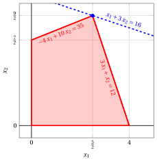{ .fig .ovale loading=lazy  }

        Una soluzione ottima del problema LP primale è:

        $$
        \tilde{x}_1=\frac{5}{2},~~\tilde{x}_2=\frac{9}{2}
        {\rm ~~~~~e~~~~~}
        z(~LP~) =  \tilde{x}_1 + 3 \; \tilde{x}_2 = \frac{5}{2} + 3 \cdot \frac{9}{2} = 16
        $$

    - Per il problema LP duale abbiamo:

        { .fig .ovale loading=lazy  }

        Una soluzione ottima del problema LP duale è:

        $$
        \tilde{\pi}_1=\frac{4}{17},~~\tilde{\pi}_2=\frac{11}{17}
        {\rm ~~~~~e~~~~~}
        z(~D(LP)~) = 35\; \tilde{\pi}_1 + 12 \; \tilde{\pi}_2 = 35\cdot \frac{4}{17} + 12 \cdot \frac{11}{17} = 16
        $$

    - I due valori ottimi coincidono, $z(~LP~) = z(~D(LP)~) = 16$, come afferma il teorema della dualità forte.

!!! esercizio "Esercizio 9.3: Problemi primale e duale (P3)"

    Consideriamo il seguente problema primale in forma canonica di massimo con $n=2$ variabili e $m=2$ vincoli:

    $$
    \begin{array}{rrrrrrrrrrrrr}
    {\max} & 2 \, {x_1} & {+} & 4 \, {x_2} \\[2ex]
    \text{soggetto a} & {-}\, {x_1} & {+} & \, {x_2} & {\le} & 2 \\[2ex]
    & 8 \, {x_1} & {+} & 2 \, {x_2} & {\le} & 19 \\[2ex]
    & {x_1,} &  & {x_2} & { \ge} & { 0 }
    \end{array}
    $$

    e il suo problema LP duale in forma canonica di minimo con $m=2$ variabili e $n=2$ vincoli:

    $$
    \begin{array}{rrrrrrrrrrrrr}
    {\min} & 2 \, {\pi_1} & {+} & 19 \, {\pi_2} \\[2ex]
    \text{soggetto a} & {-} \, {\pi_1} & {+} & 8 \, {\pi_2} & {\ge} & 2 \\[2ex]
    & \, {\pi_1} & {+} & 2 \, {\pi_2} & {\ge} & 4 \\[2ex]
    & {\pi_1,} &  & {\pi_2} & { \ge} & { 0 }
    \end{array}
    $$

    **Domande**

    1. Trovare graficamente una soluzione ottima del problema primale e una soluzione ottima del problema duale. Calcolare i valori ottimi dei due problemi.

??? soluzione "Soluzione"

    - Per il problema LP primale abbiamo:

        { .fig .ovale loading=lazy  }

        Una soluzione ottima del problema LP primale è:

        $$
        \tilde{x}_1=\frac{3}{2},~~\tilde{x}_2=\frac{7}{2}
        {\rm ~~~~~e~~~~~}
        z(~LP~) =  2\; \tilde{x}_1 + 4 \; \tilde{x}_2 = 2\cdot \frac{3}{2} + 4 \cdot \frac{7}{2} = 17
        $$

    - Per il problema LP duale abbiamo:

        { .fig .ovale loading=lazy  }

        Una soluzione ottima del problema LP duale è:

        $$
        \tilde{\pi}_1=\frac{14}{5},~~\tilde{\pi}_2=\frac{3}{5}
        {\rm ~~~~~e~~~~~}
        z(~D(LP)~) =  2\; \tilde{\pi}_1 + 19 \; \tilde{\pi}_2 = 2\cdot \frac{14}{5} + 19 \cdot \frac{3}{5} = 17
        $$

    - I due valori ottimi coincidono, $z(~LP~) = z(~D(LP)~) = 17$, come afferma il teorema della dualità forte.

!!! esercizio "Esercizio 9.4: Problemi primale e duale (P4)"

    Consideriamo il seguente problema primale in forma canonica di massimo con $n=2$ variabili e $m=2$ vincoli:

    $$
    \begin{array}{rrrrrrrrrrrrr}
    {\max} & 5 {x_1} & {+} & 3 \, {x_2} \\[2ex]
    \text{soggetto a} & 2 \, {x_1} & {+} & \, {x_2} & {\le} & 14 \\[2ex]
    & \, {x_1} & {+} & 8 \, {x_2} & {\le} & 32 \\[2ex]
    & {x_1,} &  & {x_2} & { \ge} & { 0 }
    \end{array}
    $$

    e il suo problema LP duale in forma canonica di minimo con $m=2$ variabili e $n=2$ vincoli:

    $$
    \begin{array}{rrrrrrrrrrrrr}
    {\min} & 14 \, {\pi_1} & {+} & 32 \, {\pi_2} \\[2ex]
    \text{soggetto a} & 2 \, {\pi_1} & {+} & \, {\pi_2} & {\ge} & 5 \\[2ex]
    & {\pi_1} & {+} & 8 \, {\pi_2} & {\ge} & 3 \\[2ex]
    & {\pi_1,} &  & {\pi_2} & { \ge} & { 0 }
    \end{array}
    $$

    **Domande**

    1. Trovare graficamente una soluzione ottima del problema primale e una soluzione ottima del problema duale. Calcolare i valori ottimi dei due problemi.

??? soluzione "Soluzione"

    - Per il problema LP primale abbiamo:

        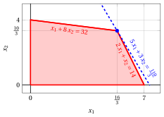{ .fig .ovale loading=lazy  }

        Una soluzione ottima del problema LP primale è:

        $$
        \tilde{x}_1=\frac{16}{3},~~\tilde{x}_2=\frac{10}{3}
        {\rm ~~~~~e~~~~~}
        z(~LP~) =  5\; \tilde{x}_1 + 3 \; \tilde{x}_2 = 5\cdot \frac{16}{3} + 3 \cdot \frac{10}{3} = \frac{110}{3}
        $$

    - Per il problema LP duale abbiamo:

        { .fig .ovale loading=lazy  }

        Una soluzione ottima del problema LP duale è:

        $$
        \tilde{\pi}_1=\frac{37}{15},~~\tilde{\pi}_2=\frac{1}{15}
        {\rm ~~~~~e~~~~~}
        z(~D(LP)~) = 14\; \tilde{\pi}_1 + 32 \; \tilde{\pi}_2 = 14\cdot \frac{37}{15} + 32 \cdot \frac{1}{15} = \frac{110}{3}
        $$

    - I due valori ottimi coincidono, $z(~LP~) = z(~D(LP)~) = \frac{110}{3}$, come afferma il teorema della dualità forte.

!!! esercizio "Esercizio 9.5: Problemi primale e duale (P5)"

    Consideriamo il seguente problema primale in forma canonica di massimo con $n=2$ variabili e $m=2$ vincoli:

    $$
    \begin{array}{rrrrrrrrrrrrr}
    {\max} & 2 {x_1} & {+} & 3 \, {x_2} \\[2ex]
    \text{soggetto a} & 6 \, {x_1} & {+} & 21 \, {x_2} & {\le} & 77 \\[2ex]
    & 8 \, {x_1} & {+} & 3 \, {x_2} & {\le} & 36 \\[2ex]
    & {x_1,} &  & {x_2} & { \ge} & { 0 }
    \end{array}
    $$

    e il suo problema LP duale in forma canonica di minimo con $m=2$ variabili e $n=2$ vincoli:

    $$
    \begin{array}{rrrrrrrrrrrrr}
    {\min} & 77 \, {\pi_1} & {+} & 36 \, {\pi_2} \\[2ex]
    \text{soggetto a} & 6 \, {\pi_1} & {+} & 8 \, {\pi_2} & {\ge} & 2 \\[2ex]
    & 21 \, {\pi_1} & {+} & 3 \, {\pi_2} & {\ge} & 3 \\[2ex]
    & {\pi_1,} &  & {\pi_2} & { \ge} & { 0 }
    \end{array}
    $$

    **Domande**

    1. Trovare graficamente una soluzione ottima del problema primale e una soluzione ottima del problema duale. Calcolare i valori ottimi dei due problemi.

??? soluzione "Soluzione"

    - Per il problema LP primale abbiamo:

        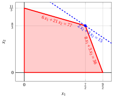{ .fig .ovale loading=lazy  }

        Una soluzione ottima del problema LP primale è:

        $$
        \tilde{x}_1=\frac{7}{2},~~\tilde{x}_2=\frac{8}{3}
        {\rm ~~~~~e~~~~~}
        z(~LP~) =  2\; \tilde{x}_1 + 3 \; \tilde{x}_2 = 2\cdot \frac{7}{2} + 3 \cdot \frac{8}{3} = 15
        $$

    - Per il problema LP duale abbiamo:

        { .fig .ovale loading=lazy  }

        Una soluzione ottima del problema LP duale è:

        $$
        \tilde{\pi}_1=\frac{3}{25},~~\tilde{\pi}_2=\frac{4}{25}
        {\rm ~~~~~e~~~~~}
        z(~D(LP)~) = 77\; \tilde{\pi}_1 + 36 \; \tilde{\pi}_2 = 77\cdot \frac{3}{25} + 36 \cdot \frac{4}{25} = 15
        $$

    - I due valori ottimi coincidono, $z(~LP~) = z(~D(LP)~) = 15$, come afferma il teorema della dualità forte.

!!! esercizio "Esercizio 9.6: Problemi primale e duale (P6)"

    Consideriamo il seguente problema LP primale in forma canonica di massimo con $n=2$ variabili e $m=2$ vincoli:

    $$
    \begin{array}{rrrrrrrrrrrrr}
    {\max} & {x_1} & {+} & \, {x_2} \\[2ex]
    \text{soggetto a} & {4} \, {x_1} & {+} & {15} \, {x_2} & {\le} & {70} \\[2ex]
    & {12} \, {x_1} & {+} & {3} \, {x_2} & {\le} & {52} \\[2ex]
    & {x_1,} &  & {x_2} & {\ge} & { 0 }
    \end{array}
    $$

    e il suo problema LP duale in forma canonica di minimo con $m=2$ variabili e $n=2$ vincoli:

    $$
    \begin{array}{rrrrrrrrrrrrr}
    {\min} & 70 \, {\pi_1} & {+} & 52 \, {\pi_2} \\[2ex]
    \text{soggetto a} & 4 \, {\pi_1} & {+} & 12 \, {\pi_2} & {\ge} & 1 \\[2ex]
    & 15 \, {\pi_1} & {+} & 3 \, {\pi_2} & {\ge} & 1 \\[2ex]
    & {\pi_1,} &  & {\pi_2} & { \ge} & { 0 }
    \end{array}
    $$

    **Domande**

    1. Trovare graficamente una soluzione ottima del problema primale e una soluzione ottima del problema duale. Calcolare i valori ottimi dei due problemi.

??? soluzione "Soluzione"

    - Per il problema LP primale abbiamo:

        { .fig .ovale loading=lazy  }

        Una soluzione ottima del problema LP primale è:

        $$
        \tilde{x}_1=\frac{95}{28},~~\tilde{x}_2=\frac{79}{21}
        {\rm ~~~~~e~~~~~}
        z(~LP~) =  \tilde{x}_1 + \tilde{x}_2 = \frac{95}{28} + \frac{79}{21} = \frac{601}{84}
        $$

    - Per il problema LP duale abbiamo:

        { .fig .ovale loading=lazy  }

        Una soluzione ottima del problema LP duale è:

        $$
        \tilde{\pi}_1=\frac{3}{56},~~\tilde{\pi}_2=\frac{11}{168}
        {\rm ~~~~~e~~~~~}
        z(~D(LP)~) = 70\; \tilde{\pi}_1 + 52 \; \tilde{\pi}_2 = 70\cdot \frac{3}{56} + 52 \cdot \frac{11}{168} = \frac{601}{84}
        $$

    - I due valori ottimi coincidono, $z(~LP~) = z(~D(LP)~) = \frac{601}{84}$, come afferma il teorema della dualità forte.

!!! esercizio "Esercizio 9.7: Problemi primale e duale (P7)"

    Consideriamo il seguente problema primale in forma canonica di massimo con $n=2$ variabili e $m=2$ vincoli:

    $$
    \begin{array}{rrrrrrrrrrrrr}
    {\max} & 3 \, {x_1} & {+} & {x_2} \\[2ex]
    \text{soggetto a} & {x_1} & {+} & {4} \, {x_2} & {\le} & {12} \\[2ex]
    & 2 \, {x_1} & {+} & \, {x_2} & {\le} & 5 \\[2ex]
    & {x_1,} &  & {x_2} & {\ge} & {0}
    \end{array}
    $$

    e il suo problema LP duale in forma canonica di minimo con $m=2$ variabili e $n=2$ vincoli:

    $$
    \begin{array}{rrrrrrrrrrrrr}
    {\min} & 12 \, {\pi_1} & {+} & 5 \, {\pi_2} \\[2ex]
    \text{soggetto a} & {\pi_1} & {+} & 2 \, {\pi_2} & {\ge} & 3 \\[2ex]
    & 4 \, {\pi_1} & {+} & \, {\pi_2} & {\ge} & 1 \\[2ex]
    & {\pi_1,} &  & {\pi_2} & { \ge} & { 0 }
    \end{array}
    $$

    **Domande**

    1. Trovare graficamente una soluzione ottima del problema primale e una soluzione ottima del problema duale. Calcolare i valori ottimi dei due problemi.

??? soluzione "Soluzione"

    - Per il problema LP primale abbiamo:

        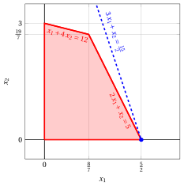{ .fig .ovale loading=lazy  }

        Una soluzione ottima del problema LP primale è:

        $$
        \tilde{x}_1=\frac{5}{2},~~\tilde{x}_2=0
        {\rm ~~~~~e~~~~~}
        z(~LP~) =  3\; \tilde{x}_1 + \tilde{x}_2 = 3\cdot \frac{5}{2} + 0 = \frac{15}{2}
        $$

    - Per il problema LP duale abbiamo:

        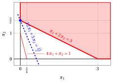{ .fig .ovale loading=lazy  }

        Una soluzione ottima del problema LP duale è:

        $$
        \tilde{\pi}_1=0,~~\tilde{\pi}_2=\frac{3}{2}
        {\rm ~~~~~e~~~~~}
        z(~D(LP)~) = 12\; \tilde{\pi}_1 + 5 \; \tilde{\pi}_2 = 12\cdot 0 + 5 \cdot \frac{3}{2} = \frac{15}{2}
        $$

    - I due valori ottimi coincidono, $z(~LP~) = z(~D(LP)~) = \frac{15}{2}$, come afferma il teorema della dualità forte.

!!! esercizio "Esercizio 9.8: Problemi primale e duale (P8)"

    Consideriamo il seguente problema primale in forma canonica di massimo con $n=2$ variabili e $m=2$ vincoli:

    $$
    \begin{array}{rrrrrrrrrrrrr}
    {\max} & \, {x_1} & {+} & 2 \, {x_2} \\[2ex]
    \text{soggetto a} & {-} {x_1} & {+} & {2} \, {x_2} & {\le} & {2} \\[2ex]
    & \, {x_1} & {+} & \, {x_2} & {\le} & 3 \\[2ex]
    & \, {x_1,} &  & {x_2} & { \ge } & { 0 }
    \end{array}
    $$

    e il suo problema LP duale in forma canonica di minimo con $m=2$ variabili e $n=2$ vincoli:

    $$
    \begin{array}{rrrrrrrrrrrrr}
    {\min} & 2 \, {\pi_1} & {+} & 3 \, {\pi_2} \\[2ex]
    \text{soggetto a} & {-} {\pi_1} & {+} & {\pi_2} & {\ge} & 1 \\[2ex]
    & 2 \, {\pi_1} & {+} & \, {\pi_2} & {\ge} & 2 \\[2ex]
    & {\pi_1,} &  & {\pi_2} & { \ge} & { 0 }
    \end{array}
    $$

    **Domande**

    1. Trovare graficamente una soluzione ottima del problema primale e una soluzione ottima del problema duale. Calcolare i valori ottimi dei due problemi.

??? soluzione "Soluzione"

    - Per il problema LP primale abbiamo:

        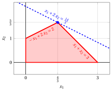{ .fig .ovale loading=lazy  }

        Una soluzione ottima del problema LP primale è:

        $$
        \tilde{x}_1=\frac{4}{3},~~\tilde{x}_2=\frac{5}{3}
        {\rm ~~~~~e~~~~~}
        z(~LP~) =  \tilde{x}_1 + 2\; \tilde{x}_2 = \frac{4}{3} + 2 \cdot \frac{5}{3} = \frac{14}{3}
        $$

    - Per il problema LP duale abbiamo:

        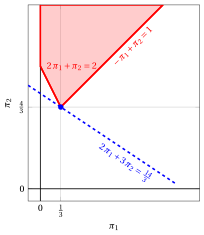{ .fig .ovale loading=lazy  }

        Una soluzione ottima del problema LP duale è:

        $$
        \tilde{\pi}_1=\frac{1}{3},~~\tilde{\pi}_2=\frac{4}{3}
        {\rm ~~~~~e~~~~~}
        z(~D(LP)~) = 2\; \tilde{\pi}_1 + 3 \; \tilde{\pi}_2 = 2\cdot \frac{1}{3} + 3 \cdot \frac{4}{3} = \frac{14}{3}
        $$

    - I due valori ottimi coincidono, $z(~LP~) = z(~D(LP)~) = \frac{14}{3}$, come afferma il teorema della dualità forte.

!!! esercizio "Esercizio 9.9: Problemi primale e duale (P9)"

    Consideriamo il seguente problema primale in forma canonica di massimo con $n=2$ variabili e $m=2$ vincoli:

    $$
    \begin{array}{rrrrrrrrrrrrr}
    {\max} & 2 \, {x_1} & {+} & {x_2} \\[2ex]
    \text{soggetto a} & {-} \, {x_1} & {+} & \, {x_2} & {\le} & 1 \\[2ex]
    & {6} \, {x_1} & {+} & {4} \, {x_2} & {\le} & {39} \\[2ex]
    & {x_1,} &  & {x_2} & { \ge} & {0}
    \end{array}
    $$

    e il suo problema LP duale in forma canonica di minimo con $m=2$ variabili e $n=2$ vincoli:

    $$
    \begin{array}{rrrrrrrrrrrrr}
    {\min} & {\pi_1} & {+} & 39 \, {\pi_2} \\[2ex]
    \text{soggetto a} & {-} \, {\pi_1} & {+} & 6 \, {\pi_2} & {\ge} & 2 \\[2ex]
    & {\pi_1} & {+} & 4 \, {\pi_2} & {\ge} & 1 \\[2ex]
    & {\pi_1,} &  & {\pi_2} & { \ge} & { 0 }
    \end{array}
    $$

    **Domande**

    1. Trovare graficamente una soluzione ottima del problema primale e una soluzione ottima del problema duale. Calcolare i valori ottimi dei due problemi.

??? soluzione "Soluzione"

    - Per il problema LP primale abbiamo:

        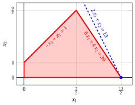{ .fig .ovale loading=lazy  }

        Una soluzione ottima del problema LP primale è:

        $$
        \tilde{x}_1=\frac{13}{2},~~\tilde{x}_2=0
        {\rm ~~~~~e~~~~~}
        z(~LP~) =  2\; \tilde{x}_1 + \tilde{x}_2 = 2\cdot \frac{13}{2} + 0 = 13
        $$

    - Per il problema LP duale abbiamo:

        { .fig .ovale loading=lazy  }

        Una soluzione ottima del problema LP duale è:

        $$
        \tilde{\pi}_1=0,~~\tilde{\pi}_2=\frac{1}{3}
        {\rm ~~~~~e~~~~~}
        z(~D(LP)~) = \tilde{\pi}_1 + 39 \; \tilde{\pi}_2 = 0 + 39 \cdot \frac{1}{3} = 13
        $$

    - I due valori ottimi coincidono, $z(~LP~) = z(~D(LP)~) = 13$, come afferma il teorema della dualità forte.

!!! esercizio "Esercizio 9.10: Problemi primale e duale (P10)"

    Consideriamo il seguente problema primale in forma canonica di massimo con $n=2$ variabili e $m=3$ vincoli:

    $$
    \begin{array}{rrrrrrrrrrrrr}
    {\max} & 5 \, {x_1} & {+} & 2 \, {x_2} \\[2ex]
    \text{soggetto a} & {-} \, {x_1} & {+} & 3 \, {x_2} & {\le} & 12 \\[2ex]
    & {x_1} & {+} & 2 \, {x_2} & {\le} & 12 \\[2ex]
    & {3} \, {x_1} & {-} & 2 \, {x_2} & {\le} & {8} \\[2ex]
    & {x_1,} &  & {x_2} & { \ge} & {0}
    \end{array}
    $$

    e il suo problema LP duale in forma canonica di minimo con $m=3$ variabili e $n=2$ vincoli:

    $$
    \begin{array}{rrrrrrrrrrrrr}
    {\min} & 12\, {\pi_1} & {+} & 12 \, {\pi_2} & {+} & 8 \, {\pi_3} \\[2ex]
    \text{soggetto a} & {-} \, {\pi_1} & {+} & \, {\pi_2} & {+} & 3 \, {\pi_3} & {\ge} & 5 \\[2ex]
    & 3 \, {\pi_1} & {+} & 2 \, {\pi_2} & {-} & 2\, {\pi_3} & {\ge} & 2 \\[2ex]
    & {\pi_1,} &  & {\pi_2,} &  & \, {\pi_3} & { \ge} & { 0 }
    \end{array}
    $$

    **Domande**

    1. Trovare graficamente una soluzione ottima del problema primale e una soluzione ottima del problema duale. Calcolare i valori ottimi dei due problemi.

??? soluzione "Soluzione"

    - Per il problema LP primale abbiamo:

        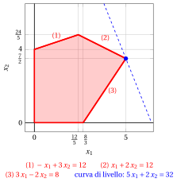{ .fig .ovale loading=lazy style="width:50%" }

        Una soluzione ottima del problema primale è:

        $$
        \tilde{x}_1=5,~~\tilde{x}_2=\frac{7}{2}
        $$

        e il valore ottimo del problema primale è:

        $$
        z(~\text{LP}~) =  5\; \tilde{x}_1 + 2 \; \tilde{x}_2 = 5 \cdot 5 + 2 \cdot \frac{7}{2} = 32
        $$

    - Per il problema LP duale abbiamo:

        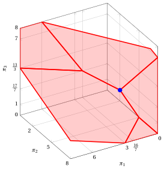{ .fig .ovale loading=lazy style="width:59%" }

        La regione ammissibile del problema duale è illimitata e la soluzione ottima è il vertice indicato in blu:

        $$
        \tilde{\pi}_1=0,~~ \tilde{\pi}_2=2,~~\tilde{\pi}_3=1
        $$

        e il valore ottimo del problema duale è:

        $$
        z(~\text{D(LP)}~) = 12\; \tilde{\pi}_1 + 12 \; \tilde{\pi}_2 + 8 \; \tilde{\pi}_3 = 12 \cdot 0 + 12 \cdot 2 + 8 \cdot 1 = 32
        $$

    - I due valori ottimi coincidono, $z(~\text{LP}~) = z(~\text{D(LP)}~) = 32$, come afferma il teorema della dualità forte.

!!! esercizio "Esercizio 9.11: Problemi primale e duale (P11)"

    Consideriamo il seguente problema primale in forma canonica di massimo con $n=2$ variabili e $m=2$ vincoli:

    $$
    \begin{array}{rrrrrrrrrrrrr}
    {\max} & {-2} \, {x_1} & {-} & {4} \, {x_2} \\[2ex]
    \text{soggetto a} & {-} \, {x_1} & {-} & \, {x_2} & {\le} & {-2} \\[2ex]
    & \, {x_1} & {-} & \, {x_2} & {\le} & {0} \\[2ex]
    & {x_1,} &  & {x_2} & { \ge} & { 0 }
    \end{array}
    $$

    e il suo problema LP duale in forma canonica di minimo con $m=2$ variabili e $n=2$ vincoli:

    $$
    \begin{array}{rrrrrrrrrrrrr}
    {\min} & {-}2 \, {\pi_1} &  &  \\[2ex]
    \text{soggetto a} & {-} \, {\pi_1} & {+} & \, {\pi_2} & {\ge} & {-}2 \\[2ex]
    & {-} \, {\pi_1} & {-} & \, {\pi_2} & {\ge} & {-}4 \\[2ex]
    & {\pi_1,} &  & {\pi_2} & { \ge} & { 0 }
    \end{array}
    $$

    **Domande**

    1. Trovare graficamente una soluzione ottima del problema primale e una soluzione ottima del problema duale. Calcolare i valori ottimi dei due problemi.

??? soluzione "Soluzione"

    - Per il problema LP primale abbiamo:

        { .fig .ovale loading=lazy  }

        Una soluzione ottima del problema LP primale è:

        $$
        \tilde{x}_1=1,~~\tilde{x}_2=1
        {\rm ~~~~~e~~~~~}
        z(~\text{LP}~) =  -2\; \tilde{x}_1 - 4 \; \tilde{x}_2 = -2 \cdot 1 - 4 \cdot 1 = -6
        $$

    - Per il problema LP duale abbiamo:

        { .fig .ovale loading=lazy  }

        Una soluzione ottima del problema LP duale è:

        $$
        \tilde{\pi}_1=3,~~\tilde{\pi}_2=1
        {\rm ~~~~~e~~~~~}
        z(~\text{D(LP)}~) =  -2\; \tilde{\pi}_1 + 0 \; \tilde{\pi}_2 = -2\cdot 3 + 0 \cdot 1 = -6
        $$

    - I due valori ottimi coincidono, $z(~\text{LP}~) = z(~\text{D(LP)}~) = -6$, come afferma il teorema della dualità forte.

## Scarti complementari

!!! esercizio "Esercizio 9.12: Scarti complementari (P3)"

    Consideriamo il seguente problema LP in forma canonica di massimo con $n=2$ variabili e $m=2$ vincoli:

    $$
    \begin{array}{rrrrrrrrrrrrr}
    {\max} & 2 \, {x_1} & {+} & 4 \, {x_2} \\[2ex]
    \text{soggetto a} & {-}\, {x_1} & {+} & \, {x_2} & {\le} & 2 \\[2ex]
    & 8 \, {x_1} & {+} & 2 \, {x_2} & {\le} & 19 \\[2ex]
    & {x_1,} &  & {x_2} & { \ge} & { 0 }
    \end{array}
    $$

    **Domande**

    1. Usando il teorema degli scarti complementari, verificare se la soluzione ammissibile

        $$
        \bar {x}_1=0,~~\bar{x}_2=2
        $$

        è una soluzione ottima del problema LP.

    2. Usando il teorema degli scarti complementari, verificare se la soluzione ammissibile

        $$
        \bar {x}_1=\frac{3}{2},~~\bar{x}_2=\frac{7}{2}
        $$

        è una soluzione ottima del problema LP.

??? soluzione "Soluzione"

    - Verifichiamo se la soluzione ammissibile

        $$
        \bar {x}_1=0,~~\bar{x}_2=2
        $$

        del problema LP è ottima.

        1. Poiché

            $$
            \sum_{i=1}^m a_{ij} \bar  \pi_i = c_j \text{   se   }\bar  x_j>0,~\forall
            j \in \{1,2,\dots,n\}
            $$

            costruiamo la seguente equazione lineare in due variabili:

            $$
            \begin{array}{rrrrrrrrrrrrr}
            & \, {\bar \pi_1} & {+} & 2 \, {\bar \pi_2} & {=} & 4 &  & {\left(\bar x_2=2>0\right)}
            \end{array}
            $$

        2. Poiché

            $$
            \bar \pi_i = 0  \text{       se       } \sum_{j=1}^n a_{ij} \bar  x_j < b_i,~\forall
            i \in \{1,2,\dots,m\}
            $$

            calcoliamo:

            $$
            \begin{array}{rrrrrrrrrrrrr}
            & {-1} {\cdot} {0} & {+} & 1 {\cdot} {2} & {=} & {2 \nless 2} &  \\[2ex]
            & 8 {\cdot} {0} & {+} & 2 {\cdot} {2} & {=} & {4 < 19} & { \text{       quindi       } \bar \pi_2 = 0}
            \end{array}
            $$

            Risolviamo quindi l'equazione precedente in una variabile e otteniamo:

            $$
            \bar \pi_1=4, ~~\bar \pi_2=0
            $$

        3. Dobbiamo verificare

            $$
            \sum_{i=1}^m a_{ij} \bar  \pi_i \ge c_j, \quad \forall j \in \{1,2,\dots,n\}
            $$

            quindi calcoliamo:

            $$
            \begin{array}{rrrrrrrrrrrrr}
            & {-1} {\cdot} {4} & {+} & 8 {\cdot} {0} & {=} & {-}4 { \ngeq 2} \\[2ex]
            & {1} {\cdot} {4} & {+} & 2 {\cdot} {0} & {=} & 4 { \ge 4}
            \end{array}
            $$

            quindi interrompiamo la verifica e concludiamo che la soluzione non è ottima.

    - Verifichiamo se la soluzione ammissibile

        $$
        \bar {x}_1=\frac{3}{2},~~\bar{x}_2=\frac{7}{2}
        $$

        del problema LP è ottima.

        1. Poiché

            $$
            \sum_{i=1}^m a_{ij} \bar  \pi_i = c_j \text{   se   }\bar  x_j>0,~\forall
            j \in \{1,2,\dots,n\}
            $$

            costruiamo il seguente sistema di due equazioni lineari in due variabili:

            $$
            \begin{array}{rrrrrrrrrrrrr}
            & {-} \, {\bar \pi_1} & {+} & 8 \, {\bar \pi_2} & {=} & 2 &  & {\left(\bar x_1=\frac{3}{2}>0\right)} \\[2ex]
            & \, {\bar \pi_1} & {+} & 2 \, {\bar \pi_2} & {=} & 4 &  & {\left(\bar x_2=\frac{7}{2}>0\right)}
            \end{array}
            $$

        2. Poiché

            $$
            \bar \pi_i = 0  \text{       se       } \sum_{j=1}^n a_{ij} \bar  x_j < b_i,~\forall
            i \in \{1,2,\dots,m\}
            $$

            calcoliamo:

            $$
            \begin{array}{rrrrrrrrrrrrr}
            & {-1} {\cdot} {\frac{3}{2} } & {+} & 1 {\cdot} {\frac{7}{2}} & {=} & 2 & {\nless 2} \\[2ex]
            & 8 {\cdot} {\frac{3}{2} } & {+} & 2 {\cdot} {\frac{7}{2}} & {=} & 19 & {\nless 19}
            \end{array}
            $$

            Risolviamo quindi il sistema precedente di due equazioni in due variabili e otteniamo:

            $$
            \bar \pi_1=\frac{14}{5}, ~~\bar \pi_2=\frac{3}{5}
            $$

        3. Dobbiamo verificare

            $$
            \sum_{i=1}^m a_{ij} \bar  \pi_i \ge c_j, \quad \forall j \in \{1,2,\dots,n\}
            $$

            quindi calcoliamo:

            $$
            \begin{array}{rrrrrrrrrrrrr}
            & {-1} {\cdot} {\frac{14}{5}} & {+} & 8 {\cdot} {\frac{3}{5}} & {=} & 2 { \ge 2} \\[2ex]
            & {1} {\cdot} {\frac{14}{5}} & {+} & 2 {\cdot} {\frac{3}{5}} & {=} & 4 { \ge 4}
            \end{array}
            $$

        4. Dobbiamo verificare

            $$
            \bar  \pi_i \ge 0, \quad \forall i \in \{1,2,\dots,m\}
            $$

            quindi, poiché

            $$
            \bar \pi_1=\frac{14}{5} \ge 0, ~~\bar \pi_2=\frac{3}{5} \ge 0
            $$

            la soluzione è ottima.

    - <strong>Soluzione grafica:</strong> la regione ammissibile del problema LP è il poliedro ombreggiato in rosso; la soluzione $\bar x_1=0$, $\bar x_2=2$, che non è ottima, è indicata in viola e la soluzione ottima $\tilde x_1=\frac{3}{2}$, $\tilde x_2=\frac{7}{2}$, di valore $17$, è indicata in blu, insieme alla curva di livello di valore $17$.

        { .fig .ovale loading=lazy  }

        La regione ammissibile del problema LP duale in forma canonica di minimo è il poliedro ombreggiato in rosso. La soluzione duale $\bar \pi_1=4$, $\bar \pi_2=0$ ottenuta dalla prima soluzione (in viola) viola il primo vincolo duale, mentre la soluzione duale $\bar \pi_1=\frac{14}{5}$, $\bar \pi_2=\frac{3}{5}$ ottenuta dalla seconda soluzione (in blu) è ammissibile e ha valore $17$, uguale al valore della soluzione primale.

        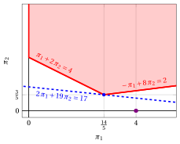{ .fig .ovale loading=lazy  }

!!! esercizio "Esercizio 9.13: Scarti complementari (P10)"

    Consideriamo il seguente problema LP in forma canonica di massimo con $n=2$ variabili e $m=3$ vincoli:

    $$
    \begin{array}{rrrrrrrrrrrrr}
    {\max} & 5 \, {x_1} & {+} & 2 \, {x_2} \\[2ex]
    \text{soggetto a} & {-} \, {x_1} & {+} & 3 \, {x_2} & {\le} & 12 \\[2ex]
    & {x_1} & {+} & 2 \, {x_2} & {\le} & 12 \\[2ex]
    & {3} \, {x_1} & {-} & 2 \, {x_2} & {\le} & {8} \\[2ex]
    & {x_1,} &  & {x_2} & { \ge} & {0}
    \end{array}
    $$

    **Domande**

    1. Usando il teorema degli scarti complementari, verificare se la soluzione ammissibile

        $$
        \bar {x}_1=\frac{8}{3},~~\bar{x}_2=0
        $$

        è una soluzione ottima del problema LP.

    2. Usando il teorema degli scarti complementari, verificare se la soluzione ammissibile

        $$
        \bar {x}_1=3,~~\bar{x}_2=4
        $$

        è una soluzione ottima del problema LP.

??? soluzione "Soluzione"

    - Verifichiamo se la soluzione ammissibile

        $$
        \bar {x}_1=\frac{8}{3},~~\bar{x}_2=0
        $$

        del problema LP è ottima.

        1. Poiché

            $$
            \sum_{i=1}^m a_{ij} \bar  \pi_i = c_j \text{   se   }\bar  x_j>0,~\forall
            j \in \{1,2,\dots,n\}
            $$

            costruiamo la seguente equazione lineare in tre variabili:

            $$
            \begin{array}{rrrrrrrrrrrrr}
            & {-} \, {\bar \pi_1} & {+} & \, {\bar \pi_2} & {+} & 3 \, {\bar \pi_3} & {=} & 5 &  & {\left(\bar x_1=\frac{8}{3}>0\right)}
            \end{array}
            $$

        2. Poiché

            $$
            \bar \pi_i = 0  \text{       se       } \sum_{j=1}^n a_{ij} \bar  x_j < b_i,~\forall
            i \in \{1,2,\dots,m\}
            $$

            calcoliamo:

            $$
            \begin{array}{rrrrrrrrrrrrr}
            & {-1} {\cdot} {\frac{8}{3}} & {+} & 3 {\cdot} {0} & {=} & {-\frac{8}{3} < 12} & { \text{       quindi       } \bar \pi_1 = 0} \\[2ex]
            & 1 {\cdot} {\frac{8}{3}} & {+} & 2 {\cdot} {0} & {=} & {\frac{8}{3} < 12} & { \text{       quindi       } \bar \pi_2 = 0} \\[2ex]
            & 3 {\cdot} {\frac{8}{3}} & {-} & 2 {\cdot} {0} & {=} & {8 \nless 8} &
            \end{array}
            $$

            Risolviamo quindi l'equazione precedente in una variabile e otteniamo:

            $$
            \bar{\pi}_1=0,~~ \bar{\pi}_2=0,~~\bar{\pi}_3=\frac{5}{3}
            $$

        3. Dobbiamo verificare

            $$
            \sum_{i=1}^m a_{ij} \bar  \pi_i \ge c_j, \quad \forall j \in \{1,2,\dots,n\}
            $$

            quindi calcoliamo:

            $$
            \begin{array}{rrrrrrrrrrrrr}
            & {-1} {\cdot} {0} & {+} & 1 {\cdot} {0} & {+} & 3 {\cdot} {\frac{5}{3}} & {=} & 5 { \ge 5} \\[2ex]
            & {3} {\cdot} {0} & {+} & 2 {\cdot} {0} & {-} & 2 {\cdot} {\frac{5}{3}} & {=} & {-\frac{10}{3}} { \ngeq 2}
            \end{array}
            $$

            Poiché il secondo vincolo duale è violato, interrompiamo la verifica e concludiamo che la soluzione non è ottima.

    - Verifichiamo se la soluzione ammissibile

        $$
        \bar {x}_1=3,~~\bar{x}_2=4
        $$

        del problema LP è ottima.

        1. Poiché

            $$
            \sum_{i=1}^m a_{ij} \bar  \pi_i = c_j \text{   se   }\bar  x_j>0,~\forall
            j \in \{1,2,\dots,n\}
            $$

            costruiamo il seguente sistema di due equazioni lineari in tre variabili:

            $$
            \begin{array}{rrrrrrrrrrrrr}
            & {-} \, {\bar \pi_1} & {+} & \, {\bar \pi_2} & {+} & 3 \, {\bar \pi_3} & {=} & 5 &  & {\left(\bar x_1=3>0\right)} \\[2ex]
            & 3\, {\bar \pi_1} & {+} & 2 \, {\bar \pi_2} & {-} & 2 \, {\bar \pi_3} & {=} & 2 &  & {\left(\bar x_2=4>0\right)}
            \end{array}
            $$

        2. Poiché

            $$
            \bar \pi_i = 0  \text{       se       } \sum_{j=1}^n a_{ij} \bar  x_j < b_i,~\forall
            i \in \{1,2,\dots,m\}
            $$

            calcoliamo:

            $$
            \begin{array}{rrrrrrrrrrrrr}
            & {-1} {\cdot} {3} & {+} & 3 {\cdot} {4} & {=} & {9 < 12} & { \text{       quindi       } \bar \pi_1 = 0} \\[2ex]
            & 1 {\cdot} {3} & {+} & 2 {\cdot} {4} & {=} & {11 < 12} & { \text{       quindi       } \bar \pi_2 = 0} \\[2ex]
            & 3 {\cdot} {3} & {-} & 2 {\cdot} {4} & {=} & {1 < 8} & { \text{       quindi       } \bar \pi_3 = 0}
            \end{array}
            $$

            Con $\bar \pi_1=\bar \pi_2=\bar \pi_3=0$ le due equazioni del sistema precedente diventano $0=5$ e $0=2$. Poiché il sistema non ammette soluzione, interrompiamo la verifica e concludiamo che la soluzione non è ottima.

    - <strong>Soluzione grafica:</strong> la regione ammissibile è il poligono ombreggiato in rosso; le due soluzioni verificate sopra sono indicate in viola e la soluzione ottima $\tilde x_1=5$, $\tilde x_2=\frac{7}{2}$, di valore $32$, è indicata in blu, insieme alla curva di livello di valore $32$.

        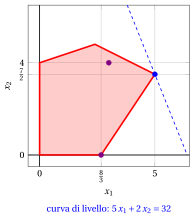{ .fig .ovale loading=lazy style="width:50%" }

!!! esercizio "Esercizio 9.14: Scarti complementari (P11)"

    Consideriamo il seguente problema LP in forma canonica di massimo con $n=2$ variabili e $m=2$ vincoli:

    $$
    \begin{array}{rrrrrrrrrrrrr}
    {\max} & {-2} \, {x_1} & {-} & {4} \, {x_2} \\[2ex]
    \text{soggetto a} & {-} \, {x_1} & {-} & \, {x_2} & {\le} & {-2} \\[2ex]
    & \, {x_1} & {-} & \, {x_2} & {\le} & {0} \\[2ex]
    & {x_1,} &  & {x_2} & { \ge} & { 0 }
    \end{array}
    $$

    **Domande**

    1. Usando il teorema degli scarti complementari, verificare se la soluzione ammissibile

        $$
        \bar {x}_1=1,~~\bar{x}_2=1
        $$

        è una soluzione ottima del problema LP.

    2. Usando il teorema degli scarti complementari, verificare se la soluzione ammissibile

        $$
        \bar {x}_1=1,~~\bar{x}_2=2
        $$

        è una soluzione ottima del problema LP.

??? soluzione "Soluzione"

    - Verifichiamo se la soluzione ammissibile

        $$
        \bar {x}_1=1,~~\bar{x}_2=1
        $$

        del problema LP è ottima.

        1. Poiché

            $$
            \sum_{i=1}^m a_{ij} \bar  \pi_i = c_j \text{   se   }\bar  x_j>0,~\forall
            j \in \{1,2,\dots,n\}
            $$

            costruiamo il seguente sistema di due equazioni lineari in due variabili:

            $$
            \begin{array}{rrrrrrrrrrrrr}
            & {-} \, {\bar \pi_1} & {+} & {\bar \pi_2} & {=} & {-}2 &  & {\left(\bar x_1=1>0\right)} \\[2ex]
            & {-} \, {\bar \pi_1} & {-} & \, {\bar \pi_2} & {=} & {-}4 &  & {\left(\bar x_2=1>0\right)}
            \end{array}
            $$

        2. Poiché

            $$
            \bar \pi_i = 0  \text{       se       } \sum_{j=1}^n a_{ij} \bar  x_j < b_i,~\forall
            i \in \{1,2,\dots,m\}
            $$

            calcoliamo:

            $$
            \begin{array}{rrrrrrrrrrrrr}
            & {-1} {\cdot} {1} & {-} & 1 {\cdot} {1} & {=} & {-}2 & {\nless -2} \\[2ex]
            & 1 {\cdot} {1} & {-} & 1 {\cdot} {1} & {=} & 0 & {\nless 0}
            \end{array}
            $$

            Risolviamo quindi il sistema precedente di due equazioni in due variabili e otteniamo:

            $$
            \bar \pi_1=3, ~~\bar \pi_2=1
            $$

        3. Dobbiamo verificare

            $$
            \sum_{i=1}^m a_{ij} \bar  \pi_i \ge c_j, \quad \forall j \in \{1,2,\dots,n\}
            $$

            quindi calcoliamo:

            $$
            \begin{array}{rrrrrrrrrrrrr}
            & {-1} {\cdot} {3} & {+} & 1 {\cdot} {1} & {=} & {-}2 { \ge -2} \\[2ex]
            & {-1} {\cdot} {3} & {-} & 1 {\cdot} {1} & {=} & {-}4 { \ge -4}
            \end{array}
            $$

        4. Dobbiamo verificare

            $$
            \bar  \pi_i \ge 0, \quad \forall i \in \{1,2,\dots,m\}
            $$

            quindi, poiché

            $$
            \bar \pi_1=3 \ge 0, ~~\bar \pi_2=1 \ge 0
            $$

            la soluzione è ottima.

    - Verifichiamo se la soluzione ammissibile

        $$
        \bar {x}_1=1,~~\bar{x}_2=2
        $$

        del problema LP è ottima.

        1. Poiché

            $$
            \sum_{i=1}^m a_{ij} \bar  \pi_i = c_j \text{   se   }\bar  x_j>0,~\forall
            j \in \{1,2,\dots,n\}
            $$

            costruiamo il seguente sistema di due equazioni lineari in due variabili:

            $$
            \begin{array}{rrrrrrrrrrrrr}
            & {-} \, {\bar \pi_1} & {+} & {\bar \pi_2} & {=} & {-}2 &  & {\left(\bar x_1=1>0\right)} \\[2ex]
            & {-} \, {\bar \pi_1} & {-} & \, {\bar \pi_2} & {=} & {-}4 &  & {\left(\bar x_2=2>0\right)}
            \end{array}
            $$

        2. Poiché

            $$
            \bar \pi_i = 0  \text{       se       } \sum_{j=1}^n a_{ij} \bar  x_j < b_i,~\forall
            i \in \{1,2,\dots,m\}
            $$

            calcoliamo:

            $$
            \begin{array}{rrrrrrrrrrrrr}
            & {-1} {\cdot} {1} & {-} & 1 {\cdot} {2} & {=} & {-}3 & {< -2 \text{       quindi       } \bar \pi_1 = 0} \\[2ex]
            & 1 {\cdot} {1} & {-} & 1 {\cdot} {2} & {=} & {-1} & {< 0 \text{       quindi       } \bar \pi_2 = 0}
            \end{array}
            $$

            Poiché il sistema precedente non ammette soluzione, interrompiamo la verifica e concludiamo che la soluzione non è ottima.

    - <strong>Soluzione grafica:</strong> la regione ammissibile del problema LP è il poliedro ombreggiato in rosso (è illimitato); la soluzione $\bar x_1=1$, $\bar x_2=2$, che non è ottima, è indicata in viola e la soluzione ottima $\tilde x_1=1$, $\tilde x_2=1$, di valore $-6$, è indicata in blu, insieme alla curva di livello di valore $-6$.

        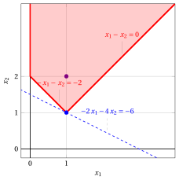{ .fig .ovale loading=lazy  }

        La regione ammissibile del problema LP duale in forma canonica di minimo è il poliedro ombreggiato in rosso. La soluzione duale $\bar \pi_1=3$, $\bar \pi_2=1$ ottenuta dalla prima soluzione è indicata in blu: è ammissibile e ha valore $-6$, uguale al valore della soluzione primale.

        { .fig .ovale loading=lazy  }

!!! esercizio "Esercizio 9.15: Scarti complementari (P44)"

    Consideriamo il seguente problema LP in forma canonica di massimo con $n=3$ variabili e $m=3$ vincoli:

    $$
    \begin{array}{rrrrrrrrrrrrr}
    {\max} & {x_1} & {+} & 2 \, {x_2} & {+} & 3 \, {x_3} \\[2ex]
    \text{soggetto a} & {x_1} & {+} & 2 \, {x_2} & {-} & 2 \, {x_3} & {\le} & 1 \\[2ex]
    & 2 \, {x_1} & {-} & \, {x_2} & {-} & 3 \, {x_3} & {\le} & 4 \\[2ex]
    & {x_1} & {+} & 2 \, {x_2} & {+} & 5 \, {x_3} & {\le} & 2 \\[2ex]
    & {x_1,} &  & {x_2,} &  & \, {x_3} & {\ge} & { 0 }
    \end{array}
    $$

    **Domande**

    1. Usando il teorema degli scarti complementari, verificare se le seguenti soluzioni ammissibili sono soluzioni ottime del problema LP:

        $$
        \bar x_1=\frac{9}{7},~~
        \bar x_2=0,~~
        \bar x_3=\frac{1}{7}~~
        {\rm ~~~~~e~~~~~}
        \bar x_1=0,~~
        \bar x_2=\frac{9}{14},~~
        \bar x_3=\frac{1}{7}~~
        $$

    2. Calcolare i valori della funzione obiettivo delle due soluzioni.

    3. Sostituire la funzione obiettivo con la seguente:

        $$
        \max ~~ 7\; x_1 + 14\; x_2 + 30\; x_3
        $$

        e verificare se le seguenti soluzioni ammissibili sono soluzioni ottime del problema LP:

        $$
        \bar x_1=\frac{9}{7},~~
        \bar x_2=0,~~
        \bar x_3=\frac{1}{7}~~
        {\rm ~~~~~e~~~~~}
        \bar x_1=0,~~
        \bar x_2=0,~~
        \bar x_3=\frac{2}{5}
        $$

??? soluzione "Soluzione"

    1. Verifichiamo se la soluzione ammissibile

        $$
        \bar x_1=\frac{9}{7},~~
        \bar x_2=0,~~
        \bar x_3=\frac{1}{7}~~
        $$

        del problema LP è ottima.

        1. Poiché

            $$
            \sum_{i=1}^m a_{ij} \bar  \pi_i = c_j \text{   se   }\bar  x_j>0,~\forall
            j \in \{1,2,\dots,n\}
            $$

            costruiamo il seguente sistema di due equazioni lineari in tre variabili:

            $$
            \begin{array}{rrrrrrrrrrrrr}
            & 1 \, {\bar{\pi}_1} & {+} & 2 \, {\bar{\pi}_2} & {+} & 1 \, {\bar{\pi}_3} & {=} & 1 &  & {\left(\bar x_1=\frac{9}{7}>0\right)} \\[2ex]
            & {-}2 \, {\bar{\pi}_1} & {-} & 3 \, {\bar{\pi}_2} & {+} & 5 \, {\bar{\pi}_3} & {=} & 3 &  & {\left(\bar x_3=\frac{1}{7}>0\right)}
            \end{array}
            $$

        2. Poiché

            $$
            \bar \pi_i = 0  \text{       se       } \sum_{j=1}^n a_{ij} \bar  x_j < b_i,~\forall
            i \in \{1,2,\dots,m\}
            $$

            calcoliamo:

            $$
            \begin{array}{rrrrrrrrrrrrr}
            & 1 {\cdot} {\frac{9}{7}} & {+} & 2 {\cdot} {0} & {-} & 2 {\cdot} {\frac{1}{7}} & {=} & {1 \nless 1} &  \\[2ex]
            & 2 {\cdot} {\frac{9}{7}} & {-} & 1 {\cdot} {0} & {-} & 3 {\cdot} {\frac{1}{7}} & {=} & {\frac{15}{7} < 4} & { \text{       quindi       } \bar \pi_2 = 0} \\[2ex]
            & 1 {\cdot} {\frac{9}{7}} & {+} & 2 {\cdot} {0} & {+} & 5 {\cdot} {\frac{1}{7}} & {=} & {2 \nless 2} &
            \end{array}
            $$

            Risolviamo quindi il sistema precedente di due equazioni in due variabili e otteniamo:

            $$
            \bar \pi_1=\frac{2}{7}, ~~\bar \pi_2=0, ~~\bar \pi_3=\frac{5}{7}
            $$

        3. Dobbiamo verificare

            $$
            \sum_{i=1}^m a_{ij} \bar  \pi_i \ge c_j, \quad \forall j \in \{1,2,\dots,n\}
            $$

            quindi calcoliamo:

            $$
            \begin{array}{rrrrrrrrrrrrr}
            & {1} {\cdot} {\frac{2}{7}} & {+} & 2 {\cdot} {0} & {+} & 1 {\cdot} {\frac{5}{7}} & {=} & 1 { \ge 1} \\[2ex]
            & {2} {\cdot} {\frac{2}{7}} & {-} & 1 {\cdot} {0} & {+} & 2 {\cdot} {\frac{5}{7}} & {=} & 2 { \ge 2} \\[2ex]
            & {-2} {\cdot} {\frac{2}{7}} & {-} & 3 {\cdot} {0} & {+} & 5 {\cdot} {\frac{5}{7}} & {=} & 3 { \ge 3}
            \end{array}
            $$

        4. Dobbiamo verificare

            $$
            \bar  \pi_i \ge 0, \quad \forall i \in \{1,2,\dots,m\}
            $$

            quindi, poiché

            $$
            \bar \pi_1=\frac{2}{7} \ge 0, ~~\bar \pi_2=0\ge 0, ~~\bar \pi_3=\frac{5}{7}\ge 0
            $$

            la soluzione è ottima.

        Verifichiamo se la soluzione ammissibile

        $$
        \bar x_1=0,~~
        \bar x_2=\frac{9}{14},~~
        \bar x_3=\frac{1}{7}~~
        $$

        del problema LP è ottima.

        1. Poiché

            $$
            \sum_{i=1}^m a_{ij} \bar  \pi_i = c_j \text{   se   }\bar  x_j>0,~\forall
            j \in \{1,2,\dots,n\}
            $$

            costruiamo il seguente sistema di due equazioni lineari in tre variabili:

            $$
            \begin{array}{rrrrrrrrrrrrr}
            & 2 \, {\bar{\pi}_1} & {-} & 1 \, {\bar{\pi}_2} & {+} & 2 \, {\bar{\pi}_3} & {=} & 2 &  & {\left(\bar x_2=\frac{9}{14}>0\right)} \\[2ex]
            & {-}2 \, {\bar{\pi}_1} & {-} & 3 \, {\bar{\pi}_2} & {+} & 5 \, {\bar{\pi}_3} & {=} & 3 &  & {\left(\bar x_3=\frac{1}{7}>0\right)}
            \end{array}
            $$

        2. Poiché

            $$
            \bar \pi_i = 0  \text{       se       } \sum_{j=1}^n a_{ij} \bar  x_j < b_i,~\forall
            i \in \{1,2,\dots,m\}
            $$

            calcoliamo:

            $$
            \begin{array}{rrrrrrrrrrrrr}
            & 1 {\cdot} {0} & {+} & 2 {\cdot} {\frac{9}{14}} & {-} & 2 {\cdot} {\frac{1}{7}} & {=} & {1 \nless 1} &  \\[2ex]
            & 2 {\cdot} {0} & {-} & 1 {\cdot} {\frac{9}{14}} & {-} & 3 {\cdot} {\frac{1}{7}} & {=} & {-\frac{15}{14} < 4} & { \text{       quindi       } \bar \pi_2 = 0} \\[2ex]
            & {1} {\cdot} {0} & {+} & 2 {\cdot} {\frac{9}{14}} & {+} & 5 {\cdot} {\frac{1}{7}} & {=} & {2 \nless 2} &
            \end{array}
            $$

            Risolviamo quindi il sistema precedente di due equazioni in due variabili e otteniamo:

            $$
            \bar \pi_1=\frac{2}{7}, ~~\bar \pi_2=0, ~~\bar \pi_3=\frac{5}{7}
            $$

        3. Dobbiamo verificare

            $$
            \sum_{i=1}^m a_{ij} \bar  \pi_i \ge c_j, \quad \forall j \in \{1,2,\dots,n\}
            $$

            quindi calcoliamo:

            $$
            \begin{array}{rrrrrrrrrrrrr}
            & {1} {\cdot} {\frac{2}{7}} & {+} & 2 {\cdot} {0} & {+} & 1 {\cdot} {\frac{5}{7}} & {=} & 1 { \ge 1} \\[2ex]
            & {2} {\cdot} {\frac{2}{7}} & {-} & 1 {\cdot} {0} & {+} & 2 {\cdot} {\frac{5}{7}} & {=} & 2 { \ge 2} \\[2ex]
            & {-2} {\cdot} {\frac{2}{7}} & {-} & 3 {\cdot} {0} & {+} & 5 {\cdot} {\frac{5}{7}} & {=} & 3 { \ge 3}
            \end{array}
            $$

        4. Dobbiamo verificare

            $$
            \bar  \pi_i \ge 0, \quad \forall i \in \{1,2,\dots,m\}
            $$

            quindi, poiché

            $$
            \bar \pi_1=\frac{2}{7} \ge 0, ~~\bar \pi_2=0\ge 0, ~~\bar \pi_3=\frac{5}{7}\ge 0
            $$

            la soluzione è ottima.

    2. Il valore della funzione obiettivo della prima soluzione è:

        $$
        \bar x_1 ~+~ 2\, \bar x_2 ~+~ 3 \, \bar x_3 ~=~ \frac{9}{7} ~+~ 0 ~+~ 3 \cdot \frac{1}{7} ~=~  \frac{12}{7}
        $$

        e il valore della funzione obiettivo della seconda è:

        $$
        \bar x_1 ~+~ 2\, \bar x_2 ~+~ 3 \, \bar x_3 ~=~ 0 ~+~ 2 \cdot \frac{9}{14} ~+~ 3 \cdot \frac{1}{7} ~=~  \frac{12}{7}
        $$

        Poiché le soluzioni sono entrambe ottime, i due valori devono coincidere. Inoltre, entrambe le soluzioni soddisfano all'uguaglianza il primo e il terzo vincolo, e ogni punto del segmento che le congiunge,

        $$
        \bar{\boldsymbol x}(\lambda) = \lambda \begin{pmatrix} \frac{9}{7} \\[1ex] 0 \\[1ex] \frac{1}{7} \end{pmatrix} + (1-\lambda) \begin{pmatrix} 0 \\[1ex] \frac{9}{14} \\[1ex] \frac{1}{7} \end{pmatrix}, \qquad \lambda \in [0,1],
        $$

        è una soluzione ammissibile di valore $\frac{12}{7}$. Di conseguenza, il problema LP ha infinite soluzioni ottime: l'intero spigolo del poliedro tra le due soluzioni è ottimo.

    3. Verifichiamo se la soluzione ammissibile

        $$
        \bar x_1=\frac{9}{7},~~
        \bar x_2=0,~~
        \bar x_3=\frac{1}{7}~~
        $$

        del problema LP è ottima considerando la nuova funzione obiettivo:

        $$
        \max ~~ 7\; x_1 + 14\; x_2 + 30\; x_3
        $$

        1. Poiché

            $$
            \sum_{i=1}^m a_{ij} \bar  \pi_i = c_j \text{   se   }\bar  x_j>0,~\forall
            j \in \{1,2,\dots,n\}
            $$

            costruiamo il seguente sistema di due equazioni lineari in tre variabili:

            $$
            \begin{array}{rrrrrrrrrrrrr}
            & 1 \, {\bar{\pi}_1} & {+} & 2 \, {\bar{\pi}_2} & {+} & 1 \, {\bar{\pi}_3} & {=} & 7 &  & {\left(\bar x_1=\frac{9}{7}>0\right)} \\[2ex]
            & {-}2 \, {\bar{\pi}_1} & {-} & 3 \, {\bar{\pi}_2} & {+} & 5 \, {\bar{\pi}_3} & {=} & 30 &  & {\left(\bar x_3=\frac{1}{7}>0\right)}
            \end{array}
            $$

        2. Dal punto 1(b) abbiamo che $\bar \pi_2 = 0$. Risolviamo quindi il sistema precedente di due equazioni in due variabili e otteniamo:

            $$
            \bar \pi_1=\frac{5}{7}, ~~\bar \pi_2=0, ~~\bar \pi_3=\frac{44}{7}
            $$

        3. Dobbiamo verificare

            $$
            \sum_{i=1}^m a_{ij} \bar  \pi_i \ge c_j, \quad \forall j \in \{1,2,\dots,n\}
            $$

            quindi calcoliamo:

            $$
            \begin{array}{rrrrrrrrrrrrr}
            & {1} {\cdot} {\frac{5}{7}} & {+} & 2 {\cdot} {0} & {+} & 1 {\cdot} {\frac{44}{7}} & {=} & 7 {\ge 7} \\[2ex]
            & {2} {\cdot} {\frac{5}{7}} & {-} & 1 {\cdot} {0} & {+} & 2 {\cdot} {\frac{44}{7}} & {=} & 14 { \ge 14} \\[2ex]
            & {-2} {\cdot} {\frac{5}{7}} & {-} & 3 {\cdot} {0} & {+} & 5 {\cdot} {\frac{44}{7}} & {=} & 30 { \ge 30}
            \end{array}
            $$

        4. Dobbiamo verificare

            $$
            \bar  \pi_i \ge 0, \quad \forall i \in \{1,2,\dots,m\}
            $$

            quindi, poiché

            $$
            \bar \pi_1=\frac{5}{7} \ge 0, ~~\bar \pi_2=0\ge 0, ~~\bar \pi_3=\frac{44}{7}\ge 0
            $$

            la soluzione è ottima.

        Verifichiamo quindi se la soluzione ammissibile

        $$
        \bar x_1=0,~~ \bar x_2=0,~~\bar x_3=\frac{2}{5}~~
        $$

        del problema LP è ottima considerando la nuova funzione obiettivo:

        $$
        \max ~~ 7\; x_1 + 14\; x_2 + 30\; x_3
        $$

        1. Poiché

            $$
            \sum_{i=1}^m a_{ij} \bar  \pi_i = c_j \text{   se   }\bar  x_j>0,~\forall
            j \in \{1,2,\dots,n\}
            $$

            costruiamo la seguente equazione lineare in tre variabili:

            $$
            \begin{array}{rrrrrrrrrrrrr}
            & {-}2 \, {\bar{\pi}_1} & {-} & 3 \, {\bar{\pi}_2} & {+} & 5 \, {\bar{\pi}_3} & {=} & 30 &  & {\left(\bar x_3=\frac{2}{5}>0\right)}
            \end{array}
            $$

        2. Poiché

            $$
            \bar \pi_i = 0  \text{       se       } \sum_{j=1}^n a_{ij} \bar  x_j < b_i,~\forall
            i \in \{1,2,\dots,m\}
            $$

            calcoliamo:

            $$
            \begin{array}{rrrrrrrrrrrrr}
            & 1 {\cdot} {0} & {+} & 2 {\cdot} {0} & {-} & 2 {\cdot} {\frac{2}{5}} & {=} & {-\frac{4}{5} < 1} & { \text{       quindi       } \bar \pi_1 = 0} \\[2ex]
            & 2 {\cdot} {0} & {-} & 1 {\cdot} {0} & {-} & 3 {\cdot} {\frac{2}{5}} & {=} & {-\frac{6}{5} < 4} & { \text{       quindi       } \bar \pi_2 = 0} \\[2ex]
            & 1 {\cdot} {0} & {+} & 2 {\cdot} {0} & {+} & 5 {\cdot} {\frac{2}{5}} & {=} & { 2 \nless 2} &
            \end{array}
            $$

            Risolviamo quindi l'equazione precedente in una variabile e otteniamo:

            $$
            \bar \pi_1=0, ~~\bar \pi_2=0, ~~\bar \pi_3=6
            $$

        3. Dobbiamo verificare

            $$
            \sum_{i=1}^m a_{ij} \bar  \pi_i \ge c_j, \quad \forall j \in \{1,2,\dots,n\}
            $$

            quindi calcoliamo:

            $$
            \begin{array}{rrrrrrrrrrrrr}
            & {1} {\cdot} {0} & {+} & 2 {\cdot} {0} & {+} & 1 {\cdot} {6} & {=} & 6 { \ngeq 7}
            \end{array}
            $$

            interrompiamo la verifica e concludiamo che la soluzione non è ottima.

!!! esercizio "Esercizio 9.16: Scarti complementari (P71)"

    Consideriamo il seguente problema LP in forma canonica di massimo con $n=4$ variabili e $m=3$ vincoli:

    $$
    \begin{array}{rrrrrrrrrrrrr}
    {\max} & 4 \, {x_1} & {+} & \, {x_2} & {+} & 5 \, {x_3} & {+} & 3 \, {x_4} \\[2ex]
    \text{soggetto a} & \, {x_1} & {-} & \, {x_2} & {-} & \, {x_3} & {+} & 3 \, {x_4} & {\le} & 1 \\[2ex]
    & 5 \, {x_1} & {+} & \, {x_2} & {+} & 3 \, {x_3} & {+} & 8 \, {x_4} & {\le} & 55 \\[2ex]
    & {-} \, {x_1} & {+} & 2 \, {x_2} & {+} & 3 \, {x_3} & {-} & 5 \, {x_4} & {\le} & 3 \\[2ex]
    & {x_1,} &  & {x_2,} &  & {x_3,} &  & {x_4} & { \ge} & { 0 }
    \end{array}
    $$

    **Domande**

    1. Usando il teorema degli scarti complementari, verificare se la soluzione ammissibile

        $$
        \bar {x}_1=0,~~\bar{x}_2=14,~~\bar{x}_3=0,~~\bar{x}_4=5
        $$

        è una soluzione ottima del problema LP.

    2. Usando il teorema degli scarti complementari, verificare se la soluzione ammissibile

        $$
        \bar {x}_1=0,~~\bar{x}_2=1,~~\bar{x}_3=2,~~\bar{x}_4=1
        $$

        è una soluzione ottima del problema LP.

    3. Usando il teorema degli scarti complementari, verificare se la soluzione ammissibile

        $$
        \bar x_{1}= 5, ~~ \bar x_{2}= 4, ~~ \bar x_{3}= 0, ~~ \bar x_{4}= 0
        $$

        è una soluzione ottima del problema LP.

??? soluzione "Soluzione"

    - Verifichiamo se la soluzione ammissibile

        $$
        \bar {x}_1=0,~~\bar{x}_2=14,~~\bar{x}_3=0,~~\bar{x}_4=5
        $$

        del problema LP è ottima.

        1. Poiché

            $$
            \sum_{i=1}^m a_{ij} \bar  \pi_i = c_j \text{   se   }\bar  x_j>0,~\forall
            j \in \{1,2,\dots,n\}
            $$

            costruiamo il seguente sistema di due equazioni lineari in tre variabili:

            $$
            \begin{array}{rrrrrrrrrrrrr}
            & {-} \, {\bar \pi_1} & {+} & \, {\bar \pi_2} & {+} & 2 \, {\bar \pi_3} & {=} & 1 &  & {\left(\bar x_2=14>0\right)} \\[2ex]
            & 3\, {\bar \pi_1} & {+} & 8 \, {\bar \pi_2} & {-} & 5 \, {\bar \pi_3} & {=} & 3 &  & {\left(\bar x_4=5>0\right)}
            \end{array}
            $$

        2. Poiché

            $$
            \bar \pi_i = 0  \text{       se       } \sum_{j=1}^n a_{ij} \bar  x_j < b_i,~\forall
            i \in \{1,2,\dots,m\}
            $$

            calcoliamo:

            $$
            \begin{array}{rrrrrrrrrrrrr}
            & 1 {\cdot} {0} & {-} & 1 {\cdot} {14} & {-} & 1 {\cdot} {0} & {+} & 3 {\cdot} {5} & {=} & {1 \nless 1} &  \\[2ex]
            & 5 {\cdot} {0} & {+} & 1 {\cdot} {14} & {+} & 3 {\cdot} {0} & {+} & 8 {\cdot} {5} & {=} & {54 < 55} & { \text{       quindi       } \bar \pi_2 = 0} \\[2ex]
            & {-1} {\cdot} {0} & {+} & 2 {\cdot} {14} & {+} & 3 {\cdot} {0} & {-} & 5 {\cdot} {5} & {=} & {3 \nless 3} &
            \end{array}
            $$

            Risolviamo quindi il sistema precedente di due equazioni in due variabili e otteniamo:

            $$
            \bar \pi_1=11, ~~\bar \pi_2=0, ~~\bar \pi_3=6
            $$

        3. Dobbiamo verificare

            $$
            \sum_{i=1}^m a_{ij} \bar  \pi_i \ge c_j, \quad \forall j \in \{1,2,\dots,n\}
            $$

            quindi calcoliamo:

            $$
            \begin{array}{rrrrrrrrrrrrr}
            & {1} {\cdot} {11} & {+} & 5 {\cdot} {0} & {-} & 1 {\cdot} {6} & {=} & 5 { \ge 4} \\[2ex]
            & {-1} {\cdot} {11} & {+} & 1 {\cdot} {0} & {+} & 2 {\cdot} {6} & {=} & 1 { \ge 1} \\[2ex]
            & {-1} {\cdot} {11} & {+} & 3 {\cdot} {0} & {+} & 3 {\cdot} {6} & {=} & 7 { \ge 5} \\[2ex]
            & {3} {\cdot} {11} & {+} & 8 {\cdot} {0} & {-} & 5 {\cdot} {6} & {=} & 3 { \ge 3}
            \end{array}
            $$

        4. Dobbiamo verificare

            $$
            \bar  \pi_i \ge 0, \quad \forall i \in \{1,2,\dots,m\}
            $$

            quindi, poiché

            $$
            \bar \pi_1=11 \ge 0, ~~\bar \pi_2=0\ge 0, ~~\bar \pi_3=6\ge 0
            $$

            la soluzione è ottima.

    - Verifichiamo se la soluzione ammissibile

        $$
        \bar {x}_1=0,~~\bar{x}_2=1,~~\bar{x}_3=2,~~\bar{x}_4=1
        $$

        del problema LP è ottima.

        1. Poiché

            $$
            \sum_{i=1}^m a_{ij} \bar  \pi_i = c_j \text{   se   }\bar  x_j>0,~\forall
            j \in \{1,2,\dots,n\}
            $$

            costruiamo il seguente sistema di tre equazioni lineari in tre variabili:

            $$
            \begin{array}{rrrrrrrrrrrrr}
            & {-} \, {\bar \pi_1} & {+} & \, {\bar \pi_2} & {+} & 2 \, {\bar \pi_3} & {=} & 1 &  & {\left(\bar x_2=1>0\right)} \\[2ex]
            & {-} \, {\bar \pi_1} & {+} & 3 \, {\bar \pi_2} & {+} & 3 \, {\bar \pi_3} & {=} & 5 &  & {\left(\bar x_3=2>0\right)} \\[2ex]
            & 3\, {\bar \pi_1} & {+} & 8 \, {\bar \pi_2} & {-} & 5 \, {\bar \pi_3} & {=} & 3 &  & {\left(\bar x_4=1>0\right)}
            \end{array}
            $$

        2. Poiché

            $$
            \bar \pi_i = 0  \text{       se       } \sum_{j=1}^n a_{ij} \bar  x_j < b_i,~\forall
            i \in \{1,2,\dots,m\}
            $$

            calcoliamo:

            $$
            \begin{array}{rrrrrrrrrrrrr}
            & 1 {\cdot} {0} & {-} & 1 {\cdot} {1} & {-} & 1 {\cdot} {2} & {+} & 3 {\cdot} {1} & {=} & {0 < 1} & { \text{       quindi       } \bar \pi_1 = 0} \\[2ex]
            & 5 {\cdot} {0} & {+} & 1 {\cdot} {1} & {+} & 3 {\cdot} {2} & {+} & 8 {\cdot} {1} & {=} & {15 < 55} & { \text{       quindi       } \bar \pi_2 = 0} \\[2ex]
            & {-1} {\cdot} {0} & {+} & 2 {\cdot} {1} & {+} & 3 {\cdot} {2} & {-} & 5 {\cdot} {1} & {=} & { 3 \nless 3} &
            \end{array}
            $$

            Poiché il sistema precedente non ammette soluzione, interrompiamo la verifica e concludiamo che la soluzione non è ottima.

    - Verifichiamo se la soluzione ammissibile

        $$
        \bar {x}_1=5,~~\bar{x}_2=4,~~\bar{x}_3=0,~~\bar{x}_4=0
        $$

        del problema LP è ottima.

        1. Poiché

            $$
            \sum_{i=1}^m a_{ij} \bar  \pi_i = c_j \text{   se   }\bar  x_j>0,~\forall
            j \in \{1,2,\dots,n\}
            $$

            costruiamo il seguente sistema di due equazioni lineari in tre variabili:

            $$
            \begin{array}{rrrrrrrrrrrrr}
            & \, {\bar \pi_1} & {+} & 5\, {\bar \pi_2} & {-} & \, {\bar \pi_3} & {=} & 4 &  & {\left(\bar x_1=5>0\right)} \\[2ex]
            & {-}\, {\bar \pi_1} & {+} & \, {\bar \pi_2} & {+} & 2 \, {\bar \pi_3} & {=} & 1 &  & {\left(\bar x_2=4>0\right)}
            \end{array}
            $$

        2. Poiché

            $$
            \bar \pi_i = 0  \text{       se       } \sum_{j=1}^n a_{ij} \bar  x_j < b_i,~\forall
            i \in \{1,2,\dots,m\}
            $$

            calcoliamo:

            $$
            \begin{array}{rrrrrrrrrrrrr}
            & 1 {\cdot} {5} & {-} & 1 {\cdot} {4} & {-} & 1 {\cdot} {0} & {+} & 3 {\cdot} {0} & {=} & {1 \nless 1} &  \\[2ex]
            & 5 {\cdot} {5} & {+} & 1 {\cdot} {4} & {+} & 3 {\cdot} {0} & {+} & 8 {\cdot} {0} & {=} & {29 < 55} & { \text{       quindi       } \bar \pi_2 = 0} \\[2ex]
            & {-1} {\cdot} {5} & {+} & 2 {\cdot} {4} & {+} & 3 {\cdot} {0} & {-} & 5 {\cdot} {0} & {=} & {3 \nless 3} &
            \end{array}
            $$

            Risolviamo quindi il sistema precedente di due equazioni in due variabili e otteniamo:

            $$
            \bar \pi_1=9, ~~\bar \pi_2=0, ~~\bar \pi_3=5
            $$

        3. Dobbiamo verificare

            $$
            \sum_{i=1}^m a_{ij} \bar  \pi_i \ge c_j, \quad \forall j \in \{1,2,\dots,n\}
            $$

            quindi calcoliamo:

            $$
            \begin{array}{rrrrrrrrrrrrr}
            & {1} {\cdot} {9} & {+} & 5 {\cdot} {0} & {-} & 1 {\cdot} {5} & {=} & 4 { \ge 4} \\[2ex]
            & {-1} {\cdot} {9} & {+} & 1 {\cdot} {0} & {+} & 2 {\cdot} {5} & {=} & 1 { \ge 1} \\[2ex]
            & {-1} {\cdot} {9} & {+} & 3 {\cdot} {0} & {+} & 3 {\cdot} {5} & {=} & 6 { \ge 5} \\[2ex]
            & {3} {\cdot} {9} & {+} & 8 {\cdot} {0} & {-} & 5 {\cdot} {5} & {=} & 2 { \ngeq 3}
            \end{array}
            $$

            quindi interrompiamo la verifica e concludiamo che la soluzione non è ottima.

!!! esercizio "Esercizio 9.17: Scarti complementari (P72)"

    Consideriamo il seguente problema LP in forma canonica di massimo con $n=5$ variabili e $m=4$ vincoli:

    $$
    \begin{array}{rrrrrrrrrrrrr}
    {\max} & 7 \, {x_1} & {+} & 6 \, {x_2} & {+} & 5 \, {x_3} & {-} & 2 \, {x_4} & {+} & 3 \, {x_5} \\[2ex]
    \text{soggetto a} & \, {x_1} & {+} & 3 \, {x_2} & {+} & 5 \, {x_3} & {-} & 2 \, {x_4} & {+} & 2 \, {x_5} & {\le} & 4 \\[2ex]
    & 4 \, {x_1} & {+} & 2 \, {x_2} & {-} & 2 \, {x_3} & {+} & \, {x_4} & {+} & \, {x_5} & {\le} & 3 \\[2ex]
    & 2 \, {x_1} & {+} & 4 \, {x_2} & {+} & 4 \, {x_3} & {-} & 2 \, {x_4} & {+} & 5 \, {x_5} & {\le} & 5 \\[2ex]
    & 3 \, {x_1} & {+} & \, {x_2} & {+} & 2 \, {x_3} & {-} & \, {x_4} & {-} & 2 \, {x_5} & {\le} & 1 \\[2ex]
    & {x_1,} &  & {x_2,} &  & \, {x_3,} &  & \, {x_4,} &  & \, {x_5} & { \ge} & { 0 }
    \end{array}
    $$

    **Domande**

    1. Usando il teorema degli scarti complementari, verificare se la soluzione ammissibile

        $$
        \bar x_1=0,~~\bar x_2=\frac{4}{3},~~\bar x_3=\frac{2}{3},~~\bar x_4=\frac{5}{3},~~\bar x_5=0
        $$

        è una soluzione ottima del problema LP.

    2. Usando il teorema degli scarti complementari, verificare se la soluzione ammissibile

        $$
        \bar x_1=\frac{39}{59},~~\bar x_2=0,~~\bar x_3=\frac{91}{59},~~\bar x_4=\frac{166}{59},~~\bar x_5=\frac{37}{59}
        $$

        è una soluzione ottima del problema LP.

??? soluzione "Soluzione"

    - Verifichiamo se la soluzione ammissibile

        $$
        \bar x_1=0,~~
        \bar x_2=\frac{4}{3},~~
        \bar x_3=\frac{2}{3},~~
        \bar x_4=\frac{5}{3},~~
        \bar x_5=0
        $$

        del problema LP è ottima.

        1. Poiché

            $$
            \sum_{i=1}^m a_{ij} \bar  \pi_i = c_j \text{   se   }\bar  x_j>0,~\forall
            j \in \{1,2,\dots,n\}
            $$

            costruiamo il seguente sistema di tre equazioni lineari in quattro variabili:

            $$
            \begin{array}{rrrrrrrrrrrrr}
            & 3 \, {\bar{\pi}_1} & {+} & 2 \, {\bar{\pi}_2} & {+} & 4 \, {\bar{\pi}_3} & {+} & \, {\bar{\pi}_4} & {=} & 6 &  & {\left(\bar x_2=\frac{4}{3}>0\right)} \\[2ex]
            & 5 \, {\bar{\pi}_1} & {-} & 2 \, {\bar{\pi}_2} & {+} & 4 \, {\bar{\pi}_3} & {+} & 2 \, {\bar{\pi}_4} & {=} & 5 &  & {\left(\bar x_3=\frac{2}{3}>0\right)} \\[2ex]
            & {-}2 \, {\bar{\pi}_1} & {+} & \, {\bar{\pi}_2} & {-} & 2 \, {\bar{\pi}_3} & {-} & \, {\bar{\pi}_4} & {=} & {-}2 &  & {\left(\bar x_4=\frac{5}{3}>0\right)}
            \end{array}
            $$

        2. Poiché

            $$
            \bar \pi_i = 0  \text{       se       } \sum_{j=1}^n a_{ij} \bar  x_j < b_i,~\forall
            i \in \{1,2,\dots,m\}
            $$

            calcoliamo:

            $$
            \begin{array}{rrrrrrrrrrrrr}
            & 1 {\cdot} {0} & {+} & 3 {\cdot} {\frac{4}{3}} & {+} & 5 {\cdot} {\frac{2}{3}} & {-} & 2 {\cdot} {\frac{5}{3}} & {+} & 2 {\cdot} {0} & {=} & {4 \nless 4} &  \\[2ex]
            & 4 {\cdot} {0} & {+} & 2 {\cdot} {\frac{4}{3}} & {-} & 2 {\cdot} {\frac{2}{3}} & {+} & 1 {\cdot} {\frac{5}{3}} & {+} & 1 {\cdot} {0} & {=} & {3 \nless 3} &  \\[2ex]
            & 2 {\cdot} {0} & {+} & 4 {\cdot} {\frac{4}{3}} & {+} & 4 {\cdot} {\frac{2}{3}} & {-} & 2 {\cdot} {\frac{5}{3}} & {+} & 5 {\cdot} {0} & {=} & {\frac{14}{3} < 5 } & { \text{       quindi       } \bar \pi_3 = 0} \\[2ex]
            & 3 {\cdot} {0} & {+} & 1 {\cdot} {\frac{4}{3}} & {+} & 2 {\cdot} {\frac{2}{3}} & {-} & 1 {\cdot} {\frac{5}{3}} & {-} & 2 {\cdot} {0} & {=} & {1 \nless 1} &
            \end{array}
            $$

            Risolviamo quindi il sistema precedente di tre equazioni in tre variabili e otteniamo:

            $$
            \bar \pi_1=1, ~~\bar \pi_2=1, ~~\bar \pi_3=0, ~~\bar \pi_4=1
            $$

        3. Dobbiamo verificare

            $$
            \sum_{i=1}^m a_{ij} \bar  \pi_i \ge c_j, \quad \forall j \in \{1,2,\dots,n\}
            $$

            quindi calcoliamo:

            $$
            \begin{array}{rrrrrrrrrrrrr}
            & {1} {\cdot} {1} & {+} & 4 {\cdot} {1} & {+} & 2 {\cdot} {0} & {+} & 3 {\cdot} {1} & {=} & 8 { \ge 7} \\[2ex]
            & {3} {\cdot} {1} & {+} & 2 {\cdot} {1} & {+} & 4 {\cdot} {0} & {+} & 1 {\cdot} {1} & {=} & 6 { \ge 6} \\[2ex]
            & {5} {\cdot} {1} & {-} & 2 {\cdot} {1} & {+} & 4 {\cdot} {0} & {+} & 2 {\cdot} {1} & {=} & 5 { \ge 5} \\[2ex]
            & {-2} {\cdot} {1} & {+} & 1 {\cdot} {1} & {-} & 2 {\cdot} {0} & {-} & 1 {\cdot} {1} & {=} & {-}2 { \ge -2} \\[2ex]
            & {2} {\cdot} {1} & {+} & 1 {\cdot} {1} & {+} & 5 {\cdot} {0} & {-} & 2 {\cdot} {1} & {=} & 1 { \ngeq 3}
            \end{array}
            $$

            quindi interrompiamo la verifica e concludiamo che la soluzione non è ottima.

    - Verifichiamo se la soluzione ammissibile

        $$
        \bar x_1=\frac{39}{59},~~
        \bar x_2=0,~~
        \bar x_3=\frac{91}{59},~~
        \bar x_4=\frac{166}{59},~~
        \bar x_5=\frac{37}{59}
        $$

        del problema LP è ottima.

        1. Poiché

            $$
            \sum_{i=1}^m a_{ij} \bar  \pi_i = c_j \text{   se   }\bar  x_j>0,~\forall
            j \in \{1,2,\dots,n\}
            $$

            costruiamo il seguente sistema di quattro equazioni lineari in quattro variabili:

            $$
            \begin{array}{rrrrrrrrrrrrr}
            & \, {\bar{\pi}_1} & {+} & 4 \, {\bar{\pi}_2} & {+} & 2 \, {\bar{\pi}_3} & {+} & 3 \, {\bar{\pi}_4} & {=} & 7 &  & {\left(\bar x_1=\frac{39}{59}>0\right)} \\[2ex]
            & 5 \, {\bar{\pi}_1} & {-} & 2 \, {\bar{\pi}_2} & {+} & 4 \, {\bar{\pi}_3} & {+} & 2 \, {\bar{\pi}_4} & {=} & 5 &  & {\left(\bar x_3=\frac{91}{59}>0\right)} \\[2ex]
            & {-}2 \, {\bar{\pi}_1} & {+} & \, {\bar{\pi}_2} & {-} & 2 \, {\bar{\pi}_3} & {-} & \, {\bar{\pi}_4} & {=} & {-2} &  & {\left(\bar x_4=\frac{166}{59}>0\right)} \\[2ex]
            & 2 \, {\bar{\pi}_1} & {+} & \, {\bar{\pi}_2} & {+} & 5 \, {\bar{\pi}_3} & {-} & 2 \, {\bar{\pi}_4} & {=} & 3 &  & {\left(\bar x_5=\frac{37}{59}>0\right)}
            \end{array}
            $$

        2. Poiché

            $$
            \bar \pi_i = 0  \text{       se       } \sum_{j=1}^n a_{ij} \bar  x_j < b_i,~\forall
            i \in \{1,2,\dots,m\}
            $$

            calcoliamo:

            $$
            \begin{array}{rrrrrrrrrrrrr}
            & 1 {\cdot} {\frac{39}{59}} & {+} & 3 {\cdot} {0} & {+} & 5 {\cdot} {\frac{91}{59}} & {-} & 2 {\cdot} {\frac{166}{59}} & {+} & 2 {\cdot} {\frac{37}{59}} & {=} & 4 & {\nless 4} \\[2ex]
            & 4 {\cdot} {\frac{39}{59}} & {+} & 2 {\cdot} {0} & {-} & 2 {\cdot} {\frac{91}{59}} & {+} & 1 {\cdot} {\frac{166}{59}} & {+} & 1 {\cdot} {\frac{37}{59}} & {=} & 3 & {\nless 3} \\[2ex]
            & 2 {\cdot} {\frac{39}{59}} & {+} & 4 {\cdot} {0} & {+} & 4 {\cdot} {\frac{91}{59}} & {-} & 2 {\cdot} {\frac{166}{59}} & {+} & 5 {\cdot} {\frac{37}{59}} & {=} & 5 & {\nless 5} \\[2ex]
            & 3 {\cdot} {\frac{39}{59}} & {+} & 1 {\cdot} {0} & {+} & 2 {\cdot} {\frac{91}{59}} & {-} & 1 {\cdot} {\frac{166}{59}} & {-} & 2 {\cdot} {\frac{37}{59}} & {=} & 1 & {\nless 1}
            \end{array}
            $$

            Risolviamo quindi il sistema precedente di quattro equazioni in quattro variabili e otteniamo:

            $$
            \bar{\pi}_1=1,~~\bar{\pi}_2=\frac{58}{59},~~\bar{\pi}_3=\frac{13}{59},~~\bar{\pi}_4=\frac{32}{59}
            $$

        3. Dobbiamo verificare

            $$
            \sum_{i=1}^m a_{ij} \bar  \pi_i \ge c_j, \quad \forall j \in \{1,2,\dots,n\}
            $$

            quindi calcoliamo:

            $$
            \begin{array}{rrrrrrrrrrrrr}
            & {1} {\cdot} {1} & {+} & 4 {\cdot} {\frac{58}{59}} & {+} & 2 {\cdot} {\frac{13}{59}} & {+} & 3 {\cdot} {\frac{32}{59}} & {=} & 7 { \ge 7} \\[2ex]
            & {3} {\cdot} {1} & {+} & 2 {\cdot} {\frac{58}{59}} & {+} & 4 {\cdot} {\frac{13}{59}} & {+} & 1 {\cdot} {\frac{32}{59}} & {=} & {\frac{377}{59}} { \ge 6} \\[2ex]
            & {5} {\cdot} {1} & {-} & 2 {\cdot} {\frac{58}{59}} & {+} & 4 {\cdot} {\frac{13}{59}} & {+} & 2 {\cdot} {\frac{32}{59}} & {=} & 5 { \ge 5} \\[2ex]
            & {-2} {\cdot} {1} & {+} & 1 {\cdot} {\frac{58}{59}} & {-} & 2 {\cdot} {\frac{13}{59}} & {-} & 1 {\cdot} {\frac{32}{59}} & {=} & {-}2 { \ge -2} \\[2ex]
            & {2} {\cdot} {1} & {+} & 1 {\cdot} {\frac{58}{59}} & {+} & 5 {\cdot} {\frac{13}{59}} & {-} & 2 {\cdot} {\frac{32}{59}} & {=} & 3 { \ge 3}
            \end{array}
            $$

        4. Dobbiamo verificare

            $$
            \bar  \pi_i \ge 0, \quad \forall i \in \{1,2,\dots,m\}
            $$

            quindi, poiché

            $$
            \bar{\pi}_1=1 \ge 0,~~\bar{\pi}_2=\frac{58}{59} \ge 0,~~\bar{\pi}_3=\frac{13}{59} \ge 0,~~\bar{\pi}_4=\frac{32}{59} \ge 0
            $$

            la soluzione è ottima.

!!! esercizio "Esercizio 9.18: Scarti complementari (B1)"

    Consideriamo il seguente problema LP in forma canonica di massimo con $n=2$ variabili e $m=3$ vincoli:

    $$
    \begin{array}{rrrrrrrrrrrrr}
    {\max} & 3 \, {x_1} & {+} & 3 \, {x_2} \\[2ex]
    \text{soggetto a} & {x_1} & {+} & 2 \, {x_2} & {\le} & 6 \\[2ex]
    & 2 \, {x_1} & {+} & \, {x_2} & {\le} & 6 \\[2ex]
    & {x_1} & {+} & \, {x_2} & {\le} & 4 \\[2ex]
    & {x_1,} &  & {x_2} & { \ge} & { 0 }
    \end{array}
    $$

    **Domande**

    1. Usando il teorema degli scarti complementari, verificare se la soluzione ammissibile

        $$
        \bar {x}_1=2,~~\bar{x}_2=2
        $$

        è una soluzione ottima del problema LP.

    2. Usando il teorema degli scarti complementari, verificare se la soluzione ammissibile

        $$
        \bar {x}_1=3,~~\bar{x}_2=0
        $$

        è una soluzione ottima del problema LP.

??? soluzione "Soluzione"

    - Verifichiamo se la soluzione ammissibile

        $$
        \bar {x}_1=2,~~\bar{x}_2=2
        $$

        del problema LP è ottima.

        1. Poiché

            $$
            \sum_{i=1}^m a_{ij} \bar  \pi_i = c_j \text{   se   }\bar  x_j>0,~\forall
            j \in \{1,2,\dots,n\}
            $$

            costruiamo il seguente sistema di due equazioni lineari in tre variabili:

            $$
            \begin{array}{rrrrrrrrrrrrr}
            & 1 \, {\bar{\pi}_1} & {+} & 2 \, {\bar{\pi}_2} & {+} & 1 \, {\bar{\pi}_3} & {=} & 3 &  & {\left(\bar x_1=2>0\right)} \\[2ex]
            & 2 \, {\bar{\pi}_1} & {+} & 1 \, {\bar{\pi}_2} & {+} & 1 \, {\bar{\pi}_3} & {=} & 3 &  & {\left(\bar x_2=2>0\right)}
            \end{array}
            $$

        2. Poiché

            $$
            \bar \pi_i = 0  \text{       se       } \sum_{j=1}^n a_{ij} \bar  x_j < b_i,~\forall
            i \in \{1,2,\dots,m\}
            $$

            calcoliamo:

            $$
            \begin{array}{rrrrrrrrrrrrr}
            & 1 {\cdot} {2} & {+} & 2 {\cdot} {2} & {=} & {6 \nless 6} &  \\[2ex]
            & 2 {\cdot} {2} & {+} & 1 {\cdot} {2} & {=} & {6 \nless 6} &  \\[2ex]
            & 1 {\cdot} {2} & {+} & 1 {\cdot} {2} & {=} & {4 \nless 4} &
            \end{array}
            $$

            Tutti e tre i vincoli sono attivi, quindi nessuna variabile duale è forzata a zero. Il sistema del passo 1 ha due equazioni e tre incognite e quindi ha <strong>infinite soluzioni</strong>. Sottraendo la seconda equazione dalla prima otteniamo $\bar \pi_2 - \bar \pi_1 = 0$, cioè $\bar \pi_1 = \bar \pi_2$. Ponendo $\bar \pi_1 = \bar \pi_2 = s$ e sostituendo nella prima equazione otteniamo $\bar \pi_3 = 3 - 3s$. Scegliamo $s=1$ e otteniamo:

            $$
            \bar \pi_1 = 1, \quad \bar \pi_2 = 1, \quad \bar \pi_3 = 0
            $$

        3. Dobbiamo verificare

            $$
            \sum_{i=1}^m a_{ij} \bar  \pi_i \ge c_j, \quad \forall j \in \{1,2,\dots,n\}
            $$

            quindi calcoliamo:

            $$
            \begin{array}{rrrrrrrrrrrrr}
            & {1} {\cdot} {1} & {+} & {2} {\cdot} {1} & {+} & {1} {\cdot} {0} & {=} & 3 { \ge 3} \\[2ex]
            & {2} {\cdot} {1} & {+} & {1} {\cdot} {1} & {+} & {1} {\cdot} {0} & {=} & 3 { \ge 3}
            \end{array}
            $$

        4. Dobbiamo verificare

            $$
            \bar  \pi_i \ge 0, \quad \forall i \in \{1,2,\dots,m\}
            $$

            quindi, poiché

            $$
            \bar \pi_1=1 \ge 0, ~~\bar \pi_2=1 \ge 0, ~~\bar \pi_3=0 \ge 0
            $$

            la soluzione è ottima.

    - Verifichiamo se la soluzione ammissibile

        $$
        \bar {x}_1=3,~~\bar{x}_2=0
        $$

        del problema LP è ottima.

        1. Poiché

            $$
            \sum_{i=1}^m a_{ij} \bar  \pi_i = c_j \text{   se   }\bar  x_j>0,~\forall
            j \in \{1,2,\dots,n\}
            $$

            costruiamo la seguente equazione lineare in tre variabili:

            $$
            \begin{array}{rrrrrrrrrrrrr}
            & 1 \, {\bar{\pi}_1} & {+} & 2 \, {\bar{\pi}_2} & {+} & 1 \, {\bar{\pi}_3} & {=} & 3 &  & {\left(\bar x_1=3>0\right)}
            \end{array}
            $$

        2. Poiché

            $$
            \bar \pi_i = 0  \text{       se       } \sum_{j=1}^n a_{ij} \bar  x_j < b_i,~\forall
            i \in \{1,2,\dots,m\}
            $$

            calcoliamo:

            $$
            \begin{array}{rrrrrrrrrrrrr}
            & 1 {\cdot} {3} & {+} & 2 {\cdot} {0} & {=} & {3 < 6} & { \text{       quindi       } \bar \pi_1 = 0} \\[2ex]
            & 2 {\cdot} {3} & {+} & 1 {\cdot} {0} & {=} & {6 \nless 6} &  \\[2ex]
            & 1 {\cdot} {3} & {+} & 1 {\cdot} {0} & {=} & {3 < 4} & { \text{       quindi       } \bar \pi_3 = 0}
            \end{array}
            $$

            Risolviamo quindi l'equazione precedente in una variabile e otteniamo:

            $$
            \bar \pi_1=0, ~~\bar \pi_2=\frac{3}{2}, ~~\bar \pi_3=0
            $$

        3. Dobbiamo verificare

            $$
            \sum_{i=1}^m a_{ij} \bar  \pi_i \ge c_j, \quad \forall j \in \{1,2,\dots,n\}
            $$

            quindi calcoliamo:

            $$
            \begin{array}{rrrrrrrrrrrrr}
            & {1} {\cdot} {0} & {+} & {2} {\cdot} {\frac{3}{2}} & {+} & {1} {\cdot} {0} & {=} & 3 { \ge 3} \\[2ex]
            & {2} {\cdot} {0} & {+} & {1} {\cdot} {\frac{3}{2}} & {+} & {1} {\cdot} {0} & {=} & {\frac{3}{2}} { \ngeq 3}
            \end{array}
            $$

            quindi interrompiamo la verifica e concludiamo che la soluzione non è ottima.

    - <strong>Soluzione grafica:</strong> la regione ammissibile del problema LP è il poliedro ombreggiato in rosso; la soluzione $\bar x_1=3$, $\bar x_2=0$, che non è ottima, è indicata in viola e la soluzione ottima $\tilde x_1=2$, $\tilde x_2=2$, di valore $12$, è indicata in blu, insieme alla curva di livello di valore $12$. La curva di livello coincide con la retta $x_1+x_2=4$ del terzo vincolo, che tocca la regione ammissibile solo nel vertice ottimo: il vertice ottimo è degenere, poiché tutti e tre i vincoli sono attivi in esso.

        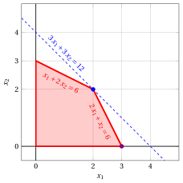{ .fig .ovale loading=lazy  }

## Esiti della coppia primale-duale

!!! esercizio "Esercizio 9.19: Esiti del primale e del duale (P31)"

    Consideriamo il seguente problema LP in forma canonica di massimo con $n=2$ variabili e $m=2$ vincoli:

    $$
    \begin{array}{rrrrrrrrrrrrr}
    {\max} & \, {x_1} & {+} & \, {x_2} \\[2ex]
    \text{soggetto a} & {-} \, {x_1} & {+} & \, {x_2} & {\le} & {1} \\[2ex]
    & \, {x_1} & {-} & \, {x_2} & {\le} & {1} \\[2ex]
    & {x_1,} &  & {x_2} & { \ge} & { 0 }
    \end{array}
    $$

    **Domande**

    1. Scrivere il problema duale.

    2. Determinare l'esito del problema primale (soluzione ottima, illimitato o inammissibile).

    3. Determinare l'esito del problema duale e verificare che la coppia sia uno dei quattro casi del teorema sui possibili esiti di una coppia di problemi primale e duale.

??? soluzione "Soluzione"

    - Il problema duale ha $m=2$ variabili non negative e $n=2$ vincoli lineari di maggiore o uguale, ottenuti trasponendo la matrice dei vincoli:

        $$
        \begin{array}{rrrrrrrrrrrrr}
        {\min} & \, {\pi_1} & {+} & \, {\pi_2} \\[2ex]
        \text{soggetto a} & {-} \, {\pi_1} & {+} & \, {\pi_2} & {\ge} & {1} \\[2ex]
        & \, {\pi_1} & {-} & \, {\pi_2} & {\ge} & {1} \\[2ex]
        & {\pi_1,} &  & {\pi_2} & { \ge} & { 0 }
        \end{array}
        $$

    - Il problema primale è <strong>illimitato</strong>. Infatti, per ogni valore $t \ge 0$ il punto $\bar x_1 = \bar x_2 = t$ è una soluzione ammissibile, poiché

        $$
        - t + t = 0 \le 1, \qquad t - t = 0 \le 1, \qquad t \ge 0 ,
        $$

        e il suo valore obiettivo è $2 \, t$, che supera qualunque valore fissato $M$ per $t$ abbastanza grande.

    - Il problema duale è <strong>inammissibile</strong>. Infatti, sommando i suoi due vincoli otteniamo

        $$
        \underbrace{(-\pi_1 + \pi_2)}_{\ge \, 1} + \underbrace{(\pi_1 - \pi_2)}_{\ge \, 1} = 0 \ge 2 ,
        $$

        che non è mai soddisfatta.

        La coppia ricade quindi nel caso “<em>primale illimitato, duale inammissibile</em>”, come previsto dal corollario: se il problema primale è illimitato, allora il problema duale è inammissibile.

    - <strong>Soluzione grafica:</strong> la regione ammissibile del problema primale è il poliedro illimitato ombreggiato in rosso; la curva di livello $x_1+x_2=3$ è tracciata in blu, e le curve di livello $x_1+x_2=k$ intersecano la regione ammissibile per ogni valore di $k \ge 0$, quindi la funzione obiettivo può crescere senza limite.

        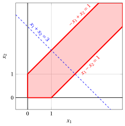{ .fig .ovale loading=lazy  }

        I due semipiani definiti dai vincoli duali, ombreggiati in rosso chiaro, non hanno alcun punto in comune nell'ortante non negativo: la regione ammissibile duale è vuota.

        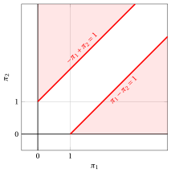{ .fig .ovale loading=lazy  }

!!! esercizio "Esercizio 9.20: Esiti del primale e del duale (P33)"

    Consideriamo il seguente problema LP in forma canonica di massimo con $n=2$ variabili e $m=2$ vincoli:

    $$
    \begin{array}{rrrrrrrrrrrrr}
    {\max} & \, {x_1} & {+} & \, {x_2} \\[2ex]
    \text{soggetto a} & \, {x_1} & {+} & \, {x_2} & {\le} & {2} \\[2ex]
    & {-} \, {x_1} & {-} & \, {x_2} & {\le} & {-4} \\[2ex]
    & {x_1,} &  & {x_2} & { \ge} & { 0 }
    \end{array}
    $$

    **Domande**

    1. Scrivere il problema duale.

    2. Determinare l'esito del problema primale (soluzione ottima, illimitato o inammissibile).

    3. Determinare l'esito del problema duale e verificare che la coppia sia uno dei quattro casi del teorema sui possibili esiti di una coppia di problemi primale e duale.

??? soluzione "Soluzione"

    - Il problema duale ha $m=2$ variabili non negative e $n=2$ vincoli lineari di maggiore o uguale, ottenuti trasponendo la matrice dei vincoli:

        $$
        \begin{array}{rrrrrrrrrrrrr}
        {\min} & {2} \, {\pi_1} & {-} & {4} \, {\pi_2} \\[2ex]
        \text{soggetto a} & \, {\pi_1} & {-} & \, {\pi_2} & {\ge} & {1} \\[2ex]
        & \, {\pi_1} & {-} & \, {\pi_2} & {\ge} & {1} \\[2ex]
        & {\pi_1,} &  & {\pi_2} & { \ge} & { 0 }
        \end{array}
        $$

        (i due vincoli duali coincidono, poiché le due colonne della matrice dei vincoli del primale sono uguali).

    - Il problema primale è <strong>inammissibile</strong>: il primo vincolo impone $x_1 + x_2 \le 2$ e il secondo, moltiplicato per $-1$, impone $x_1 + x_2 \ge 4$.

    - Il problema duale è <strong>illimitato</strong>. Infatti, per ogni valore $t \ge 0$ il punto $\bar \pi_1 = 1 + t$ e $\bar \pi_2 = t$ è una soluzione ammissibile, poiché $\bar \pi_1 - \bar \pi_2 = 1 \ge 1$, e il suo valore obiettivo è

        $$
        2 \, (1+t) - 4 \, t = 2 - 2 \, t ,
        $$

        che tende a $-\infty$ al crescere di $t$. Poiché il problema duale è un problema di minimo, è illimitato.

        La coppia ricade quindi nel caso “<em>primale inammissibile, duale illimitato</em>”.

    - <strong>Soluzione grafica:</strong> i due semipiani definiti dai vincoli primali, ombreggiati in rosso chiaro, non hanno alcun punto in comune: la regione ammissibile primale è vuota.

        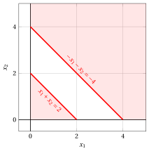{ .fig .ovale loading=lazy  }

        La regione ammissibile duale è il poliedro illimitato ombreggiato in rosso (i due vincoli duali coincidono). La curva di livello $2\,\pi_1-4\,\pi_2=-2$ è tracciata in blu: muovendosi nella direzione $(1,1)$ la funzione obiettivo decresce senza limite.

        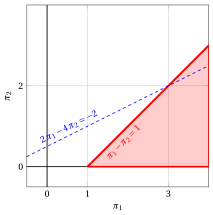{ .fig .ovale loading=lazy  }

!!! esercizio "Esercizio 9.21: Esiti del primale e del duale (P35)"

    Consideriamo il seguente problema LP in forma canonica di massimo con $n=2$ variabili e $m=2$ vincoli:

    $$
    \begin{array}{rrrrrrrrrrrrr}
    {\max} & \, {x_1} & {+} & \, {x_2} \\[2ex]
    \text{soggetto a} & \, {x_1} & {-} & \, {x_2} & {\le} & {1} \\[2ex]
    & {-} \, {x_1} & {+} & \, {x_2} & {\le} & {-2} \\[2ex]
    & {x_1,} &  & {x_2} & { \ge} & { 0 }
    \end{array}
    $$

    **Domande**

    1. Scrivere il problema duale.

    2. Determinare l'esito del problema primale (soluzione ottima, illimitato o inammissibile).

    3. Determinare l'esito del problema duale e verificare che la coppia sia uno dei quattro casi del teorema sui possibili esiti di una coppia di problemi primale e duale.

??? soluzione "Soluzione"

    - Il problema duale ha $m=2$ variabili non negative e $n=2$ vincoli lineari di maggiore o uguale, ottenuti trasponendo la matrice dei vincoli:

        $$
        \begin{array}{rrrrrrrrrrrrr}
        {\min} & \, {\pi_1} & {-} & {2} \, {\pi_2} \\[2ex]
        \text{soggetto a} & \, {\pi_1} & {-} & \, {\pi_2} & {\ge} & {1} \\[2ex]
        & {-} \, {\pi_1} & {+} & \, {\pi_2} & {\ge} & {1} \\[2ex]
        & {\pi_1,} &  & {\pi_2} & { \ge} & { 0 }
        \end{array}
        $$

    - Il problema primale è <strong>inammissibile</strong>: i due vincoli impongono $x_1 - x_2 \le 1$ e $x_1 - x_2 \ge 2$.

    - Anche il problema duale è <strong>inammissibile</strong>: sommando i suoi due vincoli otteniamo $0 \ge 2$, che non è mai soddisfatta.

        La coppia ricade quindi nel caso “<em>entrambi i problemi inammissibili</em>”. Questo esempio mostra che l'inammissibilità del problema primale, da sola, non determina l'esito del problema duale: nell'esercizio $P33$ il problema primale è inammissibile e il problema duale è illimitato, mentre qui entrambi sono inammissibili.

    - <strong>Soluzione grafica:</strong> i due semipiani definiti dai vincoli primali, ombreggiati in rosso chiaro, non hanno alcun punto in comune: la regione ammissibile primale è vuota.

        { .fig .ovale loading=lazy  }

        Anche i due semipiani definiti dai vincoli duali non hanno alcun punto in comune: anche la regione ammissibile duale è vuota.

        { .fig .ovale loading=lazy  }

!!! esercizio "Esercizio 9.22: Esiti del primale e del duale (P36)"

    Consideriamo il seguente problema LP in forma canonica di massimo con $n=2$ variabili e $m=2$ vincoli:

    $$
    \begin{array}{rrrrrrrrrrrrr}
    {\max} & {-} \, {x_1} & {-} & \, {x_2} \\[2ex]
    \text{soggetto a} & {-} \, {x_1} & {-} & \, {x_2} & {\le} & {-2} \\[2ex]
    & \, {x_1} & {-} & \, {x_2} & {\le} & {2} \\[2ex]
    & {x_1,} &  & {x_2} & { \ge} & { 0 }
    \end{array}
    $$

    **Domande**

    1. Scrivere il problema duale.

    2. Determinare l'esito del problema primale (soluzione ottima, illimitato o inammissibile).

    3. Determinare l'esito del problema duale e verificare che la coppia sia uno dei quattro casi del teorema sui possibili esiti di una coppia di problemi primale e duale.

??? soluzione "Soluzione"

    - Il problema duale ha $m=2$ variabili non negative e $n=2$ vincoli lineari di maggiore o uguale, ottenuti trasponendo la matrice dei vincoli:

        $$
        \begin{array}{rrrrrrrrrrrrr}
        {\min} & {-2} \, {\pi_1} & {+} & {2} \, {\pi_2} \\[2ex]
        \text{soggetto a} & {-} \, {\pi_1} & {+} & \, {\pi_2} & {\ge} & {-1} \\[2ex]
        & {-} \, {\pi_1} & {-} & \, {\pi_2} & {\ge} & {-1} \\[2ex]
        & {\pi_1,} &  & {\pi_2} & { \ge} & { 0 }
        \end{array}
        $$

    - Il problema primale ammette una <strong>soluzione ottima</strong>. La sua regione ammissibile è illimitata, ma il primo vincolo impone $x_1 + x_2 \ge 2$ per ogni soluzione ammissibile, e quindi

        $$
        - x_1 - x_2 \le -2, \qquad \forall \begin{pmatrix} x_1 \\ x_2\end{pmatrix} \in F .
        $$

        Le due soluzioni ammissibili $\begin{pmatrix} 0 \\ 2\end{pmatrix}$ e $\begin{pmatrix} 2 \\ 0\end{pmatrix}$ raggiungono questo valore, e quindi il valore ottimo è $z(\, LP \,) = -2$.

    - Anche il problema duale ammette una <strong>soluzione ottima</strong> e, per la dualità forte, il suo valore ottimo è $z(\, D(LP) \,) = -2$. Una soluzione duale ottima è

        $$
        \tilde \pi_1 = 1 \qquad {\rm e} \qquad \tilde \pi_2 = 0 ,
        $$

        che è ammissibile, poiché $-1 + 0 = -1 \ge -1$ e $-1 - 0 = -1 \ge -1$, e il cui valore della funzione obiettivo è $-2 \cdot 1 + 2 \cdot 0 = -2$.

        La coppia ricade quindi nel caso “<em>entrambi i problemi ammettono una soluzione ottima, con valori ottimi uguali</em>”.

    - <strong>Soluzione grafica:</strong> la regione ammissibile del problema primale è il poliedro illimitato ombreggiato in rosso. La curva di livello $-x_1-x_2=-2$, tracciata in blu, coincide con la retta del primo vincolo: tutti i punti del segmento tra i due vertici indicati in blu sono soluzioni ottime di valore $-2$.

        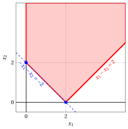{ .fig .ovale loading=lazy  }

        La regione ammissibile duale è il triangolo ombreggiato in rosso; la soluzione ottima duale $\tilde \pi_1=1$, $\tilde \pi_2=0$ è indicata in blu. La curva di livello $-2\,\pi_1+2\,\pi_2=-2$, tracciata in blu, coincide con la retta del primo vincolo duale, che tocca il triangolo solo nel vertice ottimo.

        { .fig .ovale loading=lazy  }
