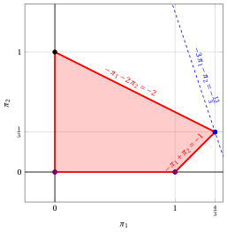
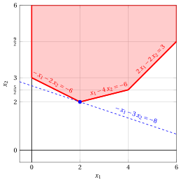
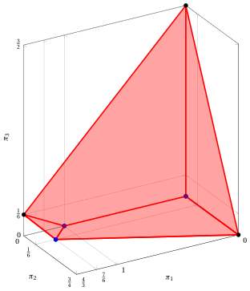
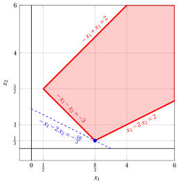
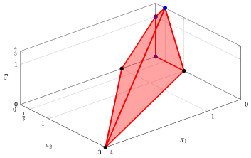
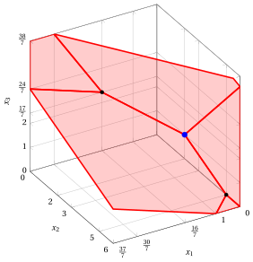
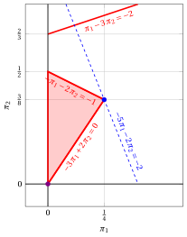
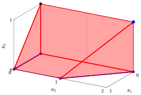

# Esercizi · Algoritmo del simplesso duale

<div class="info-capitolo" markdown>

**Esercizi · Capitolo 10** · ogni soluzione si apre con un clic · [:material-book-open-variant: Capitolo 10](../dualita/10-simplesso-duale.md) · [:material-file-pdf-box: Eserciziario, volume 3 (PDF)](../pdf/esercizi-3-dualita.pdf)

</div>

## Problemi con due variabili

<a id="esercizio-10-1"></a>

!!! esercizio "Esercizio 10.1: Algoritmo del simplesso duale (P11)"

    Consideriamo il seguente problema LP primale in forma canonica di massimo con $n=2$ variabili e $m=2$ vincoli:

    $$
    \begin{array}{rrrrrrrrrrrrr}
    {\max} & {-2}\, {x_1} & {-} & {4}\, {x_2} \\[2ex]
    \text{soggetto a} & {-}\, {x_1} & {-} & \, {x_2} & {\le} & {-2} \\[1.5ex]
    & \, {x_1} & {-} & \, {x_2} & {\le} & {0} \\[1.5ex]
    & {x_1,} &  & {x_2} & { \ge} & { 0 }
    \end{array}
    $$

    e il suo problema LP duale in forma canonica di minimo con $m=2$ variabili e $n=2$ vincoli:

    $$
    \begin{array}{rrrrrrrrrrrrr}
    {\min} & {-}2\, {\pi_1} &  &  \\[2ex]
    \text{soggetto a} & {-}\, {\pi_1} & {+} & \, {\pi_2} & {\ge} & {-2} \\[1.5ex]
    & {-}\, {\pi_1} & {-} & \, {\pi_2} & {\ge} & {-4} \\[1.5ex]
    & {\pi_1,} &  & {\pi_2} & { \ge} & { 0 }
    \end{array}
    $$

    Poiché ${\boldsymbol c} \le {\boldsymbol 0}$, la base delle $m$ variabili di scarto è <strong>duale ammissibile</strong> ma <u>non</u> è primale ammissibile.

    **Domande**

    - Risolvere il problema LP primale con l'algoritmo del simplesso duale e, in parallelo, il problema LP duale con l'algoritmo del simplesso, mostrando a ogni iterazione il dizionario duale e il dizionario primale.

??? soluzione "Soluzione"

    - <span style="color:#e03131"><strong>Inizializzazione</strong></span>

        Trasliamo gli indici delle variabili duali originali di $n=2$ e aggiungiamo in testa $n=2$ variabili di surplus. Otteniamo quindi la seguente forma standard di massimo:

        $$
        \begin{array}{rrrrrrrrrrrrr}
        {\max} &  &  &  &  & {2} \, {\pi_3} \\[2ex]
        \text{soggetto a} & {-}\, {\pi_1} &  &  & {-} & \, {\pi_3} & {+} & \, {\pi_4} & {=} & {-}2 \\[2ex]
        &  & {-} & \, {\pi_2} & {-} & \, {\pi_3} & {-} & \, {\pi_4} & {=} & {-}4 \\[2ex]
        & {\pi_1,} &  & {\pi_2,} &  & {\pi_3,} &  & {\pi_4} & { \ge} & { 0 }
        \end{array}
        $$

        Il dizionario duale iniziale è:

        \begin{equation*}
        \begin{cases}
        \begin{array}{rrrrrrrrrrrrr}
        {\pi_1=2} & {-} & {\pi_3} & {+} & {\pi_4} \\[2ex]
        {\pi_2=4} & {-} & {\pi_3} & {-} & {\pi_4} \\[2ex]
        {-w=0} & {+} & 2\, {\pi_3} &  &
        \end{array}
        \end{cases}
        \end{equation*}

        dove $\pazocal{B}=\{1,2\}$ e $\pazocal{N}=\{3,4\}$. La soluzione di base duale ammissibile è:

        $$
        \bar \pi_1=2,~~
        \bar \pi_2=4,~~~~~~
        \bar \pi_3=0,~~
        \bar \pi_4=0~~
        \text{  di valore   }0
        $$

        Dopo aver aggiunto le variabili di scarto al problema primale, otteniamo la seguente forma standard:

        $$
        \begin{array}{rrrrrrrrrrrrr}
        {\max} & {-2}\, {x_1} & {-} & {4}\, {x_2} \\[2ex]
        \text{soggetto a} & {-}\, {x_1} & {-} & \, {x_2} & {+} & {x_3} &  &  & {=} & {-2} \\[2ex]
        & {x_1} & {-} & \, {x_2} &  &  & {+} & {x_4} & {=} & {0} \\[2ex]
        & {x_1,} &  & {x_2,} &  & {x_3,} &  & {x_4} & { \ge} & { 0 }
        \end{array}
        $$

        Il dizionario primale iniziale è:

        \begin{equation*}
        \begin{cases}
        \begin{array}{rrrrrrrrrrrrr}
        {x_3=-2} & {+} & \, {x_1} & {+} & \, {x_2} \\[2ex]
        {x_4=0} & {-} & {x_1} & {+} & \, {x_2} \\[2ex]
        {z=0} & {-} & 2\, {x_1} & {-} & 4 \, {x_2}
        \end{array}
        \end{cases}
        \end{equation*}

        dove $\pazocal{B}=\{3,4\}$ e $\pazocal{N}=\{1,2\}$. La soluzione di base primale non ammissibile è:

        $$
        \bar x_3=-2,~~
        \bar x_4=0,~~~~~~~
        \bar x_1=0,~~
        \bar x_2=0
        \text{  di valore   }0
        $$

    - <span style="color:#e03131"><strong>Iterazione 1</strong></span>

        L'unica variabile in base con valore negativo è $x_3$, che è la riga pivot. Corrispondentemente, nel dizionario duale aumentiamo la variabile $\pi_3$ e possiamo ottenere una soluzione duale migliore. Abbiamo:

        $$
        \begin{cases}
        \pi_1 =& 2 - \pi_3 \\[2ex]
        \pi_2 =& 4 - \pi_3
        \end{cases}
        \qquad
        \qquad
        \begin{cases}
        \underbrace{ 2 - \pi_3 \ge 0}_{\pi_1 \ge 0} \\[2ex]
        \underbrace{  4 -  \pi_3 \ge 0}_{\pi_2 \ge 0}
        \end{cases}
        \qquad
        \qquad
        \begin{cases}
        \pi_3 \le &  2 \\[2ex]
        \pi_3 \le &  4
        \end{cases}
        $$

        Questi sono esattamente i rapporti dell'algoritmo del simplesso duale sulla riga di $x_3$: $s_m = \min \left\{ \frac{-2}{-1}, \frac{-4}{-1} \right\} = 2$, raggiunto da $x_1$. Aumentando il valore di $\pi_3$ fino a $2$, il valore di $\pi_1$ scende a $0$. Abbiamo quindi che:

        - $\pi_3$ diventa duale in base e, di conseguenza, $x_3$ diventa primale fuori base;

        - $\pi_1$ diventa duale fuori base e, di conseguenza, $x_1$ diventa primale in base.

        - Per il problema LP duale, abbiamo:

            $$
            \pi_1 = 2 -  \pi_3 + \pi_4 \text{    quindi     } \pi_3= 2 - \pi_1 + \pi_4 .
            $$

            Sostituendo nelle altre equazioni del dizionario duale, otteniamo:

            $$
            \pi_2 = 4 -  \left(  2 - \pi_1 + \pi_4  \right) -  \pi_4= 2  + \pi_1 - 2\,\pi_4
            $$

            $$
            -w = 0 + 2\; \left(2 - \pi_1 + \pi_4  \right)  = 4 -2\: \pi_1 +2\: \pi_4
            $$

            Di conseguenza, abbiamo ora il seguente dizionario duale:

            \begin{equation*}
            \begin{cases}
            \begin{array}{rrrrrrrrrrrrr}
            {\pi_2=2} & {+} & \, {\pi_1} & {-} & 2\, {\pi_4} \\[2ex]
            {\pi_3=2} & {-} & {\pi_1} & {+} & \, {\pi_4} \\[2ex]
            {-w=4} & {-} & {2} \, {\pi_1} & {+} & {2} \, {\pi_4}
            \end{array}
            \end{cases}
            \end{equation*}

            dove $\pazocal{B}=\{2,3\}$ e $\pazocal{N}=\{1,4\}$. La soluzione di base duale ammissibile è:

            $$
            \bar  \pi_2=2,~~
            \bar \pi_3=2,~~~~~~~
            \bar \pi_1=0,~~
            \bar \pi_4=0~~
            ~~~\text{di valore   } -4
            $$

        - Per il problema LP primale, abbiamo:

            $$
            x_3 = -2 +  x_1 + x_2 \text{    quindi     } x_1= 2 - x_2 + x_3 .
            $$

            Sostituendo nelle altre equazioni del dizionario primale, otteniamo:

            $$
            x_4 = 0 -   \left(  2 + x_3 - x_2 \right) +   x_2= -2 +2\,x_2 - x_3
            $$

            $$
            z = 0 -  2\; \left(  2 + x_3 - x_2 \right) -  4 \; x_2= - 4 - 2\,x_2 - 2\,x_3
            $$

            Di conseguenza, abbiamo ora il seguente dizionario primale:

            \begin{equation*}
            \begin{cases}
            \begin{array}{rrrrrrrrrrrrr}
            {x_1=} & {2} & {-} & \, {x_2} & {+} & {x_3} &  \\[2ex]
            {x_4=} & {-2} & {+} & 2\, {x_2} & {-} & \, {x_3} \\[2ex]
            {z=} & {-4} & {-} & 2 \, {x_2} & {-} & 2\, {x_3}
            \end{array}
            \end{cases}
            \end{equation*}

            dove $\pazocal{B}=\{1,4\}$ e $\pazocal{N}=\{2,3\}$. La soluzione di base primale non ammissibile è:

            $$
            \bar x_1=2,~~
            \bar x_4=-2,~~~~~~~
            \bar x_2=0,~~
            \bar x_3=0~~
            \text{  di valore   }-4
            $$

    - <span style="color:#e03131"><strong>Iterazione 2</strong></span>

        L'unica variabile in base con valore negativo è $x_4$, che è la riga pivot. Corrispondentemente, nel dizionario duale aumentiamo la variabile $\pi_4$ e possiamo ottenere una soluzione duale migliore. Abbiamo:

        $$
        \begin{cases}
        \pi_2 =& 2 - 2\: \pi_4\\[2ex]
        \pi_3 =& 2 +  \pi_4\\
        \end{cases}
        \qquad
        \qquad
        \begin{cases}
        \underbrace{ 2 - 2\, \pi_4 \ge 0}_{\pi_2 \ge 0}\\[2ex]
        \underbrace{  2 +  \pi_4 \ge 0}_{\pi_3 \ge 0}
        \end{cases}
        \qquad
        \qquad
        \begin{cases}
        \pi_4 \le&  1 \\[2ex]
        \pi_4 \ge&  -2
        \end{cases}
        $$

        Questi sono esattamente i rapporti dell'algoritmo del simplesso duale sulla riga di $x_4$: $s_m = \frac{-2}{-2} = 1$, raggiunto da $x_2$ ($\bar a_{43} = 1 > 0$ non dà alcun candidato). Aumentando il valore di $\pi_4$ fino a $1$, il valore di $\pi_2$ scende a $0$. Abbiamo quindi che:

        - $\pi_4$ diventa duale in base e, di conseguenza, $x_4$ diventa primale fuori base;

        - $\pi_2$ diventa duale fuori base e, di conseguenza, $x_2$ diventa primale in base.

        - Per il problema LP duale, abbiamo:

            $$
            \pi_2 = 2  -2\: \pi_4 + \pi_1 \text{    quindi     } \pi_4= 1 +\dfrac{1}{2}\: \pi_1 -\dfrac{1}{2}\: \pi_2.
            $$

            Sostituendo nelle altre equazioni del dizionario duale, otteniamo:

            $$
            \pi_3 = 2 +  \left(  1 +\dfrac{1}{2}\: \pi_1 -\dfrac{1}{2}\: \pi_2 \right) - \:\pi_1= 3 - \dfrac{1}{2}\: \pi_1 - \dfrac{1}{2}\: \pi_2
            $$

            $$
            -w =  4  + 2\;  \left(  1 +\dfrac{1}{2}\: \pi_1 -\dfrac{1}{2}\: \pi_2 \right)  -2\: \pi_1 = 6 - \pi_1 - \pi_2
            $$

            Di conseguenza, abbiamo ora il seguente dizionario duale ottimo:

            \begin{equation*}
            \begin{cases}
            \begin{array}{rrrrrrrrrrrrr}
            {\pi_3=} & {3} & {-} & {\dfrac{1}{2}} \, {\pi_1} & {-} & {\dfrac{1}{2}}\, {\pi_2} \\[2ex]
            {\pi_4=} & {1} & {+} & {\dfrac{1}{2}}\, {\pi_1} & {-} & {\dfrac{1}{2}}\, {\pi_2} \\[2ex]
            {-w = } & {6} & {-} & {\pi_1} & {-} & {\pi_2}
            \end{array}
            \end{cases}
            \end{equation*}

            dove $\pazocal{B}=\{3,4\}$ e $\pazocal{N}=\{1,2\}$. Tutti i coefficienti della funzione obiettivo sono non positivi, quindi la soluzione di base duale ottima è:

            $$
            \tilde \pi_3=3,~~
            \tilde \pi_4=1,~~~~~~~
            \tilde \pi_1=0,~~
            \tilde \pi_2=0~~
            ~~~\text{di valore   } -6
            $$

            Ricordando che le variabili duali originali sono le variabili traslate $\pi_3,\pi_4$, la soluzione ottima del problema LP duale originale è:

            $$
            \tilde{\pi}_1=3,~~
            \tilde{\pi}_2=1,
            {\rm ~~~e~~~}
            z(D(LP))=-6.
            $$

        - Per il problema LP primale, abbiamo:

            $$
            x_4 = -2 -  x_3 + 2 \,x_2 \text{    quindi     } x_2= 1 + \dfrac{1}{2}\,x_3 + \dfrac{1}{2}\,x_4.
            $$

            Sostituendo nelle altre equazioni del dizionario primale, otteniamo:

            $$
            x_1 = 2 + x_3 -   \left(  1 + \dfrac{1}{2}\,x_3 + \dfrac{1}{2}\,x_4 \right) = 1 + \dfrac{1}{2} \,x_3 - \dfrac{1}{2} \,x_4
            $$

            $$
            z = -4 -2\,x_3-  2\; \left(  1 + \dfrac{1}{2}\,x_3 + \dfrac{1}{2}\,x_4 \right) = -6 -3\,x_3 -x_4
            $$

            Di conseguenza, abbiamo ora il seguente dizionario primale ottimo:

            \begin{equation*}
            \begin{cases}
            \begin{array}{rrrrrrrrrrrrr}
            {x_1=} & {1} & {+} & {\dfrac{1}{2}} \, {x_3} & {-} & {\dfrac{1}{2}}\, {x_4} \\[2ex]
            {x_2=} & {1} & {+} & {\dfrac{1}{2}} \, {x_3} & {+} & {\dfrac{1}{2}} \, {x_4} \\[2ex]
            {z=} & {-6} & {-} & 3\, {x_3} & {-} & \, {x_4}
            \end{array}
            \end{cases}
            \end{equation*}

            dove $\pazocal{B}=\{1,2\}$ e $\pazocal{N}=\{3,4\}$. La soluzione di base è ora primale ammissibile e duale ammissibile, quindi la soluzione di base primale ottima è:

            $$
            \tilde x_1=1,~~
            \tilde x_2=1,~~~~~~~
            \tilde x_3=0,~~
            \tilde x_4=0~~
            \text{  di valore   }-6 ,
            $$

            in accordo con il teorema della dualità forte.

    <strong>Soluzione grafica:</strong>

    La regione ammissibile del problema LP in forma canonica è il poliedro ombreggiato in rosso. La regione ammissibile è illimitata.

    { .fig .ovale loading=lazy  }

    Una soluzione ottima del problema LP primale è:

    $$
    \tilde{x}_1=1,~~
    \tilde{x}_2=1 {\rm ~~~e~~~} z(\,LP\,)=-6
    $$

    La regione ammissibile del problema LP duale in forma canonica di minimo è il poliedro ombreggiato in rosso. Nella figura seguente rappresentiamo le due variabili duali originali $\pi_1,\pi_2$, che corrispondono alle variabili $\pi_3,\pi_4$ dei dizionari duali. 

    { .fig .ovale loading=lazy  }

    Una soluzione ottima del problema LP duale è:

    $$
    \tilde{\pi}_1=3,~~
    \tilde{\pi}_2=1
    {\rm ~~~e ~~~} z(~ D(LP)~) =-6.
    $$

    In viola il primo e il secondo vertice esplorati dalla precedente esecuzione dell'algoritmo del simplesso duale, prima di raggiungere quello ottimo rappresentato in blu.

<a id="esercizio-10-2"></a>

!!! esercizio "Esercizio 10.2: Algoritmo del simplesso duale (P12)"

    Consideriamo il seguente problema LP primale in forma canonica di massimo con $n=2$ variabili e $m=2$ vincoli:

    $$
    \begin{array}{rrrrrrrrrrrrr}
    {\max} & {-} \, {x_1} & {-} & {2} \, {x_2} \\[1.5ex]
    \text{soggetto a} & {-} \, {x_1} & {-} & {x_2} & {\le} & {-3} \\[1.5ex]
    & \, {x_1} & {-} & {2} \, {x_2} & {\le} & {-1} \\[1.5ex]
    & {x_1,} &  & {x_2} & { \ge} & { 0 }
    \end{array}
    $$

    e il suo problema LP duale in forma canonica di minimo con $m=2$ variabili e $n=2$ vincoli:

    $$
    \begin{array}{rrrrrrrrrrrrr}
    {\min} & {-3}\, {\pi_1} & {-} & {\pi_2} \\[2ex]
    \text{soggetto a} & {-} \, {\pi_1} & {+} & \, {\pi_2} & {\ge} & {-1} \\[1.5ex]
    & {-} \, {\pi_1} & {-} & {2} \, {\pi_2} & {\ge} & {-2} \\[1.5ex]
    & {\pi_1}, &  & {\pi_2} & { \ge} & { 0 }
    \end{array}
    $$

    Poiché ${\boldsymbol c} \le {\boldsymbol 0}$, la base delle $m$ variabili di scarto è <strong>duale ammissibile</strong> ma <u>non</u> è primale ammissibile.

    **Domande**

    - Risolvere il problema LP primale con l'algoritmo del simplesso duale e, in parallelo, il problema LP duale con l'algoritmo del simplesso, mostrando a ogni iterazione il dizionario duale e il dizionario primale.

??? soluzione "Soluzione"

    - <span style="color:#e03131"><strong>Inizializzazione</strong></span>

        Trasliamo gli indici delle variabili duali originali di $n=2$ e aggiungiamo in testa $n=2$ variabili di surplus. Otteniamo quindi la seguente forma standard di massimo:

        $$
        \begin{array}{rrrrrrrrrrrrr}
        {\max} &  &  &  &  &  & {3}\, {\pi_3} & {+} & {\pi_4} \\[2ex]
        \text{soggetto a} & {-} & \, {\pi_1} &  &  & {-} & \, {\pi_3} & {+} & \, {\pi_4} & {=} & {-1} \\[1.5ex]
        &  &  & {-} & \, {\pi_2} & {-} & \, {\pi_3} & {-} & {2} \, {\pi_4} & {=} & {-2} \\[1.5ex]
        &  & {\pi_1}, &  & {\pi_2}, &  & {\pi_3}, &  & {\pi_4} & { \ge} & { 0 }
        \end{array}
        $$

        Il dizionario duale iniziale è:

        \begin{equation*}
        \begin{cases}
        \begin{array}{rrrrrrrrrrrrr}
        {\pi_1=} & {1} & {-} & \, {\pi_3} & {+} & \, {\pi_4} \\[2ex]
        {\pi_2=} & {2} & {-} & \, {\pi_3} & {-} & {2} \, {\pi_4} \\[2ex]
        {-w=} & {0} & {+} & {3} \, {\pi_3} & {+} & \, {\pi_4}
        \end{array}
        \end{cases}
        \end{equation*}

        dove $\pazocal{B}=\{1,2\}$ e $\pazocal{N}=\{3,4\}$. La soluzione di base duale ammissibile è:

        $$
        \bar \pi_1=1,~~
        \bar \pi_2=2,~~~~~
        \bar \pi_3=0,~~
        \bar \pi_4=0
        $$

        con $-w=0$, cioè $w=0$.

        Dopo aver aggiunto le variabili di scarto al problema primale, otteniamo la seguente forma standard:

        $$
        \begin{array}{rrrrrrrrrrrrr}
        {\max} & {-} \, {x_1} & {-} & {2} \, {x_2} \\[1.5ex]
        \text{soggetto a} & {-} \, {x_1} & {-} & {x_2} & {+} & {x_3} &  &  & {=} & {-3} \\[1.5ex]
        & \, {x_1} & {-} & {2} \, {x_2} &  &  & {+} & {x_4} & {=} & {-1} \\[1.5ex]
        & {x_1,} &  & {x_2,} &  & {x_3,} &  & {x_4} & { \ge} & { 0 }
        \end{array}
        $$

        Il dizionario primale iniziale è:

        \begin{equation*}
        \begin{cases}
        \begin{array}{rrrrrrrrrrrrr}
        {x_3=} & {-3} & {+} & \, {x_1} & {+} & \, {x_2} \\[2ex]
        {x_4=} & {-1} & {-} & \, {x_1} & {+} & {2} \, {x_2} \\[2ex]
        {z=} & {0} & {-} & \, {x_1} & {-} & {2} \, {x_2}
        \end{array}
        \end{cases}
        \end{equation*}

        dove $\pazocal{B}=\{3,4\}$ e $\pazocal{N}=\{1,2\}$. La soluzione di base primale non ammissibile è:

        $$
        \bar x_3=-3,~~
        \bar x_4=-1,~~~~~~
        \bar x_1=0,~~
        \bar x_2=0~~
        \text{  di valore   }0
        $$

    - <span style="color:#e03131"><strong>Iterazione 1</strong></span>

        Nel dizionario primale, le variabili in base con valore negativo sono $x_3$ e $x_4$: per la regola dell'indice minimo la riga pivot è $x_3$. Corrispondentemente, nel dizionario duale aumentiamo la variabile $\pi_3$ e possiamo ottenere una soluzione duale migliore. Abbiamo:

        $$
        \begin{cases}
        \pi_1 =& 1 - \, \pi_3 \\[2ex]
        \pi_2 =& 2 - \, \pi_3
        \end{cases}
        \qquad
        \qquad
        \begin{cases}
        \underbrace{ 1 - \, \pi_3 \ge 0}_{\pi_1 \ge 0} \\[2ex]
        \underbrace{ 2 - \, \pi_3 \ge 0}_{\pi_2 \ge 0}
        \end{cases}
        \qquad
        \qquad
        \begin{cases}
        \pi_3 \le&  1 \\[2ex]
        \pi_3 \le&  2
        \end{cases}
        $$

        Questi sono esattamente i rapporti dell'algoritmo del simplesso duale sulla riga di $x_3$: $s_m = \min \left\{ \frac{-1}{-1}, \frac{-2}{-1} \right\} = 1$, raggiunto da $x_1$. Aumentando il valore di $\pi_3$ fino a $1$, il valore di $\pi_1$ scende a $0$. Abbiamo quindi che:

        - $\pi_3$ diventa duale in base e, di conseguenza, $x_3$ diventa primale fuori base;

        - $\pi_1$ diventa duale fuori base e, di conseguenza, $x_1$ diventa primale in base.

        - Per il problema LP duale, abbiamo:

            $$
            \pi_1= 1 - \, \pi_3 + \, \pi_4
            \text{    quindi     }
            \pi_3 = 1 - \pi_1 + \pi_4 .
            $$

            Sostituendo nelle altre equazioni del dizionario duale, otteniamo:

            $$
            \pi_2 = 2 - \left(1 - \pi_1 + \pi_4 \right) - 2 \, \pi_4
            = 1 + \pi_1 - 3 \, \pi_4
            $$

            $$
            -w = 3 \left(1 - \pi_1 + \pi_4 \right) + \pi_4
            = 3 - 3 \, \pi_1 + 4 \, \pi_4
            $$

            Di conseguenza, abbiamo ora il seguente dizionario duale:

            \begin{equation*}
            \begin{cases}
            \begin{array}{rrrrrrrrrrrrr}
            {\pi_2=} & {1} & {+} & \, {\pi_1} & {-} & {3} \, {\pi_4} \\[2ex]
            {\pi_3=} & {1} & {-} & \, {\pi_1} & {+} & \, {\pi_4} \\[2ex]
            {-w=} & {3} & {-} & {3} \, {\pi_1} & {+} & {4} \, {\pi_4}
            \end{array}
            \end{cases}
            \end{equation*}

            dove $\pazocal{B}=\{2,3\}$ e $\pazocal{N}=\{1,4\}$. La soluzione di base duale ammissibile è:

            $$
            \bar  \pi_2=1,~~
            \bar \pi_3=1,~~~~~~
            \bar \pi_1=0,~~
            \bar \pi_4=0,
            ~~~ -w=3, \quad w=-3.
            $$

        - Per il problema LP primale, abbiamo:

            $$
            x_3 = - 3 + x_1 + x_2
            \text{    quindi     }
            x_1 = 3 - x_2 + x_3 .
            $$

            Sostituendo nelle altre equazioni del dizionario primale, otteniamo:

            $$
            x_4 = - 1 - \left(3 - x_2 + x_3 \right) + 2 \, x_2
            = - 4 + 3 \, x_2 - x_3
            $$

            $$
            z = - \left(3 - x_2 + x_3 \right) - 2 \, x_2
            = - 3 - x_2 - x_3
            $$

            Di conseguenza, abbiamo ora il seguente dizionario primale:

            \begin{equation*}
            \begin{cases}
            \begin{array}{rrrrrrrrrrrrr}
            {x_1=} & {3} & {-} & \, {x_2} & {+} & \, {x_3} \\[2ex]
            {x_4=} & {-4} & {+} & {3} \, {x_2} & {-} & \, {x_3} \\[2ex]
            {z=} & {-3} & {-} & \, {x_2} & {-} & \, {x_3}
            \end{array}
            \end{cases}
            \end{equation*}

            dove $\pazocal{B}=\{1,4\}$ e $\pazocal{N}=\{2,3\}$. La soluzione di base primale non ammissibile è:

            $$
            \bar x_1=3,~~
            \bar x_4=-4,~~~~~~
            \bar x_2=0,~~
            \bar x_3=0~~
            \text{  di valore   }-3
            $$

    - <span style="color:#e03131"><strong>Iterazione 2</strong></span>

        L'unica variabile in base con valore negativo è $x_4$, che è la riga pivot. Corrispondentemente, nel dizionario duale aumentiamo la variabile $\pi_4$ e possiamo ottenere una soluzione duale migliore. Abbiamo:

        $$
        \begin{cases}
        \pi_2 =& 1 -3\, \pi_4\\[2ex]
        \pi_3 =& 1 + \pi_4
        \end{cases}
        \qquad
        \qquad
        \begin{cases}
        \underbrace{ 1 -3\, \pi_4 \ge 0}_{\pi_2 \ge 0}\\[2ex]
        \underbrace{ 1 + \pi_4 \ge 0}_{\pi_3 \ge 0}
        \end{cases}
        \qquad
        \qquad
        \begin{cases}
        \pi_4 \le&  \frac{1}{3} \\[2ex]
        \pi_4 \ge&  -1
        \end{cases}
        $$

        Questi sono esattamente i rapporti dell'algoritmo del simplesso duale sulla riga di $x_4$: $s_m = \frac{-1}{-3} = \frac{1}{3}$, raggiunto da $x_2$ ($\bar a_{43} = 1 > 0$ non dà alcun candidato). Aumentando il valore di $\pi_4$ fino a $\frac{1}{3}$, il valore di $\pi_2$ scende a $0$. Abbiamo quindi che:

        - $\pi_4$ diventa duale in base e, di conseguenza, $x_4$ diventa primale fuori base;

        - $\pi_2$ diventa duale fuori base e, di conseguenza, $x_2$ diventa primale in base.

        - Per il problema LP duale, abbiamo:

            $$
            \pi_2 =  1 + \pi_1 - 3 \pi_4
            \text{    quindi     }
            \pi_4 =  \frac{1}{3} + \frac{1}{3} \, \pi_1 - \frac{1}{3} \, \pi_2 .
            $$

            Sostituendo nelle altre equazioni del dizionario duale, otteniamo:

            $$
            \pi_3 = 1 - \pi_1 + \left( \frac{1}{3} + \frac{1}{3} \, \pi_1 - \frac{1}{3} \, \pi_2 \right)
            = \frac{4}{3} - \frac{2}{3}\, \pi_1 - \frac{1}{3} \, \pi_2
            $$

            $$
            -w = 3 - 3 \, \pi_1 + 4 \left( \frac{1}{3} + \frac{1}{3} \, \pi_1 - \frac{1}{3} \, \pi_2 \right)
            = \frac{13}{3} - \frac{5}{3} \, \pi_1 - \frac{4}{3} \, \pi_2 .
            $$

            Di conseguenza, abbiamo ora il seguente dizionario duale ottimo:

            \begin{equation*}
            \begin{cases}
            \begin{array}{rrrrrrrrrrrrr}
            {\pi_3=} & {\frac{4}{3}} & {-} & {\frac{2}{3}\, \pi_1} & {-} & {\frac{1}{3} \, \pi_2} \\[2ex]
            {\pi_4=} & {\frac{1}{3}} & {+} & {\frac{1}{3} \, \pi_1} & {-} & {\frac{1}{3} \, \pi_2} \\[2ex]
            {-w =} & {\frac{13}{3}} & {-} & {\frac{5}{3} \, \pi_1} & {-} & {\frac{4}{3} \, \pi_2}
            \end{array}
            \end{cases}
            \end{equation*}

            dove $\pazocal{B}=\{3,4\}$ e $\pazocal{N}=\{1,2\}$. Tutti i coefficienti della funzione obiettivo sono non positivi, quindi la soluzione di base duale ottima è:

            $$
            \tilde \pi_3=\frac{4}{3},~~
            \tilde \pi_4=\frac{1}{3},~~~~~~
            \tilde \pi_1=0,~~
            \tilde \pi_2=0,
            ~~~ -w=\frac{13}{3},\quad w=-\frac{13}{3}.
            $$

            Ricordando che le variabili duali originali sono le variabili traslate $\pi_3,\pi_4$, la soluzione ottima del problema LP duale originale è:

            $$
            \tilde{\pi}_1=\frac{4}{3},~~
            \tilde{\pi}_2=\frac{1}{3},
            {\rm ~~~e~~~}
            z(D(LP))=-\frac{13}{3}.
            $$

        - Per il problema LP primale, abbiamo:

            $$
            x_4 = -4 + 3 \, x_2 - x_3
            \text{    quindi     }
            x_2 = \frac{4}{3} + \frac{1}{3} \, x_3 + \frac{1}{3} \, x_4 .
            $$

            Sostituendo nelle altre equazioni del dizionario primale, otteniamo:

            $$
            x_1 = 3 - \left( \frac{4}{3} + \frac{1}{3} \, x_3 + \frac{1}{3} \, x_4 \right) + x_3
            = \frac{5}{3} + \frac{2}{3} \, x_3 - \frac{1}{3} \, x_4
            $$

            $$
            z = -3 - \left( \frac{4}{3} + \frac{1}{3} \, x_3 + \frac{1}{3} \, x_4 \right) - x_3
            = - \frac{13}{3} - \frac{4}{3} \, x_3 - \frac{1}{3} \, x_4
            $$

            Di conseguenza, abbiamo ora il seguente dizionario primale ottimo:

            \begin{equation*}
            \begin{cases}
            \begin{array}{rrrrrrrrrrrrr}
            {x_1=} & {\frac{5}{3}} & {+} & {\frac{2}{3}} \, {x_3} & {-} & {\frac{1}{3}\, x_4} \\[2ex]
            {x_2=} & {\frac{4}{3}} & {+} & {\frac{1}{3}} \, {x_3} & {+} & {\frac{1}{3}} \, {x_4} \\[2ex]
            {z=} & {-\frac{13}{3}} & {-} & {\frac{4}{3}} \, {x_3} & {-} & {\frac{1}{3}} \, {x_4}
            \end{array}
            \end{cases}
            \end{equation*}

            dove $\pazocal{B}=\{1,2\}$ e $\pazocal{N}=\{3,4\}$. La soluzione di base è ora primale ammissibile e duale ammissibile, quindi la soluzione di base primale ottima è:

            $$
            \tilde x_1=\frac{5}{3},~~
            \tilde x_2=\frac{4}{3},~~~~~~
            \tilde x_3=0,~~
            \tilde x_4=0~~
            \text{  di valore   } -\frac{13}{3} ,
            $$

            in accordo con il teorema della dualità forte.

    <strong>Soluzione grafica:</strong>

    La regione ammissibile del problema LP in forma canonica è il poliedro ombreggiato in rosso. La regione ammissibile è illimitata. 

    { .fig .ovale loading=lazy  }

    Una soluzione ottima del problema LP primale è:

    $$
    \tilde{x}_1=\frac{5}{3},~~
    \tilde{x}_2=\frac{4}{3}
    {\rm ~~~e~~~}
    z(\,LP\,)=-\frac{13}{3}.
    $$

    La regione ammissibile del problema LP duale in forma canonica di minimo è il poliedro ombreggiato in rosso. Nella figura seguente rappresentiamo le due variabili duali originali $\pi_1,\pi_2$, che corrispondono alle variabili $\pi_3,\pi_4$ dei dizionari duali. 

    { .fig .ovale loading=lazy  }

    Una soluzione ottima del problema LP duale è:

    $$
    \tilde{\pi}_1=\frac{4}{3},~~
    \tilde{\pi}_2=\frac{1}{3},
    {\rm ~~~e ~~~} z(~ D(LP)~) =-\frac{13}{3}.
    $$

    In viola il primo e il secondo vertice esplorati dalla precedente esecuzione dell'algoritmo del simplesso duale, prima di raggiungere quello ottimo rappresentato in blu.

<a id="esercizio-10-3"></a>

!!! esercizio "Esercizio 10.3: Algoritmo del simplesso duale (P13)"

    Consideriamo il seguente problema LP primale in forma canonica di massimo con $n=2$ variabili e $m=3$ vincoli:

    $$
    \begin{array}{rrrrrrrrrrrrr}
    {\max} & {-} \, {x_1} & {-} & {3} \, {x_2} \\[1.5ex]
    \text{soggetto a} & {-} \, {x_1} & {-} & {2}\, {x_2} & {\le} & {-6} \\[1.5ex]
    & \, {x_1} & {-} & {4} \, {x_2} & {\le} & {-6} \\[1.5ex]
    & {2} \, {x_1} & {-} & {2} \, {x_2} & {\le} & {3} \\[1.5ex]
    & {x_1,} &  & {x_2} & { \ge} & { 0 }
    \end{array}
    $$

    e il suo problema LP duale in forma canonica di minimo con $m=3$ variabili e $n=2$ vincoli:

    $$
    \begin{array}{rrrrrrrrrrrrr}
    {\min} & {-6}\, {\pi_1} & {-} & {6} \, {\pi_2} & {+} & {3} \, {\pi_3} \\[2ex]
    \text{soggetto a} & {-} \, {\pi_1} & {+} & \, {\pi_2} & {+} & {2}\, {\pi_3} & {\ge} & {-1} \\[1.5ex]
    & {-2} {\pi_1} & {-} & {4} \, {\pi_2} & {-} & {2} \, {\pi_3} & {\ge} & {-3} \\[1.5ex]
    & {\pi_1}, &  & {\pi_2}, &  & {\pi_3} & { \ge} & { 0 }
    \end{array}
    $$

    Poiché ${\boldsymbol c} \le {\boldsymbol 0}$, la base delle $m$ variabili di scarto è <strong>duale ammissibile</strong> ma <u>non</u> è primale ammissibile.

    **Domande**

    - Risolvere il problema LP primale con l'algoritmo del simplesso duale e, in parallelo, il problema LP duale con l'algoritmo del simplesso, mostrando a ogni iterazione il dizionario duale e il dizionario primale.

??? soluzione "Soluzione"

    - <span style="color:#e03131"><strong>Inizializzazione</strong></span>

        Trasliamo gli indici delle variabili duali originali di $n=2$ e aggiungiamo in testa $n=2$ variabili di surplus. Otteniamo quindi la seguente forma standard di massimo:

        $$
        \begin{array}{rrrrrrrrrrrrr}
        {\max} &  &  &  &  &  & {6}\, {\pi_3} & {+} & {6} \, {\pi_4} & {-} & {3} \, {\pi_5} \\[2ex]
        \text{soggetto a} & {-} & \, {\pi_1} &  &  & {-} & \, {\pi_3} & {+} & \, {\pi_4} & {+} & {2} \, {\pi_5} & {=} & {-1} \\[1.5ex]
        &  &  & {-} & \, {\pi_2} & {-} & {2} \, {\pi_3} & {-} & {4} \, {\pi_4} & {-} & {2} \, {\pi_5} & {=} & {-3} \\[1.5ex]
        &  & {\pi_1}, &  & {\pi_2}, &  & {\pi_3}, &  & {\pi_4}, &  & {\pi_5} & { \ge} & { 0 }
        \end{array}
        $$

        Il dizionario duale iniziale è:

        \begin{equation*}
        \begin{cases}
        \begin{array}{rrrrrrrrrrrrr}
        {\pi_1=} & {1} & {-} & \, {\pi_3} & {+} & \, {\pi_4} & {+} & {2} \, {\pi_5} \\[2ex]
        {\pi_2=} & {3} & {-} & {2} \, {\pi_3} & {-} & {4} \, {\pi_4} & {-} & {2} \, {\pi_5} \\[2ex]
        {-w=} & {0} & {+} & {6} \, {\pi_3} & {+} & {6} \, {\pi_4} & {-} & {3} \, {\pi_5}
        \end{array}
        \end{cases}
        \end{equation*}

        dove $\pazocal{B}=\{1,2\}$ e $\pazocal{N}=\{3,4,5\}$. La soluzione di base duale ammissibile è:

        $$
        \bar \pi_1=1,~~
        \bar \pi_2=3,~~~~~
        \bar \pi_3=0,~~
        \bar \pi_4=0,~~
        \bar \pi_5=0
        $$

        con $-w=0$, cioè $w=0$.

        Dopo aver aggiunto le variabili di scarto al problema primale, otteniamo la seguente forma standard:

        $$
        \begin{array}{rrrrrrrrrrrrr}
        {\max} & {-} \, {x_1} & {-} & {3} \, {x_2} \\[1.5ex]
        \text{soggetto a} & {-} \, {x_1} & {-} & {2} \, {x_2} & {+} & {x_3} &  &  &  &  & {=} & {-6} \\[1.5ex]
        & \, {x_1} & {-} & {4} \, {x_2} &  &  & {+} & {x_4} &  &  & {=} & {-6} \\[1.5ex]
        & {2} \, {x_1} & {-} & {2} \, {x_2} &  &  &  &  & {+} & {x_5} & {=} & {3} \\[1.5ex]
        & {x_1,} &  & {x_2,} &  & {x_3,} &  & {x_4,} &  & {x_5} & { \ge} & { 0 }
        \end{array}
        $$

        Il dizionario primale iniziale è:

        \begin{equation*}
        \begin{cases}
        \begin{array}{rrrrrrrrrrrrr}
        {x_3=} & {-6} & {+} & \, {x_1} & {+} & {2} \, {x_2} \\[2ex]
        {x_4=} & {-6} & {-} & \, {x_1} & {+} & {4} \, {x_2} \\[2ex]
        {x_5=} & {3} & {-} & {2} \, {x_1} & {+} & {2} \, {x_2} \\[2ex]
        {z=} & {0} & {-} & \, {x_1} & {-} & {3} \, {x_2}
        \end{array}
        \end{cases}
        \end{equation*}

        dove $\pazocal{B}=\{3,4,5\}$ e $\pazocal{N}=\{1,2\}$. La soluzione di base primale non ammissibile è:

        $$
        \bar x_3=-6,~~
        \bar x_4=-6,~~
        \bar x_5=3,~~~~~~
        \bar x_1=0,~~
        \bar x_2=0~~
        \text{  di valore   }0
        $$

    - <span style="color:#e03131"><strong>Iterazione 1</strong></span>

        Nel dizionario primale, le variabili in base con valore negativo sono $x_3$ e $x_4$: per la regola dell'indice minimo la riga pivot è $x_3$. Corrispondentemente, nel dizionario duale aumentiamo la variabile $\pi_3$ e possiamo ottenere una soluzione duale migliore. Abbiamo:

        $$
        \begin{cases}
        \pi_1 =& 1 - \, \pi_3 \\[2ex]
        \pi_2 =& 3 - 2 \,\pi_3
        \end{cases}
        \qquad
        \qquad
        \begin{cases}
        \underbrace{ 1 - \, \pi_3 \ge 0}_{\pi_1 \ge 0} \\[2ex]
        \underbrace{ 3 - 2 \, \pi_3 \ge 0}_{\pi_2 \ge 0}
        \end{cases}
        \qquad
        \qquad
        \begin{cases}
        \pi_3 \le&  1 \\[2ex]
        \pi_3 \le&  \frac{3}{2}
        \end{cases}
        $$

        Questi sono esattamente i rapporti dell'algoritmo del simplesso duale sulla riga di $x_3$: $s_m = \min \left\{ \frac{-1}{-1}, \frac{-3}{-2} \right\} = 1$, raggiunto da $x_1$. Aumentando il valore di $\pi_3$ fino a $1$, il valore di $\pi_1$ scende a $0$. Abbiamo quindi che:

        - $\pi_3$ diventa duale in base e, di conseguenza, $x_3$ diventa primale fuori base;

        - $\pi_1$ diventa duale fuori base e, di conseguenza, $x_1$ diventa primale in base.

        - Per il problema LP duale, abbiamo:

            $$
            \pi_1= 1 - \, \pi_3 + \, \pi_4 + 2 \,\pi_5
            \text{    quindi     } \pi_3 = 1 - \pi_1 + \pi_4 + 2 \, \pi_5 .
            $$

            Sostituendo nelle altre equazioni del dizionario duale, otteniamo:

            $$
            \pi_2 = 3 -  2 \left(1 - \pi_1 + \pi_4 + 2 \, \pi_5 \right) - 4 \, \pi_4 - 2 \, \pi_5 = 1 + 2 \, \pi_1 - 6 \, \pi_4 - 6 \, \pi_5
            $$

            $$
            -w = 0 + 6 \; \left(1 - \pi_1 + \pi_4 + 2 \, \pi_5 \right) + 6 \, \pi_4 - 3 \, \pi_5 = 6 - 6 \, \pi_1  + 12 \, \pi_4 + 9 \, \pi_5
            $$

            Di conseguenza, abbiamo ora il seguente dizionario duale:

            \begin{equation*}
            \begin{cases}
            \begin{array}{rrrrrrrrrrrrr}
            {\pi_2=} & {1} & {+} & {2} \, {\pi_1} & {-} & {6} \, {\pi_4} & {-} & {6} \, {\pi_5} \\[2ex]
            {\pi_3=} & {1} & {-} & \, {\pi_1} & {+} & \, {\pi_4} & {+} & {2} \, {\pi_5} \\[2ex]
            {-w=} & {6} & {-} & {6} \, {\pi_1} & {+} & {12} \, {\pi_4} & {+} & {9} \, {\pi_5}
            \end{array}
            \end{cases}
            \end{equation*}

            dove $\pazocal{B}=\{2,3\}$ e $\pazocal{N}=\{1,4,5\}$. La soluzione di base duale ammissibile è:

            $$
            \bar  \pi_2=1,~~
            \bar \pi_3=1,~~~~~~
            \bar \pi_1=0,~~
            \bar \pi_4=0,~~
            \bar \pi_5=0,
            ~~~ -w=6, \quad w=-6.
            $$

        - Per il problema LP primale, abbiamo:

            $$
            x_3 = - 6 + x_1 + 2 \, x_2 \text{    quindi     } x_1 = 6 - 2 x_2 + x_3 .
            $$

            Sostituendo nelle altre equazioni del dizionario primale, otteniamo:

            $$
            x_4 = - 6 - \left( 6 - 2 x_2 + x_3 \right) +  4\, x_2 = - 12  + 6 \,x_2 - x_3
            $$

            $$
            x_5 = 3 - 2 \, \left( 6 - 2 x_2 + x_3 \right) + 2 \, x_2 = - 9 + 6 \, x_2 - 2 \, x_3
            $$

            $$
            z = 0 -  \, \left( 6 - 2 x_2 + x_3 \right) -  3 \; x_2= - 6 - \,x_2 - \,x_3
            $$

            Di conseguenza, abbiamo ora il seguente dizionario primale:

            \begin{equation*}
            \begin{cases}
            \begin{array}{rrrrrrrrrrrrr}
            {x_1=} & {6} & {-} & {2} \, {x_2} & {+} & {x_3} &  \\[2ex]
            {x_4=} & {-12} & {+} & {6} \, {x_2} & {-} & \, {x_3} \\[2ex]
            {x_5=} & {-9} & {+} & {6} \, {x_2} & {-} & {2} \, {x_3} \\[2ex]
            {z=} & {-6} & {-} & \, {x_2} & {-} & \, {x_3}
            \end{array}
            \end{cases}
            \end{equation*}

            dove $\pazocal{B}=\{1,4,5\}$ e $\pazocal{N}=\{2,3\}$. La soluzione di base primale non ammissibile è:

            $$
            \bar x_1=6,~~
            \bar x_4=-12,~~
            \bar x_5=-9,~~~~~~
            \bar x_2=0,~~
            \bar x_3=0~~
            \text{  di valore   }-6
            $$

    - <span style="color:#e03131"><strong>Iterazione 2</strong></span>

        Nel dizionario primale, le variabili in base con valore negativo sono $x_4$ e $x_5$: per la regola dell'indice minimo la riga pivot è $x_4$. Corrispondentemente, nel dizionario duale aumentiamo la variabile $\pi_4$ e possiamo ottenere una soluzione duale migliore. Abbiamo:

        $$
        \begin{cases}
        \pi_2 =& 1 -6\, \pi_4\\[2ex]
        \pi_3 =& 1 +  \pi_4
        \end{cases}
        \qquad
        \qquad
        \begin{cases}
        \underbrace{ 1 -6\, \pi_4 \ge 0}_{\pi_2 \ge 0}\\[2ex]
        \underbrace{ 1 + \pi_4 \ge 0}_{\pi_3 \ge 0}
        \end{cases}
        \qquad
        \qquad
        \begin{cases}
        \pi_4 \le&  \frac{1}{6} \\[2ex]
        \pi_4 \ge&  -1
        \end{cases}
        $$

        Questi sono esattamente i rapporti dell'algoritmo del simplesso duale sulla riga di $x_4$: $s_m = \frac{-1}{-6} = \frac{1}{6}$, raggiunto da $x_2$ ($\bar a_{43} = 1 > 0$ non dà alcun candidato). Aumentando il valore di $\pi_4$ fino a $\frac{1}{6}$, il valore di $\pi_2$ scende a $0$. Abbiamo quindi che:

        - $\pi_4$ diventa duale in base e, di conseguenza, $x_4$ diventa primale fuori base;

        - $\pi_2$ diventa duale fuori base e, di conseguenza, $x_2$ diventa primale in base.

        - Per il problema LP duale, abbiamo:

            $$
            \pi_2 =  1 + 2 \, \pi_1 - 6 \, \pi_4 - 6 \, \pi_5 \text{    quindi     } \pi_4 =  \frac{1}{6} + \frac{1}{3} \, \pi_1 - \frac{1}{6} \, \pi_2 - \, \pi_5.
            $$

            Sostituendo nelle altre equazioni del dizionario duale, otteniamo:

            $$
            \pi_3 = 1 - \pi_1 + \left( \frac{1}{6} + \frac{1}{3} \, \pi_1 - \frac{1}{6} \, \pi_2 - \, \pi_5 \right) + 2\, \pi_5 = \frac{7}{6} - \frac{2}{3}\: \pi_1 - \frac{1}{6} \, \pi_2 + \pi_5
            $$

            $$
            -w =  6  - 6 \, \pi_1 + 12 \;  \left( \frac{1}{6} + \frac{1}{3} \, \pi_1 - \frac{1}{6} \, \pi_2 - \, \pi_5 \right)  + 9 \, \pi_5 = 8 - 2 \, \pi_1 - 2\, \pi_2 - 3 \, \pi_5 .
            $$

            Di conseguenza, abbiamo ora il seguente dizionario duale ottimo:

            \begin{equation*}
            \begin{cases}
            \begin{array}{rrrrrrrrrrrrr}
            {\pi_3=} & {\frac{7}{6}} & {-} & {\frac{2}{3}\: \pi_1} & {-} & {\frac{1}{6} \, \pi_2} & {+} & \, {\pi_5} \\[2ex]
            {\pi_4=} & {\frac{1}{6}} & {+} & {\frac{1}{3} \, \pi_1} & {-} & {\frac{1}{6} \, \pi_2} & {-} & {\, \pi_5} \\[2ex]
            {-w =} & {8} & {-} & {2} \, {\pi_1} & {-} & {2} \, {\pi_2} & {-} & {3} \, {\pi_5}
            \end{array}
            \end{cases}
            \end{equation*}

            dove $\pazocal{B}=\{3,4\}$ e $\pazocal{N}=\{1,2,5\}$. Tutti i coefficienti della funzione obiettivo sono non positivi, quindi la soluzione di base duale ottima è:

            $$
            \tilde \pi_3=\frac{7}{6},~~
            \tilde \pi_4=\frac{1}{6},~~~~~~
            \tilde \pi_1=0,~~
            \tilde \pi_2=0,~~
            \tilde \pi_5=0,
            ~~~ -w=8,\quad w=-8.
            $$

            Ricordando che le variabili duali originali sono le variabili traslate $\pi_3,\pi_4,\pi_5$, la soluzione ottima del problema LP duale originale è:

            $$
            \tilde{\pi}_1=\frac{7}{6},~~
            \tilde{\pi}_2=\frac{1}{6},~~
            \tilde{\pi}_3=0,
            {\rm ~~~e~~~}
            z(D(LP))=-8.
            $$

        - Per il problema LP primale, abbiamo:

            $$
            x_4 = -12 + 6 \,x_2 - \, x_3 \text{    quindi     } x_2 = 2 + \frac{1}{6} \,x_3 + \frac{1}{6} \, x_4.
            $$

            Sostituendo nelle altre equazioni del dizionario primale, otteniamo:

            $$
            x_1 = 6 - 2 \, \left(  2 + \frac{1}{6} \,x_3 + \frac{1}{6} \, x_4 \right) + x_3 = 2 + \frac{2}{3} \,x_3 - \frac{1}{3} \,x_4
            $$

            $$
            x_5 = - 9 + 6 \, \left(  2 + \frac{1}{6} \,x_3 + \frac{1}{6} \, x_4 \right)  - 2 \, x_3 = 3 - \,x_3 + \,x_4
            $$

            $$
            z = -6 - \left(  2 + \frac{1}{6} \,x_3 + \frac{1}{6} \, x_4 \right) - x_3 = - 8 - \frac{7}{6} \, x_3 - \frac{1}{6} \, x_4
            $$

            Di conseguenza, abbiamo ora il seguente dizionario primale ottimo:

            \begin{equation*}
            \begin{cases}
            \begin{array}{rrrrrrrrrrrrr}
            {x_1=} & {2} & {+} & {\frac{2}{3}} \, {x_3} & {-} & {\frac{1}{3}}\, {x_4} \\[2ex]
            {x_2=} & {2} & {+} & {\frac{1}{6}} \, {x_3} & {+} & {\frac{1}{6}} \, {x_4} \\[2ex]
            {x_5=} & {3} & {-} & \, {x_3} & {+} & \, {x_4} \\[2ex]
            {z=} & {-8} & {-} & {\frac{7}{6}} \, {x_3} & {-} & {\frac{1}{6}} \, {x_4}
            \end{array}
            \end{cases}
            \end{equation*}

            dove $\pazocal{B}=\{1,2,5\}$ e $\pazocal{N}=\{3,4\}$. La soluzione di base è ora primale ammissibile e duale ammissibile, quindi la soluzione di base primale ottima è:

            $$
            \tilde x_1=2,~~
            \tilde x_2=2,~~
            \tilde x_5=3,~~~~~~
            \tilde x_3=0,~~
            \tilde x_4=0~~
            \text{  di valore   } -8 ,
            $$

            in accordo con il teorema della dualità forte.

    <strong>Soluzione grafica:</strong>

    La regione ammissibile del problema LP in forma canonica è il poliedro ombreggiato in rosso. La regione ammissibile è illimitata.

    { .fig .ovale loading=lazy  }

    Una soluzione ottima del problema LP primale è:

    $$
    \tilde{x}_1=2,~~\tilde{x}_2=2 {\rm ~~~e~~~} z(\,LP\,)=-8 .
    $$

    La regione ammissibile del problema LP duale in forma canonica di minimo è il poliedro ombreggiato in rosso. Nella figura seguente rappresentiamo le tre variabili duali originali $\pi_1,\pi_2,\pi_3$, che corrispondono alle variabili $\pi_3,\pi_4,\pi_5$ dei dizionari duali. 

    { .fig .ovale loading=lazy  }

    Una soluzione ottima del problema LP duale è:

    $$
    \tilde{\pi}_1=\frac{7}{6},~~
    \tilde{\pi}_2=\frac{1}{6},~~
    \tilde{\pi}_3=0,
    {\rm ~~~e ~~~} z(~ D(LP)~) =-8.
    $$

    In viola il primo e il secondo vertice esplorati dalla precedente esecuzione dell'algoritmo del simplesso duale, prima di raggiungere quello ottimo rappresentato in blu.

    ??? codice "Codice SageMath: poliedri 3D (sagecell.sagemath.org/)"

        ```python
        # Variabili (pi_3, pi_4, pi_5): le variabili duali originali.
        # Poliedro definito da disuguaglianze (rappr. per iperpiani)
        p = Polyhedron(ieqs=[
            (1, -1, 1, 2),    # 1 - pi_3 + pi_4 + 2*pi_5 >= 0
            (3, -2, -4, -2),  # 3 - 2*pi_3 - 4*pi_4 - 2*pi_5 >= 0
            (0, 1, 0, 0),     # pi_3 >= 0
            (0, 0, 1, 0),     # pi_4 >= 0
            (0, 0, 0, 1)      # pi_5 >= 0
        ])

        # Mostra le disuguaglianze del poliedro
        p.Hrepresentation()

        # Mostra i punti estremi e i raggi estremi del poliedro
        p.Vrepresentation()

        # Disegna il poliedro (3D)
        p.plot()
        ```

<a id="esercizio-10-4"></a>

!!! esercizio "Esercizio 10.4: Algoritmo del simplesso duale (P14)"

    Consideriamo il seguente problema LP primale in forma canonica di massimo con $n=2$ variabili e $m=3$ vincoli:

    $$
    \begin{array}{rrrrrrrrrrrrr}
    {\max} & {-} \, {x_1} & {-} & {2} \, {x_2} \\[1.5ex]
    \text{soggetto a} & {-} \, {x_1} & {+} & {x_2} & {\le} & {2} \\[1.5ex]
    & \, {x_1} & {-} & {2} \, {x_2} & {\le} & {2} \\[1.5ex]
    & {-} \, {x_1} & {-} & {x_2} & {\le} & {-3} \\[1.5ex]
    & {x_1,} &  & {x_2} & { \ge} & { 0 }
    \end{array}
    $$

    e il suo problema LP duale in forma canonica di minimo con $m=3$ variabili e $n=2$ vincoli:

    $$
    \begin{array}{rrrrrrrrrrrrr}
    {\min} & {2}\, {\pi_1} & {+} & {2} \, {\pi_2} & {-} & {3} \, {\pi_3} \\[2ex]
    \text{soggetto a} & {-} \, {\pi_1} & {+} & \, {\pi_2} & {-} & {\pi_3} & {\ge} & {-1} \\[1.5ex]
    & \, {\pi_1} & {-} & {2} \, {\pi_2} & {-} & {\pi_3} & {\ge} & {-2} \\[1.5ex]
    & {\pi_1}, &  & {\pi_2}, &  & {\pi_3} & { \ge} & { 0 }
    \end{array}
    $$

    Poiché ${\boldsymbol c} \le {\boldsymbol 0}$, la base delle $m$ variabili di scarto è <strong>duale ammissibile</strong> ma <u>non</u> è primale ammissibile.

    **Domande**

    - Risolvere il problema LP primale con l'algoritmo del simplesso duale e, in parallelo, il problema LP duale con l'algoritmo del simplesso, mostrando a ogni iterazione il dizionario duale e il dizionario primale.

??? soluzione "Soluzione"

    - <span style="color:#e03131"><strong>Inizializzazione</strong></span>

        Trasliamo gli indici delle variabili duali originali di $n=2$ e aggiungiamo in testa $n=2$ variabili di surplus. Otteniamo quindi la seguente forma standard di massimo:

        $$
        \begin{array}{rrrrrrrrrrrrr}
        {\max} &  &  &  &  &  & {-} {2}\, {\pi_3} & {-} & {2} \, {\pi_4} & {+} & {3} \, {\pi_5} \\[2ex]
        \text{soggetto a} & {-} & \, {\pi_1} &  &  & {-} & \, {\pi_3} & {+} & \, {\pi_4} & {-} & \, {\pi_5} & {=} & {-1} \\[1.5ex]
        &  &  & {-} & \, {\pi_2} & {+} & \, {\pi_3} & {-} & {2} \, {\pi_4} & {-} & \, {\pi_5} & {=} & {-2} \\[1.5ex]
        &  & {\pi_1}, &  & {\pi_2}, &  & {\pi_3}, &  & {\pi_4}, &  & {\pi_5} & { \ge} & { 0 }
        \end{array}
        $$

        Il dizionario duale iniziale è:

        \begin{equation*}
        \begin{cases}
        \begin{array}{rrrrrrrrrrrrr}
        {\pi_1=} & {1} & {-} & \, {\pi_3} & {+} & \, {\pi_4} & {-} & \, {\pi_5} \\[2ex]
        {\pi_2=} & {2} & {+} & \, {\pi_3} & {-} & {2} \, {\pi_4} & {-} & \, {\pi_5} \\[2ex]
        {-w=} & {0} & {-} & {2} \, {\pi_3} & {-} & {2} \, {\pi_4} & {+} & {3} \, {\pi_5}
        \end{array}
        \end{cases}
        \end{equation*}

        dove $\pazocal{B}=\{1,2\}$ e $\pazocal{N}=\{3,4,5\}$. La soluzione di base duale ammissibile è:

        $$
        \bar \pi_1=1,~~
        \bar \pi_2=2,~~~~~
        \bar \pi_3=0,~~
        \bar \pi_4=0,~~
        \bar \pi_5=0
        $$

        con $-w=0$, cioè $w=0$.

        Dopo aver aggiunto le variabili di scarto al problema primale, otteniamo la seguente forma standard:

        $$
        \begin{array}{rrrrrrrrrrrrr}
        {\max} & {-} \, {x_1} & {-} & {2} \, {x_2} \\[1.5ex]
        \text{soggetto a} & {-} \, {x_1} & {+} & {x_2} & {+} & {x_3} &  &  &  &  & {=} & {2} \\[1.5ex]
        & \, {x_1} & {-} & {2} \, {x_2} &  &  & {+} & {x_4} &  &  & {=} & {2} \\[1.5ex]
        & {-} \, {x_1} & {-} & {x_2} &  &  &  &  & {+} & {x_5} & {=} & {-3} \\[1.5ex]
        & {x_1,} &  & {x_2,} &  & {x_3,} &  & {x_4,} &  & {x_5} & { \ge} & { 0 }
        \end{array}
        $$

        Il dizionario primale iniziale è:

        \begin{equation*}
        \begin{cases}
        \begin{array}{rrrrrrrrrrrrr}
        {x_3=} & {2} & {+} & \, {x_1} & {-} & \, {x_2} \\[2ex]
        {x_4=} & {2} & {-} & \, {x_1} & {+} & {2} \, {x_2} \\[2ex]
        {x_5=} & {-3} & {+} & \, {x_1} & {+} & \, {x_2} \\[2ex]
        {z=} & {0} & {-} & \, {x_1} & {-} & {2} \, {x_2}
        \end{array}
        \end{cases}
        \end{equation*}

        dove $\pazocal{B}=\{3,4,5\}$ e $\pazocal{N}=\{1,2\}$. La soluzione di base primale non ammissibile è:

        $$
        \bar x_3=2,~~
        \bar x_4=2,~~
        \bar x_5=-3,~~~~~~
        \bar x_1=0,~~
        \bar x_2=0~~
        \text{  di valore   }0
        $$

    - <span style="color:#e03131"><strong>Iterazione 1</strong></span>

        L'unica variabile in base con valore negativo è $x_5$, che è la riga pivot. Corrispondentemente, nel dizionario duale aumentiamo la variabile $\pi_5$ e possiamo ottenere una soluzione duale migliore. Abbiamo:

        $$
        \begin{cases}
        \pi_1 =& 1 - \, \pi_5 \\[2ex]
        \pi_2 =& 2 - \, \pi_5
        \end{cases}
        \qquad
        \qquad
        \begin{cases}
        \underbrace{ 1 - \, \pi_5 \ge 0}_{\pi_1 \ge 0} \\[2ex]
        \underbrace{ 2 - \, \pi_5 \ge 0}_{\pi_2 \ge 0}
        \end{cases}
        \qquad
        \qquad
        \begin{cases}
        \pi_5 \le&  1 \\[2ex]
        \pi_5 \le&  2
        \end{cases}
        $$

        Questi sono esattamente i rapporti dell'algoritmo del simplesso duale sulla riga di $x_5$: $s_m = \min \left\{ \frac{-1}{-1}, \frac{-2}{-1} \right\} = 1$, raggiunto da $x_1$. Aumentando il valore di $\pi_5$ fino a $1$, il valore di $\pi_1$ scende a $0$. Abbiamo quindi che:

        - $\pi_5$ diventa duale in base e, di conseguenza, $x_5$ diventa primale fuori base;

        - $\pi_1$ diventa duale fuori base e, di conseguenza, $x_1$ diventa primale in base.

        - Per il problema LP duale, abbiamo:

            $$
            \pi_1= 1 - \, \pi_3 + \, \pi_4 - \, \pi_5
            \text{    quindi     }
            \pi_5 = 1 - \pi_3 + \pi_4 - \pi_1 .
            $$

            Sostituendo nelle altre equazioni del dizionario duale, otteniamo:

            $$
            \pi_2 = 2 + \pi_3 - 2 \pi_4 - \left(1 - \pi_3 + \pi_4 - \pi_1 \right)
            = 1 + \pi_1 + 2 \pi_3 - 3 \pi_4
            $$

            $$
            -w = - 2 \pi_3 - 2 \pi_4 + 3 \left(1 - \pi_3 + \pi_4 - \pi_1 \right)
            = 3 - 3 \pi_1 - 5 \pi_3 + \pi_4
            $$

            Di conseguenza, abbiamo ora il seguente dizionario duale:

            \begin{equation*}
            \begin{cases}
            \begin{array}{rrrrrrrrrrrrr}
            {\pi_2=} & {1} & {+} & \, {\pi_1} & {+} & {2} \, {\pi_3} & {-} & {3} \, {\pi_4} \\[2ex]
            {\pi_5=} & {1} & {-} & \, {\pi_1} & {-} & \, {\pi_3} & {+} & \, {\pi_4} \\[2ex]
            {-w=} & {3} & {-} & {3} \, {\pi_1} & {-} & {5} \, {\pi_3} & {+} & \, {\pi_4}
            \end{array}
            \end{cases}
            \end{equation*}

            dove $\pazocal{B}=\{2,5\}$ e $\pazocal{N}=\{1,3,4\}$. La soluzione di base duale ammissibile è:

            $$
            \bar  \pi_2=1,~~
            \bar \pi_5=1,~~~~~~
            \bar \pi_1=0,~~
            \bar \pi_3=0,~~
            \bar \pi_4=0,
            ~~~ -w=3, \quad w=-3.
            $$

        - Per il problema LP primale, abbiamo:

            $$
            x_5 = - 3 + x_1 + x_2
            \text{    quindi     }
            x_1 = 3 - x_2 + x_5 .
            $$

            Sostituendo nelle altre equazioni del dizionario primale, otteniamo:

            $$
            x_3 = 2 + \left(3 - x_2 + x_5 \right) - x_2
            = 5 - 2 x_2 + x_5
            $$

            $$
            x_4 = 2 - \left(3 - x_2 + x_5 \right) + 2 x_2
            = -1 + 3 x_2 - x_5
            $$

            $$
            z = - \left(3 - x_2 + x_5 \right) - 2 x_2
            = -3 - x_2 - x_5
            $$

            Di conseguenza, abbiamo ora il seguente dizionario primale:

            \begin{equation*}
            \begin{cases}
            \begin{array}{rrrrrrrrrrrrr}
            {x_1=} & {3} & {-} & \, {x_2} & {+} & \, {x_5} &  \\[2ex]
            {x_3=} & {5} & {-} & {2} \, {x_2} & {+} & \, {x_5} \\[2ex]
            {x_4=} & {-1} & {+} & {3} \, {x_2} & {-} & \, {x_5} \\[2ex]
            {z=} & {-3} & {-} & \, {x_2} & {-} & \, {x_5}
            \end{array}
            \end{cases}
            \end{equation*}

            dove $\pazocal{B}=\{1,3,4\}$ e $\pazocal{N}=\{2,5\}$. La soluzione di base primale non ammissibile è:

            $$
            \bar x_1=3,~~
            \bar x_3=5,~~
            \bar x_4=-1,~~~~~~
            \bar x_2=0,~~
            \bar x_5=0~~
            \text{  di valore   }-3
            $$

    - <span style="color:#e03131"><strong>Iterazione 2</strong></span>

        L'unica variabile in base con valore negativo è $x_4$, che è la riga pivot. Corrispondentemente, nel dizionario duale aumentiamo la variabile $\pi_4$ e possiamo ottenere una soluzione duale migliore. Abbiamo:

        $$
        \begin{cases}
        \pi_2 =& 1 -3\, \pi_4\\[2ex]
        \pi_5 =& 1 + \pi_4
        \end{cases}
        \qquad
        \qquad
        \begin{cases}
        \underbrace{ 1 -3\, \pi_4 \ge 0}_{\pi_2 \ge 0}\\[2ex]
        \underbrace{ 1 + \pi_4 \ge 0}_{\pi_5 \ge 0}
        \end{cases}
        \qquad
        \qquad
        \begin{cases}
        \pi_4 \le&  \frac{1}{3} \\[2ex]
        \pi_4 \ge&  -1
        \end{cases}
        $$

        Questi sono esattamente i rapporti dell'algoritmo del simplesso duale sulla riga di $x_4$: $s_m = \frac{-1}{-3} = \frac{1}{3}$, raggiunto da $x_2$ ($\bar a_{45} = 1 > 0$ non dà alcun candidato). Aumentando il valore di $\pi_4$ fino a $\frac{1}{3}$, il valore di $\pi_2$ scende a $0$. Abbiamo quindi che:

        - $\pi_4$ diventa duale in base e, di conseguenza, $x_4$ diventa primale fuori base;

        - $\pi_2$ diventa duale fuori base e, di conseguenza, $x_2$ diventa primale in base.

        - Per il problema LP duale, abbiamo:

            $$
            \pi_2 =  1 + \pi_1 + 2 \pi_3 - 3 \pi_4
            \text{    quindi     }
            \pi_4 =  \frac{1}{3} + \frac{1}{3} \pi_1 + \frac{2}{3} \pi_3 - \frac{1}{3} \pi_2 .
            $$

            Sostituendo nelle altre equazioni del dizionario duale, otteniamo:

            $$
            \pi_5
            = 1 - \pi_1 - \pi_3
            + \left( \frac{1}{3} + \frac{1}{3} \pi_1 + \frac{2}{3} \pi_3 - \frac{1}{3} \pi_2 \right)
            = \frac{4}{3} - \frac{2}{3} \pi_1 - \frac{1}{3} \pi_2 - \frac{1}{3} \pi_3
            $$

            $$
            -w
            = 3 - 3 \pi_1 - 5 \pi_3
            + \left( \frac{1}{3} + \frac{1}{3} \pi_1 + \frac{2}{3} \pi_3 - \frac{1}{3} \pi_2 \right)
            = \frac{10}{3} - \frac{8}{3} \pi_1 - \frac{1}{3} \pi_2 - \frac{13}{3} \pi_3 .
            $$

            Di conseguenza, abbiamo ora il seguente dizionario duale ottimo:

            \begin{equation*}
            \begin{cases}
            \begin{array}{rrrrrrrrrrrrr}
            {\pi_4=} & {\frac{1}{3}} & {+} & {\frac{1}{3}\: \pi_1} & {-} & {\frac{1}{3} \, \pi_2} & {+} & {\frac{2}{3} \, \pi_3} \\[2ex]
            {\pi_5=} & {\frac{4}{3}} & {-} & {\frac{2}{3} \, \pi_1} & {-} & {\frac{1}{3} \, \pi_2} & {-} & {\frac{1}{3} \, \pi_3} \\[2ex]
            {-w =} & {\frac{10}{3}} & {-} & {\frac{8}{3}} \, {\pi_1} & {-} & {\frac{1}{3}} \, {\pi_2} & {-} & {\frac{13}{3}} \, {\pi_3}
            \end{array}
            \end{cases}
            \end{equation*}

            dove $\pazocal{B}=\{4,5\}$ e $\pazocal{N}=\{1,2,3\}$. Tutti i coefficienti della funzione obiettivo sono non positivi, quindi la soluzione di base duale ottima è:

            $$
            \tilde \pi_4=\frac{1}{3},~~
            \tilde \pi_5=\frac{4}{3},~~~~~~
            \tilde \pi_1=0,~~
            \tilde \pi_2=0,~~
            \tilde \pi_3=0,
            ~~~ -w=\frac{10}{3},\quad w=-\frac{10}{3}.
            $$

            Ricordando che le variabili duali originali sono le variabili traslate $\pi_3,\pi_4,\pi_5$, la soluzione ottima del problema LP duale originale è:

            $$
            \tilde{\pi}_1=0,~~
            \tilde{\pi}_2=\frac{1}{3},~~
            \tilde{\pi}_3=\frac{4}{3},
            {\rm ~~~e~~~}
            z(D(LP))=-\frac{10}{3}.
            $$

        - Per il problema LP primale, abbiamo:

            $$
            x_4 = -1 + 3 x_2 - x_5
            \text{    quindi     }
            x_2 = \frac{1}{3} + \frac{1}{3} x_4 + \frac{1}{3} x_5 .
            $$

            Sostituendo nelle altre equazioni del dizionario primale, otteniamo:

            $$
            x_1
            = 3 - \left( \frac{1}{3} + \frac{1}{3} x_4 + \frac{1}{3} x_5 \right) + x_5
            = \frac{8}{3} - \frac{1}{3} x_4 + \frac{2}{3} x_5
            $$

            $$
            x_3
            = 5 - 2 \left( \frac{1}{3} + \frac{1}{3} x_4 + \frac{1}{3} x_5 \right) + x_5
            = \frac{13}{3} - \frac{2}{3} x_4 + \frac{1}{3} x_5
            $$

            $$
            z
            = -3 - \left( \frac{1}{3} + \frac{1}{3} x_4 + \frac{1}{3} x_5 \right) - x_5
            = - \frac{10}{3} - \frac{1}{3} x_4 - \frac{4}{3} x_5
            $$

            Di conseguenza, abbiamo ora il seguente dizionario primale ottimo:

            \begin{equation*}
            \begin{cases}
            \begin{array}{rrrrrrrrrrrrr}
            {x_1=} & {\frac{8}{3}} & {-} & {\frac{1}{3}} \, {x_4} & {+} & {\frac{2}{3}}\, {x_5} \\[2ex]
            {x_2=} & {\frac{1}{3}} & {+} & {\frac{1}{3}} \, {x_4} & {+} & {\frac{1}{3}} \, {x_5} \\[2ex]
            {x_3=} & {\frac{13}{3}} & {-} & {\frac{2}{3}} \, {x_4} & {+} & {\frac{1}{3}} \, {x_5} \\[2ex]
            {z=} & {-\frac{10}{3}} & {-} & {\frac{1}{3}} \, {x_4} & {-} & {\frac{4}{3}} \, {x_5}
            \end{array}
            \end{cases}
            \end{equation*}

            dove $\pazocal{B}=\{1,2,3\}$ e $\pazocal{N}=\{4,5\}$. La soluzione di base è ora primale ammissibile e duale ammissibile, quindi la soluzione di base primale ottima è:

            $$
            \tilde x_1=\frac{8}{3},~~
            \tilde x_2=\frac{1}{3},~~
            \tilde x_3=\frac{13}{3},~~~~~~
            \tilde x_4=0,~~
            \tilde x_5=0~~
            \text{  di valore   } -\frac{10}{3} ,
            $$

            in accordo con il teorema della dualità forte.

    <strong>Soluzione grafica:</strong>

    La regione ammissibile del problema LP in forma canonica è il poliedro ombreggiato in rosso. La regione ammissibile è illimitata. 

    { .fig .ovale loading=lazy  }

    Una soluzione ottima del problema LP primale è:

    $$
    \tilde{x}_1=\frac{8}{3},~~
    \tilde{x}_2=\frac{1}{3}
    {\rm ~~~e~~~}
    z(\,LP\,)=-\frac{10}{3}.
    $$

    La regione ammissibile del problema LP duale in forma canonica di minimo è il poliedro ombreggiato in rosso. Nella figura seguente rappresentiamo le tre variabili duali originali $\pi_1,\pi_2,\pi_3$, che corrispondono alle variabili $\pi_3,\pi_4,\pi_5$ dei dizionari duali. 

    { .fig .ovale loading=lazy  }

    Una soluzione ottima del problema LP duale è:

    $$
    \tilde{\pi}_1=0,~~
    \tilde{\pi}_2=\frac{1}{3},~~
    \tilde{\pi}_3=\frac{4}{3},
    {\rm ~~~e ~~~} z(~ D(LP)~) =-\frac{10}{3}.
    $$

    In viola il primo e il secondo vertice esplorati dalla precedente esecuzione dell'algoritmo del simplesso duale, prima di raggiungere quello ottimo rappresentato in blu.

    ??? codice "Codice SageMath: poliedri 3D (sagecell.sagemath.org/)"

        ```python
        # Variabili (pi_1, pi_2, pi_3): le variabili duali originali.
        # Poliedro definito da disuguaglianze (rappr. per iperpiani)
        p = Polyhedron(ieqs=[
            (1, -1, 1, -1),   # 1 - pi_1 + pi_2 - pi_3 >= 0
            (2, 1, -2, -1),   # 2 + pi_1 - 2*pi_2 - pi_3 >= 0
            (0, 1, 0, 0),     # pi_1 >= 0
            (0, 0, 1, 0),     # pi_2 >= 0
            (0, 0, 0, 1)      # pi_3 >= 0
        ])

        # Mostra le disuguaglianze del poliedro
        p.Hrepresentation()

        # Mostra i punti estremi e i raggi estremi del poliedro
        p.Vrepresentation()

        # Disegna il poliedro (3D)
        p.plot()
        ```

<a id="esercizio-10-5"></a>

!!! esercizio "Esercizio 10.5: Algoritmo del simplesso duale (P15)"

    Consideriamo il seguente problema LP primale in forma canonica di massimo con $n=2$ variabili e $m=2$ vincoli:

    $$
    \begin{array}{rrrrrrrrrrrrr}
    {\max} & {-3} \, {x_1} & {-} & {2} \, {x_2} \\[1.5ex]
    \text{soggetto a} & {-} \, {x_1} & {-} & {x_2} & {\le} & {-4} \\[1.5ex]
    & {-} \, {x_1} & {-} & {3} \, {x_2} & {\le} & {-6} \\[1.5ex]
    & {x_1,} &  & {x_2} & { \ge} & { 0 }
    \end{array}
    $$

    e il suo problema LP duale in forma canonica di minimo con $m=2$ variabili e $n=2$ vincoli:

    $$
    \begin{array}{rrrrrrrrrrrrr}
    {\min} & {-4}\, {\pi_1} & {-} & {6} \, {\pi_2} \\[2ex]
    \text{soggetto a} & {-} \, {\pi_1} & {-} & \, {\pi_2} & {\ge} & {-3} \\[1.5ex]
    & {-} \, {\pi_1} & {-} & {3} \, {\pi_2} & {\ge} & {-2} \\[1.5ex]
    & {\pi_1}, &  & {\pi_2} & { \ge} & { 0 }
    \end{array}
    $$

    Poiché ${\boldsymbol c} \le {\boldsymbol 0}$, la base delle $m$ variabili di scarto è <strong>duale ammissibile</strong> ma <u>non</u> è primale ammissibile.

    **Domande**

    - Risolvere il problema LP primale con l'algoritmo del simplesso duale e, in parallelo, il problema LP duale con l'algoritmo del simplesso, mostrando a ogni iterazione il dizionario duale e il dizionario primale.

??? soluzione "Soluzione"

    - <span style="color:#e03131"><strong>Inizializzazione</strong></span>

        Trasliamo gli indici delle variabili duali originali di $n=2$ e aggiungiamo in testa $n=2$ variabili di surplus. Otteniamo quindi la seguente forma standard di massimo:

        $$
        \begin{array}{rrrrrrrrrrrrr}
        {\max} &  &  &  &  &  & {4}\, {\pi_3} & {+} & {6} \, {\pi_4} \\[2ex]
        \text{soggetto a} & {-} & \, {\pi_1} &  &  & {-} & \, {\pi_3} & {-} & \, {\pi_4} & {=} & {-3} \\[1.5ex]
        &  &  & {-} & \, {\pi_2} & {-} & \, {\pi_3} & {-} & {3} \, {\pi_4} & {=} & {-2} \\[1.5ex]
        &  & {\pi_1}, &  & {\pi_2}, &  & {\pi_3}, &  & {\pi_4} & { \ge} & { 0 }
        \end{array}
        $$

        Il dizionario duale iniziale è:

        \begin{equation*}
        \begin{cases}
        \begin{array}{rrrrrrrrrrrrr}
        {\pi_1=} & {3} & {-} & \, {\pi_3} & {-} & \, {\pi_4} \\[2ex]
        {\pi_2=} & {2} & {-} & \, {\pi_3} & {-} & {3} \, {\pi_4} \\[2ex]
        {-w=} & {0} & {+} & {4} \, {\pi_3} & {+} & {6} \, {\pi_4}
        \end{array}
        \end{cases}
        \end{equation*}

        dove $\pazocal{B}=\{1,2\}$ e $\pazocal{N}=\{3,4\}$. La soluzione di base duale ammissibile è:

        $$
        \bar \pi_1=3,~~
        \bar \pi_2=2,~~~~~
        \bar \pi_3=0,~~
        \bar \pi_4=0
        $$

        con $-w=0$, cioè $w=0$.

        Dopo aver aggiunto le variabili di scarto al problema primale, otteniamo la seguente forma standard:

        $$
        \begin{array}{rrrrrrrrrrrrr}
        {\max} & {-3} \, {x_1} & {-} & {2} \, {x_2} \\[1.5ex]
        \text{soggetto a} & {-} \, {x_1} & {-} & {x_2} & {+} & {x_3} &  &  & {=} & {-4} \\[1.5ex]
        & {-} \, {x_1} & {-} & {3} \, {x_2} &  &  & {+} & {x_4} & {=} & {-6} \\[1.5ex]
        & {x_1,} &  & {x_2,} &  & {x_3,} &  & {x_4} & { \ge} & { 0 }
        \end{array}
        $$

        Il dizionario primale iniziale è:

        \begin{equation*}
        \begin{cases}
        \begin{array}{rrrrrrrrrrrrr}
        {x_3=} & {-4} & {+} & \, {x_1} & {+} & \, {x_2} \\[2ex]
        {x_4=} & {-6} & {+} & \, {x_1} & {+} & {3} \, {x_2} \\[2ex]
        {z=} & {0} & {-} & {3} \, {x_1} & {-} & {2} \, {x_2}
        \end{array}
        \end{cases}
        \end{equation*}

        dove $\pazocal{B}=\{3,4\}$ e $\pazocal{N}=\{1,2\}$. La soluzione di base primale non ammissibile è:

        $$
        \bar x_3=-4,~~
        \bar x_4=-6,~~~~~~
        \bar x_1=0,~~
        \bar x_2=0~~
        \text{  di valore   }0
        $$

    - <span style="color:#e03131"><strong>Iterazione 1</strong></span>

        Nel dizionario primale, le variabili in base con valore negativo sono $x_3$ e $x_4$: per la regola dell'indice minimo la riga pivot è $x_3$. Corrispondentemente, nel dizionario duale aumentiamo la variabile $\pi_3$ e possiamo ottenere una soluzione duale migliore. Abbiamo:

        $$
        \begin{cases}
        \pi_1 =& 3 - \, \pi_3 \\[2ex]
        \pi_2 =& 2 - \, \pi_3
        \end{cases}
        \qquad
        \qquad
        \begin{cases}
        \underbrace{ 3 - \, \pi_3 \ge 0}_{\pi_1 \ge 0} \\[2ex]
        \underbrace{ 2 - \, \pi_3 \ge 0}_{\pi_2 \ge 0}
        \end{cases}
        \qquad
        \qquad
        \begin{cases}
        \pi_3 \le&  3 \\[2ex]
        \pi_3 \le&  2
        \end{cases}
        $$

        Questi sono esattamente i rapporti dell'algoritmo del simplesso duale sulla riga di $x_3$: $s_m = \min \left\{ \frac{-3}{-1}, \frac{-2}{-1} \right\} = 2$, raggiunto da $x_2$. Aumentando il valore di $\pi_3$ fino a $2$, il valore di $\pi_2$ scende a $0$. Abbiamo quindi che:

        - $\pi_3$ diventa duale in base e, di conseguenza, $x_3$ diventa primale fuori base;

        - $\pi_2$ diventa duale fuori base e, di conseguenza, $x_2$ diventa primale in base.

        - Per il problema LP duale, abbiamo:

            $$
            \pi_2= 2 - \, \pi_3 - 3 \, \pi_4
            \text{    quindi     }
            \pi_3 = 2 - \pi_2 - 3 \, \pi_4 .
            $$

            Sostituendo nelle altre equazioni del dizionario duale, otteniamo:

            $$
            \pi_1 = 3 - \left(2 - \pi_2 - 3 \, \pi_4 \right) - \pi_4
            = 1 + \pi_2 + 2 \, \pi_4
            $$

            $$
            -w = 4 \left(2 - \pi_2 - 3 \, \pi_4 \right) + 6 \, \pi_4
            = 8 - 4 \, \pi_2 - 6 \, \pi_4
            $$

            Di conseguenza, abbiamo ora il seguente dizionario duale ottimo:

            \begin{equation*}
            \begin{cases}
            \begin{array}{rrrrrrrrrrrrr}
            {\pi_1=} & {1} & {+} & \, {\pi_2} & {+} & {2} \, {\pi_4} \\[2ex]
            {\pi_3=} & {2} & {-} & \, {\pi_2} & {-} & {3} \, {\pi_4} \\[2ex]
            {-w=} & {8} & {-} & {4} \, {\pi_2} & {-} & {6} \, {\pi_4}
            \end{array}
            \end{cases}
            \end{equation*}

            dove $\pazocal{B}=\{1,3\}$ e $\pazocal{N}=\{2,4\}$. Tutti i coefficienti della funzione obiettivo sono non positivi, quindi la soluzione di base duale ottima è:

            $$
            \tilde \pi_1=1,~~
            \tilde \pi_3=2,~~~~~~
            \tilde \pi_2=0,~~
            \tilde \pi_4=0,
            ~~~ -w=8, \quad w=-8.
            $$

            Ricordando che le variabili duali originali sono le variabili traslate $\pi_3,\pi_4$, la soluzione ottima del problema LP duale originale è:

            $$
            \tilde{\pi}_1=2,~~
            \tilde{\pi}_2=0,
            {\rm ~~~e~~~}
            z(D(LP))=-8.
            $$

        - Per il problema LP primale, abbiamo:

            $$
            x_3 = - 4 + x_1 + x_2
            \text{    quindi     }
            x_2 = 4 - x_1 + x_3 .
            $$

            Sostituendo nelle altre equazioni del dizionario primale, otteniamo:

            $$
            x_4 = - 6 + x_1 + 3 \left(4 - x_1 + x_3 \right)
            = 6 - 2 \, x_1 + 3 \, x_3
            $$

            $$
            z = - 3 \, x_1 - 2 \left(4 - x_1 + x_3 \right)
            = - 8 - x_1 - 2 \, x_3
            $$

            Di conseguenza, abbiamo ora il seguente dizionario primale ottimo:

            \begin{equation*}
            \begin{cases}
            \begin{array}{rrrrrrrrrrrrr}
            {x_2=} & {4} & {-} & \, {x_1} & {+} & \, {x_3} \\[2ex]
            {x_4=} & {6} & {-} & {2} \, {x_1} & {+} & {3} \, {x_3} \\[2ex]
            {z=} & {-8} & {-} & \, {x_1} & {-} & {2} \, {x_3}
            \end{array}
            \end{cases}
            \end{equation*}

            dove $\pazocal{B}=\{2,4\}$ e $\pazocal{N}=\{1,3\}$. La soluzione di base è ora primale ammissibile e duale ammissibile, quindi la soluzione di base primale ottima è:

            $$
            \tilde x_2=4,~~
            \tilde x_4=6,~~~~~~
            \tilde x_1=0,~~
            \tilde x_3=0~~
            \text{  di valore   }-8 ,
            $$

            in accordo con il teorema della dualità forte.

    <strong>Soluzione grafica:</strong>

    La regione ammissibile del problema LP in forma canonica è il poliedro ombreggiato in rosso. La regione ammissibile è illimitata. 

    { .fig .ovale loading=lazy  }

    Una soluzione ottima del problema LP primale è:

    $$
    \tilde{x}_1=0,~~
    \tilde{x}_2=4
    {\rm ~~~e~~~}
    z(\,LP\,)=-8.
    $$

    La regione ammissibile del problema LP duale in forma canonica di minimo è il poliedro ombreggiato in rosso. Nella figura seguente rappresentiamo le due variabili duali originali $\pi_1,\pi_2$, che corrispondono alle variabili $\pi_3,\pi_4$ dei dizionari duali. Il vincolo $-\pi_1-\pi_2 \ge -3$ è ridondante. 

    { .fig .ovale loading=lazy  }

    Una soluzione ottima del problema LP duale è:

    $$
    \tilde{\pi}_1=2,~~
    \tilde{\pi}_2=0,
    {\rm ~~~e ~~~} z(~ D(LP)~) =-8.
    $$

    In viola il primo vertice esplorato dalla precedente esecuzione dell'algoritmo del simplesso duale, prima di raggiungere quello ottimo rappresentato in blu.

<a id="esercizio-10-6"></a>

!!! esercizio "Esercizio 10.6: Algoritmo del simplesso duale (P16)"

    Consideriamo il seguente problema LP primale in forma canonica di massimo con $n=2$ variabili e $m=2$ vincoli:

    $$
    \begin{array}{rrrrrrrrrrrrr}
    {\max} & {-} \, {x_1} & {-} & {2} \, {x_2} \\[1.5ex]
    \text{soggetto a} & {-2} \, {x_1} & {-} & {x_2} & {\le} & {-4} \\[1.5ex]
    & {-} \, {x_1} & {-} & {3} \, {x_2} & {\le} & {-6} \\[1.5ex]
    & {x_1,} &  & {x_2} & { \ge} & { 0 }
    \end{array}
    $$

    e il suo problema LP duale in forma canonica di minimo con $m=2$ variabili e $n=2$ vincoli:

    $$
    \begin{array}{rrrrrrrrrrrrr}
    {\min} & {-4}\, {\pi_1} & {-} & {6} \, {\pi_2} \\[2ex]
    \text{soggetto a} & {-2} \, {\pi_1} & {-} & \, {\pi_2} & {\ge} & {-1} \\[1.5ex]
    & {-} \, {\pi_1} & {-} & {3} \, {\pi_2} & {\ge} & {-2} \\[1.5ex]
    & {\pi_1}, &  & {\pi_2} & { \ge} & { 0 }
    \end{array}
    $$

    Poiché ${\boldsymbol c} \le {\boldsymbol 0}$, la base delle $m$ variabili di scarto è <strong>duale ammissibile</strong> ma <u>non</u> è primale ammissibile.

    **Domande**

    - Risolvere il problema LP primale con l'algoritmo del simplesso duale e, in parallelo, il problema LP duale con l'algoritmo del simplesso, mostrando a ogni iterazione il dizionario duale e il dizionario primale.

??? soluzione "Soluzione"

    - <span style="color:#e03131"><strong>Inizializzazione</strong></span>

        Trasliamo gli indici delle variabili duali originali di $n=2$ e aggiungiamo in testa $n=2$ variabili di surplus. Otteniamo quindi la seguente forma standard di massimo:

        $$
        \begin{array}{rrrrrrrrrrrrr}
        {\max} &  &  &  &  &  & {4}\, {\pi_3} & {+} & {6} \, {\pi_4} \\[2ex]
        \text{soggetto a} & {-} & \, {\pi_1} &  &  & {-} & {2} \, {\pi_3} & {-} & \, {\pi_4} & {=} & {-1} \\[1.5ex]
        &  &  & {-} & \, {\pi_2} & {-} & \, {\pi_3} & {-} & {3} \, {\pi_4} & {=} & {-2} \\[1.5ex]
        &  & {\pi_1}, &  & {\pi_2}, &  & {\pi_3}, &  & {\pi_4} & { \ge} & { 0 }
        \end{array}
        $$

        Il dizionario duale iniziale è:

        \begin{equation*}
        \begin{cases}
        \begin{array}{rrrrrrrrrrrrr}
        {\pi_1=} & {1} & {-} & {2} \, {\pi_3} & {-} & \, {\pi_4} \\[2ex]
        {\pi_2=} & {2} & {-} & \, {\pi_3} & {-} & {3} \, {\pi_4} \\[2ex]
        {-w=} & {0} & {+} & {4} \, {\pi_3} & {+} & {6} \, {\pi_4}
        \end{array}
        \end{cases}
        \end{equation*}

        dove $\pazocal{B}=\{1,2\}$ e $\pazocal{N}=\{3,4\}$. La soluzione di base duale ammissibile è:

        $$
        \bar \pi_1=1,~~
        \bar \pi_2=2,~~~~~
        \bar \pi_3=0,~~
        \bar \pi_4=0
        $$

        con $-w=0$, cioè $w=0$.

        Dopo aver aggiunto le variabili di scarto al problema primale, otteniamo la seguente forma standard:

        $$
        \begin{array}{rrrrrrrrrrrrr}
        {\max} & {-} \, {x_1} & {-} & {2} \, {x_2} \\[1.5ex]
        \text{soggetto a} & {-2} \, {x_1} & {-} & {x_2} & {+} & {x_3} &  &  & {=} & {-4} \\[1.5ex]
        & {-} \, {x_1} & {-} & {3} \, {x_2} &  &  & {+} & {x_4} & {=} & {-6} \\[1.5ex]
        & {x_1,} &  & {x_2,} &  & {x_3,} &  & {x_4} & { \ge} & { 0 }
        \end{array}
        $$

        Il dizionario primale iniziale è:

        \begin{equation*}
        \begin{cases}
        \begin{array}{rrrrrrrrrrrrr}
        {x_3=} & {-4} & {+} & {2} \, {x_1} & {+} & \, {x_2} \\[2ex]
        {x_4=} & {-6} & {+} & \, {x_1} & {+} & {3} \, {x_2} \\[2ex]
        {z=} & {0} & {-} & \, {x_1} & {-} & {2} \, {x_2}
        \end{array}
        \end{cases}
        \end{equation*}

        dove $\pazocal{B}=\{3,4\}$ e $\pazocal{N}=\{1,2\}$. La soluzione di base primale non ammissibile è:

        $$
        \bar x_3=-4,~~
        \bar x_4=-6,~~~~~~
        \bar x_1=0,~~
        \bar x_2=0~~
        \text{  di valore   }0
        $$

    - <span style="color:#e03131"><strong>Iterazione 1</strong></span>

        Nel dizionario primale, le variabili in base con valore negativo sono $x_3$ e $x_4$: per la regola dell'indice minimo la riga pivot è $x_3$. Corrispondentemente, nel dizionario duale aumentiamo la variabile $\pi_3$ e possiamo ottenere una soluzione duale migliore. Abbiamo:

        $$
        \begin{cases}
        \pi_1 =& 1 - 2 \, \pi_3 \\[2ex]
        \pi_2 =& 2 - \, \pi_3
        \end{cases}
        \qquad
        \qquad
        \begin{cases}
        \underbrace{ 1 - 2 \, \pi_3 \ge 0}_{\pi_1 \ge 0} \\[2ex]
        \underbrace{ 2 - \, \pi_3 \ge 0}_{\pi_2 \ge 0}
        \end{cases}
        \qquad
        \qquad
        \begin{cases}
        \pi_3 \le&  \frac{1}{2} \\[2ex]
        \pi_3 \le&  2
        \end{cases}
        $$

        Questi sono esattamente i rapporti dell'algoritmo del simplesso duale sulla riga di $x_3$: $s_m = \min \left\{ \frac{-1}{-2}, \frac{-2}{-1} \right\} = \frac{1}{2}$, raggiunto da $x_1$. Aumentando il valore di $\pi_3$ fino a $\frac{1}{2}$, il valore di $\pi_1$ scende a $0$. Abbiamo quindi che:

        - $\pi_3$ diventa duale in base e, di conseguenza, $x_3$ diventa primale fuori base;

        - $\pi_1$ diventa duale fuori base e, di conseguenza, $x_1$ diventa primale in base.

        - Per il problema LP duale, abbiamo:

            $$
            \pi_1= 1 - 2 \, \pi_3 - \pi_4
            \text{    quindi     }
            \pi_3 = \frac{1}{2} - \frac{1}{2} \, \pi_1 - \frac{1}{2} \, \pi_4 .
            $$

            Sostituendo nelle altre equazioni del dizionario duale, otteniamo:

            $$
            \pi_2 = 2 - \left(\frac{1}{2} - \frac{1}{2} \, \pi_1 - \frac{1}{2} \, \pi_4 \right) - 3 \, \pi_4
            = \frac{3}{2} + \frac{1}{2} \, \pi_1 - \frac{5}{2} \, \pi_4
            $$

            $$
            -w = 4 \left(\frac{1}{2} - \frac{1}{2} \, \pi_1 - \frac{1}{2} \, \pi_4 \right) + 6 \, \pi_4
            = 2 - 2 \, \pi_1 + 4 \, \pi_4
            $$

            Di conseguenza, abbiamo ora il seguente dizionario duale:

            \begin{equation*}
            \begin{cases}
            \begin{array}{rrrrrrrrrrrrr}
            {\pi_2=} & {\frac{3}{2}} & {+} & {\frac{1}{2}} \, {\pi_1} & {-} & {\frac{5}{2}} \, {\pi_4} \\[2ex]
            {\pi_3=} & {\frac{1}{2}} & {-} & {\frac{1}{2}} \, {\pi_1} & {-} & {\frac{1}{2}} \, {\pi_4} \\[2ex]
            {-w=} & {2} & {-} & {2} \, {\pi_1} & {+} & {4} \, {\pi_4}
            \end{array}
            \end{cases}
            \end{equation*}

            dove $\pazocal{B}=\{2,3\}$ e $\pazocal{N}=\{1,4\}$. La soluzione di base duale ammissibile è:

            $$
            \bar  \pi_2=\frac{3}{2},~~
            \bar \pi_3=\frac{1}{2},~~~~~~
            \bar \pi_1=0,~~
            \bar \pi_4=0,
            ~~~ -w=2, \quad w=-2.
            $$

        - Per il problema LP primale, abbiamo:

            $$
            x_3 = - 4 + 2 \, x_1 + x_2
            \text{    quindi     }
            x_1 = 2 - \frac{1}{2} \, x_2 + \frac{1}{2} \, x_3 .
            $$

            Sostituendo nelle altre equazioni del dizionario primale, otteniamo:

            $$
            x_4 = - 6 + \left(2 - \frac{1}{2} \, x_2 + \frac{1}{2} \, x_3 \right) + 3 \, x_2
            = - 4 + \frac{5}{2} \, x_2 + \frac{1}{2} \, x_3
            $$

            $$
            z = - \left(2 - \frac{1}{2} \, x_2 + \frac{1}{2} \, x_3 \right) - 2 \, x_2
            = - 2 - \frac{3}{2} \, x_2 - \frac{1}{2} \, x_3
            $$

            Di conseguenza, abbiamo ora il seguente dizionario primale:

            \begin{equation*}
            \begin{cases}
            \begin{array}{rrrrrrrrrrrrr}
            {x_1=} & {2} & {-} & {\frac{1}{2}} \, {x_2} & {+} & {\frac{1}{2}} \, {x_3} \\[2ex]
            {x_4=} & {-4} & {+} & {\frac{5}{2}} \, {x_2} & {+} & {\frac{1}{2}} \, {x_3} \\[2ex]
            {z=} & {-2} & {-} & {\frac{3}{2}} \, {x_2} & {-} & {\frac{1}{2}} \, {x_3}
            \end{array}
            \end{cases}
            \end{equation*}

            dove $\pazocal{B}=\{1,4\}$ e $\pazocal{N}=\{2,3\}$. La soluzione di base primale non ammissibile è:

            $$
            \bar x_1=2,~~
            \bar x_4=-4,~~~~~~
            \bar x_2=0,~~
            \bar x_3=0~~
            \text{  di valore   }-2
            $$

    - <span style="color:#e03131"><strong>Iterazione 2</strong></span>

        L'unica variabile in base con valore negativo è $x_4$, che è la riga pivot. Corrispondentemente, nel dizionario duale aumentiamo la variabile $\pi_4$ e possiamo ottenere una soluzione duale migliore. Abbiamo:

        $$
        \begin{cases}
        \pi_2 =& \frac{3}{2} - \frac{5}{2} \, \pi_4\\[2ex]
        \pi_3 =& \frac{1}{2} - \frac{1}{2} \, \pi_4
        \end{cases}
        \qquad
        \qquad
        \begin{cases}
        \underbrace{ \frac{3}{2} - \frac{5}{2} \, \pi_4 \ge 0}_{\pi_2 \ge 0}\\[2ex]
        \underbrace{ \frac{1}{2} - \frac{1}{2} \, \pi_4 \ge 0}_{\pi_3 \ge 0}
        \end{cases}
        \qquad
        \qquad
        \begin{cases}
        \pi_4 \le&  \frac{3}{5} \\[2ex]
        \pi_4 \le&  1
        \end{cases}
        $$

        Questi sono esattamente i rapporti dell'algoritmo del simplesso duale sulla riga di $x_4$: $s_m = \min \left\{ \frac{-3/2}{-5/2}, \frac{-1/2}{-1/2} \right\} = \frac{3}{5}$, raggiunto da $x_2$. Aumentando il valore di $\pi_4$ fino a $\frac{3}{5}$, il valore di $\pi_2$ scende a $0$. Abbiamo quindi che:

        - $\pi_4$ diventa duale in base e, di conseguenza, $x_4$ diventa primale fuori base;

        - $\pi_2$ diventa duale fuori base e, di conseguenza, $x_2$ diventa primale in base.

        - Per il problema LP duale, abbiamo:

            $$
            \pi_2 = \frac{3}{2} + \frac{1}{2} \, \pi_1 - \frac{5}{2} \, \pi_4
            \text{    quindi     }
            \pi_4 = \frac{3}{5} + \frac{1}{5} \, \pi_1 - \frac{2}{5} \, \pi_2 .
            $$

            Sostituendo nelle altre equazioni del dizionario duale, otteniamo:

            $$
            \pi_3 = \frac{1}{2} - \frac{1}{2} \, \pi_1 - \frac{1}{2} \left( \frac{3}{5} + \frac{1}{5} \, \pi_1 - \frac{2}{5} \, \pi_2 \right)
            = \frac{1}{5} - \frac{3}{5} \, \pi_1 + \frac{1}{5} \, \pi_2
            $$

            $$
            -w = 2 - 2 \, \pi_1 + 4 \left( \frac{3}{5} + \frac{1}{5} \, \pi_1 - \frac{2}{5} \, \pi_2 \right)
            = \frac{22}{5} - \frac{6}{5} \, \pi_1 - \frac{8}{5} \, \pi_2 .
            $$

            Di conseguenza, abbiamo ora il seguente dizionario duale ottimo:

            \begin{equation*}
            \begin{cases}
            \begin{array}{rrrrrrrrrrrrr}
            {\pi_3=} & {\frac{1}{5}} & {-} & {\frac{3}{5}\, \pi_1} & {+} & {\frac{1}{5} \, \pi_2} \\[2ex]
            {\pi_4=} & {\frac{3}{5}} & {+} & {\frac{1}{5} \, \pi_1} & {-} & {\frac{2}{5} \, \pi_2} \\[2ex]
            {-w =} & {\frac{22}{5}} & {-} & {\frac{6}{5} \, \pi_1} & {-} & {\frac{8}{5} \, \pi_2}
            \end{array}
            \end{cases}
            \end{equation*}

            dove $\pazocal{B}=\{3,4\}$ e $\pazocal{N}=\{1,2\}$. Tutti i coefficienti della funzione obiettivo sono non positivi, quindi la soluzione di base duale ottima è:

            $$
            \tilde \pi_3=\frac{1}{5},~~
            \tilde \pi_4=\frac{3}{5},~~~~~~
            \tilde \pi_1=0,~~
            \tilde \pi_2=0,
            ~~~ -w=\frac{22}{5},\quad w=-\frac{22}{5}.
            $$

            Ricordando che le variabili duali originali sono le variabili traslate $\pi_3,\pi_4$, la soluzione ottima del problema LP duale originale è:

            $$
            \tilde{\pi}_1=\frac{1}{5},~~
            \tilde{\pi}_2=\frac{3}{5},
            {\rm ~~~e~~~}
            z(D(LP))=-\frac{22}{5}.
            $$

        - Per il problema LP primale, abbiamo:

            $$
            x_4 = -4 + \frac{5}{2} \, x_2 + \frac{1}{2} \, x_3
            \text{    quindi     }
            x_2 = \frac{8}{5} - \frac{1}{5} \, x_3 + \frac{2}{5} \, x_4 .
            $$

            Sostituendo nelle altre equazioni del dizionario primale, otteniamo:

            $$
            x_1 = 2 - \frac{1}{2} \left( \frac{8}{5} - \frac{1}{5} \, x_3 + \frac{2}{5} \, x_4 \right) + \frac{1}{2} \, x_3
            = \frac{6}{5} + \frac{3}{5} \, x_3 - \frac{1}{5} \, x_4
            $$

            $$
            z = -2 - \frac{3}{2} \left( \frac{8}{5} - \frac{1}{5} \, x_3 + \frac{2}{5} \, x_4 \right) - \frac{1}{2} \, x_3
            = - \frac{22}{5} - \frac{1}{5} \, x_3 - \frac{3}{5} \, x_4
            $$

            Di conseguenza, abbiamo ora il seguente dizionario primale ottimo:

            \begin{equation*}
            \begin{cases}
            \begin{array}{rrrrrrrrrrrrr}
            {x_1=} & {\frac{6}{5}} & {+} & {\frac{3}{5}} \, {x_3} & {-} & {\frac{1}{5}\, x_4} \\[2ex]
            {x_2=} & {\frac{8}{5}} & {-} & {\frac{1}{5}} \, {x_3} & {+} & {\frac{2}{5}} \, {x_4} \\[2ex]
            {z=} & {-\frac{22}{5}} & {-} & {\frac{1}{5}} \, {x_3} & {-} & {\frac{3}{5}} \, {x_4}
            \end{array}
            \end{cases}
            \end{equation*}

            dove $\pazocal{B}=\{1,2\}$ e $\pazocal{N}=\{3,4\}$. La soluzione di base è ora primale ammissibile e duale ammissibile, quindi la soluzione di base primale ottima è:

            $$
            \tilde x_1=\frac{6}{5},~~
            \tilde x_2=\frac{8}{5},~~~~~~
            \tilde x_3=0,~~
            \tilde x_4=0~~
            \text{  di valore   } -\frac{22}{5} ,
            $$

            in accordo con il teorema della dualità forte.

    <strong>Soluzione grafica:</strong>

    La regione ammissibile del problema LP in forma canonica è il poliedro ombreggiato in rosso. La regione ammissibile è illimitata. 

    { .fig .ovale loading=lazy  }

    Una soluzione ottima del problema LP primale è:

    $$
    \tilde{x}_1=\frac{6}{5},~~
    \tilde{x}_2=\frac{8}{5}
    {\rm ~~~e~~~}
    z(\,LP\,)=-\frac{22}{5}.
    $$

    La regione ammissibile del problema LP duale in forma canonica di minimo è il poliedro ombreggiato in rosso. Nella figura seguente rappresentiamo le due variabili duali originali $\pi_1,\pi_2$, che corrispondono alle variabili $\pi_3,\pi_4$ dei dizionari duali. 

    { .fig .ovale loading=lazy  }

    Una soluzione ottima del problema LP duale è:

    $$
    \tilde{\pi}_1=\frac{1}{5},~~
    \tilde{\pi}_2=\frac{3}{5},
    {\rm ~~~e ~~~} z(~ D(LP)~) =-\frac{22}{5}.
    $$

    In viola il primo e il secondo vertice esplorati dalla precedente esecuzione dell'algoritmo del simplesso duale, prima di raggiungere quello ottimo rappresentato in blu.

## Problemi con tre variabili

<a id="esercizio-10-7"></a>

!!! esercizio "Esercizio 10.7: Algoritmo del simplesso duale (P51)"

    Consideriamo il seguente problema LP primale in forma canonica di massimo con $n=3$ variabili e $m=2$ vincoli:

    $$
    \begin{array}{rrrrrrrrrrrrrrrr}
    {\max} & {-} & {2\,x_1} & {-} & {\,x_2} &  &  \\[2ex]
    \text{soggetto a} &  & \, {x_1} & {-} & {x_2} & {-} & 3 \, {x_3} & {\le} & {-} 5 \\[2ex]
    & {-} & 3 \, {x_1} & {-} & 2 \, {x_2} & {+} & 2 \, {x_3} & {\le} & {-}2 \\[2ex]
    &  & {x_1,} &  & {x_2,} &  & {x_3} & { \ge} & { 0 }
    \end{array}
    $$

    e il suo problema LP duale in forma canonica di minimo con $m=2$ variabili e $n=3$ vincoli:

    $$
    \begin{array}{rrrrrrrrrrrrr}
    {\min} & {-5}\, {\pi_1} & {-} & {2}\, {\pi_2} \\[2ex]
    \text{soggetto a} & \, {\pi_1} & {-} & {3}\, {\pi_2} & {\ge} & {-2} \\[1.5ex]
    & {-}\, {\pi_1} & {-} & {2}\, {\pi_2} & {\ge} & {-1} \\[1.5ex]
    & {-3}\, {\pi_1} & {+} & {2}\, {\pi_2} & {\ge} & {0} \\[1.5ex]
    & {\pi_1,} &  & {\pi_2} & { \ge} & { 0 }
    \end{array}
    $$

    Poiché ${\boldsymbol c} \le {\boldsymbol 0}$, la base delle $m$ variabili di scarto è <strong>duale ammissibile</strong> ma <u>non</u> è primale ammissibile.

    **Domande**

    - Risolvere il problema LP primale con l'algoritmo del simplesso duale e, in parallelo, il problema LP duale con l'algoritmo del simplesso, mostrando a ogni iterazione il dizionario duale e il dizionario primale.

??? soluzione "Soluzione"

    - <span style="color:#e03131"><strong>Inizializzazione</strong></span>

        Trasliamo gli indici delle variabili duali originali di $n=3$ e aggiungiamo in testa $n=3$ variabili di surplus. Otteniamo quindi la seguente forma standard di massimo:

        $$
        \begin{array}{rrrrrrrrrrrrr}
        {\max} &  &  &  &  &  &  &  & {5\,\pi_4} & {+} & {2\,\pi_5} \\[2ex]
        \text{soggetto a} & {-} & {\pi_1} &  &  &  &  & {+} & {\pi_4} & {-} & {3\,\pi_5} & {=} & {-2} \\[2ex]
        &  &  & {-} & {\pi_2} &  &  & {-} & {\pi_4} & {-} & {2\,\pi_5} & {=} & {-1} \\[2ex]
        &  &  &  &  & {-} & {\pi_3} & {-} & {3\,\pi_4} & {+} & {2\,\pi_5} & {=} & {0} \\[2ex]
        &  & {\pi_1,} &  & {\pi_2,} &  & {\pi_3,} &  & {\pi_4,} &  & {\pi_5} & {\ge} & {0}
        \end{array}
        $$

        Il dizionario duale iniziale è:

        \begin{equation*}
        \begin{cases}
        \begin{array}{rrrrrrrrrrrrr}
        {\pi_1=2} & {+} & {\pi_4} & {-} & {3}\, {\pi_5} \\[2ex]
        {\pi_2=1} & {-} & {\pi_4} & {-} & {2}\, {\pi_5} \\[2ex]
        {\pi_3=0} & {-} & {3}\, {\pi_4} & {+} & {2}\, {\pi_5} \\[2ex]
        {-w=0} & {+} & {5}\, {\pi_4} & {+} & {2}\, {\pi_5}
        \end{array}
        \end{cases}
        \end{equation*}

        dove $\pazocal{B}=\{1,2,3\}$ e $\pazocal{N}=\{4,5\}$. La soluzione di base duale ammissibile è:

        $$
        \bar \pi_1=2,~~
        \bar \pi_2=1,~~
        \bar \pi_3=0,~~~~~~
        \bar \pi_4=0,~~
        \bar \pi_5=0~~
        \text{  di valore   }0
        $$

        Dopo aver aggiunto le variabili di scarto al problema primale, otteniamo la seguente forma standard:

        $$
        \begin{array}{rrrrrrrrrrrrr}
        {\max} & {-2}\, {x_1} & {-} & {x_2} &  &  &  &  &  &  \\[2ex]
        \text{soggetto a} & \, {x_1} & {-} & {x_2} & {-} & {3}\, {x_3} & {+} & {x_4} &  &  & {=} & {-5} \\[2ex]
        & {-3}\, {x_1} & {-} & {2}\, {x_2} & {+} & {2}\, {x_3} &  &  & {+} & {x_5} & {=} & {-2} \\[2ex]
        & {x_1,} &  & {x_2,} &  & {x_3,} &  & {x_4,} &  & {x_5} & { \ge} & { 0 }
        \end{array}
        $$

        Il dizionario primale iniziale è:

        \begin{equation*}
        \begin{cases}
        \begin{array}{rrrrrrrrrrrrr}
        {x_4=-5} & {-} & {x_1} & {+} & {x_2} & {+} & {3}\, {x_3} \\[2ex]
        {x_5=-2} & {+} & {3}\, {x_1} & {+} & {2}\, {x_2} & {-} & {2}\, {x_3} \\[2ex]
        {z=0} & {-} & {2}\, {x_1} & {-} & {x_2} &  &
        \end{array}
        \end{cases}
        \end{equation*}

        dove $\pazocal{B}=\{4,5\}$ e $\pazocal{N}=\{1,2,3\}$. La soluzione di base primale non ammissibile è:

        $$
        \bar x_4=-5,~~
        \bar x_5=-2,~~~~~~~
        \bar x_1=0,~~
        \bar x_2=0,~~
        \bar x_3=0
        \text{  di valore   }0
        $$

    - <span style="color:#e03131"><strong>Iterazione 1</strong></span>

        Nel dizionario primale, le variabili in base con valore negativo sono $x_4$ e $x_5$: per la regola dell'indice minimo la riga pivot è $x_4$. Corrispondentemente, nel dizionario duale aumentiamo la variabile $\pi_4$ e possiamo ottenere una soluzione duale migliore. Abbiamo:

        $$
        \begin{cases}
        \pi_1 =& 2 + \pi_4 \\[2ex]
        \pi_2 =& 1 - \pi_4 \\[2ex]
        \pi_3 =& -3\, \pi_4
        \end{cases}
        \qquad
        \qquad
        \begin{cases}
        \underbrace{2+\pi_4\ge 0}_{\pi_1 \ge 0}\\[2ex]
        \underbrace{1-\pi_4\ge 0}_{\pi_2 \ge 0}\\[2ex]
        \underbrace{-3\,\pi_4\ge 0}_{\pi_3 \ge 0}
        \end{cases}
        \qquad
        \qquad
        \begin{cases}
        \pi_4 \ge -2 \\[2ex]
        \pi_4 \le 1 \\[2ex]
        \pi_4 \le 0
        \end{cases}
        $$

        Questi sono esattamente i rapporti dell'algoritmo del simplesso duale sulla riga di $x_4$: $s_m = \min \left\{ \frac{-1}{-1}, \frac{0}{-3} \right\} = 0$, raggiunto da $x_3$ ($\bar a_{41} = 1 > 0$ non dà alcun candidato). Aumentando il valore di $\pi_4$ fino a $0$, il valore di $\pi_3$ resta uguale a $0$. Abbiamo quindi che:

        - $\pi_4$ diventa duale in base e, di conseguenza, $x_4$ diventa primale fuori base;

        - $\pi_3$ diventa duale fuori base e, di conseguenza, $x_3$ diventa primale in base.

        - Per il problema LP duale, abbiamo:

            $$
            \pi_3 = -3\,\pi_4 +2\,\pi_5
            \text{    quindi     }
            \pi_4= -\dfrac{1}{3}\,\pi_3+\dfrac{2}{3}\,\pi_5 .
            $$

            Sostituendo nelle altre equazioni del dizionario duale, otteniamo:

            $$
            \pi_1 = 2-\dfrac{1}{3}\,\pi_3+\dfrac{2}{3}\,\pi_5-3\,\pi_5
            =2-\dfrac{1}{3}\,\pi_3-\dfrac{7}{3}\,\pi_5
            $$

            $$
            \pi_2 = 1+\dfrac{1}{3}\,\pi_3-\dfrac{2}{3}\,\pi_5-2\,\pi_5
            =1+\dfrac{1}{3}\,\pi_3-\dfrac{8}{3}\,\pi_5
            $$

            $$
            -w = 5\left(-\dfrac{1}{3}\,\pi_3+\dfrac{2}{3}\,\pi_5\right)+2\,\pi_5
            = -\dfrac{5}{3}\,\pi_3+\dfrac{16}{3}\,\pi_5
            $$

            Di conseguenza, abbiamo ora il seguente dizionario duale:

            \begin{equation*}
            \begin{cases}
            \begin{array}{rrrrrrrrrrrrr}
            {\pi_1=2} & {-} & {\dfrac{1}{3}}\, {\pi_3} & {-} & {\dfrac{7}{3}}\, {\pi_5} \\[2ex]
            {\pi_2=1} & {+} & {\dfrac{1}{3}}\, {\pi_3} & {-} & {\dfrac{8}{3}}\, {\pi_5} \\[2ex]
            {\pi_4=0} & {-} & {\dfrac{1}{3}}\, {\pi_3} & {+} & {\dfrac{2}{3}}\, {\pi_5} \\[2ex]
            {-w=0} & {-} & {\dfrac{5}{3}}\, {\pi_3} & {+} & {\dfrac{16}{3}}\, {\pi_5}
            \end{array}
            \end{cases}
            \end{equation*}

            dove $\pazocal{B}=\{1,2,4\}$ e $\pazocal{N}=\{3,5\}$. La soluzione di base duale ammissibile è:

            $$
            \bar  \pi_1=2,~~
            \bar \pi_2=1,~~
            \bar \pi_4=0,~~~~~~~
            \bar \pi_3=0,~~
            \bar \pi_5=0~~
            ~~~\text{di valore   } 0
            $$

        - Per il problema LP primale, abbiamo:

            $$
            x_4 = -5 -x_1+x_2+3\,x_3
            \text{    quindi     }
            x_3=\dfrac{5}{3}+\dfrac{1}{3}\,x_1-\dfrac{1}{3}\,x_2+\dfrac{1}{3}\,x_4 .
            $$

            Sostituendo nelle altre equazioni del dizionario primale, otteniamo:

            $$
            x_5 = -2+3\,x_1+2\,x_2
            -2\left(\dfrac{5}{3}+\dfrac{1}{3}\,x_1-\dfrac{1}{3}\,x_2+\dfrac{1}{3}\,x_4\right)
            = -\dfrac{16}{3}+\dfrac{7}{3}\,x_1+\dfrac{8}{3}\,x_2-\dfrac{2}{3}\,x_4
            $$

            $$
            z = -2\,x_1-x_2
            $$

            Di conseguenza, abbiamo ora il seguente dizionario primale:

            \begin{equation*}
            \begin{cases}
            \begin{array}{rrrrrrrrrrrrr}
            {x_3=} & {\dfrac{5}{3}} & {+} & {\dfrac{1}{3}}\, {x_1} & {-} & {\dfrac{1}{3}}\, {x_2} & {+} & {\dfrac{1}{3}}\, {x_4} \\[2ex]
            {x_5=} & {-\dfrac{16}{3}} & {+} & {\dfrac{7}{3}}\, {x_1} & {+} & {\dfrac{8}{3}}\, {x_2} & {-} & {\dfrac{2}{3}}\, {x_4} \\[2ex]
            {z=} & {0} & {-} & {2}\, {x_1} & {-} & {x_2} &  &
            \end{array}
            \end{cases}
            \end{equation*}

            dove $\pazocal{B}=\{3,5\}$ e $\pazocal{N}=\{1,2,4\}$. La soluzione di base primale non ammissibile è:

            $$
            \bar x_3=\dfrac{5}{3},~~
            \bar x_5=-\dfrac{16}{3},~~~~~~~
            \bar x_1=0,~~
            \bar x_2=0,~~
            \bar x_4=0~~
            \text{  di valore   }0
            $$

    - <span style="color:#e03131"><strong>Iterazione 2</strong></span>

        L'unica variabile in base con valore negativo è $x_5$, che è la riga pivot. Corrispondentemente, nel dizionario duale aumentiamo la variabile $\pi_5$ e possiamo ottenere una soluzione duale migliore. Abbiamo:

        $$
        \begin{cases}
        \pi_1 =& 2-\dfrac{7}{3}\,\pi_5 \\[2ex]
        \pi_2 =& 1-\dfrac{8}{3}\,\pi_5 \\[2ex]
        \pi_4 =& \dfrac{2}{3}\,\pi_5
        \end{cases}
        \qquad
        \qquad
        \begin{cases}
        \underbrace{2-\dfrac{7}{3}\,\pi_5\ge 0}_{\pi_1 \ge 0}\\[2ex]
        \underbrace{1-\dfrac{8}{3}\,\pi_5\ge 0}_{\pi_2 \ge 0}\\[2ex]
        \underbrace{\dfrac{2}{3}\,\pi_5\ge 0}_{\pi_4 \ge 0}
        \end{cases}
        \qquad
        \qquad
        \begin{cases}
        \pi_5 \le \dfrac{6}{7}\\[2ex]
        \pi_5 \le \dfrac{3}{8}\\[2ex]
        \pi_5 \ge 0
        \end{cases}
        $$

        Questi sono esattamente i rapporti dell'algoritmo del simplesso duale sulla riga di $x_5$: $s_m = \min \left\{ \frac{-2}{-7/3}, \frac{-1}{-8/3} \right\} = \frac{3}{8}$, raggiunto da $x_2$ ($\bar a_{54} = \frac{2}{3} > 0$ non dà alcun candidato). Aumentando il valore di $\pi_5$ fino a $\dfrac{3}{8}$, il valore di $\pi_2$ scende a $0$. Abbiamo quindi che:

        - $\pi_5$ diventa duale in base e, di conseguenza, $x_5$ diventa primale fuori base;

        - $\pi_2$ diventa duale fuori base e, di conseguenza, $x_2$ diventa primale in base.

        - Per il problema LP duale, abbiamo:

            $$
            \pi_2 = 1+\dfrac{1}{3}\,\pi_3-\dfrac{8}{3}\,\pi_5
            \text{    quindi     }
            \pi_5=\dfrac{3}{8}+\dfrac{1}{8}\,\pi_3-\dfrac{3}{8}\,\pi_2 .
            $$

            Sostituendo nelle altre equazioni del dizionario duale, otteniamo:

            $$
            \pi_1 = 2-\dfrac{1}{3}\,\pi_3-\dfrac{7}{3}\left(\dfrac{3}{8}+\dfrac{1}{8}\,\pi_3-\dfrac{3}{8}\,\pi_2\right)
            = \dfrac{9}{8}+\dfrac{7}{8}\,\pi_2-\dfrac{5}{8}\,\pi_3
            $$

            $$
            \pi_4 = -\dfrac{1}{3}\,\pi_3+\dfrac{2}{3}\left(\dfrac{3}{8}+\dfrac{1}{8}\,\pi_3-\dfrac{3}{8}\,\pi_2\right)
            = \dfrac{1}{4}-\dfrac{1}{4}\,\pi_2-\dfrac{1}{4}\,\pi_3
            $$

            $$
            -w = -\dfrac{5}{3}\,\pi_3+\dfrac{16}{3}\left(\dfrac{3}{8}+\dfrac{1}{8}\,\pi_3-\dfrac{3}{8}\,\pi_2\right)
            = 2-2\,\pi_2-\pi_3
            $$

            Di conseguenza, abbiamo ora il seguente dizionario duale ottimo:

            \begin{equation*}
            \begin{cases}
            \begin{array}{rrrrrrrrrrrrr}
            {\pi_1=} & {\dfrac{9}{8}} & {+} & {\dfrac{7}{8}}\, {\pi_2} & {-} & {\dfrac{5}{8}}\, {\pi_3} \\[2ex]
            {\pi_4=} & {\dfrac{1}{4}} & {-} & {\dfrac{1}{4}}\, {\pi_2} & {-} & {\dfrac{1}{4}}\, {\pi_3} \\[2ex]
            {\pi_5=} & {\dfrac{3}{8}} & {-} & {\dfrac{3}{8}}\, {\pi_2} & {+} & {\dfrac{1}{8}}\, {\pi_3} \\[2ex]
            {-w = } & {2} & {-} & {2}\, {\pi_2} & {-} & {\pi_3}
            \end{array}
            \end{cases}
            \end{equation*}

            dove $\pazocal{B}=\{1,4,5\}$ e $\pazocal{N}=\{2,3\}$. Tutti i coefficienti della funzione obiettivo sono non positivi, quindi la soluzione di base duale ottima è:

            $$
            \tilde \pi_1=\dfrac{9}{8},~~
            \tilde \pi_4=\dfrac{1}{4},~~
            \tilde \pi_5=\dfrac{3}{8},~~~~~~~
            \tilde \pi_2=0,~~
            \tilde \pi_3=0~~
            ~~~\text{di valore   } -2
            $$

            Ricordando che le variabili duali originali sono le variabili traslate $\pi_4,\pi_5$, la soluzione ottima del problema LP duale originale è:

            $$
            \tilde{\pi}_1=\dfrac{1}{4},~~
            \tilde{\pi}_2=\dfrac{3}{8},
            {\rm ~~~e~~~}
            z(D(LP))=-2.
            $$

        - Per il problema LP primale, abbiamo:

            $$
            x_5 = -\dfrac{16}{3}+\dfrac{7}{3}\,x_1+\dfrac{8}{3}\,x_2-\dfrac{2}{3}\,x_4
            \text{    quindi     }
            x_2=2-\dfrac{7}{8}\,x_1+\dfrac{1}{4}\,x_4+\dfrac{3}{8}\,x_5.
            $$

            Sostituendo nelle altre equazioni del dizionario primale, otteniamo:

            $$
            x_3 =
            \dfrac{5}{3}+\dfrac{1}{3}\,x_1-\dfrac{1}{3}\left(2-\dfrac{7}{8}\,x_1+\dfrac{1}{4}\,x_4+\dfrac{3}{8}\,x_5\right)+\dfrac{1}{3}\,x_4
            =1+\dfrac{5}{8}\,x_1+\dfrac{1}{4}\,x_4-\dfrac{1}{8}\,x_5
            $$

            $$
            z =
            -2\,x_1-\left(2-\dfrac{7}{8}\,x_1+\dfrac{1}{4}\,x_4+\dfrac{3}{8}\,x_5\right)
            =
            -2-\dfrac{9}{8}\,x_1-\dfrac{1}{4}\,x_4-\dfrac{3}{8}\,x_5
            $$

            Di conseguenza, abbiamo ora il seguente dizionario primale ottimo:

            \begin{equation*}
            \begin{cases}
            \begin{array}{rrrrrrrrrrrrr}
            {x_2=} & {2} & {-} & {\dfrac{7}{8}}\, {x_1} & {+} & {\dfrac{1}{4}}\, {x_4} & {+} & {\dfrac{3}{8}}\, {x_5} \\[2ex]
            {x_3=} & {1} & {+} & {\dfrac{5}{8}}\, {x_1} & {+} & {\dfrac{1}{4}}\, {x_4} & {-} & {\dfrac{1}{8}}\, {x_5} \\[2ex]
            {z=} & {-2} & {-} & {\dfrac{9}{8}}\, {x_1} & {-} & {\dfrac{1}{4}}\, {x_4} & {-} & {\dfrac{3}{8}}\, {x_5}
            \end{array}
            \end{cases}
            \end{equation*}

            dove $\pazocal{B}=\{2,3\}$ e $\pazocal{N}=\{1,4,5\}$. La soluzione di base è ora primale ammissibile e duale ammissibile, quindi la soluzione di base primale ottima è:

            $$
            \tilde x_1=0,~~
            \tilde x_2=2,~~
            \tilde x_3=1,~~~~~~~
            \tilde x_4=0,~~
            \tilde x_5=0~~
            \text{  di valore   }-2 ,
            $$

            in accordo con il teorema della dualità forte.

    <strong>Soluzione grafica:</strong>

    La regione ammissibile del problema LP in forma canonica è il poliedro ombreggiato in rosso. La regione ammissibile è illimitata.

    { .fig .ovale loading=lazy  }

    Una soluzione ottima del problema LP primale è:

    $$
    \tilde{x}_1=0,~~
    \tilde{x}_2=2,~~
    \tilde{x}_3=1
    {\rm ~~~e~~~} z(\,LP\,)=-2.
    $$

    La regione ammissibile del problema LP duale in forma canonica di minimo è il poliedro ombreggiato in rosso. Nella figura seguente rappresentiamo le due variabili duali originali $\pi_1,\pi_2$, che corrispondono alle variabili $\pi_4,\pi_5$ dei dizionari duali. 

    { .fig .ovale loading=lazy  }

    Una soluzione ottima del problema LP duale è:

    $$
    \tilde{\pi}_1=\dfrac{1}{4},~~
    \tilde{\pi}_2=\dfrac{3}{8}
    {\rm ~~~e ~~~} z(~ D(LP)~) =-2.
    $$

    In viola il primo vertice esplorato dalla precedente esecuzione dell'algoritmo del simplesso duale, prima di raggiungere quello ottimo rappresentato in blu.

<a id="esercizio-10-8"></a>

!!! esercizio "Esercizio 10.8: Algoritmo del simplesso duale (P53)"

    Consideriamo il seguente problema LP primale in forma canonica di massimo con $n=3$ variabili e $m=3$ vincoli:

    $$
    \begin{array}{rrrrrrrrrrrrr}
    {\max} & {-} & {\,x_1} & {-} & {2\,x_2} & {-} & {4\,x_3} &  &  \\[2ex]
    \text{soggetto a} & {-} & {\,x_1} & {-} & {\,x_2} &  &  & {\le} & {-2} \\[2ex]
    &  &  & {-} & {\,x_2} & {-} & {\,x_3} & {\le} & {-3} \\[2ex]
    & {-} & {\,x_1} &  &  & {-} & {\,x_3} & {\le} & {-2} \\[2ex]
    &  & {x_1,} &  & {x_2,} &  & {x_3} & { \ge} & { 0 }
    \end{array}
    $$

    e il suo problema LP duale in forma canonica di minimo con $m=3$ variabili e $n=3$ vincoli:

    $$
    \begin{array}{rrrrrrrrrrrrr}
    {\min} & {-} & {2\,\pi_1} & {-} & {3\,\pi_2} & {-} & {2\,\pi_3} &  &  \\[2ex]
    \text{soggetto a} & {-} & {\,\pi_1} &  &  & {-} & {\,\pi_3} & {\ge} & {-1} \\[2ex]
    & {-} & {\,\pi_1} & {-} & {\,\pi_2} &  &  & {\ge} & {-2} \\[2ex]
    &  &  & {-} & {\,\pi_2} & {-} & {\,\pi_3} & {\ge} & {-4} \\[2ex]
    &  & {\pi_1,} &  & {\pi_2,} &  & {\pi_3} & { \ge} & { 0 }
    \end{array}
    $$

    Poiché ${\boldsymbol c} \le {\boldsymbol 0}$, la base delle $m$ variabili di scarto è <strong>duale ammissibile</strong> ma <u>non</u> è primale ammissibile.

    **Domande**

    - Risolvere il problema LP primale con l'algoritmo del simplesso duale e, in parallelo, il problema LP duale con l'algoritmo del simplesso, mostrando a ogni iterazione il dizionario duale e il dizionario primale.

??? soluzione "Soluzione"

    - <span style="color:#e03131"><strong>Inizializzazione</strong></span>

        Trasliamo gli indici delle variabili duali originali di $n=3$ e aggiungiamo in testa $n=3$ variabili di surplus. Otteniamo quindi la seguente forma standard di massimo:

        $$
        \begin{array}{rrrrrrrrrrrrrrrrr}
        {\max} &  &  &  &  &  &  &  & {2\,\pi_4} & {+} & {3\,\pi_5} & {+} & {2\,\pi_6} \\[2ex]
        \text{soggetto a} & {-} & {\pi_1} &  &  &  &  & {-} & {\pi_4} &  &  & {-} & {\pi_6} & {=} & {-1} \\[2ex]
        &  &  & {-} & {\pi_2} &  &  & {-} & {\pi_4} & {-} & {\pi_5} &  &  & {=} & {-2} \\[2ex]
        &  &  &  &  & {-} & {\pi_3} &  &  & {-} & {\pi_5} & {-} & {\pi_6} & {=} & {-4} \\[2ex]
        &  & {\pi_1,} &  & {\pi_2,} &  & {\pi_3,} &  & {\pi_4,} &  & {\pi_5,} &  & {\pi_6} & {\ge} & {0}
        \end{array}
        $$

        Il dizionario duale iniziale è:

        \begin{equation*}
        \begin{cases}
        \begin{array}{rrrrrrrrr}
        {\pi_{1}} & {=} & {1} & {-} & {\pi_{4}} &  &  & {-} & {\pi_{6}} \\[2ex]
        {\pi_{2}} & {=} & {2} & {-} & {\pi_{4}} & {-} & {\pi_{5}} &  &  \\[2ex]
        {\pi_{3}} & {=} & {4} &  &  & {-} & {\pi_{5}} & {-} & {\pi_{6}} \\[2ex]
        {-w} & {=} & {0} & {+} & {2\,\pi_{4}} & {+} & {3\,\pi_{5}} & {+} & {2\,\pi_{6}}
        \end{array}
        \end{cases}
        \end{equation*}

        dove $\pazocal{B}=\{1,2,3\}$ e $\pazocal{N}=\{4,5,6\}$. La soluzione di base duale ammissibile è:

        $$
        \bar \pi_{1}=1,~~
        \bar \pi_{2}=2,~~
        \bar \pi_{3}=4,~~~~~~
        \bar \pi_{4}=0,~~
        \bar \pi_{5}=0,~~
        \bar \pi_{6}=0
        $$

        con $-w=0$, cioè $w=0$.

        Dopo aver aggiunto le variabili di scarto al problema primale, otteniamo la seguente forma standard:

        $$
        \begin{array}{rrrrrrrrrrrrrrrrr}
        {\max} & {-} & {x_1} & {-} & {2\,x_2} & {-} & {4\,x_3} \\[2ex]
        \text{soggetto a} & {-} & {x_1} & {-} & {x_2} &  &  & {+} & {x_4} &  &  &  &  & {=} & {-2} \\[2ex]
        &  &  & {-} & {x_2} & {-} & {x_3} &  &  & {+} & {x_5} &  &  & {=} & {-3} \\[2ex]
        & {-} & {x_1} &  &  & {-} & {x_3} &  &  &  &  & {+} & {x_6} & {=} & {-2} \\[2ex]
        &  & {x_1,} &  & {x_2,} &  & {x_3,} &  & {x_4,} &  & {x_5,} &  & {x_6} & {\ge} & {0}
        \end{array}
        $$

        Il dizionario primale iniziale è:

        \begin{equation*}
        \begin{cases}
        \begin{array}{rrrrrrrrr}
        {x_{4}} & {=} & {-2} & {+} & {x_{1}} & {+} & {x_{2}} &  &  \\[2ex]
        {x_{5}} & {=} & {-3} &  &  & {+} & {x_{2}} & {+} & {x_{3}} \\[2ex]
        {x_{6}} & {=} & {-2} & {+} & {x_{1}} &  &  & {+} & {x_{3}} \\[2ex]
        {z} & {=} & {0} & {-} & {x_{1}} & {-} & {2\,x_{2}} & {-} & {4\,x_{3}}
        \end{array}
        \end{cases}
        \end{equation*}

        dove $\pazocal{B}=\{4,5,6\}$ e $\pazocal{N}=\{1,2,3\}$. La soluzione di base primale non ammissibile è:

        $$
        \bar x_{4}=-2,~~
        \bar x_{5}=-3,~~
        \bar x_{6}=-2,~~~~~~
        \bar x_{1}=0,~~
        \bar x_{2}=0,~~
        \bar x_{3}=0
        \text{  di valore   }0
        $$

    - <span style="color:#e03131"><strong>Iterazione 1</strong></span>

        Nel dizionario primale, le variabili in base con valore negativo sono $x_4$, $x_5$ e $x_6$: per la regola dell'indice minimo la riga pivot è $x_4$. Corrispondentemente, nel dizionario duale aumentiamo la variabile $\pi_{4}$ e possiamo ottenere una soluzione duale migliore. Abbiamo:

        $$
        \begin{cases}
        \pi_{1} =& 1 - \pi_{4} \\[2ex]
        \pi_{2} =& 2 - \pi_{4} \\[2ex]
        \pi_{3} =& 4
        \end{cases}
        \qquad\qquad
        \begin{cases}
        \underbrace{ 1 - \pi_{4} \ge 0}_{\pi_{1} \ge 0} \\[2ex]
        \underbrace{ 2 - \pi_{4} \ge 0}_{\pi_{2} \ge 0} \\[2ex]
        \underbrace{ 4  \ge 0}_{\pi_{3} \ge 0}
        \end{cases}
        \qquad\qquad
        \begin{cases}
        \pi_{4} \le & 1 \\[2ex]
        \pi_{4} \le & 2 \\[2ex]
        \text{(nessuna condizione)}
        \end{cases}
        $$

        Questi sono esattamente i rapporti dell'algoritmo del simplesso duale sulla riga di $x_4$: $s_m = \min \left\{ \frac{-1}{-1}, \frac{-2}{-1} \right\} = 1$, raggiunto da $x_1$. Aumentando il valore di $\pi_{4}$ fino a $1$, il valore di $\pi_{1}$ scende a $0$. Abbiamo quindi che:

        - $\pi_{4}$ diventa duale in base e, di conseguenza, $x_{4}$ diventa primale fuori base;

        - $\pi_{1}$ diventa duale fuori base e, di conseguenza, $x_{1}$ diventa primale in base.

        - Per il problema LP duale, abbiamo:

            $$
            \pi_{1} = 1 - \pi_{4} - \pi_{6}
            \text{    quindi     } \pi_{4} = 1 - \pi_{1} - \pi_{6} .
            $$

            Sostituendo nelle altre equazioni del dizionario duale, otteniamo:

            $$
            \pi_{2} = 2 - \left( 1 - \pi_{1} - \pi_{6} \right) - \pi_{5} = 1 + \pi_{1} - \pi_{5} + \pi_{6}
            $$

            $$
            \pi_{3} = 4 - \pi_{5} - \pi_{6}
            $$

            $$
            -w = 2 \left( 1 - \pi_{1} - \pi_{6} \right) + 3\,\pi_{5} + 2\,\pi_{6} = 2 - 2\,\pi_{1} + 3\,\pi_{5}
            $$

            Di conseguenza, abbiamo ora il seguente dizionario duale:

            \begin{equation*}
            \begin{cases}
            \begin{array}{rrrrrrrrr}
            {\pi_{2}} & {=} & {1} & {+} & {\pi_{1}} & {-} & {\pi_{5}} & {+} & {\pi_{6}} \\[2ex]
            {\pi_{3}} & {=} & {4} &  &  & {-} & {\pi_{5}} & {-} & {\pi_{6}} \\[2ex]
            {\pi_{4}} & {=} & {1} & {-} & {\pi_{1}} &  &  & {-} & {\pi_{6}} \\[2ex]
            {-w} & {=} & {2} & {-} & {2\,\pi_{1}} & {+} & {3\,\pi_{5}} &  &
            \end{array}
            \end{cases}
            \end{equation*}

            dove $\pazocal{B}=\{2,3,4\}$ e $\pazocal{N}=\{1,5,6\}$. La soluzione di base duale ammissibile è:

            $$
            \bar \pi_{2}=1,~~
            \bar \pi_{3}=4,~~
            \bar \pi_{4}=1,~~~~~~
            \bar \pi_{1}=0,~~
            \bar \pi_{5}=0,~~
            \bar \pi_{6}=0,
            ~~~ -w=2, \quad w=-2.
            $$

        - Per il problema LP primale, abbiamo:

            $$
            x_{4} = -2 + x_{1} + x_{2}
            \text{    quindi     } x_{1} = 2 - x_{2} + x_{4} .
            $$

            Sostituendo nelle altre equazioni del dizionario primale, otteniamo:

            $$
            x_{5} = -3 + x_{2} + x_{3}
            $$

            $$
            x_{6} = -2 + \left( 2 - x_{2} + x_{4} \right) + x_{3} = 0 - x_{2} + x_{3} + x_{4}
            $$

            $$
            z = - \left( 2 - x_{2} + x_{4} \right) - 2\,x_{2} - 4\,x_{3} = -2 - x_{2} - 4\,x_{3} - x_{4}
            $$

            Di conseguenza, abbiamo ora il seguente dizionario primale:

            \begin{equation*}
            \begin{cases}
            \begin{array}{rrrrrrrrr}
            {x_{1}} & {=} & {2} & {-} & {x_{2}} &  &  & {+} & {x_{4}} \\[2ex]
            {x_{5}} & {=} & {-3} & {+} & {x_{2}} & {+} & {x_{3}} &  &  \\[2ex]
            {x_{6}} & {=} & {0} & {-} & {x_{2}} & {+} & {x_{3}} & {+} & {x_{4}} \\[2ex]
            {z} & {=} & {-2} & {-} & {x_{2}} & {-} & {4\,x_{3}} & {-} & {x_{4}}
            \end{array}
            \end{cases}
            \end{equation*}

            dove $\pazocal{B}=\{1,5,6\}$ e $\pazocal{N}=\{2,3,4\}$. La soluzione di base primale non ammissibile è:

            $$
            \bar x_{1}=2,~~
            \bar x_{5}=-3,~~
            \bar x_{6}=0,~~~~~~
            \bar x_{2}=0,~~
            \bar x_{3}=0,~~
            \bar x_{4}=0
            \text{  di valore   }-2
            $$

    - <span style="color:#e03131"><strong>Iterazione 2</strong></span>

        L'unica variabile in base con valore negativo è $x_5$, che è la riga pivot. Corrispondentemente, nel dizionario duale aumentiamo la variabile $\pi_{5}$ e possiamo ottenere una soluzione duale migliore. Abbiamo:

        $$
        \begin{cases}
        \pi_{2} =& 1 - \pi_{5} \\[2ex]
        \pi_{3} =& 4 - \pi_{5} \\[2ex]
        \pi_{4} =& 1
        \end{cases}
        \qquad\qquad
        \begin{cases}
        \underbrace{ 1 - \pi_{5} \ge 0}_{\pi_{2} \ge 0} \\[2ex]
        \underbrace{ 4 - \pi_{5} \ge 0}_{\pi_{3} \ge 0} \\[2ex]
        \underbrace{ 1  \ge 0}_{\pi_{4} \ge 0}
        \end{cases}
        \qquad\qquad
        \begin{cases}
        \pi_{5} \le & 1 \\[2ex]
        \pi_{5} \le & 4 \\[2ex]
        \text{(nessuna condizione)}
        \end{cases}
        $$

        Questi sono esattamente i rapporti dell'algoritmo del simplesso duale sulla riga di $x_5$: $s_m = \min \left\{ \frac{-1}{-1}, \frac{-4}{-1} \right\} = 1$, raggiunto da $x_2$. Aumentando il valore di $\pi_{5}$ fino a $1$, il valore di $\pi_{2}$ scende a $0$. Abbiamo quindi che:

        - $\pi_{5}$ diventa duale in base e, di conseguenza, $x_{5}$ diventa primale fuori base;

        - $\pi_{2}$ diventa duale fuori base e, di conseguenza, $x_{2}$ diventa primale in base.

        - Per il problema LP duale, abbiamo:

            $$
            \pi_{2} = 1 + \pi_{1} - \pi_{5} + \pi_{6}
            \text{    quindi     } \pi_{5} = 1 + \pi_{1} - \pi_{2} + \pi_{6} .
            $$

            Sostituendo nelle altre equazioni del dizionario duale, otteniamo:

            $$
            \pi_{3} = 4 - \left( 1 + \pi_{1} - \pi_{2} + \pi_{6} \right) - \pi_{6} = 3 - \pi_{1} + \pi_{2} - 2\,\pi_{6}
            $$

            $$
            \pi_{4} = 1 - \pi_{1} - \pi_{6}
            $$

            $$
            -w = 2 - 2\,\pi_{1} + 3 \left( 1 + \pi_{1} - \pi_{2} + \pi_{6} \right) = 5 + \pi_{1} - 3\,\pi_{2} + 3\,\pi_{6}
            $$

            Di conseguenza, abbiamo ora il seguente dizionario duale:

            \begin{equation*}
            \begin{cases}
            \begin{array}{rrrrrrrrr}
            {\pi_{3}} & {=} & {3} & {-} & {\pi_{1}} & {+} & {\pi_{2}} & {-} & {2\,\pi_{6}} \\[2ex]
            {\pi_{4}} & {=} & {1} & {-} & {\pi_{1}} &  &  & {-} & {\pi_{6}} \\[2ex]
            {\pi_{5}} & {=} & {1} & {+} & {\pi_{1}} & {-} & {\pi_{2}} & {+} & {\pi_{6}} \\[2ex]
            {-w} & {=} & {5} & {+} & {\pi_{1}} & {-} & {3\,\pi_{2}} & {+} & {3\,\pi_{6}}
            \end{array}
            \end{cases}
            \end{equation*}

            dove $\pazocal{B}=\{3,4,5\}$ e $\pazocal{N}=\{1,2,6\}$. La soluzione di base duale ammissibile è:

            $$
            \bar \pi_{3}=3,~~
            \bar \pi_{4}=1,~~
            \bar \pi_{5}=1,~~~~~~
            \bar \pi_{1}=0,~~
            \bar \pi_{2}=0,~~
            \bar \pi_{6}=0,
            ~~~ -w=5, \quad w=-5.
            $$

        - Per il problema LP primale, abbiamo:

            $$
            x_{5} = -3 + x_{2} + x_{3}
            \text{    quindi     } x_{2} = 3 - x_{3} + x_{5} .
            $$

            Sostituendo nelle altre equazioni del dizionario primale, otteniamo:

            $$
            x_{1} = 2 - \left( 3 - x_{3} + x_{5} \right) + x_{4} = -1 + x_{3} + x_{4} - x_{5}
            $$

            $$
            x_{6} = - \left( 3 - x_{3} + x_{5} \right) + x_{3} + x_{4} = -3 + 2\,x_{3} + x_{4} - x_{5}
            $$

            $$
            z = -2 - \left( 3 - x_{3} + x_{5} \right) - 4\,x_{3} - x_{4} = -5 - 3\,x_{3} - x_{4} - x_{5}
            $$

            Di conseguenza, abbiamo ora il seguente dizionario primale:

            \begin{equation*}
            \begin{cases}
            \begin{array}{rrrrrrrrr}
            {x_{1}} & {=} & {-1} & {+} & {x_{3}} & {+} & {x_{4}} & {-} & {x_{5}} \\[2ex]
            {x_{2}} & {=} & {3} & {-} & {x_{3}} &  &  & {+} & {x_{5}} \\[2ex]
            {x_{6}} & {=} & {-3} & {+} & {2\,x_{3}} & {+} & {x_{4}} & {-} & {x_{5}} \\[2ex]
            {z} & {=} & {-5} & {-} & {3\,x_{3}} & {-} & {x_{4}} & {-} & {x_{5}}
            \end{array}
            \end{cases}
            \end{equation*}

            dove $\pazocal{B}=\{1,2,6\}$ e $\pazocal{N}=\{3,4,5\}$. La soluzione di base primale non ammissibile è:

            $$
            \bar x_{1}=-1,~~
            \bar x_{2}=3,~~
            \bar x_{6}=-3,~~~~~~
            \bar x_{3}=0,~~
            \bar x_{4}=0,~~
            \bar x_{5}=0
            \text{  di valore   }-5
            $$

    - <span style="color:#e03131"><strong>Iterazione 3</strong></span>

        Nel dizionario primale, le variabili in base con valore negativo sono $x_1$ e $x_6$: per la regola dell'indice minimo la riga pivot è $x_1$ (anche se $\bar x_6 = -3$ è più negativo). Corrispondentemente, nel dizionario duale aumentiamo la variabile $\pi_{1}$, cioè la variabile con coefficiente positivo di indice minimo nella funzione obiettivo, e possiamo ottenere una soluzione duale migliore. Abbiamo:

        $$
        \begin{cases}
        \pi_{3} =& 3 - \pi_{1} \\[2ex]
        \pi_{4} =& 1 - \pi_{1} \\[2ex]
        \pi_{5} =& 1 + \pi_{1}
        \end{cases}
        \qquad\qquad
        \begin{cases}
        \underbrace{ 3 - \pi_{1} \ge 0}_{\pi_{3} \ge 0} \\[2ex]
        \underbrace{ 1 - \pi_{1} \ge 0}_{\pi_{4} \ge 0} \\[2ex]
        \underbrace{ 1 + \pi_{1} \ge 0}_{\pi_{5} \ge 0}
        \end{cases}
        \qquad\qquad
        \begin{cases}
        \pi_{1} \le & 3 \\[2ex]
        \pi_{1} \le & 1 \\[2ex]
        \pi_{1} \ge & -1
        \end{cases}
        $$

        Questi sono esattamente i rapporti dell'algoritmo del simplesso duale sulla riga di $x_1$: $s_m = \min \left\{ \frac{-3}{-1}, \frac{-1}{-1} \right\} = 1$, raggiunto da $x_4$ ($\bar a_{15} = 1 > 0$ non dà alcun candidato). Aumentando il valore di $\pi_{1}$ fino a $1$, il valore di $\pi_{4}$ scende a $0$. Abbiamo quindi che:

        - $\pi_{1}$ diventa duale in base e, di conseguenza, $x_{1}$ diventa primale fuori base;

        - $\pi_{4}$ diventa duale fuori base e, di conseguenza, $x_{4}$ diventa primale in base.

        - Per il problema LP duale, abbiamo:

            $$
            \pi_{4} = 1 - \pi_{1} - \pi_{6}
            \text{    quindi     } \pi_{1} = 1 - \pi_{4} - \pi_{6} .
            $$

            Sostituendo nelle altre equazioni del dizionario duale, otteniamo:

            $$
            \pi_{3} = 3 - \left( 1 - \pi_{4} - \pi_{6} \right) + \pi_{2} - 2\,\pi_{6} = 2 + \pi_{2} + \pi_{4} - \pi_{6}
            $$

            $$
            \pi_{5} = 1 + \left( 1 - \pi_{4} - \pi_{6} \right) - \pi_{2} + \pi_{6} = 2 - \pi_{2} - \pi_{4}
            $$

            $$
            -w = 5 + \left( 1 - \pi_{4} - \pi_{6} \right) - 3\,\pi_{2} + 3\,\pi_{6} = 6 - 3\,\pi_{2} - \pi_{4} + 2\,\pi_{6}
            $$

            Di conseguenza, abbiamo ora il seguente dizionario duale:

            \begin{equation*}
            \begin{cases}
            \begin{array}{rrrrrrrrr}
            {\pi_{1}} & {=} & {1} &  &  & {-} & {\pi_{4}} & {-} & {\pi_{6}} \\[2ex]
            {\pi_{3}} & {=} & {2} & {+} & {\pi_{2}} & {+} & {\pi_{4}} & {-} & {\pi_{6}} \\[2ex]
            {\pi_{5}} & {=} & {2} & {-} & {\pi_{2}} & {-} & {\pi_{4}} &  &  \\[2ex]
            {-w} & {=} & {6} & {-} & {3\,\pi_{2}} & {-} & {\pi_{4}} & {+} & {2\,\pi_{6}}
            \end{array}
            \end{cases}
            \end{equation*}

            dove $\pazocal{B}=\{1,3,5\}$ e $\pazocal{N}=\{2,4,6\}$. La soluzione di base duale ammissibile è:

            $$
            \bar \pi_{1}=1,~~
            \bar \pi_{3}=2,~~
            \bar \pi_{5}=2,~~~~~~
            \bar \pi_{2}=0,~~
            \bar \pi_{4}=0,~~
            \bar \pi_{6}=0,
            ~~~ -w=6, \quad w=-6.
            $$

        - Per il problema LP primale, abbiamo:

            $$
            x_{1} = -1 + x_{3} + x_{4} - x_{5}
            \text{    quindi     } x_{4} = 1 + x_{1} - x_{3} + x_{5} .
            $$

            Sostituendo nelle altre equazioni del dizionario primale, otteniamo:

            $$
            x_{2} = 3 - x_{3} + x_{5}
            $$

            $$
            x_{6} = -3 + 2\,x_{3} + \left( 1 + x_{1} - x_{3} + x_{5} \right) - x_{5} = -2 + x_{1} + x_{3}
            $$

            $$
            z = -5 - 3\,x_{3} - \left( 1 + x_{1} - x_{3} + x_{5} \right) - x_{5} = -6 - x_{1} - 2\,x_{3} - 2\,x_{5}
            $$

            Di conseguenza, abbiamo ora il seguente dizionario primale:

            \begin{equation*}
            \begin{cases}
            \begin{array}{rrrrrrrrr}
            {x_{2}} & {=} & {3} &  &  & {-} & {x_{3}} & {+} & {x_{5}} \\[2ex]
            {x_{4}} & {=} & {1} & {+} & {x_{1}} & {-} & {x_{3}} & {+} & {x_{5}} \\[2ex]
            {x_{6}} & {=} & {-2} & {+} & {x_{1}} & {+} & {x_{3}} &  &  \\[2ex]
            {z} & {=} & {-6} & {-} & {x_{1}} & {-} & {2\,x_{3}} & {-} & {2\,x_{5}}
            \end{array}
            \end{cases}
            \end{equation*}

            dove $\pazocal{B}=\{2,4,6\}$ e $\pazocal{N}=\{1,3,5\}$. La soluzione di base primale non ammissibile è:

            $$
            \bar x_{2}=3,~~
            \bar x_{4}=1,~~
            \bar x_{6}=-2,~~~~~~
            \bar x_{1}=0,~~
            \bar x_{3}=0,~~
            \bar x_{5}=0
            \text{  di valore   }-6
            $$

    - <span style="color:#e03131"><strong>Iterazione 4</strong></span>

        L'unica variabile in base con valore negativo è $x_6$, che è la riga pivot. Corrispondentemente, nel dizionario duale aumentiamo la variabile $\pi_{6}$ e possiamo ottenere una soluzione duale migliore. Abbiamo:

        $$
        \begin{cases}
        \pi_{1} =& 1 - \pi_{6} \\[2ex]
        \pi_{3} =& 2 - \pi_{6} \\[2ex]
        \pi_{5} =& 2
        \end{cases}
        \qquad\qquad
        \begin{cases}
        \underbrace{ 1 - \pi_{6} \ge 0}_{\pi_{1} \ge 0} \\[2ex]
        \underbrace{ 2 - \pi_{6} \ge 0}_{\pi_{3} \ge 0} \\[2ex]
        \underbrace{ 2  \ge 0}_{\pi_{5} \ge 0}
        \end{cases}
        \qquad\qquad
        \begin{cases}
        \pi_{6} \le & 1 \\[2ex]
        \pi_{6} \le & 2 \\[2ex]
        \text{(nessuna condizione)}
        \end{cases}
        $$

        Questi sono esattamente i rapporti dell'algoritmo del simplesso duale sulla riga di $x_6$: $s_m = \min \left\{ \frac{-1}{-1}, \frac{-2}{-1} \right\} = 1$, raggiunto da $x_1$. Aumentando il valore di $\pi_{6}$ fino a $1$, il valore di $\pi_{1}$ scende a $0$. Abbiamo quindi che:

        - $\pi_{6}$ diventa duale in base e, di conseguenza, $x_{6}$ diventa primale fuori base;

        - $\pi_{1}$ diventa duale fuori base e, di conseguenza, $x_{1}$ diventa primale in base.

        - Per il problema LP duale, abbiamo:

            $$
            \pi_{1} = 1 - \pi_{4} - \pi_{6}
            \text{    quindi     } \pi_{6} = 1 - \pi_{1} - \pi_{4} .
            $$

            Sostituendo nelle altre equazioni del dizionario duale, otteniamo:

            $$
            \pi_{3} = 2 + \pi_{2} + \pi_{4} - \left( 1 - \pi_{1} - \pi_{4} \right) = 1 + \pi_{1} + \pi_{2} + 2\,\pi_{4}
            $$

            $$
            \pi_{5} = 2 - \pi_{2} - \pi_{4}
            $$

            $$
            -w = 6 - 3\,\pi_{2} - \pi_{4} + 2 \left( 1 - \pi_{1} - \pi_{4} \right) = 8 - 2\,\pi_{1} - 3\,\pi_{2} - 3\,\pi_{4}
            $$

            Di conseguenza, abbiamo ora il seguente dizionario duale ottimo:

            \begin{equation*}
            \begin{cases}
            \begin{array}{rrrrrrrrr}
            {\pi_{3}} & {=} & {1} & {+} & {\pi_{1}} & {+} & {\pi_{2}} & {+} & {2\,\pi_{4}} \\[2ex]
            {\pi_{5}} & {=} & {2} &  &  & {-} & {\pi_{2}} & {-} & {\pi_{4}} \\[2ex]
            {\pi_{6}} & {=} & {1} & {-} & {\pi_{1}} &  &  & {-} & {\pi_{4}} \\[2ex]
            {-w} & {=} & {8} & {-} & {2\,\pi_{1}} & {-} & {3\,\pi_{2}} & {-} & {3\,\pi_{4}}
            \end{array}
            \end{cases}
            \end{equation*}

            dove $\pazocal{B}=\{3,5,6\}$ e $\pazocal{N}=\{1,2,4\}$. Tutti i coefficienti della funzione obiettivo sono non positivi, quindi la soluzione di base duale ottima è:

            $$
            \tilde \pi_{3}=1,~~
            \tilde \pi_{5}=2,~~
            \tilde \pi_{6}=1,~~~~~~
            \tilde \pi_{1}=0,~~
            \tilde \pi_{2}=0,~~
            \tilde \pi_{4}=0,
            ~~~ -w=8, \quad w=-8.
            $$

            Ricordando che le variabili duali originali sono le variabili traslate $\pi_4,\pi_5,\pi_6$, la soluzione ottima del problema LP duale originale è:

            $$
            \tilde{\pi}_1=0,~~
            \tilde{\pi}_2=2,~~
            \tilde{\pi}_3=1,
            {\rm ~~~e~~~}
            z(D(LP))=-8.
            $$

        - Per il problema LP primale, abbiamo:

            $$
            x_{6} = -2 + x_{1} + x_{3}
            \text{    quindi     } x_{1} = 2 - x_{3} + x_{6} .
            $$

            Sostituendo nelle altre equazioni del dizionario primale, otteniamo:

            $$
            x_{2} = 3 - x_{3} + x_{5}
            $$

            $$
            x_{4} = 1 + \left( 2 - x_{3} + x_{6} \right) - x_{3} + x_{5} = 3 - 2\,x_{3} + x_{5} + x_{6}
            $$

            $$
            z = -6 - \left( 2 - x_{3} + x_{6} \right) - 2\,x_{3} - 2\,x_{5} = -8 - x_{3} - 2\,x_{5} - x_{6}
            $$

            Di conseguenza, abbiamo ora il seguente dizionario primale ottimo:

            \begin{equation*}
            \begin{cases}
            \begin{array}{rrrrrrrrr}
            {x_{1}} & {=} & {2} & {-} & {x_{3}} &  &  & {+} & {x_{6}} \\[2ex]
            {x_{2}} & {=} & {3} & {-} & {x_{3}} & {+} & {x_{5}} &  &  \\[2ex]
            {x_{4}} & {=} & {3} & {-} & {2\,x_{3}} & {+} & {x_{5}} & {+} & {x_{6}} \\[2ex]
            {z} & {=} & {-8} & {-} & {x_{3}} & {-} & {2\,x_{5}} & {-} & {x_{6}}
            \end{array}
            \end{cases}
            \end{equation*}

            dove $\pazocal{B}=\{1,2,4\}$ e $\pazocal{N}=\{3,5,6\}$. La soluzione di base è ora primale ammissibile e duale ammissibile, quindi la soluzione di base primale ottima è:

            $$
            \tilde x_{1}=2,~~
            \tilde x_{2}=3,~~
            \tilde x_{4}=3,~~~~~~
            \tilde x_{3}=0,~~
            \tilde x_{5}=0,~~
            \tilde x_{6}=0
            \text{  di valore   }-8 ,
            $$

            in accordo con il teorema della dualità forte.

    <strong>Soluzione grafica:</strong>

    La regione ammissibile del problema LP in forma canonica è il poliedro ombreggiato in rosso. La regione ammissibile è illimitata: disegniamo solo le sue facce, troncate in $x_1 = 4$, $x_2 = 5$ e $x_3 = 5$. 

    { .fig .ovale loading=lazy  }

    Una soluzione ottima del problema LP primale è:

    $$
    \tilde{x}_1=2,~~
    \tilde{x}_2=3,~~
    \tilde{x}_3=0
    {\rm ~~~e~~~} z(\,LP\,)=-8.
    $$

    La regione ammissibile del problema LP duale in forma canonica di minimo è il poliedro ombreggiato in rosso. Nella figura seguente rappresentiamo le tre variabili duali originali $\pi_1,\pi_2,\pi_3$, che corrispondono alle variabili $\pi_4,\pi_5,\pi_6$ dei dizionari duali. Il vincolo $-\pi_2-\pi_3 \ge -4$ è ridondante. 

    { .fig .ovale loading=lazy  }

    Una soluzione ottima del problema LP duale è:

    $$
    \tilde{\pi}_1=0,~~
    \tilde{\pi}_2=2,~~
    \tilde{\pi}_3=1,
    {\rm ~~~e ~~~} z(~ D(LP)~) =-8.
    $$

    In viola i quattro vertici $(0,0,0) \rightarrow (1,0,0) \rightarrow (1,1,0) \rightarrow (0,2,0)$ esplorati dalla precedente esecuzione dell'algoritmo del simplesso duale, prima di raggiungere quello ottimo $(0,2,1)$ rappresentato in blu. I valori della funzione obiettivo duale sono $0 \rightarrow -2 \rightarrow -5 \rightarrow -6 \rightarrow -8$.

    ??? codice "Codice SageMath: poliedri 3D (sagecell.sagemath.org/)"

        ```python
        # Variabili (pi_1, pi_2, pi_3): le variabili duali originali.
        # Poliedro definito da disuguaglianze (rappr. per iperpiani)
        p = Polyhedron(ieqs=[
            (1, -1, 0, -1),   # 1 - pi_1 - pi_3 >= 0
            (2, -1, -1, 0),   # 2 - pi_1 - pi_2 >= 0
            (4, 0, -1, -1),   # 4 - pi_2 - pi_3 >= 0
            (0, 1, 0, 0),     # pi_1 >= 0
            (0, 0, 1, 0),     # pi_2 >= 0
            (0, 0, 0, 1)      # pi_3 >= 0
        ])

        # Mostra le disuguaglianze del poliedro
        p.Hrepresentation()

        # Mostra i punti estremi e i raggi estremi del poliedro
        p.Vrepresentation()

        # Disegna il poliedro (3D)
        p.plot()
        ```
