# Esercizi · Algoritmo del simplesso rivisto

**Esercizi · Capitolo 11** · ogni soluzione si apre con un clic · [:material-book-open-variant: Capitolo 11: Algoritmo del simplesso rivisto](../metodi-avanzati/11-simplesso-rivisto.md) · [:material-file-pdf-box: Eserciziario, volume 4 (PDF)](../pdf/esercizi-4-metodi-avanzati.pdf)

## Problemi con due variabili

!!! esercizio "Esercizio 11.1: Algoritmo del simplesso rivisto (P0)"

    Consideriamo il seguente problema LP in forma canonica di massimo con $n=2$ variabili e $m=1$ vincolo:

    $$
    \begin{array}{rrrrrr}
    {\max} & {2}\, {x_1} & {+} & {4}\, {x_2} \\[2ex]
    \text{soggetto a} & {2}\, {x_1} & {+} & {3}\, {x_2} & {\le} & {4} \\[2ex]
    & {x_1,} &  & {x_2} & {\ge} & {0}
    \end{array}
    $$

    Introducendo le variabili di scarto, otteniamo il seguente problema LP in forma standard di massimo con $n+m=3$ variabili e $m=1$ vincolo:

    $$
    \begin{array}{rrrrrrrr}
    {\max} & {2}\, {x_1} & {+} & {4}\, {x_2} \\[2ex]
    \text{soggetto a} & {2}\, {x_1} & {+} & {3}\, {x_2} & {+} & {x_3} & {=} & {4} \\[2ex]
    & {x_1,} &  & {x_2,} &  & {x_3} & {\ge} & {0}
    \end{array}
    $$

    **Domande**

    - Eseguire l'algoritmo del simplesso rivisto per trovare una soluzione ottima di questo problema LP, usando la regola di Bland per scegliere la colonna pivot e la riga pivot.

??? soluzione "Soluzione"

    Abbiamo:

    $$
    {\boldsymbol A}=
    \begin{pmatrix}
    2 & 3 & 1
    \end{pmatrix}
    \quad
    {\boldsymbol b}=
    \begin{pmatrix}
    4
    \end{pmatrix}
    \quad
    {\boldsymbol c}=
    \begin{pmatrix}
    2\\
    4\\
    0
    \end{pmatrix}
    \quad
    {\boldsymbol x}=
    \begin{pmatrix}
    x_1 \\
    x_2 \\
    x_3
    \end{pmatrix}
    $$

    - <strong>Inizializzazione</strong>

        Poiché è un problema LP in forma standard ottenuto da un problema LP in forma canonica con $~{\boldsymbol b} \ge 0$ aggiungendo le variabili di scarto, la partizione $\pazocal{B}=\{3\}$ e $\pazocal{N}=\{1,2\}$ è associata alla seguente soluzione di base ammissibile:

        $$
        \begin{pmatrix}
        x_3
        \end{pmatrix}
        =
        \begin{pmatrix}
        4
        \end{pmatrix}
        {\rm ~~~e~~~}
        \begin{pmatrix}
        x_1 \\
        x_2
        \end{pmatrix}
        =
        \begin{pmatrix}
        0\\
        0
        \end{pmatrix}
        $$

    - <strong>Iterazione 1</strong>

        Con $\pazocal{B}= \{3\}$ e $\pazocal{N}= \{1,~~2\}$, abbiamo:

        $$
        {\boldsymbol x}_{\pazocal{B}}=
        \begin{pmatrix}
        x_3
        \end{pmatrix} ~~
        {\boldsymbol A}_{\pazocal{B}}=
        \begin{pmatrix}
        1
        \end{pmatrix} ~~
        {\boldsymbol c}_{\pazocal{B}}=
        \begin{pmatrix}
        0
        \end{pmatrix} ~~
        {{ \bar{\boldsymbol b}}}=
        \begin{pmatrix}
        4
        \end{pmatrix}
        $$

        $$
        {\boldsymbol x}_{\pazocal{N}}=
        \begin{pmatrix}
        x_1 \\
        x_2
        \end{pmatrix} ~~
        {\boldsymbol A}_{\pazocal{N}}=
        \begin{pmatrix}
        2 & 3
        \end{pmatrix} ~~
        {\boldsymbol c}_{\pazocal{N}}=
        \begin{pmatrix}
        2\\
        4
        \end{pmatrix}
        $$

        <strong>Test di ottimalità</strong>

        Risolviamo  ${\boldsymbol \pi} \; {\boldsymbol A}_{\pazocal{B}} = {\boldsymbol c}'_{\pazocal{B}}$ per calcolare ${\boldsymbol \pi} =  {{{\boldsymbol c}'_{\pazocal{B}} \; {\boldsymbol A}_{\pazocal{B}}^{-1}}}$, <u>primo sistema di equazioni lineari</u>:

        \begin{equation*}
        \begin{cases}
        \begin{array}{rrr}
        {\pi_3} & {=} & {0}
        \end{array}
        \end{cases}
        \qquad
        {\boldsymbol \pi}=
        \begin{pmatrix}
        0\\
        \end{pmatrix}
        \end{equation*}

        Calcoliamo il valore della soluzione di base ammissibile ${\bar{z}} = {\boldsymbol \pi} \; {\boldsymbol b} = \begin{pmatrix} 0\\ \end{pmatrix} \begin{pmatrix} 4 \end{pmatrix} = 0$

        Calcoliamo i costi ridotti ${{ \bar{\boldsymbol c}}'}  = {{\boldsymbol c}'_{\pazocal{N}} - {\boldsymbol \pi} \; {\boldsymbol A}_{\pazocal{N}}}$:

        $$
        {{ \bar{\boldsymbol c}}'}
        = \begin{pmatrix}
        2 & 4\\
        \end{pmatrix} - \begin{pmatrix}
        0\\
        \end{pmatrix} \begin{pmatrix}
        2 & 3
        \end{pmatrix}
        =
        \underbrace{
        \begin{pmatrix}
        2 & 4\\
        \end{pmatrix}
        }_{{c_{1}~~~c_{2}}}
        -
        \underbrace{
        \begin{pmatrix}
        0 & 0\\
        \end{pmatrix}
        }_{{\boldsymbol \pi}\;{\boldsymbol A}_{1} ~~{\boldsymbol \pi}\;{\boldsymbol A}_{2}}
        =
        \underbrace{
        \begin{pmatrix}
        2 & 4\\
        \end{pmatrix}
        }_{{\bar{c}_{1}~~~\bar{c}_{2}}}
        $$

        Non tutti i costi ridotti sono non positivi, quindi eseguiamo un'operazione di pivot.

        <strong>Operazione di pivot</strong>

        Poiché ${c}_{1} > {\boldsymbol \pi} \;{\boldsymbol A}_{1}$, $x_1$ è la <u>colonna pivot</u> e abbiamo ${\boldsymbol A}_{1} = \begin{pmatrix} 2 \end{pmatrix}$

        Risolviamo   ${\boldsymbol A}_{\pazocal{B}} \; {\boldsymbol d} = {\boldsymbol A}_{1}$ per calcolare   ${\boldsymbol d}={ {\boldsymbol A}_{\pazocal{B}}^{-1}} {\boldsymbol A}_{1}$,  <u>secondo sistema di equazioni lineari</u>:

        \begin{equation*}
        \begin{cases}
        \begin{array}{rrr}
        {d_3} & {=} & {2}
        \end{array}
        \end{cases}
        \qquad
        {\boldsymbol d}=
        \begin{pmatrix}
        2
        \end{pmatrix}
        \end{equation*}

        Dobbiamo trovare il valore massimo di $t$ tale che ${{ \bar{\boldsymbol b}}}  - t \; {{\boldsymbol d}} \ge 0$:

        $$
        \begin{cases}
        \underbrace{4 -t \cdot 2\ge 0}_{x_3 \ge 0}
        \end{cases}
        \qquad
        \begin{cases}
        t\le 2
        \end{cases}
        \text{   quindi   } t_{m}=2
        $$

        Di conseguenza, il valore della colonna pivot diventa $t_{m}$, cioè $x_1=2$. Il valore di $x_3$ diventa zero e $x_3$ è la <u>riga pivot</u>.

    - <strong>Iterazione 2</strong>

        Con $\pazocal{B}= \{1\}$ e $\pazocal{N}= \{2,~~3\}$, abbiamo:

        $$
        {\boldsymbol x}_{\pazocal{B}}=
        \begin{pmatrix}
        x_1
        \end{pmatrix} ~~
        {\boldsymbol A}_{\pazocal{B}}=
        \begin{pmatrix}
        2
        \end{pmatrix} ~~
        {\boldsymbol c}_{\pazocal{B}}=
        \begin{pmatrix}
        2
        \end{pmatrix} ~~
        {{ \bar{\boldsymbol b}}}=
        \begin{pmatrix}
        2
        \end{pmatrix}
        $$

        $$
        {\boldsymbol x}_{\pazocal{N}}=
        \begin{pmatrix}
        x_2 \\
        x_3
        \end{pmatrix} ~~
        {\boldsymbol A}_{\pazocal{N}}=
        \begin{pmatrix}
        3 & 1
        \end{pmatrix} ~~
        {\boldsymbol c}_{\pazocal{N}}=
        \begin{pmatrix}
        4\\
        0
        \end{pmatrix}
        $$

        <strong>Test di ottimalità</strong>

        Risolviamo  ${\boldsymbol \pi} \; {\boldsymbol A}_{\pazocal{B}} = {\boldsymbol c}'_{\pazocal{B}}$ per calcolare ${\boldsymbol \pi} =  {{{\boldsymbol c}'_{\pazocal{B}} \; {\boldsymbol A}_{\pazocal{B}}^{-1}}}$, <u>primo sistema di equazioni lineari</u>:

        \begin{equation*}
        \begin{cases}
        \begin{array}{rrr}
        {2}\, {\pi_1} & {=} & {2}
        \end{array}
        \end{cases}
        \qquad
        {\boldsymbol \pi}=
        \begin{pmatrix}
        1\\
        \end{pmatrix}
        \end{equation*}

        Calcoliamo il valore della soluzione di base ammissibile ${\bar{z}} = {\boldsymbol \pi} \; {\boldsymbol b} = \begin{pmatrix} 1\\ \end{pmatrix} \begin{pmatrix} 4 \end{pmatrix} = 4$

        Calcoliamo i costi ridotti ${{ \bar{\boldsymbol c}}'}  = {{\boldsymbol c}'_{\pazocal{N}} - {\boldsymbol \pi} \; {\boldsymbol A}_{\pazocal{N}}}$:

        $$
        {{ \bar{\boldsymbol c}}'}
        = \begin{pmatrix}
        4 & 0\\
        \end{pmatrix} - \begin{pmatrix}
        1\\
        \end{pmatrix} \begin{pmatrix}
        3 & 1
        \end{pmatrix}
        =
        \underbrace{
        \begin{pmatrix}
        4 & 0\\
        \end{pmatrix}
        }_{{c_{2}~~~c_{3}}}
        -
        \underbrace{
        \begin{pmatrix}
        3 & 1\\
        \end{pmatrix}
        }_{{\boldsymbol \pi}\;{\boldsymbol A}_{2} ~~{\boldsymbol \pi}\;{\boldsymbol A}_{3}}
        =
        \underbrace{
        \begin{pmatrix}
        1 & -1\\
        \end{pmatrix}
        }_{{\bar{c}_{2}~~~\bar{c}_{3}}}
        $$

        Non tutti i costi ridotti sono non positivi, quindi eseguiamo un'operazione di pivot.

        <strong>Operazione di pivot</strong>

        Poiché ${c}_{2} > {\boldsymbol \pi} \;{\boldsymbol A}_{2}$, $x_2$ è la <u>colonna pivot</u> e abbiamo ${\boldsymbol A}_{2} = \begin{pmatrix} 3 \end{pmatrix}$

        Risolviamo   ${\boldsymbol A}_{\pazocal{B}} \; {\boldsymbol d} = {\boldsymbol A}_{2}$ per calcolare   ${\boldsymbol d}={ {\boldsymbol A}_{\pazocal{B}}^{-1}} {\boldsymbol A}_{2}$,  <u>secondo sistema di equazioni lineari</u>:

        \begin{equation*}
        \begin{cases}
        \begin{array}{rrr}
        {2}\, {d_1} & {=} & {3}
        \end{array}
        \end{cases}
        \qquad
        {\boldsymbol d}=
        \begin{pmatrix}
        \dfrac{3}{2}
        \end{pmatrix}
        \end{equation*}

        Dobbiamo trovare il valore massimo di $t$ tale che ${{ \bar{\boldsymbol b}}}  - t \; {{\boldsymbol d}} \ge 0$:

        $$
        \begin{cases}
        \underbrace{2 -t \cdot \dfrac{3}{2}\ge 0}_{x_1 \ge 0}
        \end{cases}
        \qquad
        \begin{cases}
        t\le \dfrac{4}{3}
        \end{cases}
        \text{   quindi   } t_{m}=\dfrac{4}{3}
        $$

        Di conseguenza, il valore della colonna pivot diventa $t_{m}$, cioè $x_2=\dfrac{4}{3}$. Il valore di $x_1$ diventa zero e $x_1$ è la <u>riga pivot</u>.

    - <strong>Iterazione 3</strong>

        Con $\pazocal{B}= \{2\}$ e $\pazocal{N}= \{1,~~3\}$, abbiamo:

        $$
        {\boldsymbol x}_{\pazocal{B}}=
        \begin{pmatrix}
        x_2
        \end{pmatrix} ~~
        {\boldsymbol A}_{\pazocal{B}}=
        \begin{pmatrix}
        3
        \end{pmatrix} ~~
        {\boldsymbol c}_{\pazocal{B}}=
        \begin{pmatrix}
        4
        \end{pmatrix} ~~
        {{ \bar{\boldsymbol b}}}=
        \begin{pmatrix}
        \dfrac{4}{3}
        \end{pmatrix}
        $$

        $$
        {\boldsymbol x}_{\pazocal{N}}=
        \begin{pmatrix}
        x_1 \\
        x_3
        \end{pmatrix} ~~
        {\boldsymbol A}_{\pazocal{N}}=
        \begin{pmatrix}
        2 & 1
        \end{pmatrix} ~~
        {\boldsymbol c}_{\pazocal{N}}=
        \begin{pmatrix}
        2\\
        0
        \end{pmatrix}
        $$

        <strong>Test di ottimalità</strong>

        Risolviamo  ${\boldsymbol \pi} \; {\boldsymbol A}_{\pazocal{B}} = {\boldsymbol c}'_{\pazocal{B}}$ per calcolare ${\boldsymbol \pi} =  {{{\boldsymbol c}'_{\pazocal{B}} \; {\boldsymbol A}_{\pazocal{B}}^{-1}}}$, <u>primo sistema di equazioni lineari</u>:

        \begin{equation*}
        \begin{cases}
        \begin{array}{rrr}
        {3}\, {\pi_2} & {=} & {4}
        \end{array}
        \end{cases}
        \qquad
        {\boldsymbol \pi}=
        \begin{pmatrix}
        \dfrac{4}{3}\\
        \end{pmatrix}
        \end{equation*}

        Calcoliamo il valore della soluzione di base ammissibile ${\bar{z}} = {\boldsymbol \pi} \; {\boldsymbol b} = \begin{pmatrix} \dfrac{4}{3}\\ \end{pmatrix} \begin{pmatrix} 4 \end{pmatrix} = \dfrac{16}{3}$

        Calcoliamo i costi ridotti ${{ \bar{\boldsymbol c}}'}  = {{\boldsymbol c}'_{\pazocal{N}} - {\boldsymbol \pi} \; {\boldsymbol A}_{\pazocal{N}}}$:

        $$
        {{ \bar{\boldsymbol c}}'}
        = \begin{pmatrix}
        2 & 0\\
        \end{pmatrix} - \begin{pmatrix}
        \dfrac{4}{3}\\
        \end{pmatrix} \begin{pmatrix}
        2 & 1
        \end{pmatrix}
        =
        \underbrace{
        \begin{pmatrix}
        2 & 0\\
        \end{pmatrix}
        }_{{c_{1}~~~c_{3}}}
        -
        \underbrace{
        \begin{pmatrix}
        \dfrac{8}{3} & \dfrac{4}{3}\\
        \end{pmatrix}
        }_{{\boldsymbol \pi}\;{\boldsymbol A}_{1} ~~{\boldsymbol \pi}\;{\boldsymbol A}_{3}}
        =
        \underbrace{
        \begin{pmatrix}
        -\dfrac{2}{3} & -\dfrac{4}{3}\\
        \end{pmatrix}
        }_{{\bar{c}_{1}~~~\bar{c}_{3}}}
        $$

        Tutti i costi ridotti sono non positivi, quindi la soluzione di base ammissibile

        $$
        {\boldsymbol x}_{\pazocal{B}}=
        \begin{pmatrix}
        x_2
        \end{pmatrix}=\begin{pmatrix}
        \dfrac{4}{3}
        \end{pmatrix} {\rm ~~~e~~~} {\boldsymbol x}_{\pazocal{N}}=
        \begin{pmatrix}
        x_1 \\
        x_3
        \end{pmatrix}=\begin{pmatrix}
        0\\
        0
        \end{pmatrix}
        $$

        è una soluzione ottima del problema LP e ${\bar{z}} = \dfrac{16}{3}$ è il valore ottimo.

    <strong>Soluzione grafica:</strong>

    La regione ammissibile del problema LP (in forma canonica) è il poliedro ombreggiato in rosso: 

    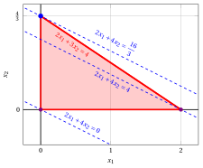{ .fig .ovale loading=lazy style="width:76%" }

    Una soluzione ottima ${ \tilde{\boldsymbol x}}(\, LP\,)$ è:

    $$
    \tilde{x}_1=0,~~\tilde{x}_2=\dfrac{4}{3}
    $$

    il valore ottimo $z(\, LP\,)$ è $\dfrac{16}{3}.$

    In viola il primo e il secondo vertice esplorati dalla precedente esecuzione dell'algoritmo del simplesso rivisto (prima di raggiungere quello ottimo rappresentato in blu).

    In blu tratteggiato, le curve di livello della funzione obiettivo associate ai valori assunti nei tre vertici.

!!! esercizio "Esercizio 11.2: Algoritmo del simplesso rivisto (P1)"

    Consideriamo il seguente problema LP in forma canonica di massimo con $n=2$ variabili e $m=1$ vincolo:

    $$
    \begin{array}{rrrrrr}
    {\max} & {x_1} & {+} & {8}\, {x_2} \\[2ex]
    \text{soggetto a} & {3}\, {x_1} & {+} & {6}\, {x_2} & {\le} & {16} \\[2ex]
    & {x_1,} &  & {x_2} & {\ge} & {0}
    \end{array}
    $$

    Introducendo le variabili di scarto, otteniamo il seguente problema LP in forma standard di massimo con $n+m=3$ variabili e $m=1$ vincolo:

    $$
    \begin{array}{rrrrrrrr}
    {\max} & {x_1} & {+} & {8}\, {x_2} \\[2ex]
    \text{soggetto a} & {3}\, {x_1} & {+} & {6}\, {x_2} & {+} & {x_3} & {=} & {16} \\[2ex]
    & {x_1,} &  & {x_2,} &  & {x_3} & {\ge} & {0}
    \end{array}
    $$

    **Domande**

    - Eseguire l'algoritmo del simplesso rivisto per trovare una soluzione ottima di questo problema LP, usando la regola di Bland per scegliere la colonna pivot e la riga pivot.

??? soluzione "Soluzione"

    Abbiamo:

    $$
    {\boldsymbol A}=
    \begin{pmatrix}
    3 & 6 & 1
    \end{pmatrix}
    \quad
    {\boldsymbol b}=
    \begin{pmatrix}
    16
    \end{pmatrix}
    \quad
    {\boldsymbol c}=
    \begin{pmatrix}
    1\\
    8\\
    0
    \end{pmatrix}
    \quad
    {\boldsymbol x}=
    \begin{pmatrix}
    x_1 \\
    x_2 \\
    x_3
    \end{pmatrix}
    $$

    - <strong>Inizializzazione</strong>

        Poiché è un problema LP in forma standard ottenuto da un problema LP in forma canonica con $~{\boldsymbol b} \ge 0$ aggiungendo le variabili di scarto, la partizione $\pazocal{B}=\{3\}$ e $\pazocal{N}=\{1,2\}$ è associata alla seguente soluzione di base ammissibile:

        $$
        \begin{pmatrix}
        x_3
        \end{pmatrix}
        =
        \begin{pmatrix}
        16
        \end{pmatrix}
        {\rm ~~~e~~~}
        \begin{pmatrix}
        x_1 \\
        x_2
        \end{pmatrix}
        =
        \begin{pmatrix}
        0\\
        0
        \end{pmatrix}
        $$

    - <strong>Iterazione 1</strong>

        Con $\pazocal{B}= \{3\}$ e $\pazocal{N}= \{1,~~2\}$, abbiamo:

        $$
        {\boldsymbol x}_{\pazocal{B}}=
        \begin{pmatrix}
        x_3
        \end{pmatrix} ~~
        {\boldsymbol A}_{\pazocal{B}}=
        \begin{pmatrix}
        1
        \end{pmatrix} ~~
        {\boldsymbol c}_{\pazocal{B}}=
        \begin{pmatrix}
        0
        \end{pmatrix} ~~
        {{ \bar{\boldsymbol b}}}=
        \begin{pmatrix}
        16
        \end{pmatrix}
        $$

        $$
        {\boldsymbol x}_{\pazocal{N}}=
        \begin{pmatrix}
        x_1 \\
        x_2
        \end{pmatrix} ~~
        {\boldsymbol A}_{\pazocal{N}}=
        \begin{pmatrix}
        3 & 6
        \end{pmatrix} ~~
        {\boldsymbol c}_{\pazocal{N}}=
        \begin{pmatrix}
        1\\
        8
        \end{pmatrix}
        $$

        <strong>Test di ottimalità</strong>

        Risolviamo  ${\boldsymbol \pi} \; {\boldsymbol A}_{\pazocal{B}} = {\boldsymbol c}'_{\pazocal{B}}$ per calcolare ${\boldsymbol \pi} =  {{{\boldsymbol c}'_{\pazocal{B}} \; {\boldsymbol A}_{\pazocal{B}}^{-1}}}$, <u>primo sistema di equazioni lineari</u>:

        \begin{equation*}
        \begin{cases}
        \begin{array}{rrr}
        {\pi_3} & {=} & {0}
        \end{array}
        \end{cases}
        \qquad
        {\boldsymbol \pi}=
        \begin{pmatrix}
        0\\
        \end{pmatrix}
        \end{equation*}

        Calcoliamo il valore della soluzione di base ammissibile ${\bar{z}} = {\boldsymbol \pi} \; {\boldsymbol b} = \begin{pmatrix} 0\\ \end{pmatrix} \begin{pmatrix} 16 \end{pmatrix} = 0$

        Calcoliamo i costi ridotti ${{ \bar{\boldsymbol c}}'}  = {{\boldsymbol c}'_{\pazocal{N}} - {\boldsymbol \pi} \; {\boldsymbol A}_{\pazocal{N}}}$:

        $$
        {{ \bar{\boldsymbol c}}'}
        = \begin{pmatrix}
        1 & 8\\
        \end{pmatrix} - \begin{pmatrix}
        0\\
        \end{pmatrix} \begin{pmatrix}
        3 & 6
        \end{pmatrix}
        =
        \underbrace{
        \begin{pmatrix}
        1 & 8\\
        \end{pmatrix}
        }_{{c_{1}~~~c_{2}}}
        -
        \underbrace{
        \begin{pmatrix}
        0 & 0\\
        \end{pmatrix}
        }_{{\boldsymbol \pi}\;{\boldsymbol A}_{1} ~~{\boldsymbol \pi}\;{\boldsymbol A}_{2}}
        =
        \underbrace{
        \begin{pmatrix}
        1 & 8\\
        \end{pmatrix}
        }_{{\bar{c}_{1}~~~\bar{c}_{2}}}
        $$

        Non tutti i costi ridotti sono non positivi, quindi eseguiamo un'operazione di pivot.

        <strong>Operazione di pivot</strong>

        Poiché ${c}_{1} > {\boldsymbol \pi} \;{\boldsymbol A}_{1}$, $x_1$ è la <u>colonna pivot</u> e abbiamo ${\boldsymbol A}_{1} = \begin{pmatrix} 3 \end{pmatrix}$

        Risolviamo   ${\boldsymbol A}_{\pazocal{B}} \; {\boldsymbol d} = {\boldsymbol A}_{1}$ per calcolare   ${\boldsymbol d}={ {\boldsymbol A}_{\pazocal{B}}^{-1}} {\boldsymbol A}_{1}$,  <u>secondo sistema di equazioni lineari</u>:

        \begin{equation*}
        \begin{cases}
        \begin{array}{rrr}
        {d_3} & {=} & {3}
        \end{array}
        \end{cases}
        \qquad
        {\boldsymbol d}=
        \begin{pmatrix}
        3
        \end{pmatrix}
        \end{equation*}

        Dobbiamo trovare il valore massimo di $t$ tale che ${{ \bar{\boldsymbol b}}}  - t \; {{\boldsymbol d}} \ge 0$:

        $$
        \begin{cases}
        \underbrace{16 -t \cdot 3\ge 0}_{x_3 \ge 0}
        \end{cases}
        \qquad
        \begin{cases}
        t\le \dfrac{16}{3}
        \end{cases}
        \text{   quindi   } t_{m}=\dfrac{16}{3}
        $$

        Di conseguenza, il valore della colonna pivot diventa $t_{m}$, cioè $x_1=\dfrac{16}{3}$. Il valore di $x_3$ diventa zero e $x_3$ è la <u>riga pivot</u>.

    - <strong>Iterazione 2</strong>

        Con $\pazocal{B}= \{1\}$ e $\pazocal{N}= \{2,~~3\}$, abbiamo:

        $$
        {\boldsymbol x}_{\pazocal{B}}=
        \begin{pmatrix}
        x_1
        \end{pmatrix} ~~
        {\boldsymbol A}_{\pazocal{B}}=
        \begin{pmatrix}
        3
        \end{pmatrix} ~~
        {\boldsymbol c}_{\pazocal{B}}=
        \begin{pmatrix}
        1
        \end{pmatrix} ~~
        {{ \bar{\boldsymbol b}}}=
        \begin{pmatrix}
        \dfrac{16}{3}
        \end{pmatrix}
        $$

        $$
        {\boldsymbol x}_{\pazocal{N}}=
        \begin{pmatrix}
        x_2 \\
        x_3
        \end{pmatrix} ~~
        {\boldsymbol A}_{\pazocal{N}}=
        \begin{pmatrix}
        6 & 1
        \end{pmatrix} ~~
        {\boldsymbol c}_{\pazocal{N}}=
        \begin{pmatrix}
        8\\
        0
        \end{pmatrix}
        $$

        <strong>Test di ottimalità</strong>

        Risolviamo  ${\boldsymbol \pi} \; {\boldsymbol A}_{\pazocal{B}} = {\boldsymbol c}'_{\pazocal{B}}$ per calcolare ${\boldsymbol \pi} =  {{{\boldsymbol c}'_{\pazocal{B}} \; {\boldsymbol A}_{\pazocal{B}}^{-1}}}$, <u>primo sistema di equazioni lineari</u>:

        \begin{equation*}
        \begin{cases}
        \begin{array}{rrr}
        {3}\, {\pi_1} & {=} & {1}
        \end{array}
        \end{cases}
        \qquad
        {\boldsymbol \pi}=
        \begin{pmatrix}
        \dfrac{1}{3}\\
        \end{pmatrix}
        \end{equation*}

        Calcoliamo il valore della soluzione di base ammissibile ${\bar{z}} = {\boldsymbol \pi} \; {\boldsymbol b} = \begin{pmatrix} \dfrac{1}{3}\\ \end{pmatrix} \begin{pmatrix} 16 \end{pmatrix} = \dfrac{16}{3}$

        Calcoliamo i costi ridotti ${{ \bar{\boldsymbol c}}'}  = {{\boldsymbol c}'_{\pazocal{N}} - {\boldsymbol \pi} \; {\boldsymbol A}_{\pazocal{N}}}$:

        $$
        {{ \bar{\boldsymbol c}}'}
        = \begin{pmatrix}
        8 & 0\\
        \end{pmatrix} - \begin{pmatrix}
        \dfrac{1}{3}\\
        \end{pmatrix} \begin{pmatrix}
        6 & 1
        \end{pmatrix}
        =
        \underbrace{
        \begin{pmatrix}
        8 & 0\\
        \end{pmatrix}
        }_{{c_{2}~~~c_{3}}}
        -
        \underbrace{
        \begin{pmatrix}
        2 & \dfrac{1}{3}\\
        \end{pmatrix}
        }_{{\boldsymbol \pi}\;{\boldsymbol A}_{2} ~~{\boldsymbol \pi}\;{\boldsymbol A}_{3}}
        =
        \underbrace{
        \begin{pmatrix}
        6 & -\dfrac{1}{3}\\
        \end{pmatrix}
        }_{{\bar{c}_{2}~~~\bar{c}_{3}}}
        $$

        Non tutti i costi ridotti sono non positivi, quindi eseguiamo un'operazione di pivot.

        <strong>Operazione di pivot</strong>

        Poiché ${c}_{2} > {\boldsymbol \pi} \;{\boldsymbol A}_{2}$, $x_2$ è la <u>colonna pivot</u> e abbiamo ${\boldsymbol A}_{2} = \begin{pmatrix} 6 \end{pmatrix}$

        Risolviamo   ${\boldsymbol A}_{\pazocal{B}} \; {\boldsymbol d} = {\boldsymbol A}_{2}$ per calcolare   ${\boldsymbol d}={ {\boldsymbol A}_{\pazocal{B}}^{-1}} {\boldsymbol A}_{2}$,  <u>secondo sistema di equazioni lineari</u>:

        \begin{equation*}
        \begin{cases}
        \begin{array}{rrr}
        {3}\, {d_1} & {=} & {6}
        \end{array}
        \end{cases}
        \qquad
        {\boldsymbol d}=
        \begin{pmatrix}
        2
        \end{pmatrix}
        \end{equation*}

        Dobbiamo trovare il valore massimo di $t$ tale che ${{ \bar{\boldsymbol b}}}  - t \; {{\boldsymbol d}} \ge 0$:

        $$
        \begin{cases}
        \underbrace{\dfrac{16}{3} -t \cdot 2\ge 0}_{x_1 \ge 0}
        \end{cases}
        \qquad
        \begin{cases}
        t\le \dfrac{8}{3}
        \end{cases}
        \text{   quindi   } t_{m}=\dfrac{8}{3}
        $$

        Di conseguenza, il valore della colonna pivot diventa $t_{m}$, cioè $x_2=\dfrac{8}{3}$. Il valore di $x_1$ diventa zero e $x_1$ è la <u>riga pivot</u>.

    - <strong>Iterazione 3</strong>

        Con $\pazocal{B}= \{2\}$ e $\pazocal{N}= \{1,~~3\}$, abbiamo:

        $$
        {\boldsymbol x}_{\pazocal{B}}=
        \begin{pmatrix}
        x_2
        \end{pmatrix} ~~
        {\boldsymbol A}_{\pazocal{B}}=
        \begin{pmatrix}
        6
        \end{pmatrix} ~~
        {\boldsymbol c}_{\pazocal{B}}=
        \begin{pmatrix}
        8
        \end{pmatrix} ~~
        {{ \bar{\boldsymbol b}}}=
        \begin{pmatrix}
        \dfrac{8}{3}
        \end{pmatrix}
        $$

        $$
        {\boldsymbol x}_{\pazocal{N}}=
        \begin{pmatrix}
        x_1 \\
        x_3
        \end{pmatrix} ~~
        {\boldsymbol A}_{\pazocal{N}}=
        \begin{pmatrix}
        3 & 1
        \end{pmatrix} ~~
        {\boldsymbol c}_{\pazocal{N}}=
        \begin{pmatrix}
        1\\
        0
        \end{pmatrix}
        $$

        <strong>Test di ottimalità</strong>

        Risolviamo  ${\boldsymbol \pi} \; {\boldsymbol A}_{\pazocal{B}} = {\boldsymbol c}'_{\pazocal{B}}$ per calcolare ${\boldsymbol \pi} =  {{{\boldsymbol c}'_{\pazocal{B}} \; {\boldsymbol A}_{\pazocal{B}}^{-1}}}$, <u>primo sistema di equazioni lineari</u>:

        \begin{equation*}
        \begin{cases}
        \begin{array}{rrr}
        {6}\, {\pi_2} & {=} & {8}
        \end{array}
        \end{cases}
        \qquad
        {\boldsymbol \pi}=
        \begin{pmatrix}
        \dfrac{4}{3}\\
        \end{pmatrix}
        \end{equation*}

        Calcoliamo il valore della soluzione di base ammissibile ${\bar{z}} = {\boldsymbol \pi} \; {\boldsymbol b} = \begin{pmatrix} \dfrac{4}{3}\\ \end{pmatrix} \begin{pmatrix} 16 \end{pmatrix} = \dfrac{64}{3}$

        Calcoliamo i costi ridotti ${{ \bar{\boldsymbol c}}'}  = {{\boldsymbol c}'_{\pazocal{N}} - {\boldsymbol \pi} \; {\boldsymbol A}_{\pazocal{N}}}$:

        $$
        {{ \bar{\boldsymbol c}}'}
        = \begin{pmatrix}
        1 & 0\\
        \end{pmatrix} - \begin{pmatrix}
        \dfrac{4}{3}\\
        \end{pmatrix} \begin{pmatrix}
        3 & 1
        \end{pmatrix}
        =
        \underbrace{
        \begin{pmatrix}
        1 & 0\\
        \end{pmatrix}
        }_{{c_{1}~~~c_{3}}}
        -
        \underbrace{
        \begin{pmatrix}
        4 & \dfrac{4}{3}\\
        \end{pmatrix}
        }_{{\boldsymbol \pi}\;{\boldsymbol A}_{1} ~~{\boldsymbol \pi}\;{\boldsymbol A}_{3}}
        =
        \underbrace{
        \begin{pmatrix}
        -3 & -\dfrac{4}{3}\\
        \end{pmatrix}
        }_{{\bar{c}_{1}~~~\bar{c}_{3}}}
        $$

        Tutti i costi ridotti sono non positivi, quindi la soluzione di base ammissibile

        $$
        {\boldsymbol x}_{\pazocal{B}}=
        \begin{pmatrix}
        x_2
        \end{pmatrix}=\begin{pmatrix}
        \dfrac{8}{3}
        \end{pmatrix} {\rm ~~~e~~~} {\boldsymbol x}_{\pazocal{N}}=
        \begin{pmatrix}
        x_1 \\
        x_3
        \end{pmatrix}=\begin{pmatrix}
        0\\
        0
        \end{pmatrix}
        $$

        è una soluzione ottima del problema LP e ${\bar{z}} = \dfrac{64}{3}$ è il valore ottimo.

    <strong>Soluzione grafica:</strong>

    La regione ammissibile del problema LP (in forma canonica) è il poliedro ombreggiato in rosso: 

    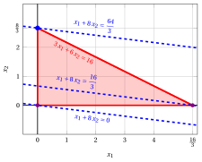{ .fig .ovale loading=lazy style="width:82%" }

    Una soluzione ottima ${ \tilde{\boldsymbol x}}(\, LP\,)$ è:

    $$
    \tilde{x}_1=0,~~\tilde{x}_2=\dfrac{8}{3}
    $$

    il valore ottimo $z(\, LP\,)$ è $\dfrac{64}{3}.$

    In viola il primo e il secondo vertice esplorati dalla precedente esecuzione dell'algoritmo del simplesso rivisto (prima di raggiungere quello ottimo rappresentato in blu).

    In blu tratteggiato, le curve di livello della funzione obiettivo associate ai valori assunti nei tre vertici.

!!! esercizio "Esercizio 11.3: Algoritmo del simplesso rivisto (P2)"

    Consideriamo il seguente problema LP in forma canonica di massimo con $n=2$ variabili e $m=2$ vincoli:

    $$
    \begin{array}{rrrrrr}
    {\max} & {x_1} & {+} & {3}\, {x_2} \\[2ex]
    \text{soggetto a} & {-4}\, {x_1} & {+} & {10}\, {x_2} & {\le} & {35} \\[2ex]
    & {3}\, {x_1} & {+} & {x_2} & {\le} & {12} \\[2ex]
    & {x_1,} &  & {x_2} & {\ge} & {0}
    \end{array}
    $$

    Introducendo le variabili di scarto, otteniamo il seguente problema LP in forma standard di massimo con $n+m=4$ variabili e $m=2$ vincoli:

    $$
    \begin{array}{rrrrrrrrrr}
    {\max} & {x_1} & {+} & {3}\, {x_2} \\[2ex]
    \text{soggetto a} & {-4}\, {x_1} & {+} & {10}\, {x_2} & {+} & {x_3} &  &  & {=} & {35} \\[2ex]
    & {3}\, {x_1} & {+} & {x_2} &  &  & {+} & {x_4} & {=} & {12} \\[2ex]
    & {x_1,} &  & {x_2,} &  & {x_3,} &  & {x_4} & {\ge} & {0}
    \end{array}
    $$

    **Domande**

    - Eseguire l'algoritmo del simplesso rivisto per trovare una soluzione ottima di questo problema LP, usando la regola di Bland per scegliere la colonna pivot e la riga pivot.

??? soluzione "Soluzione"

    Abbiamo:

    $$
    {\boldsymbol A}=
    \begin{pmatrix}
    -4 & 10 & 1 & 0\\
    3 & 1 & 0 & 1
    \end{pmatrix}
    \quad
    {\boldsymbol b}=
    \begin{pmatrix}
    35\\
    12
    \end{pmatrix}
    \quad
    {\boldsymbol c}=
    \begin{pmatrix}
    1\\
    3\\
    0\\
    0
    \end{pmatrix}
    \quad
    {\boldsymbol x}=
    \begin{pmatrix}
    x_1 \\
    x_2 \\
    x_3 \\
    x_4
    \end{pmatrix}
    $$

    - <strong>Inizializzazione</strong>

        Poiché è un problema LP in forma standard ottenuto da un problema LP in forma canonica con $~{\boldsymbol b} \ge 0$ aggiungendo le variabili di scarto, la partizione $\pazocal{B}=\{3,4\}$ e $\pazocal{N}=\{1,2\}$ è associata alla seguente soluzione di base ammissibile:

        $$
        \begin{pmatrix}
        x_3 \\
        x_4
        \end{pmatrix}
        =
        \begin{pmatrix}
        35\\
        12
        \end{pmatrix}
        {\rm ~~~e~~~}
        \begin{pmatrix}
        x_1 \\
        x_2
        \end{pmatrix}
        =
        \begin{pmatrix}
        0\\
        0
        \end{pmatrix}
        $$

    - <strong>Iterazione 1</strong>

        Con $\pazocal{B}= \{3,~~4\}$ e $\pazocal{N}= \{1,~~2\}$, abbiamo:

        $$
        {\boldsymbol x}_{\pazocal{B}}=
        \begin{pmatrix}
        x_3 \\
        x_4
        \end{pmatrix} ~~
        {\boldsymbol A}_{\pazocal{B}}=
        \begin{pmatrix}
        1 & 0\\
        0 & 1
        \end{pmatrix} ~~
        {\boldsymbol c}_{\pazocal{B}}=
        \begin{pmatrix}
        0\\
        0
        \end{pmatrix} ~~
        {{ \bar{\boldsymbol b}}}=
        \begin{pmatrix}
        35\\
        12
        \end{pmatrix}
        $$

        $$
        {\boldsymbol x}_{\pazocal{N}}=
        \begin{pmatrix}
        x_1 \\
        x_2
        \end{pmatrix} ~~
        {\boldsymbol A}_{\pazocal{N}}=
        \begin{pmatrix}
        -4 & 10\\
        3 & 1
        \end{pmatrix} ~~
        {\boldsymbol c}_{\pazocal{N}}=
        \begin{pmatrix}
        1\\
        3
        \end{pmatrix}
        $$

        <strong>Test di ottimalità</strong>

        Risolviamo  ${\boldsymbol \pi} \; {\boldsymbol A}_{\pazocal{B}} = {\boldsymbol c}'_{\pazocal{B}}$ per calcolare ${\boldsymbol \pi} =  {{{\boldsymbol c}'_{\pazocal{B}} \; {\boldsymbol A}_{\pazocal{B}}^{-1}}}$, <u>primo sistema di equazioni lineari</u>:

        \begin{equation*}
        \begin{cases}
        \begin{array}{rrrrr}
        {\pi_3} &  &  & {=} & {0} \\[2ex]
        &  & {\pi_4} & {=} & {0}
        \end{array}
        \end{cases}
        \qquad
        {\boldsymbol \pi}=
        \begin{pmatrix}
        0 & 0\\
        \end{pmatrix}
        \end{equation*}

        Calcoliamo il valore della soluzione di base ammissibile ${\bar{z}} = {\boldsymbol \pi} \; {\boldsymbol b} = \begin{pmatrix} 0 & 0\\ \end{pmatrix} \begin{pmatrix} 35\\ 12 \end{pmatrix} = 0$

        Calcoliamo i costi ridotti ${{ \bar{\boldsymbol c}}'}  = {{\boldsymbol c}'_{\pazocal{N}} - {\boldsymbol \pi} \; {\boldsymbol A}_{\pazocal{N}}}$:

        $$
        {{ \bar{\boldsymbol c}}'}
        = \begin{pmatrix}
        1 & 3\\
        \end{pmatrix} - \begin{pmatrix}
        0 & 0\\
        \end{pmatrix} \begin{pmatrix}
        -4 & 10\\
        3 & 1
        \end{pmatrix}
        =
        \underbrace{
        \begin{pmatrix}
        1 & 3\\
        \end{pmatrix}
        }_{{c_{1}~~~c_{2}}}
        -
        \underbrace{
        \begin{pmatrix}
        0 & 0\\
        \end{pmatrix}
        }_{{\boldsymbol \pi}\;{\boldsymbol A}_{1} ~~{\boldsymbol \pi}\;{\boldsymbol A}_{2}}
        =
        \underbrace{
        \begin{pmatrix}
        1 & 3\\
        \end{pmatrix}
        }_{{\bar{c}_{1}~~~\bar{c}_{2}}}
        $$

        Non tutti i costi ridotti sono non positivi, quindi eseguiamo un'operazione di pivot.

        <strong>Operazione di pivot</strong>

        Poiché ${c}_{1} > {\boldsymbol \pi} \;{\boldsymbol A}_{1}$, $x_1$ è la <u>colonna pivot</u> e abbiamo ${\boldsymbol A}_{1} = \begin{pmatrix} -4\\ 3 \end{pmatrix}$

        Risolviamo   ${\boldsymbol A}_{\pazocal{B}} \; {\boldsymbol d} = {\boldsymbol A}_{1}$ per calcolare   ${\boldsymbol d}={ {\boldsymbol A}_{\pazocal{B}}^{-1}} {\boldsymbol A}_{1}$,  <u>secondo sistema di equazioni lineari</u>:

        \begin{equation*}
        \begin{cases}
        \begin{array}{rrrrr}
        {d_3} &  &  & {=} & {-4} \\[2ex]
        &  & {d_4} & {=} & {3}
        \end{array}
        \end{cases}
        \qquad
        {\boldsymbol d}=
        \begin{pmatrix}
        -4\\
        3
        \end{pmatrix}
        \end{equation*}

        Dobbiamo trovare il valore massimo di $t$ tale che ${{ \bar{\boldsymbol b}}}  - t \; {{\boldsymbol d}} \ge 0$:

        $$
        \begin{cases}
        \underbrace{35 -t \cdot \left( -4\right)\ge 0}_{x_3 \ge 0} \\[2ex]
        \underbrace{12 -t \cdot 3\ge 0}_{x_4 \ge 0}
        \end{cases}
        \qquad
        \begin{cases}
        t\ge -\dfrac{35}{4} \\[2ex]
        t\le 4
        \end{cases}
        \text{   quindi   } t_{m}=4
        $$

        Di conseguenza, il valore della colonna pivot diventa $t_{m}$, cioè $x_1=4$. Il valore di $x_4$ diventa zero e $x_4$ è la <u>riga pivot</u>. Le altre variabili in base assumono i valori  ${ \bar{\boldsymbol b}} - t_{m} \; {\boldsymbol d}$,  quindi abbiamo:

        $$
        x_3 = 35 - 4 \cdot \left( -4\right) = 51
        $$

    - <strong>Iterazione 2</strong>

        Con $\pazocal{B}= \{1,~~3\}$ e $\pazocal{N}= \{2,~~4\}$, abbiamo:

        $$
        {\boldsymbol x}_{\pazocal{B}}=
        \begin{pmatrix}
        x_1 \\
        x_3
        \end{pmatrix} ~~
        {\boldsymbol A}_{\pazocal{B}}=
        \begin{pmatrix}
        -4 & 1\\
        3 & 0
        \end{pmatrix} ~~
        {\boldsymbol c}_{\pazocal{B}}=
        \begin{pmatrix}
        1\\
        0
        \end{pmatrix} ~~
        {{ \bar{\boldsymbol b}}}=
        \begin{pmatrix}
        4\\
        51
        \end{pmatrix}
        $$

        $$
        {\boldsymbol x}_{\pazocal{N}}=
        \begin{pmatrix}
        x_2 \\
        x_4
        \end{pmatrix} ~~
        {\boldsymbol A}_{\pazocal{N}}=
        \begin{pmatrix}
        10 & 0\\
        1 & 1
        \end{pmatrix} ~~
        {\boldsymbol c}_{\pazocal{N}}=
        \begin{pmatrix}
        3\\
        0
        \end{pmatrix}
        $$

        <strong>Test di ottimalità</strong>

        Risolviamo  ${\boldsymbol \pi} \; {\boldsymbol A}_{\pazocal{B}} = {\boldsymbol c}'_{\pazocal{B}}$ per calcolare ${\boldsymbol \pi} =  {{{\boldsymbol c}'_{\pazocal{B}} \; {\boldsymbol A}_{\pazocal{B}}^{-1}}}$, <u>primo sistema di equazioni lineari</u>:

        \begin{equation*}
        \begin{cases}
        \begin{array}{rrrrr}
        {-4}\, {\pi_1} & {+} & {3}\, {\pi_3} & {=} & {1} \\[2ex]
        {\pi_1} &  &  & {=} & {0}
        \end{array}
        \end{cases}
        \qquad
        {\boldsymbol \pi}=
        \begin{pmatrix}
        0 & \dfrac{1}{3}\\
        \end{pmatrix}
        \end{equation*}

        Calcoliamo il valore della soluzione di base ammissibile ${\bar{z}} = {\boldsymbol \pi} \; {\boldsymbol b} = \begin{pmatrix} 0 & \dfrac{1}{3}\\ \end{pmatrix} \begin{pmatrix} 35\\ 12 \end{pmatrix} = 4$

        Calcoliamo i costi ridotti ${{ \bar{\boldsymbol c}}'}  = {{\boldsymbol c}'_{\pazocal{N}} - {\boldsymbol \pi} \; {\boldsymbol A}_{\pazocal{N}}}$:

        $$
        {{ \bar{\boldsymbol c}}'}
        = \begin{pmatrix}
        3 & 0\\
        \end{pmatrix} - \begin{pmatrix}
        0 & \dfrac{1}{3}\\
        \end{pmatrix} \begin{pmatrix}
        10 & 0\\
        1 & 1
        \end{pmatrix}
        =
        \underbrace{
        \begin{pmatrix}
        3 & 0\\
        \end{pmatrix}
        }_{{c_{2}~~~c_{4}}}
        -
        \underbrace{
        \begin{pmatrix}
        \dfrac{1}{3} & \dfrac{1}{3}\\
        \end{pmatrix}
        }_{{\boldsymbol \pi}\;{\boldsymbol A}_{2} ~~{\boldsymbol \pi}\;{\boldsymbol A}_{4}}
        =
        \underbrace{
        \begin{pmatrix}
        \dfrac{8}{3} & -\dfrac{1}{3}\\
        \end{pmatrix}
        }_{{\bar{c}_{2}~~~\bar{c}_{4}}}
        $$

        Non tutti i costi ridotti sono non positivi, quindi eseguiamo un'operazione di pivot.

        <strong>Operazione di pivot</strong>

        Poiché ${c}_{2} > {\boldsymbol \pi} \;{\boldsymbol A}_{2}$, $x_2$ è la <u>colonna pivot</u> e abbiamo ${\boldsymbol A}_{2} = \begin{pmatrix} 10\\ 1 \end{pmatrix}$

        Risolviamo   ${\boldsymbol A}_{\pazocal{B}} \; {\boldsymbol d} = {\boldsymbol A}_{2}$ per calcolare   ${\boldsymbol d}={ {\boldsymbol A}_{\pazocal{B}}^{-1}} {\boldsymbol A}_{2}$,  <u>secondo sistema di equazioni lineari</u>:

        \begin{equation*}
        \begin{cases}
        \begin{array}{rrrrr}
        {-4}\, {d_1} & {+} & {d_3} & {=} & {10} \\[2ex]
        {3}\, {d_1} &  &  & {=} & {1}
        \end{array}
        \end{cases}
        \qquad
        {\boldsymbol d}=
        \begin{pmatrix}
        \dfrac{1}{3}\\[2ex]
        \dfrac{34}{3}
        \end{pmatrix}
        \end{equation*}

        Dobbiamo trovare il valore massimo di $t$ tale che ${{ \bar{\boldsymbol b}}}  - t \; {{\boldsymbol d}} \ge 0$:

        $$
        \begin{cases}
        \underbrace{4 -t \cdot \dfrac{1}{3}\ge 0}_{x_1 \ge 0} \\[2ex]
        \underbrace{51 -t \cdot \dfrac{34}{3}\ge 0}_{x_3 \ge 0}
        \end{cases}
        \qquad
        \begin{cases}
        t\le 12 \\[2ex]
        t\le \dfrac{9}{2}
        \end{cases}
        \text{   quindi   } t_{m}=\dfrac{9}{2}
        $$

        Di conseguenza, il valore della colonna pivot diventa $t_{m}$, cioè $x_2=\dfrac{9}{2}$. Il valore di $x_3$ diventa zero e $x_3$ è la <u>riga pivot</u>. Le altre variabili in base assumono i valori  ${ \bar{\boldsymbol b}} - t_{m} \; {\boldsymbol d}$,  quindi abbiamo:

        $$
        x_1 = 4 - \dfrac{9}{2} \cdot \dfrac{1}{3} = \dfrac{5}{2}
        $$

    - <strong>Iterazione 3</strong>

        Con $\pazocal{B}= \{1,~~2\}$ e $\pazocal{N}= \{3,~~4\}$, abbiamo:

        $$
        {\boldsymbol x}_{\pazocal{B}}=
        \begin{pmatrix}
        x_1 \\
        x_2
        \end{pmatrix} ~~
        {\boldsymbol A}_{\pazocal{B}}=
        \begin{pmatrix}
        -4 & 10\\
        3 & 1
        \end{pmatrix} ~~
        {\boldsymbol c}_{\pazocal{B}}=
        \begin{pmatrix}
        1\\
        3
        \end{pmatrix} ~~
        {{ \bar{\boldsymbol b}}}=
        \begin{pmatrix}
        \dfrac{5}{2}\\[2ex]
        \dfrac{9}{2}
        \end{pmatrix}
        $$

        $$
        {\boldsymbol x}_{\pazocal{N}}=
        \begin{pmatrix}
        x_3 \\
        x_4
        \end{pmatrix} ~~
        {\boldsymbol A}_{\pazocal{N}}=
        \begin{pmatrix}
        1 & 0\\
        0 & 1
        \end{pmatrix} ~~
        {\boldsymbol c}_{\pazocal{N}}=
        \begin{pmatrix}
        0\\
        0
        \end{pmatrix}
        $$

        <strong>Test di ottimalità</strong>

        Risolviamo  ${\boldsymbol \pi} \; {\boldsymbol A}_{\pazocal{B}} = {\boldsymbol c}'_{\pazocal{B}}$ per calcolare ${\boldsymbol \pi} =  {{{\boldsymbol c}'_{\pazocal{B}} \; {\boldsymbol A}_{\pazocal{B}}^{-1}}}$, <u>primo sistema di equazioni lineari</u>:

        \begin{equation*}
        \begin{cases}
        \begin{array}{rrrrr}
        {-4}\, {\pi_1} & {+} & {3}\, {\pi_2} & {=} & {1} \\[2ex]
        {10}\, {\pi_1} & {+} & {\pi_2} & {=} & {3}
        \end{array}
        \end{cases}
        \qquad
        {\boldsymbol \pi}=
        \begin{pmatrix}
        \dfrac{4}{17} & \dfrac{11}{17}\\
        \end{pmatrix}
        \end{equation*}

        Calcoliamo il valore della soluzione di base ammissibile ${\bar{z}} = {\boldsymbol \pi} \; {\boldsymbol b} = \begin{pmatrix} \dfrac{4}{17} & \dfrac{11}{17}\\ \end{pmatrix} \begin{pmatrix} 35\\ 12 \end{pmatrix} = 16$

        Calcoliamo i costi ridotti ${{ \bar{\boldsymbol c}}'}  = {{\boldsymbol c}'_{\pazocal{N}} - {\boldsymbol \pi} \; {\boldsymbol A}_{\pazocal{N}}}$:

        $$
        {{ \bar{\boldsymbol c}}'}
        = \begin{pmatrix}
        0 & 0\\
        \end{pmatrix} - \begin{pmatrix}
        \dfrac{4}{17} & \dfrac{11}{17}\\
        \end{pmatrix} \begin{pmatrix}
        1 & 0\\
        0 & 1
        \end{pmatrix}
        =
        \underbrace{
        \begin{pmatrix}
        0 & 0\\
        \end{pmatrix}
        }_{{c_{3}~~~c_{4}}}
        -
        \underbrace{
        \begin{pmatrix}
        \dfrac{4}{17} & \dfrac{11}{17}\\
        \end{pmatrix}
        }_{{\boldsymbol \pi}\;{\boldsymbol A}_{3} ~~{\boldsymbol \pi}\;{\boldsymbol A}_{4}}
        =
        \underbrace{
        \begin{pmatrix}
        -\dfrac{4}{17} & -\dfrac{11}{17}\\
        \end{pmatrix}
        }_{{\bar{c}_{3}~~~\bar{c}_{4}}}
        $$

        Tutti i costi ridotti sono non positivi, quindi la soluzione di base ammissibile

        $$
        {\boldsymbol x}_{\pazocal{B}}=
        \begin{pmatrix}
        x_1 \\
        x_2
        \end{pmatrix}=\begin{pmatrix}
        \dfrac{5}{2}\\[2ex]
        \dfrac{9}{2}
        \end{pmatrix} {\rm ~~~e~~~} {\boldsymbol x}_{\pazocal{N}}=
        \begin{pmatrix}
        x_3 \\
        x_4
        \end{pmatrix}=\begin{pmatrix}
        0\\
        0
        \end{pmatrix}
        $$

        è una soluzione ottima del problema LP e ${\bar{z}} = 16$ è il valore ottimo.

    <strong>Soluzione grafica:</strong>

    La regione ammissibile del problema LP (in forma canonica) è il poliedro ombreggiato in rosso: 

    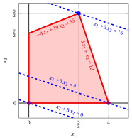{ .fig .ovale loading=lazy style="width:65%" }

    Una soluzione ottima ${ \tilde{\boldsymbol x}}(\, LP\,)$ è:

    $$
    \tilde{x}_1=\dfrac{5}{2},~~\tilde{x}_2=\dfrac{9}{2}
    $$

    il valore ottimo $z(\, LP\,)$ è $16.$

    In viola il primo e il secondo vertice esplorati dalla precedente esecuzione dell'algoritmo del simplesso rivisto (prima di raggiungere quello ottimo rappresentato in blu).

    In blu tratteggiato, le curve di livello della funzione obiettivo associate ai valori assunti nei tre vertici.

!!! esercizio "Esercizio 11.4: Algoritmo del simplesso rivisto (P3)"

    Consideriamo il seguente problema LP in forma canonica di massimo con $n=2$ variabili e $m=2$ vincoli:

    $$
    \begin{array}{rrrrrr}
    {\max} & {2}\, {x_1} & {+} & {4}\, {x_2} \\[2ex]
    \text{soggetto a} & {-x_1} & {+} & {x_2} & {\le} & {2} \\[2ex]
    & {8}\, {x_1} & {+} & {2}\, {x_2} & {\le} & {19} \\[2ex]
    & {x_1,} &  & {x_2} & {\ge} & {0}
    \end{array}
    $$

    Introducendo le variabili di scarto, otteniamo il seguente problema LP in forma standard di massimo con $n+m=4$ variabili e $m=2$ vincoli:

    $$
    \begin{array}{rrrrrrrrrr}
    {\max} & {2}\, {x_1} & {+} & {4}\, {x_2} \\[2ex]
    \text{soggetto a} & {-x_1} & {+} & {x_2} & {+} & {x_3} &  &  & {=} & {2} \\[2ex]
    & {8}\, {x_1} & {+} & {2}\, {x_2} &  &  & {+} & {x_4} & {=} & {19} \\[2ex]
    & {x_1,} &  & {x_2,} &  & {x_3,} &  & {x_4} & {\ge} & {0}
    \end{array}
    $$

    **Domande**

    - Eseguire l'algoritmo del simplesso rivisto per trovare una soluzione ottima di questo problema LP, usando la regola di Bland per scegliere la colonna pivot e la riga pivot.

??? soluzione "Soluzione"

    Abbiamo:

    $$
    {\boldsymbol A}=
    \begin{pmatrix}
    -1 & 1 & 1 & 0\\
    8 & 2 & 0 & 1
    \end{pmatrix}
    \quad
    {\boldsymbol b}=
    \begin{pmatrix}
    2\\
    19
    \end{pmatrix}
    \quad
    {\boldsymbol c}=
    \begin{pmatrix}
    2\\
    4\\
    0\\
    0
    \end{pmatrix}
    \quad
    {\boldsymbol x}=
    \begin{pmatrix}
    x_1 \\
    x_2 \\
    x_3 \\
    x_4
    \end{pmatrix}
    $$

    - <strong>Inizializzazione</strong>

        Poiché è un problema LP in forma standard ottenuto da un problema LP in forma canonica con $~{\boldsymbol b} \ge 0$ aggiungendo le variabili di scarto, la partizione $\pazocal{B}=\{3,4\}$ e $\pazocal{N}=\{1,2\}$ è associata alla seguente soluzione di base ammissibile:

        $$
        \begin{pmatrix}
        x_3 \\
        x_4
        \end{pmatrix}
        =
        \begin{pmatrix}
        2\\
        19
        \end{pmatrix}
        {\rm ~~~e~~~}
        \begin{pmatrix}
        x_1 \\
        x_2
        \end{pmatrix}
        =
        \begin{pmatrix}
        0\\
        0
        \end{pmatrix}
        $$

    - <strong>Iterazione 1</strong>

        Con $\pazocal{B}= \{3,~~4\}$ e $\pazocal{N}= \{1,~~2\}$, abbiamo:

        $$
        {\boldsymbol x}_{\pazocal{B}}=
        \begin{pmatrix}
        x_3 \\
        x_4
        \end{pmatrix} ~~
        {\boldsymbol A}_{\pazocal{B}}=
        \begin{pmatrix}
        1 & 0\\
        0 & 1
        \end{pmatrix} ~~
        {\boldsymbol c}_{\pazocal{B}}=
        \begin{pmatrix}
        0\\
        0
        \end{pmatrix} ~~
        {{ \bar{\boldsymbol b}}}=
        \begin{pmatrix}
        2\\
        19
        \end{pmatrix}
        $$

        $$
        {\boldsymbol x}_{\pazocal{N}}=
        \begin{pmatrix}
        x_1 \\
        x_2
        \end{pmatrix} ~~
        {\boldsymbol A}_{\pazocal{N}}=
        \begin{pmatrix}
        -1 & 1\\
        8 & 2
        \end{pmatrix} ~~
        {\boldsymbol c}_{\pazocal{N}}=
        \begin{pmatrix}
        2\\
        4
        \end{pmatrix}
        $$

        <strong>Test di ottimalità</strong>

        Risolviamo  ${\boldsymbol \pi} \; {\boldsymbol A}_{\pazocal{B}} = {\boldsymbol c}'_{\pazocal{B}}$ per calcolare ${\boldsymbol \pi} =  {{{\boldsymbol c}'_{\pazocal{B}} \; {\boldsymbol A}_{\pazocal{B}}^{-1}}}$, <u>primo sistema di equazioni lineari</u>:

        \begin{equation*}
        \begin{cases}
        \begin{array}{rrrrr}
        {\pi_3} &  &  & {=} & {0} \\[2ex]
        &  & {\pi_4} & {=} & {0}
        \end{array}
        \end{cases}
        \qquad
        {\boldsymbol \pi}=
        \begin{pmatrix}
        0 & 0\\
        \end{pmatrix}
        \end{equation*}

        Calcoliamo il valore della soluzione di base ammissibile ${\bar{z}} = {\boldsymbol \pi} \; {\boldsymbol b} = \begin{pmatrix} 0 & 0\\ \end{pmatrix} \begin{pmatrix} 2\\ 19 \end{pmatrix} = 0$

        Calcoliamo i costi ridotti ${{ \bar{\boldsymbol c}}'}  = {{\boldsymbol c}'_{\pazocal{N}} - {\boldsymbol \pi} \; {\boldsymbol A}_{\pazocal{N}}}$:

        $$
        {{ \bar{\boldsymbol c}}'}
        = \begin{pmatrix}
        2 & 4\\
        \end{pmatrix} - \begin{pmatrix}
        0 & 0\\
        \end{pmatrix} \begin{pmatrix}
        -1 & 1\\
        8 & 2
        \end{pmatrix}
        =
        \underbrace{
        \begin{pmatrix}
        2 & 4\\
        \end{pmatrix}
        }_{{c_{1}~~~c_{2}}}
        -
        \underbrace{
        \begin{pmatrix}
        0 & 0\\
        \end{pmatrix}
        }_{{\boldsymbol \pi}\;{\boldsymbol A}_{1} ~~{\boldsymbol \pi}\;{\boldsymbol A}_{2}}
        =
        \underbrace{
        \begin{pmatrix}
        2 & 4\\
        \end{pmatrix}
        }_{{\bar{c}_{1}~~~\bar{c}_{2}}}
        $$

        Non tutti i costi ridotti sono non positivi, quindi eseguiamo un'operazione di pivot.

        <strong>Operazione di pivot</strong>

        Poiché ${c}_{1} > {\boldsymbol \pi} \;{\boldsymbol A}_{1}$, $x_1$ è la <u>colonna pivot</u> e abbiamo ${\boldsymbol A}_{1} = \begin{pmatrix} -1\\ 8 \end{pmatrix}$

        Risolviamo   ${\boldsymbol A}_{\pazocal{B}} \; {\boldsymbol d} = {\boldsymbol A}_{1}$ per calcolare   ${\boldsymbol d}={ {\boldsymbol A}_{\pazocal{B}}^{-1}} {\boldsymbol A}_{1}$,  <u>secondo sistema di equazioni lineari</u>:

        \begin{equation*}
        \begin{cases}
        \begin{array}{rrrrr}
        {d_3} &  &  & {=} & {-1} \\[2ex]
        &  & {d_4} & {=} & {8}
        \end{array}
        \end{cases}
        \qquad
        {\boldsymbol d}=
        \begin{pmatrix}
        -1\\
        8
        \end{pmatrix}
        \end{equation*}

        Dobbiamo trovare il valore massimo di $t$ tale che ${{ \bar{\boldsymbol b}}}  - t \; {{\boldsymbol d}} \ge 0$:

        $$
        \begin{cases}
        \underbrace{2 -t \cdot \left( -1\right)\ge 0}_{x_3 \ge 0} \\[2ex]
        \underbrace{19 -t \cdot 8\ge 0}_{x_4 \ge 0}
        \end{cases}
        \qquad
        \begin{cases}
        t\ge -2 \\[2ex]
        t\le \dfrac{19}{8}
        \end{cases}
        \text{   quindi   } t_{m}=\dfrac{19}{8}
        $$

        Di conseguenza, il valore della colonna pivot diventa $t_{m}$, cioè $x_1=\dfrac{19}{8}$. Il valore di $x_4$ diventa zero e $x_4$ è la <u>riga pivot</u>. Le altre variabili in base assumono i valori  ${ \bar{\boldsymbol b}} - t_{m} \; {\boldsymbol d}$,  quindi abbiamo:

        $$
        x_3 = 2 - \dfrac{19}{8} \cdot \left( -1\right) = \dfrac{35}{8}
        $$

    - <strong>Iterazione 2</strong>

        Con $\pazocal{B}= \{1,~~3\}$ e $\pazocal{N}= \{2,~~4\}$, abbiamo:

        $$
        {\boldsymbol x}_{\pazocal{B}}=
        \begin{pmatrix}
        x_1 \\
        x_3
        \end{pmatrix} ~~
        {\boldsymbol A}_{\pazocal{B}}=
        \begin{pmatrix}
        -1 & 1\\
        8 & 0
        \end{pmatrix} ~~
        {\boldsymbol c}_{\pazocal{B}}=
        \begin{pmatrix}
        2\\
        0
        \end{pmatrix} ~~
        {{ \bar{\boldsymbol b}}}=
        \begin{pmatrix}
        \dfrac{19}{8}\\[2ex]
        \dfrac{35}{8}
        \end{pmatrix}
        $$

        $$
        {\boldsymbol x}_{\pazocal{N}}=
        \begin{pmatrix}
        x_2 \\
        x_4
        \end{pmatrix} ~~
        {\boldsymbol A}_{\pazocal{N}}=
        \begin{pmatrix}
        1 & 0\\
        2 & 1
        \end{pmatrix} ~~
        {\boldsymbol c}_{\pazocal{N}}=
        \begin{pmatrix}
        4\\
        0
        \end{pmatrix}
        $$

        <strong>Test di ottimalità</strong>

        Risolviamo  ${\boldsymbol \pi} \; {\boldsymbol A}_{\pazocal{B}} = {\boldsymbol c}'_{\pazocal{B}}$ per calcolare ${\boldsymbol \pi} =  {{{\boldsymbol c}'_{\pazocal{B}} \; {\boldsymbol A}_{\pazocal{B}}^{-1}}}$, <u>primo sistema di equazioni lineari</u>:

        \begin{equation*}
        \begin{cases}
        \begin{array}{rrrrr}
        {-\pi_1} & {+} & {8}\, {\pi_3} & {=} & {2} \\[2ex]
        {\pi_1} &  &  & {=} & {0}
        \end{array}
        \end{cases}
        \qquad
        {\boldsymbol \pi}=
        \begin{pmatrix}
        0 & \dfrac{1}{4}\\
        \end{pmatrix}
        \end{equation*}

        Calcoliamo il valore della soluzione di base ammissibile ${\bar{z}} = {\boldsymbol \pi} \; {\boldsymbol b} = \begin{pmatrix} 0 & \dfrac{1}{4}\\ \end{pmatrix} \begin{pmatrix} 2\\ 19 \end{pmatrix} = \dfrac{19}{4}$

        Calcoliamo i costi ridotti ${{ \bar{\boldsymbol c}}'}  = {{\boldsymbol c}'_{\pazocal{N}} - {\boldsymbol \pi} \; {\boldsymbol A}_{\pazocal{N}}}$:

        $$
        {{ \bar{\boldsymbol c}}'}
        = \begin{pmatrix}
        4 & 0\\
        \end{pmatrix} - \begin{pmatrix}
        0 & \dfrac{1}{4}\\
        \end{pmatrix} \begin{pmatrix}
        1 & 0\\
        2 & 1
        \end{pmatrix}
        =
        \underbrace{
        \begin{pmatrix}
        4 & 0\\
        \end{pmatrix}
        }_{{c_{2}~~~c_{4}}}
        -
        \underbrace{
        \begin{pmatrix}
        \dfrac{1}{2} & \dfrac{1}{4}\\
        \end{pmatrix}
        }_{{\boldsymbol \pi}\;{\boldsymbol A}_{2} ~~{\boldsymbol \pi}\;{\boldsymbol A}_{4}}
        =
        \underbrace{
        \begin{pmatrix}
        \dfrac{7}{2} & -\dfrac{1}{4}\\
        \end{pmatrix}
        }_{{\bar{c}_{2}~~~\bar{c}_{4}}}
        $$

        Non tutti i costi ridotti sono non positivi, quindi eseguiamo un'operazione di pivot.

        <strong>Operazione di pivot</strong>

        Poiché ${c}_{2} > {\boldsymbol \pi} \;{\boldsymbol A}_{2}$, $x_2$ è la <u>colonna pivot</u> e abbiamo ${\boldsymbol A}_{2} = \begin{pmatrix} 1\\ 2 \end{pmatrix}$

        Risolviamo   ${\boldsymbol A}_{\pazocal{B}} \; {\boldsymbol d} = {\boldsymbol A}_{2}$ per calcolare   ${\boldsymbol d}={ {\boldsymbol A}_{\pazocal{B}}^{-1}} {\boldsymbol A}_{2}$,  <u>secondo sistema di equazioni lineari</u>:

        \begin{equation*}
        \begin{cases}
        \begin{array}{rrrrr}
        {-d_1} & {+} & {d_3} & {=} & {1} \\[2ex]
        {8}\, {d_1} &  &  & {=} & {2}
        \end{array}
        \end{cases}
        \qquad
        {\boldsymbol d}=
        \begin{pmatrix}
        \dfrac{1}{4}\\[2ex]
        \dfrac{5}{4}
        \end{pmatrix}
        \end{equation*}

        Dobbiamo trovare il valore massimo di $t$ tale che ${{ \bar{\boldsymbol b}}}  - t \; {{\boldsymbol d}} \ge 0$:

        $$
        \begin{cases}
        \underbrace{\dfrac{19}{8} -t \cdot \dfrac{1}{4}\ge 0}_{x_1 \ge 0} \\[2ex]
        \underbrace{\dfrac{35}{8} -t \cdot \dfrac{5}{4}\ge 0}_{x_3 \ge 0}
        \end{cases}
        \qquad
        \begin{cases}
        t\le \dfrac{19}{2} \\[2ex]
        t\le \dfrac{7}{2}
        \end{cases}
        \text{   quindi   } t_{m}=\dfrac{7}{2}
        $$

        Di conseguenza, il valore della colonna pivot diventa $t_{m}$, cioè $x_2=\dfrac{7}{2}$. Il valore di $x_3$ diventa zero e $x_3$ è la <u>riga pivot</u>. Le altre variabili in base assumono i valori  ${ \bar{\boldsymbol b}} - t_{m} \; {\boldsymbol d}$,  quindi abbiamo:

        $$
        x_1 = \dfrac{19}{8} - \dfrac{7}{2} \cdot \dfrac{1}{4} = \dfrac{3}{2}
        $$

    - <strong>Iterazione 3</strong>

        Con $\pazocal{B}= \{1,~~2\}$ e $\pazocal{N}= \{3,~~4\}$, abbiamo:

        $$
        {\boldsymbol x}_{\pazocal{B}}=
        \begin{pmatrix}
        x_1 \\
        x_2
        \end{pmatrix} ~~
        {\boldsymbol A}_{\pazocal{B}}=
        \begin{pmatrix}
        -1 & 1\\
        8 & 2
        \end{pmatrix} ~~
        {\boldsymbol c}_{\pazocal{B}}=
        \begin{pmatrix}
        2\\
        4
        \end{pmatrix} ~~
        {{ \bar{\boldsymbol b}}}=
        \begin{pmatrix}
        \dfrac{3}{2}\\[2ex]
        \dfrac{7}{2}
        \end{pmatrix}
        $$

        $$
        {\boldsymbol x}_{\pazocal{N}}=
        \begin{pmatrix}
        x_3 \\
        x_4
        \end{pmatrix} ~~
        {\boldsymbol A}_{\pazocal{N}}=
        \begin{pmatrix}
        1 & 0\\
        0 & 1
        \end{pmatrix} ~~
        {\boldsymbol c}_{\pazocal{N}}=
        \begin{pmatrix}
        0\\
        0
        \end{pmatrix}
        $$

        <strong>Test di ottimalità</strong>

        Risolviamo  ${\boldsymbol \pi} \; {\boldsymbol A}_{\pazocal{B}} = {\boldsymbol c}'_{\pazocal{B}}$ per calcolare ${\boldsymbol \pi} =  {{{\boldsymbol c}'_{\pazocal{B}} \; {\boldsymbol A}_{\pazocal{B}}^{-1}}}$, <u>primo sistema di equazioni lineari</u>:

        \begin{equation*}
        \begin{cases}
        \begin{array}{rrrrr}
        {-\pi_1} & {+} & {8}\, {\pi_2} & {=} & {2} \\[2ex]
        {\pi_1} & {+} & {2}\, {\pi_2} & {=} & {4}
        \end{array}
        \end{cases}
        \qquad
        {\boldsymbol \pi}=
        \begin{pmatrix}
        \dfrac{14}{5} & \dfrac{3}{5}\\
        \end{pmatrix}
        \end{equation*}

        Calcoliamo il valore della soluzione di base ammissibile ${\bar{z}} = {\boldsymbol \pi} \; {\boldsymbol b} = \begin{pmatrix} \dfrac{14}{5} & \dfrac{3}{5}\\ \end{pmatrix} \begin{pmatrix} 2\\ 19 \end{pmatrix} = 17$

        Calcoliamo i costi ridotti ${{ \bar{\boldsymbol c}}'}  = {{\boldsymbol c}'_{\pazocal{N}} - {\boldsymbol \pi} \; {\boldsymbol A}_{\pazocal{N}}}$:

        $$
        {{ \bar{\boldsymbol c}}'}
        = \begin{pmatrix}
        0 & 0\\
        \end{pmatrix} - \begin{pmatrix}
        \dfrac{14}{5} & \dfrac{3}{5}\\
        \end{pmatrix} \begin{pmatrix}
        1 & 0\\
        0 & 1
        \end{pmatrix}
        =
        \underbrace{
        \begin{pmatrix}
        0 & 0\\
        \end{pmatrix}
        }_{{c_{3}~~~c_{4}}}
        -
        \underbrace{
        \begin{pmatrix}
        \dfrac{14}{5} & \dfrac{3}{5}\\
        \end{pmatrix}
        }_{{\boldsymbol \pi}\;{\boldsymbol A}_{3} ~~{\boldsymbol \pi}\;{\boldsymbol A}_{4}}
        =
        \underbrace{
        \begin{pmatrix}
        -\dfrac{14}{5} & -\dfrac{3}{5}\\
        \end{pmatrix}
        }_{{\bar{c}_{3}~~~\bar{c}_{4}}}
        $$

        Tutti i costi ridotti sono non positivi, quindi la soluzione di base ammissibile

        $$
        {\boldsymbol x}_{\pazocal{B}}=
        \begin{pmatrix}
        x_1 \\
        x_2
        \end{pmatrix}=\begin{pmatrix}
        \dfrac{3}{2}\\[2ex]
        \dfrac{7}{2}
        \end{pmatrix} {\rm ~~~e~~~} {\boldsymbol x}_{\pazocal{N}}=
        \begin{pmatrix}
        x_3 \\
        x_4
        \end{pmatrix}=\begin{pmatrix}
        0\\
        0
        \end{pmatrix}
        $$

        è una soluzione ottima del problema LP e ${\bar{z}} = 17$ è il valore ottimo.

    <strong>Soluzione grafica:</strong>

    La regione ammissibile del problema LP (in forma canonica) è il poliedro ombreggiato in rosso: 

    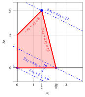{ .fig .ovale loading=lazy style="width:65%" }

    Una soluzione ottima ${ \tilde{\boldsymbol x}}(\, LP \,)$ è:

    $$
    \tilde{x}_1=\dfrac{3}{2},~~\tilde{x}_2=\dfrac{7}{2}
    $$

    il valore ottimo $z(\, LP\,)$ è $17.$

    In viola il primo e il secondo vertice esplorati dalla precedente esecuzione dell'algoritmo del simplesso rivisto (prima di raggiungere quello ottimo rappresentato in blu).

    In blu tratteggiato, le curve di livello della funzione obiettivo associate ai valori assunti nei tre vertici.

!!! esercizio "Esercizio 11.5: Algoritmo del simplesso rivisto (P4)"

    Consideriamo il seguente problema LP in forma canonica di massimo con $n=2$ variabili e $m=2$ vincoli:

    $$
    \begin{array}{rrrrrr}
    {\max} & {5}\, {x_1} & {+} & {3}\, {x_2} \\[2ex]
    \text{soggetto a} & {2}\, {x_1} & {+} & {x_2} & {\le} & {14} \\[2ex]
    & {x_1} & {+} & {8}\, {x_2} & {\le} & {32} \\[2ex]
    & {x_1,} &  & {x_2} & {\ge} & {0}
    \end{array}
    $$

    Introducendo le variabili di scarto, otteniamo il seguente problema LP in forma standard di massimo con $n+m=4$ variabili e $m=2$ vincoli:

    $$
    \begin{array}{rrrrrrrrrr}
    {\max} & {5}\, {x_1} & {+} & {3}\, {x_2} \\[2ex]
    \text{soggetto a} & {2}\, {x_1} & {+} & {x_2} & {+} & {x_3} &  &  & {=} & {14} \\[2ex]
    & {x_1} & {+} & {8}\, {x_2} &  &  & {+} & {x_4} & {=} & {32} \\[2ex]
    & {x_1,} &  & {x_2,} &  & {x_3,} &  & {x_4} & {\ge} & {0}
    \end{array}
    $$

    **Domande**

    - Eseguire l'algoritmo del simplesso rivisto per trovare una soluzione ottima di questo problema LP, utilizzando la regola di Bland per scegliere la colonna pivot e la riga pivot.

??? soluzione "Soluzione"

    Abbiamo:

    $$
    {\boldsymbol A}=
    \begin{pmatrix}
    2 & 1 & 1 & 0\\
    1 & 8 & 0 & 1
    \end{pmatrix}
    \quad
    {\boldsymbol b}=
    \begin{pmatrix}
    14\\
    32
    \end{pmatrix}
    \quad
    {\boldsymbol c}=
    \begin{pmatrix}
    5\\
    3\\
    0\\
    0
    \end{pmatrix}
    \quad
    {\boldsymbol x}=
    \begin{pmatrix}
    x_1 \\
    x_2 \\
    x_3 \\
    x_4
    \end{pmatrix}
    $$

    - <strong>Inizializzazione</strong>

        Poiché si tratta di un problema LP in forma standard ottenuto da un problema LP in forma canonica con $~{\boldsymbol b} \ge 0$ aggiungendo le variabili di scarto, la partizione $\pazocal{B}=\{3,4\}$ e $\pazocal{N}=\{1,2\}$ è associata alla seguente soluzione di base ammissibile:

        $$
        \begin{pmatrix}
        x_3 \\
        x_4
        \end{pmatrix}
        =
        \begin{pmatrix}
        14\\
        32
        \end{pmatrix}
        {\rm ~~~e~~~}
        \begin{pmatrix}
        x_1 \\
        x_2
        \end{pmatrix}
        =
        \begin{pmatrix}
        0\\
        0
        \end{pmatrix}
        $$

    - <strong>Iterazione 1</strong>

        Con $\pazocal{B}= \{3,~~4\}$ e $\pazocal{N}= \{1,~~2\}$, si ha:

        $$
        {\boldsymbol x}_{\pazocal{B}}=
        \begin{pmatrix}
        x_3 \\
        x_4
        \end{pmatrix} ~~
        {\boldsymbol A}_{\pazocal{B}}=
        \begin{pmatrix}
        1 & 0\\
        0 & 1
        \end{pmatrix} ~~
        {\boldsymbol c}_{\pazocal{B}}=
        \begin{pmatrix}
        0\\
        0
        \end{pmatrix} ~~
        {{ \bar{\boldsymbol b}}}=
        \begin{pmatrix}
        14\\
        32
        \end{pmatrix}
        $$

        $$
        {\boldsymbol x}_{\pazocal{N}}=
        \begin{pmatrix}
        x_1 \\
        x_2
        \end{pmatrix} ~~
        {\boldsymbol A}_{\pazocal{N}}=
        \begin{pmatrix}
        2 & 1\\
        1 & 8
        \end{pmatrix} ~~
        {\boldsymbol c}_{\pazocal{N}}=
        \begin{pmatrix}
        5\\
        3
        \end{pmatrix}
        $$

        <strong>Verifica di ottimalità</strong>

        Risolviamo ${\boldsymbol \pi} \; {\boldsymbol A}_{\pazocal{B}} = {\boldsymbol c}'_{\pazocal{B}}$ per calcolare ${\boldsymbol \pi} =  {{{\boldsymbol c}'_{\pazocal{B}} \; {\boldsymbol A}_{\pazocal{B}}^{-1}}}$, <u>primo sistema di equazioni lineari</u>:

        \begin{equation*}
        \begin{cases}
        \begin{array}{rrrrr}
        {\pi_3} &  &  & {=} & {0} \\[2ex]
        &  & {\pi_4} & {=} & {0}
        \end{array}
        \end{cases}
        \qquad
        {\boldsymbol \pi}=
        \begin{pmatrix}
        0 & 0\\
        \end{pmatrix}
        \end{equation*}

        Calcoliamo il valore della soluzione di base ammissibile ${\bar{z}} = {\boldsymbol \pi} \; {\boldsymbol b} = \begin{pmatrix} 0 & 0\\ \end{pmatrix} \begin{pmatrix} 14\\ 32 \end{pmatrix} = 0$

        Calcoliamo i costi ridotti ${{ \bar{\boldsymbol c}}'}  = {{\boldsymbol c}'_{\pazocal{N}} - {\boldsymbol \pi} \; {\boldsymbol A}_{\pazocal{N}}}$:

        $$
        {{ \bar{\boldsymbol c}}'}
        = \begin{pmatrix}
        5 & 3\\
        \end{pmatrix} - \begin{pmatrix}
        0 & 0\\
        \end{pmatrix} \begin{pmatrix}
        2 & 1\\
        1 & 8
        \end{pmatrix}
        =
        \underbrace{
        \begin{pmatrix}
        5 & 3\\
        \end{pmatrix}
        }_{{c_{1}~~~c_{2}}}
        -
        \underbrace{
        \begin{pmatrix}
        0 & 0\\
        \end{pmatrix}
        }_{{\boldsymbol \pi}\;{\boldsymbol A}_{1} ~~{\boldsymbol \pi}\;{\boldsymbol A}_{2}}
        =
        \underbrace{
        \begin{pmatrix}
        5 & 3\\
        \end{pmatrix}
        }_{{\bar{c}_{1}~~~\bar{c}_{2}}}
        $$

        Non tutti i costi ridotti sono non positivi, quindi eseguiamo un'operazione di pivot.

        <strong>Operazione di pivot</strong>

        Poiché ${c}_{1} > {\boldsymbol \pi} \;{\boldsymbol A}_{1}$, $x_1$ è la <u>colonna pivot</u> e si ha ${\boldsymbol A}_{1} = \begin{pmatrix} 2\\ 1 \end{pmatrix}$

        Risolviamo ${\boldsymbol A}_{\pazocal{B}} \; {\boldsymbol d} = {\boldsymbol A}_{1}$ per calcolare ${\boldsymbol d}={ {\boldsymbol A}_{\pazocal{B}}^{-1}} {\boldsymbol A}_{1}$, <u>secondo sistema di equazioni lineari</u>:

        \begin{equation*}
        \begin{cases}
        \begin{array}{rrrrr}
        {d_3} &  &  & {=} & {2} \\[2ex]
        &  & {d_4} & {=} & {1}
        \end{array}
        \end{cases}
        \qquad
        {\boldsymbol d}=
        \begin{pmatrix}
        2\\
        1
        \end{pmatrix}
        \end{equation*}

        Dobbiamo trovare il massimo $t$ tale che ${{ \bar{\boldsymbol b}}}  - t \; {{\boldsymbol d}} \ge 0$:

        $$
        \begin{cases}
        \underbrace{14 -t \cdot 2\ge 0}_{x_3 \ge 0} \\[2ex]
        \underbrace{32 -t \cdot 1\ge 0}_{x_4 \ge 0}
        \end{cases}
        \qquad
        \begin{cases}
        t\le 7 \\[2ex]
        t\le 32
        \end{cases}
        \text{   quindi   } t_{m}=7
        $$

        Di conseguenza il valore della colonna pivot diventa $t_{m}$, cioè $x_1=7$. Il valore di $x_3$ diventa zero e $x_3$ è la <u>riga pivot</u>. Le altre variabili di base assumono i valori ${ \bar{\boldsymbol b}} - t_{m} \; {\boldsymbol d}$, quindi si ha:

        $$
        x_4 = 32 - 7 \cdot 1 = 25
        $$

    - <strong>Iterazione 2</strong>

        Con $\pazocal{B}= \{1,~~4\}$ e $\pazocal{N}= \{2,~~3\}$, si ha:

        $$
        {\boldsymbol x}_{\pazocal{B}}=
        \begin{pmatrix}
        x_1 \\
        x_4
        \end{pmatrix} ~~
        {\boldsymbol A}_{\pazocal{B}}=
        \begin{pmatrix}
        2 & 0\\
        1 & 1
        \end{pmatrix} ~~
        {\boldsymbol c}_{\pazocal{B}}=
        \begin{pmatrix}
        5\\
        0
        \end{pmatrix} ~~
        {{ \bar{\boldsymbol b}}}=
        \begin{pmatrix}
        7\\
        25
        \end{pmatrix}
        $$

        $$
        {\boldsymbol x}_{\pazocal{N}}=
        \begin{pmatrix}
        x_2 \\
        x_3
        \end{pmatrix} ~~
        {\boldsymbol A}_{\pazocal{N}}=
        \begin{pmatrix}
        1 & 1\\
        8 & 0
        \end{pmatrix} ~~
        {\boldsymbol c}_{\pazocal{N}}=
        \begin{pmatrix}
        3\\
        0
        \end{pmatrix}
        $$

        <strong>Verifica di ottimalità</strong>

        Risolviamo ${\boldsymbol \pi} \; {\boldsymbol A}_{\pazocal{B}} = {\boldsymbol c}'_{\pazocal{B}}$ per calcolare ${\boldsymbol \pi} =  {{{\boldsymbol c}'_{\pazocal{B}} \; {\boldsymbol A}_{\pazocal{B}}^{-1}}}$, <u>primo sistema di equazioni lineari</u>:

        \begin{equation*}
        \begin{cases}
        \begin{array}{rrrrr}
        {2}\, {\pi_1} & {+} & {\pi_4} & {=} & {5} \\[2ex]
        &  & {\pi_4} & {=} & {0}
        \end{array}
        \end{cases}
        \qquad
        {\boldsymbol \pi}=
        \begin{pmatrix}
        \dfrac{5}{2} & 0\\
        \end{pmatrix}
        \end{equation*}

        Calcoliamo il valore della soluzione di base ammissibile ${\bar{z}} = {\boldsymbol \pi} \; {\boldsymbol b} = \begin{pmatrix} \dfrac{5}{2} & 0\\ \end{pmatrix} \begin{pmatrix} 14\\ 32 \end{pmatrix} = 35$

        Calcoliamo i costi ridotti ${{ \bar{\boldsymbol c}}'}  = {{\boldsymbol c}'_{\pazocal{N}} - {\boldsymbol \pi} \; {\boldsymbol A}_{\pazocal{N}}}$:

        $$
        {{ \bar{\boldsymbol c}}'}
        = \begin{pmatrix}
        3 & 0\\
        \end{pmatrix} - \begin{pmatrix}
        \dfrac{5}{2} & 0\\
        \end{pmatrix} \begin{pmatrix}
        1 & 1\\
        8 & 0
        \end{pmatrix}
        =
        \underbrace{
        \begin{pmatrix}
        3 & 0\\
        \end{pmatrix}
        }_{{c_{2}~~~c_{3}}}
        -
        \underbrace{
        \begin{pmatrix}
        \dfrac{5}{2} & \dfrac{5}{2}\\
        \end{pmatrix}
        }_{{\boldsymbol \pi}\;{\boldsymbol A}_{2} ~~{\boldsymbol \pi}\;{\boldsymbol A}_{3}}
        =
        \underbrace{
        \begin{pmatrix}
        \dfrac{1}{2} & -\dfrac{5}{2}\\
        \end{pmatrix}
        }_{{\bar{c}_{2}~~~\bar{c}_{3}}}
        $$

        Non tutti i costi ridotti sono non positivi, quindi eseguiamo un'operazione di pivot.

        <strong>Operazione di pivot</strong>

        Poiché ${c}_{2} > {\boldsymbol \pi} \;{\boldsymbol A}_{2}$, $x_2$ è la <u>colonna pivot</u> e si ha ${\boldsymbol A}_{2} = \begin{pmatrix} 1\\ 8 \end{pmatrix}$

        Risolviamo ${\boldsymbol A}_{\pazocal{B}} \; {\boldsymbol d} = {\boldsymbol A}_{2}$ per calcolare ${\boldsymbol d}={ {\boldsymbol A}_{\pazocal{B}}^{-1}} {\boldsymbol A}_{2}$, <u>secondo sistema di equazioni lineari</u>:

        \begin{equation*}
        \begin{cases}
        \begin{array}{rrrrr}
        {2}\, {d_1} &  &  & {=} & {1} \\[2ex]
        {d_1} & {+} & {d_4} & {=} & {8}
        \end{array}
        \end{cases}
        \qquad
        {\boldsymbol d}=
        \begin{pmatrix}
        \dfrac{1}{2}\\[2ex]
        \dfrac{15}{2}
        \end{pmatrix}
        \end{equation*}

        Dobbiamo trovare il massimo $t$ tale che ${{ \bar{\boldsymbol b}}}  - t \; {{\boldsymbol d}} \ge 0$:

        $$
        \begin{cases}
        \underbrace{7 -t \cdot \dfrac{1}{2}\ge 0}_{x_1 \ge 0} \\[2ex]
        \underbrace{25 -t \cdot \dfrac{15}{2}\ge 0}_{x_4 \ge 0}
        \end{cases}
        \qquad
        \begin{cases}
        t\le 14 \\[2ex]
        t\le \dfrac{10}{3}
        \end{cases}
        \text{   quindi   } t_{m}=\dfrac{10}{3}
        $$

        Di conseguenza il valore della colonna pivot diventa $t_{m}$, cioè $x_2=\dfrac{10}{3}$. Il valore di $x_4$ diventa zero e $x_4$ è la <u>riga pivot</u>. Le altre variabili di base assumono i valori ${ \bar{\boldsymbol b}} - t_{m} \; {\boldsymbol d}$, quindi si ha:

        $$
        x_1 = 7 - \dfrac{10}{3} \cdot \dfrac{1}{2} = \dfrac{16}{3}
        $$

    - <strong>Iterazione 3</strong>

        Con $\pazocal{B}= \{1,~~2\}$ e $\pazocal{N}= \{3,~~4\}$, si ha:

        $$
        {\boldsymbol x}_{\pazocal{B}}=
        \begin{pmatrix}
        x_1 \\
        x_2
        \end{pmatrix} ~~
        {\boldsymbol A}_{\pazocal{B}}=
        \begin{pmatrix}
        2 & 1\\
        1 & 8
        \end{pmatrix} ~~
        {\boldsymbol c}_{\pazocal{B}}=
        \begin{pmatrix}
        5\\
        3
        \end{pmatrix} ~~
        {{ \bar{\boldsymbol b}}}=
        \begin{pmatrix}
        \dfrac{16}{3}\\[2ex]
        \dfrac{10}{3}
        \end{pmatrix}
        $$

        $$
        {\boldsymbol x}_{\pazocal{N}}=
        \begin{pmatrix}
        x_3 \\
        x_4
        \end{pmatrix} ~~
        {\boldsymbol A}_{\pazocal{N}}=
        \begin{pmatrix}
        1 & 0\\
        0 & 1
        \end{pmatrix} ~~
        {\boldsymbol c}_{\pazocal{N}}=
        \begin{pmatrix}
        0\\
        0
        \end{pmatrix}
        $$

        <strong>Verifica di ottimalità</strong>

        Risolviamo ${\boldsymbol \pi} \; {\boldsymbol A}_{\pazocal{B}} = {\boldsymbol c}'_{\pazocal{B}}$ per calcolare ${\boldsymbol \pi} =  {{{\boldsymbol c}'_{\pazocal{B}} \; {\boldsymbol A}_{\pazocal{B}}^{-1}}}$, <u>primo sistema di equazioni lineari</u>:

        \begin{equation*}
        \begin{cases}
        \begin{array}{rrrrr}
        {2}\, {\pi_1} & {+} & {\pi_2} & {=} & {5} \\[2ex]
        {\pi_1} & {+} & {8}\, {\pi_2} & {=} & {3}
        \end{array}
        \end{cases}
        \qquad
        {\boldsymbol \pi}=
        \begin{pmatrix}
        \dfrac{37}{15} & \dfrac{1}{15}\\
        \end{pmatrix}
        \end{equation*}

        Calcoliamo il valore della soluzione di base ammissibile ${\bar{z}} = {\boldsymbol \pi} \; {\boldsymbol b} = \begin{pmatrix} \dfrac{37}{15} & \dfrac{1}{15}\\ \end{pmatrix} \begin{pmatrix} 14\\ 32 \end{pmatrix} = \dfrac{110}{3}$

        Calcoliamo i costi ridotti ${{ \bar{\boldsymbol c}}'}  = {{\boldsymbol c}'_{\pazocal{N}} - {\boldsymbol \pi} \; {\boldsymbol A}_{\pazocal{N}}}$:

        $$
        {{ \bar{\boldsymbol c}}'}
        = \begin{pmatrix}
        0 & 0\\
        \end{pmatrix} - \begin{pmatrix}
        \dfrac{37}{15} & \dfrac{1}{15}\\
        \end{pmatrix} \begin{pmatrix}
        1 & 0\\
        0 & 1
        \end{pmatrix}
        =
        \underbrace{
        \begin{pmatrix}
        0 & 0\\
        \end{pmatrix}
        }_{{c_{3}~~~c_{4}}}
        -
        \underbrace{
        \begin{pmatrix}
        \dfrac{37}{15} & \dfrac{1}{15}\\
        \end{pmatrix}
        }_{{\boldsymbol \pi}\;{\boldsymbol A}_{3} ~~{\boldsymbol \pi}\;{\boldsymbol A}_{4}}
        =
        \underbrace{
        \begin{pmatrix}
        -\dfrac{37}{15} & -\dfrac{1}{15}\\
        \end{pmatrix}
        }_{{\bar{c}_{3}~~~\bar{c}_{4}}}
        $$

        Tutti i costi ridotti sono non positivi, quindi la soluzione di base ammissibile

        $$
        {\boldsymbol x}_{\pazocal{B}}=
        \begin{pmatrix}
        x_1 \\
        x_2
        \end{pmatrix}=\begin{pmatrix}
        \dfrac{16}{3}\\[2ex]
        \dfrac{10}{3}
        \end{pmatrix} {\rm ~~~e~~~} {\boldsymbol x}_{\pazocal{N}}=
        \begin{pmatrix}
        x_3 \\
        x_4
        \end{pmatrix}=\begin{pmatrix}
        0\\
        0
        \end{pmatrix}
        $$

        è una soluzione ottima del problema LP e ${\bar{z}} = \dfrac{110}{3}$ è il valore della soluzione ottima.

    <strong>Soluzione grafica:</strong>

    La regione ammissibile del problema LP (in forma canonica) è il poliedro colorato in rosso: 

    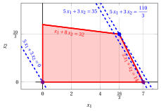{ .fig .ovale loading=lazy style="width:82%" }

    Una soluzione ottima ${ \tilde{\boldsymbol x}}(\, LP\,)$ è:

    $$
    \tilde{x}_1=\dfrac{16}{3},~~\tilde{x}_2=\dfrac{10}{3}
    $$

    il valore ottimo $z(\, LP\,)$ è $\dfrac{110}{3}.$

    In viola il primo e il secondo vertice esplorati dalla precedente esecuzione dell'algoritmo del simplesso rivisto (prima di raggiungere quello ottimo rappresentato in blu).

    In blu tratteggiato, le curve di livello della funzione obiettivo associate ai valori assunti nei tre vertici.

!!! esercizio "Esercizio 11.6: Algoritmo del simplesso rivisto (P5)"

    Consideriamo il seguente problema LP in forma canonica di massimo con $n=2$ variabili e $m=2$ vincoli:

    $$
    \begin{array}{rrrrrr}
    {\max} & {2}\, {x_1} & {+} & {3}\, {x_2} \\[2ex]
    \text{soggetto a} & {6}\, {x_1} & {+} & {21}\, {x_2} & {\le} & {77} \\[2ex]
    & {8}\, {x_1} & {+} & {3}\, {x_2} & {\le} & {36} \\[2ex]
    & {x_1,} &  & {x_2} & {\ge} & {0}
    \end{array}
    $$

    Introducendo le variabili di scarto, otteniamo il seguente problema LP in forma standard di massimo con $n+m=4$ variabili e $m=2$ vincoli:

    $$
    \begin{array}{rrrrrrrrrr}
    {\max} & {2}\, {x_1} & {+} & {3}\, {x_2} \\[2ex]
    \text{soggetto a} & {6}\, {x_1} & {+} & {21}\, {x_2} & {+} & {x_3} &  &  & {=} & {77} \\[2ex]
    & {8}\, {x_1} & {+} & {3}\, {x_2} &  &  & {+} & {x_4} & {=} & {36} \\[2ex]
    & {x_1,} &  & {x_2,} &  & {x_3,} &  & {x_4} & {\ge} & {0}
    \end{array}
    $$

    **Domande**

    - Eseguire l'algoritmo del simplesso rivisto per trovare una soluzione ottima di questo problema LP, utilizzando la regola di Bland per scegliere la colonna pivot e la riga pivot.

??? soluzione "Soluzione"

    Abbiamo:

    $$
    {\boldsymbol A}=
    \begin{pmatrix}
    6 & 21 & 1 & 0\\
    8 & 3 & 0 & 1
    \end{pmatrix}
    \quad
    {\boldsymbol b}=
    \begin{pmatrix}
    77\\
    36
    \end{pmatrix}
    \quad
    {\boldsymbol c}=
    \begin{pmatrix}
    2\\
    3\\
    0\\
    0
    \end{pmatrix}
    \quad
    {\boldsymbol x}=
    \begin{pmatrix}
    x_1 \\
    x_2 \\
    x_3 \\
    x_4
    \end{pmatrix}
    $$

    - <strong>Inizializzazione</strong>

        Poiché si tratta di un problema LP in forma standard ottenuto da un problema LP in forma canonica con $~{\boldsymbol b} \ge 0$ aggiungendo le variabili di scarto, la partizione $\pazocal{B}=\{3,4\}$ e $\pazocal{N}=\{1,2\}$ è associata alla seguente soluzione di base ammissibile:

        $$
        \begin{pmatrix}
        x_3 \\
        x_4
        \end{pmatrix}
        =
        \begin{pmatrix}
        77\\
        36
        \end{pmatrix}
        {\rm ~~~e~~~}
        \begin{pmatrix}
        x_1 \\
        x_2
        \end{pmatrix}
        =
        \begin{pmatrix}
        0\\
        0
        \end{pmatrix}
        $$

    - <strong>Iterazione 1</strong>

        Con $\pazocal{B}= \{3,~~4\}$ e $\pazocal{N}= \{1,~~2\}$, si ha:

        $$
        {\boldsymbol x}_{\pazocal{B}}=
        \begin{pmatrix}
        x_3 \\
        x_4
        \end{pmatrix} ~~
        {\boldsymbol A}_{\pazocal{B}}=
        \begin{pmatrix}
        1 & 0\\
        0 & 1
        \end{pmatrix} ~~
        {\boldsymbol c}_{\pazocal{B}}=
        \begin{pmatrix}
        0\\
        0
        \end{pmatrix} ~~
        {{ \bar{\boldsymbol b}}}=
        \begin{pmatrix}
        77\\
        36
        \end{pmatrix}
        $$

        $$
        {\boldsymbol x}_{\pazocal{N}}=
        \begin{pmatrix}
        x_1 \\
        x_2
        \end{pmatrix} ~~
        {\boldsymbol A}_{\pazocal{N}}=
        \begin{pmatrix}
        6 & 21\\
        8 & 3
        \end{pmatrix} ~~
        {\boldsymbol c}_{\pazocal{N}}=
        \begin{pmatrix}
        2\\
        3
        \end{pmatrix}
        $$

        <strong>Verifica di ottimalità</strong>

        Risolviamo ${\boldsymbol \pi} \; {\boldsymbol A}_{\pazocal{B}} = {\boldsymbol c}'_{\pazocal{B}}$ per calcolare ${\boldsymbol \pi} =  {{{\boldsymbol c}'_{\pazocal{B}} \; {\boldsymbol A}_{\pazocal{B}}^{-1}}}$, <u>primo sistema di equazioni lineari</u>:

        \begin{equation*}
        \begin{cases}
        \begin{array}{rrrrr}
        {\pi_3} &  &  & {=} & {0} \\[2ex]
        &  & {\pi_4} & {=} & {0}
        \end{array}
        \end{cases}
        \qquad
        {\boldsymbol \pi}=
        \begin{pmatrix}
        0 & 0\\
        \end{pmatrix}
        \end{equation*}

        Calcoliamo il valore della soluzione di base ammissibile ${\bar{z}} = {\boldsymbol \pi} \; {\boldsymbol b} = \begin{pmatrix} 0 & 0\\ \end{pmatrix} \begin{pmatrix} 77\\ 36 \end{pmatrix} = 0$

        Calcoliamo i costi ridotti ${{ \bar{\boldsymbol c}}'}  = {{\boldsymbol c}'_{\pazocal{N}} - {\boldsymbol \pi} \; {\boldsymbol A}_{\pazocal{N}}}$:

        $$
        {{ \bar{\boldsymbol c}}'}
        = \begin{pmatrix}
        2 & 3\\
        \end{pmatrix} - \begin{pmatrix}
        0 & 0\\
        \end{pmatrix} \begin{pmatrix}
        6 & 21\\
        8 & 3
        \end{pmatrix}
        =
        \underbrace{
        \begin{pmatrix}
        2 & 3\\
        \end{pmatrix}
        }_{{c_{1}~~~c_{2}}}
        -
        \underbrace{
        \begin{pmatrix}
        0 & 0\\
        \end{pmatrix}
        }_{{\boldsymbol \pi}\;{\boldsymbol A}_{1} ~~{\boldsymbol \pi}\;{\boldsymbol A}_{2}}
        =
        \underbrace{
        \begin{pmatrix}
        2 & 3\\
        \end{pmatrix}
        }_{{\bar{c}_{1}~~~\bar{c}_{2}}}
        $$

        Non tutti i costi ridotti sono non positivi, quindi eseguiamo un'operazione di pivot.

        <strong>Operazione di pivot</strong>

        Poiché ${c}_{1} > {\boldsymbol \pi} \;{\boldsymbol A}_{1}$, $x_1$ è la <u>colonna pivot</u> e si ha ${\boldsymbol A}_{1} = \begin{pmatrix} 6\\ 8 \end{pmatrix}$

        Risolviamo ${\boldsymbol A}_{\pazocal{B}} \; {\boldsymbol d} = {\boldsymbol A}_{1}$ per calcolare ${\boldsymbol d}={ {\boldsymbol A}_{\pazocal{B}}^{-1}} {\boldsymbol A}_{1}$, <u>secondo sistema di equazioni lineari</u>:

        \begin{equation*}
        \begin{cases}
        \begin{array}{rrrrr}
        {d_3} &  &  & {=} & {6} \\[2ex]
        &  & {d_4} & {=} & {8}
        \end{array}
        \end{cases}
        \qquad
        {\boldsymbol d}=
        \begin{pmatrix}
        6\\
        8
        \end{pmatrix}
        \end{equation*}

        Dobbiamo trovare il massimo $t$ tale che ${{ \bar{\boldsymbol b}}}  - t \; {{\boldsymbol d}} \ge 0$:

        $$
        \begin{cases}
        \underbrace{77 -t \cdot 6\ge 0}_{x_3 \ge 0} \\[2ex]
        \underbrace{36 -t \cdot 8\ge 0}_{x_4 \ge 0}
        \end{cases}
        \qquad
        \begin{cases}
        t\le \dfrac{77}{6} \\[2ex]
        t\le \dfrac{9}{2}
        \end{cases}
        \text{   quindi   } t_{m}=\dfrac{9}{2}
        $$

        Di conseguenza il valore della colonna pivot diventa $t_{m}$, cioè $x_1=\dfrac{9}{2}$. Il valore di $x_4$ diventa zero e $x_4$ è la <u>riga pivot</u>. Le altre variabili di base assumono i valori ${ \bar{\boldsymbol b}} - t_{m} \; {\boldsymbol d}$, quindi si ha:

        $$
        x_3 = 77 - \dfrac{9}{2} \cdot 6 = 50
        $$

    - <strong>Iterazione 2</strong>

        Con $\pazocal{B}= \{1,~~3\}$ e $\pazocal{N}= \{2,~~4\}$, si ha:

        $$
        {\boldsymbol x}_{\pazocal{B}}=
        \begin{pmatrix}
        x_1 \\
        x_3
        \end{pmatrix} ~~
        {\boldsymbol A}_{\pazocal{B}}=
        \begin{pmatrix}
        6 & 1\\
        8 & 0
        \end{pmatrix} ~~
        {\boldsymbol c}_{\pazocal{B}}=
        \begin{pmatrix}
        2\\
        0
        \end{pmatrix} ~~
        {{ \bar{\boldsymbol b}}}=
        \begin{pmatrix}
        \dfrac{9}{2}\\[2ex]
        50
        \end{pmatrix}
        $$

        $$
        {\boldsymbol x}_{\pazocal{N}}=
        \begin{pmatrix}
        x_2 \\
        x_4
        \end{pmatrix} ~~
        {\boldsymbol A}_{\pazocal{N}}=
        \begin{pmatrix}
        21 & 0\\
        3 & 1
        \end{pmatrix} ~~
        {\boldsymbol c}_{\pazocal{N}}=
        \begin{pmatrix}
        3\\
        0
        \end{pmatrix}
        $$

        <strong>Verifica di ottimalità</strong>

        Risolviamo ${\boldsymbol \pi} \; {\boldsymbol A}_{\pazocal{B}} = {\boldsymbol c}'_{\pazocal{B}}$ per calcolare ${\boldsymbol \pi} =  {{{\boldsymbol c}'_{\pazocal{B}} \; {\boldsymbol A}_{\pazocal{B}}^{-1}}}$, <u>primo sistema di equazioni lineari</u>:

        \begin{equation*}
        \begin{cases}
        \begin{array}{rrrrr}
        {6}\, {\pi_1} & {+} & {8}\, {\pi_3} & {=} & {2} \\[2ex]
        {\pi_1} &  &  & {=} & {0}
        \end{array}
        \end{cases}
        \qquad
        {\boldsymbol \pi}=
        \begin{pmatrix}
        0 & \dfrac{1}{4}\\
        \end{pmatrix}
        \end{equation*}

        Calcoliamo il valore della soluzione di base ammissibile ${\bar{z}} = {\boldsymbol \pi} \; {\boldsymbol b} = \begin{pmatrix} 0 & \dfrac{1}{4}\\ \end{pmatrix} \begin{pmatrix} 77\\ 36 \end{pmatrix} = 9$

        Calcoliamo i costi ridotti ${{ \bar{\boldsymbol c}}'}  = {{\boldsymbol c}'_{\pazocal{N}} - {\boldsymbol \pi} \; {\boldsymbol A}_{\pazocal{N}}}$:

        $$
        {{ \bar{\boldsymbol c}}'}
        = \begin{pmatrix}
        3 & 0\\
        \end{pmatrix} - \begin{pmatrix}
        0 & \dfrac{1}{4}\\
        \end{pmatrix} \begin{pmatrix}
        21 & 0\\
        3 & 1
        \end{pmatrix}
        =
        \underbrace{
        \begin{pmatrix}
        3 & 0\\
        \end{pmatrix}
        }_{{c_{2}~~~c_{4}}}
        -
        \underbrace{
        \begin{pmatrix}
        \dfrac{3}{4} & \dfrac{1}{4}\\
        \end{pmatrix}
        }_{{\boldsymbol \pi}\;{\boldsymbol A}_{2} ~~{\boldsymbol \pi}\;{\boldsymbol A}_{4}}
        =
        \underbrace{
        \begin{pmatrix}
        \dfrac{9}{4} & -\dfrac{1}{4}\\
        \end{pmatrix}
        }_{{\bar{c}_{2}~~~\bar{c}_{4}}}
        $$

        Non tutti i costi ridotti sono non positivi, quindi eseguiamo un'operazione di pivot.

        <strong>Operazione di pivot</strong>

        Poiché ${c}_{2} > {\boldsymbol \pi} \;{\boldsymbol A}_{2}$, $x_2$ è la <u>colonna pivot</u> e si ha ${\boldsymbol A}_{2} = \begin{pmatrix} 21\\ 3 \end{pmatrix}$

        Risolviamo ${\boldsymbol A}_{\pazocal{B}} \; {\boldsymbol d} = {\boldsymbol A}_{2}$ per calcolare ${\boldsymbol d}={ {\boldsymbol A}_{\pazocal{B}}^{-1}} {\boldsymbol A}_{2}$, <u>secondo sistema di equazioni lineari</u>:

        \begin{equation*}
        \begin{cases}
        \begin{array}{rrrrr}
        {6}\, {d_1} & {+} & {d_3} & {=} & {21} \\[2ex]
        {8}\, {d_1} &  &  & {=} & {3}
        \end{array}
        \end{cases}
        \qquad
        {\boldsymbol d}=
        \begin{pmatrix}
        \dfrac{3}{8}\\[2ex]
        \dfrac{75}{4}
        \end{pmatrix}
        \end{equation*}

        Dobbiamo trovare il massimo $t$ tale che ${{ \bar{\boldsymbol b}}}  - t \; {{\boldsymbol d}} \ge 0$:

        $$
        \begin{cases}
        \underbrace{\dfrac{9}{2} -t \cdot \dfrac{3}{8}\ge 0}_{x_1 \ge 0} \\[2ex]
        \underbrace{50 -t \cdot \dfrac{75}{4}\ge 0}_{x_3 \ge 0}
        \end{cases}
        \qquad
        \begin{cases}
        t\le 12 \\[2ex]
        t\le \dfrac{8}{3}
        \end{cases}
        \text{   quindi   } t_{m}=\dfrac{8}{3}
        $$

        Di conseguenza il valore della colonna pivot diventa $t_{m}$, cioè $x_2=\dfrac{8}{3}$. Il valore di $x_3$ diventa zero e $x_3$ è la <u>riga pivot</u>. Le altre variabili di base assumono i valori ${ \bar{\boldsymbol b}} - t_{m} \; {\boldsymbol d}$, quindi si ha:

        $$
        x_1 = \dfrac{9}{2} - \dfrac{8}{3} \cdot \dfrac{3}{8} = \dfrac{7}{2}
        $$

    - <strong>Iterazione 3</strong>

        Con $\pazocal{B}= \{1,~~2\}$ e $\pazocal{N}= \{3,~~4\}$, si ha:

        $$
        {\boldsymbol x}_{\pazocal{B}}=
        \begin{pmatrix}
        x_1 \\
        x_2
        \end{pmatrix} ~~
        {\boldsymbol A}_{\pazocal{B}}=
        \begin{pmatrix}
        6 & 21\\
        8 & 3
        \end{pmatrix} ~~
        {\boldsymbol c}_{\pazocal{B}}=
        \begin{pmatrix}
        2\\
        3
        \end{pmatrix} ~~
        {{ \bar{\boldsymbol b}}}=
        \begin{pmatrix}
        \dfrac{7}{2}\\[2ex]
        \dfrac{8}{3}
        \end{pmatrix}
        $$

        $$
        {\boldsymbol x}_{\pazocal{N}}=
        \begin{pmatrix}
        x_3 \\
        x_4
        \end{pmatrix} ~~
        {\boldsymbol A}_{\pazocal{N}}=
        \begin{pmatrix}
        1 & 0\\
        0 & 1
        \end{pmatrix} ~~
        {\boldsymbol c}_{\pazocal{N}}=
        \begin{pmatrix}
        0\\
        0
        \end{pmatrix}
        $$

        <strong>Verifica di ottimalità</strong>

        Risolviamo ${\boldsymbol \pi} \; {\boldsymbol A}_{\pazocal{B}} = {\boldsymbol c}'_{\pazocal{B}}$ per calcolare ${\boldsymbol \pi} =  {{{\boldsymbol c}'_{\pazocal{B}} \; {\boldsymbol A}_{\pazocal{B}}^{-1}}}$, <u>primo sistema di equazioni lineari</u>:

        \begin{equation*}
        \begin{cases}
        \begin{array}{rrrrr}
        {6}\, {\pi_1} & {+} & {8}\, {\pi_2} & {=} & {2} \\[2ex]
        {21}\, {\pi_1} & {+} & {3}\, {\pi_2} & {=} & {3}
        \end{array}
        \end{cases}
        \qquad
        {\boldsymbol \pi}=
        \begin{pmatrix}
        \dfrac{3}{25} & \dfrac{4}{25}\\
        \end{pmatrix}
        \end{equation*}

        Calcoliamo il valore della soluzione di base ammissibile ${\bar{z}} = {\boldsymbol \pi} \; {\boldsymbol b} = \begin{pmatrix} \dfrac{3}{25} & \dfrac{4}{25}\\ \end{pmatrix} \begin{pmatrix} 77\\ 36 \end{pmatrix} = 15$

        Calcoliamo i costi ridotti ${{ \bar{\boldsymbol c}}'}  = {{\boldsymbol c}'_{\pazocal{N}} - {\boldsymbol \pi} \; {\boldsymbol A}_{\pazocal{N}}}$:

        $$
        {{ \bar{\boldsymbol c}}'}
        = \begin{pmatrix}
        0 & 0\\
        \end{pmatrix} - \begin{pmatrix}
        \dfrac{3}{25} & \dfrac{4}{25}\\
        \end{pmatrix} \begin{pmatrix}
        1 & 0\\
        0 & 1
        \end{pmatrix}
        =
        \underbrace{
        \begin{pmatrix}
        0 & 0\\
        \end{pmatrix}
        }_{{c_{3}~~~c_{4}}}
        -
        \underbrace{
        \begin{pmatrix}
        \dfrac{3}{25} & \dfrac{4}{25}\\
        \end{pmatrix}
        }_{{\boldsymbol \pi}\;{\boldsymbol A}_{3} ~~{\boldsymbol \pi}\;{\boldsymbol A}_{4}}
        =
        \underbrace{
        \begin{pmatrix}
        -\dfrac{3}{25} & -\dfrac{4}{25}\\
        \end{pmatrix}
        }_{{\bar{c}_{3}~~~\bar{c}_{4}}}
        $$

        Tutti i costi ridotti sono non positivi, quindi la soluzione di base ammissibile

        $$
        {\boldsymbol x}_{\pazocal{B}}=
        \begin{pmatrix}
        x_1 \\
        x_2
        \end{pmatrix}=\begin{pmatrix}
        \dfrac{7}{2}\\[2ex]
        \dfrac{8}{3}
        \end{pmatrix} {\rm ~~~e~~~} {\boldsymbol x}_{\pazocal{N}}=
        \begin{pmatrix}
        x_3 \\
        x_4
        \end{pmatrix}=\begin{pmatrix}
        0\\
        0
        \end{pmatrix}
        $$

        è una soluzione ottima del problema LP e ${\bar{z}} = 15$ è il valore della soluzione ottima.

    <strong>Soluzione grafica:</strong>

    La regione ammissibile del problema LP (in forma canonica) è il poliedro colorato in rosso: 

    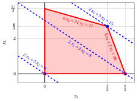{ .fig .ovale loading=lazy style="width:76%" }

    Una soluzione ottima ${ \tilde{\boldsymbol x}}(\,LP\,)$ è:

    $$
    \tilde{x}_1=\dfrac{7}{2},~~\tilde{x}_2=\dfrac{8}{3}
    $$

    il valore ottimo $z(\, LP\,)$ è $15.$

    In viola il primo e il secondo vertice esplorati dalla precedente esecuzione dell'algoritmo del simplesso rivisto (prima di raggiungere quello ottimo rappresentato in blu).

    In blu tratteggiato, le curve di livello della funzione obiettivo associate ai valori assunti nei tre vertici.

!!! esercizio "Esercizio 11.7: Algoritmo del simplesso rivisto (P6)"

    Consideriamo il seguente problema LP in forma canonica di massimo con $n=2$ variabili e $m=2$ vincoli:

    $$
    \begin{array}{rrrrrr}
    {\max} & {x_1} & {+} & {x_2} \\[2ex]
    \text{soggetto a} & {4}\, {x_1} & {+} & {15}\, {x_2} & {\le} & {70} \\[2ex]
    & {12}\, {x_1} & {+} & {3}\, {x_2} & {\le} & {52} \\[2ex]
    & {x_1,} &  & {x_2} & {\ge} & {0}
    \end{array}
    $$

    Introducendo le variabili di scarto, otteniamo il seguente problema LP in forma standard di massimo con $n+m=4$ variabili e $m=2$ vincoli:

    $$
    \begin{array}{rrrrrrrrrr}
    {\max} & {x_1} & {+} & {x_2} \\[2ex]
    \text{soggetto a} & {4}\, {x_1} & {+} & {15}\, {x_2} & {+} & {x_3} &  &  & {=} & {70} \\[2ex]
    & {12}\, {x_1} & {+} & {3}\, {x_2} &  &  & {+} & {x_4} & {=} & {52} \\[2ex]
    & {x_1,} &  & {x_2,} &  & {x_3,} &  & {x_4} & {\ge} & {0}
    \end{array}
    $$

    **Domande**

    - Eseguire l'algoritmo del simplesso rivisto per trovare una soluzione ottima di questo problema LP, utilizzando la regola di Bland per scegliere la colonna pivot e la riga pivot.

??? soluzione "Soluzione"

    Abbiamo:

    $$
    {\boldsymbol A}=
    \begin{pmatrix}
    4 & 15 & 1 & 0\\
    12 & 3 & 0 & 1
    \end{pmatrix}
    \quad
    {\boldsymbol b}=
    \begin{pmatrix}
    70\\
    52
    \end{pmatrix}
    \quad
    {\boldsymbol c}=
    \begin{pmatrix}
    1\\
    1\\
    0\\
    0
    \end{pmatrix}
    \quad
    {\boldsymbol x}=
    \begin{pmatrix}
    x_1 \\
    x_2 \\
    x_3 \\
    x_4
    \end{pmatrix}
    $$

    - <strong>Inizializzazione</strong>

        Poiché si tratta di un problema LP in forma standard ottenuto da un problema LP in forma canonica con $~{\boldsymbol b} \ge 0$ aggiungendo le variabili di scarto, la partizione $\pazocal{B}=\{3,4\}$ e $\pazocal{N}=\{1,2\}$ è associata alla seguente soluzione di base ammissibile:

        $$
        \begin{pmatrix}
        x_3 \\
        x_4
        \end{pmatrix}
        =
        \begin{pmatrix}
        70\\
        52
        \end{pmatrix}
        {\rm ~~~e~~~}
        \begin{pmatrix}
        x_1 \\
        x_2
        \end{pmatrix}
        =
        \begin{pmatrix}
        0\\
        0
        \end{pmatrix}
        $$

    - <strong>Iterazione 1</strong>

        Con $\pazocal{B}= \{3,~~4\}$ e $\pazocal{N}= \{1,~~2\}$, si ha:

        $$
        {\boldsymbol x}_{\pazocal{B}}=
        \begin{pmatrix}
        x_3 \\
        x_4
        \end{pmatrix} ~~
        {\boldsymbol A}_{\pazocal{B}}=
        \begin{pmatrix}
        1 & 0\\
        0 & 1
        \end{pmatrix} ~~
        {\boldsymbol c}_{\pazocal{B}}=
        \begin{pmatrix}
        0\\
        0
        \end{pmatrix} ~~
        {{ \bar{\boldsymbol b}}}=
        \begin{pmatrix}
        70\\
        52
        \end{pmatrix}
        $$

        $$
        {\boldsymbol x}_{\pazocal{N}}=
        \begin{pmatrix}
        x_1 \\
        x_2
        \end{pmatrix} ~~
        {\boldsymbol A}_{\pazocal{N}}=
        \begin{pmatrix}
        4 & 15\\
        12 & 3
        \end{pmatrix} ~~
        {\boldsymbol c}_{\pazocal{N}}=
        \begin{pmatrix}
        1\\
        1
        \end{pmatrix}
        $$

        <strong>Verifica di ottimalità</strong>

        Risolviamo ${\boldsymbol \pi} \; {\boldsymbol A}_{\pazocal{B}} = {\boldsymbol c}'_{\pazocal{B}}$ per calcolare ${\boldsymbol \pi} =  {{{\boldsymbol c}'_{\pazocal{B}} \; {\boldsymbol A}_{\pazocal{B}}^{-1}}}$, <u>primo sistema di equazioni lineari</u>:

        \begin{equation*}
        \begin{cases}
        \begin{array}{rrrrr}
        {\pi_3} &  &  & {=} & {0} \\[2ex]
        &  & {\pi_4} & {=} & {0}
        \end{array}
        \end{cases}
        \qquad
        {\boldsymbol \pi}=
        \begin{pmatrix}
        0 & 0\\
        \end{pmatrix}
        \end{equation*}

        Calcoliamo il valore della soluzione di base ammissibile ${\bar{z}} = {\boldsymbol \pi} \; {\boldsymbol b} = \begin{pmatrix} 0 & 0\\ \end{pmatrix} \begin{pmatrix} 70\\ 52 \end{pmatrix} = 0$

        Calcoliamo i costi ridotti ${{ \bar{\boldsymbol c}}'}  = {{\boldsymbol c}'_{\pazocal{N}} - {\boldsymbol \pi} \; {\boldsymbol A}_{\pazocal{N}}}$:

        $$
        {{ \bar{\boldsymbol c}}'}
        = \begin{pmatrix}
        1 & 1\\
        \end{pmatrix} - \begin{pmatrix}
        0 & 0\\
        \end{pmatrix} \begin{pmatrix}
        4 & 15\\
        12 & 3
        \end{pmatrix}
        =
        \underbrace{
        \begin{pmatrix}
        1 & 1\\
        \end{pmatrix}
        }_{{c_{1}~~~c_{2}}}
        -
        \underbrace{
        \begin{pmatrix}
        0 & 0\\
        \end{pmatrix}
        }_{{\boldsymbol \pi}\;{\boldsymbol A}_{1} ~~{\boldsymbol \pi}\;{\boldsymbol A}_{2}}
        =
        \underbrace{
        \begin{pmatrix}
        1 & 1\\
        \end{pmatrix}
        }_{{\bar{c}_{1}~~~\bar{c}_{2}}}
        $$

        Non tutti i costi ridotti sono non positivi, quindi eseguiamo un'operazione di pivot.

        <strong>Operazione di pivot</strong>

        Poiché ${c}_{1} > {\boldsymbol \pi} \;{\boldsymbol A}_{1}$, $x_1$ è la <u>colonna pivot</u> e si ha ${\boldsymbol A}_{1} = \begin{pmatrix} 4\\ 12 \end{pmatrix}$

        Risolviamo ${\boldsymbol A}_{\pazocal{B}} \; {\boldsymbol d} = {\boldsymbol A}_{1}$ per calcolare ${\boldsymbol d}={ {\boldsymbol A}_{\pazocal{B}}^{-1}} {\boldsymbol A}_{1}$, <u>secondo sistema di equazioni lineari</u>:

        \begin{equation*}
        \begin{cases}
        \begin{array}{rrrrr}
        {d_3} &  &  & {=} & {4} \\[2ex]
        &  & {d_4} & {=} & {12}
        \end{array}
        \end{cases}
        \qquad
        {\boldsymbol d}=
        \begin{pmatrix}
        4\\
        12
        \end{pmatrix}
        \end{equation*}

        Dobbiamo trovare il massimo $t$ tale che ${{ \bar{\boldsymbol b}}}  - t \; {{\boldsymbol d}} \ge 0$:

        $$
        \begin{cases}
        \underbrace{70 -t \cdot 4\ge 0}_{x_3 \ge 0} \\[2ex]
        \underbrace{52 -t \cdot 12\ge 0}_{x_4 \ge 0}
        \end{cases}
        \qquad
        \begin{cases}
        t\le \dfrac{35}{2} \\[2ex]
        t\le \dfrac{13}{3}
        \end{cases}
        \text{   quindi   } t_{m}=\dfrac{13}{3}
        $$

        Di conseguenza il valore della colonna pivot diventa $t_{m}$, cioè $x_1=\dfrac{13}{3}$. Il valore di $x_4$ diventa zero e $x_4$ è la <u>riga pivot</u>. Le altre variabili di base assumono i valori ${ \bar{\boldsymbol b}} - t_{m} \; {\boldsymbol d}$, quindi si ha:

        $$
        x_3 = 70 - \dfrac{13}{3} \cdot 4 = \dfrac{158}{3}
        $$

    - <strong>Iterazione 2</strong>

        Con $\pazocal{B}= \{1,~~3\}$ e $\pazocal{N}= \{2,~~4\}$, si ha:

        $$
        {\boldsymbol x}_{\pazocal{B}}=
        \begin{pmatrix}
        x_1 \\
        x_3
        \end{pmatrix} ~~
        {\boldsymbol A}_{\pazocal{B}}=
        \begin{pmatrix}
        4 & 1\\
        12 & 0
        \end{pmatrix} ~~
        {\boldsymbol c}_{\pazocal{B}}=
        \begin{pmatrix}
        1\\
        0
        \end{pmatrix} ~~
        {{ \bar{\boldsymbol b}}}=
        \begin{pmatrix}
        \dfrac{13}{3}\\[2ex]
        \dfrac{158}{3}
        \end{pmatrix}
        $$

        $$
        {\boldsymbol x}_{\pazocal{N}}=
        \begin{pmatrix}
        x_2 \\
        x_4
        \end{pmatrix} ~~
        {\boldsymbol A}_{\pazocal{N}}=
        \begin{pmatrix}
        15 & 0\\
        3 & 1
        \end{pmatrix} ~~
        {\boldsymbol c}_{\pazocal{N}}=
        \begin{pmatrix}
        1\\
        0
        \end{pmatrix}
        $$

        <strong>Verifica di ottimalità</strong>

        Risolviamo ${\boldsymbol \pi} \; {\boldsymbol A}_{\pazocal{B}} = {\boldsymbol c}'_{\pazocal{B}}$ per calcolare ${\boldsymbol \pi} =  {{{\boldsymbol c}'_{\pazocal{B}} \; {\boldsymbol A}_{\pazocal{B}}^{-1}}}$, <u>primo sistema di equazioni lineari</u>:

        \begin{equation*}
        \begin{cases}
        \begin{array}{rrrrr}
        {4}\, {\pi_1} & {+} & {12}\, {\pi_3} & {=} & {1} \\[2ex]
        {\pi_1} &  &  & {=} & {0}
        \end{array}
        \end{cases}
        \qquad
        {\boldsymbol \pi}=
        \begin{pmatrix}
        0 & \dfrac{1}{12}\\
        \end{pmatrix}
        \end{equation*}

        Calcoliamo il valore della soluzione di base ammissibile ${\bar{z}} = {\boldsymbol \pi} \; {\boldsymbol b} = \begin{pmatrix} 0 & \dfrac{1}{12}\\ \end{pmatrix} \begin{pmatrix} 70\\ 52 \end{pmatrix} = \dfrac{13}{3}$

        Calcoliamo i costi ridotti ${{ \bar{\boldsymbol c}}'}  = {{\boldsymbol c}'_{\pazocal{N}} - {\boldsymbol \pi} \; {\boldsymbol A}_{\pazocal{N}}}$:

        $$
        {{ \bar{\boldsymbol c}}'}
        = \begin{pmatrix}
        1 & 0\\
        \end{pmatrix} - \begin{pmatrix}
        0 & \dfrac{1}{12}\\
        \end{pmatrix} \begin{pmatrix}
        15 & 0\\
        3 & 1
        \end{pmatrix}
        =
        \underbrace{
        \begin{pmatrix}
        1 & 0\\
        \end{pmatrix}
        }_{{c_{2}~~~c_{4}}}
        -
        \underbrace{
        \begin{pmatrix}
        \dfrac{1}{4} & \dfrac{1}{12}\\
        \end{pmatrix}
        }_{{\boldsymbol \pi}\;{\boldsymbol A}_{2} ~~{\boldsymbol \pi}\;{\boldsymbol A}_{4}}
        =
        \underbrace{
        \begin{pmatrix}
        \dfrac{3}{4} & -\dfrac{1}{12}\\
        \end{pmatrix}
        }_{{\bar{c}_{2}~~~\bar{c}_{4}}}
        $$

        Non tutti i costi ridotti sono non positivi, quindi eseguiamo un'operazione di pivot.

        <strong>Operazione di pivot</strong>

        Poiché ${c}_{2} > {\boldsymbol \pi} \;{\boldsymbol A}_{2}$, $x_2$ è la <u>colonna pivot</u> e si ha ${\boldsymbol A}_{2} = \begin{pmatrix} 15\\ 3 \end{pmatrix}$

        Risolviamo ${\boldsymbol A}_{\pazocal{B}} \; {\boldsymbol d} = {\boldsymbol A}_{2}$ per calcolare ${\boldsymbol d}={ {\boldsymbol A}_{\pazocal{B}}^{-1}} {\boldsymbol A}_{2}$, <u>secondo sistema di equazioni lineari</u>:

        \begin{equation*}
        \begin{cases}
        \begin{array}{rrrrr}
        {4}\, {d_1} & {+} & {d_3} & {=} & {15} \\[2ex]
        {12}\, {d_1} &  &  & {=} & {3}
        \end{array}
        \end{cases}
        \qquad
        {\boldsymbol d}=
        \begin{pmatrix}
        \dfrac{1}{4}\\[2ex]
        14
        \end{pmatrix}
        \end{equation*}

        Dobbiamo trovare il massimo $t$ tale che ${{ \bar{\boldsymbol b}}}  - t \; {{\boldsymbol d}} \ge 0$:

        $$
        \begin{cases}
        \underbrace{\dfrac{13}{3} -t \cdot \dfrac{1}{4}\ge 0}_{x_1 \ge 0} \\[2ex]
        \underbrace{\dfrac{158}{3} -t \cdot 14\ge 0}_{x_3 \ge 0}
        \end{cases}
        \qquad
        \begin{cases}
        t\le \dfrac{52}{3} \\[2ex]
        t\le \dfrac{79}{21}
        \end{cases}
        \text{   quindi   } t_{m}=\dfrac{79}{21}
        $$

        Di conseguenza il valore della colonna pivot diventa $t_{m}$, cioè $x_2=\dfrac{79}{21}$. Il valore di $x_3$ diventa zero e $x_3$ è la <u>riga pivot</u>. Le altre variabili di base assumono i valori ${ \bar{\boldsymbol b}} - t_{m} \; {\boldsymbol d}$, quindi si ha:

        $$
        x_1 = \dfrac{13}{3} - \dfrac{79}{21} \cdot \dfrac{1}{4} = \dfrac{95}{28}
        $$

    - <strong>Iterazione 3</strong>

        Con $\pazocal{B}= \{1,~~2\}$ e $\pazocal{N}= \{3,~~4\}$, si ha:

        $$
        {\boldsymbol x}_{\pazocal{B}}=
        \begin{pmatrix}
        x_1 \\
        x_2
        \end{pmatrix} ~~
        {\boldsymbol A}_{\pazocal{B}}=
        \begin{pmatrix}
        4 & 15\\
        12 & 3
        \end{pmatrix} ~~
        {\boldsymbol c}_{\pazocal{B}}=
        \begin{pmatrix}
        1\\
        1
        \end{pmatrix} ~~
        {{ \bar{\boldsymbol b}}}=
        \begin{pmatrix}
        \dfrac{95}{28}\\[2ex]
        \dfrac{79}{21}
        \end{pmatrix}
        $$

        $$
        {\boldsymbol x}_{\pazocal{N}}=
        \begin{pmatrix}
        x_3 \\
        x_4
        \end{pmatrix} ~~
        {\boldsymbol A}_{\pazocal{N}}=
        \begin{pmatrix}
        1 & 0\\
        0 & 1
        \end{pmatrix} ~~
        {\boldsymbol c}_{\pazocal{N}}=
        \begin{pmatrix}
        0\\
        0
        \end{pmatrix}
        $$

        <strong>Verifica di ottimalità</strong>

        Risolviamo ${\boldsymbol \pi} \; {\boldsymbol A}_{\pazocal{B}} = {\boldsymbol c}'_{\pazocal{B}}$ per calcolare ${\boldsymbol \pi} =  {{{\boldsymbol c}'_{\pazocal{B}} \; {\boldsymbol A}_{\pazocal{B}}^{-1}}}$, <u>primo sistema di equazioni lineari</u>:

        \begin{equation*}
        \begin{cases}
        \begin{array}{rrrrr}
        {4}\, {\pi_1} & {+} & {12}\, {\pi_2} & {=} & {1} \\[2ex]
        {15}\, {\pi_1} & {+} & {3}\, {\pi_2} & {=} & {1}
        \end{array}
        \end{cases}
        \qquad
        {\boldsymbol \pi}=
        \begin{pmatrix}
        \dfrac{3}{56} & \dfrac{11}{168}\\
        \end{pmatrix}
        \end{equation*}

        Calcoliamo il valore della soluzione di base ammissibile ${\bar{z}} = {\boldsymbol \pi} \; {\boldsymbol b} = \begin{pmatrix} \dfrac{3}{56} & \dfrac{11}{168}\\ \end{pmatrix} \begin{pmatrix} 70\\ 52 \end{pmatrix} = \dfrac{601}{84}$

        Calcoliamo i costi ridotti ${{ \bar{\boldsymbol c}}'}  = {{\boldsymbol c}'_{\pazocal{N}} - {\boldsymbol \pi} \; {\boldsymbol A}_{\pazocal{N}}}$:

        $$
        {{ \bar{\boldsymbol c}}'}
        = \begin{pmatrix}
        0 & 0\\
        \end{pmatrix} - \begin{pmatrix}
        \dfrac{3}{56} & \dfrac{11}{168}\\
        \end{pmatrix} \begin{pmatrix}
        1 & 0\\
        0 & 1
        \end{pmatrix}
        =
        \underbrace{
        \begin{pmatrix}
        0 & 0\\
        \end{pmatrix}
        }_{{c_{3}~~~c_{4}}}
        -
        \underbrace{
        \begin{pmatrix}
        \dfrac{3}{56} & \dfrac{11}{168}\\
        \end{pmatrix}
        }_{{\boldsymbol \pi}\;{\boldsymbol A}_{3} ~~{\boldsymbol \pi}\;{\boldsymbol A}_{4}}
        =
        \underbrace{
        \begin{pmatrix}
        -\dfrac{3}{56} & -\dfrac{11}{168}\\
        \end{pmatrix}
        }_{{\bar{c}_{3}~~~\bar{c}_{4}}}
        $$

        Tutti i costi ridotti sono non positivi, quindi la soluzione di base ammissibile

        $$
        {\boldsymbol x}_{\pazocal{B}}=
        \begin{pmatrix}
        x_1 \\
        x_2
        \end{pmatrix}=\begin{pmatrix}
        \dfrac{95}{28}\\[2ex]
        \dfrac{79}{21}
        \end{pmatrix} {\rm ~~~e~~~} {\boldsymbol x}_{\pazocal{N}}=
        \begin{pmatrix}
        x_3 \\
        x_4
        \end{pmatrix}=\begin{pmatrix}
        0\\
        0
        \end{pmatrix}
        $$

        è una soluzione ottima del problema LP e ${\bar{z}} = \dfrac{601}{84}$ è il valore della soluzione ottima.

    <strong>Soluzione grafica:</strong>

    La regione ammissibile del problema LP (in forma canonica) è il poliedro colorato in rosso: 

    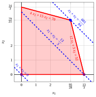{ .fig .ovale loading=lazy style="width:76%" }

    Una soluzione ottima ${ \tilde{\boldsymbol x}}(\,LP\,)$ è:

    $$
    \tilde{x}_1=\dfrac{95}{28},~~\tilde{x}_2=\dfrac{79}{21}
    $$

    il valore ottimo $z(\, LP\,)$ è $\dfrac{601}{84}.$

    In viola il primo e il secondo vertice esplorati dalla precedente esecuzione dell'algoritmo del simplesso rivisto (prima di raggiungere quello ottimo rappresentato in blu).

    In blu tratteggiato, le curve di livello della funzione obiettivo associate ai valori assunti nei tre vertici.

!!! esercizio "Esercizio 11.8: Algoritmo del simplesso rivisto (P7)"

    Consideriamo il seguente problema LP in forma canonica di massimo con $n=2$ variabili e $m=2$ vincoli:

    $$
    \begin{array}{rrrrrr}
    {\max} & {3}\, {x_1} & {+} & {x_2} \\[2ex]
    \text{soggetto a} & {x_1} & {+} & {4}\, {x_2} & {\le} & {12} \\[2ex]
    & {2}\, {x_1} & {+} & {x_2} & {\le} & {5} \\[2ex]
    & {x_1,} &  & {x_2} & {\ge} & {0}
    \end{array}
    $$

    Introducendo le variabili di scarto, otteniamo il seguente problema LP in forma standard di massimo con $n+m=4$ variabili e $m=2$ vincoli:

    $$
    \begin{array}{rrrrrrrrrr}
    {\max} & {3}\, {x_1} & {+} & {x_2} \\[2ex]
    \text{soggetto a} & {x_1} & {+} & {4}\, {x_2} & {+} & {x_3} &  &  & {=} & {12} \\[2ex]
    & {2}\, {x_1} & {+} & {x_2} &  &  & {+} & {x_4} & {=} & {5} \\[2ex]
    & {x_1,} &  & {x_2,} &  & {x_3,} &  & {x_4} & {\ge} & {0}
    \end{array}
    $$

    **Domande**

    - Eseguire l'algoritmo del simplesso rivisto per trovare una soluzione ottima di questo problema LP, utilizzando la regola di Bland per scegliere la colonna pivot e la riga pivot.

??? soluzione "Soluzione"

    Abbiamo:

    $$
    {\boldsymbol A}=
    \begin{pmatrix}
    1 & 4 & 1 & 0\\
    2 & 1 & 0 & 1
    \end{pmatrix}
    \quad
    {\boldsymbol b}=
    \begin{pmatrix}
    12\\
    5
    \end{pmatrix}
    \quad
    {\boldsymbol c}=
    \begin{pmatrix}
    3\\
    1\\
    0\\
    0
    \end{pmatrix}
    \quad
    {\boldsymbol x}=
    \begin{pmatrix}
    x_1 \\
    x_2 \\
    x_3 \\
    x_4
    \end{pmatrix}
    $$

    - <strong>Inizializzazione</strong>

        Poiché si tratta di un problema LP in forma standard ottenuto da un problema LP in forma canonica con $~{\boldsymbol b} \ge 0$ aggiungendo le variabili di scarto, la partizione $\pazocal{B}=\{3,4\}$ e $\pazocal{N}=\{1,2\}$ è associata alla seguente soluzione di base ammissibile:

        $$
        \begin{pmatrix}
        x_3 \\
        x_4
        \end{pmatrix}
        =
        \begin{pmatrix}
        12\\
        5
        \end{pmatrix}
        {\rm ~~~e~~~}
        \begin{pmatrix}
        x_1 \\
        x_2
        \end{pmatrix}
        =
        \begin{pmatrix}
        0\\
        0
        \end{pmatrix}
        $$

    - <strong>Iterazione 1</strong>

        Con $\pazocal{B}= \{3,~~4\}$ e $\pazocal{N}= \{1,~~2\}$, si ha:

        $$
        {\boldsymbol x}_{\pazocal{B}}=
        \begin{pmatrix}
        x_3 \\
        x_4
        \end{pmatrix} ~~
        {\boldsymbol A}_{\pazocal{B}}=
        \begin{pmatrix}
        1 & 0\\
        0 & 1
        \end{pmatrix} ~~
        {\boldsymbol c}_{\pazocal{B}}=
        \begin{pmatrix}
        0\\
        0
        \end{pmatrix} ~~
        {{ \bar{\boldsymbol b}}}=
        \begin{pmatrix}
        12\\
        5
        \end{pmatrix}
        $$

        $$
        {\boldsymbol x}_{\pazocal{N}}=
        \begin{pmatrix}
        x_1 \\
        x_2
        \end{pmatrix} ~~
        {\boldsymbol A}_{\pazocal{N}}=
        \begin{pmatrix}
        1 & 4\\
        2 & 1
        \end{pmatrix} ~~
        {\boldsymbol c}_{\pazocal{N}}=
        \begin{pmatrix}
        3\\
        1
        \end{pmatrix}
        $$

        <strong>Verifica di ottimalità</strong>

        Risolviamo ${\boldsymbol \pi} \; {\boldsymbol A}_{\pazocal{B}} = {\boldsymbol c}'_{\pazocal{B}}$ per calcolare ${\boldsymbol \pi} =  {{{\boldsymbol c}'_{\pazocal{B}} \; {\boldsymbol A}_{\pazocal{B}}^{-1}}}$, <u>primo sistema di equazioni lineari</u>:

        \begin{equation*}
        \begin{cases}
        \begin{array}{rrrrr}
        {\pi_3} &  &  & {=} & {0} \\[2ex]
        &  & {\pi_4} & {=} & {0}
        \end{array}
        \end{cases}
        \qquad
        {\boldsymbol \pi}=
        \begin{pmatrix}
        0 & 0\\
        \end{pmatrix}
        \end{equation*}

        Calcoliamo il valore della soluzione di base ammissibile ${\bar{z}} = {\boldsymbol \pi} \; {\boldsymbol b} = \begin{pmatrix} 0 & 0\\ \end{pmatrix} \begin{pmatrix} 12\\ 5 \end{pmatrix} = 0$

        Calcoliamo i costi ridotti ${{ \bar{\boldsymbol c}}'}  = {{\boldsymbol c}'_{\pazocal{N}} - {\boldsymbol \pi} \; {\boldsymbol A}_{\pazocal{N}}}$:

        $$
        {{ \bar{\boldsymbol c}}'}
        = \begin{pmatrix}
        3 & 1\\
        \end{pmatrix} - \begin{pmatrix}
        0 & 0\\
        \end{pmatrix} \begin{pmatrix}
        1 & 4\\
        2 & 1
        \end{pmatrix}
        =
        \underbrace{
        \begin{pmatrix}
        3 & 1\\
        \end{pmatrix}
        }_{{c_{1}~~~c_{2}}}
        -
        \underbrace{
        \begin{pmatrix}
        0 & 0\\
        \end{pmatrix}
        }_{{\boldsymbol \pi}\;{\boldsymbol A}_{1} ~~{\boldsymbol \pi}\;{\boldsymbol A}_{2}}
        =
        \underbrace{
        \begin{pmatrix}
        3 & 1\\
        \end{pmatrix}
        }_{{\bar{c}_{1}~~~\bar{c}_{2}}}
        $$

        Non tutti i costi ridotti sono non positivi, quindi eseguiamo un'operazione di pivot.

        <strong>Operazione di pivot</strong>

        Poiché ${c}_{1} > {\boldsymbol \pi} \;{\boldsymbol A}_{1}$, $x_1$ è la <u>colonna pivot</u> e si ha ${\boldsymbol A}_{1} = \begin{pmatrix} 1\\ 2 \end{pmatrix}$

        Risolviamo ${\boldsymbol A}_{\pazocal{B}} \; {\boldsymbol d} = {\boldsymbol A}_{1}$ per calcolare ${\boldsymbol d}={ {\boldsymbol A}_{\pazocal{B}}^{-1}} {\boldsymbol A}_{1}$, <u>secondo sistema di equazioni lineari</u>:

        \begin{equation*}
        \begin{cases}
        \begin{array}{rrrrr}
        {d_3} &  &  & {=} & {1} \\[2ex]
        &  & {d_4} & {=} & {2}
        \end{array}
        \end{cases}
        \qquad
        {\boldsymbol d}=
        \begin{pmatrix}
        1\\
        2
        \end{pmatrix}
        \end{equation*}

        Dobbiamo trovare il massimo $t$ tale che ${{ \bar{\boldsymbol b}}}  - t \; {{\boldsymbol d}} \ge 0$:

        $$
        \begin{cases}
        \underbrace{12 -t \cdot 1\ge 0}_{x_3 \ge 0} \\[2ex]
        \underbrace{5 -t \cdot 2\ge 0}_{x_4 \ge 0}
        \end{cases}
        \qquad
        \begin{cases}
        t\le 12 \\[2ex]
        t\le \dfrac{5}{2}
        \end{cases}
        \text{   quindi   } t_{m}=\dfrac{5}{2}
        $$

        Di conseguenza il valore della colonna pivot diventa $t_{m}$, cioè $x_1=\dfrac{5}{2}$. Il valore di $x_4$ diventa zero e $x_4$ è la <u>riga pivot</u>. Le altre variabili di base assumono i valori ${ \bar{\boldsymbol b}} - t_{m} \; {\boldsymbol d}$, quindi si ha:

        $$
        x_3 = 12 - \dfrac{5}{2} \cdot 1 = \dfrac{19}{2}
        $$

    - <strong>Iterazione 2</strong>

        Con $\pazocal{B}= \{1,~~3\}$ e $\pazocal{N}= \{2,~~4\}$, si ha:

        $$
        {\boldsymbol x}_{\pazocal{B}}=
        \begin{pmatrix}
        x_1 \\
        x_3
        \end{pmatrix} ~~
        {\boldsymbol A}_{\pazocal{B}}=
        \begin{pmatrix}
        1 & 1\\
        2 & 0
        \end{pmatrix} ~~
        {\boldsymbol c}_{\pazocal{B}}=
        \begin{pmatrix}
        3\\
        0
        \end{pmatrix} ~~
        {{ \bar{\boldsymbol b}}}=
        \begin{pmatrix}
        \dfrac{5}{2}\\[2ex]
        \dfrac{19}{2}
        \end{pmatrix}
        $$

        $$
        {\boldsymbol x}_{\pazocal{N}}=
        \begin{pmatrix}
        x_2 \\
        x_4
        \end{pmatrix} ~~
        {\boldsymbol A}_{\pazocal{N}}=
        \begin{pmatrix}
        4 & 0\\
        1 & 1
        \end{pmatrix} ~~
        {\boldsymbol c}_{\pazocal{N}}=
        \begin{pmatrix}
        1\\
        0
        \end{pmatrix}
        $$

        <strong>Verifica di ottimalità</strong>

        Risolviamo ${\boldsymbol \pi} \; {\boldsymbol A}_{\pazocal{B}} = {\boldsymbol c}'_{\pazocal{B}}$ per calcolare ${\boldsymbol \pi} =  {{{\boldsymbol c}'_{\pazocal{B}} \; {\boldsymbol A}_{\pazocal{B}}^{-1}}}$, <u>primo sistema di equazioni lineari</u>:

        \begin{equation*}
        \begin{cases}
        \begin{array}{rrrrr}
        {\pi_1} & {+} & {2}\, {\pi_3} & {=} & {3} \\[2ex]
        {\pi_1} &  &  & {=} & {0}
        \end{array}
        \end{cases}
        \qquad
        {\boldsymbol \pi}=
        \begin{pmatrix}
        0 & \dfrac{3}{2}\\
        \end{pmatrix}
        \end{equation*}

        Calcoliamo il valore della soluzione di base ammissibile ${\bar{z}} = {\boldsymbol \pi} \; {\boldsymbol b} = \begin{pmatrix} 0 & \dfrac{3}{2}\\ \end{pmatrix} \begin{pmatrix} 12\\ 5 \end{pmatrix} = \dfrac{15}{2}$

        Calcoliamo i costi ridotti ${{ \bar{\boldsymbol c}}'}  = {{\boldsymbol c}'_{\pazocal{N}} - {\boldsymbol \pi} \; {\boldsymbol A}_{\pazocal{N}}}$:

        $$
        {{ \bar{\boldsymbol c}}'}
        = \begin{pmatrix}
        1 & 0\\
        \end{pmatrix} - \begin{pmatrix}
        0 & \dfrac{3}{2}\\
        \end{pmatrix} \begin{pmatrix}
        4 & 0\\
        1 & 1
        \end{pmatrix}
        =
        \underbrace{
        \begin{pmatrix}
        1 & 0\\
        \end{pmatrix}
        }_{{c_{2}~~~c_{4}}}
        -
        \underbrace{
        \begin{pmatrix}
        \dfrac{3}{2} & \dfrac{3}{2}\\
        \end{pmatrix}
        }_{{\boldsymbol \pi}\;{\boldsymbol A}_{2} ~~{\boldsymbol \pi}\;{\boldsymbol A}_{4}}
        =
        \underbrace{
        \begin{pmatrix}
        -\dfrac{1}{2} & -\dfrac{3}{2}\\
        \end{pmatrix}
        }_{{\bar{c}_{2}~~~\bar{c}_{4}}}
        $$

        Tutti i costi ridotti sono non positivi, quindi la soluzione di base ammissibile

        $$
        {\boldsymbol x}_{\pazocal{B}}=
        \begin{pmatrix}
        x_1 \\
        x_3
        \end{pmatrix}=\begin{pmatrix}
        \dfrac{5}{2}\\[2ex]
        \dfrac{19}{2}
        \end{pmatrix} {\rm ~~~e~~~} {\boldsymbol x}_{\pazocal{N}}=
        \begin{pmatrix}
        x_2 \\
        x_4
        \end{pmatrix}=\begin{pmatrix}
        0\\
        0
        \end{pmatrix}
        $$

        è una soluzione ottima del problema LP e ${\bar{z}} = \dfrac{15}{2}$ è il valore della soluzione ottima.

    <strong>Soluzione grafica:</strong>

    La regione ammissibile del problema LP (in forma canonica) è il poliedro colorato in rosso: 

    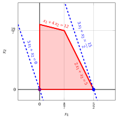{ .fig .ovale loading=lazy style="width:65%" }

    Una soluzione ottima ${ \tilde{\boldsymbol x}}(\, LP\,)$ è:

    $$
    \tilde{x}_1=\dfrac{5}{2},~~\tilde{x}_2=0
    $$

    il valore ottimo $z(\, LP\,)$ è $\dfrac{15}{2}.$

    In viola il primo vertice esplorato dalla precedente esecuzione dell'algoritmo del simplesso rivisto (prima di raggiungere quello ottimo rappresentato in blu).

    In blu tratteggiato, le curve di livello della funzione obiettivo associate ai valori assunti nei due vertici.

!!! esercizio "Esercizio 11.9: Algoritmo del simplesso rivisto (P8)"

    Consideriamo il seguente problema LP in forma canonica di massimo con $n=2$ variabili e $m=2$ vincoli:

    $$
    \begin{array}{rrrrrr}
    {\max} & {x_1} & {+} & {2}\, {x_2} \\[2ex]
    \text{soggetto a} & {-x_1} & {+} & {2}\, {x_2} & {\le} & {2} \\[2ex]
    & {x_1} & {+} & {x_2} & {\le} & {3} \\[2ex]
    & {x_1,} &  & {x_2} & {\ge} & {0}
    \end{array}
    $$

    Introducendo le variabili di scarto, otteniamo il seguente problema LP in forma standard di massimo con $n+m=4$ variabili e $m=2$ vincoli:

    $$
    \begin{array}{rrrrrrrrrr}
    {\max} & {x_1} & {+} & {2}\, {x_2} \\[2ex]
    \text{soggetto a} & {-x_1} & {+} & {2}\, {x_2} & {+} & {x_3} &  &  & {=} & {2} \\[2ex]
    & {x_1} & {+} & {x_2} &  &  & {+} & {x_4} & {=} & {3} \\[2ex]
    & {x_1,} &  & {x_2,} &  & {x_3,} &  & {x_4} & {\ge} & {0}
    \end{array}
    $$

    **Domande**

    - Eseguire l'algoritmo del simplesso rivisto per trovare una soluzione ottima di questo problema LP, utilizzando la regola di Bland per scegliere la colonna pivot e la riga pivot.

??? soluzione "Soluzione"

    Abbiamo:

    $$
    {\boldsymbol A}=
    \begin{pmatrix}
    -1 & 2 & 1 & 0\\
    1 & 1 & 0 & 1
    \end{pmatrix}
    \quad
    {\boldsymbol b}=
    \begin{pmatrix}
    2\\
    3
    \end{pmatrix}
    \quad
    {\boldsymbol c}=
    \begin{pmatrix}
    1\\
    2\\
    0\\
    0
    \end{pmatrix}
    \quad
    {\boldsymbol x}=
    \begin{pmatrix}
    x_1 \\
    x_2 \\
    x_3 \\
    x_4
    \end{pmatrix}
    $$

    - <strong>Inizializzazione</strong>

        Poiché si tratta di un problema LP in forma standard ottenuto da un problema LP in forma canonica con $~{\boldsymbol b} \ge 0$ aggiungendo le variabili di scarto, la partizione $\pazocal{B}=\{3,4\}$ e $\pazocal{N}=\{1,2\}$ è associata alla seguente soluzione di base ammissibile:

        $$
        \begin{pmatrix}
        x_3 \\
        x_4
        \end{pmatrix}
        =
        \begin{pmatrix}
        2\\
        3
        \end{pmatrix}
        {\rm ~~~e~~~}
        \begin{pmatrix}
        x_1 \\
        x_2
        \end{pmatrix}
        =
        \begin{pmatrix}
        0\\
        0
        \end{pmatrix}
        $$

    - <strong>Iterazione 1</strong>

        Con $\pazocal{B}= \{3,~~4\}$ e $\pazocal{N}= \{1,~~2\}$, si ha:

        $$
        {\boldsymbol x}_{\pazocal{B}}=
        \begin{pmatrix}
        x_3 \\
        x_4
        \end{pmatrix} ~~
        {\boldsymbol A}_{\pazocal{B}}=
        \begin{pmatrix}
        1 & 0\\
        0 & 1
        \end{pmatrix} ~~
        {\boldsymbol c}_{\pazocal{B}}=
        \begin{pmatrix}
        0\\
        0
        \end{pmatrix} ~~
        {{ \bar{\boldsymbol b}}}=
        \begin{pmatrix}
        2\\
        3
        \end{pmatrix}
        $$

        $$
        {\boldsymbol x}_{\pazocal{N}}=
        \begin{pmatrix}
        x_1 \\
        x_2
        \end{pmatrix} ~~
        {\boldsymbol A}_{\pazocal{N}}=
        \begin{pmatrix}
        -1 & 2\\
        1 & 1
        \end{pmatrix} ~~
        {\boldsymbol c}_{\pazocal{N}}=
        \begin{pmatrix}
        1\\
        2
        \end{pmatrix}
        $$

        <strong>Verifica di ottimalità</strong>

        Risolviamo ${\boldsymbol \pi} \; {\boldsymbol A}_{\pazocal{B}} = {\boldsymbol c}'_{\pazocal{B}}$ per calcolare ${\boldsymbol \pi} =  {{{\boldsymbol c}'_{\pazocal{B}} \; {\boldsymbol A}_{\pazocal{B}}^{-1}}}$, <u>primo sistema di equazioni lineari</u>:

        \begin{equation*}
        \begin{cases}
        \begin{array}{rrrrr}
        {\pi_3} &  &  & {=} & {0} \\[2ex]
        &  & {\pi_4} & {=} & {0}
        \end{array}
        \end{cases}
        \qquad
        {\boldsymbol \pi}=
        \begin{pmatrix}
        0 & 0\\
        \end{pmatrix}
        \end{equation*}

        Calcoliamo il valore della soluzione di base ammissibile ${\bar{z}} = {\boldsymbol \pi} \; {\boldsymbol b} = \begin{pmatrix} 0 & 0\\ \end{pmatrix} \begin{pmatrix} 2\\ 3 \end{pmatrix} = 0$

        Calcoliamo i costi ridotti ${{ \bar{\boldsymbol c}}'}  = {{\boldsymbol c}'_{\pazocal{N}} - {\boldsymbol \pi} \; {\boldsymbol A}_{\pazocal{N}}}$:

        $$
        {{ \bar{\boldsymbol c}}'}
        = \begin{pmatrix}
        1 & 2\\
        \end{pmatrix} - \begin{pmatrix}
        0 & 0\\
        \end{pmatrix} \begin{pmatrix}
        -1 & 2\\
        1 & 1
        \end{pmatrix}
        =
        \underbrace{
        \begin{pmatrix}
        1 & 2\\
        \end{pmatrix}
        }_{{c_{1}~~~c_{2}}}
        -
        \underbrace{
        \begin{pmatrix}
        0 & 0\\
        \end{pmatrix}
        }_{{\boldsymbol \pi}\;{\boldsymbol A}_{1} ~~{\boldsymbol \pi}\;{\boldsymbol A}_{2}}
        =
        \underbrace{
        \begin{pmatrix}
        1 & 2\\
        \end{pmatrix}
        }_{{\bar{c}_{1}~~~\bar{c}_{2}}}
        $$

        Non tutti i costi ridotti sono non positivi, quindi eseguiamo un'operazione di pivot.

        <strong>Operazione di pivot</strong>

        Poiché ${c}_{1} > {\boldsymbol \pi} \;{\boldsymbol A}_{1}$, $x_1$ è la <u>colonna pivot</u> e si ha ${\boldsymbol A}_{1} = \begin{pmatrix} -1\\ 1 \end{pmatrix}$

        Risolviamo ${\boldsymbol A}_{\pazocal{B}} \; {\boldsymbol d} = {\boldsymbol A}_{1}$ per calcolare ${\boldsymbol d}={ {\boldsymbol A}_{\pazocal{B}}^{-1}} {\boldsymbol A}_{1}$, <u>secondo sistema di equazioni lineari</u>:

        \begin{equation*}
        \begin{cases}
        \begin{array}{rrrrr}
        {d_3} &  &  & {=} & {-1} \\[2ex]
        &  & {d_4} & {=} & {1}
        \end{array}
        \end{cases}
        \qquad
        {\boldsymbol d}=
        \begin{pmatrix}
        -1\\
        1
        \end{pmatrix}
        \end{equation*}

        Dobbiamo trovare il massimo $t$ tale che ${{ \bar{\boldsymbol b}}}  - t \; {{\boldsymbol d}} \ge 0$:

        $$
        \begin{cases}
        \underbrace{2 -t \cdot \left( -1\right)\ge 0}_{x_3 \ge 0} \\[2ex]
        \underbrace{3 -t \cdot 1\ge 0}_{x_4 \ge 0}
        \end{cases}
        \qquad
        \begin{cases}
        t\ge -2 \\[2ex]
        t\le 3
        \end{cases}
        \text{   quindi   } t_{m}=3
        $$

        Di conseguenza il valore della colonna pivot diventa $t_{m}$, cioè $x_1=3$. Il valore di $x_4$ diventa zero e $x_4$ è la <u>riga pivot</u>. Le altre variabili di base assumono i valori ${ \bar{\boldsymbol b}} - t_{m} \; {\boldsymbol d}$, quindi si ha:

        $$
        x_3 = 2 - 3 \cdot \left( -1\right) = 5
        $$

    - <strong>Iterazione 2</strong>

        Con $\pazocal{B}= \{1,~~3\}$ e $\pazocal{N}= \{2,~~4\}$, si ha:

        $$
        {\boldsymbol x}_{\pazocal{B}}=
        \begin{pmatrix}
        x_1 \\
        x_3
        \end{pmatrix} ~~
        {\boldsymbol A}_{\pazocal{B}}=
        \begin{pmatrix}
        -1 & 1\\
        1 & 0
        \end{pmatrix} ~~
        {\boldsymbol c}_{\pazocal{B}}=
        \begin{pmatrix}
        1\\
        0
        \end{pmatrix} ~~
        {{ \bar{\boldsymbol b}}}=
        \begin{pmatrix}
        3\\
        5
        \end{pmatrix}
        $$

        $$
        {\boldsymbol x}_{\pazocal{N}}=
        \begin{pmatrix}
        x_2 \\
        x_4
        \end{pmatrix} ~~
        {\boldsymbol A}_{\pazocal{N}}=
        \begin{pmatrix}
        2 & 0\\
        1 & 1
        \end{pmatrix} ~~
        {\boldsymbol c}_{\pazocal{N}}=
        \begin{pmatrix}
        2\\
        0
        \end{pmatrix}
        $$

        <strong>Verifica di ottimalità</strong>

        Risolviamo ${\boldsymbol \pi} \; {\boldsymbol A}_{\pazocal{B}} = {\boldsymbol c}'_{\pazocal{B}}$ per calcolare ${\boldsymbol \pi} =  {{{\boldsymbol c}'_{\pazocal{B}} \; {\boldsymbol A}_{\pazocal{B}}^{-1}}}$, <u>primo sistema di equazioni lineari</u>:

        \begin{equation*}
        \begin{cases}
        \begin{array}{rrrrr}
        {-\pi_1} & {+} & {\pi_3} & {=} & {1} \\[2ex]
        {\pi_1} &  &  & {=} & {0}
        \end{array}
        \end{cases}
        \qquad
        {\boldsymbol \pi}=
        \begin{pmatrix}
        0 & 1\\
        \end{pmatrix}
        \end{equation*}

        Calcoliamo il valore della soluzione di base ammissibile ${\bar{z}} = {\boldsymbol \pi} \; {\boldsymbol b} = \begin{pmatrix} 0 & 1\\ \end{pmatrix} \begin{pmatrix} 2\\ 3 \end{pmatrix} = 3$

        Calcoliamo i costi ridotti ${{ \bar{\boldsymbol c}}'}  = {{\boldsymbol c}'_{\pazocal{N}} - {\boldsymbol \pi} \; {\boldsymbol A}_{\pazocal{N}}}$:

        $$
        {{ \bar{\boldsymbol c}}'}
        = \begin{pmatrix}
        2 & 0\\
        \end{pmatrix} - \begin{pmatrix}
        0 & 1\\
        \end{pmatrix} \begin{pmatrix}
        2 & 0\\
        1 & 1
        \end{pmatrix}
        =
        \underbrace{
        \begin{pmatrix}
        2 & 0\\
        \end{pmatrix}
        }_{{c_{2}~~~c_{4}}}
        -
        \underbrace{
        \begin{pmatrix}
        1 & 1\\
        \end{pmatrix}
        }_{{\boldsymbol \pi}\;{\boldsymbol A}_{2} ~~{\boldsymbol \pi}\;{\boldsymbol A}_{4}}
        =
        \underbrace{
        \begin{pmatrix}
        1 & -1\\
        \end{pmatrix}
        }_{{\bar{c}_{2}~~~\bar{c}_{4}}}
        $$

        Non tutti i costi ridotti sono non positivi, quindi eseguiamo un'operazione di pivot.

        <strong>Operazione di pivot</strong>

        Poiché ${c}_{2} > {\boldsymbol \pi} \;{\boldsymbol A}_{2}$, $x_2$ è la <u>colonna pivot</u> e si ha ${\boldsymbol A}_{2} = \begin{pmatrix} 2\\ 1 \end{pmatrix}$

        Risolviamo ${\boldsymbol A}_{\pazocal{B}} \; {\boldsymbol d} = {\boldsymbol A}_{2}$ per calcolare ${\boldsymbol d}={ {\boldsymbol A}_{\pazocal{B}}^{-1}} {\boldsymbol A}_{2}$, <u>secondo sistema di equazioni lineari</u>:

        \begin{equation*}
        \begin{cases}
        \begin{array}{rrrrr}
        {-d_1} & {+} & {d_3} & {=} & {2} \\[2ex]
        {d_1} &  &  & {=} & {1}
        \end{array}
        \end{cases}
        \qquad
        {\boldsymbol d}=
        \begin{pmatrix}
        1\\
        3
        \end{pmatrix}
        \end{equation*}

        Dobbiamo trovare il massimo $t$ tale che ${{ \bar{\boldsymbol b}}}  - t \; {{\boldsymbol d}} \ge 0$:

        $$
        \begin{cases}
        \underbrace{3 -t \cdot 1\ge 0}_{x_1 \ge 0} \\[2ex]
        \underbrace{5 -t \cdot 3\ge 0}_{x_3 \ge 0}
        \end{cases}
        \qquad
        \begin{cases}
        t\le 3 \\[2ex]
        t\le \dfrac{5}{3}
        \end{cases}
        \text{   quindi   } t_{m}=\dfrac{5}{3}
        $$

        Di conseguenza il valore della colonna pivot diventa $t_{m}$, cioè $x_2=\dfrac{5}{3}$. Il valore di $x_3$ diventa zero e $x_3$ è la <u>riga pivot</u>. Le altre variabili di base assumono i valori ${ \bar{\boldsymbol b}} - t_{m} \; {\boldsymbol d}$, quindi si ha:

        $$
        x_1 = 3 - \dfrac{5}{3} \cdot 1 = \dfrac{4}{3}
        $$

    - <strong>Iterazione 3</strong>

        Con $\pazocal{B}= \{1,~~2\}$ e $\pazocal{N}= \{3,~~4\}$, si ha:

        $$
        {\boldsymbol x}_{\pazocal{B}}=
        \begin{pmatrix}
        x_1 \\
        x_2
        \end{pmatrix} ~~
        {\boldsymbol A}_{\pazocal{B}}=
        \begin{pmatrix}
        -1 & 2\\
        1 & 1
        \end{pmatrix} ~~
        {\boldsymbol c}_{\pazocal{B}}=
        \begin{pmatrix}
        1\\
        2
        \end{pmatrix} ~~
        {{ \bar{\boldsymbol b}}}=
        \begin{pmatrix}
        \dfrac{4}{3}\\[2ex]
        \dfrac{5}{3}
        \end{pmatrix}
        $$

        $$
        {\boldsymbol x}_{\pazocal{N}}=
        \begin{pmatrix}
        x_3 \\
        x_4
        \end{pmatrix} ~~
        {\boldsymbol A}_{\pazocal{N}}=
        \begin{pmatrix}
        1 & 0\\
        0 & 1
        \end{pmatrix} ~~
        {\boldsymbol c}_{\pazocal{N}}=
        \begin{pmatrix}
        0\\
        0
        \end{pmatrix}
        $$

        <strong>Verifica di ottimalità</strong>

        Risolviamo ${\boldsymbol \pi} \; {\boldsymbol A}_{\pazocal{B}} = {\boldsymbol c}'_{\pazocal{B}}$ per calcolare ${\boldsymbol \pi} =  {{{\boldsymbol c}'_{\pazocal{B}} \; {\boldsymbol A}_{\pazocal{B}}^{-1}}}$, <u>primo sistema di equazioni lineari</u>:

        \begin{equation*}
        \begin{cases}
        \begin{array}{rrrrr}
        {-\pi_1} & {+} & {\pi_2} & {=} & {1} \\[2ex]
        {2}\, {\pi_1} & {+} & {\pi_2} & {=} & {2}
        \end{array}
        \end{cases}
        \qquad
        {\boldsymbol \pi}=
        \begin{pmatrix}
        \dfrac{1}{3} & \dfrac{4}{3}\\
        \end{pmatrix}
        \end{equation*}

        Calcoliamo il valore della soluzione di base ammissibile ${\bar{z}} = {\boldsymbol \pi} \; {\boldsymbol b} = \begin{pmatrix} \dfrac{1}{3} & \dfrac{4}{3}\\ \end{pmatrix} \begin{pmatrix} 2\\ 3 \end{pmatrix} = \dfrac{14}{3}$

        Calcoliamo i costi ridotti ${{ \bar{\boldsymbol c}}'}  = {{\boldsymbol c}'_{\pazocal{N}} - {\boldsymbol \pi} \; {\boldsymbol A}_{\pazocal{N}}}$:

        $$
        {{ \bar{\boldsymbol c}}'}
        = \begin{pmatrix}
        0 & 0\\
        \end{pmatrix} - \begin{pmatrix}
        \dfrac{1}{3} & \dfrac{4}{3}\\
        \end{pmatrix} \begin{pmatrix}
        1 & 0\\
        0 & 1
        \end{pmatrix}
        =
        \underbrace{
        \begin{pmatrix}
        0 & 0\\
        \end{pmatrix}
        }_{{c_{3}~~~c_{4}}}
        -
        \underbrace{
        \begin{pmatrix}
        \dfrac{1}{3} & \dfrac{4}{3}\\
        \end{pmatrix}
        }_{{\boldsymbol \pi}\;{\boldsymbol A}_{3} ~~{\boldsymbol \pi}\;{\boldsymbol A}_{4}}
        =
        \underbrace{
        \begin{pmatrix}
        -\dfrac{1}{3} & -\dfrac{4}{3}\\
        \end{pmatrix}
        }_{{\bar{c}_{3}~~~\bar{c}_{4}}}
        $$

        Tutti i costi ridotti sono non positivi, quindi la soluzione di base ammissibile

        $$
        {\boldsymbol x}_{\pazocal{B}}=
        \begin{pmatrix}
        x_1 \\
        x_2
        \end{pmatrix}=\begin{pmatrix}
        \dfrac{4}{3}\\[2ex]
        \dfrac{5}{3}
        \end{pmatrix} {\rm ~~~e~~~} {\boldsymbol x}_{\pazocal{N}}=
        \begin{pmatrix}
        x_3 \\
        x_4
        \end{pmatrix}=\begin{pmatrix}
        0\\
        0
        \end{pmatrix}
        $$

        è una soluzione ottima del problema LP e ${\bar{z}} = \dfrac{14}{3}$ è il valore della soluzione ottima.

    <strong>Soluzione grafica:</strong>

    La regione ammissibile del problema LP (in forma canonica) è il poliedro colorato in rosso: 

    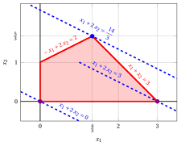{ .fig .ovale loading=lazy style="width:76%" }

    Una soluzione ottima ${ \tilde{\boldsymbol x}}(\,LP\,)$ è:

    $$
    \tilde{x}_1=\dfrac{4}{3},~~\tilde{x}_2=\dfrac{5}{3}
    $$

    il valore ottimo $z(\, LP\,)$ è $\dfrac{14}{3}.$

    In viola il primo e il secondo vertice esplorati dalla precedente esecuzione dell'algoritmo del simplesso rivisto (prima di raggiungere quello ottimo rappresentato in blu).

    In blu tratteggiato, le curve di livello della funzione obiettivo associate ai valori assunti nei tre vertici.

!!! esercizio "Esercizio 11.10: Algoritmo del simplesso rivisto (P9)"

    Consideriamo il seguente problema LP in forma canonica di massimo con $n=2$ variabili e $m=2$ vincoli:

    $$
    \begin{array}{rrrrrr}
    {\max} & {2}\, {x_1} & {+} & {x_2} \\[2ex]
    \text{soggetto a} & {-x_1} & {+} & {x_2} & {\le} & {1} \\[2ex]
    & {6}\, {x_1} & {+} & {4}\, {x_2} & {\le} & {39} \\[2ex]
    & {x_1,} &  & {x_2} & {\ge} & {0}
    \end{array}
    $$

    Introducendo le variabili di scarto, otteniamo il seguente problema LP in forma standard di massimo con $n+m=4$ variabili e $m=2$ vincoli:

    $$
    \begin{array}{rrrrrrrrrr}
    {\max} & {2}\, {x_1} & {+} & {x_2} \\[2ex]
    \text{soggetto a} & {-x_1} & {+} & {x_2} & {+} & {x_3} &  &  & {=} & {1} \\[2ex]
    & {6}\, {x_1} & {+} & {4}\, {x_2} &  &  & {+} & {x_4} & {=} & {39} \\[2ex]
    & {x_1,} &  & {x_2,} &  & {x_3,} &  & {x_4} & {\ge} & {0}
    \end{array}
    $$

    **Domande**

    - Eseguire l'algoritmo del simplesso rivisto per trovare una soluzione ottima di questo problema LP, utilizzando la regola di Bland per scegliere la colonna pivot e la riga pivot.

??? soluzione "Soluzione"

    Abbiamo:

    $$
    {\boldsymbol A}=
    \begin{pmatrix}
    -1 & 1 & 1 & 0\\
    6 & 4 & 0 & 1
    \end{pmatrix}
    \quad
    {\boldsymbol b}=
    \begin{pmatrix}
    1\\
    39
    \end{pmatrix}
    \quad
    {\boldsymbol c}=
    \begin{pmatrix}
    2\\
    1\\
    0\\
    0
    \end{pmatrix}
    \quad
    {\boldsymbol x}=
    \begin{pmatrix}
    x_1 \\
    x_2 \\
    x_3 \\
    x_4
    \end{pmatrix}
    $$

    - <strong>Inizializzazione</strong>

        Poiché si tratta di un problema LP in forma standard ottenuto da un problema LP in forma canonica con $~{\boldsymbol b} \ge 0$ aggiungendo le variabili di scarto, la partizione $\pazocal{B}=\{3,4\}$ e $\pazocal{N}=\{1,2\}$ è associata alla seguente soluzione di base ammissibile:

        $$
        \begin{pmatrix}
        x_3 \\
        x_4
        \end{pmatrix}
        =
        \begin{pmatrix}
        1\\
        39
        \end{pmatrix}
        {\rm ~~~e~~~}
        \begin{pmatrix}
        x_1 \\
        x_2
        \end{pmatrix}
        =
        \begin{pmatrix}
        0\\
        0
        \end{pmatrix}
        $$

    - <strong>Iterazione 1</strong>

        Con $\pazocal{B}= \{3,~~4\}$ e $\pazocal{N}= \{1,~~2\}$, si ha:

        $$
        {\boldsymbol x}_{\pazocal{B}}=
        \begin{pmatrix}
        x_3 \\
        x_4
        \end{pmatrix} ~~
        {\boldsymbol A}_{\pazocal{B}}=
        \begin{pmatrix}
        1 & 0\\
        0 & 1
        \end{pmatrix} ~~
        {\boldsymbol c}_{\pazocal{B}}=
        \begin{pmatrix}
        0\\
        0
        \end{pmatrix} ~~
        {{ \bar{\boldsymbol b}}}=
        \begin{pmatrix}
        1\\
        39
        \end{pmatrix}
        $$

        $$
        {\boldsymbol x}_{\pazocal{N}}=
        \begin{pmatrix}
        x_1 \\
        x_2
        \end{pmatrix} ~~
        {\boldsymbol A}_{\pazocal{N}}=
        \begin{pmatrix}
        -1 & 1\\
        6 & 4
        \end{pmatrix} ~~
        {\boldsymbol c}_{\pazocal{N}}=
        \begin{pmatrix}
        2\\
        1
        \end{pmatrix}
        $$

        <strong>Verifica di ottimalità</strong>

        Risolviamo ${\boldsymbol \pi} \; {\boldsymbol A}_{\pazocal{B}} = {\boldsymbol c}'_{\pazocal{B}}$ per calcolare ${\boldsymbol \pi} =  {{{\boldsymbol c}'_{\pazocal{B}} \; {\boldsymbol A}_{\pazocal{B}}^{-1}}}$, <u>primo sistema di equazioni lineari</u>:

        \begin{equation*}
        \begin{cases}
        \begin{array}{rrrrr}
        {\pi_3} &  &  & {=} & {0} \\[2ex]
        &  & {\pi_4} & {=} & {0}
        \end{array}
        \end{cases}
        \qquad
        {\boldsymbol \pi}=
        \begin{pmatrix}
        0 & 0\\
        \end{pmatrix}
        \end{equation*}

        Calcoliamo il valore della soluzione di base ammissibile ${\bar{z}} = {\boldsymbol \pi} \; {\boldsymbol b} = \begin{pmatrix} 0 & 0\\ \end{pmatrix} \begin{pmatrix} 1\\ 39 \end{pmatrix} = 0$

        Calcoliamo i costi ridotti ${{ \bar{\boldsymbol c}}'}  = {{\boldsymbol c}'_{\pazocal{N}} - {\boldsymbol \pi} \; {\boldsymbol A}_{\pazocal{N}}}$:

        $$
        {{ \bar{\boldsymbol c}}'}
        = \begin{pmatrix}
        2 & 1\\
        \end{pmatrix} - \begin{pmatrix}
        0 & 0\\
        \end{pmatrix} \begin{pmatrix}
        -1 & 1\\
        6 & 4
        \end{pmatrix}
        =
        \underbrace{
        \begin{pmatrix}
        2 & 1\\
        \end{pmatrix}
        }_{{c_{1}~~~c_{2}}}
        -
        \underbrace{
        \begin{pmatrix}
        0 & 0\\
        \end{pmatrix}
        }_{{\boldsymbol \pi}\;{\boldsymbol A}_{1} ~~{\boldsymbol \pi}\;{\boldsymbol A}_{2}}
        =
        \underbrace{
        \begin{pmatrix}
        2 & 1\\
        \end{pmatrix}
        }_{{\bar{c}_{1}~~~\bar{c}_{2}}}
        $$

        Non tutti i costi ridotti sono non positivi, quindi eseguiamo un'operazione di pivot.

        <strong>Operazione di pivot</strong>

        Poiché ${c}_{1} > {\boldsymbol \pi} \;{\boldsymbol A}_{1}$, $x_1$ è la <u>colonna pivot</u> e si ha ${\boldsymbol A}_{1} = \begin{pmatrix} -1\\ 6 \end{pmatrix}$

        Risolviamo ${\boldsymbol A}_{\pazocal{B}} \; {\boldsymbol d} = {\boldsymbol A}_{1}$ per calcolare ${\boldsymbol d}={ {\boldsymbol A}_{\pazocal{B}}^{-1}} {\boldsymbol A}_{1}$, <u>secondo sistema di equazioni lineari</u>:

        \begin{equation*}
        \begin{cases}
        \begin{array}{rrrrr}
        {d_3} &  &  & {=} & {-1} \\[2ex]
        &  & {d_4} & {=} & {6}
        \end{array}
        \end{cases}
        \qquad
        {\boldsymbol d}=
        \begin{pmatrix}
        -1\\
        6
        \end{pmatrix}
        \end{equation*}

        Dobbiamo trovare il massimo $t$ tale che ${{ \bar{\boldsymbol b}}}  - t \; {{\boldsymbol d}} \ge 0$:

        $$
        \begin{cases}
        \underbrace{1 -t \cdot \left( -1\right)\ge 0}_{x_3 \ge 0} \\[2ex]
        \underbrace{39 -t \cdot 6\ge 0}_{x_4 \ge 0}
        \end{cases}
        \qquad
        \begin{cases}
        t\ge -1 \\[2ex]
        t\le \dfrac{13}{2}
        \end{cases}
        \text{   quindi   } t_{m}=\dfrac{13}{2}
        $$

        Di conseguenza il valore della colonna pivot diventa $t_{m}$, cioè $x_1=\dfrac{13}{2}$. Il valore di $x_4$ diventa zero e $x_4$ è la <u>riga pivot</u>. Le altre variabili di base assumono i valori ${ \bar{\boldsymbol b}} - t_{m} \; {\boldsymbol d}$, quindi si ha:

        $$
        x_3 = 1 - \dfrac{13}{2} \cdot \left( -1\right) = \dfrac{15}{2}
        $$

    - <strong>Iterazione 2</strong>

        Con $\pazocal{B}= \{1,~~3\}$ e $\pazocal{N}= \{2,~~4\}$, si ha:

        $$
        {\boldsymbol x}_{\pazocal{B}}=
        \begin{pmatrix}
        x_1 \\
        x_3
        \end{pmatrix} ~~
        {\boldsymbol A}_{\pazocal{B}}=
        \begin{pmatrix}
        -1 & 1\\
        6 & 0
        \end{pmatrix} ~~
        {\boldsymbol c}_{\pazocal{B}}=
        \begin{pmatrix}
        2\\
        0
        \end{pmatrix} ~~
        {{ \bar{\boldsymbol b}}}=
        \begin{pmatrix}
        \dfrac{13}{2}\\[2ex]
        \dfrac{15}{2}
        \end{pmatrix}
        $$

        $$
        {\boldsymbol x}_{\pazocal{N}}=
        \begin{pmatrix}
        x_2 \\
        x_4
        \end{pmatrix} ~~
        {\boldsymbol A}_{\pazocal{N}}=
        \begin{pmatrix}
        1 & 0\\
        4 & 1
        \end{pmatrix} ~~
        {\boldsymbol c}_{\pazocal{N}}=
        \begin{pmatrix}
        1\\
        0
        \end{pmatrix}
        $$

        <strong>Verifica di ottimalità</strong>

        Risolviamo ${\boldsymbol \pi} \; {\boldsymbol A}_{\pazocal{B}} = {\boldsymbol c}'_{\pazocal{B}}$ per calcolare ${\boldsymbol \pi} =  {{{\boldsymbol c}'_{\pazocal{B}} \; {\boldsymbol A}_{\pazocal{B}}^{-1}}}$, <u>primo sistema di equazioni lineari</u>:

        \begin{equation*}
        \begin{cases}
        \begin{array}{rrrrr}
        {-\pi_1} & {+} & {6}\, {\pi_3} & {=} & {2} \\[2ex]
        {\pi_1} &  &  & {=} & {0}
        \end{array}
        \end{cases}
        \qquad
        {\boldsymbol \pi}=
        \begin{pmatrix}
        0 & \dfrac{1}{3}\\
        \end{pmatrix}
        \end{equation*}

        Calcoliamo il valore della soluzione di base ammissibile ${\bar{z}} = {\boldsymbol \pi} \; {\boldsymbol b} = \begin{pmatrix} 0 & \dfrac{1}{3}\\ \end{pmatrix} \begin{pmatrix} 1\\ 39 \end{pmatrix} = 13$

        Calcoliamo i costi ridotti ${{ \bar{\boldsymbol c}}'}  = {{\boldsymbol c}'_{\pazocal{N}} - {\boldsymbol \pi} \; {\boldsymbol A}_{\pazocal{N}}}$:

        $$
        {{ \bar{\boldsymbol c}}'}
        = \begin{pmatrix}
        1 & 0\\
        \end{pmatrix} - \begin{pmatrix}
        0 & \dfrac{1}{3}\\
        \end{pmatrix} \begin{pmatrix}
        1 & 0\\
        4 & 1
        \end{pmatrix}
        =
        \underbrace{
        \begin{pmatrix}
        1 & 0\\
        \end{pmatrix}
        }_{{c_{2}~~~c_{4}}}
        -
        \underbrace{
        \begin{pmatrix}
        \dfrac{4}{3} & \dfrac{1}{3}\\
        \end{pmatrix}
        }_{{\boldsymbol \pi}\;{\boldsymbol A}_{2} ~~{\boldsymbol \pi}\;{\boldsymbol A}_{4}}
        =
        \underbrace{
        \begin{pmatrix}
        -\dfrac{1}{3} & -\dfrac{1}{3}\\
        \end{pmatrix}
        }_{{\bar{c}_{2}~~~\bar{c}_{4}}}
        $$

        Tutti i costi ridotti sono non positivi, quindi la soluzione di base ammissibile

        $$
        {\boldsymbol x}_{\pazocal{B}}=
        \begin{pmatrix}
        x_1 \\
        x_3
        \end{pmatrix}=\begin{pmatrix}
        \dfrac{13}{2}\\[2ex]
        \dfrac{15}{2}
        \end{pmatrix} {\rm ~~~e~~~} {\boldsymbol x}_{\pazocal{N}}=
        \begin{pmatrix}
        x_2 \\
        x_4
        \end{pmatrix}=\begin{pmatrix}
        0\\
        0
        \end{pmatrix}
        $$

        è una soluzione ottima del problema LP e ${\bar{z}} = 13$ è il valore della soluzione ottima.

    <strong>Soluzione grafica:</strong>

    La regione ammissibile del problema LP (in forma canonica) è il poliedro colorato in rosso: 

    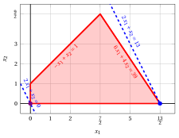{ .fig .ovale loading=lazy style="width:76%" }

    Una soluzione ottima ${ \tilde{\boldsymbol x}}(\,LP\,)$ è:

    $$
    \tilde{x}_1=\dfrac{13}{2},~~\tilde{x}_2=0
    $$

    il valore ottimo $z(\, LP\,)$ è $13.$

    In viola il primo vertice esplorato dalla precedente esecuzione dell'algoritmo del simplesso rivisto (prima di raggiungere quello ottimo rappresentato in blu).

    In blu tratteggiato, le curve di livello della funzione obiettivo associate ai valori assunti nei due vertici.

!!! esercizio "Esercizio 11.11: Algoritmo del simplesso rivisto (P10)"

    Consideriamo il seguente problema LP in forma canonica di massimo con $n=2$ variabili e $m=3$ vincoli:

    $$
    \begin{array}{rrrrrr}
    {\max} & {5}\, {x_1} & {+} & {2}\, {x_2} \\[2ex]
    \text{soggetto a} & {-x_1} & {+} & {3}\, {x_2} & {\le} & {12} \\[2ex]
    & {x_1} & {+} & {2}\, {x_2} & {\le} & {12} \\[2ex]
    & {3}\, {x_1} & {-} & {2}\, {x_2} & {\le} & {8} \\[2ex]
    & {x_1,} &  & {x_2} & {\ge} & {0}
    \end{array}
    $$

    Introducendo le variabili di scarto, otteniamo il seguente problema LP in forma standard di massimo con $n+m=5$ variabili e $m=3$ vincoli:

    $$
    \begin{array}{rrrrrrrrrrrr}
    {\max} & {5}\, {x_1} & {+} & {2}\, {x_2} \\[2ex]
    \text{soggetto a} & {-x_1} & {+} & {3}\, {x_2} & {+} & {x_3} &  &  &  &  & {=} & {12} \\[2ex]
    & {x_1} & {+} & {2}\, {x_2} &  &  & {+} & {x_4} &  &  & {=} & {12} \\[2ex]
    & {3}\, {x_1} & {-} & {2}\, {x_2} &  &  &  &  & {+} & {x_5} & {=} & {8} \\[2ex]
    & {x_1,} &  & {x_2,} &  & {x_3,} &  & {x_4,} &  & {x_5} & {\ge} & {0}
    \end{array}
    $$

    **Domande**

    - Eseguire l'algoritmo del simplesso rivisto per trovare una soluzione ottima di questo problema LP, usando la regola di Bland per scegliere la colonna pivot e la riga pivot.

??? soluzione "Soluzione"

    Abbiamo:

    $$
    {\boldsymbol A}=
    \begin{pmatrix}
    -1 & 3 & 1 & 0 & 0\\
    1 & 2 & 0 & 1 & 0\\
    3 & -2 & 0 & 0 & 1
    \end{pmatrix}
    \quad
    {\boldsymbol b}=
    \begin{pmatrix}
    12\\
    12\\
    8
    \end{pmatrix}
    \quad
    {\boldsymbol c}=
    \begin{pmatrix}
    5\\
    2\\
    0\\
    0\\
    0
    \end{pmatrix}
    \quad
    {\boldsymbol x}=
    \begin{pmatrix}
    x_1 \\
    x_2 \\
    x_3 \\
    x_4 \\
    x_5
    \end{pmatrix}
    $$

    - <strong>Inizializzazione</strong>

        Poiché è un problema LP in forma standard ottenuto da un problema LP in forma canonica con $~{\boldsymbol b} \ge 0$ aggiungendo le variabili di scarto, la partizione $\pazocal{B}=\{3,4,5\}$ e $\pazocal{N}=\{1,2\}$ è associata alla seguente soluzione di base ammissibile:

        $$
        \begin{pmatrix}
        x_3 \\
        x_4 \\
        x_5
        \end{pmatrix}
        =
        \begin{pmatrix}
        12\\
        12\\
        8
        \end{pmatrix}
        {\rm ~~~e~~~}
        \begin{pmatrix}
        x_1 \\
        x_2
        \end{pmatrix}
        =
        \begin{pmatrix}
        0\\
        0
        \end{pmatrix}
        $$

    - <strong>Iterazione 1</strong>

        Con $\pazocal{B}= \{3,~~4,~~5\}$ e $\pazocal{N}= \{1,~~2\}$, abbiamo:

        $$
        {\boldsymbol x}_{\pazocal{B}}=
        \begin{pmatrix}
        x_3 \\
        x_4 \\
        x_5
        \end{pmatrix} ~~
        {\boldsymbol A}_{\pazocal{B}}=
        \begin{pmatrix}
        1 & 0 & 0\\
        0 & 1 & 0\\
        0 & 0 & 1
        \end{pmatrix} ~~
        {\boldsymbol c}_{\pazocal{B}}=
        \begin{pmatrix}
        0\\
        0\\
        0
        \end{pmatrix} ~~
        {{ \bar{\boldsymbol b}}}=
        \begin{pmatrix}
        12\\
        12\\
        8
        \end{pmatrix}
        $$

        $$
        {\boldsymbol x}_{\pazocal{N}}=
        \begin{pmatrix}
        x_1 \\
        x_2
        \end{pmatrix} ~~
        {\boldsymbol A}_{\pazocal{N}}=
        \begin{pmatrix}
        -1 & 3\\
        1 & 2\\
        3 & -2
        \end{pmatrix} ~~
        {\boldsymbol c}_{\pazocal{N}}=
        \begin{pmatrix}
        5\\
        2
        \end{pmatrix}
        $$

        <strong>Test di ottimalità</strong>

        Risolviamo  ${\boldsymbol \pi} \; {\boldsymbol A}_{\pazocal{B}} = {\boldsymbol c}'_{\pazocal{B}}$ per calcolare ${\boldsymbol \pi} =  {{{\boldsymbol c}'_{\pazocal{B}} \; {\boldsymbol A}_{\pazocal{B}}^{-1}}}$, <u>primo sistema di equazioni lineari</u>:

        \begin{equation*}
        \begin{cases}
        \begin{array}{rrrrrrr}
        {\pi_3} &  &  &  &  & {=} & {0} \\[2ex]
        &  & {\pi_4} &  &  & {=} & {0} \\[2ex]
        &  &  &  & {\pi_5} & {=} & {0}
        \end{array}
        \end{cases}
        \qquad
        {\boldsymbol \pi}=
        \begin{pmatrix}
        0 & 0 & 0\\
        \end{pmatrix}
        \end{equation*}

        Calcoliamo il valore della soluzione di base ammissibile ${\bar{z}} = {\boldsymbol \pi} \; {\boldsymbol b} = \begin{pmatrix} 0 & 0 & 0\\ \end{pmatrix} \begin{pmatrix} 12\\ 12\\ 8 \end{pmatrix} = 0$

        Calcoliamo i costi ridotti ${{ \bar{\boldsymbol c}}'}  = {{\boldsymbol c}'_{\pazocal{N}} - {\boldsymbol \pi} \; {\boldsymbol A}_{\pazocal{N}}}$:

        $$
        \begin{aligned}
        {{ \bar{\boldsymbol c}}'}
        &= \begin{pmatrix}
        5 & 2\\
        \end{pmatrix} - \begin{pmatrix}
        0 & 0 & 0\\
        \end{pmatrix} \begin{pmatrix}
        -1 & 3\\
        1 & 2\\
        3 & -2
        \end{pmatrix}
        \\[1ex]
        &= \underbrace{
        \begin{pmatrix}
        5 & 2\\
        \end{pmatrix}
        }_{{c_{1}~~~c_{2}}}
        -
        \underbrace{
        \begin{pmatrix}
        0 & 0\\
        \end{pmatrix}
        }_{{\boldsymbol \pi}\;{\boldsymbol A}_{1} ~~{\boldsymbol \pi}\;{\boldsymbol A}_{2}}
        =
        \underbrace{
        \begin{pmatrix}
        5 & 2\\
        \end{pmatrix}
        }_{{\bar{c}_{1}~~~\bar{c}_{2}}}
        \end{aligned}
        $$

        Non tutti i costi ridotti sono non positivi, quindi eseguiamo un'operazione di pivot.

        <strong>Operazione di pivot</strong>

        Poiché ${c}_{1} > {\boldsymbol \pi} \;{\boldsymbol A}_{1}$, $x_1$ è la <u>colonna pivot</u> e abbiamo ${\boldsymbol A}_{1} = \begin{pmatrix} -1\\ 1\\ 3 \end{pmatrix}$

        Risolviamo   ${\boldsymbol A}_{\pazocal{B}} \; {\boldsymbol d} = {\boldsymbol A}_{1}$ per calcolare   ${\boldsymbol d}={ {\boldsymbol A}_{\pazocal{B}}^{-1}} {\boldsymbol A}_{1}$,  <u>secondo sistema di equazioni lineari</u>:

        \begin{equation*}
        \begin{cases}
        \begin{array}{rrrrrrr}
        {d_3} &  &  &  &  & {=} & {-1} \\[2ex]
        &  & {d_4} &  &  & {=} & {1} \\[2ex]
        &  &  &  & {d_5} & {=} & {3}
        \end{array}
        \end{cases}
        \qquad
        {\boldsymbol d}=
        \begin{pmatrix}
        -1\\
        1\\
        3
        \end{pmatrix}
        \end{equation*}

        Dobbiamo trovare il valore massimo di $t$ tale che ${{ \bar{\boldsymbol b}}}  - t \; {{\boldsymbol d}} \ge 0$:

        $$
        \begin{cases}
        \underbrace{12 -t \cdot \left( -1\right)\ge 0}_{x_3 \ge 0} \\[2ex]
        \underbrace{12 -t \cdot 1\ge 0}_{x_4 \ge 0} \\[2ex]
        \underbrace{8 -t \cdot 3\ge 0}_{x_5 \ge 0}
        \end{cases}
        \qquad
        \begin{cases}
        t\ge -12 \\[2ex]
        t\le 12 \\[2ex]
        t\le \dfrac{8}{3}
        \end{cases}
        \text{   quindi   } t_{m}=\dfrac{8}{3}
        $$

        Di conseguenza, il valore della colonna pivot diventa $t_{m}$, cioè $x_1=\dfrac{8}{3}$. Il valore di $x_5$ diventa zero e $x_5$ è la <u>riga pivot</u>. Le altre variabili in base assumono i valori  ${ \bar{\boldsymbol b}} - t_{m} \; {\boldsymbol d}$,  quindi abbiamo:

        $$
        \begin{aligned}
        x_3 &= 12 - \dfrac{8}{3} \cdot \left( -1\right) = \dfrac{44}{3} \\[2ex]
        x_4 &= 12 - \dfrac{8}{3} \cdot 1 = \dfrac{28}{3}
        \end{aligned}
        $$

    - <strong>Iterazione 2</strong>

        Con $\pazocal{B}= \{1,~~3,~~4\}$ e $\pazocal{N}= \{2,~~5\}$, abbiamo:

        $$
        {\boldsymbol x}_{\pazocal{B}}=
        \begin{pmatrix}
        x_1 \\
        x_3 \\
        x_4
        \end{pmatrix} ~~
        {\boldsymbol A}_{\pazocal{B}}=
        \begin{pmatrix}
        -1 & 1 & 0\\
        1 & 0 & 1\\
        3 & 0 & 0
        \end{pmatrix} ~~
        {\boldsymbol c}_{\pazocal{B}}=
        \begin{pmatrix}
        5\\
        0\\
        0
        \end{pmatrix} ~~
        {{ \bar{\boldsymbol b}}}=
        \begin{pmatrix}
        \dfrac{8}{3}\\[2ex]
        \dfrac{44}{3}\\[2ex]
        \dfrac{28}{3}
        \end{pmatrix}
        $$

        $$
        {\boldsymbol x}_{\pazocal{N}}=
        \begin{pmatrix}
        x_2 \\
        x_5
        \end{pmatrix} ~~
        {\boldsymbol A}_{\pazocal{N}}=
        \begin{pmatrix}
        3 & 0\\
        2 & 0\\
        -2 & 1
        \end{pmatrix} ~~
        {\boldsymbol c}_{\pazocal{N}}=
        \begin{pmatrix}
        2\\
        0
        \end{pmatrix}
        $$

        <strong>Test di ottimalità</strong>

        Risolviamo  ${\boldsymbol \pi} \; {\boldsymbol A}_{\pazocal{B}} = {\boldsymbol c}'_{\pazocal{B}}$ per calcolare ${\boldsymbol \pi} =  {{{\boldsymbol c}'_{\pazocal{B}} \; {\boldsymbol A}_{\pazocal{B}}^{-1}}}$, <u>primo sistema di equazioni lineari</u>:

        \begin{equation*}
        \begin{cases}
        \begin{array}{rrrrrrr}
        {-\pi_1} & {+} & {\pi_3} & {+} & {3}\, {\pi_4} & {=} & {5} \\[2ex]
        {\pi_1} &  &  &  &  & {=} & {0} \\[2ex]
        &  & {\pi_3} &  &  & {=} & {0}
        \end{array}
        \end{cases}
        \qquad
        {\boldsymbol \pi}=
        \begin{pmatrix}
        0 & 0 & \dfrac{5}{3}\\
        \end{pmatrix}
        \end{equation*}

        Calcoliamo il valore della soluzione di base ammissibile ${\bar{z}} = {\boldsymbol \pi} \; {\boldsymbol b} = \begin{pmatrix} 0 & 0 & \dfrac{5}{3}\\ \end{pmatrix} \begin{pmatrix} 12\\ 12\\ 8 \end{pmatrix} = \dfrac{40}{3}$

        Calcoliamo i costi ridotti ${{ \bar{\boldsymbol c}}'}  = {{\boldsymbol c}'_{\pazocal{N}} - {\boldsymbol \pi} \; {\boldsymbol A}_{\pazocal{N}}}$:

        $$
        \begin{aligned}
        {{ \bar{\boldsymbol c}}'}
        &= \begin{pmatrix}
        2 & 0\\
        \end{pmatrix} - \begin{pmatrix}
        0 & 0 & \dfrac{5}{3}\\
        \end{pmatrix} \begin{pmatrix}
        3 & 0\\
        2 & 0\\
        -2 & 1
        \end{pmatrix}
        \\[1ex]
        &= \underbrace{
        \begin{pmatrix}
        2 & 0\\
        \end{pmatrix}
        }_{{c_{2}~~~c_{5}}}
        -
        \underbrace{
        \begin{pmatrix}
        -\dfrac{10}{3} & \dfrac{5}{3}\\
        \end{pmatrix}
        }_{{\boldsymbol \pi}\;{\boldsymbol A}_{2} ~~{\boldsymbol \pi}\;{\boldsymbol A}_{5}}
        =
        \underbrace{
        \begin{pmatrix}
        \dfrac{16}{3} & -\dfrac{5}{3}\\
        \end{pmatrix}
        }_{{\bar{c}_{2}~~~\bar{c}_{5}}}
        \end{aligned}
        $$

        Non tutti i costi ridotti sono non positivi, quindi eseguiamo un'operazione di pivot.

        <strong>Operazione di pivot</strong>

        Poiché ${c}_{2} > {\boldsymbol \pi} \;{\boldsymbol A}_{2}$, $x_2$ è la <u>colonna pivot</u> e abbiamo ${\boldsymbol A}_{2} = \begin{pmatrix} 3\\ 2\\ -2 \end{pmatrix}$

        Risolviamo   ${\boldsymbol A}_{\pazocal{B}} \; {\boldsymbol d} = {\boldsymbol A}_{2}$ per calcolare   ${\boldsymbol d}={ {\boldsymbol A}_{\pazocal{B}}^{-1}} {\boldsymbol A}_{2}$,  <u>secondo sistema di equazioni lineari</u>:

        \begin{equation*}
        \begin{cases}
        \begin{array}{rrrrrrr}
        {-d_1} & {+} & {d_3} &  &  & {=} & {3} \\[2ex]
        {d_1} &  &  & {+} & {d_4} & {=} & {2} \\[2ex]
        {3}\, {d_1} &  &  &  &  & {=} & {-2}
        \end{array}
        \end{cases}
        \qquad
        {\boldsymbol d}=
        \begin{pmatrix}
        -\dfrac{2}{3}\\[2ex]
        \dfrac{7}{3}\\[2ex]
        \dfrac{8}{3}
        \end{pmatrix}
        \end{equation*}

        Dobbiamo trovare il valore massimo di $t$ tale che ${{ \bar{\boldsymbol b}}}  - t \; {{\boldsymbol d}} \ge 0$:

        $$
        \begin{cases}
        \underbrace{\dfrac{8}{3} -t \cdot \left( -\dfrac{2}{3}\right)\ge 0}_{x_1 \ge 0} \\[2ex]
        \underbrace{\dfrac{44}{3} -t \cdot \dfrac{7}{3}\ge 0}_{x_3 \ge 0} \\[2ex]
        \underbrace{\dfrac{28}{3} -t \cdot \dfrac{8}{3}\ge 0}_{x_4 \ge 0}
        \end{cases}
        \qquad
        \begin{cases}
        t\ge -4 \\[2ex]
        t\le \dfrac{44}{7} \\[2ex]
        t\le \dfrac{7}{2}
        \end{cases}
        \text{   quindi   } t_{m}=\dfrac{7}{2}
        $$

        Di conseguenza, il valore della colonna pivot diventa $t_{m}$, cioè $x_2=\dfrac{7}{2}$. Il valore di $x_4$ diventa zero e $x_4$ è la <u>riga pivot</u>. Le altre variabili in base assumono i valori  ${ \bar{\boldsymbol b}} - t_{m} \; {\boldsymbol d}$,  quindi abbiamo:

        $$
        \begin{aligned}
        x_1 &= \dfrac{8}{3} - \dfrac{7}{2} \cdot \left( -\dfrac{2}{3}\right) = 5 \\[2ex]
        x_3 &= \dfrac{44}{3} - \dfrac{7}{2} \cdot \dfrac{7}{3} = \dfrac{13}{2}
        \end{aligned}
        $$

    - <strong>Iterazione 3</strong>

        Con $\pazocal{B}= \{1,~~2,~~3\}$ e $\pazocal{N}= \{4,~~5\}$, abbiamo:

        $$
        {\boldsymbol x}_{\pazocal{B}}=
        \begin{pmatrix}
        x_1 \\
        x_2 \\
        x_3
        \end{pmatrix} ~~
        {\boldsymbol A}_{\pazocal{B}}=
        \begin{pmatrix}
        -1 & 3 & 1\\
        1 & 2 & 0\\
        3 & -2 & 0
        \end{pmatrix} ~~
        {\boldsymbol c}_{\pazocal{B}}=
        \begin{pmatrix}
        5\\
        2\\
        0
        \end{pmatrix} ~~
        {{ \bar{\boldsymbol b}}}=
        \begin{pmatrix}
        5\\[2ex]
        \dfrac{7}{2}\\[2ex]
        \dfrac{13}{2}
        \end{pmatrix}
        $$

        $$
        {\boldsymbol x}_{\pazocal{N}}=
        \begin{pmatrix}
        x_4 \\
        x_5
        \end{pmatrix} ~~
        {\boldsymbol A}_{\pazocal{N}}=
        \begin{pmatrix}
        0 & 0\\
        1 & 0\\
        0 & 1
        \end{pmatrix} ~~
        {\boldsymbol c}_{\pazocal{N}}=
        \begin{pmatrix}
        0\\
        0
        \end{pmatrix}
        $$

        <strong>Test di ottimalità</strong>

        Risolviamo  ${\boldsymbol \pi} \; {\boldsymbol A}_{\pazocal{B}} = {\boldsymbol c}'_{\pazocal{B}}$ per calcolare ${\boldsymbol \pi} =  {{{\boldsymbol c}'_{\pazocal{B}} \; {\boldsymbol A}_{\pazocal{B}}^{-1}}}$, <u>primo sistema di equazioni lineari</u>:

        \begin{equation*}
        \begin{cases}
        \begin{array}{rrrrrrr}
        {-\pi_1} & {+} & {\pi_2} & {+} & {3}\, {\pi_3} & {=} & {5} \\[2ex]
        {3}\, {\pi_1} & {+} & {2}\, {\pi_2} & {-} & {2}\, {\pi_3} & {=} & {2} \\[2ex]
        {\pi_1} &  &  &  &  & {=} & {0}
        \end{array}
        \end{cases}
        \qquad
        {\boldsymbol \pi}=
        \begin{pmatrix}
        0 & 2 & 1\\
        \end{pmatrix}
        \end{equation*}

        Calcoliamo il valore della soluzione di base ammissibile ${\bar{z}} = {\boldsymbol \pi} \; {\boldsymbol b} = \begin{pmatrix} 0 & 2 & 1\\ \end{pmatrix} \begin{pmatrix} 12\\ 12\\ 8 \end{pmatrix} = 32$

        Calcoliamo i costi ridotti ${{ \bar{\boldsymbol c}}'}  = {{\boldsymbol c}'_{\pazocal{N}} - {\boldsymbol \pi} \; {\boldsymbol A}_{\pazocal{N}}}$:

        $$
        \begin{aligned}
        {{ \bar{\boldsymbol c}}'}
        &= \begin{pmatrix}
        0 & 0\\
        \end{pmatrix} - \begin{pmatrix}
        0 & 2 & 1\\
        \end{pmatrix} \begin{pmatrix}
        0 & 0\\
        1 & 0\\
        0 & 1
        \end{pmatrix}
        \\[1ex]
        &= \underbrace{
        \begin{pmatrix}
        0 & 0\\
        \end{pmatrix}
        }_{{c_{4}~~~c_{5}}}
        -
        \underbrace{
        \begin{pmatrix}
        2 & 1\\
        \end{pmatrix}
        }_{{\boldsymbol \pi}\;{\boldsymbol A}_{4} ~~{\boldsymbol \pi}\;{\boldsymbol A}_{5}}
        =
        \underbrace{
        \begin{pmatrix}
        -2 & -1\\
        \end{pmatrix}
        }_{{\bar{c}_{4}~~~\bar{c}_{5}}}
        \end{aligned}
        $$

        Tutti i costi ridotti sono non positivi, quindi la soluzione di base ammissibile

        $$
        {\boldsymbol x}_{\pazocal{B}}=
        \begin{pmatrix}
        x_1 \\
        x_2 \\
        x_3
        \end{pmatrix}=\begin{pmatrix}
        5\\[2ex]
        \dfrac{7}{2}\\[2ex]
        \dfrac{13}{2}
        \end{pmatrix} {\rm ~~~e~~~} {\boldsymbol x}_{\pazocal{N}}=
        \begin{pmatrix}
        x_4 \\
        x_5
        \end{pmatrix}=\begin{pmatrix}
        0\\
        0
        \end{pmatrix}
        $$

        è una soluzione ottima del problema LP e ${\bar{z}} = 32$ è il valore ottimo.

    <strong>Soluzione grafica:</strong>

    La regione ammissibile del problema LP (in forma canonica) è il poliedro ombreggiato in rosso: 

    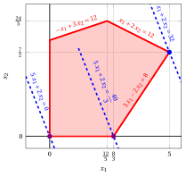{ .fig .ovale loading=lazy style="width:76%" }

    Una soluzione ottima ${ \tilde{\boldsymbol x}}(\,LP\,)$ è:

    $$
    \tilde{x}_1=5,~~\tilde{x}_2=\dfrac{7}{2}
    $$

    il valore ottimo $z(\, LP\,)$ è $32.$

    In viola il primo e il secondo vertice esplorati dalla precedente esecuzione dell'algoritmo del simplesso rivisto (prima di raggiungere quello ottimo rappresentato in blu).

    In blu tratteggiato, le curve di livello della funzione obiettivo associate ai valori assunti nei tre vertici.

!!! esercizio "Esercizio 11.12: Prima fase dell'algoritmo del simplesso rivisto (P21)"

    Consideriamo il seguente problema LP in forma canonica di massimo con $n=2$ variabili e $m=3$ vincoli:

    $$
    \begin{array}{rrrrrrrrrrrrr}
    {\max} & \, {x_1} & {+} & {2} \, {x_2} \\[2ex]
    \text{soggetto a} & {- }\, {x_1} & {-} & \, {x_2} & {\le} & {-2} \\[2ex]
    & {4} \, {x_1} & {-} & {2} \, {x_2} & {\le} & {7} \\[2ex]
    & {x_1} & {+} & {5} \, {x_2} & {\le} & {21} \\[2ex]
    & {x_1,} &  & {x_2} & { \ge} & {0 }
    \end{array}
    $$

    **Domande**

    1. Risolvere la prima fase dell'algoritmo del simplesso usando la regola di Bland per scegliere la colonna pivot e la riga pivot.

    2. A partire dalla soluzione di base ammissibile ottenuta nella domanda precedente, risolvere questo problema LP usando l'algoritmo del simplesso rivisto e la regola di Bland per scegliere la colonna pivot e la riga pivot.

??? soluzione "Soluzione"

    1. Scriviamo il problema ausiliario:

        $$
        \begin{array}{rcrcrcrcrcrcrcr}
        {\max} & {-} & {x_0} &  &  &  &  &  &  &  &  \\[2ex]
        \text{soggetto a} & {-} & {x_0} & {- } & \, {x_1} & {-} & \, {x_2} & {+} & \, {x_3} &  &  &  &  & {=} & {-2} \\[2ex]
        & {-} & {x_0} & {+} & {4} \, {x_1} & {-} & {2} \, {x_2} &  &  & {+} & \, {x_4} &  &  & {=} & {7} \\[2ex]
        & {-} & {x_0} & {+} & {x_1} & {+} & {5} \, {x_2} &  &  &  &  & {+} & \, {x_5} & {=} & {21} \\[2ex]
        &  & {x_0,} &  & {x_1,} &  & {x_2,} &  & {x_3,} &  & {x_4,} &  & \, {x_5} & { \ge} & {0 }
        \end{array}
        $$

        Ora ci sono $n + m + 1 = 6$ variabili e $m = 3$ vincoli. Abbiamo:

        $$
        {\boldsymbol A}=
        \begin{pmatrix}
        -1 & -1 & -1 & 1 & 0 & 0\\[2ex]
        -1 & 4 & -2 &  0 & 1 & 0\\[2ex]
        -1 & 1 & 5 & 0 & 0 & 1\\
        \end{pmatrix}
        \quad
        {\boldsymbol b}=
        \begin{pmatrix}
        -2 \\[2ex]
        7 \\[2ex]
        21 \\
        \end{pmatrix}
        \quad
        {\boldsymbol c}=
        \begin{pmatrix}
        -1 \\
        0  \\
        0  \\
        0  \\
        0 \\
        0 \\
        \end{pmatrix}
        \quad
        {\boldsymbol x}=
        \begin{pmatrix}
        x_{0} \\
        x_{1} \\
        x_{2} \\
        x_{3}  \\
        x_{4} \\
        x_{5} \\
        \end{pmatrix}
        $$

        - <strong>Inizializzazione</strong>

            Consideriamo $\pazocal{B}= \{3,~~4,~~5\}$ e $\pazocal{N}= \{0,~~1,~~2\}$, abbiamo:

            $$
            {\boldsymbol x}_{\pazocal{B}}=
            \begin{pmatrix}
            x_3 \\
            x_4 \\
            x_5 \\
            \end{pmatrix} ~~
            {\boldsymbol A}_{\pazocal{B}}=
            \begin{pmatrix}
            1 & 0 & 0\\
            0 & 1 & 0\\
            0 & 0 & 1\\
            \end{pmatrix} ~~
            {\boldsymbol c}_{\pazocal{B}}=
            \begin{pmatrix}
            0 \\
            0 \\
            0 \\
            \end{pmatrix} ~~
            {{ \bar{\boldsymbol b}}}=\begin{pmatrix}
            -2 \\
            7 \\
            21 \\
            \end{pmatrix}
            $$

            $$
            {\boldsymbol x}_{\pazocal{N}}=
            \begin{pmatrix}
            x_0 \\
            x_1 \\
            x_2 \\
            \end{pmatrix} ~~
            {\boldsymbol A}_{\pazocal{N}}=
            \begin{pmatrix}
            -1 & -1 & -1\\
            -1 & 4 & -2 \\
            -1 & 1 & 5 \\
            \end{pmatrix} ~~
            {\boldsymbol c}_{\pazocal{N}}=
            \begin{pmatrix}
            -1 \\
            0 \\
            0 \\
            \end{pmatrix}
            $$

            <strong>Prima operazione di pivot</strong>

            La variabile $x_0$ entra in base e $x_3$ esce dalla base, poiché $x_3$ è la variabile di scarto associata al termine noto più negativo (che è anche l'unico negativo). Abbiamo $x_0 = - b_1 = 2$.

            Le altre variabili in base $x_j$ con $j \in \pazocal B$ assumono i valori $x_j ~ = ~ {b}_j - b_1\,$,  quindi abbiamo:

            $$
            x_4= 7 - (- 2) = 9
            $$

            $$
            x_5= 21 - (- 2) = 23
            $$

            Le nuove variabili in base sono ${\boldsymbol x}_{\pazocal{B}}=\begin{pmatrix} x_0 \\ x_4 \\ x_5 \\ \end{pmatrix}$. La soluzione di base ammissibile è ${{ \bar{\boldsymbol b}}}=\begin{pmatrix} 2 \\ 9 \\ 23 \\ \end{pmatrix}$

        - <strong>Iterazione 1</strong>

            Con $\pazocal{B}= \{0,~~4,~~5\}$ e $\pazocal{N}= \{1,~~2,~~3\}$, abbiamo:

            $$
            {\boldsymbol x}_{\pazocal{B}}=
            \begin{pmatrix}
            x_0 \\
            x_4 \\
            x_5 \\
            \end{pmatrix} ~~
            {\boldsymbol A}_{\pazocal{B}}=
            \begin{pmatrix}
            -1 & 0 & 0\\
            -1 & 1 & 0\\
            -1 & 0 & 1\\
            \end{pmatrix} ~~
            {\boldsymbol c}_{\pazocal{B}}=
            \begin{pmatrix}
            -1 \\
            0 \\
            0 \\
            \end{pmatrix} ~~
            {{ \bar{\boldsymbol b}}}=\begin{pmatrix}
            2 \\
            9 \\
            23 \\
            \end{pmatrix}
            $$

            $$
            {\boldsymbol x}_{\pazocal{N}}=
            \begin{pmatrix}
            x_1 \\
            x_2 \\
            x_3 \\
            \end{pmatrix} ~~
            {\boldsymbol A}_{\pazocal{N}}=
            \begin{pmatrix}
            -1 & -1 & 1\\
            4 & -2 & 0\\
            1 & 5 & 0\\
            \end{pmatrix} ~~
            {\boldsymbol c}_{\pazocal{N}}=
            \begin{pmatrix}
            0 \\
            0 \\
            0 \\
            \end{pmatrix}
            $$

            <strong>Test di ottimalità</strong>

            Risolviamo  ${\boldsymbol \pi} \; {\boldsymbol A}_{\pazocal{B}} = {\boldsymbol c}'_{\pazocal{B}}$ per calcolare ${\boldsymbol \pi} =  {{{\boldsymbol c}'_{\pazocal{B}} \; {\boldsymbol A}_{\pazocal{B}}^{-1}}}$, <u>primo sistema di equazioni lineari</u>:

            \begin{equation*}
            \begin{cases}
            \begin{array}{rrrrrrrrrrrrr}
            {-} & {\pi_0} & {-} & {\, \pi_4} & {-} & { \pi_5} & {=} & {-1} \\[2ex]
            &  &  & {\pi_4} &  &  & {=} & {0} \\[2ex]
            &  &  &  &  & {\pi_5} & {=} & {0}
            \end{array}
            \end{cases}
            \qquad
            {\boldsymbol \pi}=
            \begin{pmatrix}
            1 & 0 & 0\\
            \end{pmatrix}
            \end{equation*}

            Calcoliamo il valore della soluzione di base ammissibile ${\bar{z}} = {\boldsymbol \pi} \; {\boldsymbol b} = \begin{pmatrix} 1 & 0 & 0 \\ \end{pmatrix} \begin{pmatrix} -2 \\ 7 \\ 21 \\ \end{pmatrix} = -2$

            Calcoliamo i costi ridotti ${{ \bar{\boldsymbol c}}'}  = {{\boldsymbol c}'_{\pazocal{N}} - {\boldsymbol \pi} \; {\boldsymbol A}_{\pazocal{N}}}$:

            $$
            \begin{aligned}
            {{ \bar{\boldsymbol c}}'}
            &= \begin{pmatrix}
            0 & 0 & 0 \\
            \end{pmatrix} - \begin{pmatrix}
            1 & 0 & 0 \\
            \end{pmatrix}
            \begin{pmatrix}
            -1 & -1 & 1\\
            4 & -2 & 0\\
            1 & 5 & 0\\
            \end{pmatrix}
            \\[1ex]
            &=
            \underbrace{
            \begin{pmatrix}
            0 & 0 & 0 \\
            \end{pmatrix}
            }_{{c_{1}~~~c_{2}~~~c_{3}}}
            -
            \underbrace{
            \begin{pmatrix}
            -1 & -1 & 1\\
            \end{pmatrix}
            }_{{\boldsymbol \pi}\;{\boldsymbol A}_{1} ~~{\boldsymbol \pi}\;{\boldsymbol A}_{2} ~~{\boldsymbol \pi}\;{\boldsymbol A}_{3}}
            =
            \underbrace{
            \begin{pmatrix}
            1 & 1 & -1 \\
            \end{pmatrix}
            }_{{\bar{c}_{1}~~~~\bar{c}_{2}~~~~\bar{c}_{3}}}
            \end{aligned}
            $$

            Non tutti i costi ridotti sono non positivi, quindi eseguiamo un'operazione di pivot.

            <strong>Operazione di pivot</strong>

            Poiché ${c}_1 > {\boldsymbol \pi} \;{\boldsymbol A}_{1}$, $x_1$ è la <u>colonna pivot</u>  e abbiamo ${\boldsymbol A}_{1} = \begin{pmatrix} -1 \\ 4 \\ 1 \end{pmatrix}$

            Risolviamo   ${\boldsymbol A}_{\pazocal{B}} \; {\boldsymbol d} = {\boldsymbol A}_{1}$ per calcolare   ${\boldsymbol d}={ {\boldsymbol A}_{\pazocal{B}}^{-1}} {\boldsymbol A}_{1}$,  <u>secondo sistema di equazioni lineari</u>:

            \begin{equation*}
            \begin{cases}
            \begin{array}{rrrrrrrrrrrrr}
            {-} & {d_0} &  &  &  &  & {=} & {-1} \\[2ex]
            {-} & {d_0} & + & {d_4} &  &  & {=} & {4} \\[2ex]
            {-} & {d_0} &  &  & + & {d_5} & {=} & {1}
            \end{array}
            \end{cases}
            \qquad
            {\boldsymbol d}=
            \begin{pmatrix}
            1 \\
            5 \\
            2 \\
            \end{pmatrix}
            \end{equation*}

            Dobbiamo trovare il valore massimo di $t$ tale che ${{ \bar{\boldsymbol b}}}  - t \; {{\boldsymbol d}} \ge 0$:

            $$
            \begin{cases}
            \underbrace{2 -t \cdot \left( 1\right)\ge 0}_{x_0 \ge 0} \\[1ex]
            \underbrace{9 -t \cdot \left( 5\right)\ge 0}_{x_4 \ge 0} \\[1ex]
            \underbrace{23 -t \cdot \left( 2\right)\ge 0}_{x_5 \ge 0} \\
            \end{cases}
            \qquad
            \begin{cases}
            t\le 2  \\[1ex]
            t\le \frac{9}{5}  \\[1ex]
            t \le \frac{23}{2} \\
            \end{cases}
            \text{   quindi   } t_{m}=\frac{9}{5}
            $$

            Di conseguenza, il valore della colonna pivot diventa $t_{m}$, cioè $x_1=\frac{9}{5}$. Il valore di $x_4$ diventa zero e $x_4$ è la <u>riga pivot</u>. Le altre variabili in base assumono i valori  ${ \bar{\boldsymbol b}} - t_{m} \; {\boldsymbol d}$,  quindi abbiamo:

            $$
            x_0= 2 - \frac{9}{5} \cdot \left( 1\right)= \frac{1}{5}
            $$

            $$
            x_5= 23 - \frac{9}{5} \cdot \left( 2\right)= \frac{97}{5}
            $$

        - <strong>Iterazione 2</strong>

            Con $\pazocal{B}= \{0,~~1,~~5\}$ e $\pazocal{N}= \{2,~~3,~~4 \}$, abbiamo:

            $$
            {\boldsymbol x}_{\pazocal{B}}=
            \begin{pmatrix}
            x_0 \\
            x_1 \\
            x_5 \\
            \end{pmatrix} ~~
            {\boldsymbol A}_{\pazocal{B}}=
            \begin{pmatrix}
            -1 & -1 & 0\\
            -1 & 4 & 0\\
            -1 & 1 & 1\\
            \end{pmatrix} ~~
            {\boldsymbol c}_{\pazocal{B}}=
            \begin{pmatrix}
            -1 \\
            0 \\
            0 \\
            \end{pmatrix} ~~
            {{ \bar{\boldsymbol b}}}=\begin{pmatrix}
            \frac{1}{5} \\[1.5ex]
            \frac{9}{5} \\[1.5ex]
            \frac{97}{5} \\
            \end{pmatrix}
            $$

            $$
            {\boldsymbol x}_{\pazocal{N}}=
            \begin{pmatrix}
            x_2 \\
            x_3 \\
            x_4 \\
            \end{pmatrix} ~~
            {\boldsymbol A}_{\pazocal{N}}=
            \begin{pmatrix}
            -1 & 1 & 0 \\
            -2 & 0 & 1 \\
            5  & 0 & 0 \\
            \end{pmatrix} ~~
            {\boldsymbol c}_{\pazocal{N}}=
            \begin{pmatrix}
            0 \\
            0 \\
            0 \\
            \end{pmatrix}
            $$

            <strong>Test di ottimalità</strong>

            Risolviamo  ${\boldsymbol \pi} \; {\boldsymbol A}_{\pazocal{B}} = {\boldsymbol c}'_{\pazocal{B}}$ per calcolare ${\boldsymbol \pi} =  {{{\boldsymbol c}'_{\pazocal{B}} \; {\boldsymbol A}_{\pazocal{B}}^{-1}}}$, <u>primo sistema di equazioni lineari</u>:

            \begin{equation*}
            \begin{cases}
            \begin{array}{rrrrrrrrrrrrr}
            {-} & {\pi_0} & {-} & {\, \pi_1} & {-} & { \pi_5} & {=} & {-1} \\[2ex]
            {-} & {\pi_0} & + & {4\, \pi_1} &  &  & {=} & {0} \\[2ex]
            &  &  &  &  & { \pi_5} & {=} & {0}
            \end{array}
            \end{cases}
            \qquad
            {\boldsymbol \pi}=
            \begin{pmatrix}
            \frac{4}{5} & \frac{1}{5} & 0\\
            \end{pmatrix}
            \end{equation*}

            Calcoliamo il valore della soluzione di base ammissibile ${\bar{z}} = {\boldsymbol \pi} \; {\boldsymbol b} = \begin{pmatrix} \frac{4}{5} & \frac{1}{5} & 0 \\ \end{pmatrix} \begin{pmatrix} -2 \\ 7 \\ 21 \\ \end{pmatrix} = -\frac{1}{5}$

            Calcoliamo i costi ridotti ${{ \bar{\boldsymbol c}}'}  = {{\boldsymbol c}'_{\pazocal{N}} - {\boldsymbol \pi} \; {\boldsymbol A}_{\pazocal{N}}}$:

            $$
            \begin{aligned}
            {{ \bar{\boldsymbol c}}'}
            &= \begin{pmatrix}
            0 & 0 & 0 \\
            \end{pmatrix} - \begin{pmatrix}
            \frac{4}{5} & \frac{1}{5} & 0\\
            \end{pmatrix}
            \begin{pmatrix}
            -1 & 1 & 0 \\
            -2 & 0 & 1 \\
            5  & 0 & 0 \\
            \end{pmatrix}
            \\[1ex]
            &=
            \underbrace{
            \begin{pmatrix}
            0 & 0 & 0 \\
            \end{pmatrix}
            }_{{c_{2}~~~c_{3}~~~c_{4}}}
            -
            \underbrace{
            \begin{pmatrix}
            -\frac{6}{5} & \frac{4}{5} & \frac{1}{5}  \\
            \end{pmatrix}
            }_{{\boldsymbol \pi}\;{\boldsymbol A}_{2} ~~{\boldsymbol \pi}\;{\boldsymbol A}_{3} ~~{\boldsymbol \pi}\;{\boldsymbol A}_{4}}
            =
            \underbrace{
            \begin{pmatrix}
            \frac{6}{5} & -\frac{4}{5} & -\frac{1}{5}
            \end{pmatrix}
            }_{{\bar{c}_{2}~~~~~~\bar{c}_{3}~~~~~~~\bar{c}_{4}}}
            \end{aligned}
            $$

            Non tutti i costi ridotti sono non positivi, quindi eseguiamo un'operazione di pivot.

            <strong>Operazione di pivot</strong>

            Poiché ${c}_2 > {\boldsymbol \pi} \;{\boldsymbol A}_{2}$, $x_2$ è la <u>colonna pivot</u> e abbiamo ${\boldsymbol A}_{2} = \begin{pmatrix} -1 \\ -2 \\ 5 \end{pmatrix}$

            Risolviamo   ${\boldsymbol A}_{\pazocal{B}} \; {\boldsymbol d} = {\boldsymbol A}_{2}$ per calcolare   ${\boldsymbol d}={ {\boldsymbol A}_{\pazocal{B}}^{-1}} {\boldsymbol A}_{2}$,  <u>secondo sistema di equazioni lineari</u>:

            \begin{equation*}
            \begin{cases}
            \begin{array}{rrrrrrrrrrrrr}
            {-} & { d_0} & {-} & {d_1} &  &  & {=} & {-1} \\[2ex]
            {-} & {d_0} & {+} & {4\, d_1} &  &  & {=} & {-2} \\[2ex]
            {-} & { d_0} & + & {d_1} & {+} & { d_5} & {=} & {5}
            \end{array}
            \end{cases}
            \qquad
            {\boldsymbol d}=
            \begin{pmatrix}
            \frac{6}{5} \\[1.5ex]
            -\frac{1}{5} \\[1.5ex]
            \frac{32}{5} \\
            \end{pmatrix}
            \end{equation*}

            Dobbiamo trovare il valore massimo di $t$ tale che ${{ \bar{\boldsymbol b}}}  - t \; {{\boldsymbol d}} \ge 0$:

            $$
            \begin{cases}
            \underbrace{\frac{1}{5} -t \cdot \left(  \frac{6}{5}\right)\ge 0}_{x_0 \ge 0} \\[2.8ex]
            \underbrace{\frac{9}{5} -t \cdot \left( -\frac{1}{5}\right)\ge 0}_{x_1 \ge 0} \\[2.8ex]
            \underbrace{\frac{97}{5} -t \cdot \left( \frac{32}{5}\right)\ge 0}_{x_5 \ge 0} \\
            \end{cases}
            \qquad
            \begin{cases}
            t \le  \frac{1}{6}  \\[1.5ex]
            t \ge - 9 \\[1.5ex]
            t \le  \frac{97}{32} \\
            \end{cases}
            \text{   quindi   } t_{m}=\frac{1}{6}
            $$

            Di conseguenza, il valore della colonna pivot diventa $t_{m}$, cioè $x_2=\frac{1}{6}$. Il valore di $x_0$ diventa zero e $x_0$ è la <u>riga pivot</u>. Le altre variabili in base assumono i valori  ${ \bar{\boldsymbol b}} - t_{m} \; {\boldsymbol d}$,  quindi abbiamo:

            $$
            x_1= \frac{9}{5} - \frac{1}{6} \: \left(-\frac{1}{5} \right)= \frac{11}{6}
            $$

            $$
            x_5= \frac{97}{5} - \frac{1}{6} \: \left( \frac{32}{5} \right)= \frac{55}{3}
            $$

        - <strong>Iterazione 3</strong>

            Con $\pazocal{B}= \{1,~~2,~~5\}$ e $\pazocal{N}= \{0,~~3,~~4\}$, abbiamo:

            $$
            {\boldsymbol x}_{\pazocal{B}}=
            \begin{pmatrix}
            x_1 \\
            x_2 \\
            x_5 \\
            \end{pmatrix} ~~
            {\boldsymbol A}_{\pazocal{B}}=
            \begin{pmatrix}
            -1 & -1 & 0\\
            4 & -2 & 0\\
            1 & 5 & 1\\
            \end{pmatrix} ~~
            {\boldsymbol c}_{\pazocal{B}}=
            \begin{pmatrix}
            0 \\
            0 \\
            0 \\
            \end{pmatrix} ~~
            {{ \bar{\boldsymbol b}}}=\begin{pmatrix}
            \frac{11}{6} \\[1.5ex]
            \frac{1}{6} \\[1.5ex]
            \frac{55}{3} \\
            \end{pmatrix}
            $$

            $$
            {\boldsymbol x}_{\pazocal{N}}=
            \begin{pmatrix}
            x_0 \\
            x_3 \\
            x_4 \\
            \end{pmatrix} ~~
            {\boldsymbol A}_{\pazocal{N}}=
            \begin{pmatrix}
            -1 & 1 & 0 \\
            -1 & 0 & 1 \\
            -1  & 0 & 0  \\
            \end{pmatrix} ~~
            {\boldsymbol c}_{\pazocal{N}}=
            \begin{pmatrix}
            -1 \\
            0 \\
            0 \\
            \end{pmatrix}
            $$

            <strong>Test di ottimalità</strong>

            Risolviamo  ${\boldsymbol \pi} \; {\boldsymbol A}_{\pazocal{B}} = {\boldsymbol c}'_{\pazocal{B}}$ per calcolare ${\boldsymbol \pi} =  {{{\boldsymbol c}'_{\pazocal{B}} \; {\boldsymbol A}_{\pazocal{B}}^{-1}}}$, <u>primo sistema di equazioni lineari</u>:

            \begin{equation*}
            \begin{cases}
            \begin{array}{rrrrrrrrrrrrr}
            {-} & {\pi_1} & + & {4\, \pi_2} & {+} & {\, \pi_5} & {=} & {0} \\[2ex]
            {-} & {\pi_1} & {-} & {2\, \pi_2} & {+} & {5\, \pi_5} & {=} & {0} \\[2ex]
            &  &  &  &  & { \pi_5} & {=} & {0}
            \end{array}
            \end{cases}
            \qquad
            {\boldsymbol \pi}=
            \begin{pmatrix}
            0 & 0 & 0\\
            \end{pmatrix}
            \end{equation*}

            Calcoliamo il valore della soluzione di base ammissibile ${\bar{z}} = {\boldsymbol \pi} \; {\boldsymbol b} = \begin{pmatrix} 0 & 0 & 0\\ \end{pmatrix} \begin{pmatrix} -2 \\ 7 \\ 21 \\ \end{pmatrix} = 0$

            Calcoliamo i costi ridotti ${{ \bar{\boldsymbol c}}'}  = {{\boldsymbol c}'_{\pazocal{N}} - {\boldsymbol \pi} \; {\boldsymbol A}_{\pazocal{N}}}$:

            $$
            \begin{aligned}
            {{ \bar{\boldsymbol c}}'}
            &= \begin{pmatrix}
            -1 & 0 & 0 \\
            \end{pmatrix} - \begin{pmatrix}
            0 & 0 & 0\\
            \end{pmatrix}
            \begin{pmatrix}
            -1 & 1 & 0 \\
            -1 & 0 & 1 \\
            -1  & 0 & 0  \\
            \end{pmatrix}
            \\[1ex]
            &=
            \underbrace{
            \begin{pmatrix}
            -1 & 0 & 0 \\
            \end{pmatrix}
            }_{{~c_{0}~~~~c_{3}~~~~c_{4}}}
            -
            \underbrace{
            \begin{pmatrix}
            0 & 0 & 0\\
            \end{pmatrix}
            }_{{\boldsymbol \pi}\;{\boldsymbol A}_{0} ~~{\boldsymbol \pi}\;{\boldsymbol A}_{3} ~~{\boldsymbol \pi}\;{\boldsymbol A}_{4}}
            =
            \underbrace{
            \begin{pmatrix}
            -1 & 0 & 0\\
            \end{pmatrix}
            }_{{\bar{c}_{0}~~~~~\bar{c}_{3}~~~~\bar{c}_{4}}}
            \end{aligned}
            $$

            Tutti i costi ridotti sono non positivi, quindi la soluzione di base ammissibile

            $$
            \begin{pmatrix}
            x_1 \\[1.5ex]
            x_2 \\[1.5ex]
            x_5 \\
            \end{pmatrix}=\begin{pmatrix}
            \frac{11}{6} \\[1.5ex]
            \frac{1}{6} \\[1.5ex]
            \frac{55}{3} \\
            \end{pmatrix} {\rm ~~~e~~~}
            \begin{pmatrix}
            x_0 \\[1.5ex]
            x_3 \\[1.5ex]
            x_4 \\
            \end{pmatrix}=\begin{pmatrix}
            0\\[1.5ex]
            0\\[1.5ex]
            0 \\
            \end{pmatrix}
            $$

            è una soluzione ottima del problema LP ausiliario e ${\bar{z}} = 0$ è il valore ottimo.

            !!! nota ""

                Una soluzione di base ottima del problema ausiliario di valore zero (in cui la variabile ausiliaria è una variabile fuori base) corrisponde a una soluzione di base ammissibile del problema LP originale.

            Eliminando la variabile ausiliaria $x_0$ dalle variabili fuori base, otteniamo $\pazocal{B}= \{1,~~2,~~5\}$ e $\pazocal{N}= \{3,~~4\}$ e la soluzione di base ammissibile del problema LP originale:

            $$
            \begin{pmatrix}
            x_1 \\[1.5ex]
            x_2 \\[1.5ex]
            x_5
            \end{pmatrix}
            =\begin{pmatrix}
            \frac{11}{6} \\[1.5ex]
            \frac{1}{6} \\[1.5ex]
            \frac{55}{3}
            \end{pmatrix}
            {\rm ~~e~~}
            \begin{pmatrix}
            x_3 \\[1.5ex]
            x_4
            \end{pmatrix}
            =\begin{pmatrix}
            0 \\[1.5ex]
            0
            \end{pmatrix}
            $$

    2. Eseguiamo l'algoritmo del simplesso rivisto sul problema LP originale. Abbiamo:

        $$
        {\boldsymbol A}=
        \begin{pmatrix}
        -1 & -1 & 1 & 0 & 0\\[2ex]
        4 & -2 &  0 & 1 & 0\\[2ex]
        1 & 5 & 0 & 0 & 1\\
        \end{pmatrix}
        \quad
        {\boldsymbol b}=
        \begin{pmatrix}
        -2 \\[2ex]
        7 \\[2ex]
        21 \\
        \end{pmatrix}
        \quad
        {\boldsymbol c}=
        \begin{pmatrix}
        1 \\
        2  \\
        0  \\
        0 \\
        0 \\
        \end{pmatrix}
        \quad
        {\boldsymbol x}=
        \begin{pmatrix}
        x_{1} \\
        x_{2} \\
        x_{3}  \\
        x_{4} \\
        x_{5} \\
        \end{pmatrix}
        $$

        - <strong>Iterazione 1</strong>

            Con $\pazocal{B}= \{1,~~2,~~5\}$ e $\pazocal{N}= \{3,~~4\}$, abbiamo:

            $$
            {\boldsymbol x}_{\pazocal{B}}=
            \begin{pmatrix}
            x_1 \\[1.5ex]
            x_2 \\[1.5ex]
            x_5 \\
            \end{pmatrix} ~~
            {\boldsymbol A}_{\pazocal{B}}=
            \begin{pmatrix}
            -1 & -1 & 0\\[1.5ex]
            4 & -2 & 0\\[1.5ex]
            1 & 5 & 1\\
            \end{pmatrix} ~~
            {\boldsymbol c}_{\pazocal{B}}=
            \begin{pmatrix}
            1 \\[1.5ex]
            2 \\[1.5ex]
            0 \\
            \end{pmatrix} ~~
            {{ \bar{\boldsymbol b}}}=\begin{pmatrix}
            \frac{11}{6} \\[1.5ex]
            \frac{1}{6} \\[1.5ex]
            \frac{55}{3} \\
            \end{pmatrix}
            $$

            $$
            {\boldsymbol x}_{\pazocal{N}}=
            \begin{pmatrix}
            x_3 \\[1.5ex]
            x_4
            \end{pmatrix} ~~
            {\boldsymbol A}_{\pazocal{N}}=
            \begin{pmatrix}
            1 & 0 \\[1.5ex]
            0 & 1 \\[1.5ex]
            0 & 0 \\
            \end{pmatrix} ~~
            {\boldsymbol c}_{\pazocal{N}}=
            \begin{pmatrix}
            0 \\[1.5ex]
            0 \\
            \end{pmatrix}
            $$

            <strong>Test di ottimalità</strong>

            Risolviamo  ${\boldsymbol \pi} \; {\boldsymbol A}_{\pazocal{B}} = {\boldsymbol c}'_{\pazocal{B}}$ per calcolare ${\boldsymbol \pi} =  {{{\boldsymbol c}'_{\pazocal{B}} \; {\boldsymbol A}_{\pazocal{B}}^{-1}}}$, <u>primo sistema di equazioni lineari</u>:

            \begin{equation*}
            \begin{cases}
            \begin{array}{rrrrrrrrrrrrr}
            {-} & {\pi_1} & {+} & {4\, \pi_2} & {+} & { \pi_5} & {=} & {1} \\[2ex]
            {-} & {\pi_1} & {-} & {2\, \pi_2} & {+} & {5\, \pi_5} & {=} & {2} \\[2ex]
            &  &  &  &  & { \pi_5} & {=} & {0}
            \end{array}
            \end{cases}
            \qquad
            {\boldsymbol \pi}=
            \begin{pmatrix}
            -\frac{5}{3} & -\frac{1}{6} & 0\\
            \end{pmatrix}
            \end{equation*}

            Calcoliamo il valore della soluzione di base ammissibile

            $$
            {\bar{z}} = {\boldsymbol \pi} \; {\boldsymbol b}
            = \begin{pmatrix}
            -\frac{5}{3} & -\frac{1}{6} & 0\\
            \end{pmatrix} \begin{pmatrix}
            -2 \\
            7 \\
            21 \\
            \end{pmatrix} = \frac{13}{6}
            $$

            Calcoliamo i costi ridotti ${{ \bar{\boldsymbol c}}'}  = {{\boldsymbol c}'_{\pazocal{N}} - {\boldsymbol \pi} \; {\boldsymbol A}_{\pazocal{N}}}$:

            $$
            \begin{aligned}
            {{ \bar{\boldsymbol c}}'}
            &= \begin{pmatrix}
            0 & 0 \\
            \end{pmatrix} - \begin{pmatrix}
            -\frac{5}{3} & -\frac{1}{6} & 0\\
            \end{pmatrix}
            \begin{pmatrix}
            1 & 0\\
            0 & 1\\
            0 & 0\\
            \end{pmatrix}
            \\[1ex]
            &=
            \underbrace{
            \begin{pmatrix}
            0 & 0 \\
            \end{pmatrix}
            }_{{c_{3}~~~c_{4}}}
            -
            \underbrace{
            \begin{pmatrix}
            -\frac{5}{3} & -\frac{1}{6}
            \end{pmatrix}
            }_{{\boldsymbol \pi}\;{\boldsymbol A}_{3}~~~{\boldsymbol \pi}\;{\boldsymbol A}_{4}}
            =
            \underbrace{
            \begin{pmatrix}
            \frac{5}{3} & \frac{1}{6}
            \end{pmatrix}
            }_{{\bar{c}_{3}~~~~\bar{c}_{4}}}
            \end{aligned}
            $$

            Non tutti i costi ridotti sono non positivi, quindi eseguiamo un'operazione di pivot.

            <strong>Operazione di pivot</strong>

            Poiché ${c}_3 > {\boldsymbol \pi} \;{\boldsymbol A}_{3}$, $x_3$ è la <u>colonna pivot</u> e abbiamo ${\boldsymbol A}_{3} = \begin{pmatrix} 1 \\ 0 \\ 0 \end{pmatrix}$

            Risolviamo   ${\boldsymbol A}_{\pazocal{B}} \; {\boldsymbol d} = {\boldsymbol A}_{3}$ per calcolare   ${\boldsymbol d}={ {\boldsymbol A}_{\pazocal{B}}^{-1}} {\boldsymbol A}_{3}$,  <u>secondo sistema di equazioni lineari</u>:

            \begin{equation*}
            \begin{cases}
            \begin{array}{rrrrrrrrrrrrr}
            {-} & { d_1} & {-} & {d_2} &  &  & {=} & {1} \\[2ex]
            & {4\,d_1} & {-} & {2\, d_2} &  &  & {=} & {0} \\[2ex]
            & { d_1} & + & {5\,d_2} & {+} & { d_5} & {=} & {0}
            \end{array}
            \end{cases}
            \qquad
            {\boldsymbol d}=
            \begin{pmatrix}
            -\frac{1}{3} \\[1.5ex]
            -\frac{2}{3} \\[1.5ex]
            \frac{11}{3} \\
            \end{pmatrix}
            \end{equation*}

            Dobbiamo trovare il valore massimo di $t$ tale che ${{ \bar{\boldsymbol b}}}  - t \; {{\boldsymbol d}} \ge 0$:

            $$
            \begin{cases}
            \underbrace{\frac{11}{6} -t \cdot \left( - \frac{1}{3}\right)\ge 0}_{x_1 \ge 0} \\[2.8ex]
            \underbrace{\frac{1}{6} -t \cdot \left( - \frac{2}{3}\right)\ge 0}_{x_2 \ge 0} \\[2.8ex]
            \underbrace{\frac{55}{3} -t \cdot \left( \frac{11}{3}\right)\ge 0}_{x_5 \ge 0} \\
            \end{cases}
            \qquad
            \begin{cases}
            t &\ge - \frac{11}{2} \\[2ex]
            t &\ge  -\frac{1}{4} \\[2ex]
            t &\le 5
            \end{cases}
            \text{   quindi   } t_{m} = 5
            $$

            Di conseguenza, il valore della colonna pivot diventa $t_{m}$, cioè $x_3=5$. Il valore di $x_5$ diventa zero e $x_5$ è la <u>riga pivot</u>. Le altre variabili in base assumono i valori  ${ \bar{\boldsymbol b}} - t_{m} \; {\boldsymbol d}$,  quindi abbiamo:

            $$
            x_1= \frac{11}{6} - 5 \cdot \left( - \frac{1}{3}\right) = \frac{7}{2}
            $$

            $$
            x_2= \frac{1}{6} - 5 \cdot \left( - \frac{2}{3}\right) = \frac{7}{2}
            $$

        - <strong>Iterazione 2</strong>

            Con $\pazocal{B}= \{1,~~2,~~3\}$ e $\pazocal{N}= \{4,~~5\}$, abbiamo:

            $$
            {\boldsymbol x}_{\pazocal{B}}=
            \begin{pmatrix}
            x_1 \\[1.5ex]
            x_2 \\[1.5ex]
            x_3 \\
            \end{pmatrix} ~~
            {\boldsymbol A}_{\pazocal{B}}=
            \begin{pmatrix}
            -1 & -1 & 1\\[1.5ex]
            4 & -2 & 0\\[1.5ex]
            1 & 5 & 0\\
            \end{pmatrix} ~~
            {\boldsymbol c}_{\pazocal{B}}=
            \begin{pmatrix}
            1 \\[1.5ex]
            2 \\[1.5ex]
            0 \\
            \end{pmatrix} ~~
            {{ \bar{\boldsymbol b}}}=\begin{pmatrix}
            \frac{7}{2} \\[1.5ex]
            \frac{7}{2} \\[1.5ex]
            5 \\
            \end{pmatrix}
            $$

            $$
            {\boldsymbol x}_{\pazocal{N}}=
            \begin{pmatrix}
            x_4 \\[1.5ex]
            x_5
            \end{pmatrix} ~~
            {\boldsymbol A}_{\pazocal{N}}=
            \begin{pmatrix}
            0 & 0 \\[1.5ex]
            1 & 0 \\[1.5ex]
            0 & 1 \\
            \end{pmatrix} ~~
            {\boldsymbol c}_{\pazocal{N}}=
            \begin{pmatrix}
            0 \\[1.5ex]
            0 \\
            \end{pmatrix}
            $$

            <strong>Test di ottimalità</strong>

            Risolviamo  ${\boldsymbol \pi} \; {\boldsymbol A}_{\pazocal{B}} = {\boldsymbol c}'_{\pazocal{B}}$ per calcolare ${\boldsymbol \pi} =  {{{\boldsymbol c}'_{\pazocal{B}} \; {\boldsymbol A}_{\pazocal{B}}^{-1}}}$, <u>primo sistema di equazioni lineari</u>:

            \begin{equation*}
            \begin{cases}
            \begin{array}{rrrrrrrrrrrrr}
            {-} & {\pi_1} & + & {4\, \pi_2} & {+} & {\, \pi_3} & {=} & {1} \\[2ex]
            {-} & {\pi_1} & {-} & {2\, \pi_2} & {+} & {5\, \pi_3} & {=} & {2} \\[2ex]
            & {\pi_1} &  &  &  &  & {=} & {0}
            \end{array}
            \end{cases}
            \qquad
            {\boldsymbol \pi}=
            \begin{pmatrix}
            0 & \frac{3}{22} & \frac{5}{11}\\
            \end{pmatrix}
            \end{equation*}

            Calcoliamo il valore della soluzione di base ammissibile ${\bar{z}} = {\boldsymbol \pi} \; {\boldsymbol b} = \begin{pmatrix} 0 & \frac{3}{22} & \frac{5}{11}\\ \end{pmatrix} \begin{pmatrix} -2 \\ 7 \\ 21 \\ \end{pmatrix} = \frac{21}{2}$

            Calcoliamo i costi ridotti ${{ \bar{\boldsymbol c}}'}  = {{\boldsymbol c}'_{\pazocal{N}} - {\boldsymbol \pi} \; {\boldsymbol A}_{\pazocal{N}}}$:

            $$
            \begin{aligned}
            {{ \bar{\boldsymbol c}}'}
            &= \begin{pmatrix}
            0 & 0 \\
            \end{pmatrix} - \begin{pmatrix}
            0 & \frac{3}{22} & \frac{5}{11}\\
            \end{pmatrix}
            \begin{pmatrix}
            0 & 0\\
            1 & 0\\
            0 & 1\\
            \end{pmatrix}
            \\[1ex]
            &=
            \underbrace{
            \begin{pmatrix}
            0 & 0 \\
            \end{pmatrix}
            }_{{c_{4}~~~c_{5}}}
            -
            \underbrace{
            \begin{pmatrix}
            \frac{3}{22} & \frac{5}{11}\\
            \end{pmatrix}
            }_{{\boldsymbol \pi}\;{\boldsymbol A}_{4}~~~{\boldsymbol \pi}\;{\boldsymbol A}_{5}}
            =
            \underbrace{
            \begin{pmatrix}
            -\frac{3}{22} & -\frac{5}{11}\\
            \end{pmatrix}
            }_{{~\bar{c}_{4}~~~~~~~~\bar{c}_{5}}}
            \end{aligned}
            $$

            Tutti i costi ridotti sono non positivi, quindi la soluzione di base ammissibile

            $$
            \begin{pmatrix}
            x_1 \\[2ex]
            x_2 \\[2ex]
            x_3 \\
            \end{pmatrix}=\begin{pmatrix}
            \frac{7}{2} \\[2ex]
            \frac{7}{2} \\[2ex]
            5
            \end{pmatrix} {\rm ~~~e~~~}
            \begin{pmatrix}
            x_4 \\[2ex]
            x_5 \\
            \end{pmatrix}=\begin{pmatrix}
            0\\[2ex]
            0 \\
            \end{pmatrix}
            $$

            è una soluzione ottima del problema LP e ${\bar{z}} = \frac{21}{2}$ è il valore ottimo.

    <strong>Soluzione grafica:</strong>

    La regione ammissibile del problema LP (in forma canonica) è il poliedro ombreggiato in rosso. In viola la soluzione di base ammissibile ottenuta dalla prima fase, $(\frac{11}{6},~\frac{1}{6})$, in blu quella ottima, $(\frac{7}{2},~\frac{7}{2})$. In blu tratteggiato, le curve di livello della funzione obiettivo associate ai valori $\frac{13}{6}$ e $\frac{21}{2}$ assunti nei due vertici.

    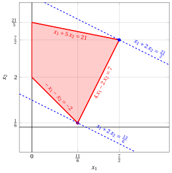{ .fig .ovale loading=lazy  }

!!! esercizio "Esercizio 11.13: Algoritmo del simplesso rivisto (B1)"

    Consideriamo il seguente problema LP in forma canonica di massimo con $n=2$ variabili e $m=2$ vincoli:

    $$
    \begin{array}{rrrrrr}
    {\max} & {25}\, {x_1} & {+} & {16}\, {x_2} \\[2ex]
    \text{soggetto a} & {50}\, {x_1} & {+} & {31}\, {x_2} & {\le} & {250} \\[2ex]
    & {-3}\, {x_1} & {+} & {2}\, {x_2} & {\le} & {4} \\[2ex]
    & {x_1,} &  & {x_2} & {\ge} & {0}
    \end{array}
    $$

    Introducendo le variabili di scarto, otteniamo il seguente problema LP in forma standard di massimo con $n+m=4$ variabili e $m=2$ vincoli:

    $$
    \begin{array}{rrrrrrrrrr}
    {\max} & {25}\, {x_1} & {+} & {16}\, {x_2} \\[2ex]
    \text{soggetto a} & {50}\, {x_1} & {+} & {31}\, {x_2} & {+} & {x_3} &  &  & {=} & {250} \\[2ex]
    & {-3}\, {x_1} & {+} & {2}\, {x_2} &  &  & {+} & {x_4} & {=} & {4} \\[2ex]
    & {x_1,} &  & {x_2,} &  & {x_3,} &  & {x_4} & {\ge} & {0}
    \end{array}
    $$

    **Domande**

    - Eseguire l'algoritmo del simplesso rivisto per trovare una soluzione ottima di questo problema LP, usando la regola di Bland per scegliere la colonna pivot e la riga pivot.

??? soluzione "Soluzione"

    Abbiamo:

    $$
    {\boldsymbol A}=
    \begin{pmatrix}
    50 & 31 & 1 & 0\\
    -3 & 2 & 0 & 1
    \end{pmatrix}
    \quad
    {\boldsymbol b}=
    \begin{pmatrix}
    250\\
    4
    \end{pmatrix}
    \quad
    {\boldsymbol c}=
    \begin{pmatrix}
    25\\
    16\\
    0\\
    0
    \end{pmatrix}
    \quad
    {\boldsymbol x}=
    \begin{pmatrix}
    x_1 \\
    x_2 \\
    x_3 \\
    x_4
    \end{pmatrix}
    $$

    - <strong>Inizializzazione</strong>

        Poiché è un problema LP in forma standard ottenuto da un problema LP in forma canonica con $~{\boldsymbol b} \ge 0$ aggiungendo le variabili di scarto, la partizione $\pazocal{B}=\{3,4\}$ e $\pazocal{N}=\{1,2\}$ è associata alla seguente soluzione di base ammissibile:

        $$
        \begin{pmatrix}
        x_3 \\
        x_4
        \end{pmatrix}
        =
        \begin{pmatrix}
        250\\
        4
        \end{pmatrix}
        {\rm ~~~e~~~}
        \begin{pmatrix}
        x_1 \\
        x_2
        \end{pmatrix}
        =
        \begin{pmatrix}
        0\\
        0
        \end{pmatrix}
        $$

    - <strong>Iterazione 1</strong>

        Con $\pazocal{B}= \{3,~~4\}$ e $\pazocal{N}= \{1,~~2\}$, abbiamo:

        $$
        {\boldsymbol x}_{\pazocal{B}}=
        \begin{pmatrix}
        x_3 \\
        x_4
        \end{pmatrix} ~~
        {\boldsymbol A}_{\pazocal{B}}=
        \begin{pmatrix}
        1 & 0\\
        0 & 1
        \end{pmatrix} ~~
        {\boldsymbol c}_{\pazocal{B}}=
        \begin{pmatrix}
        0\\
        0
        \end{pmatrix} ~~
        {{ \bar{\boldsymbol b}}}=
        \begin{pmatrix}
        250\\
        4
        \end{pmatrix}
        $$

        $$
        {\boldsymbol x}_{\pazocal{N}}=
        \begin{pmatrix}
        x_1 \\
        x_2
        \end{pmatrix} ~~
        {\boldsymbol A}_{\pazocal{N}}=
        \begin{pmatrix}
        50 & 31\\
        -3 & 2
        \end{pmatrix} ~~
        {\boldsymbol c}_{\pazocal{N}}=
        \begin{pmatrix}
        25\\
        16
        \end{pmatrix}
        $$

        <strong>Test di ottimalità</strong>

        Risolviamo  ${\boldsymbol \pi} \; {\boldsymbol A}_{\pazocal{B}} = {\boldsymbol c}'_{\pazocal{B}}$ per calcolare ${\boldsymbol \pi} =  {{{\boldsymbol c}'_{\pazocal{B}} \; {\boldsymbol A}_{\pazocal{B}}^{-1}}}$, <u>primo sistema di equazioni lineari</u>:

        \begin{equation*}
        \begin{cases}
        \begin{array}{rrrrr}
        {\pi_3} &  &  & {=} & {0} \\[2ex]
        &  & {\pi_4} & {=} & {0}
        \end{array}
        \end{cases}
        \qquad
        {\boldsymbol \pi}=
        \begin{pmatrix}
        0 & 0\\
        \end{pmatrix}
        \end{equation*}

        Calcoliamo il valore della soluzione di base ammissibile ${\bar{z}} = {\boldsymbol \pi} \; {\boldsymbol b} = \begin{pmatrix} 0 & 0\\ \end{pmatrix} \begin{pmatrix} 250\\ 4 \end{pmatrix} = 0$

        Calcoliamo i costi ridotti ${{ \bar{\boldsymbol c}}'}  = {{\boldsymbol c}'_{\pazocal{N}} - {\boldsymbol \pi} \; {\boldsymbol A}_{\pazocal{N}}}$:

        $$
        {{ \bar{\boldsymbol c}}'}
        = \begin{pmatrix}
        25 & 16\\
        \end{pmatrix} - \begin{pmatrix}
        0 & 0\\
        \end{pmatrix} \begin{pmatrix}
        50 & 31\\
        -3 & 2
        \end{pmatrix}
        =
        \underbrace{
        \begin{pmatrix}
        25 & 16\\
        \end{pmatrix}
        }_{{c_{1}~~~c_{2}}}
        -
        \underbrace{
        \begin{pmatrix}
        0 & 0\\
        \end{pmatrix}
        }_{{\boldsymbol \pi}\;{\boldsymbol A}_{1} ~~{\boldsymbol \pi}\;{\boldsymbol A}_{2}}
        =
        \underbrace{
        \begin{pmatrix}
        25 & 16\\
        \end{pmatrix}
        }_{{\bar{c}_{1}~~~\bar{c}_{2}}}
        $$

        Non tutti i costi ridotti sono non positivi, quindi eseguiamo un'operazione di pivot.

        <strong>Operazione di pivot</strong>

        Poiché ${c}_{1} > {\boldsymbol \pi} \;{\boldsymbol A}_{1}$, $x_1$ è la <u>colonna pivot</u> e abbiamo ${\boldsymbol A}_{1} = \begin{pmatrix} 50\\ -3 \end{pmatrix}$

        Risolviamo   ${\boldsymbol A}_{\pazocal{B}} \; {\boldsymbol d} = {\boldsymbol A}_{1}$ per calcolare   ${\boldsymbol d}={ {\boldsymbol A}_{\pazocal{B}}^{-1}} {\boldsymbol A}_{1}$,  <u>secondo sistema di equazioni lineari</u>:

        \begin{equation*}
        \begin{cases}
        \begin{array}{rrrrr}
        {d_3} &  &  & {=} & {50} \\[2ex]
        &  & {d_4} & {=} & {-3}
        \end{array}
        \end{cases}
        \qquad
        {\boldsymbol d}=
        \begin{pmatrix}
        50\\
        -3
        \end{pmatrix}
        \end{equation*}

        Dobbiamo trovare il valore massimo di $t$ tale che ${{ \bar{\boldsymbol b}}}  - t \; {{\boldsymbol d}} \ge 0$:

        $$
        \begin{cases}
        \underbrace{250 -t \cdot 50\ge 0}_{x_3 \ge 0} \\[2ex]
        \underbrace{4 -t \cdot \left( -3\right)\ge 0}_{x_4 \ge 0}
        \end{cases}
        \qquad
        \begin{cases}
        t\le 5 \\[2ex]
        t\ge -\dfrac{4}{3}
        \end{cases}
        \text{   quindi   } t_{m}=5
        $$

        Di conseguenza, il valore della colonna pivot diventa $t_{m}$, cioè $x_1=5$. Il valore di $x_3$ diventa zero e $x_3$ è la <u>riga pivot</u>. Le altre variabili in base assumono i valori  ${ \bar{\boldsymbol b}} - t_{m} \; {\boldsymbol d}$,  quindi abbiamo:

        $$
        x_4 = 4 - 5 \cdot \left( -3\right) = 19
        $$

    - <strong>Iterazione 2</strong>

        Con $\pazocal{B}= \{1,~~4\}$ e $\pazocal{N}= \{2,~~3\}$, abbiamo:

        $$
        {\boldsymbol x}_{\pazocal{B}}=
        \begin{pmatrix}
        x_1 \\
        x_4
        \end{pmatrix} ~~
        {\boldsymbol A}_{\pazocal{B}}=
        \begin{pmatrix}
        50 & 0\\
        -3 & 1
        \end{pmatrix} ~~
        {\boldsymbol c}_{\pazocal{B}}=
        \begin{pmatrix}
        25\\
        0
        \end{pmatrix} ~~
        {{ \bar{\boldsymbol b}}}=
        \begin{pmatrix}
        5\\
        19
        \end{pmatrix}
        $$

        $$
        {\boldsymbol x}_{\pazocal{N}}=
        \begin{pmatrix}
        x_2 \\
        x_3
        \end{pmatrix} ~~
        {\boldsymbol A}_{\pazocal{N}}=
        \begin{pmatrix}
        31 & 1\\
        2 & 0
        \end{pmatrix} ~~
        {\boldsymbol c}_{\pazocal{N}}=
        \begin{pmatrix}
        16\\
        0
        \end{pmatrix}
        $$

        <strong>Test di ottimalità</strong>

        Risolviamo  ${\boldsymbol \pi} \; {\boldsymbol A}_{\pazocal{B}} = {\boldsymbol c}'_{\pazocal{B}}$ per calcolare ${\boldsymbol \pi} =  {{{\boldsymbol c}'_{\pazocal{B}} \; {\boldsymbol A}_{\pazocal{B}}^{-1}}}$, <u>primo sistema di equazioni lineari</u>:

        \begin{equation*}
        \begin{cases}
        \begin{array}{rrrrr}
        {50}\, {\pi_1} & {-} & {3}\, {\pi_4} & {=} & {25} \\[2ex]
        &  & {\pi_4} & {=} & {0}
        \end{array}
        \end{cases}
        \qquad
        {\boldsymbol \pi}=
        \begin{pmatrix}
        \dfrac{1}{2} & 0\\
        \end{pmatrix}
        \end{equation*}

        Calcoliamo il valore della soluzione di base ammissibile ${\bar{z}} = {\boldsymbol \pi} \; {\boldsymbol b} = \begin{pmatrix} \dfrac{1}{2} & 0\\ \end{pmatrix} \begin{pmatrix} 250\\ 4 \end{pmatrix} = 125$

        Calcoliamo i costi ridotti ${{ \bar{\boldsymbol c}}'}  = {{\boldsymbol c}'_{\pazocal{N}} - {\boldsymbol \pi} \; {\boldsymbol A}_{\pazocal{N}}}$:

        $$
        {{ \bar{\boldsymbol c}}'}
        = \begin{pmatrix}
        16 & 0\\
        \end{pmatrix} - \begin{pmatrix}
        \dfrac{1}{2} & 0\\
        \end{pmatrix} \begin{pmatrix}
        31 & 1\\
        2 & 0
        \end{pmatrix}
        =
        \underbrace{
        \begin{pmatrix}
        16 & 0\\
        \end{pmatrix}
        }_{{c_{2}~~~c_{3}}}
        -
        \underbrace{
        \begin{pmatrix}
        \dfrac{31}{2} & \dfrac{1}{2}\\
        \end{pmatrix}
        }_{{\boldsymbol \pi}\;{\boldsymbol A}_{2} ~~{\boldsymbol \pi}\;{\boldsymbol A}_{3}}
        =
        \underbrace{
        \begin{pmatrix}
        \dfrac{1}{2} & -\dfrac{1}{2}\\
        \end{pmatrix}
        }_{{\bar{c}_{2}~~~\bar{c}_{3}}}
        $$

        Non tutti i costi ridotti sono non positivi, quindi eseguiamo un'operazione di pivot.

        <strong>Operazione di pivot</strong>

        Poiché ${c}_{2} > {\boldsymbol \pi} \;{\boldsymbol A}_{2}$, $x_2$ è la <u>colonna pivot</u> e abbiamo ${\boldsymbol A}_{2} = \begin{pmatrix} 31\\ 2 \end{pmatrix}$

        Risolviamo   ${\boldsymbol A}_{\pazocal{B}} \; {\boldsymbol d} = {\boldsymbol A}_{2}$ per calcolare   ${\boldsymbol d}={ {\boldsymbol A}_{\pazocal{B}}^{-1}} {\boldsymbol A}_{2}$,  <u>secondo sistema di equazioni lineari</u>:

        \begin{equation*}
        \begin{cases}
        \begin{array}{rrrrr}
        {50}\, {d_1} &  &  & {=} & {31} \\[2ex]
        {-3}\, {d_1} & {+} & {d_4} & {=} & {2}
        \end{array}
        \end{cases}
        \qquad
        {\boldsymbol d}=
        \begin{pmatrix}
        \dfrac{31}{50}\\[2ex]
        \dfrac{193}{50}
        \end{pmatrix}
        \end{equation*}

        Dobbiamo trovare il valore massimo di $t$ tale che ${{ \bar{\boldsymbol b}}}  - t \; {{\boldsymbol d}} \ge 0$:

        $$
        \begin{cases}
        \underbrace{5 -t \cdot \dfrac{31}{50}\ge 0}_{x_1 \ge 0} \\[2ex]
        \underbrace{19 -t \cdot \dfrac{193}{50}\ge 0}_{x_4 \ge 0}
        \end{cases}
        \qquad
        \begin{cases}
        t\le \dfrac{250}{31} \\[2ex]
        t\le \dfrac{950}{193}
        \end{cases}
        \text{   quindi   } t_{m}=\dfrac{950}{193}
        $$

        Di conseguenza, il valore della colonna pivot diventa $t_{m}$, cioè $x_2=\dfrac{950}{193}$. Il valore di $x_4$ diventa zero e $x_4$ è la <u>riga pivot</u>. Le altre variabili in base assumono i valori  ${ \bar{\boldsymbol b}} - t_{m} \; {\boldsymbol d}$,  quindi abbiamo:

        $$
        x_1 = 5 - \dfrac{950}{193} \cdot \dfrac{31}{50} = \dfrac{376}{193}
        $$

    - <strong>Iterazione 3</strong>

        Con $\pazocal{B}= \{1,~~2\}$ e $\pazocal{N}= \{3,~~4\}$, abbiamo:

        $$
        {\boldsymbol x}_{\pazocal{B}}=
        \begin{pmatrix}
        x_1 \\
        x_2
        \end{pmatrix} ~~
        {\boldsymbol A}_{\pazocal{B}}=
        \begin{pmatrix}
        50 & 31\\
        -3 & 2
        \end{pmatrix} ~~
        {\boldsymbol c}_{\pazocal{B}}=
        \begin{pmatrix}
        25\\
        16
        \end{pmatrix} ~~
        {{ \bar{\boldsymbol b}}}=
        \begin{pmatrix}
        \dfrac{376}{193}\\[2ex]
        \dfrac{950}{193}
        \end{pmatrix}
        $$

        $$
        {\boldsymbol x}_{\pazocal{N}}=
        \begin{pmatrix}
        x_3 \\
        x_4
        \end{pmatrix} ~~
        {\boldsymbol A}_{\pazocal{N}}=
        \begin{pmatrix}
        1 & 0\\
        0 & 1
        \end{pmatrix} ~~
        {\boldsymbol c}_{\pazocal{N}}=
        \begin{pmatrix}
        0\\
        0
        \end{pmatrix}
        $$

        <strong>Test di ottimalità</strong>

        Risolviamo  ${\boldsymbol \pi} \; {\boldsymbol A}_{\pazocal{B}} = {\boldsymbol c}'_{\pazocal{B}}$ per calcolare ${\boldsymbol \pi} =  {{{\boldsymbol c}'_{\pazocal{B}} \; {\boldsymbol A}_{\pazocal{B}}^{-1}}}$, <u>primo sistema di equazioni lineari</u>:

        \begin{equation*}
        \begin{cases}
        \begin{array}{rrrrr}
        {50}\, {\pi_1} & {-} & {3}\, {\pi_2} & {=} & {25} \\[2ex]
        {31}\, {\pi_1} & {+} & {2}\, {\pi_2} & {=} & {16}
        \end{array}
        \end{cases}
        \qquad
        {\boldsymbol \pi}=
        \begin{pmatrix}
        \dfrac{98}{193} & \dfrac{25}{193}\\
        \end{pmatrix}
        \end{equation*}

        Calcoliamo il valore della soluzione di base ammissibile ${\bar{z}} = {\boldsymbol \pi} \; {\boldsymbol b} = \begin{pmatrix} \dfrac{98}{193} & \dfrac{25}{193}\\ \end{pmatrix} \begin{pmatrix} 250\\ 4 \end{pmatrix} = \dfrac{24600}{193}$

        Calcoliamo i costi ridotti ${{ \bar{\boldsymbol c}}'}  = {{\boldsymbol c}'_{\pazocal{N}} - {\boldsymbol \pi} \; {\boldsymbol A}_{\pazocal{N}}}$:

        $$
        {{ \bar{\boldsymbol c}}'}
        = \begin{pmatrix}
        0 & 0\\
        \end{pmatrix} - \begin{pmatrix}
        \dfrac{98}{193} & \dfrac{25}{193}\\
        \end{pmatrix} \begin{pmatrix}
        1 & 0\\
        0 & 1
        \end{pmatrix}
        =
        \underbrace{
        \begin{pmatrix}
        0 & 0\\
        \end{pmatrix}
        }_{{c_{3}~~~c_{4}}}
        -
        \underbrace{
        \begin{pmatrix}
        \dfrac{98}{193} & \dfrac{25}{193}\\
        \end{pmatrix}
        }_{{\boldsymbol \pi}\;{\boldsymbol A}_{3} ~~{\boldsymbol \pi}\;{\boldsymbol A}_{4}}
        =
        \underbrace{
        \begin{pmatrix}
        -\dfrac{98}{193} & -\dfrac{25}{193}\\
        \end{pmatrix}
        }_{{\bar{c}_{3}~~~\bar{c}_{4}}}
        $$

        Tutti i costi ridotti sono non positivi, quindi la soluzione di base ammissibile

        $$
        {\boldsymbol x}_{\pazocal{B}}=
        \begin{pmatrix}
        x_1 \\
        x_2
        \end{pmatrix}=\begin{pmatrix}
        \dfrac{376}{193}\\[2ex]
        \dfrac{950}{193}
        \end{pmatrix} {\rm ~~~e~~~} {\boldsymbol x}_{\pazocal{N}}=
        \begin{pmatrix}
        x_3 \\
        x_4
        \end{pmatrix}=\begin{pmatrix}
        0\\
        0
        \end{pmatrix}
        $$

        è una soluzione ottima del problema LP e ${\bar{z}} = \dfrac{24600}{193}$ è il valore ottimo.

    <strong>Soluzione grafica:</strong>

    La regione ammissibile del problema LP (in forma canonica) è il poliedro ombreggiato in rosso: 

    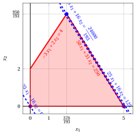{ .fig .ovale loading=lazy style="width:76%" }

    Una soluzione ottima ${ \tilde{\boldsymbol x}}(\,LP\,)$ è:

    $$
    \tilde{x}_1=\dfrac{376}{193},~~
    \tilde{x}_2=\dfrac{950}{193}
    $$

    il valore ottimo $z(\, LP\,)$ è $\dfrac{24600}{193}.$

    In viola il primo e il secondo vertice esplorati dalla precedente esecuzione dell'algoritmo del simplesso rivisto (prima di raggiungere quello ottimo rappresentato in blu).

    In blu tratteggiato, le curve di livello della funzione obiettivo associate ai valori assunti nei tre vertici.

## Problemi con tre variabili

!!! esercizio "Esercizio 11.14: Algoritmo del simplesso rivisto (P41)"

    Consideriamo il seguente problema LP in forma canonica di massimo con $n=3$ variabili e $m=4$ vincoli:

    $$
    \begin{array}{rrrrrrrr}
    {\max} & {2}\, {x_1} & {+} & {x_2} & {+} & {3}\, {x_3} \\[2ex]
    \text{soggetto a} & {x_1} & {+} & {x_2} & {+} & {x_3} & {\le} & {4} \\[2ex]
    &  &  & {x_2} &  &  & {\le} & {2} \\[2ex]
    &  &  &  &  & {x_3} & {\le} & {3} \\[2ex]
    & {3}\, {x_1} &  &  & {+} & {x_3} & {\le} & {6} \\[2ex]
    & {x_1,} &  & {x_2,} &  & {x_3} & {\ge} & {0}
    \end{array}
    $$

    Introducendo le variabili di scarto, otteniamo il seguente problema LP in forma standard di massimo con $n+m=7$ variabili e $m=4$ vincoli:

    $$
    \begin{array}{rrcrcrcrcrcrcrcr}
    {\max} & {2}\, {x_1} & {+} & {x_2} & {+} & {3}\, {x_3} \\[2ex]
    \text{soggetto a} & {x_1} & {+} & {x_2} & {+} & {x_3} & {+} & {x_4} &  &  &  &  &  &  & {=} & {4} \\[2ex]
    &  &  & {x_2} &  &  &  &  & {+} & {x_5} &  &  &  &  & {=} & {2} \\[2ex]
    &  &  &  &  & {x_3} &  &  &  &  & {+} & {x_6} &  &  & {=} & {3} \\[2ex]
    & {3}\, {x_1} &  &  & {+} & {x_3} &  &  &  &  &  &  & {+} & {x_7} & {=} & {6} \\[2ex]
    & {x_1,} &  & {x_2,} &  & {x_3,} &  & {x_4,} &  & {x_5,} &  & {x_6,} &  & {x_7} & {\ge} & {0}
    \end{array}
    $$

    **Domande**

    - Eseguire l'algoritmo del simplesso rivisto per trovare una soluzione ottima di questo problema LP, usando la regola di Bland per scegliere la colonna pivot e la riga pivot.

??? soluzione "Soluzione"

    Abbiamo:

    $$
    {\boldsymbol A}=
    \begin{pmatrix}
    1 & 1 & 1 & 1 & 0 & 0 & 0\\
    0 & 1 & 0 & 0 & 1 & 0 & 0\\
    0 & 0 & 1 & 0 & 0 & 1 & 0\\
    3 & 0 & 1 & 0 & 0 & 0 & 1
    \end{pmatrix}
    \quad
    {\boldsymbol b}=
    \begin{pmatrix}
    4\\
    2\\
    3\\
    6
    \end{pmatrix}
    \quad
    {\boldsymbol c}=
    \begin{pmatrix}
    2\\
    1\\
    3\\
    0\\
    0\\
    0\\
    0
    \end{pmatrix}
    \quad
    {\boldsymbol x}=
    \begin{pmatrix}
    x_1 \\
    x_2 \\
    x_3 \\
    x_4 \\
    x_5 \\
    x_6 \\
    x_7
    \end{pmatrix}
    $$

    - <strong>Inizializzazione</strong>

        Poiché è un problema LP in forma standard ottenuto da un problema LP in forma canonica con $~{\boldsymbol b} \ge 0$ aggiungendo le variabili di scarto, la partizione $\pazocal{B}=\{4,5,6,7\}$ e $\pazocal{N}=\{1,2,3\}$ è associata alla seguente soluzione di base ammissibile:

        $$
        \begin{pmatrix}
        x_4 \\
        x_5 \\
        x_6 \\
        x_7
        \end{pmatrix}
        =
        \begin{pmatrix}
        4\\
        2\\
        3\\
        6
        \end{pmatrix}
        {\rm ~~~e~~~}
        \begin{pmatrix}
        x_1 \\
        x_2 \\
        x_3
        \end{pmatrix}
        =
        \begin{pmatrix}
        0\\
        0\\
        0
        \end{pmatrix}
        $$

    - <strong>Iterazione 1</strong>

        Con $\pazocal{B}= \{4,~~5,~~6,~~7\}$ e $\pazocal{N}= \{1,~~2,~~3\}$, abbiamo:

        $$
        {\boldsymbol x}_{\pazocal{B}}=
        \begin{pmatrix}
        x_4 \\
        x_5 \\
        x_6 \\
        x_7
        \end{pmatrix} ~~
        {\boldsymbol A}_{\pazocal{B}}=
        \begin{pmatrix}
        1 & 0 & 0 & 0\\
        0 & 1 & 0 & 0\\
        0 & 0 & 1 & 0\\
        0 & 0 & 0 & 1
        \end{pmatrix} ~~
        {\boldsymbol c}_{\pazocal{B}}=
        \begin{pmatrix}
        0\\
        0\\
        0\\
        0
        \end{pmatrix} ~~
        {{ \bar{\boldsymbol b}}}=
        \begin{pmatrix}
        4\\
        2\\
        3\\
        6
        \end{pmatrix}
        $$

        $$
        {\boldsymbol x}_{\pazocal{N}}=
        \begin{pmatrix}
        x_1 \\
        x_2 \\
        x_3
        \end{pmatrix} ~~
        {\boldsymbol A}_{\pazocal{N}}=
        \begin{pmatrix}
        1 & 1 & 1\\
        0 & 1 & 0\\
        0 & 0 & 1\\
        3 & 0 & 1
        \end{pmatrix} ~~
        {\boldsymbol c}_{\pazocal{N}}=
        \begin{pmatrix}
        2\\
        1\\
        3
        \end{pmatrix}
        $$

        <strong>Test di ottimalità</strong>

        Risolviamo  ${\boldsymbol \pi} \; {\boldsymbol A}_{\pazocal{B}} = {\boldsymbol c}'_{\pazocal{B}}$ per calcolare ${\boldsymbol \pi} =  {{{\boldsymbol c}'_{\pazocal{B}} \; {\boldsymbol A}_{\pazocal{B}}^{-1}}}$, <u>primo sistema di equazioni lineari</u>:

        \begin{equation*}
        \begin{cases}
        \begin{array}{rrrrrrrrr}
        {\pi_4} &  &  &  &  &  &  & {=} & {0} \\[2ex]
        &  & {\pi_5} &  &  &  &  & {=} & {0} \\[2ex]
        &  &  &  & {\pi_6} &  &  & {=} & {0} \\[2ex]
        &  &  &  &  &  & {\pi_7} & {=} & {0}
        \end{array}
        \end{cases}
        \qquad
        {\boldsymbol \pi}=
        \begin{pmatrix}
        0 & 0 & 0 & 0\\
        \end{pmatrix}
        \end{equation*}

        Calcoliamo il valore della soluzione di base ammissibile ${\bar{z}} = {\boldsymbol \pi} \; {\boldsymbol b} = \begin{pmatrix} 0 & 0 & 0 & 0\\ \end{pmatrix} \begin{pmatrix} 4\\ 2\\ 3\\ 6 \end{pmatrix} = 0$

        Calcoliamo i costi ridotti ${{ \bar{\boldsymbol c}}'}  = {{\boldsymbol c}'_{\pazocal{N}} - {\boldsymbol \pi} \; {\boldsymbol A}_{\pazocal{N}}}$:

        $$
        \begin{aligned}
        {{ \bar{\boldsymbol c}}'}
        &= \begin{pmatrix}
        2 & 1 & 3\\
        \end{pmatrix} - \begin{pmatrix}
        0 & 0 & 0 & 0\\
        \end{pmatrix} \begin{pmatrix}
        1 & 1 & 1\\
        0 & 1 & 0\\
        0 & 0 & 1\\
        3 & 0 & 1
        \end{pmatrix}
        \\[1ex]
        &= \underbrace{
        \begin{pmatrix}
        2 & 1 & 3\\
        \end{pmatrix}
        }_{{c_{1}~~~c_{2}~~~c_{3}}}
        -
        \underbrace{
        \begin{pmatrix}
        0 & 0 & 0\\
        \end{pmatrix}
        }_{{\boldsymbol \pi}\;{\boldsymbol A}_{1} ~~{\boldsymbol \pi}\;{\boldsymbol A}_{2} ~~{\boldsymbol \pi}\;{\boldsymbol A}_{3}}
        =
        \underbrace{
        \begin{pmatrix}
        2 & 1 & 3\\
        \end{pmatrix}
        }_{{\bar{c}_{1}~~~\bar{c}_{2}~~~\bar{c}_{3}}}
        \end{aligned}
        $$

        Non tutti i costi ridotti sono non positivi, quindi eseguiamo un'operazione di pivot.

        <strong>Operazione di pivot</strong>

        Poiché ${c}_{1} > {\boldsymbol \pi} \;{\boldsymbol A}_{1}$, $x_1$ è la <u>colonna pivot</u> e abbiamo ${\boldsymbol A}_{1} = \begin{pmatrix} 1\\ 0\\ 0\\ 3 \end{pmatrix}$

        Risolviamo   ${\boldsymbol A}_{\pazocal{B}} \; {\boldsymbol d} = {\boldsymbol A}_{1}$ per calcolare   ${\boldsymbol d}={ {\boldsymbol A}_{\pazocal{B}}^{-1}} {\boldsymbol A}_{1}$,  <u>secondo sistema di equazioni lineari</u>:

        \begin{equation*}
        \begin{cases}
        \begin{array}{rrrrrrrrr}
        {d_4} &  &  &  &  &  &  & {=} & {1} \\[2ex]
        &  & {d_5} &  &  &  &  & {=} & {0} \\[2ex]
        &  &  &  & {d_6} &  &  & {=} & {0} \\[2ex]
        &  &  &  &  &  & {d_7} & {=} & {3}
        \end{array}
        \end{cases}
        \qquad
        {\boldsymbol d}=
        \begin{pmatrix}
        1\\
        0\\
        0\\
        3
        \end{pmatrix}
        \end{equation*}

        Dobbiamo trovare il valore massimo di $t$ tale che ${{ \bar{\boldsymbol b}}}  - t \; {{\boldsymbol d}} \ge 0$:

        $$
        \begin{cases}
        \underbrace{4 -t \cdot 1\ge 0}_{x_4 \ge 0} \\[2ex]
        \underbrace{6 -t \cdot 3\ge 0}_{x_7 \ge 0}
        \end{cases}
        \qquad
        \begin{cases}
        t\le 4 \\[2ex]
        t\le 2
        \end{cases}
        \text{   quindi   } t_{m}=2
        $$

        Di conseguenza, il valore della colonna pivot diventa $t_{m}$, cioè $x_1=2$. Il valore di $x_7$ diventa zero e $x_7$ è la <u>riga pivot</u>. Le altre variabili in base assumono i valori  ${ \bar{\boldsymbol b}} - t_{m} \; {\boldsymbol d}$,  quindi abbiamo:

        $$
        \begin{aligned}
        x_4 &= 4 - 2 \cdot 1 = 2 \\[2ex]
        x_5 &= 2 - 2 \cdot 0 = 2 \\[2ex]
        x_6 &= 3 - 2 \cdot 0 = 3
        \end{aligned}
        $$

    - <strong>Iterazione 2</strong>

        Con $\pazocal{B}= \{1,~~4,~~5,~~6\}$ e $\pazocal{N}= \{2,~~3,~~7\}$, abbiamo:

        $$
        {\boldsymbol x}_{\pazocal{B}}=
        \begin{pmatrix}
        x_1 \\
        x_4 \\
        x_5 \\
        x_6
        \end{pmatrix} ~~
        {\boldsymbol A}_{\pazocal{B}}=
        \begin{pmatrix}
        1 & 1 & 0 & 0\\
        0 & 0 & 1 & 0\\
        0 & 0 & 0 & 1\\
        3 & 0 & 0 & 0
        \end{pmatrix} ~~
        {\boldsymbol c}_{\pazocal{B}}=
        \begin{pmatrix}
        2\\
        0\\
        0\\
        0
        \end{pmatrix} ~~
        {{ \bar{\boldsymbol b}}}=
        \begin{pmatrix}
        2\\
        2\\
        2\\
        3
        \end{pmatrix}
        $$

        $$
        {\boldsymbol x}_{\pazocal{N}}=
        \begin{pmatrix}
        x_2 \\
        x_3 \\
        x_7
        \end{pmatrix} ~~
        {\boldsymbol A}_{\pazocal{N}}=
        \begin{pmatrix}
        1 & 1 & 0\\
        1 & 0 & 0\\
        0 & 1 & 0\\
        0 & 1 & 1
        \end{pmatrix} ~~
        {\boldsymbol c}_{\pazocal{N}}=
        \begin{pmatrix}
        1\\
        3\\
        0
        \end{pmatrix}
        $$

        <strong>Test di ottimalità</strong>

        Risolviamo  ${\boldsymbol \pi} \; {\boldsymbol A}_{\pazocal{B}} = {\boldsymbol c}'_{\pazocal{B}}$ per calcolare ${\boldsymbol \pi} =  {{{\boldsymbol c}'_{\pazocal{B}} \; {\boldsymbol A}_{\pazocal{B}}^{-1}}}$, <u>primo sistema di equazioni lineari</u>:

        \begin{equation*}
        \begin{cases}
        \begin{array}{rrrrrrrrr}
        {\pi_1} &  &  &  &  & {+} & {3}\, {\pi_6} & {=} & {2} \\[2ex]
        {\pi_1} &  &  &  &  &  &  & {=} & {0} \\[2ex]
        &  & {\pi_4} &  &  &  &  & {=} & {0} \\[2ex]
        &  &  &  & {\pi_5} &  &  & {=} & {0}
        \end{array}
        \end{cases}
        \qquad
        {\boldsymbol \pi}=
        \begin{pmatrix}
        0 & 0 & 0 & \dfrac{2}{3}\\
        \end{pmatrix}
        \end{equation*}

        Calcoliamo il valore della soluzione di base ammissibile ${\bar{z}} = {\boldsymbol \pi} \; {\boldsymbol b} = \begin{pmatrix} 0 & 0 & 0 & \dfrac{2}{3}\\ \end{pmatrix} \begin{pmatrix} 4\\ 2\\ 3\\ 6 \end{pmatrix} = 4$

        Calcoliamo i costi ridotti ${{ \bar{\boldsymbol c}}'}  = {{\boldsymbol c}'_{\pazocal{N}} - {\boldsymbol \pi} \; {\boldsymbol A}_{\pazocal{N}}}$:

        $$
        \begin{aligned}
        {{ \bar{\boldsymbol c}}'}
        &= \begin{pmatrix}
        1 & 3 & 0\\
        \end{pmatrix} - \begin{pmatrix}
        0 & 0 & 0 & \dfrac{2}{3}\\
        \end{pmatrix} \begin{pmatrix}
        1 & 1 & 0\\
        1 & 0 & 0\\
        0 & 1 & 0\\
        0 & 1 & 1
        \end{pmatrix}
        \\[1ex]
        &= \underbrace{
        \begin{pmatrix}
        1 & 3 & 0\\
        \end{pmatrix}
        }_{{c_{2}~~~c_{3}~~~c_{7}}}
        -
        \underbrace{
        \begin{pmatrix}
        0 & \dfrac{2}{3} & \dfrac{2}{3}\\
        \end{pmatrix}
        }_{{\boldsymbol \pi}\;{\boldsymbol A}_{2} ~~{\boldsymbol \pi}\;{\boldsymbol A}_{3} ~~{\boldsymbol \pi}\;{\boldsymbol A}_{7}}
        =
        \underbrace{
        \begin{pmatrix}
        1 & \dfrac{7}{3} & -\dfrac{2}{3}\\
        \end{pmatrix}
        }_{{\bar{c}_{2}~~~\bar{c}_{3}~~~\bar{c}_{7}}}
        \end{aligned}
        $$

        Non tutti i costi ridotti sono non positivi, quindi eseguiamo un'operazione di pivot.

        <strong>Operazione di pivot</strong>

        Poiché ${c}_{2} > {\boldsymbol \pi} \;{\boldsymbol A}_{2}$, $x_2$ è la <u>colonna pivot</u> e abbiamo ${\boldsymbol A}_{2} = \begin{pmatrix} 1\\ 1\\ 0\\ 0 \end{pmatrix}$

        Risolviamo   ${\boldsymbol A}_{\pazocal{B}} \; {\boldsymbol d} = {\boldsymbol A}_{2}$ per calcolare   ${\boldsymbol d}={ {\boldsymbol A}_{\pazocal{B}}^{-1}} {\boldsymbol A}_{2}$,  <u>secondo sistema di equazioni lineari</u>:

        \begin{equation*}
        \begin{cases}
        \begin{array}{rrrrrrrrr}
        {d_1} & {+} & {d_4} &  &  &  &  & {=} & {1} \\[2ex]
        &  &  &  & {d_5} &  &  & {=} & {1} \\[2ex]
        &  &  &  &  &  & {d_6} & {=} & {0} \\[2ex]
        {3}\, {d_1} &  &  &  &  &  &  & {=} & {0}
        \end{array}
        \end{cases}
        \qquad
        {\boldsymbol d}=
        \begin{pmatrix}
        0\\
        1\\
        1\\
        0
        \end{pmatrix}
        \end{equation*}

        Dobbiamo trovare il valore massimo di $t$ tale che ${{ \bar{\boldsymbol b}}}  - t \; {{\boldsymbol d}} \ge 0$:

        $$
        \begin{cases}
        \underbrace{2 -t \cdot 1\ge 0}_{x_4 \ge 0} \\[2ex]
        \underbrace{2 -t \cdot 1\ge 0}_{x_5 \ge 0}
        \end{cases}
        \qquad
        \begin{cases}
        t\le 2 \\[2ex]
        t\le 2
        \end{cases}
        \text{   quindi   } t_{m}=2
        $$

        Di conseguenza, il valore della colonna pivot diventa $t_{m}$, cioè $x_2=2$. Il valore di $x_4$ diventa zero e $x_4$ è la <u>riga pivot</u>. Le altre variabili in base assumono i valori  ${ \bar{\boldsymbol b}} - t_{m} \; {\boldsymbol d}$,  quindi abbiamo:

        $$
        \begin{aligned}
        x_1 &= 2 - 2 \cdot 0 = 2 \\[2ex]
        x_5 &= 2 - 2 \cdot 1 = 0 \\[2ex]
        x_6 &= 3 - 2 \cdot 0 = 3
        \end{aligned}
        $$

    - <strong>Iterazione 3</strong>

        Con $\pazocal{B}= \{1,~~2,~~5,~~6\}$ e $\pazocal{N}= \{3,~~4,~~7\}$, abbiamo:

        $$
        {\boldsymbol x}_{\pazocal{B}}=
        \begin{pmatrix}
        x_1 \\
        x_2 \\
        x_5 \\
        x_6
        \end{pmatrix} ~~
        {\boldsymbol A}_{\pazocal{B}}=
        \begin{pmatrix}
        1 & 1 & 0 & 0\\
        0 & 1 & 1 & 0\\
        0 & 0 & 0 & 1\\
        3 & 0 & 0 & 0
        \end{pmatrix} ~~
        {\boldsymbol c}_{\pazocal{B}}=
        \begin{pmatrix}
        2\\
        1\\
        0\\
        0
        \end{pmatrix} ~~
        {{ \bar{\boldsymbol b}}}=
        \begin{pmatrix}
        2\\
        2\\
        0\\
        3
        \end{pmatrix}
        $$

        $$
        {\boldsymbol x}_{\pazocal{N}}=
        \begin{pmatrix}
        x_3 \\
        x_4 \\
        x_7
        \end{pmatrix} ~~
        {\boldsymbol A}_{\pazocal{N}}=
        \begin{pmatrix}
        1 & 1 & 0\\
        0 & 0 & 0\\
        1 & 0 & 0\\
        1 & 0 & 1
        \end{pmatrix} ~~
        {\boldsymbol c}_{\pazocal{N}}=
        \begin{pmatrix}
        3\\
        0\\
        0
        \end{pmatrix}
        $$

        <strong>Test di ottimalità</strong>

        Risolviamo  ${\boldsymbol \pi} \; {\boldsymbol A}_{\pazocal{B}} = {\boldsymbol c}'_{\pazocal{B}}$ per calcolare ${\boldsymbol \pi} =  {{{\boldsymbol c}'_{\pazocal{B}} \; {\boldsymbol A}_{\pazocal{B}}^{-1}}}$, <u>primo sistema di equazioni lineari</u>:

        \begin{equation*}
        \begin{cases}
        \begin{array}{rrrrrrrrr}
        {\pi_1} &  &  &  &  & {+} & {3}\, {\pi_6} & {=} & {2} \\[2ex]
        {\pi_1} & {+} & {\pi_2} &  &  &  &  & {=} & {1} \\[2ex]
        &  & {\pi_2} &  &  &  &  & {=} & {0} \\[2ex]
        &  &  &  & {\pi_5} &  &  & {=} & {0}
        \end{array}
        \end{cases}
        \qquad
        {\boldsymbol \pi}=
        \begin{pmatrix}
        1 & 0 & 0 & \dfrac{1}{3}\\
        \end{pmatrix}
        \end{equation*}

        Calcoliamo il valore della soluzione di base ammissibile ${\bar{z}} = {\boldsymbol \pi} \; {\boldsymbol b} = \begin{pmatrix} 1 & 0 & 0 & \dfrac{1}{3}\\ \end{pmatrix} \begin{pmatrix} 4\\ 2\\ 3\\ 6 \end{pmatrix} = 6$

        Calcoliamo i costi ridotti ${{ \bar{\boldsymbol c}}'}  = {{\boldsymbol c}'_{\pazocal{N}} - {\boldsymbol \pi} \; {\boldsymbol A}_{\pazocal{N}}}$:

        $$
        \begin{aligned}
        {{ \bar{\boldsymbol c}}'}
        &= \begin{pmatrix}
        3 & 0 & 0\\
        \end{pmatrix} - \begin{pmatrix}
        1 & 0 & 0 & \dfrac{1}{3}\\
        \end{pmatrix} \begin{pmatrix}
        1 & 1 & 0\\
        0 & 0 & 0\\
        1 & 0 & 0\\
        1 & 0 & 1
        \end{pmatrix}
        \\[1ex]
        &= \underbrace{
        \begin{pmatrix}
        3 & 0 & 0\\
        \end{pmatrix}
        }_{{c_{3}~~~c_{4}~~~c_{7}}}
        -
        \underbrace{
        \begin{pmatrix}
        \dfrac{4}{3} & 1 & \dfrac{1}{3}\\
        \end{pmatrix}
        }_{{\boldsymbol \pi}\;{\boldsymbol A}_{3} ~~{\boldsymbol \pi}\;{\boldsymbol A}_{4} ~~{\boldsymbol \pi}\;{\boldsymbol A}_{7}}
        =
        \underbrace{
        \begin{pmatrix}
        \dfrac{5}{3} & -1 & -\dfrac{1}{3}\\
        \end{pmatrix}
        }_{{\bar{c}_{3}~~~\bar{c}_{4}~~~\bar{c}_{7}}}
        \end{aligned}
        $$

        Non tutti i costi ridotti sono non positivi, quindi eseguiamo un'operazione di pivot.

        <strong>Operazione di pivot</strong>

        Poiché ${c}_{3} > {\boldsymbol \pi} \;{\boldsymbol A}_{3}$, $x_3$ è la <u>colonna pivot</u> e abbiamo ${\boldsymbol A}_{3} = \begin{pmatrix} 1\\ 0\\ 1\\ 1 \end{pmatrix}$

        Risolviamo   ${\boldsymbol A}_{\pazocal{B}} \; {\boldsymbol d} = {\boldsymbol A}_{3}$ per calcolare   ${\boldsymbol d}={ {\boldsymbol A}_{\pazocal{B}}^{-1}} {\boldsymbol A}_{3}$,  <u>secondo sistema di equazioni lineari</u>:

        \begin{equation*}
        \begin{cases}
        \begin{array}{rrrrrrrrr}
        {d_1} & {+} & {d_2} &  &  &  &  & {=} & {1} \\[2ex]
        &  & {d_2} & {+} & {d_5} &  &  & {=} & {0} \\[2ex]
        &  &  &  &  &  & {d_6} & {=} & {1} \\[2ex]
        {3}\, {d_1} &  &  &  &  &  &  & {=} & {1}
        \end{array}
        \end{cases}
        \qquad
        {\boldsymbol d}=
        \begin{pmatrix}
        \dfrac{1}{3}\\[2ex]
        \dfrac{2}{3}\\[2ex]
        -\dfrac{2}{3}\\[2ex]
        1
        \end{pmatrix}
        \end{equation*}

        Dobbiamo trovare il valore massimo di $t$ tale che ${{ \bar{\boldsymbol b}}}  - t \; {{\boldsymbol d}} \ge 0$:

        $$
        \begin{cases}
        \underbrace{2 -t \cdot \dfrac{1}{3}\ge 0}_{x_1 \ge 0} \\[2ex]
        \underbrace{2 -t \cdot \dfrac{2}{3}\ge 0}_{x_2 \ge 0} \\[2ex]
        \underbrace{0 -t \cdot \left( -\dfrac{2}{3}\right)\ge 0}_{x_5 \ge 0} \\[2ex]
        \underbrace{3 -t \cdot 1\ge 0}_{x_6 \ge 0}
        \end{cases}
        \qquad
        \begin{cases}
        t\le 6 \\[2ex]
        t\le 3 \\[2ex]
        t\ge 0 \\[2ex]
        t\le 3
        \end{cases}
        \text{   quindi   } t_{m}=3
        $$

        Di conseguenza, il valore della colonna pivot diventa $t_{m}$, cioè $x_3=3$. Il valore di $x_2$ diventa zero e $x_2$ è la <u>riga pivot</u>. Le altre variabili in base assumono i valori  ${ \bar{\boldsymbol b}} - t_{m} \; {\boldsymbol d}$,  quindi abbiamo:

        $$
        \begin{aligned}
        x_1 &= 2 - 3 \cdot \dfrac{1}{3} = 1 \\[2ex]
        x_5 &= 0 - 3 \cdot \left( -\dfrac{2}{3}\right) = 2 \\[2ex]
        x_6 &= 3 - 3 \cdot 1 = 0
        \end{aligned}
        $$

    - <strong>Iterazione 4</strong>

        Con $\pazocal{B}= \{1,~~3,~~5,~~6\}$ e $\pazocal{N}= \{2,~~4,~~7\}$, abbiamo:

        $$
        {\boldsymbol x}_{\pazocal{B}}=
        \begin{pmatrix}
        x_1 \\
        x_3 \\
        x_5 \\
        x_6
        \end{pmatrix} ~~
        {\boldsymbol A}_{\pazocal{B}}=
        \begin{pmatrix}
        1 & 1 & 0 & 0\\
        0 & 0 & 1 & 0\\
        0 & 1 & 0 & 1\\
        3 & 1 & 0 & 0
        \end{pmatrix} ~~
        {\boldsymbol c}_{\pazocal{B}}=
        \begin{pmatrix}
        2\\
        3\\
        0\\
        0
        \end{pmatrix} ~~
        {{ \bar{\boldsymbol b}}}=
        \begin{pmatrix}
        1\\
        3\\
        2\\
        0
        \end{pmatrix}
        $$

        $$
        {\boldsymbol x}_{\pazocal{N}}=
        \begin{pmatrix}
        x_2 \\
        x_4 \\
        x_7
        \end{pmatrix} ~~
        {\boldsymbol A}_{\pazocal{N}}=
        \begin{pmatrix}
        1 & 1 & 0\\
        1 & 0 & 0\\
        0 & 0 & 0\\
        0 & 0 & 1
        \end{pmatrix} ~~
        {\boldsymbol c}_{\pazocal{N}}=
        \begin{pmatrix}
        1\\
        0\\
        0
        \end{pmatrix}
        $$

        <strong>Test di ottimalità</strong>

        Risolviamo  ${\boldsymbol \pi} \; {\boldsymbol A}_{\pazocal{B}} = {\boldsymbol c}'_{\pazocal{B}}$ per calcolare ${\boldsymbol \pi} =  {{{\boldsymbol c}'_{\pazocal{B}} \; {\boldsymbol A}_{\pazocal{B}}^{-1}}}$, <u>primo sistema di equazioni lineari</u>:

        \begin{equation*}
        \begin{cases}
        \begin{array}{rrrrrrrrr}
        {\pi_1} &  &  &  &  & {+} & {3}\, {\pi_6} & {=} & {2} \\[2ex]
        {\pi_1} &  &  & {+} & {\pi_5} & {+} & {\pi_6} & {=} & {3} \\[2ex]
        &  & {\pi_3} &  &  &  &  & {=} & {0} \\[2ex]
        &  &  &  & {\pi_5} &  &  & {=} & {0}
        \end{array}
        \end{cases}
        \qquad
        {\boldsymbol \pi}=
        \begin{pmatrix}
        \dfrac{7}{2} & 0 & 0 & -\dfrac{1}{2}\\
        \end{pmatrix}
        \end{equation*}

        Calcoliamo il valore della soluzione di base ammissibile ${\bar{z}} = {\boldsymbol \pi} \; {\boldsymbol b} = \begin{pmatrix} \dfrac{7}{2} & 0 & 0 & -\dfrac{1}{2}\\ \end{pmatrix} \begin{pmatrix} 4\\ 2\\ 3\\ 6 \end{pmatrix} = 11$

        Calcoliamo i costi ridotti ${{ \bar{\boldsymbol c}}'}  = {{\boldsymbol c}'_{\pazocal{N}} - {\boldsymbol \pi} \; {\boldsymbol A}_{\pazocal{N}}}$:

        $$
        \begin{aligned}
        {{ \bar{\boldsymbol c}}'}
        &= \begin{pmatrix}
        1 & 0 & 0\\
        \end{pmatrix} - \begin{pmatrix}
        \dfrac{7}{2} & 0 & 0 & -\dfrac{1}{2}\\
        \end{pmatrix} \begin{pmatrix}
        1 & 1 & 0\\
        1 & 0 & 0\\
        0 & 0 & 0\\
        0 & 0 & 1
        \end{pmatrix}
        \\[1ex]
        &= \underbrace{
        \begin{pmatrix}
        1 & 0 & 0\\
        \end{pmatrix}
        }_{{c_{2}~~~c_{4}~~~c_{7}}}
        -
        \underbrace{
        \begin{pmatrix}
        \dfrac{7}{2} & \dfrac{7}{2} & -\dfrac{1}{2}\\
        \end{pmatrix}
        }_{{\boldsymbol \pi}\;{\boldsymbol A}_{2} ~~{\boldsymbol \pi}\;{\boldsymbol A}_{4} ~~{\boldsymbol \pi}\;{\boldsymbol A}_{7}}
        =
        \underbrace{
        \begin{pmatrix}
        -\dfrac{5}{2} & -\dfrac{7}{2} & \dfrac{1}{2}\\
        \end{pmatrix}
        }_{{\bar{c}_{2}~~~\bar{c}_{4}~~~\bar{c}_{7}}}
        \end{aligned}
        $$

        Non tutti i costi ridotti sono non positivi, quindi eseguiamo un'operazione di pivot.

        <strong>Operazione di pivot</strong>

        Poiché ${c}_{7} > {\boldsymbol \pi} \;{\boldsymbol A}_{7}$, $x_7$ è la <u>colonna pivot</u> e abbiamo ${\boldsymbol A}_{7} = \begin{pmatrix} 0\\ 0\\ 0\\ 1 \end{pmatrix}$

        Risolviamo   ${\boldsymbol A}_{\pazocal{B}} \; {\boldsymbol d} = {\boldsymbol A}_{7}$ per calcolare   ${\boldsymbol d}={ {\boldsymbol A}_{\pazocal{B}}^{-1}} {\boldsymbol A}_{7}$,  <u>secondo sistema di equazioni lineari</u>:

        \begin{equation*}
        \begin{cases}
        \begin{array}{rrrrrrrrr}
        {d_1} & {+} & {d_3} &  &  &  &  & {=} & {0} \\[2ex]
        &  &  &  & {d_5} &  &  & {=} & {0} \\[2ex]
        &  & {d_3} &  &  & {+} & {d_6} & {=} & {0} \\[2ex]
        {3}\, {d_1} & {+} & {d_3} &  &  &  &  & {=} & {1}
        \end{array}
        \end{cases}
        \qquad
        {\boldsymbol d}=
        \begin{pmatrix}
        \dfrac{1}{2}\\[2ex]
        -\dfrac{1}{2}\\[2ex]
        0\\[2ex]
        \dfrac{1}{2}
        \end{pmatrix}
        \end{equation*}

        Dobbiamo trovare il valore massimo di $t$ tale che ${{ \bar{\boldsymbol b}}}  - t \; {{\boldsymbol d}} \ge 0$:

        $$
        \begin{cases}
        \underbrace{1 -t \cdot \dfrac{1}{2}\ge 0}_{x_1 \ge 0} \\[2ex]
        \underbrace{3 -t \cdot \left( -\dfrac{1}{2}\right)\ge 0}_{x_3 \ge 0} \\[2ex]
        \underbrace{0 -t \cdot \dfrac{1}{2}\ge 0}_{x_6 \ge 0}
        \end{cases}
        \qquad
        \begin{cases}
        t\le 2 \\[2ex]
        t\ge -6 \\[2ex]
        t\le 0
        \end{cases}
        \text{   quindi   } t_{m}=0
        $$

        Di conseguenza, il valore della colonna pivot diventa $t_{m}$, cioè $x_7=0$. Il valore di $x_6$ rimane zero e $x_6$ è la <u>riga pivot</u>. Le altre variabili in base assumono i valori  ${ \bar{\boldsymbol b}} - t_{m} \; {\boldsymbol d}$,  quindi abbiamo:

        $$
        \begin{aligned}
        x_1 &= 1 - 0 \cdot \dfrac{1}{2} = 1 \\[2ex]
        x_3 &= 3 - 0 \cdot \left( -\dfrac{1}{2}\right) = 3 \\[2ex]
        x_5 &= 2 - 0 \cdot 0 = 2
        \end{aligned}
        $$

    - <strong>Iterazione 5</strong>

        Con $\pazocal{B}= \{1,~~3,~~5,~~7\}$ e $\pazocal{N}= \{2,~~4,~~6\}$, abbiamo:

        $$
        {\boldsymbol x}_{\pazocal{B}}=
        \begin{pmatrix}
        x_1 \\
        x_3 \\
        x_5 \\
        x_7
        \end{pmatrix} ~~
        {\boldsymbol A}_{\pazocal{B}}=
        \begin{pmatrix}
        1 & 1 & 0 & 0\\
        0 & 0 & 1 & 0\\
        0 & 1 & 0 & 0\\
        3 & 1 & 0 & 1
        \end{pmatrix} ~~
        {\boldsymbol c}_{\pazocal{B}}=
        \begin{pmatrix}
        2\\
        3\\
        0\\
        0
        \end{pmatrix} ~~
        {{ \bar{\boldsymbol b}}}=
        \begin{pmatrix}
        1\\
        3\\
        2\\
        0
        \end{pmatrix}
        $$

        $$
        {\boldsymbol x}_{\pazocal{N}}=
        \begin{pmatrix}
        x_2 \\
        x_4 \\
        x_6
        \end{pmatrix} ~~
        {\boldsymbol A}_{\pazocal{N}}=
        \begin{pmatrix}
        1 & 1 & 0\\
        1 & 0 & 0\\
        0 & 0 & 1\\
        0 & 0 & 0
        \end{pmatrix} ~~
        {\boldsymbol c}_{\pazocal{N}}=
        \begin{pmatrix}
        1\\
        0\\
        0
        \end{pmatrix}
        $$

        <strong>Test di ottimalità</strong>

        Risolviamo  ${\boldsymbol \pi} \; {\boldsymbol A}_{\pazocal{B}} = {\boldsymbol c}'_{\pazocal{B}}$ per calcolare ${\boldsymbol \pi} =  {{{\boldsymbol c}'_{\pazocal{B}} \; {\boldsymbol A}_{\pazocal{B}}^{-1}}}$, <u>primo sistema di equazioni lineari</u>:

        \begin{equation*}
        \begin{cases}
        \begin{array}{rrrrrrrrr}
        {\pi_1} &  &  &  &  & {+} & {3}\, {\pi_7} & {=} & {2} \\[2ex]
        {\pi_1} &  &  & {+} & {\pi_5} & {+} & {\pi_7} & {=} & {3} \\[2ex]
        &  & {\pi_3} &  &  &  &  & {=} & {0} \\[2ex]
        &  &  &  &  &  & {\pi_7} & {=} & {0}
        \end{array}
        \end{cases}
        \qquad
        {\boldsymbol \pi}=
        \begin{pmatrix}
        2 & 0 & 1 & 0\\
        \end{pmatrix}
        \end{equation*}

        Calcoliamo il valore della soluzione di base ammissibile ${\bar{z}} = {\boldsymbol \pi} \; {\boldsymbol b} = \begin{pmatrix} 2 & 0 & 1 & 0\\ \end{pmatrix} \begin{pmatrix} 4\\ 2\\ 3\\ 6 \end{pmatrix} = 11$

        Calcoliamo i costi ridotti ${{ \bar{\boldsymbol c}}'}  = {{\boldsymbol c}'_{\pazocal{N}} - {\boldsymbol \pi} \; {\boldsymbol A}_{\pazocal{N}}}$:

        $$
        \begin{aligned}
        {{ \bar{\boldsymbol c}}'}
        &= \begin{pmatrix}
        1 & 0 & 0\\
        \end{pmatrix} - \begin{pmatrix}
        2 & 0 & 1 & 0\\
        \end{pmatrix} \begin{pmatrix}
        1 & 1 & 0\\
        1 & 0 & 0\\
        0 & 0 & 1\\
        0 & 0 & 0
        \end{pmatrix}
        \\[1ex]
        &= \underbrace{
        \begin{pmatrix}
        1 & 0 & 0\\
        \end{pmatrix}
        }_{{c_{2}~~~c_{4}~~~c_{6}}}
        -
        \underbrace{
        \begin{pmatrix}
        2 & 2 & 1\\
        \end{pmatrix}
        }_{{\boldsymbol \pi}\;{\boldsymbol A}_{2} ~~{\boldsymbol \pi}\;{\boldsymbol A}_{4} ~~{\boldsymbol \pi}\;{\boldsymbol A}_{6}}
        =
        \underbrace{
        \begin{pmatrix}
        -1 & -2 & -1\\
        \end{pmatrix}
        }_{{\bar{c}_{2}~~~\bar{c}_{4}~~~\bar{c}_{6}}}
        \end{aligned}
        $$

        Tutti i costi ridotti sono non positivi, quindi la soluzione di base ammissibile

        $$
        {\boldsymbol x}_{\pazocal{B}}=
        \begin{pmatrix}
        x_1 \\
        x_3 \\
        x_5 \\
        x_7
        \end{pmatrix}=\begin{pmatrix}
        1\\
        3\\
        2\\
        0
        \end{pmatrix} {\rm ~~~e~~~} {\boldsymbol x}_{\pazocal{N}}=
        \begin{pmatrix}
        x_2 \\
        x_4 \\
        x_6
        \end{pmatrix}=\begin{pmatrix}
        0\\
        0\\
        0
        \end{pmatrix}
        $$

        è una soluzione ottima del problema LP e ${\bar{z}} = 11$ è il valore ottimo.

    <strong>Soluzione grafica:</strong>

    La regione ammissibile del problema LP (in forma canonica) è il poliedro ombreggiato in rosso: 

    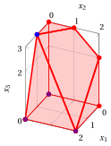{ .fig .ovale loading=lazy style="width:53%" }

    Una soluzione ottima ${ \tilde{\boldsymbol x}}(\, LP \,)$ è:

    $$
    \tilde{x}_1=1,~~
    \tilde{x}_2=0,~~
    \tilde{x}_3=3
    $$

    il valore ottimo $z(\, LP \,)$ è $11.$

    In viola il primo e il secondo vertice esplorati dalla precedente esecuzione dell'algoritmo del simplesso rivisto (prima di raggiungere quello ottimo rappresentato in blu).

!!! esercizio "Esercizio 11.15: Algoritmo del simplesso rivisto (P42)"

    Consideriamo il seguente problema LP in forma canonica di massimo con $n=3$ variabili e $m=3$ vincoli:

    $$
    \begin{array}{rrrrrrrr}
    {\max} & {3}\, {x_1} & {+} & {2}\, {x_2} & {+} & {4}\, {x_3} \\[2ex]
    \text{soggetto a} & {x_1} & {+} & {x_2} & {+} & {2}\, {x_3} & {\le} & {4} \\[2ex]
    & {2}\, {x_1} &  &  & {+} & {3}\, {x_3} & {\le} & {5} \\[2ex]
    & {2}\, {x_1} & {+} & {x_2} & {+} & {3}\, {x_3} & {\le} & {7} \\[2ex]
    & {x_1,} &  & {x_2,} &  & {x_3} & {\ge} & {0}
    \end{array}
    $$

    Introducendo le variabili di scarto, otteniamo il seguente problema LP in forma standard di massimo con $n+m=6$ variabili e $m=3$ vincoli:

    $$
    \begin{array}{rrcrcrcrcrcrcr}
    {\max} & {3}\, {x_1} & {+} & {2}\, {x_2} & {+} & {4}\, {x_3} \\[2ex]
    \text{soggetto a} & {x_1} & {+} & {x_2} & {+} & {2}\, {x_3} & {+} & {x_4} &  &  &  &  & {=} & {4} \\[2ex]
    & {2}\, {x_1} &  &  & {+} & {3}\, {x_3} &  &  & {+} & {x_5} &  &  & {=} & {5} \\[2ex]
    & {2}\, {x_1} & {+} & {x_2} & {+} & {3}\, {x_3} &  &  &  &  & {+} & {x_6} & {=} & {7} \\[2ex]
    & {x_1,} &  & {x_2,} &  & {x_3,} &  & {x_4,} &  & {x_5,} &  & {x_6} & {\ge} & {0}
    \end{array}
    $$

    **Domande**

    - Eseguire l'algoritmo del simplesso rivisto per trovare una soluzione ottima di questo problema LP, usando la regola di Bland per scegliere la colonna pivot e la riga pivot.

??? soluzione "Soluzione"

    Abbiamo:

    $$
    {\boldsymbol A}=
    \begin{pmatrix}
    1 & 1 & 2 & 1 & 0 & 0\\
    2 & 0 & 3 & 0 & 1 & 0\\
    2 & 1 & 3 & 0 & 0 & 1
    \end{pmatrix}
    \quad
    {\boldsymbol b}=
    \begin{pmatrix}
    4\\
    5\\
    7
    \end{pmatrix}
    \quad
    {\boldsymbol c}=
    \begin{pmatrix}
    3\\
    2\\
    4\\
    0\\
    0\\
    0
    \end{pmatrix}
    \quad
    {\boldsymbol x}=
    \begin{pmatrix}
    x_1 \\
    x_2 \\
    x_3 \\
    x_4 \\
    x_5 \\
    x_6
    \end{pmatrix}
    $$

    - <strong>Inizializzazione</strong>

        Poiché è un problema LP in forma standard ottenuto da un problema LP in forma canonica con $~{\boldsymbol b} \ge 0$ aggiungendo le variabili di scarto, la partizione $\pazocal{B}=\{4,5,6\}$ e $\pazocal{N}=\{1,2,3\}$ è associata alla seguente soluzione di base ammissibile:

        $$
        \begin{pmatrix}
        x_4 \\
        x_5 \\
        x_6
        \end{pmatrix}
        =
        \begin{pmatrix}
        4\\
        5\\
        7
        \end{pmatrix}
        {\rm ~~~e~~~}
        \begin{pmatrix}
        x_1 \\
        x_2 \\
        x_3
        \end{pmatrix}
        =
        \begin{pmatrix}
        0\\
        0\\
        0
        \end{pmatrix}
        $$

    - <strong>Iterazione 1</strong>

        Con $\pazocal{B}= \{4,~~5,~~6\}$ e $\pazocal{N}= \{1,~~2,~~3\}$, abbiamo:

        $$
        {\boldsymbol x}_{\pazocal{B}}=
        \begin{pmatrix}
        x_4 \\
        x_5 \\
        x_6
        \end{pmatrix} ~~
        {\boldsymbol A}_{\pazocal{B}}=
        \begin{pmatrix}
        1 & 0 & 0\\
        0 & 1 & 0\\
        0 & 0 & 1
        \end{pmatrix} ~~
        {\boldsymbol c}_{\pazocal{B}}=
        \begin{pmatrix}
        0\\
        0\\
        0
        \end{pmatrix} ~~
        {{ \bar{\boldsymbol b}}}=
        \begin{pmatrix}
        4\\
        5\\
        7
        \end{pmatrix}
        $$

        $$
        {\boldsymbol x}_{\pazocal{N}}=
        \begin{pmatrix}
        x_1 \\
        x_2 \\
        x_3
        \end{pmatrix} ~~
        {\boldsymbol A}_{\pazocal{N}}=
        \begin{pmatrix}
        1 & 1 & 2\\
        2 & 0 & 3\\
        2 & 1 & 3
        \end{pmatrix} ~~
        {\boldsymbol c}_{\pazocal{N}}=
        \begin{pmatrix}
        3\\
        2\\
        4
        \end{pmatrix}
        $$

        <strong>Test di ottimalità</strong>

        Risolviamo  ${\boldsymbol \pi} \; {\boldsymbol A}_{\pazocal{B}} = {\boldsymbol c}'_{\pazocal{B}}$ per calcolare ${\boldsymbol \pi} =  {{{\boldsymbol c}'_{\pazocal{B}} \; {\boldsymbol A}_{\pazocal{B}}^{-1}}}$, <u>primo sistema di equazioni lineari</u>:

        \begin{equation*}
        \begin{cases}
        \begin{array}{rrrrrrr}
        {\pi_4} &  &  &  &  & {=} & {0} \\[2ex]
        &  & {\pi_5} &  &  & {=} & {0} \\[2ex]
        &  &  &  & {\pi_6} & {=} & {0}
        \end{array}
        \end{cases}
        \qquad
        {\boldsymbol \pi}=
        \begin{pmatrix}
        0 & 0 & 0\\
        \end{pmatrix}
        \end{equation*}

        Calcoliamo il valore della soluzione di base ammissibile ${\bar{z}} = {\boldsymbol \pi} \; {\boldsymbol b} = \begin{pmatrix} 0 & 0 & 0\\ \end{pmatrix} \begin{pmatrix} 4\\ 5\\ 7 \end{pmatrix} = 0$

        Calcoliamo i costi ridotti ${{ \bar{\boldsymbol c}}'}  = {{\boldsymbol c}'_{\pazocal{N}} - {\boldsymbol \pi} \; {\boldsymbol A}_{\pazocal{N}}}$:

        $$
        \begin{aligned}
        {{ \bar{\boldsymbol c}}'}
        &= \begin{pmatrix}
        3 & 2 & 4\\
        \end{pmatrix} - \begin{pmatrix}
        0 & 0 & 0\\
        \end{pmatrix} \begin{pmatrix}
        1 & 1 & 2\\
        2 & 0 & 3\\
        2 & 1 & 3
        \end{pmatrix}
        \\[1ex]
        &= \underbrace{
        \begin{pmatrix}
        3 & 2 & 4\\
        \end{pmatrix}
        }_{{c_{1}~~~c_{2}~~~c_{3}}}
        -
        \underbrace{
        \begin{pmatrix}
        0 & 0 & 0\\
        \end{pmatrix}
        }_{{\boldsymbol \pi}\;{\boldsymbol A}_{1} ~~{\boldsymbol \pi}\;{\boldsymbol A}_{2} ~~{\boldsymbol \pi}\;{\boldsymbol A}_{3}}
        =
        \underbrace{
        \begin{pmatrix}
        3 & 2 & 4\\
        \end{pmatrix}
        }_{{\bar{c}_{1}~~~\bar{c}_{2}~~~\bar{c}_{3}}}
        \end{aligned}
        $$

        Non tutti i costi ridotti sono non positivi, quindi eseguiamo un'operazione di pivot.

        <strong>Operazione di pivot</strong>

        Poiché ${c}_{1} > {\boldsymbol \pi} \;{\boldsymbol A}_{1}$, $x_1$ è la <u>colonna pivot</u> e abbiamo ${\boldsymbol A}_{1} = \begin{pmatrix} 1\\ 2\\ 2 \end{pmatrix}$

        Risolviamo   ${\boldsymbol A}_{\pazocal{B}} \; {\boldsymbol d} = {\boldsymbol A}_{1}$ per calcolare   ${\boldsymbol d}={ {\boldsymbol A}_{\pazocal{B}}^{-1}} {\boldsymbol A}_{1}$,  <u>secondo sistema di equazioni lineari</u>:

        \begin{equation*}
        \begin{cases}
        \begin{array}{rrrrrrr}
        {d_4} &  &  &  &  & {=} & {1} \\[2ex]
        &  & {d_5} &  &  & {=} & {2} \\[2ex]
        &  &  &  & {d_6} & {=} & {2}
        \end{array}
        \end{cases}
        \qquad
        {\boldsymbol d}=
        \begin{pmatrix}
        1\\
        2\\
        2
        \end{pmatrix}
        \end{equation*}

        Dobbiamo trovare il valore massimo di $t$ tale che ${{ \bar{\boldsymbol b}}}  - t \; {{\boldsymbol d}} \ge 0$:

        $$
        \begin{cases}
        \underbrace{4 -t \cdot 1\ge 0}_{x_4 \ge 0} \\[2ex]
        \underbrace{5 -t \cdot 2\ge 0}_{x_5 \ge 0} \\[2ex]
        \underbrace{7 -t \cdot 2\ge 0}_{x_6 \ge 0}
        \end{cases}
        \qquad
        \begin{cases}
        t\le 4 \\[2ex]
        t\le \dfrac{5}{2} \\[2ex]
        t\le \dfrac{7}{2}
        \end{cases}
        \text{   quindi   } t_{m}=\dfrac{5}{2}
        $$

        Di conseguenza, il valore della colonna pivot diventa $t_{m}$, cioè $x_1=\dfrac{5}{2}$. Il valore di $x_5$ diventa zero e $x_5$ è la <u>riga pivot</u>. Le altre variabili in base assumono i valori  ${ \bar{\boldsymbol b}} - t_{m} \; {\boldsymbol d}$,  quindi abbiamo:

        $$
        \begin{aligned}
        x_4 &= 4 - \dfrac{5}{2} \cdot 1 = \dfrac{3}{2} \\[2ex]
        x_6 &= 7 - \dfrac{5}{2} \cdot 2 = 2
        \end{aligned}
        $$

    - <strong>Iterazione 2</strong>

        Con $\pazocal{B}= \{1,~~4,~~6\}$ e $\pazocal{N}= \{2,~~3,~~5\}$, abbiamo:

        $$
        {\boldsymbol x}_{\pazocal{B}}=
        \begin{pmatrix}
        x_1 \\
        x_4 \\
        x_6
        \end{pmatrix} ~~
        {\boldsymbol A}_{\pazocal{B}}=
        \begin{pmatrix}
        1 & 1 & 0\\
        2 & 0 & 0\\
        2 & 0 & 1
        \end{pmatrix} ~~
        {\boldsymbol c}_{\pazocal{B}}=
        \begin{pmatrix}
        3\\
        0\\
        0
        \end{pmatrix} ~~
        {{ \bar{\boldsymbol b}}}=
        \begin{pmatrix}
        \dfrac{5}{2}\\[2ex]
        \dfrac{3}{2}\\[2ex]
        2
        \end{pmatrix}
        $$

        $$
        {\boldsymbol x}_{\pazocal{N}}=
        \begin{pmatrix}
        x_2 \\
        x_3 \\
        x_5
        \end{pmatrix} ~~
        {\boldsymbol A}_{\pazocal{N}}=
        \begin{pmatrix}
        1 & 2 & 0\\
        0 & 3 & 1\\
        1 & 3 & 0
        \end{pmatrix} ~~
        {\boldsymbol c}_{\pazocal{N}}=
        \begin{pmatrix}
        2\\
        4\\
        0
        \end{pmatrix}
        $$

        <strong>Test di ottimalità</strong>

        Risolviamo  ${\boldsymbol \pi} \; {\boldsymbol A}_{\pazocal{B}} = {\boldsymbol c}'_{\pazocal{B}}$ per calcolare ${\boldsymbol \pi} =  {{{\boldsymbol c}'_{\pazocal{B}} \; {\boldsymbol A}_{\pazocal{B}}^{-1}}}$, <u>primo sistema di equazioni lineari</u>:

        \begin{equation*}
        \begin{cases}
        \begin{array}{rrrrrrr}
        {\pi_1} & {+} & {2}\, {\pi_4} & {+} & {2}\, {\pi_6} & {=} & {3} \\[2ex]
        {\pi_1} &  &  &  &  & {=} & {0} \\[2ex]
        &  &  &  & {\pi_6} & {=} & {0}
        \end{array}
        \end{cases}
        \qquad
        {\boldsymbol \pi}=
        \begin{pmatrix}
        0 & \dfrac{3}{2} & 0\\
        \end{pmatrix}
        \end{equation*}

        Calcoliamo il valore della soluzione di base ammissibile ${\bar{z}} = {\boldsymbol \pi} \; {\boldsymbol b} = \begin{pmatrix} 0 & \dfrac{3}{2} & 0\\ \end{pmatrix} \begin{pmatrix} 4\\ 5\\ 7 \end{pmatrix} = \dfrac{15}{2}$

        Calcoliamo i costi ridotti ${{ \bar{\boldsymbol c}}'}  = {{\boldsymbol c}'_{\pazocal{N}} - {\boldsymbol \pi} \; {\boldsymbol A}_{\pazocal{N}}}$:

        $$
        \begin{aligned}
        {{ \bar{\boldsymbol c}}'}
        &= \begin{pmatrix}
        2 & 4 & 0\\
        \end{pmatrix} - \begin{pmatrix}
        0 & \dfrac{3}{2} & 0\\
        \end{pmatrix} \begin{pmatrix}
        1 & 2 & 0\\
        0 & 3 & 1\\
        1 & 3 & 0
        \end{pmatrix}
        \\[1ex]
        &= \underbrace{
        \begin{pmatrix}
        2 & 4 & 0\\
        \end{pmatrix}
        }_{{c_{2}~~~c_{3}~~~c_{5}}}
        -
        \underbrace{
        \begin{pmatrix}
        0 & \dfrac{9}{2} & \dfrac{3}{2}\\
        \end{pmatrix}
        }_{{\boldsymbol \pi}\;{\boldsymbol A}_{2} ~~{\boldsymbol \pi}\;{\boldsymbol A}_{3} ~~{\boldsymbol \pi}\;{\boldsymbol A}_{5}}
        =
        \underbrace{
        \begin{pmatrix}
        2 & -\dfrac{1}{2} & -\dfrac{3}{2}\\
        \end{pmatrix}
        }_{{\bar{c}_{2}~~~\bar{c}_{3}~~~\bar{c}_{5}}}
        \end{aligned}
        $$

        Non tutti i costi ridotti sono non positivi, quindi eseguiamo un'operazione di pivot.

        <strong>Operazione di pivot</strong>

        Poiché ${c}_{2} > {\boldsymbol \pi} \;{\boldsymbol A}_{2}$, $x_2$ è la <u>colonna pivot</u> e abbiamo ${\boldsymbol A}_{2} = \begin{pmatrix} 1\\ 0\\ 1 \end{pmatrix}$

        Risolviamo   ${\boldsymbol A}_{\pazocal{B}} \; {\boldsymbol d} = {\boldsymbol A}_{2}$ per calcolare   ${\boldsymbol d}={ {\boldsymbol A}_{\pazocal{B}}^{-1}} {\boldsymbol A}_{2}$,  <u>secondo sistema di equazioni lineari</u>:

        \begin{equation*}
        \begin{cases}
        \begin{array}{rrrrrrr}
        {d_1} & {+} & {d_4} &  &  & {=} & {1} \\[2ex]
        {2}\, {d_1} &  &  &  &  & {=} & {0} \\[2ex]
        {2}\, {d_1} &  &  & {+} & {d_6} & {=} & {1}
        \end{array}
        \end{cases}
        \qquad
        {\boldsymbol d}=
        \begin{pmatrix}
        0\\
        1\\
        1
        \end{pmatrix}
        \end{equation*}

        Dobbiamo trovare il valore massimo di $t$ tale che ${{ \bar{\boldsymbol b}}}  - t \; {{\boldsymbol d}} \ge 0$:

        $$
        \begin{cases}
        \underbrace{\dfrac{3}{2} -t \cdot 1\ge 0}_{x_4 \ge 0} \\[2ex]
        \underbrace{2 -t \cdot 1\ge 0}_{x_6 \ge 0}
        \end{cases}
        \qquad
        \begin{cases}
        t\le \dfrac{3}{2} \\[2ex]
        t\le 2
        \end{cases}
        \text{   quindi   } t_{m}=\dfrac{3}{2}
        $$

        Di conseguenza, il valore della colonna pivot diventa $t_{m}$, cioè $x_2=\dfrac{3}{2}$. Il valore di $x_4$ diventa zero e $x_4$ è la <u>riga pivot</u>. Le altre variabili in base assumono i valori  ${ \bar{\boldsymbol b}} - t_{m} \; {\boldsymbol d}$,  quindi abbiamo:

        $$
        \begin{aligned}
        x_1 &= \dfrac{5}{2} - \dfrac{3}{2} \cdot 0 = \dfrac{5}{2} \\[2ex]
        x_6 &= 2 - \dfrac{3}{2} \cdot 1 = \dfrac{1}{2}
        \end{aligned}
        $$

    - <strong>Iterazione 3</strong>

        Con $\pazocal{B}= \{1,~~2,~~6\}$ e $\pazocal{N}= \{3,~~4,~~5\}$, abbiamo:

        $$
        {\boldsymbol x}_{\pazocal{B}}=
        \begin{pmatrix}
        x_1 \\
        x_2 \\
        x_6
        \end{pmatrix} ~~
        {\boldsymbol A}_{\pazocal{B}}=
        \begin{pmatrix}
        1 & 1 & 0\\
        2 & 0 & 0\\
        2 & 1 & 1
        \end{pmatrix} ~~
        {\boldsymbol c}_{\pazocal{B}}=
        \begin{pmatrix}
        3\\
        2\\
        0
        \end{pmatrix} ~~
        {{ \bar{\boldsymbol b}}}=
        \begin{pmatrix}
        \dfrac{5}{2}\\[2ex]
        \dfrac{3}{2}\\[2ex]
        \dfrac{1}{2}
        \end{pmatrix}
        $$

        $$
        {\boldsymbol x}_{\pazocal{N}}=
        \begin{pmatrix}
        x_3 \\
        x_4 \\
        x_5
        \end{pmatrix} ~~
        {\boldsymbol A}_{\pazocal{N}}=
        \begin{pmatrix}
        2 & 1 & 0\\
        3 & 0 & 1\\
        3 & 0 & 0
        \end{pmatrix} ~~
        {\boldsymbol c}_{\pazocal{N}}=
        \begin{pmatrix}
        4\\
        0\\
        0
        \end{pmatrix}
        $$

        <strong>Test di ottimalità</strong>

        Risolviamo  ${\boldsymbol \pi} \; {\boldsymbol A}_{\pazocal{B}} = {\boldsymbol c}'_{\pazocal{B}}$ per calcolare ${\boldsymbol \pi} =  {{{\boldsymbol c}'_{\pazocal{B}} \; {\boldsymbol A}_{\pazocal{B}}^{-1}}}$, <u>primo sistema di equazioni lineari</u>:

        \begin{equation*}
        \begin{cases}
        \begin{array}{rrrrrrr}
        {\pi_1} & {+} & {2}\, {\pi_2} & {+} & {2}\, {\pi_6} & {=} & {3} \\[2ex]
        {\pi_1} &  &  & {+} & {\pi_6} & {=} & {2} \\[2ex]
        &  &  &  & {\pi_6} & {=} & {0}
        \end{array}
        \end{cases}
        \qquad
        {\boldsymbol \pi}=
        \begin{pmatrix}
        2 & \dfrac{1}{2} & 0\\
        \end{pmatrix}
        \end{equation*}

        Calcoliamo il valore della soluzione di base ammissibile ${\bar{z}} = {\boldsymbol \pi} \; {\boldsymbol b} = \begin{pmatrix} 2 & \dfrac{1}{2} & 0\\ \end{pmatrix} \begin{pmatrix} 4\\ 5\\ 7 \end{pmatrix} = \dfrac{21}{2}$

        Calcoliamo i costi ridotti ${{ \bar{\boldsymbol c}}'}  = {{\boldsymbol c}'_{\pazocal{N}} - {\boldsymbol \pi} \; {\boldsymbol A}_{\pazocal{N}}}$:

        $$
        \begin{aligned}
        {{ \bar{\boldsymbol c}}'}
        &= \begin{pmatrix}
        4 & 0 & 0\\
        \end{pmatrix} - \begin{pmatrix}
        2 & \dfrac{1}{2} & 0\\
        \end{pmatrix} \begin{pmatrix}
        2 & 1 & 0\\
        3 & 0 & 1\\
        3 & 0 & 0
        \end{pmatrix}
        \\[1ex]
        &= \underbrace{
        \begin{pmatrix}
        4 & 0 & 0\\
        \end{pmatrix}
        }_{{c_{3}~~~c_{4}~~~c_{5}}}
        -
        \underbrace{
        \begin{pmatrix}
        \dfrac{11}{2} & 2 & \dfrac{1}{2}\\
        \end{pmatrix}
        }_{{\boldsymbol \pi}\;{\boldsymbol A}_{3} ~~{\boldsymbol \pi}\;{\boldsymbol A}_{4} ~~{\boldsymbol \pi}\;{\boldsymbol A}_{5}}
        =
        \underbrace{
        \begin{pmatrix}
        -\dfrac{3}{2} & -2 & -\dfrac{1}{2}\\
        \end{pmatrix}
        }_{{\bar{c}_{3}~~~\bar{c}_{4}~~~\bar{c}_{5}}}
        \end{aligned}
        $$

        Tutti i costi ridotti sono non positivi, quindi la soluzione di base ammissibile

        $$
        {\boldsymbol x}_{\pazocal{B}}=
        \begin{pmatrix}
        x_1 \\
        x_2 \\
        x_6
        \end{pmatrix}=\begin{pmatrix}
        \dfrac{5}{2}\\[2ex]
        \dfrac{3}{2}\\[2ex]
        \dfrac{1}{2}
        \end{pmatrix} {\rm ~~~e~~~} {\boldsymbol x}_{\pazocal{N}}=
        \begin{pmatrix}
        x_3 \\
        x_4 \\
        x_5
        \end{pmatrix}=\begin{pmatrix}
        0\\
        0\\
        0
        \end{pmatrix}
        $$

        è una soluzione ottima del problema LP e ${\bar{z}} = \dfrac{21}{2}$ è il valore ottimo.

    <strong>Soluzione grafica:</strong>

    La regione ammissibile del problema LP (in forma canonica) è il poliedro ombreggiato in rosso: 

    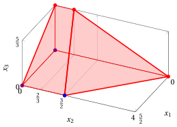{ .fig .ovale loading=lazy style="width:76%" }

    Una soluzione ottima ${ \tilde{\boldsymbol x}}(\, LP \,)$ è:

    $$
    \tilde{x}_1=\dfrac{5}{2},~~
    \tilde{x}_2=\dfrac{3}{2},~~
    \tilde{x}_3=0
    $$

    il valore ottimo $z(\, LP \,)$ è $\dfrac{21}{2}.$

    In viola il primo e il secondo vertice esplorati dalla precedente esecuzione dell'algoritmo del simplesso rivisto (prima di raggiungere quello ottimo rappresentato in blu).

!!! esercizio "Esercizio 11.16: Algoritmo del simplesso rivisto (P43)"

    Consideriamo il seguente problema LP in forma canonica di massimo con $n=3$ variabili e $m=2$ vincoli:

    $$
    \begin{array}{rrrrrrrr}
    {\max} & {x_1} & {+} & {2}\, {x_2} & {+} & {7}\, {x_3} \\[2ex]
    \text{soggetto a} & {x_1} &  &  & {+} & {2}\, {x_3} & {\le} & {2} \\[2ex]
    &  &  & {x_2} & {+} & {2}\, {x_3} & {\le} & {2} \\[2ex]
    & {x_1,} &  & {x_2,} &  & {x_3} & {\ge} & {0}
    \end{array}
    $$

    Introducendo le variabili di scarto, otteniamo il seguente problema LP in forma standard di massimo con $n+m=5$ variabili e $m=2$ vincoli:

    $$
    \begin{array}{rrrrrrrrrrrr}
    {\max} & {x_1} & {+} & {2}\, {x_2} & {+} & {7}\, {x_3} \\[2ex]
    \text{soggetto a} & {x_1} &  &  & {+} & {2}\, {x_3} & {+} & {x_4} &  &  & {=} & {2} \\[2ex]
    &  &  & {x_2} & {+} & {2}\, {x_3} &  &  & {+} & {x_5} & {=} & {2} \\[2ex]
    & {x_1,} &  & {x_2,} &  & {x_3,} &  & {x_4,} &  & {x_5} & {\ge} & {0}
    \end{array}
    $$

    **Domande**

    - Eseguire l'algoritmo del simplesso rivisto per trovare una soluzione ottima di questo problema LP, usando la regola di Bland per scegliere la colonna pivot e la riga pivot.

??? soluzione "Soluzione"

    Abbiamo:

    $$
    {\boldsymbol A}=
    \begin{pmatrix}
    1 & 0 & 2 & 1 & 0\\
    0 & 1 & 2 & 0 & 1
    \end{pmatrix}
    \quad
    {\boldsymbol b}=
    \begin{pmatrix}
    2\\
    2
    \end{pmatrix}
    \quad
    {\boldsymbol c}=
    \begin{pmatrix}
    1\\
    2\\
    7\\
    0\\
    0
    \end{pmatrix}
    \quad
    {\boldsymbol x}=
    \begin{pmatrix}
    x_1 \\
    x_2 \\
    x_3 \\
    x_4 \\
    x_5
    \end{pmatrix}
    $$

    - <strong>Inizializzazione</strong>

        Poiché è un problema LP in forma standard ottenuto da un problema LP in forma canonica con $~{\boldsymbol b} \ge 0$ aggiungendo le variabili di scarto, la partizione $\pazocal{B}=\{4,5\}$ e $\pazocal{N}=\{1,2,3\}$ è associata alla seguente soluzione di base ammissibile:

        $$
        \begin{pmatrix}
        x_4 \\
        x_5
        \end{pmatrix}
        =
        \begin{pmatrix}
        2\\
        2
        \end{pmatrix}
        {\rm ~~~e~~~}
        \begin{pmatrix}
        x_1 \\
        x_2 \\
        x_3
        \end{pmatrix}
        =
        \begin{pmatrix}
        0\\
        0\\
        0
        \end{pmatrix}
        $$

    - <strong>Iterazione 1</strong>

        Con $\pazocal{B}= \{4,~~5\}$ e $\pazocal{N}= \{1,~~2,~~3\}$, abbiamo:

        $$
        {\boldsymbol x}_{\pazocal{B}}=
        \begin{pmatrix}
        x_4 \\
        x_5
        \end{pmatrix} ~~
        {\boldsymbol A}_{\pazocal{B}}=
        \begin{pmatrix}
        1 & 0\\
        0 & 1
        \end{pmatrix} ~~
        {\boldsymbol c}_{\pazocal{B}}=
        \begin{pmatrix}
        0\\
        0
        \end{pmatrix} ~~
        {{ \bar{\boldsymbol b}}}=
        \begin{pmatrix}
        2\\
        2
        \end{pmatrix}
        $$

        $$
        {\boldsymbol x}_{\pazocal{N}}=
        \begin{pmatrix}
        x_1 \\
        x_2 \\
        x_3
        \end{pmatrix} ~~
        {\boldsymbol A}_{\pazocal{N}}=
        \begin{pmatrix}
        1 & 0 & 2\\
        0 & 1 & 2
        \end{pmatrix} ~~
        {\boldsymbol c}_{\pazocal{N}}=
        \begin{pmatrix}
        1\\
        2\\
        7
        \end{pmatrix}
        $$

        <strong>Test di ottimalità</strong>

        Risolviamo  ${\boldsymbol \pi} \; {\boldsymbol A}_{\pazocal{B}} = {\boldsymbol c}'_{\pazocal{B}}$ per calcolare ${\boldsymbol \pi} =  {{{\boldsymbol c}'_{\pazocal{B}} \; {\boldsymbol A}_{\pazocal{B}}^{-1}}}$, <u>primo sistema di equazioni lineari</u>:

        \begin{equation*}
        \begin{cases}
        \begin{array}{rrrrr}
        {\pi_4} &  &  & {=} & {0} \\[2ex]
        &  & {\pi_5} & {=} & {0}
        \end{array}
        \end{cases}
        \qquad
        {\boldsymbol \pi}=
        \begin{pmatrix}
        0 & 0\\
        \end{pmatrix}
        \end{equation*}

        Calcoliamo il valore della soluzione di base ammissibile ${\bar{z}} = {\boldsymbol \pi} \; {\boldsymbol b} = \begin{pmatrix} 0 & 0\\ \end{pmatrix} \begin{pmatrix} 2\\ 2 \end{pmatrix} = 0$

        Calcoliamo i costi ridotti ${{ \bar{\boldsymbol c}}'}  = {{\boldsymbol c}'_{\pazocal{N}} - {\boldsymbol \pi} \; {\boldsymbol A}_{\pazocal{N}}}$:

        $$
        \begin{aligned}
        {{ \bar{\boldsymbol c}}'}
        &= \begin{pmatrix}
        1 & 2 & 7\\
        \end{pmatrix} - \begin{pmatrix}
        0 & 0\\
        \end{pmatrix} \begin{pmatrix}
        1 & 0 & 2\\
        0 & 1 & 2
        \end{pmatrix}
        \\[1ex]
        &= \underbrace{
        \begin{pmatrix}
        1 & 2 & 7\\
        \end{pmatrix}
        }_{{c_{1}~~~c_{2}~~~c_{3}}}
        -
        \underbrace{
        \begin{pmatrix}
        0 & 0 & 0\\
        \end{pmatrix}
        }_{{\boldsymbol \pi}\;{\boldsymbol A}_{1} ~~{\boldsymbol \pi}\;{\boldsymbol A}_{2} ~~{\boldsymbol \pi}\;{\boldsymbol A}_{3}}
        =
        \underbrace{
        \begin{pmatrix}
        1 & 2 & 7\\
        \end{pmatrix}
        }_{{\bar{c}_{1}~~~\bar{c}_{2}~~~\bar{c}_{3}}}
        \end{aligned}
        $$

        Non tutti i costi ridotti sono non positivi, quindi eseguiamo un'operazione di pivot.

        <strong>Operazione di pivot</strong>

        Poiché ${c}_{1} > {\boldsymbol \pi} \;{\boldsymbol A}_{1}$, $x_1$ è la <u>colonna pivot</u> e abbiamo ${\boldsymbol A}_{1} = \begin{pmatrix} 1\\ 0 \end{pmatrix}$

        Risolviamo   ${\boldsymbol A}_{\pazocal{B}} \; {\boldsymbol d} = {\boldsymbol A}_{1}$ per calcolare   ${\boldsymbol d}={ {\boldsymbol A}_{\pazocal{B}}^{-1}} {\boldsymbol A}_{1}$,  <u>secondo sistema di equazioni lineari</u>:

        \begin{equation*}
        \begin{cases}
        \begin{array}{rrrrr}
        {d_4} &  &  & {=} & {1} \\[2ex]
        &  & {d_5} & {=} & {0}
        \end{array}
        \end{cases}
        \qquad
        {\boldsymbol d}=
        \begin{pmatrix}
        1\\
        0
        \end{pmatrix}
        \end{equation*}

        Dobbiamo trovare il valore massimo di $t$ tale che ${{ \bar{\boldsymbol b}}}  - t \; {{\boldsymbol d}} \ge 0$:

        $$
        \begin{cases}
        \underbrace{2 -t \cdot 1\ge 0}_{x_4 \ge 0}
        \end{cases}
        \qquad
        \begin{cases}
        t\le 2
        \end{cases}
        \text{   quindi   } t_{m}=2
        $$

        Di conseguenza, il valore della colonna pivot diventa $t_{m}$, cioè $x_1=2$. Il valore di $x_4$ diventa zero e $x_4$ è la <u>riga pivot</u>. Le altre variabili in base assumono i valori  ${ \bar{\boldsymbol b}} - t_{m} \; {\boldsymbol d}$,  quindi abbiamo:

        $$
        x_5 = 2 - 2 \cdot 0 = 2
        $$

    - <strong>Iterazione 2</strong>

        Con $\pazocal{B}= \{1,~~5\}$ e $\pazocal{N}= \{2,~~3,~~4\}$, abbiamo:

        $$
        {\boldsymbol x}_{\pazocal{B}}=
        \begin{pmatrix}
        x_1 \\
        x_5
        \end{pmatrix} ~~
        {\boldsymbol A}_{\pazocal{B}}=
        \begin{pmatrix}
        1 & 0\\
        0 & 1
        \end{pmatrix} ~~
        {\boldsymbol c}_{\pazocal{B}}=
        \begin{pmatrix}
        1\\
        0
        \end{pmatrix} ~~
        {{ \bar{\boldsymbol b}}}=
        \begin{pmatrix}
        2\\
        2
        \end{pmatrix}
        $$

        $$
        {\boldsymbol x}_{\pazocal{N}}=
        \begin{pmatrix}
        x_2 \\
        x_3 \\
        x_4
        \end{pmatrix} ~~
        {\boldsymbol A}_{\pazocal{N}}=
        \begin{pmatrix}
        0 & 2 & 1\\
        1 & 2 & 0
        \end{pmatrix} ~~
        {\boldsymbol c}_{\pazocal{N}}=
        \begin{pmatrix}
        2\\
        7\\
        0
        \end{pmatrix}
        $$

        <strong>Test di ottimalità</strong>

        Risolviamo  ${\boldsymbol \pi} \; {\boldsymbol A}_{\pazocal{B}} = {\boldsymbol c}'_{\pazocal{B}}$ per calcolare ${\boldsymbol \pi} =  {{{\boldsymbol c}'_{\pazocal{B}} \; {\boldsymbol A}_{\pazocal{B}}^{-1}}}$, <u>primo sistema di equazioni lineari</u>:

        \begin{equation*}
        \begin{cases}
        \begin{array}{rrrrr}
        {\pi_1} &  &  & {=} & {1} \\[2ex]
        &  & {\pi_5} & {=} & {0}
        \end{array}
        \end{cases}
        \qquad
        {\boldsymbol \pi}=
        \begin{pmatrix}
        1 & 0\\
        \end{pmatrix}
        \end{equation*}

        Calcoliamo il valore della soluzione di base ammissibile ${\bar{z}} = {\boldsymbol \pi} \; {\boldsymbol b} = \begin{pmatrix} 1 & 0\\ \end{pmatrix} \begin{pmatrix} 2\\ 2 \end{pmatrix} = 2$

        Calcoliamo i costi ridotti ${{ \bar{\boldsymbol c}}'}  = {{\boldsymbol c}'_{\pazocal{N}} - {\boldsymbol \pi} \; {\boldsymbol A}_{\pazocal{N}}}$:

        $$
        \begin{aligned}
        {{ \bar{\boldsymbol c}}'}
        &= \begin{pmatrix}
        2 & 7 & 0\\
        \end{pmatrix} - \begin{pmatrix}
        1 & 0\\
        \end{pmatrix} \begin{pmatrix}
        0 & 2 & 1\\
        1 & 2 & 0
        \end{pmatrix}
        \\[1ex]
        &= \underbrace{
        \begin{pmatrix}
        2 & 7 & 0\\
        \end{pmatrix}
        }_{{c_{2}~~~c_{3}~~~c_{4}}}
        -
        \underbrace{
        \begin{pmatrix}
        0 & 2 & 1\\
        \end{pmatrix}
        }_{{\boldsymbol \pi}\;{\boldsymbol A}_{2} ~~{\boldsymbol \pi}\;{\boldsymbol A}_{3} ~~{\boldsymbol \pi}\;{\boldsymbol A}_{4}}
        =
        \underbrace{
        \begin{pmatrix}
        2 & 5 & -1\\
        \end{pmatrix}
        }_{{\bar{c}_{2}~~~\bar{c}_{3}~~~\bar{c}_{4}}}
        \end{aligned}
        $$

        Non tutti i costi ridotti sono non positivi, quindi eseguiamo un'operazione di pivot.

        <strong>Operazione di pivot</strong>

        Poiché ${c}_{2} > {\boldsymbol \pi} \;{\boldsymbol A}_{2}$, $x_2$ è la <u>colonna pivot</u> e abbiamo ${\boldsymbol A}_{2} = \begin{pmatrix} 0\\ 1 \end{pmatrix}$

        Risolviamo   ${\boldsymbol A}_{\pazocal{B}} \; {\boldsymbol d} = {\boldsymbol A}_{2}$ per calcolare   ${\boldsymbol d}={ {\boldsymbol A}_{\pazocal{B}}^{-1}} {\boldsymbol A}_{2}$,  <u>secondo sistema di equazioni lineari</u>:

        \begin{equation*}
        \begin{cases}
        \begin{array}{rrrrr}
        {d_1} &  &  & {=} & {0} \\[2ex]
        &  & {d_5} & {=} & {1}
        \end{array}
        \end{cases}
        \qquad
        {\boldsymbol d}=
        \begin{pmatrix}
        0\\
        1
        \end{pmatrix}
        \end{equation*}

        Dobbiamo trovare il valore massimo di $t$ tale che ${{ \bar{\boldsymbol b}}}  - t \; {{\boldsymbol d}} \ge 0$:

        $$
        \begin{cases}
        \underbrace{2 -t \cdot 1\ge 0}_{x_5 \ge 0}
        \end{cases}
        \qquad
        \begin{cases}
        t\le 2
        \end{cases}
        \text{   quindi   } t_{m}=2
        $$

        Di conseguenza, il valore della colonna pivot diventa $t_{m}$, cioè $x_2=2$. Il valore di $x_5$ diventa zero e $x_5$ è la <u>riga pivot</u>. Le altre variabili in base assumono i valori  ${ \bar{\boldsymbol b}} - t_{m} \; {\boldsymbol d}$,  quindi abbiamo:

        $$
        x_1 = 2 - 2 \cdot 0 = 2
        $$

    - <strong>Iterazione 3</strong>

        Con $\pazocal{B}= \{1,~~2\}$ e $\pazocal{N}= \{3,~~4,~~5\}$, abbiamo:

        $$
        {\boldsymbol x}_{\pazocal{B}}=
        \begin{pmatrix}
        x_1 \\
        x_2
        \end{pmatrix} ~~
        {\boldsymbol A}_{\pazocal{B}}=
        \begin{pmatrix}
        1 & 0\\
        0 & 1
        \end{pmatrix} ~~
        {\boldsymbol c}_{\pazocal{B}}=
        \begin{pmatrix}
        1\\
        2
        \end{pmatrix} ~~
        {{ \bar{\boldsymbol b}}}=
        \begin{pmatrix}
        2\\
        2
        \end{pmatrix}
        $$

        $$
        {\boldsymbol x}_{\pazocal{N}}=
        \begin{pmatrix}
        x_3 \\
        x_4 \\
        x_5
        \end{pmatrix} ~~
        {\boldsymbol A}_{\pazocal{N}}=
        \begin{pmatrix}
        2 & 1 & 0\\
        2 & 0 & 1
        \end{pmatrix} ~~
        {\boldsymbol c}_{\pazocal{N}}=
        \begin{pmatrix}
        7\\
        0\\
        0
        \end{pmatrix}
        $$

        <strong>Test di ottimalità</strong>

        Risolviamo  ${\boldsymbol \pi} \; {\boldsymbol A}_{\pazocal{B}} = {\boldsymbol c}'_{\pazocal{B}}$ per calcolare ${\boldsymbol \pi} =  {{{\boldsymbol c}'_{\pazocal{B}} \; {\boldsymbol A}_{\pazocal{B}}^{-1}}}$, <u>primo sistema di equazioni lineari</u>:

        \begin{equation*}
        \begin{cases}
        \begin{array}{rrrrr}
        {\pi_1} &  &  & {=} & {1} \\[2ex]
        &  & {\pi_2} & {=} & {2}
        \end{array}
        \end{cases}
        \qquad
        {\boldsymbol \pi}=
        \begin{pmatrix}
        1 & 2\\
        \end{pmatrix}
        \end{equation*}

        Calcoliamo il valore della soluzione di base ammissibile ${\bar{z}} = {\boldsymbol \pi} \; {\boldsymbol b} = \begin{pmatrix} 1 & 2\\ \end{pmatrix} \begin{pmatrix} 2\\ 2 \end{pmatrix} = 6$

        Calcoliamo i costi ridotti ${{ \bar{\boldsymbol c}}'}  = {{\boldsymbol c}'_{\pazocal{N}} - {\boldsymbol \pi} \; {\boldsymbol A}_{\pazocal{N}}}$:

        $$
        \begin{aligned}
        {{ \bar{\boldsymbol c}}'}
        &= \begin{pmatrix}
        7 & 0 & 0\\
        \end{pmatrix} - \begin{pmatrix}
        1 & 2\\
        \end{pmatrix} \begin{pmatrix}
        2 & 1 & 0\\
        2 & 0 & 1
        \end{pmatrix}
        \\[1ex]
        &= \underbrace{
        \begin{pmatrix}
        7 & 0 & 0\\
        \end{pmatrix}
        }_{{c_{3}~~~c_{4}~~~c_{5}}}
        -
        \underbrace{
        \begin{pmatrix}
        6 & 1 & 2\\
        \end{pmatrix}
        }_{{\boldsymbol \pi}\;{\boldsymbol A}_{3} ~~{\boldsymbol \pi}\;{\boldsymbol A}_{4} ~~{\boldsymbol \pi}\;{\boldsymbol A}_{5}}
        =
        \underbrace{
        \begin{pmatrix}
        1 & -1 & -2\\
        \end{pmatrix}
        }_{{\bar{c}_{3}~~~\bar{c}_{4}~~~\bar{c}_{5}}}
        \end{aligned}
        $$

        Non tutti i costi ridotti sono non positivi, quindi eseguiamo un'operazione di pivot.

        <strong>Operazione di pivot</strong>

        Poiché ${c}_{3} > {\boldsymbol \pi} \;{\boldsymbol A}_{3}$, $x_3$ è la <u>colonna pivot</u> e abbiamo ${\boldsymbol A}_{3} = \begin{pmatrix} 2\\ 2 \end{pmatrix}$

        Risolviamo   ${\boldsymbol A}_{\pazocal{B}} \; {\boldsymbol d} = {\boldsymbol A}_{3}$ per calcolare   ${\boldsymbol d}={ {\boldsymbol A}_{\pazocal{B}}^{-1}} {\boldsymbol A}_{3}$,  <u>secondo sistema di equazioni lineari</u>:

        \begin{equation*}
        \begin{cases}
        \begin{array}{rrrrr}
        {d_1} &  &  & {=} & {2} \\[2ex]
        &  & {d_2} & {=} & {2}
        \end{array}
        \end{cases}
        \qquad
        {\boldsymbol d}=
        \begin{pmatrix}
        2\\
        2
        \end{pmatrix}
        \end{equation*}

        Dobbiamo trovare il valore massimo di $t$ tale che ${{ \bar{\boldsymbol b}}}  - t \; {{\boldsymbol d}} \ge 0$:

        $$
        \begin{cases}
        \underbrace{2 -t \cdot 2\ge 0}_{x_1 \ge 0} \\[2ex]
        \underbrace{2 -t \cdot 2\ge 0}_{x_2 \ge 0}
        \end{cases}
        \qquad
        \begin{cases}
        t\le 1 \\[2ex]
        t\le 1
        \end{cases}
        \text{   quindi   } t_{m}=1
        $$

        Di conseguenza, il valore della colonna pivot diventa $t_{m}$, cioè $x_3=1$. Il valore di $x_1$ diventa zero e $x_1$ è la <u>riga pivot</u>. Le altre variabili in base assumono i valori  ${ \bar{\boldsymbol b}} - t_{m} \; {\boldsymbol d}$,  quindi abbiamo:

        $$
        x_2 = 2 - 1 \cdot 2 = 0
        $$

    - <strong>Iterazione 4</strong>

        Con $\pazocal{B}= \{2,~~3\}$ e $\pazocal{N}= \{1,~~4,~~5\}$, abbiamo:

        $$
        {\boldsymbol x}_{\pazocal{B}}=
        \begin{pmatrix}
        x_2 \\
        x_3
        \end{pmatrix} ~~
        {\boldsymbol A}_{\pazocal{B}}=
        \begin{pmatrix}
        0 & 2\\
        1 & 2
        \end{pmatrix} ~~
        {\boldsymbol c}_{\pazocal{B}}=
        \begin{pmatrix}
        2\\
        7
        \end{pmatrix} ~~
        {{ \bar{\boldsymbol b}}}=
        \begin{pmatrix}
        0\\
        1
        \end{pmatrix}
        $$

        $$
        {\boldsymbol x}_{\pazocal{N}}=
        \begin{pmatrix}
        x_1 \\
        x_4 \\
        x_5
        \end{pmatrix} ~~
        {\boldsymbol A}_{\pazocal{N}}=
        \begin{pmatrix}
        1 & 1 & 0\\
        0 & 0 & 1
        \end{pmatrix} ~~
        {\boldsymbol c}_{\pazocal{N}}=
        \begin{pmatrix}
        1\\
        0\\
        0
        \end{pmatrix}
        $$

        <strong>Test di ottimalità</strong>

        Risolviamo  ${\boldsymbol \pi} \; {\boldsymbol A}_{\pazocal{B}} = {\boldsymbol c}'_{\pazocal{B}}$ per calcolare ${\boldsymbol \pi} =  {{{\boldsymbol c}'_{\pazocal{B}} \; {\boldsymbol A}_{\pazocal{B}}^{-1}}}$, <u>primo sistema di equazioni lineari</u>:

        \begin{equation*}
        \begin{cases}
        \begin{array}{rrrrr}
        &  & {\pi_3} & {=} & {2} \\[2ex]
        {2}\, {\pi_2} & {+} & {2}\, {\pi_3} & {=} & {7}
        \end{array}
        \end{cases}
        \qquad
        {\boldsymbol \pi}=
        \begin{pmatrix}
        \dfrac{3}{2} & 2\\
        \end{pmatrix}
        \end{equation*}

        Calcoliamo il valore della soluzione di base ammissibile ${\bar{z}} = {\boldsymbol \pi} \; {\boldsymbol b} = \begin{pmatrix} \dfrac{3}{2} & 2\\ \end{pmatrix} \begin{pmatrix} 2\\ 2 \end{pmatrix} = 7$

        Calcoliamo i costi ridotti ${{ \bar{\boldsymbol c}}'}  = {{\boldsymbol c}'_{\pazocal{N}} - {\boldsymbol \pi} \; {\boldsymbol A}_{\pazocal{N}}}$:

        $$
        \begin{aligned}
        {{ \bar{\boldsymbol c}}'}
        &= \begin{pmatrix}
        1 & 0 & 0\\
        \end{pmatrix} - \begin{pmatrix}
        \dfrac{3}{2} & 2\\
        \end{pmatrix} \begin{pmatrix}
        1 & 1 & 0\\
        0 & 0 & 1
        \end{pmatrix}
        \\[1ex]
        &= \underbrace{
        \begin{pmatrix}
        1 & 0 & 0\\
        \end{pmatrix}
        }_{{c_{1}~~~c_{4}~~~c_{5}}}
        -
        \underbrace{
        \begin{pmatrix}
        \dfrac{3}{2} & \dfrac{3}{2} & 2\\
        \end{pmatrix}
        }_{{\boldsymbol \pi}\;{\boldsymbol A}_{1} ~~{\boldsymbol \pi}\;{\boldsymbol A}_{4} ~~{\boldsymbol \pi}\;{\boldsymbol A}_{5}}
        =
        \underbrace{
        \begin{pmatrix}
        -\dfrac{1}{2} & -\dfrac{3}{2} & -2\\
        \end{pmatrix}
        }_{{\bar{c}_{1}~~~\bar{c}_{4}~~~\bar{c}_{5}}}
        \end{aligned}
        $$

        Tutti i costi ridotti sono non positivi, quindi la soluzione di base ammissibile

        $$
        {\boldsymbol x}_{\pazocal{B}}=
        \begin{pmatrix}
        x_2 \\
        x_3
        \end{pmatrix}=\begin{pmatrix}
        0\\
        1
        \end{pmatrix} {\rm ~~~e~~~} {\boldsymbol x}_{\pazocal{N}}=
        \begin{pmatrix}
        x_1 \\
        x_4 \\
        x_5
        \end{pmatrix}=\begin{pmatrix}
        0\\
        0\\
        0
        \end{pmatrix}
        $$

        è una soluzione ottima del problema LP e ${\bar{z}} = 7$ è il valore ottimo.

    <strong>Soluzione grafica:</strong>

    La regione ammissibile del problema LP (in forma canonica) è il poliedro ombreggiato in rosso: 

    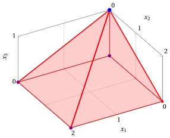{ .fig .ovale loading=lazy style="width:71%" }

    Una soluzione ottima ${ \tilde{\boldsymbol x}}(\, LP \,)$ è:

    $$
    \tilde{x}_1=0,~~\tilde{x}_2=0,~~\tilde{x}_3=1
    $$

    il valore ottimo $z(\, LP \,)$ è $7.$

    In viola il primo, il secondo e il terzo vertice esplorati dalla precedente esecuzione dell'algoritmo del simplesso rivisto (prima di raggiungere quello ottimo rappresentato in blu).

!!! esercizio "Esercizio 11.17: Algoritmo del simplesso rivisto (P44)"

    Consideriamo il seguente problema LP in forma canonica di massimo con $n=3$ variabili e $m=3$ vincoli:

    $$
    \begin{array}{rrrrrrrr}
    {\max} & {x_1} & {+} & {2}\, {x_2} & {+} & {3}\, {x_3} \\[2ex]
    \text{soggetto a} & {x_1} & {+} & {2}\, {x_2} & {-} & {2}\, {x_3} & {\le} & {1} \\[2ex]
    & {2}\, {x_1} & {-} & {x_2} & {-} & {3}\, {x_3} & {\le} & {4} \\[2ex]
    & {x_1} & {+} & {2}\, {x_2} & {+} & {5}\, {x_3} & {\le} & {2} \\[2ex]
    & {x_1,} &  & {x_2,} &  & {x_3} & {\ge} & {0}
    \end{array}
    $$

    Introducendo le variabili di scarto, otteniamo il seguente problema LP in forma standard di massimo con $n+m=6$ variabili e $m=3$ vincoli:

    $$
    \begin{array}{rrcrcrcrcrcrcr}
    {\max} & {x_1} & {+} & {2}\, {x_2} & {+} & {3}\, {x_3} \\[2ex]
    \text{soggetto a} & {x_1} & {+} & {2}\, {x_2} & {-} & {2}\, {x_3} & {+} & {x_4} &  &  &  &  & {=} & {1} \\[2ex]
    & {2}\, {x_1} & {-} & {x_2} & {-} & {3}\, {x_3} &  &  & {+} & {x_5} &  &  & {=} & {4} \\[2ex]
    & {x_1} & {+} & {2}\, {x_2} & {+} & {5}\, {x_3} &  &  &  &  & {+} & {x_6} & {=} & {2} \\[2ex]
    & {x_1,} &  & {x_2,} &  & {x_3,} &  & {x_4,} &  & {x_5,} &  & {x_6} & {\ge} & {0}
    \end{array}
    $$

    **Domande**

    - Eseguire l'algoritmo del simplesso rivisto per trovare una soluzione ottima di questo problema LP, utilizzando la regola di Bland per scegliere la colonna pivot e la riga pivot.

??? soluzione "Soluzione"

    Abbiamo:

    $$
    {\boldsymbol A}=
    \begin{pmatrix}
    1 & 2 & -2 & 1 & 0 & 0\\
    2 & -1 & -3 & 0 & 1 & 0\\
    1 & 2 & 5 & 0 & 0 & 1
    \end{pmatrix}
    \quad
    {\boldsymbol b}=
    \begin{pmatrix}
    1\\
    4\\
    2
    \end{pmatrix}
    \quad
    {\boldsymbol c}=
    \begin{pmatrix}
    1\\
    2\\
    3\\
    0\\
    0\\
    0
    \end{pmatrix}
    \quad
    {\boldsymbol x}=
    \begin{pmatrix}
    x_1 \\
    x_2 \\
    x_3 \\
    x_4 \\
    x_5 \\
    x_6
    \end{pmatrix}
    $$

    - <strong>Inizializzazione</strong>

        Poiché si tratta di un problema LP in forma standard ottenuto da un problema LP in forma canonica con $~{\boldsymbol b} \ge 0$ aggiungendo le variabili di scarto, la partizione $\pazocal{B}=\{4,5,6\}$ e $\pazocal{N}=\{1,2,3\}$ è associata alla seguente soluzione di base ammissibile:

        $$
        \begin{pmatrix}
        x_4 \\
        x_5 \\
        x_6
        \end{pmatrix}
        =
        \begin{pmatrix}
        1\\
        4\\
        2
        \end{pmatrix}
        {\rm ~~~e~~~}
        \begin{pmatrix}
        x_1 \\
        x_2 \\
        x_3
        \end{pmatrix}
        =
        \begin{pmatrix}
        0\\
        0\\
        0
        \end{pmatrix}
        $$

    - <strong>Iterazione 1</strong>

        Con $\pazocal{B}= \{4,~~5,~~6\}$ e $\pazocal{N}= \{1,~~2,~~3\}$, si ha:

        $$
        {\boldsymbol x}_{\pazocal{B}}=
        \begin{pmatrix}
        x_4 \\
        x_5 \\
        x_6
        \end{pmatrix} ~~
        {\boldsymbol A}_{\pazocal{B}}=
        \begin{pmatrix}
        1 & 0 & 0\\
        0 & 1 & 0\\
        0 & 0 & 1
        \end{pmatrix} ~~
        {\boldsymbol c}_{\pazocal{B}}=
        \begin{pmatrix}
        0\\
        0\\
        0
        \end{pmatrix} ~~
        {{ \bar{\boldsymbol b}}}=
        \begin{pmatrix}
        1\\
        4\\
        2
        \end{pmatrix}
        $$

        $$
        {\boldsymbol x}_{\pazocal{N}}=
        \begin{pmatrix}
        x_1 \\
        x_2 \\
        x_3
        \end{pmatrix} ~~
        {\boldsymbol A}_{\pazocal{N}}=
        \begin{pmatrix}
        1 & 2 & -2\\
        2 & -1 & -3\\
        1 & 2 & 5
        \end{pmatrix} ~~
        {\boldsymbol c}_{\pazocal{N}}=
        \begin{pmatrix}
        1\\
        2\\
        3
        \end{pmatrix}
        $$

        <strong>Verifica di ottimalità</strong>

        Risolviamo ${\boldsymbol \pi} \; {\boldsymbol A}_{\pazocal{B}} = {\boldsymbol c}'_{\pazocal{B}}$ per calcolare ${\boldsymbol \pi} =  {{{\boldsymbol c}'_{\pazocal{B}} \; {\boldsymbol A}_{\pazocal{B}}^{-1}}}$, <u>primo sistema di equazioni lineari</u>:

        \begin{equation*}
        \begin{cases}
        \begin{array}{rrrrrrr}
        {\pi_4} &  &  &  &  & {=} & {0} \\[2ex]
        &  & {\pi_5} &  &  & {=} & {0} \\[2ex]
        &  &  &  & {\pi_6} & {=} & {0}
        \end{array}
        \end{cases}
        \qquad
        {\boldsymbol \pi}=
        \begin{pmatrix}
        0 & 0 & 0\\
        \end{pmatrix}
        \end{equation*}

        Calcoliamo il valore della soluzione di base ammissibile ${\bar{z}} = {\boldsymbol \pi} \; {\boldsymbol b} = \begin{pmatrix} 0 & 0 & 0\\ \end{pmatrix} \begin{pmatrix} 1\\ 4\\ 2 \end{pmatrix} = 0$

        Calcoliamo i costi ridotti ${{ \bar{\boldsymbol c}}'}  = {{\boldsymbol c}'_{\pazocal{N}} - {\boldsymbol \pi} \; {\boldsymbol A}_{\pazocal{N}}}$:

        $$
        \begin{aligned}
        {{ \bar{\boldsymbol c}}'}
        &= \begin{pmatrix}
        1 & 2 & 3\\
        \end{pmatrix} - \begin{pmatrix}
        0 & 0 & 0\\
        \end{pmatrix} \begin{pmatrix}
        1 & 2 & -2\\
        2 & -1 & -3\\
        1 & 2 & 5
        \end{pmatrix}
        \\[1ex]
        &= \underbrace{
        \begin{pmatrix}
        1 & 2 & 3\\
        \end{pmatrix}
        }_{{c_{1}~~~c_{2}~~~c_{3}}}
        -
        \underbrace{
        \begin{pmatrix}
        0 & 0 & 0\\
        \end{pmatrix}
        }_{{\boldsymbol \pi}\;{\boldsymbol A}_{1} ~~{\boldsymbol \pi}\;{\boldsymbol A}_{2} ~~{\boldsymbol \pi}\;{\boldsymbol A}_{3}}
        =
        \underbrace{
        \begin{pmatrix}
        1 & 2 & 3\\
        \end{pmatrix}
        }_{{\bar{c}_{1}~~~\bar{c}_{2}~~~\bar{c}_{3}}}
        \end{aligned}
        $$

        Non tutti i costi ridotti sono non positivi, quindi eseguiamo un'operazione di pivot.

        <strong>Operazione di pivot</strong>

        Poiché ${c}_{1} > {\boldsymbol \pi} \;{\boldsymbol A}_{1}$, $x_1$ è la <u>colonna pivot</u> e si ha ${\boldsymbol A}_{1} = \begin{pmatrix} 1\\ 2\\ 1 \end{pmatrix}$

        Risolviamo ${\boldsymbol A}_{\pazocal{B}} \; {\boldsymbol d} = {\boldsymbol A}_{1}$ per calcolare ${\boldsymbol d}={ {\boldsymbol A}_{\pazocal{B}}^{-1}} {\boldsymbol A}_{1}$, <u>secondo sistema di equazioni lineari</u>:

        \begin{equation*}
        \begin{cases}
        \begin{array}{rrrrrrr}
        {d_4} &  &  &  &  & {=} & {1} \\[2ex]
        &  & {d_5} &  &  & {=} & {2} \\[2ex]
        &  &  &  & {d_6} & {=} & {1}
        \end{array}
        \end{cases}
        \qquad
        {\boldsymbol d}=
        \begin{pmatrix}
        1\\
        2\\
        1
        \end{pmatrix}
        \end{equation*}

        Dobbiamo trovare il massimo $t$ tale che ${{ \bar{\boldsymbol b}}}  - t \; {{\boldsymbol d}} \ge 0$:

        $$
        \begin{cases}
        \underbrace{1 -t \cdot 1\ge 0}_{x_4 \ge 0} \\[2ex]
        \underbrace{4 -t \cdot 2\ge 0}_{x_5 \ge 0} \\[2ex]
        \underbrace{2 -t \cdot 1\ge 0}_{x_6 \ge 0}
        \end{cases}
        \qquad
        \begin{cases}
        t\le 1 \\[2ex]
        t\le 2 \\[2ex]
        t\le 2
        \end{cases}
        \text{   quindi   } t_{m}=1
        $$

        Di conseguenza il valore della colonna pivot diventa $t_{m}$, cioè $x_1=1$. Il valore di $x_4$ diventa zero e $x_4$ è la <u>riga pivot</u>. Le altre variabili di base assumono i valori ${ \bar{\boldsymbol b}} - t_{m} \; {\boldsymbol d}$, quindi si ha:

        $$
        \begin{aligned}
        x_5 &= 4 - 1 \cdot 2 = 2 \\[2ex]
        x_6 &= 2 - 1 \cdot 1 = 1
        \end{aligned}
        $$

    - <strong>Iterazione 2</strong>

        Con $\pazocal{B}= \{1,~~5,~~6\}$ e $\pazocal{N}= \{2,~~3,~~4\}$, si ha:

        $$
        {\boldsymbol x}_{\pazocal{B}}=
        \begin{pmatrix}
        x_1 \\
        x_5 \\
        x_6
        \end{pmatrix} ~~
        {\boldsymbol A}_{\pazocal{B}}=
        \begin{pmatrix}
        1 & 0 & 0\\
        2 & 1 & 0\\
        1 & 0 & 1
        \end{pmatrix} ~~
        {\boldsymbol c}_{\pazocal{B}}=
        \begin{pmatrix}
        1\\
        0\\
        0
        \end{pmatrix} ~~
        {{ \bar{\boldsymbol b}}}=
        \begin{pmatrix}
        1\\
        2\\
        1
        \end{pmatrix}
        $$

        $$
        {\boldsymbol x}_{\pazocal{N}}=
        \begin{pmatrix}
        x_2 \\
        x_3 \\
        x_4
        \end{pmatrix} ~~
        {\boldsymbol A}_{\pazocal{N}}=
        \begin{pmatrix}
        2 & -2 & 1\\
        -1 & -3 & 0\\
        2 & 5 & 0
        \end{pmatrix} ~~
        {\boldsymbol c}_{\pazocal{N}}=
        \begin{pmatrix}
        2\\
        3\\
        0
        \end{pmatrix}
        $$

        <strong>Verifica di ottimalità</strong>

        Risolviamo ${\boldsymbol \pi} \; {\boldsymbol A}_{\pazocal{B}} = {\boldsymbol c}'_{\pazocal{B}}$ per calcolare ${\boldsymbol \pi} =  {{{\boldsymbol c}'_{\pazocal{B}} \; {\boldsymbol A}_{\pazocal{B}}^{-1}}}$, <u>primo sistema di equazioni lineari</u>:

        \begin{equation*}
        \begin{cases}
        \begin{array}{rrrrrrr}
        {\pi_1} & {+} & {2}\, {\pi_5} & {+} & {\pi_6} & {=} & {1} \\[2ex]
        &  & {\pi_5} &  &  & {=} & {0} \\[2ex]
        &  &  &  & {\pi_6} & {=} & {0}
        \end{array}
        \end{cases}
        \qquad
        {\boldsymbol \pi}=
        \begin{pmatrix}
        1 & 0 & 0\\
        \end{pmatrix}
        \end{equation*}

        Calcoliamo il valore della soluzione di base ammissibile ${\bar{z}} = {\boldsymbol \pi} \; {\boldsymbol b} = \begin{pmatrix} 1 & 0 & 0\\ \end{pmatrix} \begin{pmatrix} 1\\ 4\\ 2 \end{pmatrix} = 1$

        Calcoliamo i costi ridotti ${{ \bar{\boldsymbol c}}'}  = {{\boldsymbol c}'_{\pazocal{N}} - {\boldsymbol \pi} \; {\boldsymbol A}_{\pazocal{N}}}$:

        $$
        \begin{aligned}
        {{ \bar{\boldsymbol c}}'}
        &= \begin{pmatrix}
        2 & 3 & 0\\
        \end{pmatrix} - \begin{pmatrix}
        1 & 0 & 0\\
        \end{pmatrix} \begin{pmatrix}
        2 & -2 & 1\\
        -1 & -3 & 0\\
        2 & 5 & 0
        \end{pmatrix}
        \\[1ex]
        &= \underbrace{
        \begin{pmatrix}
        2 & 3 & 0\\
        \end{pmatrix}
        }_{{c_{2}~~~c_{3}~~~c_{4}}}
        -
        \underbrace{
        \begin{pmatrix}
        2 & -2 & 1\\
        \end{pmatrix}
        }_{{\boldsymbol \pi}\;{\boldsymbol A}_{2} ~~{\boldsymbol \pi}\;{\boldsymbol A}_{3} ~~{\boldsymbol \pi}\;{\boldsymbol A}_{4}}
        =
        \underbrace{
        \begin{pmatrix}
        0 & 5 & -1\\
        \end{pmatrix}
        }_{{\bar{c}_{2}~~~\bar{c}_{3}~~~\bar{c}_{4}}}
        \end{aligned}
        $$

        Non tutti i costi ridotti sono non positivi, quindi eseguiamo un'operazione di pivot.

        <strong>Operazione di pivot</strong>

        Poiché ${c}_{3} > {\boldsymbol \pi} \;{\boldsymbol A}_{3}$, $x_3$ è la <u>colonna pivot</u> e si ha ${\boldsymbol A}_{3} = \begin{pmatrix} -2\\ -3\\ 5 \end{pmatrix}$

        Risolviamo ${\boldsymbol A}_{\pazocal{B}} \; {\boldsymbol d} = {\boldsymbol A}_{3}$ per calcolare ${\boldsymbol d}={ {\boldsymbol A}_{\pazocal{B}}^{-1}} {\boldsymbol A}_{3}$, <u>secondo sistema di equazioni lineari</u>:

        \begin{equation*}
        \begin{cases}
        \begin{array}{rrrrrrr}
        {d_1} &  &  &  &  & {=} & {-2} \\[2ex]
        {2}\, {d_1} & {+} & {d_5} &  &  & {=} & {-3} \\[2ex]
        {d_1} &  &  & {+} & {d_6} & {=} & {5}
        \end{array}
        \end{cases}
        \qquad
        {\boldsymbol d}=
        \begin{pmatrix}
        -2\\
        1\\
        7
        \end{pmatrix}
        \end{equation*}

        Dobbiamo trovare il massimo $t$ tale che ${{ \bar{\boldsymbol b}}}  - t \; {{\boldsymbol d}} \ge 0$:

        $$
        \begin{cases}
        \underbrace{1 -t \cdot \left( -2\right)\ge 0}_{x_1 \ge 0} \\[2ex]
        \underbrace{2 -t \cdot 1\ge 0}_{x_5 \ge 0} \\[2ex]
        \underbrace{1 -t \cdot 7\ge 0}_{x_6 \ge 0}
        \end{cases}
        \qquad
        \begin{cases}
        t\ge -\dfrac{1}{2} \\[2ex]
        t\le 2 \\[2ex]
        t\le \dfrac{1}{7}
        \end{cases}
        \text{   quindi   } t_{m}=\dfrac{1}{7}
        $$

        Di conseguenza il valore della colonna pivot diventa $t_{m}$, cioè $x_3=\dfrac{1}{7}$. Il valore di $x_6$ diventa zero e $x_6$ è la <u>riga pivot</u>. Le altre variabili di base assumono i valori ${ \bar{\boldsymbol b}} - t_{m} \; {\boldsymbol d}$, quindi si ha:

        $$
        \begin{aligned}
        x_1 &= 1 - \dfrac{1}{7} \cdot \left( -2\right) = \dfrac{9}{7} \\[2ex]
        x_5 &= 2 - \dfrac{1}{7} \cdot 1 = \dfrac{13}{7}
        \end{aligned}
        $$

    - <strong>Iterazione 3</strong>

        Con $\pazocal{B}= \{1,~~3,~~5\}$ e $\pazocal{N}= \{2,~~4,~~6\}$, si ha:

        $$
        {\boldsymbol x}_{\pazocal{B}}=
        \begin{pmatrix}
        x_1 \\
        x_3 \\
        x_5
        \end{pmatrix} ~~
        {\boldsymbol A}_{\pazocal{B}}=
        \begin{pmatrix}
        1 & -2 & 0\\
        2 & -3 & 1\\
        1 & 5 & 0
        \end{pmatrix} ~~
        {\boldsymbol c}_{\pazocal{B}}=
        \begin{pmatrix}
        1\\
        3\\
        0
        \end{pmatrix} ~~
        {{ \bar{\boldsymbol b}}}=
        \begin{pmatrix}
        \dfrac{9}{7}\\[2ex]
        \dfrac{1}{7}\\[2ex]
        \dfrac{13}{7}
        \end{pmatrix}
        $$

        $$
        {\boldsymbol x}_{\pazocal{N}}=
        \begin{pmatrix}
        x_2 \\
        x_4 \\
        x_6
        \end{pmatrix} ~~
        {\boldsymbol A}_{\pazocal{N}}=
        \begin{pmatrix}
        2 & 1 & 0\\
        -1 & 0 & 0\\
        2 & 0 & 1
        \end{pmatrix} ~~
        {\boldsymbol c}_{\pazocal{N}}=
        \begin{pmatrix}
        2\\
        0\\
        0
        \end{pmatrix}
        $$

        <strong>Verifica di ottimalità</strong>

        Risolviamo ${\boldsymbol \pi} \; {\boldsymbol A}_{\pazocal{B}} = {\boldsymbol c}'_{\pazocal{B}}$ per calcolare ${\boldsymbol \pi} =  {{{\boldsymbol c}'_{\pazocal{B}} \; {\boldsymbol A}_{\pazocal{B}}^{-1}}}$, <u>primo sistema di equazioni lineari</u>:

        \begin{equation*}
        \begin{cases}
        \begin{array}{rrrrrrr}
        {\pi_1} & {+} & {2}\, {\pi_3} & {+} & {\pi_5} & {=} & {1} \\[2ex]
        {-2}\, {\pi_1} & {-} & {3}\, {\pi_3} & {+} & {5}\, {\pi_5} & {=} & {3} \\[2ex]
        &  & {\pi_3} &  &  & {=} & {0}
        \end{array}
        \end{cases}
        \qquad
        {\boldsymbol \pi}=
        \begin{pmatrix}
        \dfrac{2}{7} & 0 & \dfrac{5}{7}\\
        \end{pmatrix}
        \end{equation*}

        Calcoliamo il valore della soluzione di base ammissibile ${\bar{z}} = {\boldsymbol \pi} \; {\boldsymbol b} = \begin{pmatrix} \dfrac{2}{7} & 0 & \dfrac{5}{7}\\ \end{pmatrix} \begin{pmatrix} 1\\ 4\\ 2 \end{pmatrix} = \dfrac{12}{7}$

        Calcoliamo i costi ridotti ${{ \bar{\boldsymbol c}}'}  = {{\boldsymbol c}'_{\pazocal{N}} - {\boldsymbol \pi} \; {\boldsymbol A}_{\pazocal{N}}}$:

        $$
        \begin{aligned}
        {{ \bar{\boldsymbol c}}'}
        &= \begin{pmatrix}
        2 & 0 & 0\\
        \end{pmatrix} - \begin{pmatrix}
        \dfrac{2}{7} & 0 & \dfrac{5}{7}\\
        \end{pmatrix} \begin{pmatrix}
        2 & 1 & 0\\
        -1 & 0 & 0\\
        2 & 0 & 1
        \end{pmatrix}
        \\[1ex]
        &= \underbrace{
        \begin{pmatrix}
        2 & 0 & 0\\
        \end{pmatrix}
        }_{{c_{2}~~~c_{4}~~~c_{6}}}
        -
        \underbrace{
        \begin{pmatrix}
        2 & \dfrac{2}{7} & \dfrac{5}{7}\\
        \end{pmatrix}
        }_{{\boldsymbol \pi}\;{\boldsymbol A}_{2} ~~{\boldsymbol \pi}\;{\boldsymbol A}_{4} ~~{\boldsymbol \pi}\;{\boldsymbol A}_{6}}
        =
        \underbrace{
        \begin{pmatrix}
        0 & -\dfrac{2}{7} & -\dfrac{5}{7}\\
        \end{pmatrix}
        }_{{\bar{c}_{2}~~~\bar{c}_{4}~~~\bar{c}_{6}}}
        \end{aligned}
        $$

        Tutti i costi ridotti sono non positivi, quindi la soluzione di base ammissibile

        $$
        {\boldsymbol x}_{\pazocal{B}}=
        \begin{pmatrix}
        x_1 \\
        x_3 \\
        x_5
        \end{pmatrix}=\begin{pmatrix}
        \dfrac{9}{7}\\[2ex]
        \dfrac{1}{7}\\[2ex]
        \dfrac{13}{7}
        \end{pmatrix} {\rm ~~~e~~~} {\boldsymbol x}_{\pazocal{N}}=
        \begin{pmatrix}
        x_2 \\
        x_4 \\
        x_6
        \end{pmatrix}=\begin{pmatrix}
        0\\
        0\\
        0
        \end{pmatrix}
        $$

        è una soluzione ottima del problema LP e ${\bar{z}} = \dfrac{12}{7}$ è il valore della soluzione ottima.

    - <strong>Soluzioni ottime multiple</strong>

        La soluzione ottima <u>non è unica</u>: nella base finale la variabile non di base $x_2$ ha costo ridotto $\bar c_{2} = 0$, e ogni punto dello spigolo che congiunge $\left(\dfrac{9}{7},~0,~\dfrac{1}{7}\right)$ e $\left(0,~\dfrac{9}{14},~\dfrac{1}{7}\right)$ è ottimo, con valore $\dfrac{12}{7}$.

    <strong>Soluzione grafica:</strong>

    La regione ammissibile del problema LP (in forma canonica) è il poliedro colorato in rosso: 

    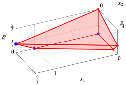{ .fig .ovale loading=lazy style="width:71%" }

    Una soluzione ottima ${ \tilde{\boldsymbol x}}(\, LP \,)$ è:

    $$
    \tilde{x}_1=\dfrac{9}{7},~~\tilde{x}_2=0,~~\tilde{x}_3=\dfrac{1}{7}
    $$

    il valore ottimo $z(\, LP \,)$ è $\dfrac{12}{7}.$

    In viola il primo e il secondo vertice esplorati dalla precedente esecuzione dell'algoritmo del simplesso rivisto (prima di raggiungere quello ottimo rappresentato in blu).

!!! esercizio "Esercizio 11.18: Algoritmo del simplesso rivisto (P45)"

    Consideriamo il seguente problema LP in forma canonica di massimo con $n=3$ variabili e $m=2$ vincoli:

    $$
    \begin{array}{rrrrrrrr}
    {\max} & {4}\, {x_1} & {-} & {13}\, {x_2} & {+} & {7}\, {x_3} \\[2ex]
    \text{soggetto a} & {3}\, {x_1} & {+} & {2}\, {x_2} & {+} & {5}\, {x_3} & {\le} & {5} \\[2ex]
    & {x_1} & {-} & {3}\, {x_2} & {+} & {5}\, {x_3} & {\le} & {3} \\[2ex]
    & {x_1,} &  & {x_2,} &  & {x_3} & {\ge} & {0}
    \end{array}
    $$

    Introducendo le variabili di scarto, otteniamo il seguente problema LP in forma standard di massimo con $n+m=5$ variabili e $m=2$ vincoli:

    $$
    \begin{array}{rrrrrrrrrrrr}
    {\max} & {4}\, {x_1} & {-} & {13}\, {x_2} & {+} & {7}\, {x_3} \\[2ex]
    \text{soggetto a} & {3}\, {x_1} & {+} & {2}\, {x_2} & {+} & {5}\, {x_3} & {+} & {x_4} &  &  & {=} & {5} \\[2ex]
    & {x_1} & {-} & {3}\, {x_2} & {+} & {5}\, {x_3} &  &  & {+} & {x_5} & {=} & {3} \\[2ex]
    & {x_1,} &  & {x_2,} &  & {x_3,} &  & {x_4,} &  & {x_5} & {\ge} & {0}
    \end{array}
    $$

    **Domande**

    - Eseguire l'algoritmo del simplesso rivisto per trovare una soluzione ottima di questo problema LP, utilizzando la regola di Bland per scegliere la colonna pivot e la riga pivot.

??? soluzione "Soluzione"

    Abbiamo:

    $$
    {\boldsymbol A}=
    \begin{pmatrix}
    3 & 2 & 5 & 1 & 0\\
    1 & -3 & 5 & 0 & 1
    \end{pmatrix}
    \quad
    {\boldsymbol b}=
    \begin{pmatrix}
    5\\
    3
    \end{pmatrix}
    \quad
    {\boldsymbol c}=
    \begin{pmatrix}
    4\\
    -13\\
    7\\
    0\\
    0
    \end{pmatrix}
    \quad
    {\boldsymbol x}=
    \begin{pmatrix}
    x_1 \\
    x_2 \\
    x_3 \\
    x_4 \\
    x_5
    \end{pmatrix}
    $$

    - <strong>Inizializzazione</strong>

        Poiché si tratta di un problema LP in forma standard ottenuto da un problema LP in forma canonica con $~{\boldsymbol b} \ge 0$ aggiungendo le variabili di scarto, la partizione $\pazocal{B}=\{4,5\}$ e $\pazocal{N}=\{1,2,3\}$ è associata alla seguente soluzione di base ammissibile:

        $$
        \begin{pmatrix}
        x_4 \\
        x_5
        \end{pmatrix}
        =
        \begin{pmatrix}
        5\\
        3
        \end{pmatrix}
        {\rm ~~~e~~~}
        \begin{pmatrix}
        x_1 \\
        x_2 \\
        x_3
        \end{pmatrix}
        =
        \begin{pmatrix}
        0\\
        0\\
        0
        \end{pmatrix}
        $$

    - <strong>Iterazione 1</strong>

        Con $\pazocal{B}= \{4,~~5\}$ e $\pazocal{N}= \{1,~~2,~~3\}$, si ha:

        $$
        {\boldsymbol x}_{\pazocal{B}}=
        \begin{pmatrix}
        x_4 \\
        x_5
        \end{pmatrix} ~~
        {\boldsymbol A}_{\pazocal{B}}=
        \begin{pmatrix}
        1 & 0\\
        0 & 1
        \end{pmatrix} ~~
        {\boldsymbol c}_{\pazocal{B}}=
        \begin{pmatrix}
        0\\
        0
        \end{pmatrix} ~~
        {{ \bar{\boldsymbol b}}}=
        \begin{pmatrix}
        5\\
        3
        \end{pmatrix}
        $$

        $$
        {\boldsymbol x}_{\pazocal{N}}=
        \begin{pmatrix}
        x_1 \\
        x_2 \\
        x_3
        \end{pmatrix} ~~
        {\boldsymbol A}_{\pazocal{N}}=
        \begin{pmatrix}
        3 & 2 & 5\\
        1 & -3 & 5
        \end{pmatrix} ~~
        {\boldsymbol c}_{\pazocal{N}}=
        \begin{pmatrix}
        4\\
        -13\\
        7
        \end{pmatrix}
        $$

        <strong>Verifica di ottimalità</strong>

        Risolviamo ${\boldsymbol \pi} \; {\boldsymbol A}_{\pazocal{B}} = {\boldsymbol c}'_{\pazocal{B}}$ per calcolare ${\boldsymbol \pi} =  {{{\boldsymbol c}'_{\pazocal{B}} \; {\boldsymbol A}_{\pazocal{B}}^{-1}}}$, <u>primo sistema di equazioni lineari</u>:

        \begin{equation*}
        \begin{cases}
        \begin{array}{rrrrr}
        {\pi_4} &  &  & {=} & {0} \\[2ex]
        &  & {\pi_5} & {=} & {0}
        \end{array}
        \end{cases}
        \qquad
        {\boldsymbol \pi}=
        \begin{pmatrix}
        0 & 0\\
        \end{pmatrix}
        \end{equation*}

        Calcoliamo il valore della soluzione di base ammissibile ${\bar{z}} = {\boldsymbol \pi} \; {\boldsymbol b} = \begin{pmatrix} 0 & 0\\ \end{pmatrix} \begin{pmatrix} 5\\ 3 \end{pmatrix} = 0$

        Calcoliamo i costi ridotti ${{ \bar{\boldsymbol c}}'}  = {{\boldsymbol c}'_{\pazocal{N}} - {\boldsymbol \pi} \; {\boldsymbol A}_{\pazocal{N}}}$:

        $$
        \begin{aligned}
        {{ \bar{\boldsymbol c}}'}
        &= \begin{pmatrix}
        4 & -13 & 7\\
        \end{pmatrix} - \begin{pmatrix}
        0 & 0\\
        \end{pmatrix} \begin{pmatrix}
        3 & 2 & 5\\
        1 & -3 & 5
        \end{pmatrix}
        \\[1ex]
        &= \underbrace{
        \begin{pmatrix}
        4 & -13 & 7\\
        \end{pmatrix}
        }_{{c_{1}~~~c_{2}~~~c_{3}}}
        -
        \underbrace{
        \begin{pmatrix}
        0 & 0 & 0\\
        \end{pmatrix}
        }_{{\boldsymbol \pi}\;{\boldsymbol A}_{1} ~~{\boldsymbol \pi}\;{\boldsymbol A}_{2} ~~{\boldsymbol \pi}\;{\boldsymbol A}_{3}}
        =
        \underbrace{
        \begin{pmatrix}
        4 & -13 & 7\\
        \end{pmatrix}
        }_{{\bar{c}_{1}~~~\bar{c}_{2}~~~\bar{c}_{3}}}
        \end{aligned}
        $$

        Non tutti i costi ridotti sono non positivi, quindi eseguiamo un'operazione di pivot.

        <strong>Operazione di pivot</strong>

        Poiché ${c}_{1} > {\boldsymbol \pi} \;{\boldsymbol A}_{1}$, $x_1$ è la <u>colonna pivot</u> e si ha ${\boldsymbol A}_{1} = \begin{pmatrix} 3\\ 1 \end{pmatrix}$

        Risolviamo ${\boldsymbol A}_{\pazocal{B}} \; {\boldsymbol d} = {\boldsymbol A}_{1}$ per calcolare ${\boldsymbol d}={ {\boldsymbol A}_{\pazocal{B}}^{-1}} {\boldsymbol A}_{1}$, <u>secondo sistema di equazioni lineari</u>:

        \begin{equation*}
        \begin{cases}
        \begin{array}{rrrrr}
        {d_4} &  &  & {=} & {3} \\[2ex]
        &  & {d_5} & {=} & {1}
        \end{array}
        \end{cases}
        \qquad
        {\boldsymbol d}=
        \begin{pmatrix}
        3\\
        1
        \end{pmatrix}
        \end{equation*}

        Dobbiamo trovare il massimo $t$ tale che ${{ \bar{\boldsymbol b}}}  - t \; {{\boldsymbol d}} \ge 0$:

        $$
        \begin{cases}
        \underbrace{5 -t \cdot 3\ge 0}_{x_4 \ge 0} \\[2ex]
        \underbrace{3 -t \cdot 1\ge 0}_{x_5 \ge 0}
        \end{cases}
        \qquad
        \begin{cases}
        t\le \dfrac{5}{3} \\[2ex]
        t\le 3
        \end{cases}
        \text{   quindi   } t_{m}=\dfrac{5}{3}
        $$

        Di conseguenza il valore della colonna pivot diventa $t_{m}$, cioè $x_1=\dfrac{5}{3}$. Il valore di $x_4$ diventa zero e $x_4$ è la <u>riga pivot</u>. Le altre variabili di base assumono i valori ${ \bar{\boldsymbol b}} - t_{m} \; {\boldsymbol d}$, quindi si ha:

        $$
        x_5 = 3 - \dfrac{5}{3} \cdot 1 = \dfrac{4}{3}
        $$

    - <strong>Iterazione 2</strong>

        Con $\pazocal{B}= \{1,~~5\}$ e $\pazocal{N}= \{2,~~3,~~4\}$, si ha:

        $$
        {\boldsymbol x}_{\pazocal{B}}=
        \begin{pmatrix}
        x_1 \\
        x_5
        \end{pmatrix} ~~
        {\boldsymbol A}_{\pazocal{B}}=
        \begin{pmatrix}
        3 & 0\\
        1 & 1
        \end{pmatrix} ~~
        {\boldsymbol c}_{\pazocal{B}}=
        \begin{pmatrix}
        4\\
        0
        \end{pmatrix} ~~
        {{ \bar{\boldsymbol b}}}=
        \begin{pmatrix}
        \dfrac{5}{3}\\[2ex]
        \dfrac{4}{3}
        \end{pmatrix}
        $$

        $$
        {\boldsymbol x}_{\pazocal{N}}=
        \begin{pmatrix}
        x_2 \\
        x_3 \\
        x_4
        \end{pmatrix} ~~
        {\boldsymbol A}_{\pazocal{N}}=
        \begin{pmatrix}
        2 & 5 & 1\\
        -3 & 5 & 0
        \end{pmatrix} ~~
        {\boldsymbol c}_{\pazocal{N}}=
        \begin{pmatrix}
        -13\\
        7\\
        0
        \end{pmatrix}
        $$

        <strong>Verifica di ottimalità</strong>

        Risolviamo ${\boldsymbol \pi} \; {\boldsymbol A}_{\pazocal{B}} = {\boldsymbol c}'_{\pazocal{B}}$ per calcolare ${\boldsymbol \pi} =  {{{\boldsymbol c}'_{\pazocal{B}} \; {\boldsymbol A}_{\pazocal{B}}^{-1}}}$, <u>primo sistema di equazioni lineari</u>:

        \begin{equation*}
        \begin{cases}
        \begin{array}{rrrrr}
        {3}\, {\pi_1} & {+} & {\pi_5} & {=} & {4} \\[2ex]
        &  & {\pi_5} & {=} & {0}
        \end{array}
        \end{cases}
        \qquad
        {\boldsymbol \pi}=
        \begin{pmatrix}
        \dfrac{4}{3} & 0\\
        \end{pmatrix}
        \end{equation*}

        Calcoliamo il valore della soluzione di base ammissibile ${\bar{z}} = {\boldsymbol \pi} \; {\boldsymbol b} = \begin{pmatrix} \dfrac{4}{3} & 0\\ \end{pmatrix} \begin{pmatrix} 5\\ 3 \end{pmatrix} = \dfrac{20}{3}$

        Calcoliamo i costi ridotti ${{ \bar{\boldsymbol c}}'}  = {{\boldsymbol c}'_{\pazocal{N}} - {\boldsymbol \pi} \; {\boldsymbol A}_{\pazocal{N}}}$:

        $$
        \begin{aligned}
        {{ \bar{\boldsymbol c}}'}
        &= \begin{pmatrix}
        -13 & 7 & 0\\
        \end{pmatrix} - \begin{pmatrix}
        \dfrac{4}{3} & 0\\
        \end{pmatrix} \begin{pmatrix}
        2 & 5 & 1\\
        -3 & 5 & 0
        \end{pmatrix}
        \\[1ex]
        &= \underbrace{
        \begin{pmatrix}
        -13 & 7 & 0\\
        \end{pmatrix}
        }_{{c_{2}~~~c_{3}~~~c_{4}}}
        -
        \underbrace{
        \begin{pmatrix}
        \dfrac{8}{3} & \dfrac{20}{3} & \dfrac{4}{3}\\
        \end{pmatrix}
        }_{{\boldsymbol \pi}\;{\boldsymbol A}_{2} ~~{\boldsymbol \pi}\;{\boldsymbol A}_{3} ~~{\boldsymbol \pi}\;{\boldsymbol A}_{4}}
        =
        \underbrace{
        \begin{pmatrix}
        -\dfrac{47}{3} & \dfrac{1}{3} & -\dfrac{4}{3}\\
        \end{pmatrix}
        }_{{\bar{c}_{2}~~~\bar{c}_{3}~~~\bar{c}_{4}}}
        \end{aligned}
        $$

        Non tutti i costi ridotti sono non positivi, quindi eseguiamo un'operazione di pivot.

        <strong>Operazione di pivot</strong>

        Poiché ${c}_{3} > {\boldsymbol \pi} \;{\boldsymbol A}_{3}$, $x_3$ è la <u>colonna pivot</u> e si ha ${\boldsymbol A}_{3} = \begin{pmatrix} 5\\ 5 \end{pmatrix}$

        Risolviamo ${\boldsymbol A}_{\pazocal{B}} \; {\boldsymbol d} = {\boldsymbol A}_{3}$ per calcolare ${\boldsymbol d}={ {\boldsymbol A}_{\pazocal{B}}^{-1}} {\boldsymbol A}_{3}$, <u>secondo sistema di equazioni lineari</u>:

        \begin{equation*}
        \begin{cases}
        \begin{array}{rrrrr}
        {3}\, {d_1} &  &  & {=} & {5} \\[2ex]
        {d_1} & {+} & {d_5} & {=} & {5}
        \end{array}
        \end{cases}
        \qquad
        {\boldsymbol d}=
        \begin{pmatrix}
        \dfrac{5}{3}\\[2ex]
        \dfrac{10}{3}
        \end{pmatrix}
        \end{equation*}

        Dobbiamo trovare il massimo $t$ tale che ${{ \bar{\boldsymbol b}}}  - t \; {{\boldsymbol d}} \ge 0$:

        $$
        \begin{cases}
        \underbrace{\dfrac{5}{3} -t \cdot \dfrac{5}{3}\ge 0}_{x_1 \ge 0} \\[2ex]
        \underbrace{\dfrac{4}{3} -t \cdot \dfrac{10}{3}\ge 0}_{x_5 \ge 0}
        \end{cases}
        \qquad
        \begin{cases}
        t\le 1 \\[2ex]
        t\le \dfrac{2}{5}
        \end{cases}
        \text{   quindi   } t_{m}=\dfrac{2}{5}
        $$

        Di conseguenza il valore della colonna pivot diventa $t_{m}$, cioè $x_3=\dfrac{2}{5}$. Il valore di $x_5$ diventa zero e $x_5$ è la <u>riga pivot</u>. Le altre variabili di base assumono i valori ${ \bar{\boldsymbol b}} - t_{m} \; {\boldsymbol d}$, quindi si ha:

        $$
        x_1 = \dfrac{5}{3} - \dfrac{2}{5} \cdot \dfrac{5}{3} = 1
        $$

    - <strong>Iterazione 3</strong>

        Con $\pazocal{B}= \{1,~~3\}$ e $\pazocal{N}= \{2,~~4,~~5\}$, si ha:

        $$
        {\boldsymbol x}_{\pazocal{B}}=
        \begin{pmatrix}
        x_1 \\
        x_3
        \end{pmatrix} ~~
        {\boldsymbol A}_{\pazocal{B}}=
        \begin{pmatrix}
        3 & 5\\
        1 & 5
        \end{pmatrix} ~~
        {\boldsymbol c}_{\pazocal{B}}=
        \begin{pmatrix}
        4\\
        7
        \end{pmatrix} ~~
        {{ \bar{\boldsymbol b}}}=
        \begin{pmatrix}
        1\\[2ex]
        \dfrac{2}{5}
        \end{pmatrix}
        $$

        $$
        {\boldsymbol x}_{\pazocal{N}}=
        \begin{pmatrix}
        x_2 \\
        x_4 \\
        x_5
        \end{pmatrix} ~~
        {\boldsymbol A}_{\pazocal{N}}=
        \begin{pmatrix}
        2 & 1 & 0\\
        -3 & 0 & 1
        \end{pmatrix} ~~
        {\boldsymbol c}_{\pazocal{N}}=
        \begin{pmatrix}
        -13\\
        0\\
        0
        \end{pmatrix}
        $$

        <strong>Verifica di ottimalità</strong>

        Risolviamo ${\boldsymbol \pi} \; {\boldsymbol A}_{\pazocal{B}} = {\boldsymbol c}'_{\pazocal{B}}$ per calcolare ${\boldsymbol \pi} =  {{{\boldsymbol c}'_{\pazocal{B}} \; {\boldsymbol A}_{\pazocal{B}}^{-1}}}$, <u>primo sistema di equazioni lineari</u>:

        \begin{equation*}
        \begin{cases}
        \begin{array}{rrrrr}
        {3}\, {\pi_1} & {+} & {\pi_3} & {=} & {4} \\[2ex]
        {5}\, {\pi_1} & {+} & {5}\, {\pi_3} & {=} & {7}
        \end{array}
        \end{cases}
        \qquad
        {\boldsymbol \pi}=
        \begin{pmatrix}
        \dfrac{13}{10} & \dfrac{1}{10}\\
        \end{pmatrix}
        \end{equation*}

        Calcoliamo il valore della soluzione di base ammissibile ${\bar{z}} = {\boldsymbol \pi} \; {\boldsymbol b} = \begin{pmatrix} \dfrac{13}{10} & \dfrac{1}{10}\\ \end{pmatrix} \begin{pmatrix} 5\\ 3 \end{pmatrix} = \dfrac{34}{5}$

        Calcoliamo i costi ridotti ${{ \bar{\boldsymbol c}}'}  = {{\boldsymbol c}'_{\pazocal{N}} - {\boldsymbol \pi} \; {\boldsymbol A}_{\pazocal{N}}}$:

        $$
        \begin{aligned}
        {{ \bar{\boldsymbol c}}'}
        &= \begin{pmatrix}
        -13 & 0 & 0\\
        \end{pmatrix} - \begin{pmatrix}
        \dfrac{13}{10} & \dfrac{1}{10}\\
        \end{pmatrix} \begin{pmatrix}
        2 & 1 & 0\\
        -3 & 0 & 1
        \end{pmatrix}
        \\[1ex]
        &= \underbrace{
        \begin{pmatrix}
        -13 & 0 & 0\\
        \end{pmatrix}
        }_{{c_{2}~~~c_{4}~~~c_{5}}}
        -
        \underbrace{
        \begin{pmatrix}
        \dfrac{23}{10} & \dfrac{13}{10} & \dfrac{1}{10}\\
        \end{pmatrix}
        }_{{\boldsymbol \pi}\;{\boldsymbol A}_{2} ~~{\boldsymbol \pi}\;{\boldsymbol A}_{4} ~~{\boldsymbol \pi}\;{\boldsymbol A}_{5}}
        =
        \underbrace{
        \begin{pmatrix}
        -\dfrac{153}{10} & -\dfrac{13}{10} & -\dfrac{1}{10}\\
        \end{pmatrix}
        }_{{\bar{c}_{2}~~~\bar{c}_{4}~~~\bar{c}_{5}}}
        \end{aligned}
        $$

        Tutti i costi ridotti sono non positivi, quindi la soluzione di base ammissibile

        $$
        {\boldsymbol x}_{\pazocal{B}}=
        \begin{pmatrix}
        x_1 \\
        x_3
        \end{pmatrix}=\begin{pmatrix}
        1\\[2ex]
        \dfrac{2}{5}
        \end{pmatrix} {\rm ~~~e~~~} {\boldsymbol x}_{\pazocal{N}}=
        \begin{pmatrix}
        x_2 \\
        x_4 \\
        x_5
        \end{pmatrix}=\begin{pmatrix}
        0\\
        0\\
        0
        \end{pmatrix}
        $$

        è una soluzione ottima del problema LP e ${\bar{z}} = \dfrac{34}{5}$ è il valore della soluzione ottima.

    <strong>Soluzione grafica:</strong>

    La regione ammissibile del problema LP (in forma canonica) è il poliedro colorato in rosso: 

    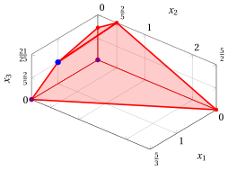{ .fig .ovale loading=lazy style="width:71%" }

    Una soluzione ottima ${ \tilde{\boldsymbol x}}(\, LP \,)$ è:

    $$
    \tilde{x}_1=1,~~\tilde{x}_2=0,~~\tilde{x}_3=\dfrac{2}{5}
    $$

    il valore ottimo $z(\, LP \,)$ è $\dfrac{34}{5}.$

    In viola il primo e il secondo vertice esplorati dalla precedente esecuzione dell'algoritmo del simplesso rivisto (prima di raggiungere quello ottimo rappresentato in blu).

!!! esercizio "Esercizio 11.19: Algoritmo del simplesso rivisto (P46)"

    Consideriamo il seguente problema LP in forma canonica di massimo con $n=3$ variabili e $m=3$ vincoli:

    $$
    \begin{array}{rrrrrrrr}
    {\max} & {5}\, {x_1} & {+} & {6}\, {x_2} & {+} & {10}\, {x_3} \\[2ex]
    \text{soggetto a} & {9}\, {x_1} & {+} & {2}\, {x_2} & {+} & {2}\, {x_3} & {\le} & {11} \\[2ex]
    & {2}\, {x_1} & {+} & {6}\, {x_2} & {+} & {6}\, {x_3} & {\le} & {16} \\[2ex]
    & {4}\, {x_1} & {+} & {2}\, {x_2} & {+} & {7}\, {x_3} & {\le} & {10} \\[2ex]
    & {x_1,} &  & {x_2,} &  & {x_3} & {\ge} & {0}
    \end{array}
    $$

    Introducendo le variabili di scarto, otteniamo il seguente problema LP in forma standard di massimo con $n+m=6$ variabili e $m=3$ vincoli:

    $$
    \begin{array}{rrcrcrcrcrcrcr}
    {\max} & {5}\, {x_1} & {+} & {6}\, {x_2} & {+} & {10}\, {x_3} \\[2ex]
    \text{soggetto a} & {9}\, {x_1} & {+} & {2}\, {x_2} & {+} & {2}\, {x_3} & {+} & {x_4} &  &  &  &  & {=} & {11} \\[2ex]
    & {2}\, {x_1} & {+} & {6}\, {x_2} & {+} & {6}\, {x_3} &  &  & {+} & {x_5} &  &  & {=} & {16} \\[2ex]
    & {4}\, {x_1} & {+} & {2}\, {x_2} & {+} & {7}\, {x_3} &  &  &  &  & {+} & {x_6} & {=} & {10} \\[2ex]
    & {x_1,} &  & {x_2,} &  & {x_3,} &  & {x_4,} &  & {x_5,} &  & {x_6} & {\ge} & {0}
    \end{array}
    $$

    **Domande**

    - Eseguire l'algoritmo del simplesso rivisto per trovare una soluzione ottima di questo problema LP, utilizzando la regola di Bland per scegliere la colonna pivot e la riga pivot.

??? soluzione "Soluzione"

    Abbiamo:

    $$
    {\boldsymbol A}=
    \begin{pmatrix}
    9 & 2 & 2 & 1 & 0 & 0\\
    2 & 6 & 6 & 0 & 1 & 0\\
    4 & 2 & 7 & 0 & 0 & 1
    \end{pmatrix}
    \quad
    {\boldsymbol b}=
    \begin{pmatrix}
    11\\
    16\\
    10
    \end{pmatrix}
    \quad
    {\boldsymbol c}=
    \begin{pmatrix}
    5\\
    6\\
    10\\
    0\\
    0\\
    0
    \end{pmatrix}
    \quad
    {\boldsymbol x}=
    \begin{pmatrix}
    x_1 \\
    x_2 \\
    x_3 \\
    x_4 \\
    x_5 \\
    x_6
    \end{pmatrix}
    $$

    - <strong>Inizializzazione</strong>

        Poiché si tratta di un problema LP in forma standard ottenuto da un problema LP in forma canonica con $~{\boldsymbol b} \ge 0$ aggiungendo le variabili di scarto, la partizione $\pazocal{B}=\{4,5,6\}$ e $\pazocal{N}=\{1,2,3\}$ è associata alla seguente soluzione di base ammissibile:

        $$
        \begin{pmatrix}
        x_4 \\
        x_5 \\
        x_6
        \end{pmatrix}
        =
        \begin{pmatrix}
        11\\
        16\\
        10
        \end{pmatrix}
        {\rm ~~~e~~~}
        \begin{pmatrix}
        x_1 \\
        x_2 \\
        x_3
        \end{pmatrix}
        =
        \begin{pmatrix}
        0\\
        0\\
        0
        \end{pmatrix}
        $$

    - <strong>Iterazione 1</strong>

        Con $\pazocal{B}= \{4,~~5,~~6\}$ e $\pazocal{N}= \{1,~~2,~~3\}$, si ha:

        $$
        {\boldsymbol x}_{\pazocal{B}}=
        \begin{pmatrix}
        x_4 \\
        x_5 \\
        x_6
        \end{pmatrix} ~~
        {\boldsymbol A}_{\pazocal{B}}=
        \begin{pmatrix}
        1 & 0 & 0\\
        0 & 1 & 0\\
        0 & 0 & 1
        \end{pmatrix} ~~
        {\boldsymbol c}_{\pazocal{B}}=
        \begin{pmatrix}
        0\\
        0\\
        0
        \end{pmatrix} ~~
        {{ \bar{\boldsymbol b}}}=
        \begin{pmatrix}
        11\\
        16\\
        10
        \end{pmatrix}
        $$

        $$
        {\boldsymbol x}_{\pazocal{N}}=
        \begin{pmatrix}
        x_1 \\
        x_2 \\
        x_3
        \end{pmatrix} ~~
        {\boldsymbol A}_{\pazocal{N}}=
        \begin{pmatrix}
        9 & 2 & 2\\
        2 & 6 & 6\\
        4 & 2 & 7
        \end{pmatrix} ~~
        {\boldsymbol c}_{\pazocal{N}}=
        \begin{pmatrix}
        5\\
        6\\
        10
        \end{pmatrix}
        $$

        <strong>Verifica di ottimalità</strong>

        Risolviamo ${\boldsymbol \pi} \; {\boldsymbol A}_{\pazocal{B}} = {\boldsymbol c}'_{\pazocal{B}}$ per calcolare ${\boldsymbol \pi} =  {{{\boldsymbol c}'_{\pazocal{B}} \; {\boldsymbol A}_{\pazocal{B}}^{-1}}}$, <u>primo sistema di equazioni lineari</u>:

        \begin{equation*}
        \begin{cases}
        \begin{array}{rrrrrrr}
        {\pi_4} &  &  &  &  & {=} & {0} \\[2ex]
        &  & {\pi_5} &  &  & {=} & {0} \\[2ex]
        &  &  &  & {\pi_6} & {=} & {0}
        \end{array}
        \end{cases}
        \qquad
        {\boldsymbol \pi}=
        \begin{pmatrix}
        0 & 0 & 0\\
        \end{pmatrix}
        \end{equation*}

        Calcoliamo il valore della soluzione di base ammissibile ${\bar{z}} = {\boldsymbol \pi} \; {\boldsymbol b} = \begin{pmatrix} 0 & 0 & 0\\ \end{pmatrix} \begin{pmatrix} 11\\ 16\\ 10 \end{pmatrix} = 0$

        Calcoliamo i costi ridotti ${{ \bar{\boldsymbol c}}'}  = {{\boldsymbol c}'_{\pazocal{N}} - {\boldsymbol \pi} \; {\boldsymbol A}_{\pazocal{N}}}$:

        $$
        \begin{aligned}
        {{ \bar{\boldsymbol c}}'}
        &= \begin{pmatrix}
        5 & 6 & 10\\
        \end{pmatrix} - \begin{pmatrix}
        0 & 0 & 0\\
        \end{pmatrix} \begin{pmatrix}
        9 & 2 & 2\\
        2 & 6 & 6\\
        4 & 2 & 7
        \end{pmatrix}
        \\[1ex]
        &= \underbrace{
        \begin{pmatrix}
        5 & 6 & 10\\
        \end{pmatrix}
        }_{{c_{1}~~~c_{2}~~~c_{3}}}
        -
        \underbrace{
        \begin{pmatrix}
        0 & 0 & 0\\
        \end{pmatrix}
        }_{{\boldsymbol \pi}\;{\boldsymbol A}_{1} ~~{\boldsymbol \pi}\;{\boldsymbol A}_{2} ~~{\boldsymbol \pi}\;{\boldsymbol A}_{3}}
        =
        \underbrace{
        \begin{pmatrix}
        5 & 6 & 10\\
        \end{pmatrix}
        }_{{\bar{c}_{1}~~~\bar{c}_{2}~~~\bar{c}_{3}}}
        \end{aligned}
        $$

        Non tutti i costi ridotti sono non positivi, quindi eseguiamo un'operazione di pivot.

        <strong>Operazione di pivot</strong>

        Poiché ${c}_{1} > {\boldsymbol \pi} \;{\boldsymbol A}_{1}$, $x_1$ è la <u>colonna pivot</u> e si ha ${\boldsymbol A}_{1} = \begin{pmatrix} 9\\ 2\\ 4 \end{pmatrix}$

        Risolviamo ${\boldsymbol A}_{\pazocal{B}} \; {\boldsymbol d} = {\boldsymbol A}_{1}$ per calcolare ${\boldsymbol d}={ {\boldsymbol A}_{\pazocal{B}}^{-1}} {\boldsymbol A}_{1}$, <u>secondo sistema di equazioni lineari</u>:

        \begin{equation*}
        \begin{cases}
        \begin{array}{rrrrrrr}
        {d_4} &  &  &  &  & {=} & {9} \\[2ex]
        &  & {d_5} &  &  & {=} & {2} \\[2ex]
        &  &  &  & {d_6} & {=} & {4}
        \end{array}
        \end{cases}
        \qquad
        {\boldsymbol d}=
        \begin{pmatrix}
        9\\
        2\\
        4
        \end{pmatrix}
        \end{equation*}

        Dobbiamo trovare il massimo $t$ tale che ${{ \bar{\boldsymbol b}}}  - t \; {{\boldsymbol d}} \ge 0$:

        $$
        \begin{cases}
        \underbrace{11 -t \cdot 9\ge 0}_{x_4 \ge 0} \\[2ex]
        \underbrace{16 -t \cdot 2\ge 0}_{x_5 \ge 0} \\[2ex]
        \underbrace{10 -t \cdot 4\ge 0}_{x_6 \ge 0}
        \end{cases}
        \qquad
        \begin{cases}
        t\le \dfrac{11}{9} \\[2ex]
        t\le 8 \\[2ex]
        t\le \dfrac{5}{2}
        \end{cases}
        \text{   quindi   } t_{m}=\dfrac{11}{9}
        $$

        Di conseguenza il valore della colonna pivot diventa $t_{m}$, cioè $x_1=\dfrac{11}{9}$. Il valore di $x_4$ diventa zero e $x_4$ è la <u>riga pivot</u>. Le altre variabili di base assumono i valori ${ \bar{\boldsymbol b}} - t_{m} \; {\boldsymbol d}$, quindi si ha:

        $$
        \begin{aligned}
        x_5 &= 16 - \dfrac{11}{9} \cdot 2 = \dfrac{122}{9} \\[2ex]
        x_6 &= 10 - \dfrac{11}{9} \cdot 4 = \dfrac{46}{9}
        \end{aligned}
        $$

    - <strong>Iterazione 2</strong>

        Con $\pazocal{B}= \{1,~~5,~~6\}$ e $\pazocal{N}= \{2,~~3,~~4\}$, si ha:

        $$
        {\boldsymbol x}_{\pazocal{B}}=
        \begin{pmatrix}
        x_1 \\
        x_5 \\
        x_6
        \end{pmatrix} ~~
        {\boldsymbol A}_{\pazocal{B}}=
        \begin{pmatrix}
        9 & 0 & 0\\
        2 & 1 & 0\\
        4 & 0 & 1
        \end{pmatrix} ~~
        {\boldsymbol c}_{\pazocal{B}}=
        \begin{pmatrix}
        5\\
        0\\
        0
        \end{pmatrix} ~~
        {{ \bar{\boldsymbol b}}}=
        \begin{pmatrix}
        \dfrac{11}{9}\\[2ex]
        \dfrac{122}{9}\\[2ex]
        \dfrac{46}{9}
        \end{pmatrix}
        $$

        $$
        {\boldsymbol x}_{\pazocal{N}}=
        \begin{pmatrix}
        x_2 \\
        x_3 \\
        x_4
        \end{pmatrix} ~~
        {\boldsymbol A}_{\pazocal{N}}=
        \begin{pmatrix}
        2 & 2 & 1\\
        6 & 6 & 0\\
        2 & 7 & 0
        \end{pmatrix} ~~
        {\boldsymbol c}_{\pazocal{N}}=
        \begin{pmatrix}
        6\\
        10\\
        0
        \end{pmatrix}
        $$

        <strong>Verifica di ottimalità</strong>

        Risolviamo ${\boldsymbol \pi} \; {\boldsymbol A}_{\pazocal{B}} = {\boldsymbol c}'_{\pazocal{B}}$ per calcolare ${\boldsymbol \pi} =  {{{\boldsymbol c}'_{\pazocal{B}} \; {\boldsymbol A}_{\pazocal{B}}^{-1}}}$, <u>primo sistema di equazioni lineari</u>:

        \begin{equation*}
        \begin{cases}
        \begin{array}{rrrrrrr}
        {9}\, {\pi_1} & {+} & {2}\, {\pi_5} & {+} & {4}\, {\pi_6} & {=} & {5} \\[2ex]
        &  & {\pi_5} &  &  & {=} & {0} \\[2ex]
        &  &  &  & {\pi_6} & {=} & {0}
        \end{array}
        \end{cases}
        \qquad
        {\boldsymbol \pi}=
        \begin{pmatrix}
        \dfrac{5}{9} & 0 & 0\\
        \end{pmatrix}
        \end{equation*}

        Calcoliamo il valore della soluzione di base ammissibile ${\bar{z}} = {\boldsymbol \pi} \; {\boldsymbol b} = \begin{pmatrix} \dfrac{5}{9} & 0 & 0\\ \end{pmatrix} \begin{pmatrix} 11\\ 16\\ 10 \end{pmatrix} = \dfrac{55}{9}$

        Calcoliamo i costi ridotti ${{ \bar{\boldsymbol c}}'}  = {{\boldsymbol c}'_{\pazocal{N}} - {\boldsymbol \pi} \; {\boldsymbol A}_{\pazocal{N}}}$:

        $$
        \begin{aligned}
        {{ \bar{\boldsymbol c}}'}
        &= \begin{pmatrix}
        6 & 10 & 0\\
        \end{pmatrix} - \begin{pmatrix}
        \dfrac{5}{9} & 0 & 0\\
        \end{pmatrix} \begin{pmatrix}
        2 & 2 & 1\\
        6 & 6 & 0\\
        2 & 7 & 0
        \end{pmatrix}
        \\[1ex]
        &= \underbrace{
        \begin{pmatrix}
        6 & 10 & 0\\
        \end{pmatrix}
        }_{{c_{2}~~~c_{3}~~~c_{4}}}
        -
        \underbrace{
        \begin{pmatrix}
        \dfrac{10}{9} & \dfrac{10}{9} & \dfrac{5}{9}\\
        \end{pmatrix}
        }_{{\boldsymbol \pi}\;{\boldsymbol A}_{2} ~~{\boldsymbol \pi}\;{\boldsymbol A}_{3} ~~{\boldsymbol \pi}\;{\boldsymbol A}_{4}}
        =
        \underbrace{
        \begin{pmatrix}
        \dfrac{44}{9} & \dfrac{80}{9} & -\dfrac{5}{9}\\
        \end{pmatrix}
        }_{{\bar{c}_{2}~~~\bar{c}_{3}~~~\bar{c}_{4}}}
        \end{aligned}
        $$

        Non tutti i costi ridotti sono non positivi, quindi eseguiamo un'operazione di pivot.

        <strong>Operazione di pivot</strong>

        Poiché ${c}_{2} > {\boldsymbol \pi} \;{\boldsymbol A}_{2}$, $x_2$ è la <u>colonna pivot</u> e si ha ${\boldsymbol A}_{2} = \begin{pmatrix} 2\\ 6\\ 2 \end{pmatrix}$

        Risolviamo ${\boldsymbol A}_{\pazocal{B}} \; {\boldsymbol d} = {\boldsymbol A}_{2}$ per calcolare ${\boldsymbol d}={ {\boldsymbol A}_{\pazocal{B}}^{-1}} {\boldsymbol A}_{2}$, <u>secondo sistema di equazioni lineari</u>:

        \begin{equation*}
        \begin{cases}
        \begin{array}{rrrrrrr}
        {9}\, {d_1} &  &  &  &  & {=} & {2} \\[2ex]
        {2}\, {d_1} & {+} & {d_5} &  &  & {=} & {6} \\[2ex]
        {4}\, {d_1} &  &  & {+} & {d_6} & {=} & {2}
        \end{array}
        \end{cases}
        \qquad
        {\boldsymbol d}=
        \begin{pmatrix}
        \dfrac{2}{9}\\[2ex]
        \dfrac{50}{9}\\[2ex]
        \dfrac{10}{9}
        \end{pmatrix}
        \end{equation*}

        Dobbiamo trovare il massimo $t$ tale che ${{ \bar{\boldsymbol b}}}  - t \; {{\boldsymbol d}} \ge 0$:

        $$
        \begin{cases}
        \underbrace{\dfrac{11}{9} -t \cdot \dfrac{2}{9}\ge 0}_{x_1 \ge 0} \\[2ex]
        \underbrace{\dfrac{122}{9} -t \cdot \dfrac{50}{9}\ge 0}_{x_5 \ge 0} \\[2ex]
        \underbrace{\dfrac{46}{9} -t \cdot \dfrac{10}{9}\ge 0}_{x_6 \ge 0}
        \end{cases}
        \qquad
        \begin{cases}
        t\le \dfrac{11}{2} \\[2ex]
        t\le \dfrac{61}{25} \\[2ex]
        t\le \dfrac{23}{5}
        \end{cases}
        \text{   quindi   } t_{m}=\dfrac{61}{25}
        $$

        Di conseguenza il valore della colonna pivot diventa $t_{m}$, cioè $x_2=\dfrac{61}{25}$. Il valore di $x_5$ diventa zero e $x_5$ è la <u>riga pivot</u>. Le altre variabili di base assumono i valori ${ \bar{\boldsymbol b}} - t_{m} \; {\boldsymbol d}$, quindi si ha:

        $$
        \begin{aligned}
        x_1 &= \dfrac{11}{9} - \dfrac{61}{25} \cdot \dfrac{2}{9} = \dfrac{17}{25} \\[2ex]
        x_6 &= \dfrac{46}{9} - \dfrac{61}{25} \cdot \dfrac{10}{9} = \dfrac{12}{5}
        \end{aligned}
        $$

    - <strong>Iterazione 3</strong>

        Con $\pazocal{B}= \{1,~~2,~~6\}$ e $\pazocal{N}= \{3,~~4,~~5\}$, si ha:

        $$
        {\boldsymbol x}_{\pazocal{B}}=
        \begin{pmatrix}
        x_1 \\
        x_2 \\
        x_6
        \end{pmatrix} ~~
        {\boldsymbol A}_{\pazocal{B}}=
        \begin{pmatrix}
        9 & 2 & 0\\
        2 & 6 & 0\\
        4 & 2 & 1
        \end{pmatrix} ~~
        {\boldsymbol c}_{\pazocal{B}}=
        \begin{pmatrix}
        5\\
        6\\
        0
        \end{pmatrix} ~~
        {{ \bar{\boldsymbol b}}}=
        \begin{pmatrix}
        \dfrac{17}{25}\\[2ex]
        \dfrac{61}{25}\\[2ex]
        \dfrac{12}{5}
        \end{pmatrix}
        $$

        $$
        {\boldsymbol x}_{\pazocal{N}}=
        \begin{pmatrix}
        x_3 \\
        x_4 \\
        x_5
        \end{pmatrix} ~~
        {\boldsymbol A}_{\pazocal{N}}=
        \begin{pmatrix}
        2 & 1 & 0\\
        6 & 0 & 1\\
        7 & 0 & 0
        \end{pmatrix} ~~
        {\boldsymbol c}_{\pazocal{N}}=
        \begin{pmatrix}
        10\\
        0\\
        0
        \end{pmatrix}
        $$

        <strong>Verifica di ottimalità</strong>

        Risolviamo ${\boldsymbol \pi} \; {\boldsymbol A}_{\pazocal{B}} = {\boldsymbol c}'_{\pazocal{B}}$ per calcolare ${\boldsymbol \pi} =  {{{\boldsymbol c}'_{\pazocal{B}} \; {\boldsymbol A}_{\pazocal{B}}^{-1}}}$, <u>primo sistema di equazioni lineari</u>:

        \begin{equation*}
        \begin{cases}
        \begin{array}{rrrrrrr}
        {9}\, {\pi_1} & {+} & {2}\, {\pi_2} & {+} & {4}\, {\pi_6} & {=} & {5} \\[2ex]
        {2}\, {\pi_1} & {+} & {6}\, {\pi_2} & {+} & {2}\, {\pi_6} & {=} & {6} \\[2ex]
        &  &  &  & {\pi_6} & {=} & {0}
        \end{array}
        \end{cases}
        \qquad
        {\boldsymbol \pi}=
        \begin{pmatrix}
        \dfrac{9}{25} & \dfrac{22}{25} & 0\\
        \end{pmatrix}
        \end{equation*}

        Calcoliamo il valore della soluzione di base ammissibile ${\bar{z}} = {\boldsymbol \pi} \; {\boldsymbol b} = \begin{pmatrix} \dfrac{9}{25} & \dfrac{22}{25} & 0\\ \end{pmatrix} \begin{pmatrix} 11\\ 16\\ 10 \end{pmatrix} = \dfrac{451}{25}$

        Calcoliamo i costi ridotti ${{ \bar{\boldsymbol c}}'}  = {{\boldsymbol c}'_{\pazocal{N}} - {\boldsymbol \pi} \; {\boldsymbol A}_{\pazocal{N}}}$:

        $$
        \begin{aligned}
        {{ \bar{\boldsymbol c}}'}
        &= \begin{pmatrix}
        10 & 0 & 0\\
        \end{pmatrix} - \begin{pmatrix}
        \dfrac{9}{25} & \dfrac{22}{25} & 0\\
        \end{pmatrix} \begin{pmatrix}
        2 & 1 & 0\\
        6 & 0 & 1\\
        7 & 0 & 0
        \end{pmatrix}
        \\[1ex]
        &= \underbrace{
        \begin{pmatrix}
        10 & 0 & 0\\
        \end{pmatrix}
        }_{{c_{3}~~~c_{4}~~~c_{5}}}
        -
        \underbrace{
        \begin{pmatrix}
        6 & \dfrac{9}{25} & \dfrac{22}{25}\\
        \end{pmatrix}
        }_{{\boldsymbol \pi}\;{\boldsymbol A}_{3} ~~{\boldsymbol \pi}\;{\boldsymbol A}_{4} ~~{\boldsymbol \pi}\;{\boldsymbol A}_{5}}
        =
        \underbrace{
        \begin{pmatrix}
        4 & -\dfrac{9}{25} & -\dfrac{22}{25}\\
        \end{pmatrix}
        }_{{\bar{c}_{3}~~~\bar{c}_{4}~~~\bar{c}_{5}}}
        \end{aligned}
        $$

        Non tutti i costi ridotti sono non positivi, quindi eseguiamo un'operazione di pivot.

        <strong>Operazione di pivot</strong>

        Poiché ${c}_{3} > {\boldsymbol \pi} \;{\boldsymbol A}_{3}$, $x_3$ è la <u>colonna pivot</u> e si ha ${\boldsymbol A}_{3} = \begin{pmatrix} 2\\ 6\\ 7 \end{pmatrix}$

        Risolviamo ${\boldsymbol A}_{\pazocal{B}} \; {\boldsymbol d} = {\boldsymbol A}_{3}$ per calcolare ${\boldsymbol d}={ {\boldsymbol A}_{\pazocal{B}}^{-1}} {\boldsymbol A}_{3}$, <u>secondo sistema di equazioni lineari</u>:

        \begin{equation*}
        \begin{cases}
        \begin{array}{rrrrrrr}
        {9}\, {d_1} & {+} & {2}\, {d_2} &  &  & {=} & {2} \\[2ex]
        {2}\, {d_1} & {+} & {6}\, {d_2} &  &  & {=} & {6} \\[2ex]
        {4}\, {d_1} & {+} & {2}\, {d_2} & {+} & {d_6} & {=} & {7}
        \end{array}
        \end{cases}
        \qquad
        {\boldsymbol d}=
        \begin{pmatrix}
        0\\
        1\\
        5
        \end{pmatrix}
        \end{equation*}

        Dobbiamo trovare il massimo $t$ tale che ${{ \bar{\boldsymbol b}}}  - t \; {{\boldsymbol d}} \ge 0$:

        $$
        \begin{cases}
        \underbrace{\dfrac{61}{25} -t \cdot 1\ge 0}_{x_2 \ge 0} \\[2ex]
        \underbrace{\dfrac{12}{5} -t \cdot 5\ge 0}_{x_6 \ge 0}
        \end{cases}
        \qquad
        \begin{cases}
        t\le \dfrac{61}{25} \\[2ex]
        t\le \dfrac{12}{25}
        \end{cases}
        \text{   quindi   } t_{m}=\dfrac{12}{25}
        $$

        Di conseguenza il valore della colonna pivot diventa $t_{m}$, cioè $x_3=\dfrac{12}{25}$. Il valore di $x_6$ diventa zero e $x_6$ è la <u>riga pivot</u>. Le altre variabili di base assumono i valori ${ \bar{\boldsymbol b}} - t_{m} \; {\boldsymbol d}$, quindi si ha:

        $$
        \begin{aligned}
        x_1 &= \dfrac{17}{25} - \dfrac{12}{25} \cdot 0 = \dfrac{17}{25} \\[2ex]
        x_2 &= \dfrac{61}{25} - \dfrac{12}{25} \cdot 1 = \dfrac{49}{25}
        \end{aligned}
        $$

    - <strong>Iterazione 4</strong>

        Con $\pazocal{B}= \{1,~~2,~~3\}$ e $\pazocal{N}= \{4,~~5,~~6\}$, si ha:

        $$
        {\boldsymbol x}_{\pazocal{B}}=
        \begin{pmatrix}
        x_1 \\
        x_2 \\
        x_3
        \end{pmatrix} ~~
        {\boldsymbol A}_{\pazocal{B}}=
        \begin{pmatrix}
        9 & 2 & 2\\
        2 & 6 & 6\\
        4 & 2 & 7
        \end{pmatrix} ~~
        {\boldsymbol c}_{\pazocal{B}}=
        \begin{pmatrix}
        5\\
        6\\
        10
        \end{pmatrix} ~~
        {{ \bar{\boldsymbol b}}}=
        \begin{pmatrix}
        \dfrac{17}{25}\\[2ex]
        \dfrac{49}{25}\\[2ex]
        \dfrac{12}{25}
        \end{pmatrix}
        $$

        $$
        {\boldsymbol x}_{\pazocal{N}}=
        \begin{pmatrix}
        x_4 \\
        x_5 \\
        x_6
        \end{pmatrix} ~~
        {\boldsymbol A}_{\pazocal{N}}=
        \begin{pmatrix}
        1 & 0 & 0\\
        0 & 1 & 0\\
        0 & 0 & 1
        \end{pmatrix} ~~
        {\boldsymbol c}_{\pazocal{N}}=
        \begin{pmatrix}
        0\\
        0\\
        0
        \end{pmatrix}
        $$

        <strong>Verifica di ottimalità</strong>

        Risolviamo ${\boldsymbol \pi} \; {\boldsymbol A}_{\pazocal{B}} = {\boldsymbol c}'_{\pazocal{B}}$ per calcolare ${\boldsymbol \pi} =  {{{\boldsymbol c}'_{\pazocal{B}} \; {\boldsymbol A}_{\pazocal{B}}^{-1}}}$, <u>primo sistema di equazioni lineari</u>:

        \begin{equation*}
        \begin{cases}
        \begin{array}{rrrrrrr}
        {9}\, {\pi_1} & {+} & {2}\, {\pi_2} & {+} & {4}\, {\pi_3} & {=} & {5} \\[2ex]
        {2}\, {\pi_1} & {+} & {6}\, {\pi_2} & {+} & {2}\, {\pi_3} & {=} & {6} \\[2ex]
        {2}\, {\pi_1} & {+} & {6}\, {\pi_2} & {+} & {7}\, {\pi_3} & {=} & {10}
        \end{array}
        \end{cases}
        \qquad
        {\boldsymbol \pi}=
        \begin{pmatrix}
        \dfrac{1}{25} & \dfrac{18}{25} & \dfrac{4}{5}\\
        \end{pmatrix}
        \end{equation*}

        Calcoliamo il valore della soluzione di base ammissibile ${\bar{z}} = {\boldsymbol \pi} \; {\boldsymbol b} = \begin{pmatrix} \dfrac{1}{25} & \dfrac{18}{25} & \dfrac{4}{5}\\ \end{pmatrix} \begin{pmatrix} 11\\ 16\\ 10 \end{pmatrix} = \dfrac{499}{25}$

        Calcoliamo i costi ridotti ${{ \bar{\boldsymbol c}}'}  = {{\boldsymbol c}'_{\pazocal{N}} - {\boldsymbol \pi} \; {\boldsymbol A}_{\pazocal{N}}}$:

        $$
        \begin{aligned}
        {{ \bar{\boldsymbol c}}'}
        &= \begin{pmatrix}
        0 & 0 & 0\\
        \end{pmatrix} - \begin{pmatrix}
        \dfrac{1}{25} & \dfrac{18}{25} & \dfrac{4}{5}\\
        \end{pmatrix} \begin{pmatrix}
        1 & 0 & 0\\
        0 & 1 & 0\\
        0 & 0 & 1
        \end{pmatrix}
        \\[1ex]
        &= \underbrace{
        \begin{pmatrix}
        0 & 0 & 0\\
        \end{pmatrix}
        }_{{c_{4}~~~c_{5}~~~c_{6}}}
        -
        \underbrace{
        \begin{pmatrix}
        \dfrac{1}{25} & \dfrac{18}{25} & \dfrac{4}{5}\\
        \end{pmatrix}
        }_{{\boldsymbol \pi}\;{\boldsymbol A}_{4} ~~{\boldsymbol \pi}\;{\boldsymbol A}_{5} ~~{\boldsymbol \pi}\;{\boldsymbol A}_{6}}
        =
        \underbrace{
        \begin{pmatrix}
        -\dfrac{1}{25} & -\dfrac{18}{25} & -\dfrac{4}{5}\\
        \end{pmatrix}
        }_{{\bar{c}_{4}~~~\bar{c}_{5}~~~\bar{c}_{6}}}
        \end{aligned}
        $$

        Tutti i costi ridotti sono non positivi, quindi la soluzione di base ammissibile

        $$
        {\boldsymbol x}_{\pazocal{B}}=
        \begin{pmatrix}
        x_1 \\
        x_2 \\
        x_3
        \end{pmatrix}=\begin{pmatrix}
        \dfrac{17}{25}\\[2ex]
        \dfrac{49}{25}\\[2ex]
        \dfrac{12}{25}
        \end{pmatrix} {\rm ~~~e~~~} {\boldsymbol x}_{\pazocal{N}}=
        \begin{pmatrix}
        x_4 \\
        x_5 \\
        x_6
        \end{pmatrix}=\begin{pmatrix}
        0\\
        0\\
        0
        \end{pmatrix}
        $$

        è una soluzione ottima del problema LP e ${\bar{z}} = \dfrac{499}{25}$ è il valore della soluzione ottima.

    <strong>Soluzione grafica:</strong>

    La regione ammissibile del problema LP (in forma canonica) è il poliedro colorato in rosso: 

    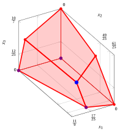{ .fig .ovale loading=lazy style="width:71%" }

    Una soluzione ottima ${ \tilde{\boldsymbol x}}(\, LP \,)$ è:

    $$
    \tilde{x}_1=\dfrac{17}{25},~~\tilde{x}_2=\dfrac{49}{25},~~\tilde{x}_3=\dfrac{12}{25}
    $$

    il valore ottimo $z(\, LP \,)$ è $\dfrac{499}{25}.$

    In viola il primo, il secondo e il terzo vertice esplorati dalla precedente esecuzione dell'algoritmo del simplesso rivisto (prima di raggiungere quello ottimo rappresentato in blu).
