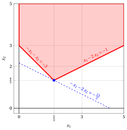
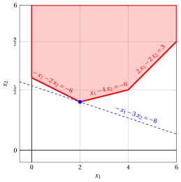
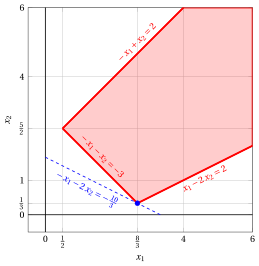
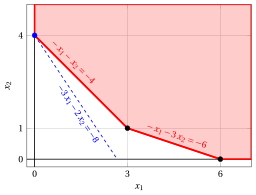
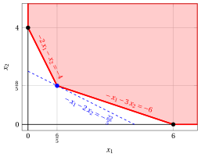

# Esercizi · Algoritmo del simplesso duale rivisto

**Esercizi · Capitolo 12** · ogni soluzione si apre con un clic · [:material-book-open-variant: Capitolo 12: Algoritmo del simplesso duale rivisto](../metodi-avanzati/12-rivisto-duale.md) · [:material-file-pdf-box: Eserciziario, volume 4 (PDF)](../pdf/esercizi-4-metodi-avanzati.pdf)

!!! esercizio "Esercizio 12.1: Algoritmo del simplesso duale rivisto (P11)"

    Consideriamo il seguente problema LP in forma canonica di massimo con $n=2$ variabili e $m=2$ vincoli:

    $$
    \begin{array}{rrrrrrrrrrrrr}
    {\max} & {-2} \, {x_1} & {-} & {4} \, {x_2} \\[2ex]
    \text{soggetto a} & {-} \, {x_1} & {-} & {x_2} & {\le} & {-2} \\[2ex]
    & {x_1} & {-} & {x_2} & {\le} & {0} \\[2ex]
    & {x_1,} &  & {x_2} & {\ge} & {0}
    \end{array}
    $$

    Poiché ${\boldsymbol c} \le {\boldsymbol 0}$, la base delle $m$ variabili di scarto è <strong>duale ammissibile</strong> ma <u>non</u> è primale ammissibile.

    **Domande**

    - Eseguire l'algoritmo del simplesso duale rivisto per trovare una soluzione ottima di questo problema LP, risolvendo a ogni iterazione i due sistemi di equazioni lineari. Come riga pivot scegliere la variabile in base con l'indice minimo tra quelle con $\bar b_r < 0$ e, nel test dei rapporti per la colonna pivot, risolvere i pareggi scegliendo l'indice minimo.

??? soluzione "Soluzione"

    Abbiamo:

    $$
    {\boldsymbol A}= \begin{pmatrix}
    -1 & -1 & 1 & 0 \\[2ex]
    1 & -1 & 0 & 1 \\
    \end{pmatrix}
    \quad
    {\boldsymbol b}= \begin{pmatrix}
    -2 \\[2ex]
    0 \\
    \end{pmatrix}
    \quad
    {\boldsymbol c}= \begin{pmatrix}
    -2 \\[2ex]
    -4 \\[2ex]
    0 \\[2ex]
    0 \\
    \end{pmatrix}
    \quad
    {\boldsymbol x}= \begin{pmatrix}
    x_{1} \\[2ex]
    x_{2} \\[2ex]
    x_{3} \\[2ex]
    x_{4} \\
    \end{pmatrix}
    $$

    - <strong>Inizializzazione</strong>

        Poiché è un problema LP in forma standard ottenuto da un problema LP in forma canonica con ${\boldsymbol c} \le {\boldsymbol 0}$ aggiungendo le variabili di scarto, la partizione $\pazocal{B} = \{3,~4\}$ e $\pazocal{N} = \{1,~2\}$ è <strong>duale ammissibile</strong>, poiché ${\boldsymbol A}_{\pazocal{B}} = {\boldsymbol I}$ e ${\boldsymbol c}_{\pazocal{B}} = {\boldsymbol 0}$ danno

        $$
        {\bar{\boldsymbol c}}' = {\boldsymbol c}'_{\pazocal{N}} = \begin{pmatrix}
        -2 & -4 \\
        \end{pmatrix} \le {\boldsymbol 0} .
        $$

        La soluzione di base associata <u>non</u> è ammissibile, e quindi si usa l'algoritmo del simplesso duale.

    - <strong>Iterazione 1</strong>

        Con $\pazocal{B}= \{3,~~4\}$ e $\pazocal{N}= \{1,~~2\}$, abbiamo:

        $$
        {\boldsymbol x}_{\pazocal{B}}= \begin{pmatrix}
        x_{3} \\[2ex]
        x_{4} \\
        \end{pmatrix} ~~
        {\boldsymbol A}_{\pazocal{B}}= \begin{pmatrix}
        1 & 0 \\[2ex]
        0 & 1 \\
        \end{pmatrix} ~~
        {\boldsymbol c}_{\pazocal{B}}= \begin{pmatrix}
        0 \\[2ex]
        0 \\
        \end{pmatrix}
        $$

        $$
        {\boldsymbol x}_{\pazocal{N}}= \begin{pmatrix}
        x_{1} \\[2ex]
        x_{2} \\
        \end{pmatrix} ~~
        {\boldsymbol A}_{\pazocal{N}}= \begin{pmatrix}
        -1 & -1 \\[2ex]
        1 & -1 \\
        \end{pmatrix} ~~
        {\bar{\boldsymbol c}}'= \begin{pmatrix}
        -2 & -4 \\
        \end{pmatrix}
        $$

        <strong>Test di ammissibilità</strong>

        Risolviamo ${\boldsymbol A}_{\pazocal{B}} \; {\bar{\boldsymbol b}} = {\boldsymbol b}$ per calcolare ${\bar{\boldsymbol b}} = {{\boldsymbol A}_{\pazocal{B}}^{-1} \; {\boldsymbol b}}$, <u>primo sistema di equazioni lineari</u>:

        \begin{equation*}
        \begin{cases}
        \begin{array}{rrrr}
        {\bar b_{3}} &  & {=} & {-2} \\[2ex]
        & {\bar b_{4}} & {=} & {0}
        \end{array}
        \end{cases}
        \qquad
        {\bar{\boldsymbol b}}=
        \begin{pmatrix}
        -2 \\[2ex]
        0 \\
        \end{pmatrix}
        \end{equation*}

        Non tutte le variabili in base sono non negative, poiché $\bar b_{3} = -2 < 0$, quindi eseguiamo un'operazione di pivot duale.

        <strong>Operazione di pivot duale</strong>

        Poiché $\bar b_{3} < 0$, $x_{3}$ è la <u>riga pivot</u> e abbiamo ${\boldsymbol e}_{3} = \begin{pmatrix} 1 \\[2ex] 0 \\ \end{pmatrix}$

        Risolviamo ${\boldsymbol u} \; {\boldsymbol A}_{\pazocal{B}} = {\boldsymbol e}'_{3}$ per calcolare ${\boldsymbol u} = {{\boldsymbol e}'_{3} \; {\boldsymbol A}_{\pazocal{B}}^{-1}}$, <u>secondo sistema di equazioni lineari</u>:

        \begin{equation*}
        \begin{cases}
        \begin{array}{rrrr}
        {u_{3}} &  & {=} & {1} \\[2ex]
        & {u_{4}} & {=} & {0}
        \end{array}
        \end{cases}
        \qquad
        {\boldsymbol u}=
        \begin{pmatrix}
        1 & 0 \\
        \end{pmatrix}
        \end{equation*}

        Calcoliamo la riga di ${\bar{\boldsymbol A}}$ associata a $x_{3}$, $\bar a_{3j} = {\boldsymbol u} \; {\boldsymbol A}_{j}$:

        $$
        \underbrace{-1}_{\bar a_{31}} \qquad \underbrace{-1}_{\bar a_{32}}
        $$

        I candidati sono le variabili fuori base con $\bar a_{3j} < 0$, e il test dei rapporti dà:

        $$
        \min \left\{~\underbrace{\frac{-2}{-1}}_{= \, 2},~\underbrace{\frac{-4}{-1}}_{= \, 4}~\right\} = 2 ,
        $$

        quindi $x_{1}$ è la <u>colonna pivot</u>.

        Aggiorniamo i costi ridotti con la riga ${\bar a}_{3j}$ già calcolata, $\bar c_j \leftarrow \bar c_j - 2 \; \bar a_{3j}$:

        $$
        \underbrace{-2}_{\bar c_{2}} \qquad \underbrace{-2}_{\bar c_{3}}
        $$

        La nuova base è $\pazocal{B}= \{1,~~4\}$.

    - <strong>Iterazione 2</strong>

        Con $\pazocal{B}= \{1,~~4\}$ e $\pazocal{N}= \{2,~~3\}$, abbiamo:

        $$
        {\boldsymbol x}_{\pazocal{B}}= \begin{pmatrix}
        x_{1} \\[2ex]
        x_{4} \\
        \end{pmatrix} ~~
        {\boldsymbol A}_{\pazocal{B}}= \begin{pmatrix}
        -1 & 0 \\[2ex]
        1 & 1 \\
        \end{pmatrix} ~~
        {\boldsymbol c}_{\pazocal{B}}= \begin{pmatrix}
        -2 \\[2ex]
        0 \\
        \end{pmatrix}
        $$

        $$
        {\boldsymbol x}_{\pazocal{N}}= \begin{pmatrix}
        x_{2} \\[2ex]
        x_{3} \\
        \end{pmatrix} ~~
        {\boldsymbol A}_{\pazocal{N}}= \begin{pmatrix}
        -1 & 1 \\[2ex]
        -1 & 0 \\
        \end{pmatrix} ~~
        {\bar{\boldsymbol c}}'= \begin{pmatrix}
        -2 & -2 \\
        \end{pmatrix}
        $$

        <strong>Test di ammissibilità</strong>

        Risolviamo ${\boldsymbol A}_{\pazocal{B}} \; {\bar{\boldsymbol b}} = {\boldsymbol b}$ per calcolare ${\bar{\boldsymbol b}} = {{\boldsymbol A}_{\pazocal{B}}^{-1} \; {\boldsymbol b}}$, <u>primo sistema di equazioni lineari</u>:

        \begin{equation*}
        \begin{cases}
        \begin{array}{rrrr}
        {-\bar b_{1}} &  & {=} & {-2} \\[2ex]
        {\bar b_{1}} & {+\bar b_{4}} & {=} & {0}
        \end{array}
        \end{cases}
        \qquad
        {\bar{\boldsymbol b}}=
        \begin{pmatrix}
        2 \\[2ex]
        -2 \\
        \end{pmatrix}
        \end{equation*}

        Non tutte le variabili in base sono non negative, poiché $\bar b_{4} = -2 < 0$, quindi eseguiamo un'operazione di pivot duale.

        <strong>Operazione di pivot duale</strong>

        Poiché $\bar b_{4} < 0$, $x_{4}$ è la <u>riga pivot</u> e abbiamo ${\boldsymbol e}_{4} = \begin{pmatrix} 0 \\[2ex] 1 \\ \end{pmatrix}$

        Risolviamo ${\boldsymbol u} \; {\boldsymbol A}_{\pazocal{B}} = {\boldsymbol e}'_{4}$ per calcolare ${\boldsymbol u} = {{\boldsymbol e}'_{4} \; {\boldsymbol A}_{\pazocal{B}}^{-1}}$, <u>secondo sistema di equazioni lineari</u>:

        \begin{equation*}
        \begin{cases}
        \begin{array}{rrrr}
        {-u_{1}} & {+u_{4}} & {=} & {0} \\[2ex]
        & {u_{4}} & {=} & {1}
        \end{array}
        \end{cases}
        \qquad
        {\boldsymbol u}=
        \begin{pmatrix}
        1 & 1 \\
        \end{pmatrix}
        \end{equation*}

        Calcoliamo la riga di ${\bar{\boldsymbol A}}$ associata a $x_{4}$, $\bar a_{4j} = {\boldsymbol u} \; {\boldsymbol A}_{j}$:

        $$
        \underbrace{-2}_{\bar a_{42}} \qquad \underbrace{1}_{\bar a_{43}}
        $$

        I candidati sono le variabili fuori base con $\bar a_{4j} < 0$, e il test dei rapporti dà:

        $$
        \min \left\{~\underbrace{\frac{-2}{-2}}_{= \, 1}~\right\} = 1 ,
        $$

        quindi $x_{2}$ è la <u>colonna pivot</u>.

        Aggiorniamo i costi ridotti con la riga ${\bar a}_{4j}$ già calcolata, $\bar c_j \leftarrow \bar c_j - 1 \; \bar a_{4j}$:

        $$
        \underbrace{-3}_{\bar c_{3}} \qquad \underbrace{-1}_{\bar c_{4}}
        $$

        La nuova base è $\pazocal{B}= \{1,~~2\}$.

    - <strong>Iterazione 3</strong>

        Con $\pazocal{B}= \{1,~~2\}$ e $\pazocal{N}= \{3,~~4\}$, abbiamo:

        $$
        {\boldsymbol x}_{\pazocal{B}}= \begin{pmatrix}
        x_{1} \\[2ex]
        x_{2} \\
        \end{pmatrix} ~~
        {\boldsymbol A}_{\pazocal{B}}= \begin{pmatrix}
        -1 & -1 \\[2ex]
        1 & -1 \\
        \end{pmatrix} ~~
        {\boldsymbol c}_{\pazocal{B}}= \begin{pmatrix}
        -2 \\[2ex]
        -4 \\
        \end{pmatrix}
        $$

        $$
        {\boldsymbol x}_{\pazocal{N}}= \begin{pmatrix}
        x_{3} \\[2ex]
        x_{4} \\
        \end{pmatrix} ~~
        {\boldsymbol A}_{\pazocal{N}}= \begin{pmatrix}
        1 & 0 \\[2ex]
        0 & 1 \\
        \end{pmatrix} ~~
        {\bar{\boldsymbol c}}'= \begin{pmatrix}
        -3 & -1 \\
        \end{pmatrix}
        $$

        <strong>Test di ammissibilità</strong>

        Risolviamo ${\boldsymbol A}_{\pazocal{B}} \; {\bar{\boldsymbol b}} = {\boldsymbol b}$ per calcolare ${\bar{\boldsymbol b}} = {{\boldsymbol A}_{\pazocal{B}}^{-1} \; {\boldsymbol b}}$, <u>primo sistema di equazioni lineari</u>:

        \begin{equation*}
        \begin{cases}
        \begin{array}{rrrr}
        {-\bar b_{1}} & {-\bar b_{2}} & {=} & {-2} \\[2ex]
        {\bar b_{1}} & {-\bar b_{2}} & {=} & {0}
        \end{array}
        \end{cases}
        \qquad
        {\bar{\boldsymbol b}}=
        \begin{pmatrix}
        1 \\[2ex]
        1 \\
        \end{pmatrix}
        \end{equation*}

        Tutte le variabili in base sono non negative, quindi la base è primale ammissibile e duale ammissibile: è <strong>ottima</strong>.

        Calcoliamo il valore ottimo ${\bar{z}} = {\boldsymbol c}'_{\pazocal{B}} \; {\bar{\boldsymbol b}} = \begin{pmatrix} -2 & -4 \\ \end{pmatrix} \begin{pmatrix} 1 \\[2ex] 1 \\ \end{pmatrix} = -6$

        Una soluzione ottima di questo problema LP è

        $$
        \tilde x_{1}=1,~~\tilde x_{2}=1
        {\rm ~~~e~~~} z(\,LP\,) = -6 .
        $$

    <strong>Soluzione grafica:</strong>

    La regione ammissibile del problema LP in forma canonica è il poliedro ombreggiato in rosso. La regione ammissibile è illimitata.

    { .fig .ovale loading=lazy  }

    Una soluzione ottima del problema LP primale è:

    $$
    \tilde{x}_1=1,~~
    \tilde{x}_2=1 {\rm ~~~e~~~} z(\,LP\,)=-6
    $$

    La regione ammissibile del problema LP duale in forma canonica di minimo è il poliedro ombreggiato in rosso. Nella figura seguente rappresentiamo le due variabili duali originali: $\pi_1,\pi_2$. 

    { .fig .ovale loading=lazy  }

    Una soluzione ottima del problema LP duale è:

    $$
    \tilde{\pi}_1=3,~~
    \tilde{\pi}_2=1
    {\rm ~~~e ~~~} z(~ D(LP)~) =-6.
    $$

    In viola il primo e il secondo vertice esplorati dalla precedente esecuzione dell'algoritmo del simplesso duale rivisto (prima di raggiungere quello ottimo, rappresentato in blu).

!!! esercizio "Esercizio 12.2: Algoritmo del simplesso duale rivisto (P12)"

    Consideriamo il seguente problema LP in forma canonica di massimo con $n=2$ variabili e $m=2$ vincoli:

    $$
    \begin{array}{rrrrrrrrrrrrr}
    {\max} & {-} \, {x_1} & {-} & {2} \, {x_2} \\[2ex]
    \text{soggetto a} & {-} \, {x_1} & {-} & {x_2} & {\le} & {-3} \\[2ex]
    & {x_1} & {-} & {2} \, {x_2} & {\le} & {-1} \\[2ex]
    & {x_1,} &  & {x_2} & {\ge} & {0}
    \end{array}
    $$

    Poiché ${\boldsymbol c} \le {\boldsymbol 0}$, la base delle $m$ variabili di scarto è <strong>duale ammissibile</strong> ma <u>non</u> è primale ammissibile.

    **Domande**

    - Eseguire l'algoritmo del simplesso duale rivisto per trovare una soluzione ottima di questo problema LP, risolvendo a ogni iterazione i due sistemi di equazioni lineari. Come riga pivot scegliere la variabile in base con l'indice minimo tra quelle con $\bar b_r < 0$ e, nel test dei rapporti per la colonna pivot, risolvere i pareggi scegliendo l'indice minimo.

??? soluzione "Soluzione"

    Abbiamo:

    $$
    {\boldsymbol A}= \begin{pmatrix}
    -1 & -1 & 1 & 0 \\[2ex]
    1 & -2 & 0 & 1 \\
    \end{pmatrix}
    \quad
    {\boldsymbol b}= \begin{pmatrix}
    -3 \\[2ex]
    -1 \\
    \end{pmatrix}
    \quad
    {\boldsymbol c}= \begin{pmatrix}
    -1 \\[2ex]
    -2 \\[2ex]
    0 \\[2ex]
    0 \\
    \end{pmatrix}
    \quad
    {\boldsymbol x}= \begin{pmatrix}
    x_{1} \\[2ex]
    x_{2} \\[2ex]
    x_{3} \\[2ex]
    x_{4} \\
    \end{pmatrix}
    $$

    - <strong>Inizializzazione</strong>

        Poiché è un problema LP in forma standard ottenuto da un problema LP in forma canonica con ${\boldsymbol c} \le {\boldsymbol 0}$ aggiungendo le variabili di scarto, la partizione $\pazocal{B} = \{3,~4\}$ e $\pazocal{N} = \{1,~2\}$ è <strong>duale ammissibile</strong>, poiché ${\boldsymbol A}_{\pazocal{B}} = {\boldsymbol I}$ e ${\boldsymbol c}_{\pazocal{B}} = {\boldsymbol 0}$ danno

        $$
        {\bar{\boldsymbol c}}' = {\boldsymbol c}'_{\pazocal{N}} = \begin{pmatrix}
        -1 & -2 \\
        \end{pmatrix} \le {\boldsymbol 0} .
        $$

        La soluzione di base associata <u>non</u> è ammissibile, e quindi si usa l'algoritmo del simplesso duale.

    - <strong>Iterazione 1</strong>

        Con $\pazocal{B}= \{3,~~4\}$ e $\pazocal{N}= \{1,~~2\}$, abbiamo:

        $$
        {\boldsymbol x}_{\pazocal{B}}= \begin{pmatrix}
        x_{3} \\[2ex]
        x_{4} \\
        \end{pmatrix} ~~
        {\boldsymbol A}_{\pazocal{B}}= \begin{pmatrix}
        1 & 0 \\[2ex]
        0 & 1 \\
        \end{pmatrix} ~~
        {\boldsymbol c}_{\pazocal{B}}= \begin{pmatrix}
        0 \\[2ex]
        0 \\
        \end{pmatrix}
        $$

        $$
        {\boldsymbol x}_{\pazocal{N}}= \begin{pmatrix}
        x_{1} \\[2ex]
        x_{2} \\
        \end{pmatrix} ~~
        {\boldsymbol A}_{\pazocal{N}}= \begin{pmatrix}
        -1 & -1 \\[2ex]
        1 & -2 \\
        \end{pmatrix} ~~
        {\bar{\boldsymbol c}}'= \begin{pmatrix}
        -1 & -2 \\
        \end{pmatrix}
        $$

        <strong>Test di ammissibilità</strong>

        Risolviamo ${\boldsymbol A}_{\pazocal{B}} \; {\bar{\boldsymbol b}} = {\boldsymbol b}$ per calcolare ${\bar{\boldsymbol b}} = {{\boldsymbol A}_{\pazocal{B}}^{-1} \; {\boldsymbol b}}$, <u>primo sistema di equazioni lineari</u>:

        \begin{equation*}
        \begin{cases}
        \begin{array}{rrrr}
        {\bar b_{3}} &  & {=} & {-3} \\[2ex]
        & {\bar b_{4}} & {=} & {-1}
        \end{array}
        \end{cases}
        \qquad
        {\bar{\boldsymbol b}}=
        \begin{pmatrix}
        -3 \\[2ex]
        -1 \\
        \end{pmatrix}
        \end{equation*}

        Non tutte le variabili in base sono non negative, poiché $\bar b_{3} = -3 < 0$, quindi eseguiamo un'operazione di pivot duale.

        <strong>Operazione di pivot duale</strong>

        Poiché $\bar b_{3} < 0$, $x_{3}$ è la <u>riga pivot</u> e abbiamo ${\boldsymbol e}_{3} = \begin{pmatrix} 1 \\[2ex] 0 \\ \end{pmatrix}$

        Risolviamo ${\boldsymbol u} \; {\boldsymbol A}_{\pazocal{B}} = {\boldsymbol e}'_{3}$ per calcolare ${\boldsymbol u} = {{\boldsymbol e}'_{3} \; {\boldsymbol A}_{\pazocal{B}}^{-1}}$, <u>secondo sistema di equazioni lineari</u>:

        \begin{equation*}
        \begin{cases}
        \begin{array}{rrrr}
        {u_{3}} &  & {=} & {1} \\[2ex]
        & {u_{4}} & {=} & {0}
        \end{array}
        \end{cases}
        \qquad
        {\boldsymbol u}=
        \begin{pmatrix}
        1 & 0 \\
        \end{pmatrix}
        \end{equation*}

        Calcoliamo la riga di ${\bar{\boldsymbol A}}$ associata a $x_{3}$, $\bar a_{3j} = {\boldsymbol u} \; {\boldsymbol A}_{j}$:

        $$
        \underbrace{-1}_{\bar a_{31}} \qquad \underbrace{-1}_{\bar a_{32}}
        $$

        I candidati sono le variabili fuori base con $\bar a_{3j} < 0$, e il test dei rapporti dà:

        $$
        \min \left\{~\underbrace{\frac{-1}{-1}}_{= \, 1},~\underbrace{\frac{-2}{-1}}_{= \, 2}~\right\} = 1 ,
        $$

        quindi $x_{1}$ è la <u>colonna pivot</u>.

        Aggiorniamo i costi ridotti con la riga ${\bar a}_{3j}$ già calcolata, $\bar c_j \leftarrow \bar c_j - 1 \; \bar a_{3j}$:

        $$
        \underbrace{-1}_{\bar c_{2}} \qquad \underbrace{-1}_{\bar c_{3}}
        $$

        La nuova base è $\pazocal{B}= \{1,~~4\}$.

    - <strong>Iterazione 2</strong>

        Con $\pazocal{B}= \{1,~~4\}$ e $\pazocal{N}= \{2,~~3\}$, abbiamo:

        $$
        {\boldsymbol x}_{\pazocal{B}}= \begin{pmatrix}
        x_{1} \\[2ex]
        x_{4} \\
        \end{pmatrix} ~~
        {\boldsymbol A}_{\pazocal{B}}= \begin{pmatrix}
        -1 & 0 \\[2ex]
        1 & 1 \\
        \end{pmatrix} ~~
        {\boldsymbol c}_{\pazocal{B}}= \begin{pmatrix}
        -1 \\[2ex]
        0 \\
        \end{pmatrix}
        $$

        $$
        {\boldsymbol x}_{\pazocal{N}}= \begin{pmatrix}
        x_{2} \\[2ex]
        x_{3} \\
        \end{pmatrix} ~~
        {\boldsymbol A}_{\pazocal{N}}= \begin{pmatrix}
        -1 & 1 \\[2ex]
        -2 & 0 \\
        \end{pmatrix} ~~
        {\bar{\boldsymbol c}}'= \begin{pmatrix}
        -1 & -1 \\
        \end{pmatrix}
        $$

        <strong>Test di ammissibilità</strong>

        Risolviamo ${\boldsymbol A}_{\pazocal{B}} \; {\bar{\boldsymbol b}} = {\boldsymbol b}$ per calcolare ${\bar{\boldsymbol b}} = {{\boldsymbol A}_{\pazocal{B}}^{-1} \; {\boldsymbol b}}$, <u>primo sistema di equazioni lineari</u>:

        \begin{equation*}
        \begin{cases}
        \begin{array}{rrrr}
        {-\bar b_{1}} &  & {=} & {-3} \\[2ex]
        {\bar b_{1}} & {+\bar b_{4}} & {=} & {-1}
        \end{array}
        \end{cases}
        \qquad
        {\bar{\boldsymbol b}}=
        \begin{pmatrix}
        3 \\[2ex]
        -4 \\
        \end{pmatrix}
        \end{equation*}

        Non tutte le variabili in base sono non negative, poiché $\bar b_{4} = -4 < 0$, quindi eseguiamo un'operazione di pivot duale.

        <strong>Operazione di pivot duale</strong>

        Poiché $\bar b_{4} < 0$, $x_{4}$ è la <u>riga pivot</u> e abbiamo ${\boldsymbol e}_{4} = \begin{pmatrix} 0 \\[2ex] 1 \\ \end{pmatrix}$

        Risolviamo ${\boldsymbol u} \; {\boldsymbol A}_{\pazocal{B}} = {\boldsymbol e}'_{4}$ per calcolare ${\boldsymbol u} = {{\boldsymbol e}'_{4} \; {\boldsymbol A}_{\pazocal{B}}^{-1}}$, <u>secondo sistema di equazioni lineari</u>:

        \begin{equation*}
        \begin{cases}
        \begin{array}{rrrr}
        {-u_{1}} & {+u_{4}} & {=} & {0} \\[2ex]
        & {u_{4}} & {=} & {1}
        \end{array}
        \end{cases}
        \qquad
        {\boldsymbol u}=
        \begin{pmatrix}
        1 & 1 \\
        \end{pmatrix}
        \end{equation*}

        Calcoliamo la riga di ${\bar{\boldsymbol A}}$ associata a $x_{4}$, $\bar a_{4j} = {\boldsymbol u} \; {\boldsymbol A}_{j}$:

        $$
        \underbrace{-3}_{\bar a_{42}} \qquad \underbrace{1}_{\bar a_{43}}
        $$

        I candidati sono le variabili fuori base con $\bar a_{4j} < 0$, e il test dei rapporti dà:

        $$
        \min \left\{~\underbrace{\frac{-1}{-3}}_{= \, \frac{1}{3}}~\right\} = \frac{1}{3} ,
        $$

        quindi $x_{2}$ è la <u>colonna pivot</u>.

        Aggiorniamo i costi ridotti con la riga ${\bar a}_{4j}$ già calcolata, $\bar c_j \leftarrow \bar c_j - \frac{1}{3} \; \bar a_{4j}$:

        $$
        \underbrace{-\frac{4}{3}}_{\bar c_{3}} \qquad \underbrace{-\frac{1}{3}}_{\bar c_{4}}
        $$

        La nuova base è $\pazocal{B}= \{1,~~2\}$.

    - <strong>Iterazione 3</strong>

        Con $\pazocal{B}= \{1,~~2\}$ e $\pazocal{N}= \{3,~~4\}$, abbiamo:

        $$
        {\boldsymbol x}_{\pazocal{B}}= \begin{pmatrix}
        x_{1} \\[2ex]
        x_{2} \\
        \end{pmatrix} ~~
        {\boldsymbol A}_{\pazocal{B}}= \begin{pmatrix}
        -1 & -1 \\[2ex]
        1 & -2 \\
        \end{pmatrix} ~~
        {\boldsymbol c}_{\pazocal{B}}= \begin{pmatrix}
        -1 \\[2ex]
        -2 \\
        \end{pmatrix}
        $$

        $$
        {\boldsymbol x}_{\pazocal{N}}= \begin{pmatrix}
        x_{3} \\[2ex]
        x_{4} \\
        \end{pmatrix} ~~
        {\boldsymbol A}_{\pazocal{N}}= \begin{pmatrix}
        1 & 0 \\[2ex]
        0 & 1 \\
        \end{pmatrix} ~~
        {\bar{\boldsymbol c}}'= \begin{pmatrix}
        -\frac{4}{3} & -\frac{1}{3} \\
        \end{pmatrix}
        $$

        <strong>Test di ammissibilità</strong>

        Risolviamo ${\boldsymbol A}_{\pazocal{B}} \; {\bar{\boldsymbol b}} = {\boldsymbol b}$ per calcolare ${\bar{\boldsymbol b}} = {{\boldsymbol A}_{\pazocal{B}}^{-1} \; {\boldsymbol b}}$, <u>primo sistema di equazioni lineari</u>:

        \begin{equation*}
        \begin{cases}
        \begin{array}{rrrr}
        {-\bar b_{1}} & {-\bar b_{2}} & {=} & {-3} \\[2ex]
        {\bar b_{1}} & {-2\,\bar b_{2}} & {=} & {-1}
        \end{array}
        \end{cases}
        \qquad
        {\bar{\boldsymbol b}}=
        \begin{pmatrix}
        \frac{5}{3} \\[2ex]
        \frac{4}{3} \\
        \end{pmatrix}
        \end{equation*}

        Tutte le variabili in base sono non negative, quindi la base è primale ammissibile e duale ammissibile: è <strong>ottima</strong>.

        Calcoliamo il valore ottimo ${\bar{z}} = {\boldsymbol c}'_{\pazocal{B}} \; {\bar{\boldsymbol b}} = \begin{pmatrix} -1 & -2 \\ \end{pmatrix} \begin{pmatrix} \frac{5}{3} \\[2ex] \frac{4}{3} \\ \end{pmatrix} = -\frac{13}{3}$

        Una soluzione ottima di questo problema LP è

        $$
        \tilde x_{1}=\frac{5}{3},~~\tilde x_{2}=\frac{4}{3}
        {\rm ~~~e~~~} z(\,LP\,) = -\frac{13}{3} .
        $$

    <strong>Soluzione grafica:</strong>

    La regione ammissibile del problema LP in forma canonica è il poliedro ombreggiato in rosso. La regione ammissibile è illimitata. 

    { .fig .ovale loading=lazy  }

    Una soluzione ottima del problema LP primale è:

    $$
    \tilde{x}_1=\frac{5}{3},~~
    \tilde{x}_2=\frac{4}{3}
    {\rm ~~~e~~~}
    z(\,LP\,)=-\frac{13}{3}.
    $$

    La regione ammissibile del problema LP duale in forma canonica di minimo è il poliedro ombreggiato in rosso. Nella figura seguente rappresentiamo le due variabili duali originali: $\pi_1,\pi_2$. 

    { .fig .ovale loading=lazy  }

    Una soluzione ottima del problema LP duale è:

    $$
    \tilde{\pi}_1=\frac{4}{3},~~
    \tilde{\pi}_2=\frac{1}{3},
    {\rm ~~~e ~~~} z(~ D(LP)~) =-\frac{13}{3}.
    $$

    In viola il primo e il secondo vertice esplorati dalla precedente esecuzione dell'algoritmo del simplesso duale rivisto (prima di raggiungere quello ottimo, rappresentato in blu).

!!! esercizio "Esercizio 12.3: Algoritmo del simplesso duale rivisto (P13)"

    Consideriamo il seguente problema LP in forma canonica di massimo con $n=2$ variabili e $m=3$ vincoli:

    $$
    \begin{array}{rrrrrrrrrrrrr}
    {\max} & {-} \, {x_1} & {-} & {3} \, {x_2} \\[2ex]
    \text{soggetto a} & {-} \, {x_1} & {-} & {2} \, {x_2} & {\le} & {-6} \\[2ex]
    & {x_1} & {-} & {4} \, {x_2} & {\le} & {-6} \\[2ex]
    & {2} \, {x_1} & {-} & {2} \, {x_2} & {\le} & {3} \\[2ex]
    & {x_1,} &  & {x_2} & {\ge} & {0}
    \end{array}
    $$

    Poiché ${\boldsymbol c} \le {\boldsymbol 0}$, la base delle $m$ variabili di scarto è <strong>duale ammissibile</strong> ma <u>non</u> è primale ammissibile.

    **Domande**

    - Eseguire l'algoritmo del simplesso duale rivisto per trovare una soluzione ottima di questo problema LP, risolvendo a ogni iterazione i due sistemi di equazioni lineari. Come riga pivot scegliere la variabile in base con l'indice minimo tra quelle con $\bar b_r < 0$ e, nel test dei rapporti per la colonna pivot, risolvere i pareggi scegliendo l'indice minimo.

??? soluzione "Soluzione"

    Abbiamo:

    $$
    {\boldsymbol A}= \begin{pmatrix}
    -1 & -2 & 1 & 0 & 0 \\[2ex]
    1 & -4 & 0 & 1 & 0 \\[2ex]
    2 & -2 & 0 & 0 & 1 \\
    \end{pmatrix}
    \quad
    {\boldsymbol b}= \begin{pmatrix}
    -6 \\[2ex]
    -6 \\[2ex]
    3 \\
    \end{pmatrix}
    \quad
    {\boldsymbol c}= \begin{pmatrix}
    -1 \\[2ex]
    -3 \\[2ex]
    0 \\[2ex]
    0 \\[2ex]
    0 \\
    \end{pmatrix}
    \quad
    {\boldsymbol x}= \begin{pmatrix}
    x_{1} \\[2ex]
    x_{2} \\[2ex]
    x_{3} \\[2ex]
    x_{4} \\[2ex]
    x_{5} \\
    \end{pmatrix}
    $$

    - <strong>Inizializzazione</strong>

        Poiché è un problema LP in forma standard ottenuto da un problema LP in forma canonica con ${\boldsymbol c} \le {\boldsymbol 0}$ aggiungendo le variabili di scarto, la partizione $\pazocal{B} = \{3,~4,~5\}$ e $\pazocal{N} = \{1,~2\}$ è <strong>duale ammissibile</strong>, poiché ${\boldsymbol A}_{\pazocal{B}} = {\boldsymbol I}$ e ${\boldsymbol c}_{\pazocal{B}} = {\boldsymbol 0}$ danno

        $$
        {\bar{\boldsymbol c}}' = {\boldsymbol c}'_{\pazocal{N}} = \begin{pmatrix}
        -1 & -3 \\
        \end{pmatrix} \le {\boldsymbol 0} .
        $$

        La soluzione di base associata <u>non</u> è ammissibile, e quindi si usa l'algoritmo del simplesso duale.

    - <strong>Iterazione 1</strong>

        Con $\pazocal{B}= \{3,~~4,~~5\}$ e $\pazocal{N}= \{1,~~2\}$, abbiamo:

        $$
        {\boldsymbol x}_{\pazocal{B}}= \begin{pmatrix}
        x_{3} \\[2ex]
        x_{4} \\[2ex]
        x_{5} \\
        \end{pmatrix} ~~
        {\boldsymbol A}_{\pazocal{B}}= \begin{pmatrix}
        1 & 0 & 0 \\[2ex]
        0 & 1 & 0 \\[2ex]
        0 & 0 & 1 \\
        \end{pmatrix} ~~
        {\boldsymbol c}_{\pazocal{B}}= \begin{pmatrix}
        0 \\[2ex]
        0 \\[2ex]
        0 \\
        \end{pmatrix}
        $$

        $$
        {\boldsymbol x}_{\pazocal{N}}= \begin{pmatrix}
        x_{1} \\[2ex]
        x_{2} \\
        \end{pmatrix} ~~
        {\boldsymbol A}_{\pazocal{N}}= \begin{pmatrix}
        -1 & -2 \\[2ex]
        1 & -4 \\[2ex]
        2 & -2 \\
        \end{pmatrix} ~~
        {\bar{\boldsymbol c}}'= \begin{pmatrix}
        -1 & -3 \\
        \end{pmatrix}
        $$

        <strong>Test di ammissibilità</strong>

        Risolviamo ${\boldsymbol A}_{\pazocal{B}} \; {\bar{\boldsymbol b}} = {\boldsymbol b}$ per calcolare ${\bar{\boldsymbol b}} = {{\boldsymbol A}_{\pazocal{B}}^{-1} \; {\boldsymbol b}}$, <u>primo sistema di equazioni lineari</u>:

        \begin{equation*}
        \begin{cases}
        \begin{array}{rrrrr}
        {\bar b_{3}} &  &  & {=} & {-6} \\[2ex]
        & {\bar b_{4}} &  & {=} & {-6} \\[2ex]
        &  & {\bar b_{5}} & {=} & {3}
        \end{array}
        \end{cases}
        \qquad
        {\bar{\boldsymbol b}}=
        \begin{pmatrix}
        -6 \\[2ex]
        -6 \\[2ex]
        3 \\
        \end{pmatrix}
        \end{equation*}

        Non tutte le variabili in base sono non negative, poiché $\bar b_{3} = -6 < 0$, quindi eseguiamo un'operazione di pivot duale.

        <strong>Operazione di pivot duale</strong>

        Poiché $\bar b_{3} < 0$, $x_{3}$ è la <u>riga pivot</u> e abbiamo ${\boldsymbol e}_{3} = \begin{pmatrix} 1 \\[2ex] 0 \\[2ex] 0 \\ \end{pmatrix}$

        Risolviamo ${\boldsymbol u} \; {\boldsymbol A}_{\pazocal{B}} = {\boldsymbol e}'_{3}$ per calcolare ${\boldsymbol u} = {{\boldsymbol e}'_{3} \; {\boldsymbol A}_{\pazocal{B}}^{-1}}$, <u>secondo sistema di equazioni lineari</u>:

        \begin{equation*}
        \begin{cases}
        \begin{array}{rrrrr}
        {u_{3}} &  &  & {=} & {1} \\[2ex]
        & {u_{4}} &  & {=} & {0} \\[2ex]
        &  & {u_{5}} & {=} & {0}
        \end{array}
        \end{cases}
        \qquad
        {\boldsymbol u}=
        \begin{pmatrix}
        1 & 0 & 0 \\
        \end{pmatrix}
        \end{equation*}

        Calcoliamo la riga di ${\bar{\boldsymbol A}}$ associata a $x_{3}$, $\bar a_{3j} = {\boldsymbol u} \; {\boldsymbol A}_{j}$:

        $$
        \underbrace{-1}_{\bar a_{31}} \qquad \underbrace{-2}_{\bar a_{32}}
        $$

        I candidati sono le variabili fuori base con $\bar a_{3j} < 0$, e il test dei rapporti dà:

        $$
        \min \left\{~\underbrace{\frac{-1}{-1}}_{= \, 1},~\underbrace{\frac{-3}{-2}}_{= \, \frac{3}{2}}~\right\} = 1 ,
        $$

        quindi $x_{1}$ è la <u>colonna pivot</u>.

        Aggiorniamo i costi ridotti con la riga ${\bar a}_{3j}$ già calcolata, $\bar c_j \leftarrow \bar c_j - 1 \; \bar a_{3j}$:

        $$
        \underbrace{-1}_{\bar c_{2}} \qquad \underbrace{-1}_{\bar c_{3}}
        $$

        La nuova base è $\pazocal{B}= \{1,~~4,~~5\}$.

    - <strong>Iterazione 2</strong>

        Con $\pazocal{B}= \{1,~~4,~~5\}$ e $\pazocal{N}= \{2,~~3\}$, abbiamo:

        $$
        {\boldsymbol x}_{\pazocal{B}}= \begin{pmatrix}
        x_{1} \\[2ex]
        x_{4} \\[2ex]
        x_{5} \\
        \end{pmatrix} ~~
        {\boldsymbol A}_{\pazocal{B}}= \begin{pmatrix}
        -1 & 0 & 0 \\[2ex]
        1 & 1 & 0 \\[2ex]
        2 & 0 & 1 \\
        \end{pmatrix} ~~
        {\boldsymbol c}_{\pazocal{B}}= \begin{pmatrix}
        -1 \\[2ex]
        0 \\[2ex]
        0 \\
        \end{pmatrix}
        $$

        $$
        {\boldsymbol x}_{\pazocal{N}}= \begin{pmatrix}
        x_{2} \\[2ex]
        x_{3} \\
        \end{pmatrix} ~~
        {\boldsymbol A}_{\pazocal{N}}= \begin{pmatrix}
        -2 & 1 \\[2ex]
        -4 & 0 \\[2ex]
        -2 & 0 \\
        \end{pmatrix} ~~
        {\bar{\boldsymbol c}}'= \begin{pmatrix}
        -1 & -1 \\
        \end{pmatrix}
        $$

        <strong>Test di ammissibilità</strong>

        Risolviamo ${\boldsymbol A}_{\pazocal{B}} \; {\bar{\boldsymbol b}} = {\boldsymbol b}$ per calcolare ${\bar{\boldsymbol b}} = {{\boldsymbol A}_{\pazocal{B}}^{-1} \; {\boldsymbol b}}$, <u>primo sistema di equazioni lineari</u>:

        \begin{equation*}
        \begin{cases}
        \begin{array}{rrrrr}
        {-\bar b_{1}} &  &  & {=} & {-6} \\[2ex]
        {\bar b_{1}} & {+\bar b_{4}} &  & {=} & {-6} \\[2ex]
        {2\,\bar b_{1}} &  & {+\bar b_{5}} & {=} & {3}
        \end{array}
        \end{cases}
        \qquad
        {\bar{\boldsymbol b}}=
        \begin{pmatrix}
        6 \\[2ex]
        -12 \\[2ex]
        -9 \\
        \end{pmatrix}
        \end{equation*}

        Non tutte le variabili in base sono non negative, poiché $\bar b_{4} = -12 < 0$, quindi eseguiamo un'operazione di pivot duale.

        <strong>Operazione di pivot duale</strong>

        Poiché $\bar b_{4} < 0$, $x_{4}$ è la <u>riga pivot</u> e abbiamo ${\boldsymbol e}_{4} = \begin{pmatrix} 0 \\[2ex] 1 \\[2ex] 0 \\ \end{pmatrix}$

        Risolviamo ${\boldsymbol u} \; {\boldsymbol A}_{\pazocal{B}} = {\boldsymbol e}'_{4}$ per calcolare ${\boldsymbol u} = {{\boldsymbol e}'_{4} \; {\boldsymbol A}_{\pazocal{B}}^{-1}}$, <u>secondo sistema di equazioni lineari</u>:

        \begin{equation*}
        \begin{cases}
        \begin{array}{rrrrr}
        {-u_{1}} & {+u_{4}} & {+2\,u_{5}} & {=} & {0} \\[2ex]
        & {u_{4}} &  & {=} & {1} \\[2ex]
        &  & {u_{5}} & {=} & {0}
        \end{array}
        \end{cases}
        \qquad
        {\boldsymbol u}=
        \begin{pmatrix}
        1 & 1 & 0 \\
        \end{pmatrix}
        \end{equation*}

        Calcoliamo la riga di ${\bar{\boldsymbol A}}$ associata a $x_{4}$, $\bar a_{4j} = {\boldsymbol u} \; {\boldsymbol A}_{j}$:

        $$
        \underbrace{-6}_{\bar a_{42}} \qquad \underbrace{1}_{\bar a_{43}}
        $$

        I candidati sono le variabili fuori base con $\bar a_{4j} < 0$, e il test dei rapporti dà:

        $$
        \min \left\{~\underbrace{\frac{-1}{-6}}_{= \, \frac{1}{6}}~\right\} = \frac{1}{6} ,
        $$

        quindi $x_{2}$ è la <u>colonna pivot</u>.

        Aggiorniamo i costi ridotti con la riga ${\bar a}_{4j}$ già calcolata, $\bar c_j \leftarrow \bar c_j - \frac{1}{6} \; \bar a_{4j}$:

        $$
        \underbrace{-\frac{7}{6}}_{\bar c_{3}} \qquad \underbrace{-\frac{1}{6}}_{\bar c_{4}}
        $$

        La nuova base è $\pazocal{B}= \{1,~~2,~~5\}$.

    - <strong>Iterazione 3</strong>

        Con $\pazocal{B}= \{1,~~2,~~5\}$ e $\pazocal{N}= \{3,~~4\}$, abbiamo:

        $$
        {\boldsymbol x}_{\pazocal{B}}= \begin{pmatrix}
        x_{1} \\[2ex]
        x_{2} \\[2ex]
        x_{5} \\
        \end{pmatrix} ~~
        {\boldsymbol A}_{\pazocal{B}}= \begin{pmatrix}
        -1 & -2 & 0 \\[2ex]
        1 & -4 & 0 \\[2ex]
        2 & -2 & 1 \\
        \end{pmatrix} ~~
        {\boldsymbol c}_{\pazocal{B}}= \begin{pmatrix}
        -1 \\[2ex]
        -3 \\[2ex]
        0 \\
        \end{pmatrix}
        $$

        $$
        {\boldsymbol x}_{\pazocal{N}}= \begin{pmatrix}
        x_{3} \\[2ex]
        x_{4} \\
        \end{pmatrix} ~~
        {\boldsymbol A}_{\pazocal{N}}= \begin{pmatrix}
        1 & 0 \\[2ex]
        0 & 1 \\[2ex]
        0 & 0 \\
        \end{pmatrix} ~~
        {\bar{\boldsymbol c}}'= \begin{pmatrix}
        -\frac{7}{6} & -\frac{1}{6} \\
        \end{pmatrix}
        $$

        <strong>Test di ammissibilità</strong>

        Risolviamo ${\boldsymbol A}_{\pazocal{B}} \; {\bar{\boldsymbol b}} = {\boldsymbol b}$ per calcolare ${\bar{\boldsymbol b}} = {{\boldsymbol A}_{\pazocal{B}}^{-1} \; {\boldsymbol b}}$, <u>primo sistema di equazioni lineari</u>:

        \begin{equation*}
        \begin{cases}
        \begin{array}{rrrrr}
        {-\bar b_{1}} & {-2\,\bar b_{2}} &  & {=} & {-6} \\[2ex]
        {\bar b_{1}} & {-4\,\bar b_{2}} &  & {=} & {-6} \\[2ex]
        {2\,\bar b_{1}} & {-2\,\bar b_{2}} & {+\bar b_{5}} & {=} & {3}
        \end{array}
        \end{cases}
        \qquad
        {\bar{\boldsymbol b}}=
        \begin{pmatrix}
        2 \\[2ex]
        2 \\[2ex]
        3 \\
        \end{pmatrix}
        \end{equation*}

        Tutte le variabili in base sono non negative, quindi la base è primale ammissibile e duale ammissibile: è <strong>ottima</strong>.

        Calcoliamo il valore ottimo ${\bar{z}} = {\boldsymbol c}'_{\pazocal{B}} \; {\bar{\boldsymbol b}} = \begin{pmatrix} -1 & -3 & 0 \\ \end{pmatrix} \begin{pmatrix} 2 \\[2ex] 2 \\[2ex] 3 \\ \end{pmatrix} = -8$

        Una soluzione ottima di questo problema LP è

        $$
        \tilde x_{1}=2,~~\tilde x_{2}=2
        {\rm ~~~e~~~} z(\,LP\,) = -8 .
        $$

    <strong>Soluzione grafica:</strong>

    La regione ammissibile del problema LP in forma canonica è il poliedro ombreggiato in rosso. La regione ammissibile è illimitata.

    { .fig .ovale loading=lazy  }

    Una soluzione ottima del problema LP primale è:

    $$
    \tilde{x}_1=2,~~\tilde{x}_2=2 {\rm ~~~e~~~} z(\,LP\,)=-8 .
    $$

    La regione ammissibile del problema LP duale in forma canonica di minimo è il poliedro ombreggiato in rosso. Nella figura seguente rappresentiamo le tre variabili duali originali: $\pi_1,\pi_2,\pi_3$. 

    { .fig .ovale loading=lazy  }

    Una soluzione ottima del problema LP duale è:

    $$
    \tilde{\pi}_1=\frac{7}{6},~~
    \tilde{\pi}_2=\frac{1}{6},~~
    \tilde{\pi}_3=0,
    {\rm ~~~e ~~~} z(~ D(LP)~) =-8.
    $$

    In viola il primo e il secondo vertice esplorati dalla precedente esecuzione dell'algoritmo del simplesso duale rivisto (prima di raggiungere quello ottimo, rappresentato in blu).

!!! esercizio "Esercizio 12.4: Algoritmo del simplesso duale rivisto (P14)"

    Consideriamo il seguente problema LP in forma canonica di massimo con $n=2$ variabili e $m=3$ vincoli:

    $$
    \begin{array}{rrrrrrrrrrrrr}
    {\max} & {-} \, {x_1} & {-} & {2} \, {x_2} \\[2ex]
    \text{soggetto a} & {-} \, {x_1} & {+} & {x_2} & {\le} & {2} \\[2ex]
    & {x_1} & {-} & {2} \, {x_2} & {\le} & {2} \\[2ex]
    & {-} \, {x_1} & {-} & {x_2} & {\le} & {-3} \\[2ex]
    & {x_1,} &  & {x_2} & {\ge} & {0}
    \end{array}
    $$

    Poiché ${\boldsymbol c} \le {\boldsymbol 0}$, la base delle $m$ variabili di scarto è <strong>duale ammissibile</strong> ma <u>non</u> è primale ammissibile.

    **Domande**

    - Eseguire l'algoritmo del simplesso duale rivisto per trovare una soluzione ottima di questo problema LP, risolvendo a ogni iterazione i due sistemi di equazioni lineari. Come riga pivot scegliere la variabile in base con l'indice minimo tra quelle con $\bar b_r < 0$ e, nel test dei rapporti per la colonna pivot, risolvere i pareggi scegliendo l'indice minimo.

??? soluzione "Soluzione"

    Abbiamo:

    $$
    {\boldsymbol A}= \begin{pmatrix}
    -1 & 1 & 1 & 0 & 0 \\[2ex]
    1 & -2 & 0 & 1 & 0 \\[2ex]
    -1 & -1 & 0 & 0 & 1 \\
    \end{pmatrix}
    \quad
    {\boldsymbol b}= \begin{pmatrix}
    2 \\[2ex]
    2 \\[2ex]
    -3 \\
    \end{pmatrix}
    \quad
    {\boldsymbol c}= \begin{pmatrix}
    -1 \\[2ex]
    -2 \\[2ex]
    0 \\[2ex]
    0 \\[2ex]
    0 \\
    \end{pmatrix}
    \quad
    {\boldsymbol x}= \begin{pmatrix}
    x_{1} \\[2ex]
    x_{2} \\[2ex]
    x_{3} \\[2ex]
    x_{4} \\[2ex]
    x_{5} \\
    \end{pmatrix}
    $$

    - <strong>Inizializzazione</strong>

        Poiché è un problema LP in forma standard ottenuto da un problema LP in forma canonica con ${\boldsymbol c} \le {\boldsymbol 0}$ aggiungendo le variabili di scarto, la partizione $\pazocal{B} = \{3,~4,~5\}$ e $\pazocal{N} = \{1,~2\}$ è <strong>duale ammissibile</strong>, poiché ${\boldsymbol A}_{\pazocal{B}} = {\boldsymbol I}$ e ${\boldsymbol c}_{\pazocal{B}} = {\boldsymbol 0}$ danno

        $$
        {\bar{\boldsymbol c}}' = {\boldsymbol c}'_{\pazocal{N}} = \begin{pmatrix}
        -1 & -2 \\
        \end{pmatrix} \le {\boldsymbol 0} .
        $$

        La soluzione di base associata <u>non</u> è ammissibile, e quindi si usa l'algoritmo del simplesso duale.

    - <strong>Iterazione 1</strong>

        Con $\pazocal{B}= \{3,~~4,~~5\}$ e $\pazocal{N}= \{1,~~2\}$, abbiamo:

        $$
        {\boldsymbol x}_{\pazocal{B}}= \begin{pmatrix}
        x_{3} \\[2ex]
        x_{4} \\[2ex]
        x_{5} \\
        \end{pmatrix} ~~
        {\boldsymbol A}_{\pazocal{B}}= \begin{pmatrix}
        1 & 0 & 0 \\[2ex]
        0 & 1 & 0 \\[2ex]
        0 & 0 & 1 \\
        \end{pmatrix} ~~
        {\boldsymbol c}_{\pazocal{B}}= \begin{pmatrix}
        0 \\[2ex]
        0 \\[2ex]
        0 \\
        \end{pmatrix}
        $$

        $$
        {\boldsymbol x}_{\pazocal{N}}= \begin{pmatrix}
        x_{1} \\[2ex]
        x_{2} \\
        \end{pmatrix} ~~
        {\boldsymbol A}_{\pazocal{N}}= \begin{pmatrix}
        -1 & 1 \\[2ex]
        1 & -2 \\[2ex]
        -1 & -1 \\
        \end{pmatrix} ~~
        {\bar{\boldsymbol c}}'= \begin{pmatrix}
        -1 & -2 \\
        \end{pmatrix}
        $$

        <strong>Test di ammissibilità</strong>

        Risolviamo ${\boldsymbol A}_{\pazocal{B}} \; {\bar{\boldsymbol b}} = {\boldsymbol b}$ per calcolare ${\bar{\boldsymbol b}} = {{\boldsymbol A}_{\pazocal{B}}^{-1} \; {\boldsymbol b}}$, <u>primo sistema di equazioni lineari</u>:

        \begin{equation*}
        \begin{cases}
        \begin{array}{rrrrr}
        {\bar b_{3}} &  &  & {=} & {2} \\[2ex]
        & {\bar b_{4}} &  & {=} & {2} \\[2ex]
        &  & {\bar b_{5}} & {=} & {-3}
        \end{array}
        \end{cases}
        \qquad
        {\bar{\boldsymbol b}}=
        \begin{pmatrix}
        2 \\[2ex]
        2 \\[2ex]
        -3 \\
        \end{pmatrix}
        \end{equation*}

        Non tutte le variabili in base sono non negative, poiché $\bar b_{5} = -3 < 0$, quindi eseguiamo un'operazione di pivot duale.

        <strong>Operazione di pivot duale</strong>

        Poiché $\bar b_{5} < 0$, $x_{5}$ è la <u>riga pivot</u> e abbiamo ${\boldsymbol e}_{5} = \begin{pmatrix} 0 \\[2ex] 0 \\[2ex] 1 \\ \end{pmatrix}$

        Risolviamo ${\boldsymbol u} \; {\boldsymbol A}_{\pazocal{B}} = {\boldsymbol e}'_{5}$ per calcolare ${\boldsymbol u} = {{\boldsymbol e}'_{5} \; {\boldsymbol A}_{\pazocal{B}}^{-1}}$, <u>secondo sistema di equazioni lineari</u>:

        \begin{equation*}
        \begin{cases}
        \begin{array}{rrrrr}
        {u_{3}} &  &  & {=} & {0} \\[2ex]
        & {u_{4}} &  & {=} & {0} \\[2ex]
        &  & {u_{5}} & {=} & {1}
        \end{array}
        \end{cases}
        \qquad
        {\boldsymbol u}=
        \begin{pmatrix}
        0 & 0 & 1 \\
        \end{pmatrix}
        \end{equation*}

        Calcoliamo la riga di ${\bar{\boldsymbol A}}$ associata a $x_{5}$, $\bar a_{5j} = {\boldsymbol u} \; {\boldsymbol A}_{j}$:

        $$
        \underbrace{-1}_{\bar a_{51}} \qquad \underbrace{-1}_{\bar a_{52}}
        $$

        I candidati sono le variabili fuori base con $\bar a_{5j} < 0$, e il test dei rapporti dà:

        $$
        \min \left\{~\underbrace{\frac{-1}{-1}}_{= \, 1},~\underbrace{\frac{-2}{-1}}_{= \, 2}~\right\} = 1 ,
        $$

        quindi $x_{1}$ è la <u>colonna pivot</u>.

        Aggiorniamo i costi ridotti con la riga ${\bar a}_{5j}$ già calcolata, $\bar c_j \leftarrow \bar c_j - 1 \; \bar a_{5j}$:

        $$
        \underbrace{-1}_{\bar c_{2}} \qquad \underbrace{-1}_{\bar c_{5}}
        $$

        La nuova base è $\pazocal{B}= \{1,~~3,~~4\}$.

    - <strong>Iterazione 2</strong>

        Con $\pazocal{B}= \{1,~~3,~~4\}$ e $\pazocal{N}= \{2,~~5\}$, abbiamo:

        $$
        {\boldsymbol x}_{\pazocal{B}}= \begin{pmatrix}
        x_{1} \\[2ex]
        x_{3} \\[2ex]
        x_{4} \\
        \end{pmatrix} ~~
        {\boldsymbol A}_{\pazocal{B}}= \begin{pmatrix}
        -1 & 1 & 0 \\[2ex]
        1 & 0 & 1 \\[2ex]
        -1 & 0 & 0 \\
        \end{pmatrix} ~~
        {\boldsymbol c}_{\pazocal{B}}= \begin{pmatrix}
        -1 \\[2ex]
        0 \\[2ex]
        0 \\
        \end{pmatrix}
        $$

        $$
        {\boldsymbol x}_{\pazocal{N}}= \begin{pmatrix}
        x_{2} \\[2ex]
        x_{5} \\
        \end{pmatrix} ~~
        {\boldsymbol A}_{\pazocal{N}}= \begin{pmatrix}
        1 & 0 \\[2ex]
        -2 & 0 \\[2ex]
        -1 & 1 \\
        \end{pmatrix} ~~
        {\bar{\boldsymbol c}}'= \begin{pmatrix}
        -1 & -1 \\
        \end{pmatrix}
        $$

        <strong>Test di ammissibilità</strong>

        Risolviamo ${\boldsymbol A}_{\pazocal{B}} \; {\bar{\boldsymbol b}} = {\boldsymbol b}$ per calcolare ${\bar{\boldsymbol b}} = {{\boldsymbol A}_{\pazocal{B}}^{-1} \; {\boldsymbol b}}$, <u>primo sistema di equazioni lineari</u>:

        \begin{equation*}
        \begin{cases}
        \begin{array}{rrrrr}
        {-\bar b_{1}} & {+\bar b_{3}} &  & {=} & {2} \\[2ex]
        {\bar b_{1}} &  & {+\bar b_{4}} & {=} & {2} \\[2ex]
        {-\bar b_{1}} &  &  & {=} & {-3}
        \end{array}
        \end{cases}
        \qquad
        {\bar{\boldsymbol b}}=
        \begin{pmatrix}
        3 \\[2ex]
        5 \\[2ex]
        -1 \\
        \end{pmatrix}
        \end{equation*}

        Non tutte le variabili in base sono non negative, poiché $\bar b_{4} = -1 < 0$, quindi eseguiamo un'operazione di pivot duale.

        <strong>Operazione di pivot duale</strong>

        Poiché $\bar b_{4} < 0$, $x_{4}$ è la <u>riga pivot</u> e abbiamo ${\boldsymbol e}_{4} = \begin{pmatrix} 0 \\[2ex] 0 \\[2ex] 1 \\ \end{pmatrix}$

        Risolviamo ${\boldsymbol u} \; {\boldsymbol A}_{\pazocal{B}} = {\boldsymbol e}'_{4}$ per calcolare ${\boldsymbol u} = {{\boldsymbol e}'_{4} \; {\boldsymbol A}_{\pazocal{B}}^{-1}}$, <u>secondo sistema di equazioni lineari</u>:

        \begin{equation*}
        \begin{cases}
        \begin{array}{rrrrr}
        {-u_{1}} & {+u_{3}} & {-u_{4}} & {=} & {0} \\[2ex]
        {u_{1}} &  &  & {=} & {0} \\[2ex]
        & {u_{3}} &  & {=} & {1}
        \end{array}
        \end{cases}
        \qquad
        {\boldsymbol u}=
        \begin{pmatrix}
        0 & 1 & 1 \\
        \end{pmatrix}
        \end{equation*}

        Calcoliamo la riga di ${\bar{\boldsymbol A}}$ associata a $x_{4}$, $\bar a_{4j} = {\boldsymbol u} \; {\boldsymbol A}_{j}$:

        $$
        \underbrace{-3}_{\bar a_{42}} \qquad \underbrace{1}_{\bar a_{45}}
        $$

        I candidati sono le variabili fuori base con $\bar a_{4j} < 0$, e il test dei rapporti dà:

        $$
        \min \left\{~\underbrace{\frac{-1}{-3}}_{= \, \frac{1}{3}}~\right\} = \frac{1}{3} ,
        $$

        quindi $x_{2}$ è la <u>colonna pivot</u>.

        Aggiorniamo i costi ridotti con la riga ${\bar a}_{4j}$ già calcolata, $\bar c_j \leftarrow \bar c_j - \frac{1}{3} \; \bar a_{4j}$:

        $$
        \underbrace{-\frac{1}{3}}_{\bar c_{4}} \qquad \underbrace{-\frac{4}{3}}_{\bar c_{5}}
        $$

        La nuova base è $\pazocal{B}= \{1,~~2,~~3\}$.

    - <strong>Iterazione 3</strong>

        Con $\pazocal{B}= \{1,~~2,~~3\}$ e $\pazocal{N}= \{4,~~5\}$, abbiamo:

        $$
        {\boldsymbol x}_{\pazocal{B}}= \begin{pmatrix}
        x_{1} \\[2ex]
        x_{2} \\[2ex]
        x_{3} \\
        \end{pmatrix} ~~
        {\boldsymbol A}_{\pazocal{B}}= \begin{pmatrix}
        -1 & 1 & 1 \\[2ex]
        1 & -2 & 0 \\[2ex]
        -1 & -1 & 0 \\
        \end{pmatrix} ~~
        {\boldsymbol c}_{\pazocal{B}}= \begin{pmatrix}
        -1 \\[2ex]
        -2 \\[2ex]
        0 \\
        \end{pmatrix}
        $$

        $$
        {\boldsymbol x}_{\pazocal{N}}= \begin{pmatrix}
        x_{4} \\[2ex]
        x_{5} \\
        \end{pmatrix} ~~
        {\boldsymbol A}_{\pazocal{N}}= \begin{pmatrix}
        0 & 0 \\[2ex]
        1 & 0 \\[2ex]
        0 & 1 \\
        \end{pmatrix} ~~
        {\bar{\boldsymbol c}}'= \begin{pmatrix}
        -\frac{1}{3} & -\frac{4}{3} \\
        \end{pmatrix}
        $$

        <strong>Test di ammissibilità</strong>

        Risolviamo ${\boldsymbol A}_{\pazocal{B}} \; {\bar{\boldsymbol b}} = {\boldsymbol b}$ per calcolare ${\bar{\boldsymbol b}} = {{\boldsymbol A}_{\pazocal{B}}^{-1} \; {\boldsymbol b}}$, <u>primo sistema di equazioni lineari</u>:

        \begin{equation*}
        \begin{cases}
        \begin{array}{rrrrr}
        {-\bar b_{1}} & {+\bar b_{2}} & {+\bar b_{3}} & {=} & {2} \\[2ex]
        {\bar b_{1}} & {-2\,\bar b_{2}} &  & {=} & {2} \\[2ex]
        {-\bar b_{1}} & {-\bar b_{2}} &  & {=} & {-3}
        \end{array}
        \end{cases}
        \qquad
        {\bar{\boldsymbol b}}=
        \begin{pmatrix}
        \frac{8}{3} \\[2ex]
        \frac{1}{3} \\[2ex]
        \frac{13}{3} \\
        \end{pmatrix}
        \end{equation*}

        Tutte le variabili in base sono non negative, quindi la base è primale ammissibile e duale ammissibile: è <strong>ottima</strong>.

        Calcoliamo il valore ottimo ${\bar{z}} = {\boldsymbol c}'_{\pazocal{B}} \; {\bar{\boldsymbol b}} = \begin{pmatrix} -1 & -2 & 0 \\ \end{pmatrix} \begin{pmatrix} \frac{8}{3} \\[2ex] \frac{1}{3} \\[2ex] \frac{13}{3} \\ \end{pmatrix} = -\frac{10}{3}$

        Una soluzione ottima di questo problema LP è

        $$
        \tilde x_{1}=\frac{8}{3},~~\tilde x_{2}=\frac{1}{3}
        {\rm ~~~e~~~} z(\,LP\,) = -\frac{10}{3} .
        $$

    <strong>Soluzione grafica:</strong>

    La regione ammissibile del problema LP in forma canonica è il poliedro ombreggiato in rosso. La regione ammissibile è illimitata. 

    { .fig .ovale loading=lazy  }

    Una soluzione ottima del problema LP primale è:

    $$
    \tilde{x}_1=\frac{8}{3},~~
    \tilde{x}_2=\frac{1}{3}
    {\rm ~~~e~~~}
    z(\,LP\,)=-\frac{10}{3}.
    $$

    La regione ammissibile del problema LP duale in forma canonica di minimo è il poliedro ombreggiato in rosso. Nella figura seguente rappresentiamo le tre variabili duali originali: $\pi_1,\pi_2,\pi_3$. 

    { .fig .ovale loading=lazy  }

    Una soluzione ottima del problema LP duale è:

    $$
    \tilde{\pi}_1=0,~~
    \tilde{\pi}_2=\frac{1}{3},~~
    \tilde{\pi}_3=\frac{4}{3},
    {\rm ~~~e ~~~} z(~ D(LP)~) =-\frac{10}{3}.
    $$

    In viola il primo e il secondo vertice esplorati dalla precedente esecuzione dell'algoritmo del simplesso duale rivisto (prima di raggiungere quello ottimo, rappresentato in blu).

!!! esercizio "Esercizio 12.5: Algoritmo del simplesso duale rivisto (P15)"

    Consideriamo il seguente problema LP in forma canonica di massimo con $n=2$ variabili e $m=2$ vincoli:

    $$
    \begin{array}{rrrrrrrrrrrrr}
    {\max} & {-3} \, {x_1} & {-} & {2} \, {x_2} \\[2ex]
    \text{soggetto a} & {-} \, {x_1} & {-} & {x_2} & {\le} & {-4} \\[2ex]
    & {-} \, {x_1} & {-} & {3} \, {x_2} & {\le} & {-6} \\[2ex]
    & {x_1,} &  & {x_2} & {\ge} & {0}
    \end{array}
    $$

    Poiché ${\boldsymbol c} \le {\boldsymbol 0}$, la base delle $m$ variabili di scarto è <strong>duale ammissibile</strong> ma <u>non</u> è primale ammissibile.

    **Domande**

    - Eseguire l'algoritmo del simplesso duale rivisto per trovare una soluzione ottima di questo problema LP, risolvendo a ogni iterazione i due sistemi di equazioni lineari. Come riga pivot scegliere la variabile in base con l'indice minimo tra quelle con $\bar b_r < 0$ e, nel test dei rapporti per la colonna pivot, risolvere i pareggi scegliendo l'indice minimo.

??? soluzione "Soluzione"

    Abbiamo:

    $$
    {\boldsymbol A}= \begin{pmatrix}
    -1 & -1 & 1 & 0 \\[2ex]
    -1 & -3 & 0 & 1 \\
    \end{pmatrix}
    \quad
    {\boldsymbol b}= \begin{pmatrix}
    -4 \\[2ex]
    -6 \\
    \end{pmatrix}
    \quad
    {\boldsymbol c}= \begin{pmatrix}
    -3 \\[2ex]
    -2 \\[2ex]
    0 \\[2ex]
    0 \\
    \end{pmatrix}
    \quad
    {\boldsymbol x}= \begin{pmatrix}
    x_{1} \\[2ex]
    x_{2} \\[2ex]
    x_{3} \\[2ex]
    x_{4} \\
    \end{pmatrix}
    $$

    - <strong>Inizializzazione</strong>

        Poiché è un problema LP in forma standard ottenuto da un problema LP in forma canonica con ${\boldsymbol c} \le {\boldsymbol 0}$ aggiungendo le variabili di scarto, la partizione $\pazocal{B} = \{3,~4\}$ e $\pazocal{N} = \{1,~2\}$ è <strong>duale ammissibile</strong>, poiché ${\boldsymbol A}_{\pazocal{B}} = {\boldsymbol I}$ e ${\boldsymbol c}_{\pazocal{B}} = {\boldsymbol 0}$ danno

        $$
        {\bar{\boldsymbol c}}' = {\boldsymbol c}'_{\pazocal{N}} = \begin{pmatrix}
        -3 & -2 \\
        \end{pmatrix} \le {\boldsymbol 0} .
        $$

        La soluzione di base associata <u>non</u> è ammissibile, e quindi si usa l'algoritmo del simplesso duale.

    - <strong>Iterazione 1</strong>

        Con $\pazocal{B}= \{3,~~4\}$ e $\pazocal{N}= \{1,~~2\}$, abbiamo:

        $$
        {\boldsymbol x}_{\pazocal{B}}= \begin{pmatrix}
        x_{3} \\[2ex]
        x_{4} \\
        \end{pmatrix} ~~
        {\boldsymbol A}_{\pazocal{B}}= \begin{pmatrix}
        1 & 0 \\[2ex]
        0 & 1 \\
        \end{pmatrix} ~~
        {\boldsymbol c}_{\pazocal{B}}= \begin{pmatrix}
        0 \\[2ex]
        0 \\
        \end{pmatrix}
        $$

        $$
        {\boldsymbol x}_{\pazocal{N}}= \begin{pmatrix}
        x_{1} \\[2ex]
        x_{2} \\
        \end{pmatrix} ~~
        {\boldsymbol A}_{\pazocal{N}}= \begin{pmatrix}
        -1 & -1 \\[2ex]
        -1 & -3 \\
        \end{pmatrix} ~~
        {\bar{\boldsymbol c}}'= \begin{pmatrix}
        -3 & -2 \\
        \end{pmatrix}
        $$

        <strong>Test di ammissibilità</strong>

        Risolviamo ${\boldsymbol A}_{\pazocal{B}} \; {\bar{\boldsymbol b}} = {\boldsymbol b}$ per calcolare ${\bar{\boldsymbol b}} = {{\boldsymbol A}_{\pazocal{B}}^{-1} \; {\boldsymbol b}}$, <u>primo sistema di equazioni lineari</u>:

        \begin{equation*}
        \begin{cases}
        \begin{array}{rrrr}
        {\bar b_{3}} &  & {=} & {-4} \\[2ex]
        & {\bar b_{4}} & {=} & {-6}
        \end{array}
        \end{cases}
        \qquad
        {\bar{\boldsymbol b}}=
        \begin{pmatrix}
        -4 \\[2ex]
        -6 \\
        \end{pmatrix}
        \end{equation*}

        Non tutte le variabili in base sono non negative, poiché $\bar b_{3} = -4 < 0$, quindi eseguiamo un'operazione di pivot duale.

        <strong>Operazione di pivot duale</strong>

        Poiché $\bar b_{3} < 0$, $x_{3}$ è la <u>riga pivot</u> e abbiamo ${\boldsymbol e}_{3} = \begin{pmatrix} 1 \\[2ex] 0 \\ \end{pmatrix}$

        Risolviamo ${\boldsymbol u} \; {\boldsymbol A}_{\pazocal{B}} = {\boldsymbol e}'_{3}$ per calcolare ${\boldsymbol u} = {{\boldsymbol e}'_{3} \; {\boldsymbol A}_{\pazocal{B}}^{-1}}$, <u>secondo sistema di equazioni lineari</u>:

        \begin{equation*}
        \begin{cases}
        \begin{array}{rrrr}
        {u_{3}} &  & {=} & {1} \\[2ex]
        & {u_{4}} & {=} & {0}
        \end{array}
        \end{cases}
        \qquad
        {\boldsymbol u}=
        \begin{pmatrix}
        1 & 0 \\
        \end{pmatrix}
        \end{equation*}

        Calcoliamo la riga di ${\bar{\boldsymbol A}}$ associata a $x_{3}$, $\bar a_{3j} = {\boldsymbol u} \; {\boldsymbol A}_{j}$:

        $$
        \underbrace{-1}_{\bar a_{31}} \qquad \underbrace{-1}_{\bar a_{32}}
        $$

        I candidati sono le variabili fuori base con $\bar a_{3j} < 0$, e il test dei rapporti dà:

        $$
        \min \left\{~\underbrace{\frac{-3}{-1}}_{= \, 3},~\underbrace{\frac{-2}{-1}}_{= \, 2}~\right\} = 2 ,
        $$

        quindi $x_{2}$ è la <u>colonna pivot</u>.

        Aggiorniamo i costi ridotti con la riga ${\bar a}_{3j}$ già calcolata, $\bar c_j \leftarrow \bar c_j - 2 \; \bar a_{3j}$:

        $$
        \underbrace{-1}_{\bar c_{1}} \qquad \underbrace{-2}_{\bar c_{3}}
        $$

        La nuova base è $\pazocal{B}= \{2,~~4\}$.

    - <strong>Iterazione 2</strong>

        Con $\pazocal{B}= \{2,~~4\}$ e $\pazocal{N}= \{1,~~3\}$, abbiamo:

        $$
        {\boldsymbol x}_{\pazocal{B}}= \begin{pmatrix}
        x_{2} \\[2ex]
        x_{4} \\
        \end{pmatrix} ~~
        {\boldsymbol A}_{\pazocal{B}}= \begin{pmatrix}
        -1 & 0 \\[2ex]
        -3 & 1 \\
        \end{pmatrix} ~~
        {\boldsymbol c}_{\pazocal{B}}= \begin{pmatrix}
        -2 \\[2ex]
        0 \\
        \end{pmatrix}
        $$

        $$
        {\boldsymbol x}_{\pazocal{N}}= \begin{pmatrix}
        x_{1} \\[2ex]
        x_{3} \\
        \end{pmatrix} ~~
        {\boldsymbol A}_{\pazocal{N}}= \begin{pmatrix}
        -1 & 1 \\[2ex]
        -1 & 0 \\
        \end{pmatrix} ~~
        {\bar{\boldsymbol c}}'= \begin{pmatrix}
        -1 & -2 \\
        \end{pmatrix}
        $$

        <strong>Test di ammissibilità</strong>

        Risolviamo ${\boldsymbol A}_{\pazocal{B}} \; {\bar{\boldsymbol b}} = {\boldsymbol b}$ per calcolare ${\bar{\boldsymbol b}} = {{\boldsymbol A}_{\pazocal{B}}^{-1} \; {\boldsymbol b}}$, <u>primo sistema di equazioni lineari</u>:

        \begin{equation*}
        \begin{cases}
        \begin{array}{rrrr}
        {-\bar b_{2}} &  & {=} & {-4} \\[2ex]
        {-3\,\bar b_{2}} & {+\bar b_{4}} & {=} & {-6}
        \end{array}
        \end{cases}
        \qquad
        {\bar{\boldsymbol b}}=
        \begin{pmatrix}
        4 \\[2ex]
        6 \\
        \end{pmatrix}
        \end{equation*}

        Tutte le variabili in base sono non negative, quindi la base è primale ammissibile e duale ammissibile: è <strong>ottima</strong>.

        Calcoliamo il valore ottimo ${\bar{z}} = {\boldsymbol c}'_{\pazocal{B}} \; {\bar{\boldsymbol b}} = \begin{pmatrix} -2 & 0 \\ \end{pmatrix} \begin{pmatrix} 4 \\[2ex] 6 \\ \end{pmatrix} = -8$

        Una soluzione ottima di questo problema LP è

        $$
        \tilde x_{1}=0,~~\tilde x_{2}=4
        {\rm ~~~e~~~} z(\,LP\,) = -8 .
        $$

    <strong>Soluzione grafica:</strong>

    La regione ammissibile del problema LP in forma canonica è il poliedro ombreggiato in rosso. La regione ammissibile è illimitata. 

    { .fig .ovale loading=lazy  }

    Una soluzione ottima del problema LP primale è:

    $$
    \tilde{x}_1=0,~~
    \tilde{x}_2=4
    {\rm ~~~e~~~}
    z(\,LP\,)=-8.
    $$

    La regione ammissibile del problema LP duale in forma canonica di minimo è il poliedro ombreggiato in rosso. Nella figura seguente rappresentiamo le due variabili duali originali: $\pi_1,\pi_2$. Il vincolo $-\pi_1-\pi_2 \ge -3$ è ridondante. 

    { .fig .ovale loading=lazy  }

    Una soluzione ottima del problema LP duale è:

    $$
    \tilde{\pi}_1=2,~~
    \tilde{\pi}_2=0,
    {\rm ~~~e ~~~} z(~ D(LP)~) =-8.
    $$

    In viola il primo vertice esplorato dalla precedente esecuzione dell'algoritmo del simplesso duale rivisto (prima di raggiungere quello ottimo, rappresentato in blu).

!!! esercizio "Esercizio 12.6: Algoritmo del simplesso duale rivisto (P16)"

    Consideriamo il seguente problema LP in forma canonica di massimo con $n=2$ variabili e $m=2$ vincoli:

    $$
    \begin{array}{rrrrrrrrrrrrr}
    {\max} & {-} \, {x_1} & {-} & {2} \, {x_2} \\[2ex]
    \text{soggetto a} & {-2} \, {x_1} & {-} & {x_2} & {\le} & {-4} \\[2ex]
    & {-} \, {x_1} & {-} & {3} \, {x_2} & {\le} & {-6} \\[2ex]
    & {x_1,} &  & {x_2} & {\ge} & {0}
    \end{array}
    $$

    Poiché ${\boldsymbol c} \le {\boldsymbol 0}$, la base delle $m$ variabili di scarto è <strong>duale ammissibile</strong> ma <u>non</u> è primale ammissibile.

    **Domande**

    - Eseguire l'algoritmo del simplesso duale rivisto per trovare una soluzione ottima di questo problema LP, risolvendo a ogni iterazione i due sistemi di equazioni lineari. Come riga pivot scegliere la variabile in base con l'indice minimo tra quelle con $\bar b_r < 0$ e, nel test dei rapporti per la colonna pivot, risolvere i pareggi scegliendo l'indice minimo.

??? soluzione "Soluzione"

    Abbiamo:

    $$
    {\boldsymbol A}= \begin{pmatrix}
    -2 & -1 & 1 & 0 \\[2ex]
    -1 & -3 & 0 & 1 \\
    \end{pmatrix}
    \quad
    {\boldsymbol b}= \begin{pmatrix}
    -4 \\[2ex]
    -6 \\
    \end{pmatrix}
    \quad
    {\boldsymbol c}= \begin{pmatrix}
    -1 \\[2ex]
    -2 \\[2ex]
    0 \\[2ex]
    0 \\
    \end{pmatrix}
    \quad
    {\boldsymbol x}= \begin{pmatrix}
    x_{1} \\[2ex]
    x_{2} \\[2ex]
    x_{3} \\[2ex]
    x_{4} \\
    \end{pmatrix}
    $$

    - <strong>Inizializzazione</strong>

        Poiché è un problema LP in forma standard ottenuto da un problema LP in forma canonica con ${\boldsymbol c} \le {\boldsymbol 0}$ aggiungendo le variabili di scarto, la partizione $\pazocal{B} = \{3,~4\}$ e $\pazocal{N} = \{1,~2\}$ è <strong>duale ammissibile</strong>, poiché ${\boldsymbol A}_{\pazocal{B}} = {\boldsymbol I}$ e ${\boldsymbol c}_{\pazocal{B}} = {\boldsymbol 0}$ danno

        $$
        {\bar{\boldsymbol c}}' = {\boldsymbol c}'_{\pazocal{N}} = \begin{pmatrix}
        -1 & -2 \\
        \end{pmatrix} \le {\boldsymbol 0} .
        $$

        La soluzione di base associata <u>non</u> è ammissibile, e quindi si usa l'algoritmo del simplesso duale.

    - <strong>Iterazione 1</strong>

        Con $\pazocal{B}= \{3,~~4\}$ e $\pazocal{N}= \{1,~~2\}$, abbiamo:

        $$
        {\boldsymbol x}_{\pazocal{B}}= \begin{pmatrix}
        x_{3} \\[2ex]
        x_{4} \\
        \end{pmatrix} ~~
        {\boldsymbol A}_{\pazocal{B}}= \begin{pmatrix}
        1 & 0 \\[2ex]
        0 & 1 \\
        \end{pmatrix} ~~
        {\boldsymbol c}_{\pazocal{B}}= \begin{pmatrix}
        0 \\[2ex]
        0 \\
        \end{pmatrix}
        $$

        $$
        {\boldsymbol x}_{\pazocal{N}}= \begin{pmatrix}
        x_{1} \\[2ex]
        x_{2} \\
        \end{pmatrix} ~~
        {\boldsymbol A}_{\pazocal{N}}= \begin{pmatrix}
        -2 & -1 \\[2ex]
        -1 & -3 \\
        \end{pmatrix} ~~
        {\bar{\boldsymbol c}}'= \begin{pmatrix}
        -1 & -2 \\
        \end{pmatrix}
        $$

        <strong>Test di ammissibilità</strong>

        Risolviamo ${\boldsymbol A}_{\pazocal{B}} \; {\bar{\boldsymbol b}} = {\boldsymbol b}$ per calcolare ${\bar{\boldsymbol b}} = {{\boldsymbol A}_{\pazocal{B}}^{-1} \; {\boldsymbol b}}$, <u>primo sistema di equazioni lineari</u>:

        \begin{equation*}
        \begin{cases}
        \begin{array}{rrrr}
        {\bar b_{3}} &  & {=} & {-4} \\[2ex]
        & {\bar b_{4}} & {=} & {-6}
        \end{array}
        \end{cases}
        \qquad
        {\bar{\boldsymbol b}}=
        \begin{pmatrix}
        -4 \\[2ex]
        -6 \\
        \end{pmatrix}
        \end{equation*}

        Non tutte le variabili in base sono non negative, poiché $\bar b_{3} = -4 < 0$, quindi eseguiamo un'operazione di pivot duale.

        <strong>Operazione di pivot duale</strong>

        Poiché $\bar b_{3} < 0$, $x_{3}$ è la <u>riga pivot</u> e abbiamo ${\boldsymbol e}_{3} = \begin{pmatrix} 1 \\[2ex] 0 \\ \end{pmatrix}$

        Risolviamo ${\boldsymbol u} \; {\boldsymbol A}_{\pazocal{B}} = {\boldsymbol e}'_{3}$ per calcolare ${\boldsymbol u} = {{\boldsymbol e}'_{3} \; {\boldsymbol A}_{\pazocal{B}}^{-1}}$, <u>secondo sistema di equazioni lineari</u>:

        \begin{equation*}
        \begin{cases}
        \begin{array}{rrrr}
        {u_{3}} &  & {=} & {1} \\[2ex]
        & {u_{4}} & {=} & {0}
        \end{array}
        \end{cases}
        \qquad
        {\boldsymbol u}=
        \begin{pmatrix}
        1 & 0 \\
        \end{pmatrix}
        \end{equation*}

        Calcoliamo la riga di ${\bar{\boldsymbol A}}$ associata a $x_{3}$, $\bar a_{3j} = {\boldsymbol u} \; {\boldsymbol A}_{j}$:

        $$
        \underbrace{-2}_{\bar a_{31}} \qquad \underbrace{-1}_{\bar a_{32}}
        $$

        I candidati sono le variabili fuori base con $\bar a_{3j} < 0$, e il test dei rapporti dà:

        $$
        \min \left\{~\underbrace{\frac{-1}{-2}}_{= \, \frac{1}{2}},~\underbrace{\frac{-2}{-1}}_{= \, 2}~\right\} = \frac{1}{2} ,
        $$

        quindi $x_{1}$ è la <u>colonna pivot</u>.

        Aggiorniamo i costi ridotti con la riga ${\bar a}_{3j}$ già calcolata, $\bar c_j \leftarrow \bar c_j - \frac{1}{2} \; \bar a_{3j}$:

        $$
        \underbrace{-\frac{3}{2}}_{\bar c_{2}} \qquad \underbrace{-\frac{1}{2}}_{\bar c_{3}}
        $$

        La nuova base è $\pazocal{B}= \{1,~~4\}$.

    - <strong>Iterazione 2</strong>

        Con $\pazocal{B}= \{1,~~4\}$ e $\pazocal{N}= \{2,~~3\}$, abbiamo:

        $$
        {\boldsymbol x}_{\pazocal{B}}= \begin{pmatrix}
        x_{1} \\[2ex]
        x_{4} \\
        \end{pmatrix} ~~
        {\boldsymbol A}_{\pazocal{B}}= \begin{pmatrix}
        -2 & 0 \\[2ex]
        -1 & 1 \\
        \end{pmatrix} ~~
        {\boldsymbol c}_{\pazocal{B}}= \begin{pmatrix}
        -1 \\[2ex]
        0 \\
        \end{pmatrix}
        $$

        $$
        {\boldsymbol x}_{\pazocal{N}}= \begin{pmatrix}
        x_{2} \\[2ex]
        x_{3} \\
        \end{pmatrix} ~~
        {\boldsymbol A}_{\pazocal{N}}= \begin{pmatrix}
        -1 & 1 \\[2ex]
        -3 & 0 \\
        \end{pmatrix} ~~
        {\bar{\boldsymbol c}}'= \begin{pmatrix}
        -\frac{3}{2} & -\frac{1}{2} \\
        \end{pmatrix}
        $$

        <strong>Test di ammissibilità</strong>

        Risolviamo ${\boldsymbol A}_{\pazocal{B}} \; {\bar{\boldsymbol b}} = {\boldsymbol b}$ per calcolare ${\bar{\boldsymbol b}} = {{\boldsymbol A}_{\pazocal{B}}^{-1} \; {\boldsymbol b}}$, <u>primo sistema di equazioni lineari</u>:

        \begin{equation*}
        \begin{cases}
        \begin{array}{rrrr}
        {-2\,\bar b_{1}} &  & {=} & {-4} \\[2ex]
        {-\bar b_{1}} & {+\bar b_{4}} & {=} & {-6}
        \end{array}
        \end{cases}
        \qquad
        {\bar{\boldsymbol b}}=
        \begin{pmatrix}
        2 \\[2ex]
        -4 \\
        \end{pmatrix}
        \end{equation*}

        Non tutte le variabili in base sono non negative, poiché $\bar b_{4} = -4 < 0$, quindi eseguiamo un'operazione di pivot duale.

        <strong>Operazione di pivot duale</strong>

        Poiché $\bar b_{4} < 0$, $x_{4}$ è la <u>riga pivot</u> e abbiamo ${\boldsymbol e}_{4} = \begin{pmatrix} 0 \\[2ex] 1 \\ \end{pmatrix}$

        Risolviamo ${\boldsymbol u} \; {\boldsymbol A}_{\pazocal{B}} = {\boldsymbol e}'_{4}$ per calcolare ${\boldsymbol u} = {{\boldsymbol e}'_{4} \; {\boldsymbol A}_{\pazocal{B}}^{-1}}$, <u>secondo sistema di equazioni lineari</u>:

        \begin{equation*}
        \begin{cases}
        \begin{array}{rrrr}
        {-2\,u_{1}} & {-u_{4}} & {=} & {0} \\[2ex]
        & {u_{4}} & {=} & {1}
        \end{array}
        \end{cases}
        \qquad
        {\boldsymbol u}=
        \begin{pmatrix}
        -\frac{1}{2} & 1 \\
        \end{pmatrix}
        \end{equation*}

        Calcoliamo la riga di ${\bar{\boldsymbol A}}$ associata a $x_{4}$, $\bar a_{4j} = {\boldsymbol u} \; {\boldsymbol A}_{j}$:

        $$
        \underbrace{-\frac{5}{2}}_{\bar a_{42}} \qquad \underbrace{-\frac{1}{2}}_{\bar a_{43}}
        $$

        I candidati sono le variabili fuori base con $\bar a_{4j} < 0$, e il test dei rapporti dà:

        $$
        \min \left\{~\underbrace{\frac{-\frac{3}{2}}{-\frac{5}{2}}}_{= \, \frac{3}{5}},~\underbrace{\frac{-\frac{1}{2}}{-\frac{1}{2}}}_{= \, 1}~\right\} = \frac{3}{5} ,
        $$

        quindi $x_{2}$ è la <u>colonna pivot</u>.

        Aggiorniamo i costi ridotti con la riga ${\bar a}_{4j}$ già calcolata, $\bar c_j \leftarrow \bar c_j - \frac{3}{5} \; \bar a_{4j}$:

        $$
        \underbrace{-\frac{1}{5}}_{\bar c_{3}} \qquad \underbrace{-\frac{3}{5}}_{\bar c_{4}}
        $$

        La nuova base è $\pazocal{B}= \{1,~~2\}$.

    - <strong>Iterazione 3</strong>

        Con $\pazocal{B}= \{1,~~2\}$ e $\pazocal{N}= \{3,~~4\}$, abbiamo:

        $$
        {\boldsymbol x}_{\pazocal{B}}= \begin{pmatrix}
        x_{1} \\[2ex]
        x_{2} \\
        \end{pmatrix} ~~
        {\boldsymbol A}_{\pazocal{B}}= \begin{pmatrix}
        -2 & -1 \\[2ex]
        -1 & -3 \\
        \end{pmatrix} ~~
        {\boldsymbol c}_{\pazocal{B}}= \begin{pmatrix}
        -1 \\[2ex]
        -2 \\
        \end{pmatrix}
        $$

        $$
        {\boldsymbol x}_{\pazocal{N}}= \begin{pmatrix}
        x_{3} \\[2ex]
        x_{4} \\
        \end{pmatrix} ~~
        {\boldsymbol A}_{\pazocal{N}}= \begin{pmatrix}
        1 & 0 \\[2ex]
        0 & 1 \\
        \end{pmatrix} ~~
        {\bar{\boldsymbol c}}'= \begin{pmatrix}
        -\frac{1}{5} & -\frac{3}{5} \\
        \end{pmatrix}
        $$

        <strong>Test di ammissibilità</strong>

        Risolviamo ${\boldsymbol A}_{\pazocal{B}} \; {\bar{\boldsymbol b}} = {\boldsymbol b}$ per calcolare ${\bar{\boldsymbol b}} = {{\boldsymbol A}_{\pazocal{B}}^{-1} \; {\boldsymbol b}}$, <u>primo sistema di equazioni lineari</u>:

        \begin{equation*}
        \begin{cases}
        \begin{array}{rrrr}
        {-2\,\bar b_{1}} & {-\bar b_{2}} & {=} & {-4} \\[2ex]
        {-\bar b_{1}} & {-3\,\bar b_{2}} & {=} & {-6}
        \end{array}
        \end{cases}
        \qquad
        {\bar{\boldsymbol b}}=
        \begin{pmatrix}
        \frac{6}{5} \\[2ex]
        \frac{8}{5} \\
        \end{pmatrix}
        \end{equation*}

        Tutte le variabili in base sono non negative, quindi la base è primale ammissibile e duale ammissibile: è <strong>ottima</strong>.

        Calcoliamo il valore ottimo ${\bar{z}} = {\boldsymbol c}'_{\pazocal{B}} \; {\bar{\boldsymbol b}} = \begin{pmatrix} -1 & -2 \\ \end{pmatrix} \begin{pmatrix} \frac{6}{5} \\[2ex] \frac{8}{5} \\ \end{pmatrix} = -\frac{22}{5}$

        Una soluzione ottima di questo problema LP è

        $$
        \tilde x_{1}=\frac{6}{5},~~\tilde x_{2}=\frac{8}{5}
        {\rm ~~~e~~~} z(\,LP\,) = -\frac{22}{5} .
        $$

    <strong>Soluzione grafica:</strong>

    La regione ammissibile del problema LP in forma canonica è il poliedro ombreggiato in rosso. La regione ammissibile è illimitata. 

    { .fig .ovale loading=lazy  }

    Una soluzione ottima del problema LP primale è:

    $$
    \tilde{x}_1=\frac{6}{5},~~
    \tilde{x}_2=\frac{8}{5}
    {\rm ~~~e~~~}
    z(\,LP\,)=-\frac{22}{5}.
    $$

    La regione ammissibile del problema LP duale in forma canonica di minimo è il poliedro ombreggiato in rosso. Nella figura seguente rappresentiamo le due variabili duali originali: $\pi_1,\pi_2$. 

    { .fig .ovale loading=lazy  }

    Una soluzione ottima del problema LP duale è:

    $$
    \tilde{\pi}_1=\frac{1}{5},~~
    \tilde{\pi}_2=\frac{3}{5},
    {\rm ~~~e ~~~} z(~ D(LP)~) =-\frac{22}{5}.
    $$

    In viola il primo e il secondo vertice esplorati dalla precedente esecuzione dell'algoritmo del simplesso duale rivisto (prima di raggiungere quello ottimo, rappresentato in blu).

!!! esercizio "Esercizio 12.7: Algoritmo del simplesso duale rivisto (P51)"

    Consideriamo il seguente problema LP in forma canonica di massimo con $n=3$ variabili e $m=2$ vincoli:

    $$
    \begin{array}{rrrrrrrrrrrrr}
    {\max} & {-2} \, {x_1} & {-} & {x_2} &  &  \\[2ex]
    \text{soggetto a} & {x_1} & {-} & {x_2} & {-} & {3} \, {x_3} & {\le} & {-5} \\[2ex]
    & {-3} \, {x_1} & {-} & {2} \, {x_2} & {+} & {2} \, {x_3} & {\le} & {-2} \\[2ex]
    & {x_1,} &  & {x_2,} &  & {x_3} & {\ge} & {0}
    \end{array}
    $$

    Poiché ${\boldsymbol c} \le {\boldsymbol 0}$, la base delle $m$ variabili di scarto è <strong>duale ammissibile</strong> ma <u>non</u> è primale ammissibile.

    **Domande**

    - Eseguire l'algoritmo del simplesso duale rivisto per trovare una soluzione ottima di questo problema LP, risolvendo a ogni iterazione i due sistemi di equazioni lineari. Come riga pivot scegliere la variabile in base con l'indice minimo tra quelle con $\bar b_r < 0$ e, nel test dei rapporti per la colonna pivot, risolvere i pareggi scegliendo l'indice minimo.

??? soluzione "Soluzione"

    Abbiamo:

    $$
    {\boldsymbol A}= \begin{pmatrix}
    1 & -1 & -3 & 1 & 0 \\[2ex]
    -3 & -2 & 2 & 0 & 1 \\
    \end{pmatrix}
    \quad
    {\boldsymbol b}= \begin{pmatrix}
    -5 \\[2ex]
    -2 \\
    \end{pmatrix}
    \quad
    {\boldsymbol c}= \begin{pmatrix}
    -2 \\[2ex]
    -1 \\[2ex]
    0 \\[2ex]
    0 \\[2ex]
    0 \\
    \end{pmatrix}
    \quad
    {\boldsymbol x}= \begin{pmatrix}
    x_{1} \\[2ex]
    x_{2} \\[2ex]
    x_{3} \\[2ex]
    x_{4} \\[2ex]
    x_{5} \\
    \end{pmatrix}
    $$

    - <strong>Inizializzazione</strong>

        Poiché è un problema LP in forma standard ottenuto da un problema LP in forma canonica con ${\boldsymbol c} \le {\boldsymbol 0}$ aggiungendo le variabili di scarto, la partizione $\pazocal{B} = \{4,~5\}$ e $\pazocal{N} = \{1,~2,~3\}$ è <strong>duale ammissibile</strong>, poiché ${\boldsymbol A}_{\pazocal{B}} = {\boldsymbol I}$ e ${\boldsymbol c}_{\pazocal{B}} = {\boldsymbol 0}$ danno

        $$
        {\bar{\boldsymbol c}}' = {\boldsymbol c}'_{\pazocal{N}} = \begin{pmatrix}
        -2 & -1 & 0 \\
        \end{pmatrix} \le {\boldsymbol 0} .
        $$

        La soluzione di base associata <u>non</u> è ammissibile, e quindi si usa l'algoritmo del simplesso duale.

    - <strong>Iterazione 1</strong>

        Con $\pazocal{B}= \{4,~~5\}$ e $\pazocal{N}= \{1,~~2,~~3\}$, abbiamo:

        $$
        {\boldsymbol x}_{\pazocal{B}}= \begin{pmatrix}
        x_{4} \\[2ex]
        x_{5} \\
        \end{pmatrix} ~~
        {\boldsymbol A}_{\pazocal{B}}= \begin{pmatrix}
        1 & 0 \\[2ex]
        0 & 1 \\
        \end{pmatrix} ~~
        {\boldsymbol c}_{\pazocal{B}}= \begin{pmatrix}
        0 \\[2ex]
        0 \\
        \end{pmatrix}
        $$

        $$
        {\boldsymbol x}_{\pazocal{N}}= \begin{pmatrix}
        x_{1} \\[2ex]
        x_{2} \\[2ex]
        x_{3} \\
        \end{pmatrix} ~~
        {\boldsymbol A}_{\pazocal{N}}= \begin{pmatrix}
        1 & -1 & -3 \\[2ex]
        -3 & -2 & 2 \\
        \end{pmatrix} ~~
        {\bar{\boldsymbol c}}'= \begin{pmatrix}
        -2 & -1 & 0 \\
        \end{pmatrix}
        $$

        <strong>Test di ammissibilità</strong>

        Risolviamo ${\boldsymbol A}_{\pazocal{B}} \; {\bar{\boldsymbol b}} = {\boldsymbol b}$ per calcolare ${\bar{\boldsymbol b}} = {{\boldsymbol A}_{\pazocal{B}}^{-1} \; {\boldsymbol b}}$, <u>primo sistema di equazioni lineari</u>:

        \begin{equation*}
        \begin{cases}
        \begin{array}{rrrr}
        {\bar b_{4}} &  & {=} & {-5} \\[2ex]
        & {\bar b_{5}} & {=} & {-2}
        \end{array}
        \end{cases}
        \qquad
        {\bar{\boldsymbol b}}=
        \begin{pmatrix}
        -5 \\[2ex]
        -2 \\
        \end{pmatrix}
        \end{equation*}

        Non tutte le variabili in base sono non negative, poiché $\bar b_{4} = -5 < 0$, quindi eseguiamo un'operazione di pivot duale.

        <strong>Operazione di pivot duale</strong>

        Poiché $\bar b_{4} < 0$, $x_{4}$ è la <u>riga pivot</u> e abbiamo ${\boldsymbol e}_{4} = \begin{pmatrix} 1 \\[2ex] 0 \\ \end{pmatrix}$

        Risolviamo ${\boldsymbol u} \; {\boldsymbol A}_{\pazocal{B}} = {\boldsymbol e}'_{4}$ per calcolare ${\boldsymbol u} = {{\boldsymbol e}'_{4} \; {\boldsymbol A}_{\pazocal{B}}^{-1}}$, <u>secondo sistema di equazioni lineari</u>:

        \begin{equation*}
        \begin{cases}
        \begin{array}{rrrr}
        {u_{4}} &  & {=} & {1} \\[2ex]
        & {u_{5}} & {=} & {0}
        \end{array}
        \end{cases}
        \qquad
        {\boldsymbol u}=
        \begin{pmatrix}
        1 & 0 \\
        \end{pmatrix}
        \end{equation*}

        Calcoliamo la riga di ${\bar{\boldsymbol A}}$ associata a $x_{4}$, $\bar a_{4j} = {\boldsymbol u} \; {\boldsymbol A}_{j}$:

        $$
        \underbrace{1}_{\bar a_{41}} \qquad \underbrace{-1}_{\bar a_{42}} \qquad \underbrace{-3}_{\bar a_{43}}
        $$

        I candidati sono le variabili fuori base con $\bar a_{4j} < 0$, e il test dei rapporti dà:

        $$
        \min \left\{~\underbrace{\frac{-1}{-1}}_{= \, 1},~\underbrace{\frac{0}{-3}}_{= \, 0}~\right\} = 0 ,
        $$

        quindi $x_{3}$ è la <u>colonna pivot</u>.

        Aggiorniamo i costi ridotti con la riga ${\bar a}_{4j}$ già calcolata, $\bar c_j \leftarrow \bar c_j - 0 \; \bar a_{4j}$:

        $$
        \underbrace{-2}_{\bar c_{1}} \qquad \underbrace{-1}_{\bar c_{2}} \qquad \underbrace{0}_{\bar c_{4}}
        $$

        La nuova base è $\pazocal{B}= \{3,~~5\}$.

    - <strong>Iterazione 2</strong>

        Con $\pazocal{B}= \{3,~~5\}$ e $\pazocal{N}= \{1,~~2,~~4\}$, abbiamo:

        $$
        {\boldsymbol x}_{\pazocal{B}}= \begin{pmatrix}
        x_{3} \\[2ex]
        x_{5} \\
        \end{pmatrix} ~~
        {\boldsymbol A}_{\pazocal{B}}= \begin{pmatrix}
        -3 & 0 \\[2ex]
        2 & 1 \\
        \end{pmatrix} ~~
        {\boldsymbol c}_{\pazocal{B}}= \begin{pmatrix}
        0 \\[2ex]
        0 \\
        \end{pmatrix}
        $$

        $$
        {\boldsymbol x}_{\pazocal{N}}= \begin{pmatrix}
        x_{1} \\[2ex]
        x_{2} \\[2ex]
        x_{4} \\
        \end{pmatrix} ~~
        {\boldsymbol A}_{\pazocal{N}}= \begin{pmatrix}
        1 & -1 & 1 \\[2ex]
        -3 & -2 & 0 \\
        \end{pmatrix} ~~
        {\bar{\boldsymbol c}}'= \begin{pmatrix}
        -2 & -1 & 0 \\
        \end{pmatrix}
        $$

        <strong>Test di ammissibilità</strong>

        Risolviamo ${\boldsymbol A}_{\pazocal{B}} \; {\bar{\boldsymbol b}} = {\boldsymbol b}$ per calcolare ${\bar{\boldsymbol b}} = {{\boldsymbol A}_{\pazocal{B}}^{-1} \; {\boldsymbol b}}$, <u>primo sistema di equazioni lineari</u>:

        \begin{equation*}
        \begin{cases}
        \begin{array}{rrrr}
        {-3\,\bar b_{3}} &  & {=} & {-5} \\[2ex]
        {2\,\bar b_{3}} & {+\bar b_{5}} & {=} & {-2}
        \end{array}
        \end{cases}
        \qquad
        {\bar{\boldsymbol b}}=
        \begin{pmatrix}
        \frac{5}{3} \\[2ex]
        -\frac{16}{3} \\
        \end{pmatrix}
        \end{equation*}

        Non tutte le variabili in base sono non negative, poiché $\bar b_{5} = -\frac{16}{3} < 0$, quindi eseguiamo un'operazione di pivot duale.

        <strong>Operazione di pivot duale</strong>

        Poiché $\bar b_{5} < 0$, $x_{5}$ è la <u>riga pivot</u> e abbiamo ${\boldsymbol e}_{5} = \begin{pmatrix} 0 \\[2ex] 1 \\ \end{pmatrix}$

        Risolviamo ${\boldsymbol u} \; {\boldsymbol A}_{\pazocal{B}} = {\boldsymbol e}'_{5}$ per calcolare ${\boldsymbol u} = {{\boldsymbol e}'_{5} \; {\boldsymbol A}_{\pazocal{B}}^{-1}}$, <u>secondo sistema di equazioni lineari</u>:

        \begin{equation*}
        \begin{cases}
        \begin{array}{rrrr}
        {-3\,u_{3}} & {+2\,u_{5}} & {=} & {0} \\[2ex]
        & {u_{5}} & {=} & {1}
        \end{array}
        \end{cases}
        \qquad
        {\boldsymbol u}=
        \begin{pmatrix}
        \frac{2}{3} & 1 \\
        \end{pmatrix}
        \end{equation*}

        Calcoliamo la riga di ${\bar{\boldsymbol A}}$ associata a $x_{5}$, $\bar a_{5j} = {\boldsymbol u} \; {\boldsymbol A}_{j}$:

        $$
        \underbrace{-\frac{7}{3}}_{\bar a_{51}} \qquad \underbrace{-\frac{8}{3}}_{\bar a_{52}} \qquad \underbrace{\frac{2}{3}}_{\bar a_{54}}
        $$

        I candidati sono le variabili fuori base con $\bar a_{5j} < 0$, e il test dei rapporti dà:

        $$
        \min \left\{~\underbrace{\frac{-2}{-\frac{7}{3}}}_{= \, \frac{6}{7}},~\underbrace{\frac{-1}{-\frac{8}{3}}}_{= \, \frac{3}{8}}~\right\} = \frac{3}{8} ,
        $$

        quindi $x_{2}$ è la <u>colonna pivot</u>.

        Aggiorniamo i costi ridotti con la riga ${\bar a}_{5j}$ già calcolata, $\bar c_j \leftarrow \bar c_j - \frac{3}{8} \; \bar a_{5j}$:

        $$
        \underbrace{-\frac{9}{8}}_{\bar c_{1}} \qquad \underbrace{-\frac{1}{4}}_{\bar c_{4}} \qquad \underbrace{-\frac{3}{8}}_{\bar c_{5}}
        $$

        La nuova base è $\pazocal{B}= \{2,~~3\}$.

    - <strong>Iterazione 3</strong>

        Con $\pazocal{B}= \{2,~~3\}$ e $\pazocal{N}= \{1,~~4,~~5\}$, abbiamo:

        $$
        {\boldsymbol x}_{\pazocal{B}}= \begin{pmatrix}
        x_{2} \\[2ex]
        x_{3} \\
        \end{pmatrix} ~~
        {\boldsymbol A}_{\pazocal{B}}= \begin{pmatrix}
        -1 & -3 \\[2ex]
        -2 & 2 \\
        \end{pmatrix} ~~
        {\boldsymbol c}_{\pazocal{B}}= \begin{pmatrix}
        -1 \\[2ex]
        0 \\
        \end{pmatrix}
        $$

        $$
        {\boldsymbol x}_{\pazocal{N}}= \begin{pmatrix}
        x_{1} \\[2ex]
        x_{4} \\[2ex]
        x_{5} \\
        \end{pmatrix} ~~
        {\boldsymbol A}_{\pazocal{N}}= \begin{pmatrix}
        1 & 1 & 0 \\[2ex]
        -3 & 0 & 1 \\
        \end{pmatrix} ~~
        {\bar{\boldsymbol c}}'= \begin{pmatrix}
        -\frac{9}{8} & -\frac{1}{4} & -\frac{3}{8} \\
        \end{pmatrix}
        $$

        <strong>Test di ammissibilità</strong>

        Risolviamo ${\boldsymbol A}_{\pazocal{B}} \; {\bar{\boldsymbol b}} = {\boldsymbol b}$ per calcolare ${\bar{\boldsymbol b}} = {{\boldsymbol A}_{\pazocal{B}}^{-1} \; {\boldsymbol b}}$, <u>primo sistema di equazioni lineari</u>:

        \begin{equation*}
        \begin{cases}
        \begin{array}{rrrr}
        {-\bar b_{2}} & {-3\,\bar b_{3}} & {=} & {-5} \\[2ex]
        {-2\,\bar b_{2}} & {+2\,\bar b_{3}} & {=} & {-2}
        \end{array}
        \end{cases}
        \qquad
        {\bar{\boldsymbol b}}=
        \begin{pmatrix}
        2 \\[2ex]
        1 \\
        \end{pmatrix}
        \end{equation*}

        Tutte le variabili in base sono non negative, quindi la base è primale ammissibile e duale ammissibile: è <strong>ottima</strong>.

        Calcoliamo il valore ottimo ${\bar{z}} = {\boldsymbol c}'_{\pazocal{B}} \; {\bar{\boldsymbol b}} = \begin{pmatrix} -1 & 0 \\ \end{pmatrix} \begin{pmatrix} 2 \\[2ex] 1 \\ \end{pmatrix} = -2$

        Una soluzione ottima di questo problema LP è

        $$
        \tilde x_{1}=0,~~\tilde x_{2}=2,~~\tilde x_{3}=1
        {\rm ~~~e~~~} z(\,LP\,) = -2 .
        $$

    <strong>Soluzione grafica:</strong>

    La regione ammissibile del problema LP in forma canonica è il poliedro ombreggiato in rosso. La regione ammissibile è illimitata.

    { .fig .ovale loading=lazy  }

    Una soluzione ottima del problema LP primale è:

    $$
    \tilde{x}_1=0,~~
    \tilde{x}_2=2,~~
    \tilde{x}_3=1
    {\rm ~~~e~~~} z(\,LP\,)=-2.
    $$

    La regione ammissibile del problema LP duale in forma canonica di minimo è il poliedro ombreggiato in rosso. Nella figura seguente rappresentiamo le due variabili duali originali: $\pi_1,\pi_2$. 

    { .fig .ovale loading=lazy  }

    Una soluzione ottima del problema LP duale è:

    $$
    \tilde{\pi}_1=\dfrac{1}{4},~~
    \tilde{\pi}_2=\dfrac{3}{8}
    {\rm ~~~e ~~~} z(~ D(LP)~) =-2.
    $$

    In viola il primo vertice esplorato dalla precedente esecuzione dell'algoritmo del simplesso duale rivisto (prima di raggiungere quello ottimo, rappresentato in blu).

!!! esercizio "Esercizio 12.8: Algoritmo del simplesso duale rivisto (P53)"

    Consideriamo il seguente problema LP in forma canonica di massimo con $n=3$ variabili e $m=3$ vincoli:

    $$
    \begin{array}{rrrrrrrrrrrrr}
    {\max} & {-} \, {x_1} & {-} & {2} \, {x_2} & {-} & {4} \, {x_3} \\[2ex]
    \text{soggetto a} & {-} \, {x_1} & {-} & {x_2} &  &  & {\le} & {-2} \\[2ex]
    &  &  & {-} \, {x_2} & {-} & {x_3} & {\le} & {-3} \\[2ex]
    & {-} \, {x_1} &  &  & {-} & {x_3} & {\le} & {-2} \\[2ex]
    & {x_1,} &  & {x_2,} &  & {x_3} & {\ge} & {0}
    \end{array}
    $$

    Poiché ${\boldsymbol c} \le {\boldsymbol 0}$, la base delle $m$ variabili di scarto è <strong>duale ammissibile</strong> ma <u>non</u> è primale ammissibile.

    **Domande**

    - Eseguire l'algoritmo del simplesso duale rivisto per trovare una soluzione ottima di questo problema LP, risolvendo a ogni iterazione i due sistemi di equazioni lineari. Come riga pivot scegliere la variabile in base con l'indice minimo tra quelle con $\bar b_r < 0$ e, nel test dei rapporti per la colonna pivot, risolvere i pareggi scegliendo l'indice minimo.

??? soluzione "Soluzione"

    Abbiamo:

    $$
    {\boldsymbol A}= \begin{pmatrix}
    -1 & -1 & 0 & 1 & 0 & 0 \\[2ex]
    0 & -1 & -1 & 0 & 1 & 0 \\[2ex]
    -1 & 0 & -1 & 0 & 0 & 1 \\
    \end{pmatrix}
    \quad
    {\boldsymbol b}= \begin{pmatrix}
    -2 \\[2ex]
    -3 \\[2ex]
    -2 \\
    \end{pmatrix}
    \quad
    {\boldsymbol c}= \begin{pmatrix}
    -1 \\[2ex]
    -2 \\[2ex]
    -4 \\[2ex]
    0 \\[2ex]
    0 \\[2ex]
    0 \\
    \end{pmatrix}
    \quad
    {\boldsymbol x}= \begin{pmatrix}
    x_{1} \\[2ex]
    x_{2} \\[2ex]
    x_{3} \\[2ex]
    x_{4} \\[2ex]
    x_{5} \\[2ex]
    x_{6} \\
    \end{pmatrix}
    $$

    - <strong>Inizializzazione</strong>

        Poiché è un problema LP in forma standard ottenuto da un problema LP in forma canonica con ${\boldsymbol c} \le {\boldsymbol 0}$ aggiungendo le variabili di scarto, la partizione $\pazocal{B} = \{4,~5,~6\}$ e $\pazocal{N} = \{1,~2,~3\}$ è <strong>duale ammissibile</strong>, poiché ${\boldsymbol A}_{\pazocal{B}} = {\boldsymbol I}$ e ${\boldsymbol c}_{\pazocal{B}} = {\boldsymbol 0}$ danno

        $$
        {\bar{\boldsymbol c}}' = {\boldsymbol c}'_{\pazocal{N}} = \begin{pmatrix}
        -1 & -2 & -4 \\
        \end{pmatrix} \le {\boldsymbol 0} .
        $$

        La soluzione di base associata <u>non</u> è ammissibile, e quindi si usa l'algoritmo del simplesso duale.

    - <strong>Iterazione 1</strong>

        Con $\pazocal{B}= \{4,~~5,~~6\}$ e $\pazocal{N}= \{1,~~2,~~3\}$, abbiamo:

        $$
        {\boldsymbol x}_{\pazocal{B}}= \begin{pmatrix}
        x_{4} \\[2ex]
        x_{5} \\[2ex]
        x_{6} \\
        \end{pmatrix} ~~
        {\boldsymbol A}_{\pazocal{B}}= \begin{pmatrix}
        1 & 0 & 0 \\[2ex]
        0 & 1 & 0 \\[2ex]
        0 & 0 & 1 \\
        \end{pmatrix} ~~
        {\boldsymbol c}_{\pazocal{B}}= \begin{pmatrix}
        0 \\[2ex]
        0 \\[2ex]
        0 \\
        \end{pmatrix}
        $$

        $$
        {\boldsymbol x}_{\pazocal{N}}= \begin{pmatrix}
        x_{1} \\[2ex]
        x_{2} \\[2ex]
        x_{3} \\
        \end{pmatrix} ~~
        {\boldsymbol A}_{\pazocal{N}}= \begin{pmatrix}
        -1 & -1 & 0 \\[2ex]
        0 & -1 & -1 \\[2ex]
        -1 & 0 & -1 \\
        \end{pmatrix} ~~
        {\bar{\boldsymbol c}}'= \begin{pmatrix}
        -1 & -2 & -4 \\
        \end{pmatrix}
        $$

        <strong>Test di ammissibilità</strong>

        Risolviamo ${\boldsymbol A}_{\pazocal{B}} \; {\bar{\boldsymbol b}} = {\boldsymbol b}$ per calcolare ${\bar{\boldsymbol b}} = {{\boldsymbol A}_{\pazocal{B}}^{-1} \; {\boldsymbol b}}$, <u>primo sistema di equazioni lineari</u>:

        \begin{equation*}
        \begin{cases}
        \begin{array}{rrrrr}
        {\bar b_{4}} &  &  & {=} & {-2} \\[2ex]
        & {\bar b_{5}} &  & {=} & {-3} \\[2ex]
        &  & {\bar b_{6}} & {=} & {-2}
        \end{array}
        \end{cases}
        \qquad
        {\bar{\boldsymbol b}}=
        \begin{pmatrix}
        -2 \\[2ex]
        -3 \\[2ex]
        -2 \\
        \end{pmatrix}
        \end{equation*}

        Non tutte le variabili in base sono non negative, poiché $\bar b_{4} = -2 < 0$, quindi eseguiamo un'operazione di pivot duale.

        <strong>Operazione di pivot duale</strong>

        Poiché $\bar b_{4} < 0$, $x_{4}$ è la <u>riga pivot</u> e abbiamo ${\boldsymbol e}_{4} = \begin{pmatrix} 1 \\[2ex] 0 \\[2ex] 0 \\ \end{pmatrix}$

        Risolviamo ${\boldsymbol u} \; {\boldsymbol A}_{\pazocal{B}} = {\boldsymbol e}'_{4}$ per calcolare ${\boldsymbol u} = {{\boldsymbol e}'_{4} \; {\boldsymbol A}_{\pazocal{B}}^{-1}}$, <u>secondo sistema di equazioni lineari</u>:

        \begin{equation*}
        \begin{cases}
        \begin{array}{rrrrr}
        {u_{4}} &  &  & {=} & {1} \\[2ex]
        & {u_{5}} &  & {=} & {0} \\[2ex]
        &  & {u_{6}} & {=} & {0}
        \end{array}
        \end{cases}
        \qquad
        {\boldsymbol u}=
        \begin{pmatrix}
        1 & 0 & 0 \\
        \end{pmatrix}
        \end{equation*}

        Calcoliamo la riga di ${\bar{\boldsymbol A}}$ associata a $x_{4}$, $\bar a_{4j} = {\boldsymbol u} \; {\boldsymbol A}_{j}$:

        $$
        \underbrace{-1}_{\bar a_{41}} \qquad \underbrace{-1}_{\bar a_{42}} \qquad \underbrace{0}_{\bar a_{43}}
        $$

        I candidati sono le variabili fuori base con $\bar a_{4j} < 0$, e il test dei rapporti dà:

        $$
        \min \left\{~\underbrace{\frac{-1}{-1}}_{= \, 1},~\underbrace{\frac{-2}{-1}}_{= \, 2}~\right\} = 1 ,
        $$

        quindi $x_{1}$ è la <u>colonna pivot</u>.

        Aggiorniamo i costi ridotti con la riga ${\bar a}_{4j}$ già calcolata, $\bar c_j \leftarrow \bar c_j - 1 \; \bar a_{4j}$:

        $$
        \underbrace{-1}_{\bar c_{2}} \qquad \underbrace{-4}_{\bar c_{3}} \qquad \underbrace{-1}_{\bar c_{4}}
        $$

        La nuova base è $\pazocal{B}= \{1,~~5,~~6\}$.

    - <strong>Iterazione 2</strong>

        Con $\pazocal{B}= \{1,~~5,~~6\}$ e $\pazocal{N}= \{2,~~3,~~4\}$, abbiamo:

        $$
        {\boldsymbol x}_{\pazocal{B}}= \begin{pmatrix}
        x_{1} \\[2ex]
        x_{5} \\[2ex]
        x_{6} \\
        \end{pmatrix} ~~
        {\boldsymbol A}_{\pazocal{B}}= \begin{pmatrix}
        -1 & 0 & 0 \\[2ex]
        0 & 1 & 0 \\[2ex]
        -1 & 0 & 1 \\
        \end{pmatrix} ~~
        {\boldsymbol c}_{\pazocal{B}}= \begin{pmatrix}
        -1 \\[2ex]
        0 \\[2ex]
        0 \\
        \end{pmatrix}
        $$

        $$
        {\boldsymbol x}_{\pazocal{N}}= \begin{pmatrix}
        x_{2} \\[2ex]
        x_{3} \\[2ex]
        x_{4} \\
        \end{pmatrix} ~~
        {\boldsymbol A}_{\pazocal{N}}= \begin{pmatrix}
        -1 & 0 & 1 \\[2ex]
        -1 & -1 & 0 \\[2ex]
        0 & -1 & 0 \\
        \end{pmatrix} ~~
        {\bar{\boldsymbol c}}'= \begin{pmatrix}
        -1 & -4 & -1 \\
        \end{pmatrix}
        $$

        <strong>Test di ammissibilità</strong>

        Risolviamo ${\boldsymbol A}_{\pazocal{B}} \; {\bar{\boldsymbol b}} = {\boldsymbol b}$ per calcolare ${\bar{\boldsymbol b}} = {{\boldsymbol A}_{\pazocal{B}}^{-1} \; {\boldsymbol b}}$, <u>primo sistema di equazioni lineari</u>:

        \begin{equation*}
        \begin{cases}
        \begin{array}{rrrrr}
        {-\bar b_{1}} &  &  & {=} & {-2} \\[2ex]
        & {\bar b_{5}} &  & {=} & {-3} \\[2ex]
        {-\bar b_{1}} &  & {+\bar b_{6}} & {=} & {-2}
        \end{array}
        \end{cases}
        \qquad
        {\bar{\boldsymbol b}}=
        \begin{pmatrix}
        2 \\[2ex]
        -3 \\[2ex]
        0 \\
        \end{pmatrix}
        \end{equation*}

        Non tutte le variabili in base sono non negative, poiché $\bar b_{5} = -3 < 0$, quindi eseguiamo un'operazione di pivot duale.

        <strong>Operazione di pivot duale</strong>

        Poiché $\bar b_{5} < 0$, $x_{5}$ è la <u>riga pivot</u> e abbiamo ${\boldsymbol e}_{5} = \begin{pmatrix} 0 \\[2ex] 1 \\[2ex] 0 \\ \end{pmatrix}$

        Risolviamo ${\boldsymbol u} \; {\boldsymbol A}_{\pazocal{B}} = {\boldsymbol e}'_{5}$ per calcolare ${\boldsymbol u} = {{\boldsymbol e}'_{5} \; {\boldsymbol A}_{\pazocal{B}}^{-1}}$, <u>secondo sistema di equazioni lineari</u>:

        \begin{equation*}
        \begin{cases}
        \begin{array}{rrrrr}
        {-u_{1}} &  & {-u_{6}} & {=} & {0} \\[2ex]
        & {u_{5}} &  & {=} & {1} \\[2ex]
        &  & {u_{6}} & {=} & {0}
        \end{array}
        \end{cases}
        \qquad
        {\boldsymbol u}=
        \begin{pmatrix}
        0 & 1 & 0 \\
        \end{pmatrix}
        \end{equation*}

        Calcoliamo la riga di ${\bar{\boldsymbol A}}$ associata a $x_{5}$, $\bar a_{5j} = {\boldsymbol u} \; {\boldsymbol A}_{j}$:

        $$
        \underbrace{-1}_{\bar a_{52}} \qquad \underbrace{-1}_{\bar a_{53}} \qquad \underbrace{0}_{\bar a_{54}}
        $$

        I candidati sono le variabili fuori base con $\bar a_{5j} < 0$, e il test dei rapporti dà:

        $$
        \min \left\{~\underbrace{\frac{-1}{-1}}_{= \, 1},~\underbrace{\frac{-4}{-1}}_{= \, 4}~\right\} = 1 ,
        $$

        quindi $x_{2}$ è la <u>colonna pivot</u>.

        Aggiorniamo i costi ridotti con la riga ${\bar a}_{5j}$ già calcolata, $\bar c_j \leftarrow \bar c_j - 1 \; \bar a_{5j}$:

        $$
        \underbrace{-3}_{\bar c_{3}} \qquad \underbrace{-1}_{\bar c_{4}} \qquad \underbrace{-1}_{\bar c_{5}}
        $$

        La nuova base è $\pazocal{B}= \{1,~~2,~~6\}$.

    - <strong>Iterazione 3</strong>

        Con $\pazocal{B}= \{1,~~2,~~6\}$ e $\pazocal{N}= \{3,~~4,~~5\}$, abbiamo:

        $$
        {\boldsymbol x}_{\pazocal{B}}= \begin{pmatrix}
        x_{1} \\[2ex]
        x_{2} \\[2ex]
        x_{6} \\
        \end{pmatrix} ~~
        {\boldsymbol A}_{\pazocal{B}}= \begin{pmatrix}
        -1 & -1 & 0 \\[2ex]
        0 & -1 & 0 \\[2ex]
        -1 & 0 & 1 \\
        \end{pmatrix} ~~
        {\boldsymbol c}_{\pazocal{B}}= \begin{pmatrix}
        -1 \\[2ex]
        -2 \\[2ex]
        0 \\
        \end{pmatrix}
        $$

        $$
        {\boldsymbol x}_{\pazocal{N}}= \begin{pmatrix}
        x_{3} \\[2ex]
        x_{4} \\[2ex]
        x_{5} \\
        \end{pmatrix} ~~
        {\boldsymbol A}_{\pazocal{N}}= \begin{pmatrix}
        0 & 1 & 0 \\[2ex]
        -1 & 0 & 1 \\[2ex]
        -1 & 0 & 0 \\
        \end{pmatrix} ~~
        {\bar{\boldsymbol c}}'= \begin{pmatrix}
        -3 & -1 & -1 \\
        \end{pmatrix}
        $$

        <strong>Test di ammissibilità</strong>

        Risolviamo ${\boldsymbol A}_{\pazocal{B}} \; {\bar{\boldsymbol b}} = {\boldsymbol b}$ per calcolare ${\bar{\boldsymbol b}} = {{\boldsymbol A}_{\pazocal{B}}^{-1} \; {\boldsymbol b}}$, <u>primo sistema di equazioni lineari</u>:

        \begin{equation*}
        \begin{cases}
        \begin{array}{rrrrr}
        {-\bar b_{1}} & {-\bar b_{2}} &  & {=} & {-2} \\[2ex]
        & {-\bar b_{2}} &  & {=} & {-3} \\[2ex]
        {-\bar b_{1}} &  & {+\bar b_{6}} & {=} & {-2}
        \end{array}
        \end{cases}
        \qquad
        {\bar{\boldsymbol b}}=
        \begin{pmatrix}
        -1 \\[2ex]
        3 \\[2ex]
        -3 \\
        \end{pmatrix}
        \end{equation*}

        Non tutte le variabili in base sono non negative, poiché $\bar b_{1} = -1 < 0$, quindi eseguiamo un'operazione di pivot duale.

        <strong>Operazione di pivot duale</strong>

        Poiché $\bar b_{1} < 0$, $x_{1}$ è la <u>riga pivot</u> e abbiamo ${\boldsymbol e}_{1} = \begin{pmatrix} 1 \\[2ex] 0 \\[2ex] 0 \\ \end{pmatrix}$

        Risolviamo ${\boldsymbol u} \; {\boldsymbol A}_{\pazocal{B}} = {\boldsymbol e}'_{1}$ per calcolare ${\boldsymbol u} = {{\boldsymbol e}'_{1} \; {\boldsymbol A}_{\pazocal{B}}^{-1}}$, <u>secondo sistema di equazioni lineari</u>:

        \begin{equation*}
        \begin{cases}
        \begin{array}{rrrrr}
        {-u_{1}} &  & {-u_{6}} & {=} & {1} \\[2ex]
        {-u_{1}} & {-u_{2}} &  & {=} & {0} \\[2ex]
        &  & {u_{6}} & {=} & {0}
        \end{array}
        \end{cases}
        \qquad
        {\boldsymbol u}=
        \begin{pmatrix}
        -1 & 1 & 0 \\
        \end{pmatrix}
        \end{equation*}

        Calcoliamo la riga di ${\bar{\boldsymbol A}}$ associata a $x_{1}$, $\bar a_{1j} = {\boldsymbol u} \; {\boldsymbol A}_{j}$:

        $$
        \underbrace{-1}_{\bar a_{13}} \qquad \underbrace{-1}_{\bar a_{14}} \qquad \underbrace{1}_{\bar a_{15}}
        $$

        I candidati sono le variabili fuori base con $\bar a_{1j} < 0$, e il test dei rapporti dà:

        $$
        \min \left\{~\underbrace{\frac{-3}{-1}}_{= \, 3},~\underbrace{\frac{-1}{-1}}_{= \, 1}~\right\} = 1 ,
        $$

        quindi $x_{4}$ è la <u>colonna pivot</u>.

        Aggiorniamo i costi ridotti con la riga ${\bar a}_{1j}$ già calcolata, $\bar c_j \leftarrow \bar c_j - 1 \; \bar a_{1j}$:

        $$
        \underbrace{-1}_{\bar c_{1}} \qquad \underbrace{-2}_{\bar c_{3}} \qquad \underbrace{-2}_{\bar c_{5}}
        $$

        La nuova base è $\pazocal{B}= \{2,~~4,~~6\}$.

    - <strong>Iterazione 4</strong>

        Con $\pazocal{B}= \{2,~~4,~~6\}$ e $\pazocal{N}= \{1,~~3,~~5\}$, abbiamo:

        $$
        {\boldsymbol x}_{\pazocal{B}}= \begin{pmatrix}
        x_{2} \\[2ex]
        x_{4} \\[2ex]
        x_{6} \\
        \end{pmatrix} ~~
        {\boldsymbol A}_{\pazocal{B}}= \begin{pmatrix}
        -1 & 1 & 0 \\[2ex]
        -1 & 0 & 0 \\[2ex]
        0 & 0 & 1 \\
        \end{pmatrix} ~~
        {\boldsymbol c}_{\pazocal{B}}= \begin{pmatrix}
        -2 \\[2ex]
        0 \\[2ex]
        0 \\
        \end{pmatrix}
        $$

        $$
        {\boldsymbol x}_{\pazocal{N}}= \begin{pmatrix}
        x_{1} \\[2ex]
        x_{3} \\[2ex]
        x_{5} \\
        \end{pmatrix} ~~
        {\boldsymbol A}_{\pazocal{N}}= \begin{pmatrix}
        -1 & 0 & 0 \\[2ex]
        0 & -1 & 1 \\[2ex]
        -1 & -1 & 0 \\
        \end{pmatrix} ~~
        {\bar{\boldsymbol c}}'= \begin{pmatrix}
        -1 & -2 & -2 \\
        \end{pmatrix}
        $$

        <strong>Test di ammissibilità</strong>

        Risolviamo ${\boldsymbol A}_{\pazocal{B}} \; {\bar{\boldsymbol b}} = {\boldsymbol b}$ per calcolare ${\bar{\boldsymbol b}} = {{\boldsymbol A}_{\pazocal{B}}^{-1} \; {\boldsymbol b}}$, <u>primo sistema di equazioni lineari</u>:

        \begin{equation*}
        \begin{cases}
        \begin{array}{rrrrr}
        {-\bar b_{2}} & {+\bar b_{4}} &  & {=} & {-2} \\[2ex]
        {-\bar b_{2}} &  &  & {=} & {-3} \\[2ex]
        &  & {\bar b_{6}} & {=} & {-2}
        \end{array}
        \end{cases}
        \qquad
        {\bar{\boldsymbol b}}=
        \begin{pmatrix}
        3 \\[2ex]
        1 \\[2ex]
        -2 \\
        \end{pmatrix}
        \end{equation*}

        Non tutte le variabili in base sono non negative, poiché $\bar b_{6} = -2 < 0$, quindi eseguiamo un'operazione di pivot duale.

        <strong>Operazione di pivot duale</strong>

        Poiché $\bar b_{6} < 0$, $x_{6}$ è la <u>riga pivot</u> e abbiamo ${\boldsymbol e}_{6} = \begin{pmatrix} 0 \\[2ex] 0 \\[2ex] 1 \\ \end{pmatrix}$

        Risolviamo ${\boldsymbol u} \; {\boldsymbol A}_{\pazocal{B}} = {\boldsymbol e}'_{6}$ per calcolare ${\boldsymbol u} = {{\boldsymbol e}'_{6} \; {\boldsymbol A}_{\pazocal{B}}^{-1}}$, <u>secondo sistema di equazioni lineari</u>:

        \begin{equation*}
        \begin{cases}
        \begin{array}{rrrrr}
        {-u_{2}} & {-u_{4}} &  & {=} & {0} \\[2ex]
        {u_{2}} &  &  & {=} & {0} \\[2ex]
        &  & {u_{6}} & {=} & {1}
        \end{array}
        \end{cases}
        \qquad
        {\boldsymbol u}=
        \begin{pmatrix}
        0 & 0 & 1 \\
        \end{pmatrix}
        \end{equation*}

        Calcoliamo la riga di ${\bar{\boldsymbol A}}$ associata a $x_{6}$, $\bar a_{6j} = {\boldsymbol u} \; {\boldsymbol A}_{j}$:

        $$
        \underbrace{-1}_{\bar a_{61}} \qquad \underbrace{-1}_{\bar a_{63}} \qquad \underbrace{0}_{\bar a_{65}}
        $$

        I candidati sono le variabili fuori base con $\bar a_{6j} < 0$, e il test dei rapporti dà:

        $$
        \min \left\{~\underbrace{\frac{-1}{-1}}_{= \, 1},~\underbrace{\frac{-2}{-1}}_{= \, 2}~\right\} = 1 ,
        $$

        quindi $x_{1}$ è la <u>colonna pivot</u>.

        Aggiorniamo i costi ridotti con la riga ${\bar a}_{6j}$ già calcolata, $\bar c_j \leftarrow \bar c_j - 1 \; \bar a_{6j}$:

        $$
        \underbrace{-1}_{\bar c_{3}} \qquad \underbrace{-2}_{\bar c_{5}} \qquad \underbrace{-1}_{\bar c_{6}}
        $$

        La nuova base è $\pazocal{B}= \{1,~~2,~~4\}$.

    - <strong>Iterazione 5</strong>

        Con $\pazocal{B}= \{1,~~2,~~4\}$ e $\pazocal{N}= \{3,~~5,~~6\}$, abbiamo:

        $$
        {\boldsymbol x}_{\pazocal{B}}= \begin{pmatrix}
        x_{1} \\[2ex]
        x_{2} \\[2ex]
        x_{4} \\
        \end{pmatrix} ~~
        {\boldsymbol A}_{\pazocal{B}}= \begin{pmatrix}
        -1 & -1 & 1 \\[2ex]
        0 & -1 & 0 \\[2ex]
        -1 & 0 & 0 \\
        \end{pmatrix} ~~
        {\boldsymbol c}_{\pazocal{B}}= \begin{pmatrix}
        -1 \\[2ex]
        -2 \\[2ex]
        0 \\
        \end{pmatrix}
        $$

        $$
        {\boldsymbol x}_{\pazocal{N}}= \begin{pmatrix}
        x_{3} \\[2ex]
        x_{5} \\[2ex]
        x_{6} \\
        \end{pmatrix} ~~
        {\boldsymbol A}_{\pazocal{N}}= \begin{pmatrix}
        0 & 0 & 0 \\[2ex]
        -1 & 1 & 0 \\[2ex]
        -1 & 0 & 1 \\
        \end{pmatrix} ~~
        {\bar{\boldsymbol c}}'= \begin{pmatrix}
        -1 & -2 & -1 \\
        \end{pmatrix}
        $$

        <strong>Test di ammissibilità</strong>

        Risolviamo ${\boldsymbol A}_{\pazocal{B}} \; {\bar{\boldsymbol b}} = {\boldsymbol b}$ per calcolare ${\bar{\boldsymbol b}} = {{\boldsymbol A}_{\pazocal{B}}^{-1} \; {\boldsymbol b}}$, <u>primo sistema di equazioni lineari</u>:

        \begin{equation*}
        \begin{cases}
        \begin{array}{rrrrr}
        {-\bar b_{1}} & {-\bar b_{2}} & {+\bar b_{4}} & {=} & {-2} \\[2ex]
        & {-\bar b_{2}} &  & {=} & {-3} \\[2ex]
        {-\bar b_{1}} &  &  & {=} & {-2}
        \end{array}
        \end{cases}
        \qquad
        {\bar{\boldsymbol b}}=
        \begin{pmatrix}
        2 \\[2ex]
        3 \\[2ex]
        3 \\
        \end{pmatrix}
        \end{equation*}

        Tutte le variabili in base sono non negative, quindi la base è primale ammissibile e duale ammissibile: è <strong>ottima</strong>.

        Calcoliamo il valore ottimo ${\bar{z}} = {\boldsymbol c}'_{\pazocal{B}} \; {\bar{\boldsymbol b}} = \begin{pmatrix} -1 & -2 & 0 \\ \end{pmatrix} \begin{pmatrix} 2 \\[2ex] 3 \\[2ex] 3 \\ \end{pmatrix} = -8$

        Una soluzione ottima di questo problema LP è

        $$
        \tilde x_{1}=2,~~\tilde x_{2}=3,~~\tilde x_{3}=0
        {\rm ~~~e~~~} z(\,LP\,) = -8 .
        $$

    <strong>Soluzione grafica:</strong>

    La regione ammissibile del problema LP in forma canonica è il poliedro ombreggiato in rosso. La regione ammissibile è illimitata: disegniamo solo le sue facce, tagliate in $x_1 = 4$, $x_2 = 5$ e $x_3 = 5$. 

    { .fig .ovale loading=lazy  }

    Una soluzione ottima del problema LP primale è:

    $$
    \tilde{x}_1=2,~~
    \tilde{x}_2=3,~~
    \tilde{x}_3=0
    {\rm ~~~e~~~} z(\,LP\,)=-8.
    $$

    La regione ammissibile del problema LP duale in forma canonica di minimo è il poliedro ombreggiato in rosso. Nella figura seguente rappresentiamo le tre variabili duali originali: $\pi_1,\pi_2,\pi_3$. Il vincolo $-\pi_2-\pi_3 \ge -4$ è ridondante. 

    { .fig .ovale loading=lazy  }

    Una soluzione ottima del problema LP duale è:

    $$
    \tilde{\pi}_1=0,~~
    \tilde{\pi}_2=2,~~
    \tilde{\pi}_3=1,
    {\rm ~~~e ~~~} z(~ D(LP)~) =-8.
    $$

    In viola i quattro vertici $(0,0,0) \rightarrow (1,0,0) \rightarrow (1,1,0) \rightarrow (0,2,0)$ esplorati dalla precedente esecuzione dell'algoritmo del simplesso duale rivisto (prima di raggiungere quello ottimo $(0,2,1)$, rappresentato in blu). I valori della funzione obiettivo duale sono $0 \rightarrow -2 \rightarrow -5 \rightarrow -6 \rightarrow -8$.
