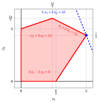

# Algoritmo del simplesso rivisto

**Parte 4 · Metodi matriciali, sensitività e geometria · Capitolo 11** · [:material-file-pdf-box: Dispensa, volume 4 (PDF)](../pdf/dispensa-4-metodi-avanzati.pdf) · [:material-presentation: Slide](../pdf/slide-11-simplesso-rivisto.pdf) · [:material-pencil: Esercizi: Algoritmo del simplesso rivisto](../esercizi/es-11-simplesso-rivisto.md)

!!! esempio "Esempio 11.1: un problema LP in forma canonica e la sua forma standard"

    

    Consideriamo il seguente problema LP in forma canonica di massimo con $n=2$ variabili e $m=3$ vincoli:

    $$
    \begin{array}{rrrrrrrrrrrrr}
    {\max} & 5 \, {x_1} & {+} & 2 \, {x_2} \\[2ex]
    \text{soggetto a} & {-} \, {x_1} & {+} & 3 \, {x_2} & {\le} & 12 \\[2ex]
    & {x_1} & {+} & 2 \, {x_2} & {\le} & 12 \\[2ex]
    & {3} \, {x_1} & {-} & 2 \, {x_2} & {\le} & {8} \\[2ex]
    & {x_1,} &  & {x_2} & { \ge} & {0}
    \end{array}
    $$

    

    

    { .fig .cornice loading=lazy style="width:92%" }

    

    La sua forma standard equivalente con $n+m=5$ variabili e $m=3$ vincoli è:

    $$
    \begin{array}{rrrrrrrrrrrrrrrrrrr}
    {\max} & 5 \, {x_1} & {+} & 2 \, {x_2} &  &  \\[1ex]
    \text{soggetto a} & {-x_1} & {+} & {3} \, {x_2} & {+} \, {x_3} &  &  & {=} & 12 \\[1ex]
    & {x_1} & {+} & {2} \, {x_2} &  & {+} \, {x_4} &  & {=} & 12 \\[1ex]
    & 3 \, {x_1} & {-} & {2} \, {x_2} &  &  & {+} \, {x_5} & {=} & 8 \\[1ex]
    & {x_1,} &  & {x_2,} & \, {x_3,} & \, {x_4,} & \, {x_5} & { \ge} & { 0 }
    \end{array}
    $$

    Per questo problema LP in forma standard abbiamo:

    $$
    {\boldsymbol  c}=
    \begin{pmatrix}
    5 \\[0.5ex]
    2 \\[0.5ex]
    0  \\[0.5ex]
    0  \\[0.5ex]
    0
    \end{pmatrix}
    \quad
    {\boldsymbol  x}=
    \begin{pmatrix}
    x_{1} \\[0.5ex]
    x_{2} \\[0.5ex]
    x_{3}  \\[0.5ex]
    x_{4}  \\[0.5ex]
    x_{5}
    \end{pmatrix}
    \quad
    {\boldsymbol  A}=
    \begin{pmatrix}
    -1 & 3 & 1 & 0 & 0\\[1ex]
    1 & 2 & 0 & 1 & 0\\[1ex]
    3 & -2 & 0 & 0 & 1\\
    \end{pmatrix}
    \quad
    {\boldsymbol b}=
    \begin{pmatrix}
    12 \\[1ex]
    12 \\[1ex]
    8 \\
    \end{pmatrix}
    $$

    Poiché $\begin{pmatrix} 12 \\[1ex] 12 \\[1ex] 8 \end{pmatrix} \ge \begin{pmatrix} 0 \\[1ex] 0 \\[1ex] 0 \end{pmatrix}$, con $\pazocal{B}=\{3,4,5\}$ e $\pazocal{N}=\{1,2\}$ abbiamo la seguente soluzione di base ammissibile iniziale:

    $$
    \begin{pmatrix}
    x_3 \\[1ex]
    x_4 \\[1ex]
    x_5 \\
    \end{pmatrix}
    = \begin{pmatrix}
    12 \\[1ex]
    12 \\[1ex]
    8 \\
    \end{pmatrix} ~~~~~
    \begin{pmatrix}
    x_1 \\[1ex]
    x_2
    \end{pmatrix}
    = \begin{pmatrix}
    0 \\[1ex]
    0
    \end{pmatrix}
    {\rm ~~~~e~~~~}
    \bar{\boldsymbol b}=
    \begin{pmatrix}
    12\\[1ex]
    12\\[1ex]
    8
    \end{pmatrix}
    $$

## 11.1 Operazioni di pivot con due sistemi di equazioni lineari

- Data una base ${\boldsymbol  A}_{\pazocal{B}}$, tutte le informazioni necessarie per le operazioni di pivot si possono determinare risolvendo <strong>due sistemi di equazioni lineari</strong>.

- **1.** <strong>Primo sistema di equazioni lineari</strong>

    - I costi ridotti e il valore della soluzione di base ammissibile si possono determinare calcolando direttamente $\red{{{\boldsymbol c}'_{\pazocal{B}} \; {\boldsymbol  A}_{\pazocal{B}}^{-1}}}$ poiché:

        $$
        {{ \bar{\boldsymbol c}}'}  = {{\boldsymbol c}'_{\pazocal{N}} - \red{{{\boldsymbol c}'_{\pazocal{B}} \; {\boldsymbol  A}_{\pazocal{B}}^{-1}}} \;{\boldsymbol  A}_{\pazocal{N}}}~~~~~ {\rm e}~~~~~ {\bar{z}} = \red{{{\boldsymbol c}'_{\pazocal{B}} \; {\boldsymbol  A}_{\pazocal{B}}^{-1}}} \; {\boldsymbol b}
        $$

        Ponendo ${\boldsymbol \pi} =  {{{\boldsymbol c}'_{\pazocal{B}} \; {\boldsymbol  A}_{\pazocal{B}}^{-1}}}$, il vettore riga ${\boldsymbol \pi} \in \R^{1 \times m}$ di $m$ colonne si può trovare risolvendo il seguente sistema di equazioni lineari:

        $$
        {\boldsymbol \pi} \; {\boldsymbol  A}_{\pazocal{B}} = {\boldsymbol c}'_{\pazocal{B}} ~~~\Longrightarrow~~~ {\boldsymbol \pi} =  \red{{{\boldsymbol c}'_{\pazocal{B}} \; {\boldsymbol  A}_{\pazocal{B}}^{-1}}}
        \text{       dove       }
        {\boldsymbol \pi} = [\pi_{j}] \text{  con   } j \in \pazocal{B}
        $$

        Negli esempi le componenti di ${\boldsymbol \pi}$ sono indicate con gli indici $j \in \pazocal{B}$ delle variabili in base, ma ogni componente di ${\boldsymbol \pi}$ corrisponde a un <u>vincolo</u>, cioè a una riga di ${\boldsymbol A}_{\pazocal{B}}$: la $i$-esima componente di ${\boldsymbol \pi}$ è associata all'$i$-esimo vincolo.

- **2.** <strong>Secondo sistema di equazioni lineari</strong>

    - Data una colonna pivot $x_p$ con $p \in \pazocal{N}$, la riga pivot e l'aggiornamento della soluzione di base ammissibile corrente si possono ottenere calcolando direttamente $\violet{{\boldsymbol  A}_{\pazocal{B}}^{-1} \;{\boldsymbol  A}_{p}}$ poiché:

        $$
        {\boldsymbol  x}_{\pazocal{B}}
        =
        {{\bar{\boldsymbol b}}}
        -
        \violet{{{\boldsymbol  A}_{\pazocal{B}}^{-1} \;{\boldsymbol  A}_{p}}} \; x_{p}
        $$

        Ponendo ${\boldsymbol d} = {{ {\boldsymbol  A}_{\pazocal{B}}^{-1}} {\boldsymbol  A}_{p}}$, il vettore colonna ${\boldsymbol d} \in \R^{m \times 1}$ di $m$ righe (associate alle variabili in base) si può trovare risolvendo il seguente sistema di equazioni lineari:

        $$
        {\boldsymbol  A}_{\pazocal{B}} \; {\boldsymbol d} = {\boldsymbol  A}_{p} ~~~\Longrightarrow~~~{\boldsymbol d} = \violet{{ {\boldsymbol  A}_{\pazocal{B}}^{-1}} {\boldsymbol  A}_{p}}
        \text{       dove       }
        {\boldsymbol d}   = [d_{i}] \text{  con   } i \in \pazocal{B}
        $$

!!! esempio "Esempio 11.2: Sistemi di equazioni lineari"

    Per il problema LP dell'[Esempio 11.1](#box-1-ex-rsimplex-1) con $\pazocal{B}= \{1,~~3,~~4\}$, $\pazocal{N}= \{2,~~5\}$ e $x_2$ come colonna pivot, abbiamo:

    $$
    {\boldsymbol A}_{\pazocal{B}}=
    \begin{pmatrix}
    -1 & 1 & 0 \\
    1 & 0 & 1\\
    3 & 0 & 0\\
    \end{pmatrix} ~~~~~~
    {\boldsymbol c}_{\pazocal{B}}=
    \begin{pmatrix}
    5 \\
    0 \\
    0 \\
    \end{pmatrix} ~~~~~~
    {\boldsymbol A}_{2} = \begin{pmatrix}
    3 \\
    2 \\
    -2
    \end{pmatrix}
    $$

    Risolviamo ${\boldsymbol \pi} \; {\boldsymbol  A}_{\pazocal{B}} = {\boldsymbol c}'_{\pazocal{B}}$ per calcolare ${\boldsymbol \pi} =  {{{\boldsymbol c}'_{\pazocal{B}} \; {\boldsymbol  A}_{\pazocal{B}}^{-1}}}$, <u>primo sistema di equazioni lineari</u>:

    \begin{equation*}
    \begin{cases}
    \begin{array}{rrrrrrrrrrrrr}
    {-\pi_1} & {+} & {\pi_3} & {+} & {3\;\pi_4} & {=} & {5} \\[0.25ex]
    {\pi_1} &  &  &  &  & {=} & {0} \\[0.25ex]
    &  & {\pi_3} &  &  & {=} & {0}
    \end{array}
    \end{cases}
    \Rightarrow~~~~
    {\boldsymbol \pi}=
    \begin{pmatrix}
    0& 0 & \frac{5}{3}\\
    \end{pmatrix}
    \end{equation*}

    Risolviamo ${\boldsymbol  A}_{\pazocal{B}} \; {\boldsymbol d} = {\boldsymbol  A}_{2}$ per calcolare ${\boldsymbol d}={ {\boldsymbol  A}_{\pazocal{B}}^{-1}} {\boldsymbol  A}_{2}$, <u>secondo sistema di equazioni lineari</u>:

    \begin{equation*}
    \begin{cases}
    \begin{array}{rrrrrrrrrrrrr}
    {-d_1} & {+} & {d_3} &  &  & {=} & {3} \\[0.25ex]
    {d_1} &  &  & {+} & {d_4} & {=} & {2} \\[0.25ex]
    {3\;d_1} &  &  &  &  & {=} & {-2}
    \end{array}
    \end{cases}
    \Rightarrow~~~~
    {\boldsymbol d}=
    \begin{pmatrix}
    -\frac{2}{3}\\[0.75ex]
    \frac{7}{3}\\[0.75ex]
    \frac{8}{3}
    \end{pmatrix}
    \end{equation*}

!!! chiave ""

    L'algoritmo del simplesso rivisto non calcola mai la matrice inversa ${\boldsymbol A}_{\pazocal{B}}^{-1}$: a ogni iterazione risolve <u>due sistemi di equazioni lineari</u>, uno per il vettore riga ${\boldsymbol \pi}$ e uno per il vettore colonna ${\boldsymbol d}$. Risolvere un sistema di $m$ equazioni lineari costa meno, dal punto di vista computazionale, che invertire una matrice di dimensione $m$, e la matrice ${\boldsymbol A}_{\pazocal{B}}$ dei due sistemi è la stessa.

## 11.2 Pseudocodice dell'algoritmo del simplesso rivisto

!!! algoritmo "Algoritmo"

    - **Passo 0:** <strong>Inizializzazione</strong>

        Trovare una soluzione di base ammissibile ${\boldsymbol  x}_{\pazocal{B}}={{\bar{\boldsymbol b}}}$ e ${\boldsymbol  x}_{\pazocal{N}}={{{\boldsymbol 0}}}$ del problema LP in forma standard di massimo.  Andare al <u>Passo $1$</u>.

    - **Passo 1:** <strong>Test di ottimalità</strong>

        - **a.** Risolvere  ${\boldsymbol \pi} \; {\boldsymbol  A}_{\pazocal{B}} = {\boldsymbol c}'_{\pazocal{B}}$ per calcolare ${\boldsymbol \pi} =  {{{\boldsymbol c}'_{\pazocal{B}} \; {\boldsymbol  A}_{\pazocal{B}}^{-1}}}$

        - **b.** Calcolare i costi ridotti e il valore della soluzione di base ammissibile:

            $$
            {{ \bar{\boldsymbol c}}}'  = {{\boldsymbol c}'_{\pazocal{N}} -
            \underbrace{{{\boldsymbol c}'_{\pazocal{B}} \; {\boldsymbol  A}_{\pazocal{B}}^{-1}}}_{={\boldsymbol \pi}}
            \;{\boldsymbol  A}_{\pazocal{N}}}
            \qquad \qquad {\bar{z}} = \underbrace{{{\boldsymbol c}'_{\pazocal{B}} \; {\boldsymbol  A}_{\pazocal{B}}^{-1}}}_{={\boldsymbol \pi}} \; {\boldsymbol b}
            $$

        <strong>Se</strong> ${{ \bar{\boldsymbol c}}'} \le {\boldsymbol 0}$ allora la soluzione di base ammissibile ${\boldsymbol  x}_{\pazocal{B}}={{\bar{\boldsymbol b}}}$ e ${\boldsymbol  x}_{\pazocal{N}}={{{\boldsymbol 0}}}$ è una soluzione ottima e ${\bar{z}}$ è il valore ottimo, <strong>altrimenti</strong> andare al <u>Passo $2$</u>.

    - **Passo 2:** <strong>Operazioni di pivot</strong>

        La <strong>colonna pivot</strong> è una variabile fuori base $x_p$ con $p \in \pazocal{N}$ tale che:

        $$
        {c}_{p} >\underbrace{{{\boldsymbol c}'_{\pazocal{B}} \; {\boldsymbol  A}_{\pazocal{B}}^{-1}}}_{={\boldsymbol \pi}}  \;{\boldsymbol  A}_{p}
        $$

        - **a.** Risolvere   ${\boldsymbol  A}_{\pazocal{B}} \; {\boldsymbol d} = {\boldsymbol  A}_{p}$ per calcolare   ${\boldsymbol d}={ {\boldsymbol  A}_{\pazocal{B}}^{-1}} {\boldsymbol  A}_{p}$

        - **b.** Se ${\boldsymbol d} \le {\boldsymbol 0}$, allora il problema LP è <strong>illimitato</strong>. <code>STOP</code>.

        - **c.** Trovare il valore massimo di $t$ (indicato con $t_m$) tale che:

            $$
            {{\bar{\boldsymbol b}}}  - t \; \underbrace{ {\boldsymbol  A}_{\pazocal{B}}^{-1} {\boldsymbol  A}_{p}}_{={\boldsymbol d}} \ge 0
            \qquad \Longrightarrow \qquad
            t_m \leftarrow \min \left\{~\frac{\bar b_i}{d_i}: i\in\pazocal{B},~d_i>0 ~\right\}
            $$

        La <strong>riga pivot</strong> è una variabile in base $x_r$ con $r \in \pazocal{B}$ tale che:

        $$
        \bar{b}_r  - t_m \; \underbrace{\bar{a}_{rp}}_{=d_r} = 0
        $$

        - **d.** Aggiornare la base con la nuova partizione degli indici delle variabili:

            $$
            \pazocal{B} \leftarrow \big(\pazocal{B} \setminus \{ r \} \big) \cup \{ p \}
            {\rm ~~~e~~~}
            \pazocal{N} \leftarrow \big(\pazocal{N} \setminus \{ p \} \big) \cup \{ r \}
            $$

        - **e.** Aggiornare la soluzione di base ammissibile (nuovo vettore ${{\bar{\boldsymbol b}}}$):

            $$
            x_i = \bar{b}_i  - t_m \; \underbrace{\bar{a}_{ip}}_{=d_i},~\forall i \in
            \pazocal{B} \setminus \{p\},~~ x_p = t_m {\rm ~~~~~~e~~~~~~}
            x_i = 0,~\forall i \in
            \pazocal{N}
            $$

        Andare al <u>Passo $1$</u>.

!!! esempio "Esempio 11.3: algoritmo del simplesso rivisto – prima iterazione"

    <strong>Inizializzazione</strong>

    Nel problema LP dell'[Esempio 11.1](#box-1-ex-rsimplex-1), $\begin{pmatrix} x_3 \\ x_4 \\ x_5 \\ \end{pmatrix} \!=\! \begin{pmatrix} 12 \\ 12 \\ 8 \\ \end{pmatrix} ~ \begin{pmatrix} x_1 \\ x_2 \end{pmatrix} \!=\! \begin{pmatrix} 0 \\ 0 \end{pmatrix}$ è una soluzione di base ammissibile con $\bar{\boldsymbol b} \!=\! \begin{pmatrix} 12 \\ 12 \\ 8 \\ \end{pmatrix}$.

    <strong>Test di ottimalità</strong>

    Con $\pazocal{B}=\{3,4,5\}$ e $\pazocal{N}=\{1,2\}$, risolviamo ${\boldsymbol \pi} \; {\boldsymbol A}_{\pazocal{B}} = {\boldsymbol c}'_{\pazocal{B}}$ per calcolare ${\boldsymbol \pi} =  {{{\boldsymbol c}'_{\pazocal{B}} \; {\boldsymbol A}_{\pazocal{B}}^{-1}}}$.

    \begin{gather*}
    {\boldsymbol A}_{\pazocal{B}}=
    \begin{pmatrix}
    1 & 0 & 0\\
    0 & 1 & 0\\
    0 & 0 & 1
    \end{pmatrix} ~~
    {\boldsymbol c}'_{\pazocal{B}}=
    \begin{pmatrix}
    0 & 0 & 0
    \end{pmatrix}
    \\[2ex]
    \text{quindi   }
    \begin{cases}
    \begin{array}{rrrrrrrrrrrrr}
    {\pi_3} &  &  &  &  & {=} & {0} \\
    &  & {\pi_4} &  &  & {=} & {0} \\
    &  &  &  & {\pi_5} & {=} & {0}
    \end{array}
    \end{cases}
    \Rightarrow~~
    {\boldsymbol \pi}=
    \begin{pmatrix}
    0 & 0 & 0\\
    \end{pmatrix}
    \end{gather*}

    Calcoliamo il valore della soluzione di base ammissibile ${\bar{z} } = {\boldsymbol \pi} \; {\boldsymbol b} = \begin{pmatrix} 0 & 0 & 0 \\ \end{pmatrix} \begin{pmatrix} 12 \\ 12 \\ 8 \\ \end{pmatrix} = 0.$ Calcoliamo i costi ridotti ${{ \bar{\boldsymbol c} }'}  = {{\boldsymbol c}'_{\pazocal{N}} - {\boldsymbol \pi} \; {\boldsymbol A}_{\pazocal{N}}}$:

    $$
    {{ \bar{\boldsymbol c} }'}
    = \begin{pmatrix}
    5 & 2 \\
    \end{pmatrix} - \begin{pmatrix}
    0 & 0 & 0\\
    \end{pmatrix} \begin{pmatrix}
    -1 & 3 \\
    1 & 2  \\
    3 & -2  \\
    \end{pmatrix}
    =
    \underbrace{
    \begin{pmatrix}
    5 & 2  \\
    \end{pmatrix}
    }_{{c_{1}~~~c_{2}}}
    -
    \underbrace{
    \begin{pmatrix}
    0 & 0 \\
    \end{pmatrix}
    }_{{\boldsymbol \pi}\;{\boldsymbol A}_{1} ~~{\boldsymbol \pi}\;{\boldsymbol A}_{2} }
    =
    \underbrace{
    \begin{pmatrix}
    5 & 2 \\
    \end{pmatrix}
    }_{{\bar{c}_{1}~~~\bar{c}_{2}}}
    $$

    <strong>Operazione di pivot</strong>

    Poiché ${c}_{1}>{\boldsymbol \pi} \;{\boldsymbol A}_{1}$, $x_1$ è la <u>colonna pivot</u>. Risolviamo ${\boldsymbol A}_{\pazocal{B}} \; {\boldsymbol d} = {\boldsymbol A}_{1}$ per calcolare ${\boldsymbol d}={ {\boldsymbol A}_{\pazocal{B}}^{-1}} {\boldsymbol A}_{1}$.

    \begin{gather*}
    {\boldsymbol A}_{\pazocal{B}}=
    \begin{pmatrix}
    1 & 0 & 0\\
    0 & 1 & 0\\
    0 & 0 & 1
    \end{pmatrix} ~~
    {\boldsymbol A}_{1}=
    \begin{pmatrix}
    -1\\
    1\\
    3
    \end{pmatrix}
    \\[2ex]
    \text{quindi   }
    \begin{cases}
    \begin{array}{rrrrrrrrrrrrr}
    {d_3} &  &  &  &  & {=} & {-1} \\
    &  & {d_4} &  &  & {=} & {1} \\
    &  &  &  & {d_5} & {=} & {3}
    \end{array}
    \end{cases}
    \Rightarrow~~
    {\boldsymbol d}=
    \begin{pmatrix}
    -1\\[0.5ex]
    1\\[0.5ex]
    3
    \end{pmatrix}
    \end{gather*}

    Dobbiamo trovare il valore massimo di $t$ tale che ${{ \bar{\boldsymbol b} }}  - t \; {{\boldsymbol d }} \ge 0$:

    $$
    \begin{cases}
    \underbrace{12 -t \cdot (-1)\ge 0}_{x_3 \ge 0} \\
    \underbrace{12 -t \cdot 1\ge 0}_{x_4 \ge 0} \\
    \underbrace{8 -t \cdot 3\ge 0}_{x_5 \ge 0}
    \end{cases}
    \qquad
    \begin{cases}
    t\ge -12  \\[0.5ex]
    t\le 12  \\[0.5ex]
    t\le \frac{8}{3}
    \end{cases}
    \text{   quindi   } t_{m}=\frac{8}{3}
    $$

    Il valore della colonna pivot diventa $t_{m}$, cioè $x_1=\frac{8}{3}$. Il valore di $x_5$ diventa zero e $x_5$ è la <u>riga pivot</u>. Le altre variabili in base assumono i valori ${ \bar{\boldsymbol b} } - t_{m} \; {\boldsymbol d}$, quindi abbiamo:

    $$
    x_3= 12 - \frac{8}{3} \cdot (-1)=\frac{44}{3},~~~x_4= 12 - \frac{8}{3} \cdot 1=\frac{28}{3} {~~~~\rm e~quindi~~}
    \begin{pmatrix}
    x_1 \\[0.5ex]
    x_3  \\[0.5ex]
    x_4
    \end{pmatrix}
    =\begin{pmatrix}
    \frac{8}{3} \\[0.5ex]
    \frac{44}{3}  \\[0.5ex]
    \frac{28}{3}
    \end{pmatrix}
    $$

    La nuova partizione degli indici delle variabili è $\pazocal{B}=\{1,3,4\}$ e $\pazocal{N}=\{2,5\}$.

!!! esempio "Esempio 11.4: algoritmo del simplesso rivisto – seconda iterazione"

    <strong>Test di ottimalità</strong>

    Con $\pazocal{B}=\{1,3,4\}$ e $\pazocal{N}=\{2,5\}$, risolviamo ${\boldsymbol \pi} \; {\boldsymbol A}_{\pazocal{B}} = {\boldsymbol c}'_{\pazocal{B}}$ per calcolare ${\boldsymbol \pi} =  {{{\boldsymbol c}'_{\pazocal{B}} \; {\boldsymbol A}_{\pazocal{B}}^{-1}}}$.

    \begin{gather*}
    {\boldsymbol A}_{\pazocal{B}}=
    \begin{pmatrix}
    -1 & 1 & 0\\
    1 & 0 & 1\\
    3 & 0 & 0
    \end{pmatrix} ~~
    {\boldsymbol c}'_{\pazocal{B}}=
    \begin{pmatrix}
    5 & 0 & 0
    \end{pmatrix}
    \\[2ex]
    \text{quindi   }
    \begin{cases}
    \begin{array}{rrrrrrrrrrrrr}
    {-\pi_1} & {+} & {\pi_3} & {+} & {3\;\pi_4} & {=} & {5} \\[0.5ex]
    {\pi_1} &  &  &  &  & {=} & {0} \\[0.5ex]
    &  & {\pi_3} &  &  & {=} & {0}
    \end{array}
    \end{cases}
    \Rightarrow~~
    {\boldsymbol \pi}=
    \begin{pmatrix}
    0& 0 & \frac{5}{3}\\
    \end{pmatrix}
    \end{gather*}

    Calcoliamo il valore della soluzione di base ammissibile ${\bar{z} } = {\boldsymbol \pi} \; {\boldsymbol b} = \begin{pmatrix} 0& 0 & \frac{5}{3} \\ \end{pmatrix} \begin{pmatrix} 12 \\ 12 \\ 8 \\ \end{pmatrix} = \frac{40}{3}.$ Calcoliamo i costi ridotti ${{ \bar{\boldsymbol c} }'}  = {{\boldsymbol c}'_{\pazocal{N}} - {\boldsymbol \pi} \; {\boldsymbol A}_{\pazocal{N}}}$:

    $$
    {{ \bar{\boldsymbol c} }'}
    = \begin{pmatrix}
    2 & 0 \\
    \end{pmatrix} - \begin{pmatrix}
    0 & 0 & \frac{5}{3}\\
    \end{pmatrix} \begin{pmatrix}
    3 & 0 \\
    2 & 0 \\
    -2 & 1 \\
    \end{pmatrix}
    =
    \underbrace{
    \begin{pmatrix}
    2 & 0  \\
    \end{pmatrix}
    }_{{c_{2}~~~c_{5}}}
    -
    \underbrace{
    \begin{pmatrix}
    -\frac{10}{3} & \frac{5}{3} \\
    \end{pmatrix}
    }_{{\boldsymbol \pi}\;{\boldsymbol A}_{2} ~~{\boldsymbol \pi}\;{\boldsymbol A}_{5}}
    =
    \underbrace{
    \begin{pmatrix}
    \frac{16}{3} & -\frac{5}{3} \\
    \end{pmatrix}
    }_{{\bar{c}_{2}~~~\bar{c}_{5}}}
    $$

    <strong>Operazione di pivot</strong>

    Poiché ${c}_{2} > {\boldsymbol \pi} \;{\boldsymbol A}_{2}$, $x_2$ è la <u>colonna pivot</u>. Risolviamo ${\boldsymbol A}_{\pazocal{B}} \; {\boldsymbol d} = {\boldsymbol A}_{2}$ per calcolare ${\boldsymbol d}={ {\boldsymbol A}_{\pazocal{B}}^{-1}} {\boldsymbol A}_{2}$.

    \begin{gather*}
    {\boldsymbol A}_{\pazocal{B}}=
    \begin{pmatrix}
    -1 & 1 & 0\\
    1 & 0 & 1\\
    3 & 0 & 0
    \end{pmatrix} ~~
    {\boldsymbol A}_{2}=
    \begin{pmatrix}
    3\\
    2\\
    -2
    \end{pmatrix}
    \\[2ex]
    \text{quindi   }
    \begin{cases}
    \begin{array}{rrrrrrrrrrrrr}
    {-d_1} & {+} & {d_3} &  &  & {=} & {3} \\[0.5ex]
    {d_1} &  &  & {+} & {d_4} & {=} & {2} \\[0.5ex]
    {3\;d_1} &  &  &  &  & {=} & {-2}
    \end{array}
    \end{cases}
    \Rightarrow~~
    {\boldsymbol d}=
    \begin{pmatrix}
    -\frac{2}{3}\\[0.75ex]
    \frac{7}{3}\\[0.75ex]
    \frac{8}{3}
    \end{pmatrix}
    \end{gather*}

    Dobbiamo trovare il valore massimo di $t$ tale che ${{ \bar{\boldsymbol b} }}  - t \; {{\boldsymbol d}} \ge 0$:

    $$
    \begin{cases}
    \underbrace{\frac{8}{3} -t \cdot \left(-\frac{2}{3}\right)\ge 0}_{x_1 \ge 0} \\[1ex]
    \underbrace{\frac{44}{3} -t \cdot \frac{7}{3}\ge 0}_{x_3 \ge 0} \\[1ex]
    \underbrace{\frac{28}{3} -t \cdot \frac{8}{3}\ge 0}_{x_4 \ge 0} \\
    \end{cases}
    \qquad
    \begin{cases}
    t\ge -4  \\[1ex]
    t\le \frac{44}{7}  \\[1ex]
    t\le \frac{7}{2}
    \end{cases}
    \text{   quindi   } t_{m}=\frac{7}{2}
    $$

    Il valore della colonna pivot diventa $t_{m}$, cioè $x_2=\frac{7}{2}$. Il valore di $x_4$ diventa zero e $x_4$ è la <u>riga pivot</u>. Le altre variabili in base assumono i valori ${ \bar{\boldsymbol b} } - t_{m} \; {\boldsymbol d}$, quindi abbiamo:

    $$
    x_1= \frac{8}{3} - \frac{7}{2} \cdot \left(-\frac{2}{3}\right)=5,~~x_3= \frac{44}{3} - \frac{7}{2} \cdot \frac{7}{3}=\frac{13}{2}{~~~~\rm e~quindi~~}
    \begin{pmatrix}
    x_1 \\[1ex]
    x_2  \\[1ex]
    x_3
    \end{pmatrix}
    =\begin{pmatrix}
    5\\[1ex]
    \frac{7}{2} \\[1ex]
    \frac{13}{2} \\
    \end{pmatrix}
    $$

    La nuova partizione degli indici delle variabili è $\pazocal{B}=\{1,2,3\}$ e $\pazocal{N}=\{4,5\}$.

!!! esempio "Esempio 11.5: algoritmo del simplesso rivisto – terza iterazione"

    <strong>Test di ottimalità</strong>

    Con $\pazocal{B}=\{1,2,3\}$ e $\pazocal{N}=\{4,5\}$, risolviamo ${\boldsymbol \pi} \; {\boldsymbol A}_{\pazocal{B}} = {\boldsymbol c}'_{\pazocal{B}}$ per calcolare ${\boldsymbol \pi} =  {{{\boldsymbol c}'_{\pazocal{B}} \; {\boldsymbol A}_{\pazocal{B}}^{-1}}}$.

    \begin{gather*}
    {\boldsymbol A}_{\pazocal{B}}=
    \begin{pmatrix}
    -1 & 3 & 1\\
    1 & 2 & 0\\
    3 & -2 & 0
    \end{pmatrix} ~
    {\boldsymbol c}'_{\pazocal{B}}=
    \begin{pmatrix}
    5 & 2 & 0
    \end{pmatrix}
    \\[2ex]
    \text{quindi   }
    \begin{cases}
    \begin{array}{rrrrrrrrrrrrr}
    {-\pi_1} & {+} & {\pi_2} & {+} & {3\;\pi_3} & {=} & {5} \\[0.5ex]
    {3\,\pi_1} & {+} & {2\,\pi_2} & {-} & {2\,\pi_3} & {=} & {2} \\[0.5ex]
    {\pi_1} &  &  &  &  & {=} & {0}
    \end{array}
    \end{cases}
    \Rightarrow~
    {\boldsymbol \pi}=
    \begin{pmatrix}
    0 & 2 & 1\\
    \end{pmatrix}
    \end{gather*}

    Calcoliamo il valore della soluzione di base ammissibile ${\bar{z} } = {\boldsymbol \pi} \; {\boldsymbol b} = \begin{pmatrix} 0 & 2 &1 \\ \end{pmatrix} \begin{pmatrix} 12 \\ 12 \\ 8 \\ \end{pmatrix} = 32$

    Calcoliamo i costi ridotti ${{ \bar{\boldsymbol c} }'}  = {{\boldsymbol c}'_{\pazocal{N}} - {\boldsymbol \pi} \; {\boldsymbol A}_{\pazocal{N}}}$:

    $$
    {{ \bar{\boldsymbol c} }'}
    = \begin{pmatrix}
    0 & 0\\
    \end{pmatrix} - \begin{pmatrix}
    0 & 2 & 1\\
    \end{pmatrix} \begin{pmatrix}
    0 & 0  \\
    1 & 0  \\
    0 & 1  \\
    \end{pmatrix}
    =
    \underbrace{
    \begin{pmatrix}
    0 & 0 \\
    \end{pmatrix}
    }_{c_{4}~~~c_{5}}
    -
    \underbrace{
    \begin{pmatrix}
    2 & 1 \\
    \end{pmatrix}
    }_{{\boldsymbol \pi}\;{\boldsymbol A}_{4} ~~{\boldsymbol \pi}\;{\boldsymbol A}_{5}}
    =
    \underbrace{
    \begin{pmatrix}
    -2 & -1 \\
    \end{pmatrix}
    }_{\bar{c}_{4}~~~\bar{c}_{5}}
    $$

    Tutti i costi ridotti sono non positivi, quindi la soluzione di base ammissibile

    $$
    \begin{pmatrix}
    x_1 \\[1ex]
    x_2 \\[1ex]
    x_3 \\
    \end{pmatrix}=\begin{pmatrix}
    5\\[1ex]
    \frac{7}{2} \\[1ex]
    \frac{13}{2} \\
    \end{pmatrix} {\rm ~~~e~~~}
    \begin{pmatrix}
    x_4 \\[1ex]
    x_5 \\
    \end{pmatrix}=\begin{pmatrix}
    0\\[2ex]
    0 \\
    \end{pmatrix}
    $$

    è una soluzione ottima del problema LP e ${\bar{z}} = 32$ è il valore ottimo.

---

**Esercizi su questo capitolo:** [:material-pencil: Algoritmo del simplesso rivisto](../esercizi/es-11-simplesso-rivisto.md)
