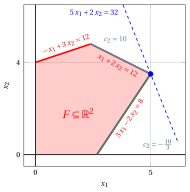
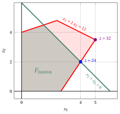

# Analisi di sensitività

**Parte 4 · Metodi matriciali, sensitività e geometria · Capitolo 14** · [:material-file-pdf-box: Dispensa, volume 4 (PDF)](../pdf/dispensa-4-metodi-avanzati.pdf) · [:material-pencil: Esercizi](../esercizi/es-14-sensitivita.md)

## 14.1 Basi ottime e le loro due condizioni

- I dati di un problema LP sono raramente noti con esattezza: le componenti del vettore dei costi ${\boldsymbol c}$ e del vettore dei termini noti ${\boldsymbol b}$ sono stime, e possono cambiare dopo che il problema LP è stato risolto. L'<strong>analisi di sensitività</strong> studia come cambiano una soluzione ottima e il valore ottimo quando cambiano i dati.

- Consideriamo un problema LP in forma standard di massimo con $n+m$ variabili non negative e $m$ vincoli lineari di uguaglianza, ottenuto da un problema LP in forma canonica di massimo aggiungendo $m$ variabili di scarto:

    

    \begin{align*}
    &&   \max \;\;{\boldsymbol c}' \, {\boldsymbol x}  \label{SENS_FORM_STANDARD_OBJ} \tag{14.1a}\\[2ex]
    && \text{soggetto a} \quad  {\boldsymbol A} \; {\boldsymbol x}  &= {\boldsymbol b},  & \phantom{j=1111}  \label{SENS_FORM_STANDARD_CONS1} \tag{14.1b}\\[2ex]
    && {\boldsymbol x}                        &\ge  {\boldsymbol 0}. \label{SENS_FORM_STANDARD_CONS2} \tag{14.1c}
    \end{align*}

!!! definizione "Definizione 14.1: base ottima"

    Una base ${\boldsymbol A}_{\pazocal{B}}$ del problema LP [(14.1)](#eq-SENS_FORM_STANDARD) si chiama <strong>base ottima</strong> se soddisfa le due condizioni seguenti, e allora la sua soluzione di base ammissibile è una soluzione ottima:

    1. <strong>ammissibilità primale</strong>: $~\bar{\boldsymbol b} = {\boldsymbol A}_{\pazocal{B}}^{-1} \, {\boldsymbol b} \ge {\boldsymbol 0}$;

    2. <strong>ammissibilità duale</strong>: $~{{ \bar{\boldsymbol c}}'}  = {\boldsymbol c}'_{\pazocal{N}} - {\boldsymbol \pi} \;{\boldsymbol  A}_{\pazocal{N}} \le {\boldsymbol 0}$, dove ${\boldsymbol \pi} = {\boldsymbol c}'_{\pazocal{B}} \; {\boldsymbol  A}_{\pazocal{B}}^{-1}$.

!!! chiave ""

    Le due condizioni sono <u>sufficienti</u> per l'ottimalità; in presenza di degenerazione, una soluzione di base ammissibile ottima può essere associata anche a una base che non è duale ammissibile. Una variazione dei dati preserva l'ottimalità della base finché <u>entrambe</u> le condizioni continuano a valere.

- Le due condizioni coinvolgono i dati in due modi diversi:

    1. il vettore dei termini noti ${\boldsymbol b}$ compare solo nella condizione di ammissibilità <u>primale</u>;

    2. il vettore dei costi ${\boldsymbol c}$ compare solo nella condizione di ammissibilità <u>duale</u>.

    Di conseguenza, una variazione di ${\boldsymbol b}$ può distruggere solo l'ammissibilità primale della base, e una variazione di ${\boldsymbol c}$ può distruggere solo la sua ammissibilità duale.

!!! esempio "Esempio 14.1: base ottima"

    Consideriamo il seguente problema LP in forma canonica di massimo con $n=2$ variabili non negative e $m=3$ vincoli lineari di minore o uguale:

    $$
    \begin{array}{rrrrrrrrrrrrr}
    {\max} & 5 \, {x_1} & {+} & 2 \, {x_2} \\[1ex]
    \text{soggetto a} & {-} \, {x_1} & {+} & 3 \, {x_2} & {\le} & 12 \\[1ex]
    & {x_1} & {+} & 2 \, {x_2} & {\le} & 12 \\[1ex]
    & {3} \, {x_1} & {-} & 2 \, {x_2} & {\le} & 8 \\[1ex]
    & {x_1,} &  & {x_2} & { \ge} & {0}
    \end{array}
    $$

    La sua forma standard di massimo ha $n+m=5$ variabili non negative, e la base ottima determinata dall'algoritmo del simplesso è

    $$
    \pazocal{B}= \{1,~~2,~~3\}
    \qquad {\rm e} \qquad
    \pazocal{N}= \{4,~~5\} .
    $$

    Il dizionario associato è:

    \begin{equation*}
    \begin{cases}
    \begin{array}{rrrrrrrrrrrrr}
    {x_1} & {=} & {5} & {-} & {\frac{1}{4}\,x_4} & {-} & {\frac{1}{4}\,x_5} \\[2ex]
    {x_2} & {=} & {\frac{7}{2}} & {-} & {\frac{3}{8}\,x_4} & {+} & {\frac{1}{8}\,x_5} \\[2ex]
    {x_3} & {=} & {\frac{13}{2}} & {+} & {\frac{7}{8}\,x_4} & {-} & {\frac{5}{8}\,x_5} \\[2ex]
    {z} & {=} & {32} & {-} & {2\,x_4} & {-} & {x_5}
    \end{array}
    \end{cases}
    \end{equation*}

    e abbiamo:

    $$
    {\boldsymbol  A}_{\pazocal{B}}^{-1} =
    \begin{pmatrix}
    0 & \frac{1}{4} & \frac{1}{4} \\[1ex]
    0 & \frac{3}{8} & -\frac{1}{8} \\[1ex]
    1 & -\frac{7}{8} & \frac{5}{8}
    \end{pmatrix}
    \qquad {\rm e} \qquad
    {\boldsymbol \pi} = {\boldsymbol c}'_{\pazocal{B}} \; {\boldsymbol  A}_{\pazocal{B}}^{-1} = (0~~2~~1) .
    $$

    Una soluzione ottima è $\tilde{\boldsymbol x}(\, LP \,) = \begin{pmatrix} 5 \\[0.5ex] \frac{7}{2} \end{pmatrix}$ e il valore ottimo è $z(\, LP \,) = 32$.

## 14.2 Variazioni del vettore dei costi

- Sostituiamo una componente $c_k$ del vettore dei costi con $c_k + \delta$, dove $\delta \in \R$, e cerchiamo i valori di $\delta$ per cui la base ottima resta ottima. Poiché ${\boldsymbol b}$ non cambia, la condizione di ammissibilità primale continua a valere, e va verificata solo la condizione di ammissibilità duale.

### 14.2.1 Coefficiente di costo di una variabile fuori base

!!! chiave ""

    Se $k \in \pazocal{N}$, allora ${\boldsymbol c}_{\pazocal{B}}$ non cambia, e quindi neanche ${\boldsymbol \pi}$. Cambia solo il costo ridotto di $x_k$:

    $$
    \bar{c}_k \; \longrightarrow \; \bar{c}_k + \delta ,
    $$

    e la base ottima resta ottima se e solo se

    $$
    \delta \le - \, \bar{c}_k .
    $$

- La soluzione ottima e il valore ottimo <u>non</u> cambiano per questi valori di $\delta$: il dizionario è lo stesso, tranne un costo ridotto.

### 14.2.2 Coefficiente di costo di una variabile in base

!!! chiave ""

    Se $k \in \pazocal{B}$, allora ${\boldsymbol c}_{\pazocal{B}}$ cambia, e quindi cambiano <u>tutti</u> i costi ridotti. Indicando con $\bar{a}_{kj}$ l'elemento della matrice $\bar{\boldsymbol A}$ nella riga di $x_k$ e nella colonna di $x_j$, abbiamo

    $$
    \bar{c}_j \; \longrightarrow \; \bar{c}_j - \delta \; \bar{a}_{kj} , \qquad \forall j \in \pazocal{N} ,
    $$

    e la base ottima resta ottima se e solo se $\bar{c}_j - \delta \, \bar{a}_{kj} \le 0$ per ogni $j \in \pazocal{N}$, cioè se e solo se

    $$
    \max \left\{~\frac{\bar c_j}{\bar a_{kj}}: j\in\pazocal{N},~\bar a_{kj}>0 ~\right\}
    \;\le\; \delta \;\le\;
    \min \left\{~\frac{\bar c_j}{\bar a_{kj}}: j\in\pazocal{N},~\bar a_{kj}<0 ~\right\} .
    $$

- La soluzione ottima <u>non</u> cambia per questi valori di $\delta$, perché $\bar{\boldsymbol b}$ resta invariato, ma il valore ottimo diventa

    $$
    z(\, LP \,) + \delta \; \tilde{x}_k .
    $$

!!! esempio "Esempio 14.2: variazioni del vettore dei costi"

    Consideriamo la base ottima dell'[Esempio 14.1](#box-2-ex-sens-0), con $\pazocal{N}= \{4,~~5\}$, $\bar{c}_4 = -2$, $\bar{c}_5 = -1$ e

    $$
    \bar{\boldsymbol A}
    =
    \begin{pmatrix}
    \frac{1}{4} & \frac{1}{4} \\[1ex]
    \frac{3}{8} & -\frac{1}{8} \\[1ex]
    -\frac{7}{8} & \frac{5}{8}
    \end{pmatrix} .
    $$

    <strong>Coefficiente della variabile in base $x_1$.</strong> Sostituiamo $c_1 = 5$ con $5 + \delta$. La riga di $x_1$ in $\bar{\boldsymbol A}$ è $\left(\frac{1}{4}~~\frac{1}{4}\right)$, i cui due elementi sono entrambi positivi, quindi entrambi danno un lower bound su $\delta$:

    $$
    \delta \ge \max \left\{~\underbrace{\frac{-2}{1/4}}_{= \, -8},~\underbrace{\frac{-1}{1/4}}_{= \, -4}~\right\} = -4 ,
    $$

    e non c'è alcun upper bound, perché nessun elemento della riga è negativo. Di conseguenza,

    $$
    \delta \ge -4
    \qquad \Longrightarrow \qquad
    c_1 \in [\, 1, \; +\infty \, ) .
    $$

    <strong>Coefficiente della variabile in base $x_2$.</strong> Sostituiamo $c_2 = 2$ con $2 + \delta$. La riga di $x_2$ in $\bar{\boldsymbol A}$ è $\left(\frac{3}{8}~~-\frac{1}{8}\right)$, con un elemento positivo, che dà un lower bound, e un elemento negativo, che dà un upper bound:

    $$
    \underbrace{\frac{-2}{3/8}}_{= \, -\frac{16}{3}} \; \le \; \delta \; \le \; \underbrace{\frac{-1}{-1/8}}_{= \, 8} ,
    $$

    cioè

    $$
    -\frac{16}{3} \le \delta \le 8
    \qquad \Longrightarrow \qquad
    c_2 \in \left[\, -\frac{10}{3}, \; 10 \, \right] .
    $$

    Per ogni valore di $c_2$ in questo intervallo, la soluzione ottima resta $\tilde{\boldsymbol x}(\, LP \,) = \begin{pmatrix} 5 \\[0.5ex] \frac{7}{2} \end{pmatrix}$, mentre il valore ottimo diventa $32 + \delta \cdot \frac{7}{2}$.

    { .fig .cornice loading=lazy style="width:53%" }

    Gli insiemi di livello della funzione obiettivo <strong>ruotano</strong> al variare di $c_2$, mentre la soluzione ottima resta il vertice $\begin{pmatrix} 5 \\[0.3ex] \frac{7}{2} \end{pmatrix}$. I due estremi dell'intervallo hanno un preciso significato geometrico: sono i valori di $c_2$ per cui gli insiemi di livello diventano <u>paralleli a uno dei due spigoli</u> che si incontrano in quel vertice. Per $c_2 = 10$ sono paralleli allo spigolo su $x_1 + 2x_2 = 12$, disegnato in blu, e per $c_2 = -\frac{10}{3}$ sono paralleli allo spigolo su $3x_1 - 2x_2 = 8$, disegnato in verde. Oltre questi valori la soluzione ottima si sposta in un vertice adiacente.

## 14.3 Variazioni del vettore dei termini noti

- Sostituiamo una componente $b_k$ del vettore dei termini noti con $b_k + \delta$, dove $\delta \in \R$. Poiché ${\boldsymbol c}$ non cambia, la condizione di ammissibilità duale continua a valere, e va verificata solo la condizione di ammissibilità primale.

!!! chiave ""

    I valori delle variabili in base diventano

    $$
    \bar{\boldsymbol b} \; \longrightarrow \;
    {\boldsymbol A}_{\pazocal{B}}^{-1} \, ({\boldsymbol b} + \delta \, {\boldsymbol e}_k)
    = \bar{\boldsymbol b} + \delta \; {\boldsymbol A}_{\pazocal{B}}^{-1} \, {\boldsymbol e}_k ,
    $$

    dove ${\boldsymbol A}_{\pazocal{B}}^{-1} \, {\boldsymbol e}_k$ è la $k$-esima <u>colonna</u> della matrice ${\boldsymbol A}_{\pazocal{B}}^{-1}$, i cui elementi indichiamo con $\beta_{ik}$. La base ottima resta ottima se e solo se

    $$
    \max \left\{~- \, \frac{\bar b_i}{\beta_{ik}}: i\in\pazocal{B},~\beta_{ik}>0 ~\right\}
    \;\le\; \delta \;\le\;
    \min \left\{~- \, \frac{\bar b_i}{\beta_{ik}}: i\in\pazocal{B},~\beta_{ik}<0 ~\right\} .
    $$

!!! definizione "Definizione 14.2: prezzi ombra"

    Data una base ottima ${\boldsymbol A}_{\pazocal{B}}$ del problema LP [(14.1)](#eq-SENS_FORM_STANDARD), le componenti del vettore riga

    $$
    {\boldsymbol \pi} = {\boldsymbol c}'_{\pazocal{B}} \; {\boldsymbol  A}_{\pazocal{B}}^{-1}
    $$

    si chiamano <strong>prezzi ombra</strong> degli $m$ vincoli lineari.

!!! chiave ""

    Finché la base ottima resta ottima, il valore ottimo varia linearmente con $\delta$:

    $$
    z(\, LP \,) \; \longrightarrow \; z(\, LP \,) + \delta \; \pi_k .
    $$

    Il prezzo ombra $\pi_k$ è quindi il <strong>valore marginale</strong> del $k$-esimo vincolo: misura l'aumento del valore ottimo per ogni aumento unitario di $b_k$.

- Per il teorema della dualità forte, il vettore ${\boldsymbol \pi}$ dei prezzi ombra è una soluzione ottima del problema duale, e quindi

    $$
    z(\, LP \,) = {\boldsymbol \pi} \; {\boldsymbol b} = \sum_{i=1}^m \pi_i \; b_i .
    $$

- Se il $k$-esimo vincolo <u>non</u> è attivo nella soluzione ottima, cioè se la sua variabile è in base con valore strettamente positivo, allora $\pi_k = 0$: una piccola variazione di $b_k$ non cambia il valore ottimo.

!!! esempio "Esempio 14.3: variazioni del vettore dei termini noti"

    Consideriamo la base ottima dell'[Esempio 14.1](#box-2-ex-sens-0), con $\bar{\boldsymbol b} = \left(5~~\frac{7}{2}~~\frac{13}{2}\right)'$ e ${\boldsymbol \pi} = (0~~2~~1)$.

    <strong>Primo vincolo.</strong> Il suo prezzo ombra è $\pi_1 = 0$, perché la sua variabile di scarto $x_3$ è in base con valore $\frac{13}{2} > 0$: il primo vincolo non è attivo nella soluzione ottima, e una piccola variazione di $b_1$ non cambia il valore ottimo. La prima colonna di ${\boldsymbol A}_{\pazocal{B}}^{-1}$ è $(0~~0~~1)'$, quindi cambia solo il valore di $x_3$, e si ottiene

    $$
    \frac{13}{2} + \delta \ge 0
    \qquad \Longrightarrow \qquad
    \delta \ge - \, \frac{13}{2}
    \qquad \Longrightarrow \qquad
    b_1 \in \left[\, \frac{11}{2}, \; +\infty \, \right) .
    $$

    <strong>Secondo vincolo.</strong> Il suo prezzo ombra è $\pi_2 = 2$. La seconda colonna di ${\boldsymbol A}_{\pazocal{B}}^{-1}$ è $\left(\frac{1}{4}~~\frac{3}{8}~~-\frac{7}{8}\right)'$, quindi

    $$
    \begin{cases}
    5 + \frac{1}{4} \, \delta \ge 0\\[1.5ex]
    \frac{7}{2} + \frac{3}{8} \, \delta \ge 0\\[1.5ex]
    \frac{13}{2} - \frac{7}{8} \, \delta \ge 0
    \end{cases}
    \qquad \Longrightarrow \qquad
    \begin{cases}
    \delta \ge -20\\[1.5ex]
    \delta \ge -\frac{28}{3}\\[1.5ex]
    \delta \le \frac{52}{7}
    \end{cases}
    \qquad \Longrightarrow \qquad
    - \, \frac{28}{3} \le \delta \le \frac{52}{7} ,
    $$

    cioè

    $$
    b_2 \in \left[\, \frac{8}{3}, \; \frac{136}{7} \, \right] .
    $$

    Per ogni valore di $b_2$ in questo intervallo, il valore ottimo è

    $$
    z(\, LP \,) = 32 + 2 \; \delta .
    $$

    Per esempio, con $b_2 = 13$ abbiamo $\delta = 1$ e il valore ottimo diventa $34$; con $b_2 = 11$ abbiamo $\delta = -1$ e il valore ottimo diventa $30$.

    <strong>Terzo vincolo.</strong> Il suo prezzo ombra è $\pi_3 = 1$, e la sua colonna è $\left(\frac{1}{4}~~-\frac{1}{8}~~\frac{5}{8}\right)'$, che dà

    $$
    b_3 \in \left[\, - \, \frac{12}{5}, \; 36 \, \right] .
    $$

    { .fig .cornice loading=lazy style="width:53%" }

    Aumentando $b_2$ da $12$ a $13$, il secondo vincolo trasla verso l'esterno, la soluzione ottima si sposta da $\begin{pmatrix} 5 \\[0.3ex] \frac{7}{2} \end{pmatrix}$ a $\begin{pmatrix} \frac{21}{4} \\[0.3ex] \frac{31}{8} \end{pmatrix}$ e il valore ottimo aumenta di $\pi_2 = 2$.

## 14.4 Aggiunta di una nuova variabile

- Aggiungiamo una variabile non negativa $x_{\star}$ al problema LP [(14.1)](#eq-SENS_FORM_STANDARD), con coefficiente di costo $c_{\star}$ e colonna ${\boldsymbol A}_{\star} \in \R^{m}$. La base ottima del problema LP originale è ancora una base di quello nuovo, ed è ancora <u>primale ammissibile</u>, perché né ${\boldsymbol A}_{\pazocal{B}}$ né ${\boldsymbol b}$ sono cambiati.

!!! chiave ""

    La nuova variabile $x_{\star}$ è fuori base, e il suo costo ridotto è

    $$
    \bar{c}_{\star} = c_{\star} - {\boldsymbol \pi} \; {\boldsymbol  A}_{\star} .
    $$

    1. Se $\bar{c}_{\star} \le 0$, allora la base è ancora duale ammissibile e la soluzione ottima non cambia: la nuova variabile assume il valore $\tilde{x}_{\star} = 0$.

    2. Se $\bar{c}_{\star} > 0$, allora la base non è più duale ammissibile: l'<strong>algoritmo del simplesso</strong> riparte da essa, con $x_{\star}$ come prima colonna pivot.

!!! esempio "Esempio 14.4: aggiunta di una nuova variabile"

    Consideriamo il problema LP dell'[Esempio 14.1](#box-2-ex-sens-0) e aggiungiamo una nuova variabile non negativa $x_{\star}$ con coefficiente di costo $c_{\star} = 4$ e colonna ${\boldsymbol  A}_{\star} = (1~~1~~1)'$, cioè il problema LP diventa:

    $$
    \begin{array}{rrrrrrrrrrrrr}
    {\max} & 5 \, {x_1} & {+} & 2 \, {x_2} & {+} & 4 \, {x_{\star}} \\[1ex]
    \text{soggetto a} & {-} \, {x_1} & {+} & 3 \, {x_2} & {+} & \, {x_{\star}} & {\le} & 12 \\[1ex]
    & {x_1} & {+} & 2 \, {x_2} & {+} & \, {x_{\star}} & {\le} & 12 \\[1ex]
    & {3} \, {x_1} & {-} & 2 \, {x_2} & {+} & \, {x_{\star}} & {\le} & 8 \\[1ex]
    & {x_1,} &  & {x_2,} &  & {x_{\star}} & { \ge} & {0}
    \end{array}
    $$

    Il costo ridotto della nuova variabile è

    $$
    \bar{c}_{\star} = c_{\star} - {\boldsymbol \pi} \; {\boldsymbol  A}_{\star}
    = 4 - (0~~2~~1)
    \begin{pmatrix} 1 \\ 1 \\ 1 \end{pmatrix}
    = 4 - 3 = 1 > 0 ,
    $$

    quindi la base $\pazocal{B}= \{1,~~2,~~3\}$ non è più duale ammissibile: conviene produrre la nuova variabile.

    Facciamo ripartire l'algoritmo del simplesso da questa base, con $x_{\star}$ come colonna pivot. La sua colonna nel dizionario è

    $$
    \bar{\boldsymbol A}_{\star} = {\boldsymbol A}_{\pazocal{B}}^{-1} \; {\boldsymbol  A}_{\star}
    =
    \begin{pmatrix}
    0 & \frac{1}{4} & \frac{1}{4} \\[1ex]
    0 & \frac{3}{8} & -\frac{1}{8} \\[1ex]
    1 & -\frac{7}{8} & \frac{5}{8}
    \end{pmatrix}
    \begin{pmatrix} 1 \\ 1 \\ 1 \end{pmatrix}
    =
    \begin{pmatrix}
    \frac{1}{2} \\[1ex]
    \frac{1}{4} \\[1ex]
    \frac{3}{4}
    \end{pmatrix} ,
    $$

    e il test dei rapporti dà

    $$
    t_m = \min \left\{~\frac{5}{1/2},~\frac{7/2}{1/4},~\frac{13/2}{3/4}~\right\}
    = \min \left\{~10,~14,~\frac{26}{3}~\right\} = \frac{26}{3} ,
    $$

    realizzato dalla variabile in base $x_3$, che esce dalla base. Dopo questa sola operazione di pivot tutti i costi ridotti diventano non positivi, e la nuova soluzione ottima è

    $$
    \tilde{x}_1 = \frac{2}{3}, \qquad
    \tilde{x}_2 = \frac{4}{3}, \qquad
    \tilde{x}_{\star} = \frac{26}{3} ,
    $$

    con valore ottimo

    $$
    z(\, LP \,) = 5 \cdot \frac{2}{3} + 2 \cdot \frac{4}{3} + 4 \cdot \frac{26}{3} = \frac{122}{3} .
    $$

## 14.5 Aggiunta di un nuovo vincolo

- Aggiungiamo un vincolo lineare

    $$
    \sum_{j=1}^{n+m} a_{\star j} \; x_j \le b_{\star}
    $$

    al problema LP [(14.1)](#eq-SENS_FORM_STANDARD), insieme alla sua variabile di scarto $x_{n+m+1} \ge 0$. La base ottima del problema LP originale, estesa con $x_{n+m+1}$, è una base del nuovo problema LP.

!!! chiave ""

    La base estesa è ancora <u>duale ammissibile</u>, perché i costi ridotti non cambiano e il costo ridotto della nuova variabile di scarto è $0$. La sua ammissibilità primale, invece, dipende dalla soluzione ottima $\tilde{\boldsymbol x}(\, LP \,)$ del problema LP originale:

    1. se $\tilde{\boldsymbol x}(\, LP \,)$ <strong>soddisfa</strong> il nuovo vincolo, allora la base resta ottima e la soluzione ottima non cambia;

    2. se $\tilde{\boldsymbol x}(\, LP \,)$ <strong>viola</strong> il nuovo vincolo, allora la nuova variabile di scarto assume un valore negativo e l'<strong>algoritmo del simplesso duale</strong> riparte dalla base estesa, con $x_{n+m+1}$ come prima riga pivot.

!!! esempio "Esempio 14.5: aggiunta di un nuovo vincolo"

    Consideriamo il problema LP dell'[Esempio 14.1](#box-2-ex-sens-0) e aggiungiamo il nuovo vincolo lineare

    $$
    x_1 + x_2 \le 6 ,
    $$

    con la sua variabile di scarto $x_6$. La soluzione ottima del problema LP originale lo viola, perché

    $$
    \tilde{x}_1 + \tilde{x}_2 = 5 + \frac{7}{2} = \frac{17}{2} > 6 ,
    $$

    e quindi il valore della nuova variabile di scarto è

    $$
    \bar{b}_6 = 6 - \frac{17}{2} = - \, \frac{5}{2} < 0 .
    $$

    La base estesa $\pazocal{B}= \{1,~~2,~~3,~~6\}$ è duale ammissibile, perché i costi ridotti sono ancora $\bar{c}_4 = -2$ e $\bar{c}_5 = -1$, ma non è primale ammissibile. Applichiamo l'<strong>algoritmo del simplesso duale</strong>, con $x_6$ come riga pivot. La riga di $x_6$ nel dizionario si ottiene sostituendo le equazioni di $x_1$ e $x_2$ nel nuovo vincolo:

    $$
    x_6 = 6 - x_1 - x_2
    = 6 - \left( 5 - \frac{1}{4} \, x_4 - \frac{1}{4} \, x_5 \right) - \left( \frac{7}{2} - \frac{3}{8} \, x_4 + \frac{1}{8} \, x_5 \right)
    = - \, \frac{5}{2} + \frac{5}{8} \, x_4 + \frac{1}{8} \, x_5 ,
    $$

    cioè $\bar{a}_{64} = - \, \frac{5}{8}$ e $\bar{a}_{65} = - \, \frac{1}{8}$. Il test dei rapporti dà

    $$
    \min \left\{~\underbrace{\frac{-2}{-5/8}}_{= \, \frac{16}{5}},~\underbrace{\frac{-1}{-1/8}}_{= \, 8}~\right\} = \frac{16}{5} ,
    $$

    quindi la colonna pivot è $x_4$. Dopo questa sola operazione di pivot duale la base diventa primale ammissibile, e la nuova soluzione ottima è

    $$
    \tilde{\boldsymbol x}(\, LP \,) =
    \begin{pmatrix}
    4 \\[0.5ex]
    2
    \end{pmatrix}
    \qquad \text{con} \qquad
    z(\, LP \,) = 5 \cdot 4 + 2 \cdot 2 = 24 .
    $$

    { .fig .cornice loading=lazy style="width:53%" }

    In viola la soluzione ottima del problema LP originale, che viola il nuovo vincolo, e in blu la soluzione ottima del nuovo problema LP, raggiunta con una sola operazione di pivot duale.

## 14.6 Riepilogo

!!! chiave ""

    Data una base ottima ${\boldsymbol A}_{\pazocal{B}}$ di un problema LP, una variazione dei suoi dati si gestisce come segue:

    
<table>
    <tr>
    <th><strong>variazione</strong></th>
    <th><strong>condizione da verificare</strong></th>
    <th><strong>come ripartire</strong></th>
    </tr>
    <tr>
    <td>\(c_k\) con \(k \in \pazocal{N}\)</td>
    <td>ammissibilità duale</td>
    <td>algoritmo del simplesso</td>
    </tr>
    <tr>
    <td>\(c_k\) con \(k \in \pazocal{B}\)</td>
    <td>ammissibilità duale</td>
    <td>algoritmo del simplesso</td>
    </tr>
    <tr>
    <td>\(b_k\)</td>
    <td>ammissibilità primale</td>
    <td>algoritmo del simplesso duale</td>
    </tr>
    <tr>
    <td>nuova variabile \(x_{\star}\)</td>
    <td>ammissibilità duale</td>
    <td>algoritmo del simplesso</td>
    </tr>
    <tr>
    <td>nuovo vincolo</td>
    <td>ammissibilità primale</td>
    <td>algoritmo del simplesso duale</td>
    </tr>
    </table>

    In tutti i casi la precedente base ottima viene usata come <strong>avvio a caldo</strong>: i due algoritmi ripartono da essa, e di solito poche operazioni di pivot bastano a ripristinare l'ottimalità.
