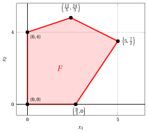

# La geometria della programmazione lineare

**Parte 4 · Metodi matriciali, sensitività e geometria · Capitolo 15** · [:material-file-pdf-box: Dispensa, volume 4 (PDF)](../pdf/dispensa-4-metodi-avanzati.pdf) · [:material-presentation: Slide](../pdf/slide-15-geometria.pdf) · [:material-pencil: Esercizi: La geometria della programmazione lineare](../esercizi/es-15-geometria.md)

## 15.1 La dimensione di un poliedro

- La regione ammissibile di un problema LP è un poliedro $F \subseteq \R^n$. Finora l'abbiamo descritta attraverso i suoi vincoli lineari; in questo documento ne descriviamo la struttura <strong>geometrica</strong>, e la mettiamo in relazione con le nozioni algebriche di base e di soluzione di base ammissibile.

!!! definizione "Definizione 15.1: inviluppo affine e dimensione"

    Dato un poliedro $F \subseteq \R^n$, il suo <strong>inviluppo affine</strong> $\mathrm{aff}(F)$ è il più piccolo sottospazio affine di $\R^n$ che contiene $F$. La <strong>dimensione</strong> di $F$, indicata con $\dim(F)$, è la dimensione di $\mathrm{aff}(F)$.

    In modo equivalente, $\dim(F) = k$ se e solo se $F$ contiene $k+1$ punti ${\boldsymbol x}^{(0)}, {\boldsymbol x}^{(1)}, \dots, {\boldsymbol x}^{(k)}$ tali che i $k$ vettori ${\boldsymbol x}^{(1)} - {\boldsymbol x}^{(0)}, \dots, {\boldsymbol x}^{(k)} - {\boldsymbol x}^{(0)}$ sono linearmente indipendenti, e non contiene $k+2$ punti con questa proprietà.

!!! definizione "Definizione 15.2: poliedro a dimensione piena"

    Un poliedro $F \subseteq \R^n$ si dice <strong>a dimensione piena</strong> se $\dim(F) = n$. Per convenzione, $\dim(\emptyset) = -1$, e un poliedro costituito da un solo punto ha dimensione $0$.

- La dimensione di un poliedro <u>non</u> è il numero di variabili: è il numero di direzioni indipendenti lungo le quali ci si può muovere all'interno del poliedro. Ogni vincolo di uguaglianza soddisfatto da tutti i punti di $F$, e <u>linearmente indipendente</u> dagli altri, ne riduce la dimensione di uno.

!!! chiave ""

    La regione ammissibile di un problema LP in <strong>forma standard di massimo</strong>,

    $$
    F = \left\{\, {\boldsymbol x} \in \R^{n} ~:~ {\boldsymbol A}\,{\boldsymbol x} = {\boldsymbol b}, ~ {\boldsymbol x} \ge {\boldsymbol 0} \,\right\} ,
    $$

    non è <u>mai</u> a dimensione piena quando $F \ne \emptyset$ e $\rank({\boldsymbol A}) \ge 1$: tutti i suoi punti soddisfano gli $m$ vincoli di uguaglianza, e quindi

    $$
    \dim(F) \; \le \; n - \rank({\boldsymbol A}) .
    $$

    La regione ammissibile di un problema LP in <strong>forma canonica di massimo</strong> è invece a dimensione piena ogni volta che contiene un punto che soddisfa tutti i vincoli in senso stretto.

!!! esempio "Esempio 15.1: dimensione di un poliedro"

    - La regione ammissibile del problema LP in forma canonica di massimo

        $$
        \begin{array}{rrrrrrrrrrrrr}
        {\max} & 5 \, {x_1} & {+} & 2 \, {x_2} \\[1ex]
        \text{soggetto a} & {-} \, {x_1} & {+} & 3 \, {x_2} & {\le} & 12 \\[1ex]
        & {x_1} & {+} & 2 \, {x_2} & {\le} & 12 \\[1ex]
        & {3} \, {x_1} & {-} & 2 \, {x_2} & {\le} & 8 \\[1ex]
        & {x_1,} &  & {x_2} & { \ge} & {0}
        \end{array}
        $$

        è <strong>a dimensione piena</strong>: $\dim(F) = 2$, perché per esempio il punto $\begin{pmatrix} 1 \\ 1 \end{pmatrix}$ soddisfa tutti e cinque i vincoli in senso stretto, e quindi un piccolo disco centrato in esso è contenuto in $F$.

    - La regione ammissibile del problema LP in forma standard di massimo

        $$
        F = \left\{~
        \begin{pmatrix} x_1 \\ x_2 \\ x_3 \end{pmatrix}
        \in \R^3 ~:~
        2x_1 + 3x_2 + x_3 = 4,~~ {\boldsymbol x} \ge {\boldsymbol 0}
        ~\right\}
        $$

        ha dimensione $\dim(F) = 2$, e quindi <u>non</u> è a dimensione piena: tutti i suoi punti giacciono sul piano $2x_1 + 3x_2 + x_3 = 4$. Qui $n = 3$, $\rank({\boldsymbol A}) = 1$ e infatti $\dim(F) = 2 = n - \rank({\boldsymbol A})$.

## 15.2 Facce, faccette e vertici

!!! definizione "Definizione 15.3: disuguaglianza valida"

    Una disuguaglianza lineare ${\boldsymbol a}' {\boldsymbol x} \le \beta$, con ${\boldsymbol a} \in \R^n$ e $\beta \in \R$, è <strong>valida</strong> per un poliedro $F \subseteq \R^n$ se è soddisfatta da tutti i suoi punti:

    $$
    {\boldsymbol a}' {\boldsymbol x} \le \beta, \qquad \forall {\boldsymbol x} \in F .
    $$

!!! definizione "Definizione 15.4: faccia"

    Dati un poliedro $F \subseteq \R^n$ e una disuguaglianza valida ${\boldsymbol a}' {\boldsymbol x} \le \beta$ per $F$, l'insieme

    $$
    G = \left\{\, {\boldsymbol x} \in F ~:~ {\boldsymbol a}' {\boldsymbol x} = \beta \,\right\}
    $$

    si chiama <strong>faccia</strong> di $F$. Una faccia è <strong>propria</strong> se $G \ne \emptyset$ e $G \ne F$.

- Una faccia di un poliedro si ottiene richiedendo che una disuguaglianza valida sia soddisfatta all'uguaglianza, ed è essa stessa un poliedro. Sia $F$ sia $\emptyset$ sono facce di $F$: la prima si ottiene con la disuguaglianza valida ${\boldsymbol 0}' {\boldsymbol x} \le 0$, la seconda con una qualsiasi disuguaglianza valida che non è mai soddisfatta all'uguaglianza.

- Ogni vincolo lineare $\sum_{j} a_{ij} x_j \le b_i$ del problema LP è una disuguaglianza valida per la sua regione ammissibile, e quindi definisce una faccia: l'insieme delle soluzioni ammissibili per cui il vincolo è <strong>attivo</strong>. Insieme alle condizioni degli scarti complementari, questo è il legame tra la geometria di $F$ e il problema duale.

!!! definizione "Definizione 15.5: faccetta e vertice"

    Dati un poliedro $F \subseteq \R^n$ e una faccia non vuota $G$ di $F$:

    1. $G$ è una <strong>faccetta</strong> di $F$ se $\dim(G) = \dim(F) - 1$;

    2. $G$ è un <strong>vertice</strong> di $F$ se $\dim(G) = 0$, cioè se $G$ è costituita da un solo punto.

    Una faccetta è sempre una faccia propria. Un vertice è una faccia propria, tranne quando $F$ stesso è costituito da un solo punto: in tal caso $G = F$ è l'unico vertice di $F$.

!!! chiave ""

    Le faccette sono le facce proprie <strong>più grandi</strong> e, quando il poliedro ha almeno un vertice (come la regione ammissibile di un problema LP con variabili non negative), i vertici sono le facce non vuote <strong>più piccole</strong>. Le faccette sono importanti perché sono esattamente i vincoli che non si possono eliminare: un poliedro a dimensione piena è descritto dalle sue disuguaglianze che definiscono faccette, e solo da quelle. I vertici sono importanti perché, come mostriamo più avanti, sono esattamente le soluzioni di base ammissibili.

!!! definizione "Definizione 15.6: punto estremo"

    Un punto ${\boldsymbol x} \in F$ è un <strong>punto estremo</strong> del poliedro $F$ se non si può scrivere come combinazione convessa di due punti <u>distinti</u> di $F$, cioè se non esistono ${\boldsymbol x}^{(1)}, {\boldsymbol x}^{(2)} \in F$ con ${\boldsymbol x}^{(1)} \ne {\boldsymbol x}^{(2)}$ e $\lambda \in (0,1)$ tali che

    $$
    {\boldsymbol x} = \lambda \, {\boldsymbol x}^{(1)} + (1-\lambda) \, {\boldsymbol x}^{(2)} .
    $$

!!! teorema "Teorema 15.7: vertici e punti estremi"

    Dati un poliedro $F \subseteq \R^n$ e un punto ${\boldsymbol x} \in F$, le due affermazioni seguenti sono equivalenti:

    1. $\{{\boldsymbol x}\}$ è un vertice di $F$;

    2. ${\boldsymbol x}$ è un punto estremo di $F$.

??? dimostrazione "Dimostrazione"

    $(1 \Rightarrow 2)$ Sia $\{{\boldsymbol x}\}$ la faccia definita dalla disuguaglianza valida ${\boldsymbol a}' {\boldsymbol y} \le \beta$, e supponiamo ${\boldsymbol x} = \lambda \, {\boldsymbol x}^{(1)} + (1-\lambda) \, {\boldsymbol x}^{(2)}$ con ${\boldsymbol x}^{(1)}, {\boldsymbol x}^{(2)} \in F$ e $\lambda \in (0,1)$. Allora

    $$
    \beta = {\boldsymbol a}' {\boldsymbol x}
    = \lambda \, \underbrace{{\boldsymbol a}' {\boldsymbol x}^{(1)}}_{\le \, \beta} + (1-\lambda) \, \underbrace{{\boldsymbol a}' {\boldsymbol x}^{(2)}}_{\le \, \beta} \; \le \; \beta ,
    $$

    e la disuguaglianza può valere con uguaglianza solo se ${\boldsymbol a}' {\boldsymbol x}^{(1)} = {\boldsymbol a}' {\boldsymbol x}^{(2)} = \beta$. Di conseguenza entrambi i punti appartengono alla faccia $\{{\boldsymbol x}\}$, e quindi ${\boldsymbol x}^{(1)} = {\boldsymbol x}^{(2)} = {\boldsymbol x}$: i due punti non sono distinti.

    $(2 \Rightarrow 1)$ Sia ${\boldsymbol x}$ un punto estremo e sia $I$ l'insieme degli indici dei vincoli di $F$ attivi in ${\boldsymbol x}$. Se le righe $\{{\boldsymbol a}_i\}_{i \in I}$ non generassero $\R^n$, esisterebbe una direzione ${\boldsymbol d} \ne {\boldsymbol 0}$ con ${\boldsymbol a}_i' {\boldsymbol d} = 0$ per ogni $i \in I$, e quindi, per $\varepsilon > 0$ abbastanza piccolo, entrambi i punti ${\boldsymbol x} \pm \varepsilon {\boldsymbol d}$ apparterrebbero a $F$, contraddicendo il fatto che ${\boldsymbol x}$ è un punto estremo, poiché ${\boldsymbol x}$ è il loro punto medio. Di conseguenza le righe attive generano $\R^n$, il sistema $\{{\boldsymbol a}_i' {\boldsymbol y} = b_i\}_{i \in I}$ ha ${\boldsymbol x}$ come unica soluzione, e la disuguaglianza valida ottenuta sommando i vincoli attivi definisce la faccia $\{{\boldsymbol x}\}$. □

!!! esempio "Esempio 15.2: facce, faccette e vertici"

    Consideriamo la regione ammissibile $F$ del primo problema LP dell'[Esempio 15.1](#box-3-ex-geo-dim). È a dimensione piena, $\dim(F) = 2$, e quindi:

    1. le sue <strong>faccette</strong> sono le sue facce di dimensione $1$, cioè i suoi cinque <u>spigoli</u>;

    2. i suoi <strong>vertici</strong> sono le sue facce di dimensione $0$, cioè i suoi cinque <u>punti d'angolo</u>.

    Ciascuno dei cinque vincoli lineari definisce una faccetta, e quindi sono tutti necessari per descrivere $F$:

    
<table>
    <tr>
    <th><strong>vincolo</strong></th>
    <th><strong>faccetta che definisce</strong></th>
    <th><strong>vertici che contiene</strong></th>
    </tr>
    <tr>
    <td>\(-x_1 + 3x_2 \le 12\)</td>
    <td>spigolo da \((0,4)\) a \(\left(\frac{12}{5},\frac{24}{5}\right)\)</td>
    <td>\(2\)</td>
    </tr>
    <tr>
    <td>\(x_1 + 2x_2 \le 12\)</td>
    <td>spigolo da \(\left(\frac{12}{5},\frac{24}{5}\right)\) a \(\left(5,\frac{7}{2}\right)\)</td>
    <td>\(2\)</td>
    </tr>
    <tr>
    <td>\(3x_1 - 2x_2 \le 8\)</td>
    <td>spigolo da \(\left(5,\frac{7}{2}\right)\) a \(\left(\frac{8}{3},0\right)\)</td>
    <td>\(2\)</td>
    </tr>
    <tr>
    <td>\(x_2 \ge 0\)</td>
    <td>spigolo da \(\left(\frac{8}{3},0\right)\) a \((0,0)\)</td>
    <td>\(2\)</td>
    </tr>
    <tr>
    <td>\(x_1 \ge 0\)</td>
    <td>spigolo da \((0,0)\) a \((0,4)\)</td>
    <td>\(2\)</td>
    </tr>
    </table>

    { .fig .cornice loading=lazy style="width:56%" }

    I cinque punti segnati in nero sono i vertici di $F$, e i cinque segmenti rossi che li uniscono sono le sue faccette.

## 15.3 Soluzioni di base ammissibili e vertici

- Colleghiamo ora la nozione geometrica di vertice alla nozione algebrica di soluzione di base ammissibile, che è quella usata dall'algoritmo del simplesso. Consideriamo un problema LP in forma standard di massimo con $n+m$ variabili non negative e $m$ vincoli lineari di uguaglianza, con $\rank({\boldsymbol A}) = m$.

!!! teorema "Teorema 15.8: soluzioni di base ammissibili e vertici"

    Dati un problema LP in forma standard di massimo e un punto $\bar{\boldsymbol x} \in F$, le due affermazioni seguenti sono equivalenti:

    1. $\bar{\boldsymbol x}$ è una <strong>soluzione di base ammissibile</strong>, cioè esiste una base ${\boldsymbol A}_{\pazocal{B}}$ tale che $\bar{\boldsymbol x}_{\pazocal{B}} = {\boldsymbol A}_{\pazocal{B}}^{-1} {\boldsymbol b} \ge {\boldsymbol 0}$ e $\bar{\boldsymbol x}_{\pazocal{N}} = {\boldsymbol 0}$;

    2. $\bar{\boldsymbol x}$ è un <strong>vertice</strong> di $F$.

- L'idea della dimostrazione è che le colonne associate alle componenti strettamente positive di $\bar{\boldsymbol x}$ sono linearmente indipendenti se e solo se $\bar{\boldsymbol x}$ non si può spostare in due direzioni opposte restando in $F$.

??? dimostrazione "Dimostrazione"

    Sia $P = \{\, j ~:~ \bar x_j > 0 \,\}$.

    $(1 \Rightarrow 2)$ Sia $\bar{\boldsymbol x}$ una soluzione di base ammissibile con base $\pazocal{B}$. Allora $P \subseteq \pazocal{B}$, e quindi le colonne $\{{\boldsymbol A}_j\}_{j \in P}$ sono linearmente indipendenti, essendo un sottoinsieme delle colonne della matrice invertibile ${\boldsymbol A}_{\pazocal{B}}$. Supponiamo $\bar{\boldsymbol x} = \lambda \, {\boldsymbol x}^{(1)} + (1-\lambda) \, {\boldsymbol x}^{(2)}$ con ${\boldsymbol x}^{(1)}, {\boldsymbol x}^{(2)} \in F$ e $\lambda \in (0,1)$. Per ogni $j \notin P$ abbiamo $\bar x_j = 0$ e, poiché entrambi i punti sono non negativi, $x^{(1)}_j = x^{(2)}_j = 0$. Posto ${\boldsymbol d} = {\boldsymbol x}^{(1)} - {\boldsymbol x}^{(2)}$, otteniamo $d_j = 0$ per ogni $j \notin P$ e

    $$
    {\boldsymbol A} \, {\boldsymbol d} = {\boldsymbol A}{\boldsymbol x}^{(1)} - {\boldsymbol A}{\boldsymbol x}^{(2)} = {\boldsymbol b} - {\boldsymbol b} = {\boldsymbol 0}
    \qquad \Longrightarrow \qquad
    \sum_{j \in P} d_j \, {\boldsymbol A}_j = {\boldsymbol 0} .
    $$

    Per l'indipendenza lineare di $\{{\boldsymbol A}_j\}_{j \in P}$ otteniamo ${\boldsymbol d} = {\boldsymbol 0}$, cioè ${\boldsymbol x}^{(1)} = {\boldsymbol x}^{(2)}$. Di conseguenza $\bar{\boldsymbol x}$ è un punto estremo e, per il [Teorema 15.7](#box-8-theo-vertex-extreme), un vertice di $F$.

    $(2 \Rightarrow 1)$ Sia $\bar{\boldsymbol x}$ un vertice di $F$ e supponiamo, per assurdo, che le colonne $\{{\boldsymbol A}_j\}_{j \in P}$ siano linearmente dipendenti: esiste ${\boldsymbol d} \ne {\boldsymbol 0}$ con $d_j = 0$ per ogni $j \notin P$ e $\sum_{j \in P} d_j {\boldsymbol A}_j = {\boldsymbol 0}$. Poiché $\bar x_j > 0$ per ogni $j \in P$, per $\varepsilon > 0$ abbastanza piccolo entrambi i punti $\bar{\boldsymbol x} \pm \varepsilon \, {\boldsymbol d}$ sono non negativi, e soddisfano ${\boldsymbol A}(\bar{\boldsymbol x} \pm \varepsilon {\boldsymbol d}) = {\boldsymbol b}$: appartengono a $F$. Ma $\bar{\boldsymbol x}$ è il loro punto medio, il che contraddice il [Teorema 15.7](#box-8-theo-vertex-extreme). Di conseguenza le colonne $\{{\boldsymbol A}_j\}_{j \in P}$ sono linearmente indipendenti; poiché $\rank({\boldsymbol A}) = m$, si possono completare a $m$ colonne linearmente indipendenti, i cui indici formano una base $\pazocal{B} \supseteq P$. Rispetto a essa, $\bar{\boldsymbol x}_{\pazocal{N}} = {\boldsymbol 0}$ e $\bar{\boldsymbol x}_{\pazocal{B}} = {\boldsymbol A}_{\pazocal{B}}^{-1} {\boldsymbol b} \ge {\boldsymbol 0}$: $\bar{\boldsymbol x}$ è una soluzione di base ammissibile. □

!!! chiave ""

    La corrispondenza tra basi e vertici è <strong>suriettiva</strong> ma non necessariamente <strong>biunivoca</strong>: ogni soluzione di base ammissibile è un vertice, ma lo stesso vertice può essere associato a più basi diverse. Ciò accade <u>solo se</u> il vertice è <strong>degenere</strong>, cioè se qualche variabile in base assume il valore $0$: un vertice non degenere è associato a esattamente una base, formata dagli indici delle sue componenti strettamente positive, mentre un vertice degenere è di solito, ma non sempre, associato a più basi.

!!! esempio "Esempio 15.3: basi e vertici"

    Consideriamo il primo problema LP dell'[Esempio 15.1](#box-3-ex-geo-dim) in forma standard di massimo, con $n+m=5$ variabili non negative e $m=3$ vincoli lineari di uguaglianza. Una base è un sottoinsieme di $3$ indici su $5$, e ci sono $\binom{5}{3} = 10$ sottoinsiemi di questo tipo. Tutti danno una matrice invertibile ${\boldsymbol A}_{\pazocal{B}}$, e quindi sono tutti basi:

    
<table>
    <tr>
    <th>\(\pazocal{B}\)</th>
    <th>\({\boldsymbol x}_{\pazocal{B}} = {\boldsymbol A}_{\pazocal{B}}^{-1} {\boldsymbol b}\)</th>
    <th>ammissibile</th>
    <th>vertice \((x_1,x_2)\)</th>
    </tr>
    <tr>
    <td>\(\{1,2,3\}\)</td>
    <td>\(\left(5,~\frac{7}{2},~\frac{13}{2}\right)\)</td>
    <td>✓</td>
    <td>\(\left(5,\frac{7}{2}\right)\)</td>
    </tr>
    <tr>
    <td>\(\{1,2,4\}\)</td>
    <td>\(\left(\frac{48}{7},~\frac{44}{7},~-\frac{52}{7}\right)\)</td>
    <td></td>
    <td></td>
    </tr>
    <tr>
    <td>\(\{1,2,5\}\)</td>
    <td>\(\left(\frac{12}{5},~\frac{24}{5},~\frac{52}{5}\right)\)</td>
    <td>✓</td>
    <td>\(\left(\frac{12}{5},\frac{24}{5}\right)\)</td>
    </tr>
    <tr>
    <td>\(\{1,3,4\}\)</td>
    <td>\(\left(\frac{8}{3},~\frac{44}{3},~\frac{28}{3}\right)\)</td>
    <td>✓</td>
    <td>\(\left(\frac{8}{3},0\right)\)</td>
    </tr>
    <tr>
    <td>\(\{1,3,5\}\)</td>
    <td>\((12,~24,~-28)\)</td>
    <td></td>
    <td></td>
    </tr>
    <tr>
    <td>\(\{1,4,5\}\)</td>
    <td>\((-12,~24,~44)\)</td>
    <td></td>
    <td></td>
    </tr>
    <tr>
    <td>\(\{2,3,4\}\)</td>
    <td>\((-4,~24,~20)\)</td>
    <td></td>
    <td></td>
    </tr>
    <tr>
    <td>\(\{2,3,5\}\)</td>
    <td>\((6,~-6,~20)\)</td>
    <td></td>
    <td></td>
    </tr>
    <tr>
    <td>\(\{2,4,5\}\)</td>
    <td>\((4,~4,~16)\)</td>
    <td>✓</td>
    <td>\((0,4)\)</td>
    </tr>
    <tr>
    <td>\(\{3,4,5\}\)</td>
    <td>\((12,~12,~8)\)</td>
    <td>✓</td>
    <td>\((0,0)\)</td>
    </tr>
    </table>

    Esattamente $5$ delle $10$ basi sono ammissibili, e corrispondono ai $5$ vertici di $F$ determinati nell'esempio precedente. In questo problema LP la corrispondenza è <strong>biunivoca</strong>, poiché nessuna soluzione di base ammissibile è degenere: in ogni riga ammissibile della tabella tutte e tre le variabili in base sono strettamente positive.

!!! esempio "Esempio 15.4: un vertice degenere"

    Consideriamo invece il seguente problema LP in forma canonica di massimo, la cui regione ammissibile è costituita da un solo punto:

    $$
    \begin{array}{rrrrrrrrrrrrr}
    {\max} & \, {x_1} & {+} & {2} \, {x_2} \\[1ex]
    \text{soggetto a} & \, {x_1} & {+} & \, {x_2} & {\le} & {2} \\[1ex]
    & {-} \, {x_1} & {-} & \, {x_2} & {\le} & {-2} \\[1ex]
    & \, {x_1} & {-} & \, {x_2} & {\le} & {0} \\[1ex]
    & {-} \, {x_1} & {+} & \, {x_2} & {\le} & {0} \\[1ex]
    & {x_1,} &  & {x_2} & { \ge} & {0}
    \end{array}
    $$

    I primi due vincoli impongono $x_1 + x_2 = 2$ e gli ultimi due impongono $x_1 = x_2$, quindi

    $$
    F = \left\{ \begin{pmatrix} 1 \\ 1 \end{pmatrix} \right\} ,
    \qquad \dim(F) = 0 .
    $$

    In forma standard di massimo il problema ha $6$ variabili e $4$ vincoli, e l'unico vertice $\begin{pmatrix} 1 \\ 1 \end{pmatrix}$ è associato a <strong>quattro</strong> basi diverse,

    $$
    \{1,2,3,5\}, \qquad \{1,2,3,6\}, \qquad \{1,2,4,5\}, \qquad \{1,2,4,6\} ,
    $$

    in ciascuna delle quali due variabili in base assumono il valore $0$. Questo vertice è quindi <strong>degenere</strong>, e la corrispondenza tra basi e vertici non è biunivoca.

    { .fig .cornice loading=lazy style="width:44%" }

## 15.4 Il Teorema Fondamentale, in chiave geometrica

- Il Teorema Fondamentale della programmazione lineare afferma che, ogni volta che un problema LP ammette una soluzione ottima, ammette una soluzione <u>di base</u> ammissibile che è ottima. Per il [Teorema 15.8](#box-10-theo-bfs-vertex), questo enunciato ha un'immediata lettura geometrica.

!!! teorema "Corollario 15.9: vertici ottimi"

    Se un problema LP ammette una soluzione ottima, allora almeno un <strong>vertice</strong> della sua regione ammissibile è una soluzione ottima.

!!! chiave ""

    Questo è il risultato che giustifica il <strong>metodo grafico</strong>: per risolvere un problema LP con due variabili è sufficiente calcolare il valore obiettivo in ciascun vertice della regione ammissibile e tenere il migliore. È anche il risultato che rende possibile l'algoritmo del simplesso: la ricerca di una soluzione ottima, che a priori è una ricerca fra infiniti punti, diventa una ricerca fra i <u>finiti</u> vertici.

- L'insieme delle soluzioni ottime di un problema LP è esso stesso una <strong>faccia</strong> della regione ammissibile: è la faccia definita dalla disuguaglianza valida ${\boldsymbol c}' {\boldsymbol x} \le z(\, LP \,)$. Di conseguenza:

    1. se tale faccia è un vertice, la soluzione ottima è unica;

    2. se tale faccia ha dimensione $1$ o più, il problema LP ammette infinite soluzioni ottime, e fra di esse almeno un vertice.

- Un vertice è una soluzione ottima se e solo se nessuno spigolo che parte da esso, limitato o illimitato, migliora la funzione obiettivo. Il <strong>test di ottimalità</strong> dell'algoritmo del simplesso si basa su questa proprietà: le variabili fuori base corrispondono alle direzioni che escono dal vertice, e il loro effetto sulla funzione obiettivo è misurato dai costi ridotti. Il test è una condizione <u>sufficiente</u> per l'ottimalità ma, in un vertice degenere, non necessaria: un vertice degenere può essere ottimo anche se qualche costo ridotto è positivo, poiché la direzione corrispondente può uscire immediatamente da $F$.

!!! definizione "Definizione 15.10: vertici adiacenti"

    Due vertici di un poliedro si dicono <strong>adiacenti</strong> se il segmento che li congiunge è una faccia, cioè uno spigolo.

!!! chiave ""

    In termini di basi, due soluzioni di base ammissibili <u>non degeneri</u> sono adiacenti se e solo se le loro basi differiscono per esattamente un indice.

    Un'<strong>operazione di pivot</strong> dell'algoritmo del simplesso sostituisce un indice della base con un altro. Se è non degenere, ci si sposta da un vertice a uno <strong>adiacente</strong>, lungo uno spigolo della regione ammissibile, aumentando strettamente il valore obiettivo; se è degenere ($t_m = 0$), cambia la base ma resta nello stesso vertice. L'algoritmo del simplesso è, geometricamente, un cammino sugli spigoli del poliedro.

!!! esempio "Esempio 15.5: l'algoritmo del simplesso come cammino sugli spigoli"

    L'esecuzione dell'algoritmo del simplesso sul primo problema LP dell'[Esempio 15.1](#box-3-ex-geo-dim), partendo dalla base $\pazocal{B}= \{3,4,5\}$, visita i seguenti vertici:

    $$
    (0,0) ~ \longrightarrow ~ \left(\frac{8}{3},0\right) ~ \longrightarrow ~ \left(5,\frac{7}{2}\right) ,
    $$

    con valori obiettivo $0$, $\frac{40}{3}$ e $32$. Ogni passo si muove lungo uno spigolo di $F$, verso un vertice adiacente, e il valore obiettivo aumenta strettamente. Nella figura, in viola i due vertici visitati prima dell'ultimo, in blu il vertice ottimo.

    { .fig .cornice loading=lazy style="width:56%" }

## 15.5 Riepilogo

!!! chiave ""

    
<table>
    <tr>
    <th><strong>nozione geometrica</strong></th>
    <th><strong>corrispondente algebrico</strong></th>
    </tr>
    <tr>
    <td>poliedro \(F\)</td>
    <td>regione ammissibile del problema LP</td>
    </tr>
    <tr>
    <td>\(\dim(F)\)</td>
    <td>\(n\) meno le uguaglianze indipendenti valide in \(F\)</td>
    </tr>
    <tr>
    <td>faccia</td>
    <td>soluzioni in cui una disuguaglianza valida è attiva</td>
    </tr>
    <tr>
    <td>faccetta</td>
    <td>un vincolo che non si può eliminare</td>
    </tr>
    <tr>
    <td>vertice \(=\) punto estremo</td>
    <td>soluzione di base ammissibile</td>
    </tr>
    <tr>
    <td>vertice degenere</td>
    <td>più basi, un solo punto</td>
    </tr>
    <tr>
    <td>spigolo tra due vertici</td>
    <td>operazione di pivot</td>
    </tr>
    <tr>
    <td>faccia ottima</td>
    <td>insieme delle soluzioni ottime</td>
    </tr>
    </table>

- Il numero di vertici di un poliedro può essere <strong>esponenziale</strong> nel numero dei suoi vincoli e variabili: per un problema LP in forma standard di massimo è limitato da $\binom{n+m}{m}$. Per questo l'algoritmo del simplesso, che visita un vertice alla volta, non si può dimostrare efficiente semplicemente contando i vertici, e perché il suo comportamento pratico è molto migliore del suo caso peggiore.

---

**Esercizi su questo capitolo:** [:material-pencil: La geometria della programmazione lineare](../esercizi/es-15-geometria.md)
