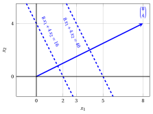
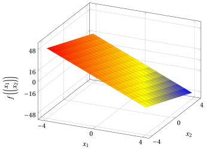

# Funzioni lineari

**Parte 1 · Funzioni lineari, poliedri e problemi di programmazione lineare · Capitolo 1** · [:material-file-pdf-box: Dispensa, volume 1 (PDF)](../pdf/dispensa-1-problemi-di-programmazione-lineare.pdf) · [:material-presentation: Slide](../pdf/slide-01-funzioni-lineari.pdf) · [:material-gesture-tap: App: Rette di livello](../laboratorio/rette-di-livello.md)

## 1.1 Funzioni lineari

!!! definizione "Definizione 1.1: funzione lineare"

    Dato un vettore (colonna)

    $$
    \underbrace{
    \begin{pmatrix}
    c_1 \\
    c_2 \\
    \vdots \\
    c_n
    \end{pmatrix}}_{ {\boldsymbol c}} \in \mathbb{R}^{n}
    $$

    la funzione (scalare) associata

    \begin{align*}
    f: \mathbb{R}^{n} \rightarrow \mathbb{R}, ~~~  f:\underbrace{\begin{pmatrix}
    x_1 \\
    x_2 \\
    \vdots \\
    x_n
    \end{pmatrix}}_{{\boldsymbol x}} \mapsto \underbrace{\sum_{j=1}^n c_j x_j}_{{\boldsymbol c}' {\boldsymbol x}} \tag{1.1}
    \end{align*}

    si dice <strong>funzione lineare</strong>.

!!! definizione "Definizione 1.2: gradiente di una funzione lineare"

    Il <strong>gradiente</strong> (vettore delle derivate parziali) della funzione lineare $f({\boldsymbol x}) = {\boldsymbol c}'{\boldsymbol x}$ è:

    \begin{align*}
    \nabla f({\boldsymbol x}) &=
    \begin{pmatrix}
    \frac{ \partial f({\boldsymbol x})}{ \partial x_1} \\[1ex] \frac{ \partial f({\boldsymbol x})}{ \partial x_2} \\[1ex] \vdots \\[1ex]
    \frac{ \partial f({\boldsymbol x})}{ \partial x_n}
    \end{pmatrix}
    =
    \underbrace{\begin{pmatrix}
    c_1 \\[1ex]
    c_2 \\[1ex]
    \vdots \\[1ex]
    c_n
    \end{pmatrix}}_{ {\boldsymbol c}}
    \end{align*}

!!! definizione "Definizione 1.3: matrice Hessiana di una funzione lineare"

    La <strong>matrice Hessiana</strong> (matrice delle derivate parziali seconde) della funzione lineare $f({\boldsymbol x}) = {\boldsymbol c}'{\boldsymbol x}$ è la matrice $n \times n$:

    \begin{align*}
    \nabla^2 f({\boldsymbol x}) =
    \begin{pmatrix}
    \frac{\partial^2 f({\boldsymbol x})}{\partial x_1 \partial x_1} & \frac{\partial^2 f({\boldsymbol x})}{\partial x_1 \partial x_2} & \cdots & \frac{\partial^2 f({\boldsymbol x})}{\partial x_1 \partial x_n} \\[1.5ex]
    \frac{\partial^2 f({\boldsymbol x})}{\partial x_2 \partial x_1} & \frac{\partial^2 f({\boldsymbol x})}{\partial x_2 \partial x_2} & \cdots & \frac{\partial^2 f({\boldsymbol x})}{\partial x_2 \partial x_n} \\[1.5ex]
    \vdots & \vdots & \ddots & \vdots \\[1.5ex]
    \frac{\partial^2 f({\boldsymbol x})}{\partial x_n \partial x_1} & \frac{\partial^2 f({\boldsymbol x})}{\partial x_n \partial x_2} & \cdots & \frac{\partial^2 f({\boldsymbol x})}{\partial x_n \partial x_n}
    \end{pmatrix}
    =
    \begin{pmatrix}
    0 & 0 & \cdots & 0 \\[1ex]
    0 & 0 & \cdots & 0 \\[1ex]
    \vdots & \vdots & \ddots & \vdots \\[1ex]
    0 & 0 & \cdots & 0
    \end{pmatrix}
    \end{align*}

    poiché ogni derivata parziale prima $\frac{\partial f({\boldsymbol x})}{\partial x_j} = c_j$ è una costante.

!!! definizione "Definizione 1.4: insiemi di livello di una funzione lineare"

    Gli <strong>insiemi di livello</strong> della funzione lineare $f({\boldsymbol x}) = {\boldsymbol c}'{\boldsymbol x}$ (gli insiemi di punti in cui la funzione è <strong>costante</strong>) sono:

    \begin{align*}
    \left\{~~{\boldsymbol x} \in \R^{n}:~~ {\boldsymbol c}' \; {\boldsymbol x}= k  ~~\right\} , \qquad \forall k \in \mathbb{R}
    \end{align*}

!!! chiave ""

    - Il gradiente di una funzione lineare è lo stesso vettore ${\boldsymbol c}$ in ogni punto e, di conseguenza, la sua <strong>matrice Hessiana</strong> (matrice delle derivate parziali seconde) è ovunque la matrice nulla.

    - Gli insiemi di livello di una funzione lineare sono gli <strong>iperpiani</strong> perpendicolari al gradiente.

!!! esempio "Esempio 1.1: gradiente e insiemi di livello di funzioni lineari"

    Con ${\boldsymbol c}=\begin{pmatrix} 8\\ 4 \end{pmatrix}$, la funzione lineare associata è:

    $$
    f: \mathbb{R}^{2} \rightarrow \mathbb{R},~~ f: \begin{pmatrix}
    x_1 \\
    x_2 \\
    \end{pmatrix} \mapsto \begin{pmatrix}
    8 &  4 \\
    \end{pmatrix}
    \;
    \begin{pmatrix}
    x_{1} \\
    x_{2} \\
    \end{pmatrix}= 8\:x_1 + 4\: \, x_2
    $$

    <strong>Gradiente:</strong>

    $$
    \nabla f\left(\begin{pmatrix}
    x_1 \\
    x_2 \\
    \end{pmatrix}\right) =
    \begin{pmatrix}
    8 \\[0.5ex] 4
    \end{pmatrix}
    $$

    { .fig .ovale loading=lazy style="width:65%" }

    La figura mostra:

    - Il gradiente calcolato in $\begin{pmatrix} 0 \\ 0 \end{pmatrix}$: $\nabla f\left(\begin{pmatrix} 0 \\ 0 \end{pmatrix}\right) =\begin{pmatrix} 8 \\[0.5ex] 4 \end{pmatrix}$ (freccia blu)

    - Due insiemi di livello (linee blu tratteggiate): $8 x_1 +4 x_2 = 16$ e $8 x_1 +4 x_2 = 40$

!!! esempio "Esempio 1.2: gradiente e insiemi di livello di funzioni lineari"

    Con ${\boldsymbol c}=\begin{pmatrix} -8\\ -4 \end{pmatrix}$, la funzione lineare associata è:

    $$
    f: \mathbb{R}^{2} \rightarrow \mathbb{R},~~ f: \begin{pmatrix}
    x_1 \\
    x_2 \\
    \end{pmatrix} \mapsto \begin{pmatrix}
    -8 &  -4 \\
    \end{pmatrix}
    \;
    \begin{pmatrix}
    x_{1} \\
    x_{2} \\
    \end{pmatrix}= -8\:x_1 - 4\: \, x_2
    $$

    <strong>Gradiente:</strong>

    $$
    \nabla f\left(\begin{pmatrix}
    x_1 \\
    x_2 \\
    \end{pmatrix}\right) =
    \begin{pmatrix}
    -8 \\[0.5ex] -4
    \end{pmatrix}
    $$

    { .fig .ovale loading=lazy style="width:65%" }

    La figura mostra:

    - Il gradiente calcolato in $\begin{pmatrix} 0 \\ 0 \end{pmatrix}$: $\nabla f\left(\begin{pmatrix} 0 \\ 0 \end{pmatrix}\right) =\begin{pmatrix} -8 \\[0.5ex] -4 \end{pmatrix}$ (freccia blu)

    - Due insiemi di livello (linee blu tratteggiate): $-8 x_1 -4 x_2 = 16$ e $-8 x_1 -4 x_2 = 40$

!!! esempio "Esempio 1.3: grafici di funzioni lineari"

    Con ${\boldsymbol c}=\begin{pmatrix} 8\\  4 \end{pmatrix}$, abbiamo $f\left(\begin{pmatrix} x_1 \\ x_2 \\ \end{pmatrix}\right)=8\;x_1 + 4\;x_2$. Il suo grafico è:

    { .fig .ovale loading=lazy style="width:59%" }

!!! esempio "Esempio 1.4: grafici di funzioni lineari"

    Con ${\boldsymbol c}=\begin{pmatrix} -8\\ -4 \end{pmatrix}$, abbiamo $f\left(\begin{pmatrix} x_1 \\ x_2 \\ \end{pmatrix}\right)=-8\;x_1- 4\;x_2$. Il suo grafico è:

    { .fig .ovale loading=lazy style="width:59%" }

<!-- laboratorio-interattivo: sezione generata da interattivi.py -->

## Laboratorio interattivo { #laboratorio-interattivo }

Le idee del capitolo, da toccare con mano: muovi i cursori e trascina i punti.
Ogni app si apre anche a tutta pagina nel [laboratorio interattivo](../laboratorio/index.md): [Rette di livello](../laboratorio/rette-di-livello.md).

