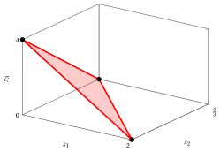

# Semispazi e poliedri

**Parte 1 · Funzioni lineari, poliedri e problemi di programmazione lineare · Capitolo 2** · [:material-file-pdf-box: Dispensa, volume 1 (PDF)](../pdf/dispensa-1-problemi-di-programmazione-lineare.pdf) · [:material-pencil: Esercizi](../esercizi/es-02-poliedri.md)

## 2.1 Semispazi e iperpiani di supporto

!!! definizione "Definizione 2.1: semispazio"

    Dato un vettore (riga)

    $$
    \underbrace{
    \begin{pmatrix}
    a_{1} & a_{2} & \dots &
    a_{n} \\
    \end{pmatrix}}_{{\boldsymbol a}} \in \R^{1 \times n}
    $$

    e uno scalare $b \in \R$, l'insieme

    $$
    \left\{~~ \underbrace{\begin{pmatrix}
    x_{1} \\
    x_{2} \\
    \vdots  \\
    x_{n} \\
    \end{pmatrix}}_{{\boldsymbol x}} \in \R^n:~~~  \underbrace{\sum_{j=1}^n a_j \; x_j \le b}_{ {\boldsymbol a} \: {\boldsymbol x} \le b} ~~\right\}
    $$

    si chiama <strong>semispazio</strong>.

- Dato un semispazio, l'insieme

    $$
    \left\{~~ \underbrace{\begin{pmatrix}
    x_{1} \\
    x_{2} \\
    \vdots  \\
    x_{n} \\
    \end{pmatrix}}_{{\boldsymbol x}} \in \R^n:~~~  \underbrace{\sum_{j=1}^n a_j \; x_j = b}_{{\boldsymbol a} \: {\boldsymbol x} = b} ~~\right\}
    $$

    si chiama <strong>iperpiano di supporto</strong> del semispazio.

!!! esempio "Esempio 2.1: semispazio e iperpiano di supporto"

    Consideriamo il seguente semispazio in $\R^2$:

    $$
    \left\{~~
    \begin{pmatrix} x_1 \\ x_2 \end{pmatrix} \in \R^2 :~~ -3 \; x_1 + 2 \; x_2 \le 4 ~~\right\} \text{   dove   }
    {\boldsymbol a}=
    \begin{pmatrix}
    -3 &  2 \\
    \end{pmatrix}
    ~~{\rm e}~~
    b=4
    $$

    { .fig .ovale loading=lazy style="width:50%" }

    Consideriamo il seguente semispazio in $\R^2$:

    $$
    \left\{~~
    \begin{pmatrix} x_1 \\ x_2 \end{pmatrix} \in \R^2 :~~ 50x_1 + 31 \; x_2 \le 250 ~~\right\} \text{   dove   }
    {\boldsymbol a}=
    \begin{pmatrix}
    -3 &  2 \\
    \end{pmatrix}
    ~~{\rm e}~~
    b=250
    $$

    { .fig .ovale loading=lazy style="width:50%" }

## 2.2 Poliedri

!!! definizione "Definizione 2.2: poliedro"

    Data una matrice

    $$
    \underbrace{
    \begin{pmatrix}
    a_{11} & a_{12} & \dots & a_{1n}\\
    a_{21} & a_{22} & \dots & a_{2n}\\
    \vdots  & \vdots  & \ddots & \vdots \\
    a_{m1} & a_{n2} & \dots & a_{mn}\\
    \end{pmatrix}}_{{\boldsymbol A}} \in \R^{m \times n}
    $$

    e un vettore (colonna)

    $$
    \underbrace{\begin{pmatrix}
    b_{1} \\
    b_{2} \\
    \vdots  \\
    b_{m} \\
    \end{pmatrix}}_{{\boldsymbol b}} \in \R^{m}
    $$

    l'insieme

    $$
    \left\{ \underbrace{\begin{pmatrix}
    x_{1} \\
    x_{2} \\
    \vdots  \\
    x_{n} \\
    \end{pmatrix}}_{{\boldsymbol x}} \in \R^n: ~~~ \underbrace{\sum_{j=1}^n a_{ij} \; x_j\le b_i,~~~\forall i \in \{1,2,\dots,m\}}_{{\boldsymbol A} \; {\boldsymbol x} \le {\boldsymbol b}} ~~\right\}
    $$

    si chiama <strong>poliedro</strong>.

!!! definizione "Definizione 2.3: poliedro limitato"

    Un poliedro $P \subseteq \R^n$ è <strong>limitato</strong> se esiste $\underbrace{\begin{pmatrix} \beta_1 \\ \beta_2 \\ \vdots \\ \beta_n \end{pmatrix}}_{={\boldsymbol \beta}} \in \R^n_{\ge 0}$ tale che

    \begin{equation*}
    \underbrace{-\beta_j \le x_j \le \beta_j}_{|x_j| \le \beta_j},
    \qquad \forall {\boldsymbol x} \in P,~ \forall j \in \{1,2,\dots,n\}. \tag{2.1}
    \end{equation*}

    Qui, $\beta_j$ è un <strong>upper bound</strong>, mentre $-\beta_j$ è un <strong>lower bound</strong> di $P$ lungo la dimensione $j \in \{1,2,\dots,n\}$.

!!! definizione "Definizione 2.4: politopo"

    Un poliedro limitato si chiama <strong>politopo</strong>.

!!! esempio "Esempio 2.2: poliedro"

    Consideriamo il seguente poliedro definito come intersezione di quattro semispazi:

    $$
    P = \left\{~~
    \begin{pmatrix} x_1 \\[0.3ex] x_2 \end{pmatrix} \in \R^2 :~~
    -\,x_1 - x_2 \le -3,~~~
    x_1 + x_2 \le 9,~~~
    -\,x_1 + x_2 \le 3,~~~
    x_1 - x_2 \le 3
    ~~\right\}
    $$

    Ad esempio, consideriamo due punti, $\begin{pmatrix} 3 \\[0.3ex] 5 \end{pmatrix}$ and $\begin{pmatrix} 5 \\[0.3ex] 3 \end{pmatrix}$, nell'insieme $P$. Tutti i punti del segmento blu in figura, dati da:

    $$
    \lambda \begin{pmatrix} 3 \\[0.3ex] 5 \end{pmatrix} + (1-\lambda) \begin{pmatrix} 5 \\[0.3ex] 3 \end{pmatrix}
    = \begin{pmatrix} 5-2\lambda \\[0.3ex] 3+2\lambda \end{pmatrix}
    \quad \text{per} \quad \lambda \in [0,1],
    $$

    appartengono anch'essi a $P$. Infatti, per ogni $\lambda \in [0,1]$ abbiamo $x_1 + x_2 = 8$ e $x_1 - x_2 = 2 - 4\lambda \in [-2,2]$, quindi tutte e quattro le disuguaglianze che definiscono $P$ sono soddisfatte.

    { .fig .ovale loading=lazy style="width:57%" }

    Ad esempio, con $\lambda = \tfrac{1}{2}$, il punto del segmento è quello mostrato in blu

    $$
    \begin{pmatrix}
    \tfrac{1}{2}\,3 + \!\left(1-\tfrac{1}{2}\right)\!5 \\[1ex]
    \tfrac{1}{2}\,5 + \!\left(1-\tfrac{1}{2}\right)\!3
    \end{pmatrix}
    =
    \begin{pmatrix}
    4 \\[0.3ex]
    4
    \end{pmatrix}
    $$

    Questo poliedro $P$ è anche un politopo, poiché è un poliedro limitato in $\R^2$. Infatti, ponendo ${\boldsymbol \beta} = \begin{pmatrix} 6 \\[0.5ex] 6 \end{pmatrix}$ abbiamo

    $$
    |x_1| \le 6 ~~{\rm e}~~ |x_2| \le 6 ~~\text{per ogni}~~
    \begin{pmatrix} x_1 \\[0.3ex] x_2 \end{pmatrix} \in P
    $$

- Osserviamo che se un poliedro contiene i seguenti due semispazi:

    $$
    \left\{ {\boldsymbol x} \in \R^n:~~  {\boldsymbol a} \; {\boldsymbol x} \le b \right\}~~~~{\rm e}~~~~~ \left\{ {\boldsymbol x} \in \R^n:~~  {\boldsymbol a} \; {\boldsymbol x} \ge  b \right\}
    $$

    contiene, <em>de facto</em>, il seguente iperpiano:

    $$
    \left\{ {\boldsymbol x} \in \R^n:~~  {\boldsymbol a} \; {\boldsymbol x} =  b \right\}
    $$

!!! chiave ""

    In generale, un poliedro è dato dall'intersezione di semispazi e iperpiani.

!!! esempio "Esempio 2.3: poliedro"

    Consideriamo il seguente poliedro dato dall'intersezione di tre semispazi e un iperpiano:

    $$
    P = \left\{~~
    \begin{pmatrix}
    x_1 \\[0.3ex]
    x_2 \\[0.3ex]
    x_3
    \end{pmatrix}
    \in \mathbb{R}^3 :~
    ~x_1 \ge 0,~~
    x_2 \ge 0,~~
    x_3 \ge 0,~~
    2x_1 + 3x_2 + x_3 = 4
    ~~\right\}
    $$

    La sua rappresentazione tridimensionale corrisponde all'iperpiano mostrato in figura.

    { .fig .ovale loading=lazy style="width:47%" }

<!-- laboratorio-interattivo: sezione generata da interattivi.py -->

## Laboratorio interattivo { #laboratorio-interattivo }

Le idee del capitolo, da toccare con mano: muovi i cursori e trascina i punti.
Tutti i grafici del corso sono nel [laboratorio interattivo](../laboratorio/index.md#cap-2).

