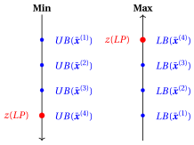
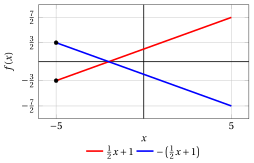
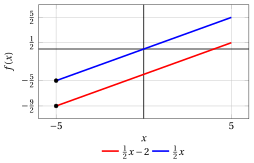
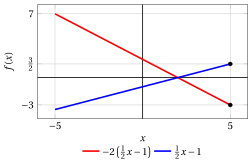

# Problemi di ottimizzazione lineare

**Parte 1 · Funzioni lineari, poliedri e problemi di programmazione lineare · Capitolo 3** · [:material-file-pdf-box: Dispensa, volume 1 (PDF)](../pdf/dispensa-1-problemi-di-programmazione-lineare.pdf) · [:material-pencil: Esercizi: Problemi di ottimizzazione lineare](../esercizi/es-03-problemi-ottimizzazione-lineare.md)

## 3.1 Problemi di programmazione lineare

!!! definizione "Definizione 3.1: Problema di programmazione lineare in forma di minimo e di massimo"

    Dati un poliedro $F \subseteq \R^n$ e una funzione lineare $f : \R^n \to \R$, il <strong>problema di programmazione lineare</strong> $LP$ associato consiste nel,

    - in <strong>forma di minimo</strong>, trovare un punto $\tilde{\boldsymbol{x}}(LP) \in F$ tale che

        $$
        f(\tilde{\boldsymbol{x}}(LP)) \le f(\boldsymbol{x}), \qquad \forall \boldsymbol{x} \in F;
        $$

    - in <strong>forma di massimo</strong>, trovare un punto $\tilde{\boldsymbol{x}}(LP) \in F$ tale che

        $$
        f(\tilde{\boldsymbol{x}}(LP)) \ge f(\boldsymbol{x}), \qquad \forall \boldsymbol{x} \in F.
        $$

### 3.1.1 Regione ammissibile e funzione obiettivo

- Il poliedro $F$ si chiama <strong>regione ammissibile</strong> del problema LP; i suoi punti $\boldsymbol{x} \in F$ si chiamano <strong>soluzioni ammissibili</strong> del problema LP.

- La funzione lineare $f$ è la <strong>funzione obiettivo</strong> del problema LP; essa associa un valore obiettivo a ogni soluzione ammissibile.

- Per definire il poliedro della regione ammissibile di un problema LP servono il numero $m$ delle sue disuguaglianze/uguaglianze e

    1. una matrice ${\boldsymbol A} \in \R^{m \times n}$ — la <strong>matrice dei vincoli</strong>,

    2. un vettore (colonna) ${\boldsymbol b} \in \R^{m}$ — il <strong>vettore dei termini noti</strong>.

    $$
    \underbrace{
    \begin{pmatrix}
    a_{11} & a_{12} & \dots & a_{1n}\\
    a_{21} & a_{22} & \dots & a_{2n}\\
    \vdots  & \vdots  & \ddots & \vdots \\
    a_{m1} & a_{m2} & \dots & a_{mn}
    \end{pmatrix}
    }_{\boldsymbol{A}} \in \R^{m \times n }
    \qquad\qquad
    \underbrace{
    \begin{pmatrix}
    b_{1} \\
    b_{2} \\
    \vdots \\
    b_{m}
    \end{pmatrix}
    }_{\boldsymbol{b}} \in \R^{m}
    $$

    Inoltre, per ogni riga occorre specificare se corrisponde a un semispazio (disuguaglianza lineare) o a un iperpiano (uguaglianza lineare).

- Per definire la funzione obiettivo lineare di un problema LP serve il vettore (colonna) ${\boldsymbol c} \in \R^{n}$, detto <strong>vettore dei costi</strong>:

    $$
    \underbrace{
    \begin{pmatrix}
    c_{1} \\
    c_{2} \\
    \vdots \\
    c_{n}
    \end{pmatrix}
    }_{\boldsymbol c} \in \R^{n}.
    $$

!!! chiave ""

    I <strong>dati</strong> di un problema LP sono la matrice dei vincoli ${\boldsymbol A} \in \R^{m \times n}$, il vettore dei termini noti ${\boldsymbol b} \in \R^{m}$, il vettore dei costi ${\boldsymbol c} \in \R^{n}$ e, per ogni riga, l'informazione che specifica se il vincolo corrispondente è un'uguaglianza o una disuguaglianza.

### 3.1.2 Soluzioni ottime e valore ottimo

!!! definizione "Definizione 3.2: soluzione ottima e valore ottimo di un problema LP"

    - Un punto $\tilde{\boldsymbol{x}}(LP) \in F$ come nella definizione del problema LP si chiama <strong>soluzione ottima</strong> del problema LP.

        1. In forma di minimo,

            $$
            \tilde{\boldsymbol{x}}(LP) \in
            \argmin \{\, f(\boldsymbol{x}) \;\text{soggetto a}\; \boldsymbol{x} \in F \,\}.
            $$

        2. In forma di massimo,

            $$
            \tilde{\boldsymbol{x}}(LP) \in
            \argmax \{\, f(\boldsymbol{x}) \;\text{soggetto a}\; \boldsymbol{x} \in F \,\}.
            $$

    - Il valore $f(\tilde{\boldsymbol{x}}(LP))$ si chiama <strong>valore ottimo</strong> del problema LP e si indica con $z(LP)$.

        1. In forma di minimo,

            $$
            z(LP) =
            \underbrace{\min \{\, f(\boldsymbol{x}) \;\text{soggetto a}\; \boldsymbol{x} \in F \,\}}_{ =f(\tilde{\boldsymbol{x}}(LP))}.
            $$

        2. In forma di massimo,

            $$
            z(LP) =
            \underbrace{\max \{\, f(\boldsymbol{x}) \;\text{soggetto a}\; \boldsymbol{x} \in F \,\}}_{ =f(\tilde{\boldsymbol{x}}(LP))}.
            $$

- Un problema LP può ammettere più soluzioni ottime (anche infinite), oppure nessuna. In tali casi, gli operatori $\argmin$ e $\argmax$ restituiscono l'insieme di tutte le soluzioni ottime quando esistono, e l'insieme vuoto altrimenti.

- Con un lieve abuso di notazione:

    1. In <strong>forma di minimo</strong>, scriviamo il problema LP come

        $$
        \min \{\, f(\boldsymbol{x}) \;\text{soggetto a}\; \boldsymbol{x} \in F \,\}.
        $$

    2. In <strong>forma di massimo</strong>, scriviamo il problema LP come

        $$
        \max \{\, f(\boldsymbol{x}) \;\text{soggetto a}\; \boldsymbol{x} \in F \,\}.
        $$

    !!! chiave ""

        Sebbene si usino i simboli “$\min$” e “$\max$”, l'obiettivo di un problema LP è <strong>trovare una soluzione ottima</strong> $\tilde{\boldsymbol{x}}(LP)$, quando esiste, e non soltanto determinare il valore ottimo $z(LP)$.

- In <strong>forma di minimo</strong>, una soluzione ottima è un <strong>punto di minimo</strong> e il valore ottimo corrispondente è il <strong>minimo</strong> della funzione obiettivo sulla regione ammissibile. Analogamente, in <strong>forma di massimo</strong>, una soluzione ottima è un <strong>punto di massimo</strong> e il valore ottimo corrispondente è il <strong>massimo</strong> della funzione obiettivo sulla regione ammissibile.

### 3.1.3 Problemi LP senza soluzione ottima

- Una soluzione ottima di un problema LP può non esistere per una delle due seguenti ragioni:

    1. Se la funzione obiettivo decresce indefinitamente in forma di minimo o cresce indefinitamente in forma di massimo, il problema LP si dice <strong>illimitato</strong>. In questi casi scriviamo rispettivamente $z(LP) = -\infty$ e $z(LP) = +\infty$.

    2. Se la regione ammissibile è vuota, cioè non esistono soluzioni ammissibili, il problema LP si dice <strong>inammissibile</strong>. Non ha soluzione ottima e $z(LP)$ non è definito.

- Non esiste una terza ragione: se un problema LP ha soluzioni ammissibili e non è illimitato, l'estremo inferiore (in forma di minimo) o l'estremo superiore (in forma di massimo) della funzione obiettivo sulla regione ammissibile è sempre <strong>raggiunto</strong> da una soluzione ammissibile. Ciò dipende dalla struttura speciale dei problemi LP: la funzione obiettivo è lineare e la regione ammissibile è un poliedro, un insieme <strong>chiuso</strong> definito da disuguaglianze lineari “$\le$”, “$\ge$” e da uguaglianze lineari “$=$”, mai da disuguaglianze strette “$<$”, “$>$”. Ad esempio, l'intervallo $(0,1] = \{\, x \in \R : 0 < x \le 1 \,\}$ non è un poliedro e $\min \{\, x \text{ soggetto a } 0 < x \le 1 \,\}$ non è un problema LP: il suo estremo inferiore $0$ non è raggiunto.

- I tre possibili esiti di un problema LP (inammissibile, illimitato, soluzione ottima) sono definiti formalmente e studiati nel capitolo «Esiti possibili e formulazioni equivalenti».

!!! esempio "Esempio 3.1: problemi LP senza soluzione ottima"

    - Consideriamo la funzione obiettivo $f(x) = 2x+1$ e la regione ammissibile $F = \{\, x \in \R : x \ge -2 \,\}$, una semiretta. In forma di minimo, $2x+1 \ge -3$ per ogni $x$ ammissibile, con uguaglianza solo per $x=-2$: l'unica soluzione ottima è $\tilde{\boldsymbol x}(LP) = (-2)$ e $z(LP) = -3$. In forma di massimo, per ogni valore $M \ge 0$ la soluzione ammissibile $x = M$ ha $f(M) = 2M+1 > M$: la funzione obiettivo cresce indefinitamente e il problema è <strong>illimitato</strong>, $z(LP) = +\infty$.

    - Consideriamo la regione ammissibile $F = \{\, x \in \R : x \le -1,~ x \ge 1 \,\}$. Nessun numero reale soddisfa entrambe le disuguaglianze, quindi $F = \emptyset$: per ogni funzione obiettivo lineare, sia la forma di minimo sia la forma di massimo sono <strong>inammissibili</strong>.

### 3.1.4 Soluzioni ammissibili e bound sul valore ottimo

- Given

    $$
    \underbrace{
    \begin{pmatrix}
    \bar x_1 \\
    \bar x_2 \\
    \vdots \\
    \bar x_n
    \end{pmatrix}
    }_{\bar{\boldsymbol x}(LP)}
    \in F
    $$

    una <strong>soluzione ammissibile</strong> di un problema LP, abbiamo

    1. in forma di <strong>minimo</strong>, il seguente <strong>upper bound</strong>:

        $$
        z(LP) \le
        \underbrace{f(\bar{\boldsymbol{x}}(LP))}_{UB(\bar{\boldsymbol x})} .
        $$

    2. in forma di <strong>massimo</strong>, il seguente <strong>lower bound</strong>:

        $$
        \underbrace{f(\bar{\boldsymbol{x}}(LP))}_{LB(\bar{\boldsymbol x})}
        \le z(LP) .
        $$

    A titolo di esempio, la figura seguente considera quattro soluzioni ammissibili

    $$
    \bar{\boldsymbol x}^{(1)}, \bar{\boldsymbol x}^{(2)}, \bar{\boldsymbol x}^{(3)}, \bar{\boldsymbol x}^{(4)} \in F
    $$

    e mostra come forniscano lower bound nel caso di massimo e upper bound nel caso di minimo per il valore ottimo $z(LP)$ (la quarta raggiunge il valore ottimo).

    { .fig .cornice loading=lazy style="width:62%" }

## 3.2 Esempi e proprietà dei problemi di ottimizzazione lineare

- Il seguente esempio è un problema di ottimizzazione lineare in una variabile: la regione ammissibile è un intervallo (un poliedro in $\R$) e la funzione obiettivo è lineare.

!!! esempio "Esempio 3.2: problema LP in una variabile"

    Consideriamo la seguente funzione obiettivo e la seguente regione ammissibile:

    $$
    f:\R  \rr \R,~f: x \mapsto 2x + 1 \qquad \text{e} \qquad F=[-2,3]
    $$

    { .fig .ovale loading=lazy style="width:59%" }

    I problemi LP associati in forma di minimo e di massimo sono:

    \begin{equation*}
    \min \bigg\{\,  2x + 1 \ \text{ soggetto a } -2 \le x \le 3 \,\bigg\}
    \end{equation*}

    \begin{equation*}
    \max \bigg\{\,  2x + 1 \ \text{ soggetto a } -2 \le x \le 3 \,\bigg\}
    \end{equation*}

    - Per la forma di minimo, poiché la funzione lineare è strettamente crescente, l'unica soluzione ottima e il valore ottimo sono:

        $$
        \tilde{\boldsymbol x}(LP) = (-2)
        \quad \text{e} \quad
        z(LP) = -3.
        $$

    - Per la forma di massimo, poiché la funzione lineare è strettamente crescente, l'unica soluzione ottima e il valore ottimo sono:

        $$
        \tilde{\boldsymbol x}(LP) = (3)
        \quad \text{e} \quad
        z(LP) = 7.
        $$

    La funzione derivata è costante:

    $$
    f':\R  \rr \R,~f': x \mapsto 2
    $$

    $$
    f'(x) = 2 > 0 \quad \forall x \in \R,
    $$

### 3.2.1 Proprietà dei problemi LP

- Le seguenti proprietà valgono per ogni problema LP con regione ammissibile $F$ e funzione obiettivo $f(\boldsymbol{x}) = {\boldsymbol c}'\boldsymbol{x}$.

- Le enunciamo usando $\min$ e $\max$ per problemi LP che ammettono una soluzione ottima. Se uno dei due problemi LP di un'uguaglianza è inammissibile (illimitato), lo è anche l'altro.

- Per ogni problema LP, abbiamo:

    \begin{align*}
    \label{PropMinMaxLP}
    \min \bigg\{\, {\boldsymbol c}'\boldsymbol{x} \text{ soggetto a } \boldsymbol{x}\in F \,\bigg\}
    &= -\,\max \bigg\{\, -{\boldsymbol c}'\boldsymbol{x} \text{ soggetto a } \boldsymbol{x}\in F \,\bigg\} \tag{3.1}
    \end{align*}

- Le soluzioni ottime non cambiano: un punto minimizza ${\boldsymbol c}'\boldsymbol{x}$ su $F$ se e solo se massimizza $-{\boldsymbol c}'\boldsymbol{x}$ su $F$.

!!! esempio "Esempio 3.3: proprietà: minimo e massimo"

    $$
    \begin{aligned}
    &\underbrace{\min \left\{\, \frac{1}{2}x+1 \text{ soggetto a } -5 \le x \le 5 \,\right\}}_{=-\frac{3}{2}}\\[1ex]
    &\qquad = -\,\underbrace{\max \left\{\, -\left( \frac{1}{2}x+1 \right) \text{ soggetto a } -5 \le x \le 5 \,\right\}}_{=\frac{3}{2}}
    \end{aligned}
    $$

    Entrambi gli ottimi sono raggiunti in $x=-5$ (punti neri in figura).

    { .fig .ovale loading=lazy style="width:44%" }

- Per ogni problema LP e per ogni $a \in \R$, abbiamo:

    \begin{align*}
    \label{PropAddLP}
    \min \bigg\{\, a + {\boldsymbol c}'\boldsymbol{x} \text{ soggetto a } \boldsymbol{x}\in F \,\bigg\}
    &= a + \min \bigg\{\, {\boldsymbol c}'\boldsymbol{x} \text{ soggetto a } \boldsymbol{x}\in F \,\bigg\} \tag{3.2}
    \end{align*}

- Sommare una costante sposta il grafico della funzione obiettivo verso l'alto o verso il basso: le soluzioni ottime non cambiano.

!!! esempio "Esempio 3.4: proprietà: somma di una costante"

    $$
    \underbrace{\min \left\{\, \frac{1}{2}x-2 \text{ soggetto a } -5 \le x \le 5 \,\right\}}_{=-\frac{9}{2}}
    = -2 + \underbrace{\min \left\{\, \frac{1}{2}x \text{ soggetto a } -5 \le x \le 5 \,\right\}}_{=-\frac{5}{2}}
    $$

    { .fig .ovale loading=lazy style="width:44%" }

- Per ogni problema LP e per ogni $a \in \R_{>0}$, abbiamo:

    \begin{align*}
    \label{PropPosLP}
    \min \bigg\{\, a\, {\boldsymbol c}'\boldsymbol{x} \text{ soggetto a } \boldsymbol{x}\in F \,\bigg\}
    &= a \; \min \bigg\{\, {\boldsymbol c}'\boldsymbol{x} \text{ soggetto a } \boldsymbol{x}\in F \,\bigg\} \tag{3.3}
    \end{align*}

- Moltiplicare per una costante positiva dilata (o comprime) verticalmente il grafico: le soluzioni ottime non cambiano.

!!! esempio "Esempio 3.5: proprietà: moltiplicazione per una costante positiva"

    $$
    \underbrace{\min \left\{\, 2\left(\frac{1}{2}x-1\right) \text{ soggetto a } -5 \le x \le 5 \,\right\}}_{=-7}
    = 2\,\underbrace{\min \left\{\, \frac{1}{2}x-1 \text{ soggetto a } -5 \le x \le 5 \,\right\}}_{=-\frac{7}{2}}
    $$

    { .fig .ovale loading=lazy style="width:44%" }

- Per ogni problema LP e per ogni $a \in \R_{<0}$, abbiamo:

    \begin{align*}
    \label{PropNegLP}
    \min \bigg\{\, a\, {\boldsymbol c}'\boldsymbol{x} \text{ soggetto a } \boldsymbol{x}\in F \,\bigg\}
    &= a \; \max \bigg\{\, {\boldsymbol c}'\boldsymbol{x} \text{ soggetto a } \boldsymbol{x}\in F \,\bigg\} \tag{3.4}
    \end{align*}

- Moltiplicare per una costante negativa capovolge il grafico: i punti di minimo di $a\,{\boldsymbol c}'\boldsymbol{x}$ sono i punti di massimo di ${\boldsymbol c}'\boldsymbol{x}$.

!!! esempio "Esempio 3.6: proprietà: moltiplicazione per una costante negativa"

    $$
    \begin{aligned}
    &\underbrace{\min \left\{\, -2\left(\frac{1}{2}x-1\right) \text{ soggetto a } -5 \le x \le 5 \,\right\}}_{=-3}\\[1ex]
    &\qquad = -2\,\underbrace{\max \left\{\, \frac{1}{2}x-1 \text{ soggetto a } -5 \le x \le 5 \,\right\}}_{=\frac{3}{2}}
    \end{aligned}
    $$

    Il minimo di $-2\left(\frac{1}{2}x-1\right)$ e il massimo di $\frac{1}{2}x-1$ sono entrambi raggiunti in $x=5$.

    { .fig .ovale loading=lazy style="width:44%" }

---

**Esercizi su questo capitolo:** [:material-pencil: Problemi di ottimizzazione lineare](../esercizi/es-03-problemi-ottimizzazione-lineare.md)
