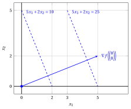
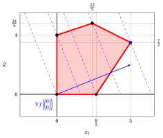
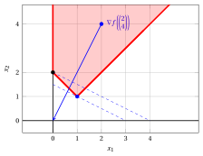
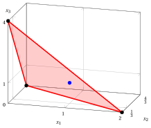
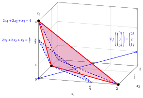

# Problemi di programmazione lineare

**Parte 1 · Funzioni lineari, poliedri e problemi di programmazione lineare · Capitolo 4** · [:material-file-pdf-box: Dispensa, volume 1 (PDF)](../pdf/dispensa-1-problemi-di-programmazione-lineare.pdf) · [:material-presentation: Slide](../pdf/slide-04-problemi-pl.pdf) · [:material-pencil: Esercizi: Problemi di programmazione lineare](../esercizi/es-04-problemi-pl.md) · [:material-gesture-tap: App: Il metodo grafico](../laboratorio/metodo-grafico.md)

## 4.1 Forma canonica di massimo

!!! definizione "Definizione 4.1: Problemi di programmazione lineare in forma canonica di massimo"

    Dati:

    1. un vettore dei costi ${\boldsymbol c} \in \R^{n}$

    2. una matrice dei vincoli ${\boldsymbol A} \in \R^{m \times n }$

    3. un vettore dei termini noti ${\boldsymbol b} \in \R^{m}$ con $m$ righe

        $$
        \underbrace{
        \begin{pmatrix}
        c_{1} \\
        c_{2} \\
        \vdots \\
        \vdots \\
        c_{n} \\
        \end{pmatrix}
        }_{{\boldsymbol c}} \in \R^{n}
        \qquad \qquad
        \underbrace{
        \begin{pmatrix}
        a_{11} & a_{12} & \dots & \dots & a_{1n}\\
        a_{21} & a_{22} & \dots & \dots & a_{2n}\\
        \vdots  & \vdots  & \ddots & \ddots & \vdots \\
        a_{m1} & a_{m2} & \dots & \dots & a_{mn}\\
        \end{pmatrix}
        }_{{\boldsymbol A}} \in \R^{m \times n }
        \qquad \qquad
        \underbrace{
        \begin{pmatrix}
        b_{1} \\
        b_{2} \\
        \vdots \\
        b_{m} \\
        \end{pmatrix}
        }_{{\boldsymbol b}} \in \R^{m}
        $$

    un <strong>problema di programmazione lineare</strong> LP in <strong>forma canonica di massimo</strong> con $n$ <u>variabili non negative</u>

    $$
    \underbrace{
    \begin{pmatrix}
    x_{1} \\
    x_{2} \\
    \vdots \\
    \vdots \\
    x_{n} \\
    \end{pmatrix}
    }_{{\boldsymbol x}} \in \R^{n}_{\ge 0}
    $$

    e $m$ <u>vincoli lineari di minore o uguale</u> è il seguente problema di ottimizzazione:

    

    \begin{align*}
    \label{ObjFunc}  &&   \max \;\; \underbrace{\sum_{j =1}^n c_j \, x_j}_{ {\boldsymbol c}' {\boldsymbol x}}  \qquad \qquad \qquad \qquad \qquad \qquad  \tag{4.1a}\\[1ex]
    \label{Cons}     && \text{soggetto a} \quad \underbrace{\sum_{j =1}^n a_{ij} \, x_j  \le b_i, \qquad   \forall i \in \{1,2,\dots,m\}}_{ {\boldsymbol A}\,{\boldsymbol x}  \le {\boldsymbol b}},  \tag{4.1b}\\[1ex]
    \label{NonNegCons}&& \underbrace{x_j \ge 0, \qquad \forall j \in \{1,2,\dots,n\}}_{{\boldsymbol x} \ge {\boldsymbol 0}}, \tag{4.1c}
    \end{align*}

    dove ${\boldsymbol 0} = \begin{pmatrix} 0 \\ 0 \\ \vdots \\ 0 \\ \end{pmatrix}$ è un vettore (colonna) di $n$ zeri.

!!! esempio "Esempio 4.1: Problema LP in forma canonica di massimo"

    Consideriamo i seguenti dati di un problema LP con $n=2$ e $m=3$:

    $$
    {\boldsymbol c}=
    \begin{pmatrix}
    5 \\[1ex]
    2\\
    \end{pmatrix}
    \qquad
    {\boldsymbol A}=
    \begin{pmatrix}
    -1 & 3 \\[1ex]
    1 & 2 \\[1ex]
    3 & -2 \\
    \end{pmatrix}
    \qquad
    {\boldsymbol b}=
    \begin{pmatrix}
    12 \\[1ex]
    12 \\[1ex]
    8\\
    \end{pmatrix}
    $$

    Le componenti numeriche dei due vettori colonna e della matrice sono

    \begin{gather*}
    c_1=5,~c_2=2,~a_{11}=-1,~a_{12}=3,~a_{21}=1,~a_{22}=2,\\
    a_{31}=3,~a_{32}=-2,~b_1=12,~b_2=12,~b_3=8.
    \end{gather*}

    Il problema ha $n=2$ variabili non negative ${\boldsymbol x}= \begin{pmatrix} x_1 \\[1ex] x_2\\ \end{pmatrix}.$

    Il problema LP associato in forma canonica di massimo con $n=2$ variabili non negative e $m=3$ vincoli lineari di minore o uguale è il seguente:

    $$
    \begin{array}{rrrrrrrrrrrrr}
    {\max} & 5 \, {x_1} & {+} & 2 \, {x_2} \\[1ex]
    \text{soggetto a} & {-} \, {x_1} & {+} & 3 \, {x_2} & {\le} & 12 \\[1ex]
    & {x_1} & {+} & 2 \, {x_2} & {\le} & 12 \\[1ex]
    & {3} \, {x_1} & {-} & 2 \, {x_2} & {\le} & 8 \\[1ex]
    & {x_1,} &  & {x_2} & { \ge} & {0}
    \end{array}
    $$

!!! esempio "Esempio 4.2: Problema LP in forma canonica di massimo"

    Consideriamo i seguenti dati di un problema LP con $n=2$ e $m=2$:

    $$
    {\boldsymbol c}=
    \begin{pmatrix}
    -2 \\[1ex]
    -4\\
    \end{pmatrix}
    \qquad
    {\boldsymbol A}=
    \begin{pmatrix}
    -1 & -1 \\[1ex]
    1 & -1 \\
    \end{pmatrix}
    \qquad
    {\boldsymbol b}=
    \begin{pmatrix}
    -2 \\[1ex]
    0\\
    \end{pmatrix}
    $$

    I valori numerici dei due vettori colonna e della matrice sono

    $$
    c_1=-2,~c_2=-4,~a_{11}=-1,~a_{12}=-1,~a_{21}=1,~a_{22}=-1,~b_1=-2,~b_2=0.
    $$

    Il problema ha $n=2$ variabili decisionali non negative ${\boldsymbol x}= \begin{pmatrix} x_1 \\[1ex] x_2\\ \end{pmatrix}.$

    Il problema LP associato in forma canonica di massimo con $n=2$ variabili non negative e $m=2$ vincoli lineari di minore o uguale è il seguente:

    $$
    \begin{array}{rrrrrrrrrrrrr}
    {\max} & {-2} \, {x_1} & {-} & 4\, {x_2} \\[1ex]
    \text{soggetto a} & {-} \, {x_1} & {-} & {x_2} & {\le} & {-2} \\[1ex]
    & {x_1} & {-} & {x_2} & {\le} & {0} \\[1ex]
    & {x_1,} &  & {x_2} & { \ge} & {0}
    \end{array}
    $$

### 4.1.1 Regione ammissibile e funzione obiettivo

!!! definizione "Definizione 4.2: regione ammissibile e funzione obiettivo"

    - La <strong>regione ammissibile</strong> di un problema LP [(4.1)](#eq-CANONICAL) è il <strong>poliedro</strong> $F$ definito come segue:

        \begin{equation*}
        \label{FeasibleRegion}
        \begin{split}
        F = \left\{~
        \underbrace{
        \begin{pmatrix}
        x_{1} \\
        x_{2} \\
        \vdots \\
        x_{n} \\
        \end{pmatrix}}_{{\boldsymbol x}}  \in \R^n : \right.
        ~~ & \underbrace{\sum_{j=1}^n a_{ij} \, x_j \le b_i,~~\forall i \in \{1,2,\dots,m\}}_{{\boldsymbol A}\,{\boldsymbol x} \le {\boldsymbol b}}, \\[1ex]
        & \left. \vphantom{\begin{pmatrix} x_{1} \\ x_{2} \\ \vdots \\ x_{n} \end{pmatrix}}
        \underbrace{x_j \ge 0,~~\forall j \in \{1,2,\dots,n\}}_{{\boldsymbol x} \ge {\boldsymbol 0}}
        ~\right\}.
        \end{split} \tag{4.2}
        \end{equation*}

        La regione ammissibile è definita dai vincoli lineari di minore o uguale $\eqref{Cons}$ e dai vincoli di non negatività $\eqref{NonNegCons}$.

    - La <strong>funzione obiettivo</strong> $\eqref{ObjFunc}$ di un problema LP [(4.1)](#eq-CANONICAL), da massimizzare, è la <strong>funzione lineare</strong> $f$ (scalare) definita come segue:

        \begin{equation*}
        \label{ObjectiveFunction}
        f: \R^{n} \rightarrow \R,
        \qquad
        f :
        \underbrace{\begin{pmatrix}
        x_1 \\
        x_2 \\
        \vdots \\
        x_n
        \end{pmatrix}}_{{\boldsymbol x}}
        \mapsto
        \underbrace{\sum_{j=1}^n c_j x_j}_{{\boldsymbol c}' {\boldsymbol x}} \tag{4.3}
        \end{equation*}

!!! esempio "Esempio 4.3: funzione obiettivo"

    La funzione obiettivo del problema LP dell'[Esempio 4.1](#box-2-exLPCanonical) è la funzione lineare scalare:

    $$
    f: \R^2 \rr \R, \quad
    f\!:\!
    \begin{pmatrix}
    x_1 \\[1ex]
    x_2
    \end{pmatrix}
    \mapsto
    5\,x_1 + 2\,x_2
    \quad
    \textrm{il suo gradiente è}
    \quad
    \nabla f\!\left(
    \begin{pmatrix}
    x_1\\[1ex]
    x_2
    \end{pmatrix}
    \right)
    =
    \begin{pmatrix}
    5 \\[1ex] 2
    \end{pmatrix}.
    $$

    { .fig .cornice loading=lazy style="width:48%" }

!!! esempio "Esempio 4.4: regione ammissibile"

    La regione ammissibile del problema LP dell'[Esempio 4.1](#box-2-exLPCanonical) è il poliedro:

    $$
    F = \left\{~
    \begin{pmatrix}
    x_1 \\[0.5ex]
    x_2
    \end{pmatrix}
    \in \R^2 :
    -\,x_1 + 3x_2 \le 12,~~
    x_1 + 2x_2 \le 12,~~
    3x_1 - 2x_2 \le 8,~~
    x_1,\, x_2 \ge 0
    ~\right\}.
    $$

    { .fig .cornice loading=lazy style="width:47%" }

### 4.1.2 Lower bound

!!! definizione "Definizione 4.3: soluzione ammissibile e lower bound"

    - Data

        $$
        \underbrace{\begin{pmatrix}
        \bar x_1 \\
        \bar x_2 \\
        \vdots \\
        \bar x_n
        \end{pmatrix}}_{{ \bar{\boldsymbol x}}(\, LP \,)} \in F
        $$

        una <strong>soluzione ammissibile</strong> del problema LP [(4.1)](#eq-CANONICAL) (un punto che soddisfa i vincoli $\eqref{Cons}$ e $\eqref{NonNegCons}$), possiamo calcolare un <strong>lower bound</strong> $LB(\bar{\boldsymbol x})$ sul valore ottimo $z(\, LP \,)$ come segue:

        \begin{equation*}
        \label{FeasSolCanonical}
        LB(\bar{\boldsymbol x})= \sum_{j=1}^n c_j \; \bar{x}_j \tag{4.4}
        \end{equation*}

!!! chiave ""

    Per ogni soluzione ammissibile ${ \bar{\boldsymbol x}}(\, LP \,) \in F$ di un problema LP [(4.1)](#eq-CANONICAL),  abbiamo

    \begin{equation*}
    LB(\bar{\boldsymbol x}) \le z(\, LP \,) \tag{4.5}
    \end{equation*}

!!! esempio "Esempio 4.5: Soluzioni ammissibili e lower bound"

    Consideriamo il problema LP dell'[Esempio 4.1](#box-2-exLPCanonical). Una soluzione ammissibile è per esempio ${ \bar{\boldsymbol x}}(\, LP \,)= \begin{pmatrix} 0 \\ 4 \end{pmatrix}$ (dove $\bar{x}_1=0$ e $\bar{x}_2=4$) poiché:

    $$
    - 0 + 3 \cdot 4 = 12 \le 12,~~~ 0 + 2 \cdot 4 = 8 \le 12,~~~ 3 \cdot 0 - 2 \cdot 4 = - 8 \le 8,~~~ 0\ge 0 {\rm ~~~e~~~} 4 \ge 0
    $$

    

    Di conseguenza, un lower bound $LB(\bar{\boldsymbol x})$ sul valore ottimo $z(\, LP \,)$ del problema LP è:

    $$
    LB(\bar{\boldsymbol x})= 5 \cdot 0 + 2 \cdot 4 = 8
    $$

    

    

    { .fig .cornice loading=lazy style="width:95%" }

    

### 4.1.3 Metodo grafico

!!! chiave ""

    Una soluzione ottima di un problema LP [(4.1)](#eq-CANONICAL) in forma canonica di massimo con due variabili si può determinare graficamente usando la direzione del gradiente della funzione obiettivo e gli insiemi di livello perpendicolari al gradiente.

!!! esempio "Esempio 4.6: Metodo grafico"

    Per il problema LP dell'[Esempio 4.1](#box-2-exLPCanonical):

    $$
    \begin{array}{rrrrrrrrrrrrr}
    {\max} & 5 \, {x_1} & {+} & 2 \, {x_2} \\[1ex]
    \text{soggetto a} & {-} \, {x_1} & {+} & 3 \, {x_2} & {\le} & 12 \\[1ex]
    & {x_1} & {+} & 2 \, {x_2} & {\le} & 12 \\[1ex]
    & {3} \, {x_1} & {-} & 2 \, {x_2} & {\le} & 8 \\[1ex]
    & {x_1,} &  & {x_2} & { \ge} & {0}
    \end{array}
    $$

    una soluzione ottima è:

    $$
    \underbrace{\begin{pmatrix}
    \tilde x_1\\[0.3ex]
    \tilde x_2
    \end{pmatrix}}_{{ \tilde{\boldsymbol x}}(\, LP \,)}
    =
    \begin{pmatrix}
    5\\[0.3ex]
    \frac{7}{2}
    \end{pmatrix}
    $$

    e il valore ottimo è:

    $$
    z(\, LP \,)= 5\; \tilde{x}_1 + 2 \; \tilde{x}_2= 5 \cdot 5 + 2 \cdot \frac{7}{2} = 32
    $$

    { .fig .cornice loading=lazy style="width:88%" }

    In blu tratteggiato, da sinistra a destra, gli insiemi di livello $5\,x_1 + 2\,x_2 = 0$, $5\,x_1 + 2\,x_2 = 8$, $5\,x_1 + 2\,x_2 = \frac{40}{3}$, $5\,x_1 + 2\,x_2 = \frac{108}{5}$ e $5\,x_1 + 2\,x_2 = 32$ della funzione obiettivo; il vertice ottimo è disegnato in blu.

!!! esempio "Esempio 4.7: Metodo grafico"

    Per il problema LP dell'[Esempio 4.2](#box-3-ex-lp-2):

    $$
    \begin{array}{rrrrrrrrrrrrr}
    {\max} & {-2} \, {x_1} & {-} & 4 \, {x_2} \\[1ex]
    \text{soggetto a} & {-} \, {x_1} & {-} & {x_2} & {\le} & {-2} \\[1ex]
    & {x_1} & {-} & {x_2} & {\le} & {0} \\[1ex]
    & {x_1,} &  & {x_2} & { \ge} & {0}
    \end{array}
    $$

    una soluzione ottima è:

    $$
    \underbrace{\begin{pmatrix}
    \tilde x_1\\[0.3ex]
    \tilde x_2
    \end{pmatrix}}_{{ \tilde{\boldsymbol x}}(\, LP \,)}
    =
    \begin{pmatrix}
    1\\[0.3ex]
    1
    \end{pmatrix}
    $$

    e il valore ottimo è:

    $$
    z(\, LP \,) = -2\; \tilde{x}_1 - 4 \; \tilde{x}_2= -2 \cdot 1 - 4 \cdot 1 = -6
    $$

    { .fig .cornice loading=lazy style="width:88%" }

    In blu tratteggiato, dal basso verso l'alto, gli insiemi di livello $-2\,x_1 - 4\,x_2 = -6$ e $-2\,x_1 - 4\,x_2 = -8$ della funzione obiettivo; il vertice ottimo $(1,1)$ è disegnato in blu e il gradiente è tracciato a partire dal punto $(2,4)$.

## 4.2 Forma standard di massimo

!!! definizione "Definizione 4.4: Problemi di programmazione lineare in forma standard di massimo"

    Dati:

    1. un vettore dei costi ${\boldsymbol c} \in \R^{n}$

    2. una matrice dei vincoli ${\boldsymbol A} \in \R^{m \times n }$

    3. un vettore dei termini noti ${\boldsymbol b} \in \R^{m}$ con $m$ righe

        $$
        \underbrace{
        \begin{pmatrix}
        c_{1} \\
        c_{2} \\
        \vdots \\
        \vdots \\
        c_{n} \\
        \end{pmatrix}
        }_{{\boldsymbol c}} \in \R^{n}
        \qquad \qquad
        \underbrace{
        \begin{pmatrix}
        a_{11} & a_{12} & \dots & \dots & a_{1n}\\
        a_{21} & a_{22} & \dots & \dots & a_{2n}\\
        \vdots  & \vdots  & \ddots & \ddots & \vdots \\
        a_{m1} & a_{m2} & \dots & \dots & a_{mn}\\
        \end{pmatrix}
        }_{{\boldsymbol A}} \in \R^{m \times n }
        \qquad \qquad
        \underbrace{
        \begin{pmatrix}
        b_{1} \\
        b_{2} \\
        \vdots \\
        b_{m} \\
        \end{pmatrix}
        }_{{\boldsymbol b}} \in \R^{m}
        $$

    un <strong>problema di programmazione lineare</strong> LP in <strong>forma standard di massimo</strong> con $n$ <u>variabili non negative</u>

    $$
    \underbrace{
    \begin{pmatrix}
    x_{1} \\
    x_{2} \\
    \vdots \\
    \vdots \\
    x_{n} \\
    \end{pmatrix}
    }_{{\boldsymbol x}} \in \R^{n}_{\ge 0}
    $$

    e $m$ <u>vincoli lineari di uguaglianza</u> è il seguente problema di ottimizzazione:

    

    \begin{align*}
    \label{STANDARD_ObjFunc}  &&   \max \;\; \underbrace{\sum_{j =1}^n c_j \, x_j}_{ {\boldsymbol c}' {\boldsymbol x}}  \qquad \qquad \qquad \qquad \qquad \qquad  \tag{4.6a}\\[1ex]
    \label{STANDARD_Cons}     && \text{soggetto a} \quad \underbrace{\sum_{j =1}^n a_{ij} \, x_j  = b_i, \qquad   \forall i \in \{1,2,\dots,m\}}_{ {\boldsymbol A}\,{\boldsymbol x}  = {\boldsymbol b}},  \tag{4.6b}\\[1ex]
    \label{STANDARD_NonNegCons}&& \underbrace{x_j \ge 0, \qquad \forall j \in \{1,2,\dots,n\}}_{{\boldsymbol x} \ge {\boldsymbol 0}}, \tag{4.6c}
    \end{align*}

    dove ${\boldsymbol 0} = \begin{pmatrix} 0 \\ 0 \\ \vdots \\ 0 \\ \end{pmatrix}$ è un vettore (colonna) di $n$ zeri.

!!! esempio "Esempio 4.8: Problema LP in forma standard di massimo"

    Consideriamo i seguenti dati di un problema LP con $n=3$ e $m=1$:

    $$
    {\boldsymbol c}=
    \begin{pmatrix}
    2 \\[1ex]
    2\\[1ex]
    1\\
    \end{pmatrix}
    \qquad
    {\boldsymbol A}=
    \begin{pmatrix}
    2 & 3 & 1
    \end{pmatrix}
    \qquad
    {\boldsymbol b}=
    \begin{pmatrix}
    4
    \end{pmatrix}
    $$

    I valori numerici dei due vettori colonna e della matrice sono

    $$
    c_1=2,~c_2=2,~c_3=1,~a_{11}=2,~a_{12}=3,~a_{13}=1,~b_1=4.
    $$

    Il problema ha $n=3$ variabili non negative ${\boldsymbol x}= \begin{pmatrix} x_1 \\[1ex] x_2 \\[1ex] x_3\\ \end{pmatrix}.$

    Il problema LP associato in forma standard di massimo con $n=3$ variabili non negative e $m=1$ vincolo lineare di uguaglianza è il seguente:

    $$
    \begin{array}{rrrrrrrrrrrrr}
    {\max} & 2 \, {x_1} & {+} & 2 \, {x_2} & {+} & \, {x_3} \\[1ex]
    \text{soggetto a} & {2} \, {x_1} & {+} & 3 \, {x_2} & {+} & \, {x_3} & {=} & 4 \\[1ex]
    & {x_1,} &  & {x_2,} &  & {x_3} & { \ge} & {0}
    \end{array}
    $$

### 4.2.1 Regione ammissibile e funzione obiettivo

!!! definizione "Definizione 4.5: regione ammissibile e funzione obiettivo"

    - La <strong>regione ammissibile</strong> di un problema LP [(4.6)](#eq-STANDARD) è il <strong>poliedro</strong> $F$ definito come segue:

        \begin{equation*}
        \label{STANDARD_FeasibleRegion}
        \begin{split}
        F = \left\{~
        \underbrace{
        \begin{pmatrix}
        x_{1} \\
        x_{2} \\
        \vdots \\
        x_{n} \\
        \end{pmatrix}}_{{\boldsymbol x}}  \in \R^n : \right.
        ~~ & \underbrace{\sum_{j=1}^n a_{ij} \, x_j = b_i,~~\forall i \in \{1,2,\dots,m\}}_{{\boldsymbol A}\,{\boldsymbol x} ={\boldsymbol b}}, \\[1ex]
        & \left. \vphantom{\begin{pmatrix} x_{1} \\ x_{2} \\ \vdots \\ x_{n} \end{pmatrix}}
        \underbrace{x_j \ge 0,~~\forall j \in \{1,2,\dots,n\}}_{{\boldsymbol x} \ge {\boldsymbol 0}}
        ~\right\}.
        \end{split} \tag{4.7}
        \end{equation*}

        La regione ammissibile è definita dai vincoli lineari di uguaglianza $\eqref{STANDARD_Cons}$ e dai vincoli di non negatività $\eqref{STANDARD_NonNegCons}$.

    - La <strong>funzione obiettivo</strong> $\eqref{STANDARD_ObjFunc}$ di un problema LP [(4.6)](#eq-STANDARD), da massimizzare, è la <strong>funzione lineare</strong> $f$ (scalare) definita come segue:

        \begin{equation*}
        \label{STANDARD_ObjectiveFunction}
        f: \R^{n} \rightarrow \R,
        \qquad
        f :
        \underbrace{\begin{pmatrix}
        x_1 \\
        x_2 \\
        \vdots \\
        x_n
        \end{pmatrix}}_{{\boldsymbol x}}
        \mapsto
        \underbrace{\sum_{j=1}^n c_j x_j}_{{\boldsymbol c}' {\boldsymbol x}} \tag{4.8}
        \end{equation*}

!!! esempio "Esempio 4.9: funzione obiettivo"

    La funzione obiettivo del problema LP dell'[Esempio 4.8](#box-12-exLPStandard) è la funzione lineare scalare:

    $$
    f: \R^3 \rr \R, \quad
    f\!:\!
    \begin{pmatrix}
    x_1 \\[1ex]
    x_2 \\[1ex]
    x_3
    \end{pmatrix}
    \mapsto
    2\,x_1 + 2\,x_2 + x_3
    \quad
    \textrm{e il suo gradiente è}
    \quad
    \nabla f\!\left(
    \begin{pmatrix}
    x_1\\[1ex]
    x_2\\[1ex]
    x_3
    \end{pmatrix}
    \right)
    =
    \begin{pmatrix}
    2 \\[0.5ex] 2 \\[0.5ex] 1
    \end{pmatrix}.
    $$

    { .fig .cornice loading=lazy style="width:71%" }

!!! esempio "Esempio 4.10: regione ammissibile"

    La regione ammissibile del problema LP dell'[Esempio 4.8](#box-12-exLPStandard) è il poliedro:

    $$
    F = \left\{~
    \begin{pmatrix}
    x_1 \\[0.5ex]
    x_2 \\[0.5ex]
    x_3
    \end{pmatrix}
    \in \R^3 :
    2x_1 + 3x_2 + x_3 = 4,~~
    x_1 \ge 0,~~
    x_2 \ge 0,~~
    x_3 \ge 0
    ~\right\}.
    $$

    { .fig .cornice loading=lazy style="width:47%" }

### 4.2.2 Lower bound

!!! definizione "Definizione 4.6: soluzione ammissibile e lower bound"

    - Data

        $$
        \underbrace{\begin{pmatrix}
        \bar x_1 \\
        \bar x_2 \\
        \vdots \\
        \bar x_n
        \end{pmatrix}}_{{ \bar{\boldsymbol x}}(\, LP \,)} \in F
        $$

        una <strong>soluzione ammissibile</strong> del problema LP [(4.6)](#eq-STANDARD) (un punto che soddisfa i vincoli $\eqref{STANDARD_Cons}$ e $\eqref{STANDARD_NonNegCons}$), possiamo calcolare un <strong>lower bound</strong> $LB(\bar{\boldsymbol x})$ sul valore ottimo $z(\, LP \,)$ come segue:

        \begin{equation*}
        \label{FeasSolStandard}
        LB(\bar{\boldsymbol x})= \sum_{j=1}^n c_j \; \bar{x}_j \tag{4.9}
        \end{equation*}

!!! chiave ""

    Per ogni soluzione ammissibile ${ \bar{\boldsymbol x}}(\, LP \,) \in F$ di un problema LP [(4.6)](#eq-STANDARD),  abbiamo

    \begin{equation*}
    LB(\bar{\boldsymbol x}) \le z(\, LP \,) \tag{4.10}
    \end{equation*}

!!! esempio "Esempio 4.11: Soluzioni ammissibili e lower bound"

    Consideriamo il problema LP dell'[Esempio 4.8](#box-12-exLPStandard). Una soluzione ammissibile è per esempio ${ \bar{\boldsymbol x}}(\, LP \,)= \begin{pmatrix} 1 \\ \frac13 \\ 1 \end{pmatrix}$ (dove $\bar{x}_1 = 1$, $\bar{x}_2 = \tfrac13$ e $\bar{x}_3 = 1$) poiché:

    $$
    2\cdot 1 + 3\cdot \tfrac13 + 1 = 4,
    \qquad
    1 \ge 0,
    \qquad
    \tfrac13 \ge 0,
    \qquad
    1 \ge 0.
    $$

    Di conseguenza, un lower bound $LB(\bar{\boldsymbol x})$ sul valore ottimo $z(\, LP \,)$ del problema LP è:

    $$
    LB(\bar{\boldsymbol x})
    = 2\cdot 1 + 2\cdot \tfrac13 + 1
    = \frac{11}{3}.
    $$

    { .fig .cornice loading=lazy style="width:47%" }

### 4.2.3 Metodo grafico

!!! chiave ""

    Una soluzione ottima di un problema LP [(4.6)](#eq-STANDARD) in forma standard di massimo con due o tre variabili si può determinare graficamente usando la direzione del gradiente della funzione obiettivo e gli insiemi di livello perpendicolari al gradiente.

!!! esempio "Esempio 4.12: Metodo grafico"

    Per il problema LP dell'[Esempio 4.8](#box-12-exLPStandard):

    $$
    \begin{array}{rrrrrrrrrrrrr}
    {\max} & 2 \, {x_1} & {+} & 2 \, {x_2} & {+} & \, {x_3} \\[1ex]
    \text{soggetto a} & {2} \, {x_1} & {+} & 3 \, {x_2} & {+} & \, {x_3} & {=} & 4 \\[1ex]
    & {x_1,} &  & {x_2,} &  & {x_3} & { \ge} & {0}
    \end{array}
    $$

    Tutte le soluzioni ottime giacciono sul segmento

    $$
    \left\{\,
    \begin{pmatrix}
    x_1\\
    x_2\\
    x_3
    \end{pmatrix}   \in \R^3
    \;:\;
    x_2 = 0,\; 2x_1 + x_3 = 4,\; x_1 \ge 0,\; x_3 \ge 0
    \,\right\},
    $$

    cioè sul segmento che congiunge i punti $\begin{pmatrix} 2\\ 0\\ 0 \end{pmatrix}$ e $\begin{pmatrix} 0\\ 0\\ 4 \end{pmatrix}$. Prendendo per esempio la soluzione ottima $\tilde{\boldsymbol x}(\, LP \,) = \begin{pmatrix} 2\\ 0\\ 0 \end{pmatrix}$ (dove $\tilde{x}_1=2$, $\tilde{x}_2=0$ e $\tilde{x}_3=0$), il valore ottimo è: $z(\, LP \,) = 2\,\tilde{x}_1 + 2\,\tilde{x}_2 + \tilde{x}_3 = 2 \cdot 2 + 2 \cdot 0 + 0 = 4.$

    { .fig .cornice loading=lazy style="width:59%" }

---

**Esercizi su questo capitolo:** [:material-pencil: Problemi di programmazione lineare](../esercizi/es-04-problemi-pl.md)

<!-- laboratorio-interattivo: sezione generata da interattivi.py -->

## Laboratorio interattivo { #laboratorio-interattivo }

Le idee del capitolo, da toccare con mano: muovi i cursori e trascina i punti.
Ogni app si apre anche a tutta pagina nel [laboratorio interattivo](../laboratorio/index.md): [Il metodo grafico](../laboratorio/metodo-grafico.md).

