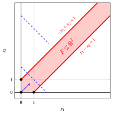

# Esiti possibili e formulazioni equivalenti

**Parte 1 · Funzioni lineari, poliedri e problemi di programmazione lineare · Capitolo 5** · [:material-file-pdf-box: Dispensa, volume 1 (PDF)](../pdf/dispensa-1-problemi-di-programmazione-lineare.pdf) · [:material-pencil: Esercizi](../esercizi/es-05-esiti-equivalenze.md)

## 5.1 Le due forme di riferimento

- In tutto questo documento facciamo riferimento alle due forme di un problema LP introdotte nel documento precedente. Dati un vettore dei costi ${\boldsymbol c} \in \R^{n}$, una matrice dei vincoli ${\boldsymbol A} \in \R^{m \times n }$ e un vettore dei termini noti ${\boldsymbol b} \in \R^{m}$, esse si scrivono come segue.

!!! chiave ""

    Un problema LP in <strong>forma canonica di massimo</strong> con $n$ variabili non negative e $m$ vincoli lineari di minore o uguale:

    

    \begin{align*}
    \label{ObjFunc}  &&   \max \;\; \underbrace{\sum_{j =1}^n c_j \, x_j}_{ {\boldsymbol c}' {\boldsymbol x}}  \qquad \qquad \qquad \qquad \qquad \qquad  \tag{5.1a}\\[1ex]
    \label{Cons}     && \text{soggetto a} \quad \underbrace{\sum_{j =1}^n a_{ij} \, x_j  \le b_i, \qquad   \forall i \in \{1,2,\dots,m\}}_{ {\boldsymbol A}\,{\boldsymbol x}  \le {\boldsymbol b}},  \tag{5.1b}\\[1ex]
    \label{NonNegCons}&& \underbrace{x_j \ge 0, \qquad \forall j \in \{1,2,\dots,n\}}_{{\boldsymbol x} \ge {\boldsymbol 0}}. \tag{5.1c}
    \end{align*}

!!! chiave ""

    Un problema LP in <strong>forma standard di massimo</strong> con $n$ variabili non negative e $m$ vincoli lineari di uguaglianza:

    

    \begin{align*}
    \label{STANDARD_ObjFunc}  &&   \max \;\; \underbrace{\sum_{j =1}^n c_j \, x_j}_{ {\boldsymbol c}' {\boldsymbol x}}  \qquad \qquad \qquad \qquad \qquad \qquad  \tag{5.2a}\\[1ex]
    \label{STANDARD_Cons}     && \text{soggetto a} \quad \underbrace{\sum_{j =1}^n a_{ij} \, x_j  = b_i, \qquad   \forall i \in \{1,2,\dots,m\}}_{ {\boldsymbol A}\,{\boldsymbol x}  = {\boldsymbol b}},  \tag{5.2b}\\[1ex]
    \label{STANDARD_NonNegCons}&& \underbrace{x_j \ge 0, \qquad \forall j \in \{1,2,\dots,n\}}_{{\boldsymbol x} \ge {\boldsymbol 0}}. \tag{5.2c}
    \end{align*}

- Facciamo inoltre riferimento ai tre problemi LP usati come esempi guida nel documento precedente, che richiamiamo nei tre esempi seguenti.

!!! esempio "Esempio 5.1: problema LP guida in forma canonica di massimo"

    Il primo esempio guida è il seguente problema LP in forma canonica di massimo con $n=2$ variabili non negative e $m=3$ vincoli lineari di minore o uguale:

    $$
    \begin{array}{rrrrrrrrrrrrr}
    {\max} & 5 \, {x_1} & {+} & 2 \, {x_2} \\[1ex]
    \text{soggetto a} & {-} \, {x_1} & {+} & 3 \, {x_2} & {\le} & 12 \\[1ex]
    & {x_1} & {+} & 2 \, {x_2} & {\le} & 12 \\[1ex]
    & {3} \, {x_1} & {-} & 2 \, {x_2} & {\le} & 8 \\[1ex]
    & {x_1,} &  & {x_2} & { \ge} & {0}
    \end{array}
    $$

    Una soluzione ottima è $\tilde{\boldsymbol x}(\, LP \,) = \begin{pmatrix} 5 \\[0.5ex] \frac{7}{2} \end{pmatrix}$ e il valore ottimo è $z(\, LP \,) = 32$.

!!! esempio "Esempio 5.2: problema LP guida in forma canonica di massimo"

    Il secondo esempio guida è il seguente problema LP in forma canonica di massimo con $n=2$ variabili non negative e $m=2$ vincoli lineari di minore o uguale:

    $$
    \begin{array}{rrrrrrrrrrrrr}
    {\max} & {-2} \, {x_1} & {-} & 4\, {x_2} \\[1ex]
    \text{soggetto a} & {-} \, {x_1} & {-} & {x_2} & {\le} & {-2} \\[1ex]
    & {x_1} & {-} & {x_2} & {\le} & {0} \\[1ex]
    & {x_1,} &  & {x_2} & { \ge} & {0}
    \end{array}
    $$

    Una soluzione ottima è $\tilde{\boldsymbol x}(\, LP \,) = \begin{pmatrix} 1 \\[0.5ex] 1 \end{pmatrix}$ e il valore ottimo è $z(\, LP \,) = -6$.

!!! esempio "Esempio 5.3: problema LP guida in forma standard di massimo"

    Il terzo esempio guida è il seguente problema LP in forma standard di massimo con $n=3$ variabili non negative e $m=1$ vincolo lineare di uguaglianza:

    $$
    \begin{array}{rrrrrrrrrrrrr}
    {\max} & 2 \, {x_1} & {+} & 2 \, {x_2} & {+} & \, {x_3} \\[1ex]
    \text{soggetto a} & {2} \, {x_1} & {+} & 3 \, {x_2} & {+} & \, {x_3} & {=} & 4 \\[1ex]
    & {x_1,} &  & {x_2,} &  & {x_3} & { \ge} & {0}
    \end{array}
    $$

    Il suo valore ottimo è $z(\, LP \,) = 4$, raggiunto da ogni punto del segmento che congiunge $\begin{pmatrix} 2 \\ 0 \\ 0 \end{pmatrix}$ e $\begin{pmatrix} 0 \\ 0 \\ 4 \end{pmatrix}$.

## 5.2 Problemi LP inammissibili e illimitati

- I problemi LP dell'[Esempio 5.1](#box-1-ex-oe-1), dell'[Esempio 5.2](#box-2-ex-oe-2) e dell'[Esempio 5.3](#box-3-ex-oe-3) ammettono una soluzione ottima. Non è sempre così: un problema LP può <u>non avere alcuna soluzione ammissibile</u>, oppure può avere soluzioni ammissibili <u>di valore obiettivo arbitrariamente grande</u>.

!!! definizione "Definizione 5.1: problema LP inammissibile"

    Un problema LP si dice <strong>inammissibile</strong> se la sua regione ammissibile è vuota:

    $$
    F = \emptyset .
    $$

!!! definizione "Definizione 5.2: problema LP illimitato"

    Un problema LP in <strong>forma di massimo</strong> si dice <strong>illimitato</strong> se, per ogni valore $M \in \R$, esiste una soluzione ammissibile $\bar{\boldsymbol x}(\, LP \,) \in F$ tale che

    $$
    f(\bar{\boldsymbol{x}}(\, LP \,)) > M .
    $$

    Un problema LP in <strong>forma di minimo</strong> si dice <strong>illimitato</strong> se, per ogni valore $M \in \R$, esiste una soluzione ammissibile $\bar{\boldsymbol x}(\, LP \,) \in F$ tale che $f(\bar{\boldsymbol{x}}(\, LP \,)) < M$.

!!! chiave ""

    Un problema LP soddisfa esattamente una delle tre condizioni seguenti:

    1. è <strong>inammissibile</strong>;

    2. è <strong>illimitato</strong>;

    3. ammette una <strong>soluzione ottima</strong> $\tilde{\boldsymbol x}(\, LP \,)$, e il valore ottimo $z(\, LP \,)$ è un numero finito.

- Un problema LP inammissibile non ha soluzioni ammissibili, quindi non ha soluzioni ottime e il valore ottimo $z(\, LP \,)$ non è definito. Un problema LP illimitato ha soluzioni ammissibili, ma nessuna di esse è ottima, e anche in questo caso il valore ottimo $z(\, LP \,)$ non è definito.

- Nei due casi, con un leggero abuso di notazione, scriviamo $z(\, LP \,)= -\infty$ per un problema LP inammissibile in forma di massimo e $z(\, LP \,)= +\infty$ per un problema LP illimitato in forma di massimo.

!!! esempio "Esempio 5.4: problema LP inammissibile"

    Consideriamo il seguente problema LP in forma canonica di massimo con $n=2$ variabili non negative e $m=2$ vincoli lineari di minore o uguale:

    $$
    \begin{array}{rrrrrrrrrrrrr}
    {\max} & \, {x_1} & {+} & \, {x_2} \\[1ex]
    \text{soggetto a} & \, {x_1} & {+} & \, {x_2} & {\le} & {2} \\[1ex]
    & {-} \, {x_1} & {-} & \, {x_2} & {\le} & {-4} \\[1ex]
    & {x_1,} &  & {x_2} & { \ge} & {0}
    \end{array}
    $$

    Il primo vincolo impone $x_1 + x_2 \le 2$ e il secondo impone $x_1 + x_2 \ge 4$. Nessun punto di $\R^2$ li soddisfa entrambi, e quindi abbiamo:

    $$
    F = \emptyset .
    $$

    Di conseguenza, questo problema LP è <strong>inammissibile</strong>.

    { .fig .cornice loading=lazy style="width:50%" }

    In rosso il semipiano $x_1 + x_2 \le 2$ (con i vincoli di non negatività) e in viola il semipiano $x_1 + x_2 \ge 4$: la loro intersezione è vuota.

!!! esempio "Esempio 5.5: problema LP illimitato"

    Consideriamo il seguente problema LP in forma canonica di massimo con $n=2$ variabili non negative e $m=2$ vincoli lineari di minore o uguale:

    $$
    \begin{array}{rrrrrrrrrrrrr}
    {\max} & \, {x_1} & {+} & \, {x_2} \\[1ex]
    \text{soggetto a} & {-} \, {x_1} & {+} & \, {x_2} & {\le} & {1} \\[1ex]
    & \, {x_1} & {-} & \, {x_2} & {\le} & {1} \\[1ex]
    & {x_1,} &  & {x_2} & { \ge} & {0}
    \end{array}
    $$

    Per ogni valore $t \ge 0$, il punto $\bar{\boldsymbol x}(\, LP \,) = \begin{pmatrix} t \\[0.5ex] t \end{pmatrix}$ è una soluzione ammissibile, poiché

    $$
    - t + t = 0 \le 1, \qquad t - t = 0 \le 1, \qquad t \ge 0 {\rm ~~~e~~~} t \ge 0 ,
    $$

    e il suo valore obiettivo è

    $$
    LB(\bar{\boldsymbol x}) = t + t = 2 \, t .
    $$

    Di conseguenza, per ogni valore $M \in \R$, la soluzione ammissibile ottenuta con $t > \frac{M}{2}$ ha un valore obiettivo maggiore di $M$, e quindi questo problema LP è <strong>illimitato</strong>.

    { .fig .cornice loading=lazy style="width:50%" }

    In blu tratteggiato gli insiemi di livello $x_1 + x_2 = 2$ e $x_1 + x_2 = 6$ della funzione obiettivo: il gradiente punta lungo la regione ammissibile illimitata.

!!! chiave ""

    Un problema LP la cui regione ammissibile $F$ è <u>illimitata</u> non è necessariamente un problema LP illimitato: la funzione obiettivo può benissimo raggiungere un valore ottimo finito su $F$.

!!! esempio "Esempio 5.6: regione ammissibile illimitata e soluzioni ottime multiple"

    Consideriamo il seguente problema LP in forma canonica di massimo con $n=2$ variabili non negative e $m=2$ vincoli lineari di minore o uguale:

    $$
    \begin{array}{rrrrrrrrrrrrr}
    {\max} & {-} \, {x_1} & {-} & \, {x_2} \\[1ex]
    \text{soggetto a} & {-} \, {x_1} & {-} & \, {x_2} & {\le} & {-2} \\[1ex]
    & \, {x_1} & {-} & \, {x_2} & {\le} & {2} \\[1ex]
    & {x_1,} &  & {x_2} & { \ge} & {0}
    \end{array}
    $$

    La regione ammissibile $F$ è illimitata. Tuttavia, il primo vincolo impone $x_1 + x_2 \ge 2$ per ogni soluzione ammissibile, e quindi

    $$
    - x_1 - x_2 \le -2, \qquad \forall \begin{pmatrix} x_1 \\ x_2\end{pmatrix} \in F .
    $$

    Le soluzioni ammissibili $\begin{pmatrix} 0 \\ 2\end{pmatrix}$ e $\begin{pmatrix} 2 \\ 0\end{pmatrix}$ raggiungono questo valore, e quindi sono due <strong>soluzioni ottime</strong> e il valore ottimo è $z(\, LP \,) = -2$.

    { .fig .cornice loading=lazy style="width:50%" }

    In blu tratteggiato l'insieme di livello $-x_1 - x_2 = -6$ e in blu continuo l'insieme di livello $-x_1 - x_2 = -2$, che contiene il segmento di soluzioni ottime che congiunge i due vertici blu.

!!! teorema "Osservazione 5.3: soluzioni ottime multiple"

    Se $\tilde{\boldsymbol x}^{(1)}(\, LP \,)$ e $\tilde{\boldsymbol x}^{(2)}(\, LP \,)$ sono due soluzioni ottime di un problema LP, allora ogni combinazione convessa

    $$
    \lambda \, \tilde{\boldsymbol x}^{(1)}(\, LP \,) + (1-\lambda) \, \tilde{\boldsymbol x}^{(2)}(\, LP \,),
    \qquad \lambda \in [0,1],
    $$

    è anch'essa una soluzione ottima. Di conseguenza, un problema LP che ammette una soluzione ottima ammette o esattamente una soluzione ottima o infinite soluzioni ottime.

??? dimostrazione "Dimostrazione"

    Sia $\boldsymbol{x}^{\lambda} = \lambda \, \tilde{\boldsymbol x}^{(1)}(\, LP \,) + (1-\lambda) \, \tilde{\boldsymbol x}^{(2)}(\, LP \,)$ con $\lambda \in [0,1]$. Innanzitutto, $\boldsymbol{x}^{\lambda} \in F$. Infatti, la regione ammissibile $F$ è un poliedro e, per ciascuna delle sue disuguaglianze ${\boldsymbol a}\,{\boldsymbol x} \le b$, poiché $\lambda \ge 0$, $1-\lambda \ge 0$ ed entrambe le soluzioni la soddisfano, abbiamo:

    $$
    {\boldsymbol a}\,\boldsymbol{x}^{\lambda}
    = \lambda \, {\boldsymbol a}\,\tilde{\boldsymbol x}^{(1)}(\, LP \,) + (1-\lambda) \, {\boldsymbol a}\,\tilde{\boldsymbol x}^{(2)}(\, LP \,)
    \le \lambda \, b + (1-\lambda) \, b = b ;
    $$

    lo stesso calcolo, con $=$ al posto di $\le$, vale per ciascuna delle sue uguaglianze. Inoltre, poiché la funzione obiettivo $f$ è lineare, abbiamo:

    \begin{align*}
    f(\boldsymbol{x}^{\lambda})
    &= \lambda \, f(\tilde{\boldsymbol x}^{(1)}(\, LP \,)) + (1-\lambda) \, f(\tilde{\boldsymbol x}^{(2)}(\, LP \,)) \\[2ex]
    &= \lambda \, z(\, LP \,) + (1-\lambda) \, z(\, LP \,) = z(\, LP \,) ,
    \end{align*}

    dove la seconda uguaglianza vale perché entrambe le soluzioni sono ottime. Di conseguenza, $\boldsymbol{x}^{\lambda}$ è una soluzione ammissibile il cui valore obiettivo è il valore ottimo, e quindi è una soluzione ottima. □

## 5.3 Riformulazioni equivalenti

- Un <strong>problema LP generico</strong> può essere scritto in una forma che non è né la forma canonica di massimo [(5.1)](#eq-CANONICAL) né la forma standard di massimo [(5.2)](#eq-STANDARD): la sua funzione obiettivo può dover essere minimizzata, i suoi vincoli possono essere dei tre tipi “$\le$”, “$\ge$” e “$=$”, e le sue variabili possono essere non positive o libere.

- In questa sezione mostriamo che ogni problema LP generico può essere riscritto in forma canonica di massimo e in forma standard di massimo.

!!! definizione "Definizione 5.4: problemi LP equivalenti"

    Due problemi LP si dicono <strong>equivalenti</strong> se, da una soluzione ottima di uno dei due, si può ottenere direttamente una soluzione ottima dell'altro, e i due problemi sono entrambi inammissibili, entrambi illimitati, oppure entrambi ammettono una soluzione ottima.

### 5.3.1 Forma di minimo e forma di massimo

- Per ogni funzione lineare $f$ e ogni poliedro $F$, abbiamo:

    $$
    \min \{\, f(\boldsymbol{x}) \;\text{soggetto a}\; \boldsymbol{x} \in F \,\}
    =
    - \max \{\, - f(\boldsymbol{x}) \;\text{soggetto a}\; \boldsymbol{x} \in F \,\} .
    $$

- Di conseguenza, un problema LP in <strong>forma di minimo</strong> con vettore dei costi ${\boldsymbol c}$ è equivalente al problema LP in <strong>forma di massimo</strong> con la stessa regione ammissibile e vettore dei costi $-{\boldsymbol c}$:

    $$
    \underbrace{\sum_{j=1}^n c_j \, x_j}_{{\boldsymbol c}' {\boldsymbol x}}
    \qquad \longrightarrow \qquad
    \underbrace{\sum_{j=1}^n (-c_j) \, x_j}_{-{\boldsymbol c}' {\boldsymbol x}} .
    $$

!!! chiave ""

    I due problemi LP equivalenti hanno le <strong>stesse soluzioni ottime</strong>, mentre i loro valori ottimi sono numeri opposti:

    $$
    \tilde{\boldsymbol x}(\, LP_{\min} \,) = \tilde{\boldsymbol x}(\, LP_{\max} \,)
    \qquad {\rm e} \qquad
    z(\, LP_{\min} \,) = - \, z(\, LP_{\max} \,) .
    $$

!!! esempio "Esempio 5.7: dalla forma di minimo alla forma di massimo"

    Consideriamo il seguente problema LP in forma di minimo con $n=2$ variabili non negative:

    $$
    \begin{array}{rrrrrrrrrrrrr}
    {\min} & {2} \, {x_1} & {+} & {4} \, {x_2} \\[1ex]
    \text{soggetto a} & {-} \, {x_1} & {-} & \, {x_2} & {\le} & {-2} \\[1ex]
    & \, {x_1} & {-} & \, {x_2} & {\le} & {0} \\[1ex]
    & {x_1,} &  & {x_2} & { \ge} & {0}
    \end{array}
    $$

    Cambiando il segno del vettore dei costi, otteniamo il problema LP equivalente in forma canonica di massimo dell'[Esempio 5.2](#box-2-ex-oe-2):

    $$
    \begin{array}{rrrrrrrrrrrrr}
    {\max} & {-2} \, {x_1} & {-} & {4} \, {x_2} \\[1ex]
    \text{soggetto a} & {-} \, {x_1} & {-} & \, {x_2} & {\le} & {-2} \\[1ex]
    & \, {x_1} & {-} & \, {x_2} & {\le} & {0} \\[1ex]
    & {x_1,} &  & {x_2} & { \ge} & {0}
    \end{array}
    $$

    La soluzione ottima di entrambi i problemi è $\tilde{\boldsymbol x}(\, LP \,) = \begin{pmatrix} 1 \\ 1 \end{pmatrix} ,$ mentre il valore ottimo della forma di minimo è $6$ e il valore ottimo della forma di massimo è $-6$.

### 5.3.2 Vincoli di maggiore o uguale e di uguaglianza

- Un vincolo lineare di <strong>maggiore o uguale</strong> è equivalente a un vincolo lineare di minore o uguale, poiché, moltiplicando entrambi i membri per $-1$, abbiamo:

    $$
    \sum_{j=1}^n a_{ij} \, x_j \ge b_i
    \qquad \Longleftrightarrow \qquad
    \sum_{j=1}^n (-a_{ij}) \, x_j \le - b_i .
    $$

- Un vincolo lineare di <strong>uguaglianza</strong> è equivalente a due vincoli lineari di minore o uguale, poiché:

    $$
    \sum_{j=1}^n a_{ij} \, x_j = b_i
    \qquad \Longleftrightarrow \qquad
    \underbrace{\sum_{j=1}^n a_{ij} \, x_j \le b_i}_{\text{primo vincolo}}
    {\rm ~~~~e~~~~}
    \underbrace{\sum_{j=1}^n (-a_{ij}) \, x_j \le - b_i}_{\text{secondo vincolo}} .
    $$

!!! chiave ""

    Un problema LP [(5.2)](#eq-STANDARD) in forma standard di massimo con $n$ variabili non negative e $m$ vincoli lineari di uguaglianza è equivalente a un problema LP [(5.1)](#eq-CANONICAL) in forma canonica di massimo con le stesse $n$ variabili non negative e $2 \, m$ vincoli lineari di minore o uguale:

    \begin{align*}
    &&   \max \;\;{\sum_{j =1}^n c_j \, x_j}                               \\[1ex]
    && \text{soggetto a} \quad  {\sum_{j =1}^n a_{ij} \, x_j}  &\leq b_i,   & \forall i \in \{1,2,\dots,m\},                    \\[1ex]
    &&   {\sum_{j =1}^n (-a_{ij}) \, x_j}  &\leq -b_i,   & \forall i \in \{1,2,\dots,m\},                    \\[1ex]
    &&x_j                        &\ge  0, & \forall j \in \{1,2,\dots,n\}.
    \end{align*}

    I due problemi LP hanno la <strong>stessa regione ammissibile</strong>, e quindi le stesse soluzioni ottime e lo stesso valore ottimo.

!!! esempio "Esempio 5.8: dalla forma standard alla forma canonica di massimo"

    Consideriamo il problema LP in forma standard di massimo dell'[Esempio 5.3](#box-3-ex-oe-3), con $n=3$ variabili non negative e $m=1$ vincolo lineare di uguaglianza:

    $$
    \begin{array}{rrrrrrrrrrrrr}
    {\max} & 2 \, {x_1} & {+} & 2 \, {x_2} & {+} & \, {x_3} \\[1ex]
    \text{soggetto a} & {2} \, {x_1} & {+} & 3 \, {x_2} & {+} & \, {x_3} & {=} & 4 \\[1ex]
    & {x_1,} &  & {x_2,} &  & {x_3} & { \ge} & {0}
    \end{array}
    $$

    Sostituendo il vincolo lineare di uguaglianza con due vincoli lineari di minore o uguale, otteniamo il problema LP equivalente in forma canonica di massimo con $n=3$ variabili non negative e $2 \, m = 2$ vincoli lineari di minore o uguale:

    $$
    \begin{array}{rrrrrrrrrrrrr}
    {\max} & 2 \, {x_1} & {+} & 2 \, {x_2} & {+} & \, {x_3} \\[1ex]
    \text{soggetto a} & {2} \, {x_1} & {+} & 3 \, {x_2} & {+} & \, {x_3} & {\le} & 4 \\[1ex]
    & {-2} \, {x_1} & {-} & 3 \, {x_2} & {-} & \, {x_3} & {\le} & {-4} \\[1ex]
    & {x_1,} &  & {x_2,} &  & {x_3} & { \ge} & {0}
    \end{array}
    $$

### 5.3.3 Variabili di scarto e di surplus

- Un vincolo lineare di <strong>minore o uguale</strong> è equivalente a un vincolo lineare di uguaglianza e a un vincolo di non negatività, ottenuti aggiungendo una variabile non negativa $x_{n+i}$:

    $$
    \sum_{j=1}^n a_{ij} \, x_j \le b_i
    \qquad \Longleftrightarrow \qquad
    \sum_{j=1}^n a_{ij} \, x_j + x_{n+i} = b_i
    {\rm ~~~~e~~~~} x_{n+i} \ge 0 .
    $$

- Un vincolo lineare di <strong>maggiore o uguale</strong> è equivalente a un vincolo lineare di uguaglianza e a un vincolo di non negatività, ottenuti sottraendo una variabile non negativa $x_{n+i}$:

    $$
    \sum_{j=1}^n a_{ij} \, x_j \ge b_i
    \qquad \Longleftrightarrow \qquad
    \sum_{j=1}^n a_{ij} \, x_j - x_{n+i} = b_i
    {\rm ~~~~e~~~~} x_{n+i} \ge 0 .
    $$

!!! definizione "Definizione 5.5: variabili di scarto e di surplus"

    La variabile non negativa aggiuntiva $x_{n+i}$ si chiama <strong>variabile di scarto</strong> di un vincolo lineare di minore o uguale e <strong>variabile di surplus</strong> di un vincolo lineare di maggiore o uguale. Il suo valore misura, per una data soluzione ammissibile, la differenza fra i due membri del vincolo.

!!! chiave ""

    Un problema LP [(5.1)](#eq-CANONICAL) in forma canonica di massimo con $n$ variabili non negative e $m$ vincoli lineari di minore o uguale è equivalente a un problema LP [(5.2)](#eq-STANDARD) in forma standard di massimo con $n+m$ variabili non negative e gli stessi $m$ vincoli lineari, ora di uguaglianza:

    \begin{align*}
    &&  \max \;\;{\sum_{j =1}^n c_j \, x_j}             \\[1ex]
    && \text{soggetto a} \quad  {\sum_{j =1}^n a_{ij} \, x_j}  + x_{n+i}&= b_i,   & \forall i \in \{1,2,\dots,m\},                     \\[1ex]
    &&x_j                        &\ge  0, & \forall j \in \{1,2,\dots,n+m\}.
    \end{align*}

- In notazione matriciale, le $m$ variabili di scarto formano un vettore colonna ${\boldsymbol x}_S \in \R^{m}_{\ge 0}$ e la matrice dei vincoli della forma standard di massimo si ottiene affiancando ad ${\boldsymbol A}$ la <strong>matrice identità</strong> ${\boldsymbol I}$ di dimensione $m$:

    \begin{align*}
    &&   \max \;\;{\boldsymbol c}'\; {\boldsymbol x}                               \\[2ex]
    && \text{soggetto a} \quad  \underbrace{{\boldsymbol A} \; {\boldsymbol x} +{\boldsymbol I} \; {\boldsymbol x}_S}_{
    \begin{pmatrix} {\boldsymbol A} & {\boldsymbol I} \end{pmatrix}
    \begin{pmatrix} {\boldsymbol x} \\ {\boldsymbol x}_S \end{pmatrix}
    }  &= {\boldsymbol b},  & \phantom{j=1111} \\[2ex]
    && {\boldsymbol x},~{\boldsymbol x}_S                        &\ge {\boldsymbol 0},
    \end{align*}

    dove

    $$
    {\boldsymbol x}_S=
    \begin{pmatrix}
    x_{n+1} \\
    x_{n+2} \\
    \vdots  \\
    x_{n+m} \\
    \end{pmatrix}
    \qquad\qquad
    {\boldsymbol I}=
    \begin{pmatrix}
    1 & 0 & \dots & 0\\
    0 & 1 & \dots & 0\\
    \vdots  & \vdots  & \ddots & \vdots \\
    0 &  0&  \dots & 1
    \end{pmatrix}
    $$

!!! esempio "Esempio 5.9: dalla forma canonica alla forma standard di massimo"

    Aggiungendo $m=3$ variabili di scarto, il problema LP dell'[Esempio 5.1](#box-1-ex-oe-1) diventa il seguente problema LP equivalente in forma standard di massimo con $n+m=5$ variabili non negative:

    $$
    \begin{array}{rrrrrrrrrrrrrrr}
    {\max} & 5 \, {x_1} & {+} & 2 \, {x_2} \\[1ex]
    \text{soggetto a} & {-} \, {x_1} & {+} & 3 \, {x_2} & {+} & {x_3} &  &  &  &  & {=} & 12 \\[1ex]
    & {x_1} & {+} & 2 \, {x_2} &  &  & {+} & {x_4} &  &  & {=} & 12 \\[1ex]
    & 3 \, {x_1} & {-} & 2 \, {x_2} &  &  &  &  & {+} & {x_5} & {=} & 8 \\[1ex]
    & {x_1,} &  & {x_2,} &  & {x_3,} &  & {x_4,} &  & {x_5} & {\ge} & {0}
    \end{array}
    $$

    La soluzione ottima $\tilde{\boldsymbol x}(\, LP \,)$ dell'[Esempio 5.1](#box-1-ex-oe-1) soddisfa il primo vincolo come disuguaglianza stretta e gli altri due con uguaglianza, e quindi i valori delle tre variabili di scarto sono $\tilde{x}_3 = \frac{13}{2}$, $\tilde{x}_4 = 0$ e $\tilde{x}_5 = 0$.

### 5.3.4 Variabili non positive e variabili libere

- Una variabile <strong>non positiva</strong> $x_j \le 0$ è equivalente a una variabile non negativa $x_j^{+} \ge 0$, ponendo:

    $$
    x_j = - \, x_j^{+} .
    $$

- Una variabile <strong>libera</strong> $x_j \gtreqless 0$ è equivalente a due variabili non negative $x_j^{+} \ge 0$ e $x_j^{-} \ge 0$, ponendo:

    $$
    x_j = x_j^{+} - x_j^{-} .
    $$

!!! chiave ""

    In entrambi i casi, la sostituzione si effettua nella funzione obiettivo e in ogni vincolo lineare del problema LP. Una variabile libera si sostituisce con <u>due</u> variabili non negative, poiché ogni numero reale è la differenza di due numeri non negativi.

!!! esempio "Esempio 5.10: problema LP equivalente con sole variabili non negative"

    Consideriamo il seguente problema LP con una variabile non negativa $x_1 \ge 0$, una variabile non positiva $x_2 \le 0$ e una variabile libera $x_3 \gtreqless 0$:

    $$
    \begin{array}{rrrrrrrrrrrrr}
    {\max} & {2} \, {x_1} & {+} & {4} \, {x_2} & {+} & {2} \, {x_3} \\[2ex]
    \text{soggetto a} & {-} \, {x_1} & + & \, {x_2} & {+} & {x_3} & {=} & 2 \\[2ex]
    & {8} \, {x_1} & {+} & {2} \, {x_2} &  &  & {=} & {19} \\[2ex]
    & {x_1} &  &  &  &  & { \ge} & { 0 } \\[2ex]
    &  &  & {x_2} &  &  & { \le} & { 0 } \\[2ex]
    &  &  &  &  & {x_3} & { \gtreqless} & { 0 }
    \end{array}
    $$

    Ponendo $x_2 = -x_2^{+}$ e $x_3 = x_3^{+} - x_3^{-}$, otteniamo il seguente problema LP equivalente con sole variabili non negative:

    $$
    \begin{array}{rrrrrrrrrrrrr}
    {\max} & {2} \, {x_1} & {-} & {4} \, {x_2^+} & {+} & {2} \, {x_3^+} & {-} & {2} \, {x_3^-} \\[2ex]
    \text{soggetto a} & {-} \, {x_1} & {-} & \, {x_2^+} & {+} & {x_3^+} & {-} & {x_3^-} & {=} & 2 \\[2ex]
    & {8} \, {x_1} & {-} & {2} \, {x_2^+} &  &  &  &  & {=} & {19} \\[2ex]
    & {x_1,} &  & {x_2^+,} &  & {x_3^+,} &  & {x_3^-} & { \ge} & { 0 }
    \end{array}
    $$

    Da una soluzione ottima del secondo problema LP si ottiene una soluzione ottima del primo calcolando $\tilde{x}_2 = -\tilde{x}_2^{+}$ e $\tilde{x}_3 = \tilde{x}_3^{+} - \tilde{x}_3^{-}$.

### 5.3.5 Da un problema LP generico alla forma canonica e alla forma standard di massimo

!!! chiave ""

    Ogni problema LP generico può essere riscritto in forma canonica di massimo e in forma standard di massimo applicando le seguenti trasformazioni:

    
<table>
    <tr>
    <th></th>
    <th><strong>forma canonica di max</strong></th>
    <th><strong>forma standard di max</strong></th>
    </tr>
    <tr>
    <td>\(\min {\boldsymbol c}' {\boldsymbol x}\)</td>
    <td>\(-\max (-{\boldsymbol c})' {\boldsymbol x}\)</td>
    <td>\(-\max (-{\boldsymbol c})' {\boldsymbol x}\)</td>
    </tr>
    <tr>
    <td>\(\sum_j a_{ij} x_j \le b_i\)</td>
    <td>invariato</td>
    <td>aggiungere una variabile di scarto \(x_{n+i} \ge 0\)</td>
    </tr>
    <tr>
    <td>\(\sum_j a_{ij} x_j \ge b_i\)</td>
    <td>moltiplicare per \(-1\)</td>
    <td>sottrarre una variabile di surplus \(x_{n+i} \ge 0\)</td>
    </tr>
    <tr>
    <td>\(\sum_j a_{ij} x_j = b_i\)</td>
    <td>sdoppiare in due “\(\le\)”, il secondo moltiplicato per \(-1\)</td>
    <td>invariato</td>
    </tr>
    <tr>
    <td>\(x_j \ge 0\)</td>
    <td>invariata</td>
    <td>invariata</td>
    </tr>
    <tr>
    <td>\(x_j \le 0\)</td>
    <td>\(x_j = -x_j^{+}\)</td>
    <td>\(x_j = -x_j^{+}\)</td>
    </tr>
    <tr>
    <td>\(x_j \gtreqless 0\)</td>
    <td>\(x_j = x_j^{+} - x_j^{-}\)</td>
    <td>\(x_j = x_j^{+} - x_j^{-}\)</td>
    </tr>
    </table>

!!! esempio "Esempio 5.11: da un problema LP generico alla forma canonica di massimo"

    Consideriamo il seguente problema LP generico con $3$ variabili:

    $$
    \begin{array}{rrrrrrrrrrrrr}
    {\min} & {3} \, {x_1} & {-} & {2} \, {x_2} & {+} & \, {x_3} \\[2ex]
    \text{soggetto a} & \, {x_1} & {+} & \, {x_2} & {-} & {x_3} & {\ge} & {4} \\[2ex]
    & {2} \, {x_1} & {-} & \, {x_2} &  &  & {=} & {6} \\[2ex]
    & {x_1} &  &  &  &  & { \ge} & { 0 } \\[2ex]
    &  &  & {x_2} &  &  & { \le} & { 0 } \\[2ex]
    &  &  &  &  & {x_3} & { \gtreqless} & { 0 }
    \end{array}
    $$

    Applichiamo le trasformazioni della tabella precedente:

    1. la funzione obiettivo è da minimizzare, e quindi massimizziamo la funzione obiettivo opposta;

    2. il primo vincolo è un vincolo di maggiore o uguale, e quindi lo moltiplichiamo per $-1$;

    3. il secondo vincolo è un vincolo di uguaglianza, e quindi lo sdoppiamo in due vincoli di minore o uguale;

    4. la variabile $x_2$ è non positiva, e quindi poniamo $x_2 = -x_2^{+}$ con $x_2^{+} \ge 0$;

    5. la variabile $x_3$ è libera, e quindi poniamo $x_3 = x_3^{+} - x_3^{-}$ con $x_3^{+}, x_3^{-} \ge 0$.

    Otteniamo il seguente problema LP equivalente in forma canonica di massimo con $n=4$ variabili non negative e $m=3$ vincoli lineari di minore o uguale:

    $$
    \begin{array}{rrrrrrrrrrrrr}
    {-} {\max} & {-3} \, {x_1} & {-} & {2} \, {x_2^+} & {-} & \, {x_3^+} & {+} & \, {x_3^-} \\[2ex]
    \text{soggetto a} & {-} \, {x_1} & {+} & \, {x_2^+} & {+} & {x_3^+} & {-} & {x_3^-} & {\le} & {-4} \\[2ex]
    & {2} \, {x_1} & {+} & \, {x_2^+} &  &  &  &  & {\le} & {6} \\[2ex]
    & {-2} \, {x_1} & {-} & \, {x_2^+} &  &  &  &  & {\le} & {-6} \\[2ex]
    & {x_1,} &  & {x_2^+,} &  & {x_3^+,} &  & {x_3^-} & { \ge} & { 0 }
    \end{array}
    $$

    Infine, aggiungendo $m=3$ variabili di scarto $x_5, x_6, x_7$, otteniamo il problema LP equivalente in forma standard di massimo con $n+m=7$ variabili non negative e $m=3$ vincoli lineari di uguaglianza.

### 5.3.6 Dati razionali

!!! definizione "Definizione 5.6: Minimo comune denominatore"

    Dato un vettore ${\boldsymbol v} \in \Q^{k}$ di $k$ numeri razionali $v_j = \frac{p_j}{q_j}$ con $p_j \in \Z$ e $q_j \in \N$ coprimi, $\forall j \in \{1,2,\dots,k\}$, il <strong>minimo comune denominatore</strong> [^1], indicato con $lcd({\boldsymbol v})$, è il più piccolo numero intero positivo divisibile per tutti i denominatori $q_j$, con $j \in \{1,2,\dots,k\}$.

- Moltiplicare un vincolo lineare per un numero positivo non cambia l'insieme dei punti che lo soddisfano, e moltiplicare la funzione obiettivo per un numero positivo non cambia l'insieme delle soluzioni ottime. Di conseguenza, un problema LP con <strong>dati razionali</strong> è equivalente a un problema LP con <strong>dati interi</strong>.

!!! chiave ""

    Dato un problema LP [(5.1)](#eq-CANONICAL) con dati razionali, il problema LP equivalente con dati interi si scrive come segue:

    \begin{align*}
    &&  \frac{1}{lcd({\boldsymbol c})} \max \;\;{\sum_{j =1}^n lcd({\boldsymbol c}) \,  c_j \, x_j}                       \\[2ex]
    && \text{soggetto a} \quad  {\sum_{j =1}^n lcd([{\boldsymbol a}_i~b_i]) \, a_{ij} \, x_j}  &\leq lcd([{\boldsymbol a}_i~b_i]) \,  b_i,   & \forall i \in \{1,2,\dots,m\},                    \\[2ex]
    &&x_j                        &\ge  0, & \forall j \in \{1,2,\dots,n\},
    \end{align*}

    dove ${\boldsymbol a}_i$ indica la $i$-esima riga della matrice dei vincoli ${\boldsymbol A}$.

!!! esempio "Esempio 5.12: problema LP equivalente con dati interi"

    Per il seguente problema LP [(5.1)](#eq-CANONICAL) con $n=5$ variabili non negative, $m=1$ vincolo lineare di minore o uguale e dati razionali:

    $$
    \begin{array}{rrrrrrrrrrrrr}
    {\max} & {\frac{1}{3}} \, {x_1} & {-} & {\frac{11}{27}} \, {x_2} & {+} & {\frac{7}{10}} \, {x_3} & {+} & {\frac{7}{5}} \, {x_4} & {+} & {\frac{2}{9}} \, {x_5} \\[2ex]
    \text{soggetto a} & {\frac{1}{2}} \, {x_1} & {+} & {\frac{3}{4}} \, {x_2} & {+} & {\frac{11}{6}} \, {x_3} & {-} & {\frac{1}{4}} \, {x_4} & {+} & {\frac{5}{2}} \, {x_5} & {\le} & {\frac{25}{12}} \\[2ex]
    & {x_1,} &  & {x_2,} &  & {x_3,} &  & {x_4,} &  & {x_5} & { \ge} & { 0 }
    \end{array}
    $$

    abbiamo:

    $$
    \underbrace{lcd\left(\begin{pmatrix}
    \frac{1}{3} \\[1ex] -\frac{11}{27} \\[1ex] \frac{7}{10} \\[1ex] \frac{7}{5} \\[1ex] \frac{2}{9}
    \end{pmatrix}\right)}_{=lcd({\boldsymbol c})} = 270 {\rm ~~~~~e~~~~~}
    \underbrace{lcd\left(\begin{pmatrix}
    \frac{1}{2} \\[1ex] \frac{3}{4} \\[1ex] \frac{11}{6} \\[1ex] -\frac{1}{4} \\[1ex] \frac{5}{2} \\[1ex] \frac{25}{12}
    \end{pmatrix}\right)}_{= lcd \bigg( \left[  {\boldsymbol a}_1~\frac{25}{12} \right] \bigg)}  = 12
    $$

    e, di conseguenza, il problema LP equivalente con le stesse variabili e gli stessi vincoli e con dati interi si scrive come segue:

    $$
    \begin{array}{rrrrrrrrrrrrr}
    {\frac{1}{270}~~~} {\max} & {90} \, {x_1} & {-} & {110} \, {x_2} & {+} & {189} \, {x_3} & {+} & {378} \, {x_4} & {+} & {60} \, {x_5} \\[2ex]
    \text{soggetto a} & {6} \, {x_1} & {+} & {9} \, {x_2} & {+} & {22} \, {x_3} & {-} & {3} \, {x_4} & {+} & {30} \, {x_5} & {\le} & {25} \\[2ex]
    & {x_1,} &  & {x_2,} &  & {x_3,} &  & {x_4,} &  & {x_5} & { \ge} & { 0 }
    \end{array}
    $$

[^1]: ovvero il minimo comune multiplo dei denominatori.

<!-- laboratorio-interattivo: sezione generata da interattivi.py -->

## Laboratorio interattivo { #laboratorio-interattivo }

Le idee del capitolo, da toccare con mano: muovi i cursori e trascina i punti.
Tutti i grafici del corso sono nel [laboratorio interattivo](../laboratorio/index.md#cap-5).

