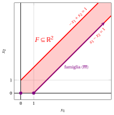
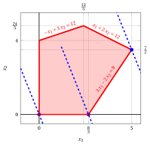

# Algoritmo del simplesso

**Parte 2 · L'algoritmo del simplesso · Capitolo 6** · [:material-file-pdf-box: Dispensa, volume 2 (PDF)](../pdf/dispensa-2-simplesso.pdf) · [:material-presentation: Slide](../pdf/slide-06-simplesso.pdf) · [:material-pencil: Esercizi: Algoritmo del simplesso](../esercizi/es-06-simplesso.md) · [:material-gesture-tap: App: Il simplesso passo per passo](../laboratorio/simplesso-passi.md)

## 6.1 La forma standard di un problema LP in forma canonica di massimo

- Consideriamo un problema LP in forma standard di massimo con $n+m$ variabili non negative e $m$ vincoli lineari di uguaglianza ottenuto da un problema LP in forma canonica di massimo con $n$ variabili non negative e $m$ vincoli lineari di minore o uguale aggiungendo $m$ variabili di scarto non negative:

    

    \begin{align*}
    &&   \max \;\;{\boldsymbol c}' \, {\boldsymbol x}  \label{FORM_STANDARD_OBJ} \tag{6.1a}\\[2ex]
    && \text{soggetto a} \quad  {\boldsymbol A} \; {\boldsymbol x}  &= {\boldsymbol b},  & \phantom{j=1111}  \label{FORM_STANDARD_CONS1} \tag{6.1b}\\[2ex]
    && {\boldsymbol x}                        &\ge  {\boldsymbol 0}. \label{FORM_STANDARD_CONS2} \tag{6.1c}
    \end{align*}

    I dati del problema LP   sono:

    - **1.** un vettore colonna dei costi ${\boldsymbol c} \in \Z^{(n+m) }$ di $n+m$ righe;

    - **2.** una matrice dei vincoli ${\boldsymbol A} \in \Z^{m \times (n+m) }$  di $m$ righe e $n+m$ colonne;

    - **3.** un vettore colonna dei termini noti ${\boldsymbol b} \in \Z^{m }$ di $m$ righe.

    $$
    {\boldsymbol  c}=
    \begin{pmatrix}
    c_{1} \\
    c_{2} \\
    \vdots  \\
    c_{n} \\
    0 \\
    \vdots  \\
    0 \\
    \end{pmatrix} ~~~~~~
    {\boldsymbol  A}=
    \begin{pmatrix}
    a_{11} & a_{12} & \cdots & a_{1n} & 1 & 0 & \cdots & 0 \\
    a_{21} & a_{22} & \cdots & a_{2n} & 0 & 1 & \cdots & 0 \\
    \vdots & \vdots & \ddots & \vdots & \vdots & \vdots & \ddots & \vdots \\
    a_{m1} & a_{m2} & \cdots & a_{mn} & 0 & 0 & \cdots & 1 \\
    \end{pmatrix} ~~~~~~
    {\boldsymbol b}=
    \begin{pmatrix}
    b_{1} \\
    b_{2} \\
    \vdots  \\
    b_{m} \\
    \end{pmatrix}
    $$

    Le $m+n$ variabili non negative possono essere scritte come un vettore colonna ${\boldsymbol x}$  di $n+m$ righe.

    $$
    {\boldsymbol x} = \begin{pmatrix}
    x_1 \\
    x_2 \\
    \vdots  \\
    x_n \\
    x_{n+1} \\
    x_{n+2} \\
    \vdots  \\
    x_{n+m} \\
    \end{pmatrix}
    $$

    Poiché il problema LP [(6.1)](#eq-FORM_STANDARD) è ottenuto aggiungendo $m$ variabili di scarto a un problema LP in forma canonica,  abbiamo:

    $$
    \begin{pmatrix}
    a_{1 (n+1)} & a_{1(n+2)} & \cdots   &a_{1(n+m)}\\
    a_{2(n+1)} & a_{2(n+2)} & \cdots   &a_{2(n+m)}\\
    \vdots & \vdots & \ddots & \vdots \\
    a_{m(n+1)} & a_{m(n+2)} & \cdots   &a_{m(n+m)}\\
    \end{pmatrix}
    =\begin{pmatrix}
    1 & 0 & \cdots & 0\\
    0 & 1 & \cdots & 0\\
    \vdots  & \vdots  & \ddots & \vdots \\
    0 &  0&  \cdots & 1
    \end{pmatrix}
    $$

    che è la matrice identità ${\boldsymbol  I}$ di dimensione $m$. Inoltre, per lo stesso motivo, abbiamo:

    $$
    \begin{pmatrix}
    c_{n+1} \\
    c_{n+2} \\
    \vdots  \\
    c_{n+m} \\
    \end{pmatrix}
    =
    \begin{pmatrix}
    0 \\
    0 \\
    \vdots  \\
    0 \\
    \end{pmatrix}
    $$

!!! chiave ""

    Poiché la matrice dei vincoli ${\boldsymbol A}  \in \Z^{m \times (n+m) }$ contiene la matrice identità ${\boldsymbol I}$ di dimensione $m$,  abbiamo:

    $$
    \rank({\boldsymbol A}) = m
    $$

    Di conseguenza ci sono $m$ <strong>righe linearmente indipendenti</strong> e  almeno un  insieme di  $m$ <strong>colonne linearmente indipendenti</strong> [^1] nella matrice dei vincoli ${\boldsymbol A}$.

!!! esempio "Esempio 6.1: forma standard di massimo di problemi LP in forma canonica di massimo"

    Consideriamo il seguente problema LP in forma canonica di massimo con $n=2$ variabili e $m=3$ vincoli:

    $$
    \begin{array}{rrrrrrrrrrrrr}
    {\max} & 5 \, {x_1} & {+} & 2 \, {x_2} \\[1ex]
    \text{soggetto a} & {-} \, {x_1} & {+} & 3 \, {x_2} & {\le} & 12 \\[1ex]
    & {x_1} & {+} & 2 \, {x_2} & {\le} & 12 \\[1ex]
    & {3} \, {x_1} & {-} & 2 \, {x_2} & {\le} & {8} \\[1ex]
    & {x_1,} &  & {x_2} & { \ge} & {0}
    \end{array}
    $$

    

    { .fig .ovale loading=lazy style="width:94%" }

    

    

    In blu tratteggiato l'insieme di livello $5\,x_1 + 2\,x_2 = 32$ passante per il vertice ottimo.

    Una soluzione ottima ${\tilde{\boldsymbol x}}(\,LP\,)$  è:

    $$
    \tilde{x}_1=5,~~\tilde{x}_2=\frac{7}{2}
    $$

    e il valore ottimo è:

    $$
    z(~LP~)  = 32
    $$

    

    La forma standard con $n+m=5$ variabili e $m=3$ vincoli si scrive come segue:

    $$
    \begin{array}{rrrrrrrrrrrrrrr}
    {\max} & 5 \, {x_1} & {+} & 2 \, {x_2} \\[1ex]
    \text{soggetto a} & {-} \, {x_1} & {+} & 3 \, {x_2} & {+} & {x_3} &  &  &  &  & {=} & 12 \\[1ex]
    & {x_1} & {+} & 2 \, {x_2} &  &  & {+} & {x_4} &  &  & {=} & 12 \\[1ex]
    & 3 \, {x_1} & {-} & 2 \, {x_2} &  &  &  &  & {+} & {x_5} & {=} & 8 \\[1ex]
    & {x_1,} &  & {x_2,} &  & {x_3,} &  & {x_4,} &  & {x_5} & {\ge} & {0}
    \end{array}
    $$

    Nel problema LP in forma standard (detto [Esempio 6.1](#box-1-ex-simplex-1)), abbiamo:

    $$
    {\boldsymbol  c}=
    \begin{pmatrix}
    5 \\[0.5ex]
    2 \\[0.5ex]
    0  \\[0.5ex]
    0  \\[0.5ex]
    0
    \end{pmatrix}
    \quad
    {\boldsymbol  A}=
    \begin{pmatrix}
    -1 & 3 & 1 & 0 & 0\\[1ex]
    1 & 2 & 0 & 1 & 0\\[1ex]
    3 & -2 & 0 & 0 & 1\\
    \end{pmatrix}
    \quad
    {\boldsymbol b}=
    \begin{pmatrix}
    12 \\[1ex]
    12 \\[1ex]
    8 \\
    \end{pmatrix}
    {\rm ~~~~~e~~~~~}  {\boldsymbol  x}=
    \begin{pmatrix}
    x_{1} \\[0.5ex]
    x_{2} \\[0.5ex]
    x_{3}  \\[0.5ex]
    x_{4}  \\[0.5ex]
    x_{5}
    \end{pmatrix}
    $$

    Una soluzione ottima ${\tilde{\boldsymbol x}}(\,LP\,)$ della forma standard è: $\tilde{x}_1=5,~~\tilde{x}_2=\frac{7}{2},~~\tilde{x}_3=\frac{13}{2},~~\tilde{x}_4=0,~~\tilde{x}_5=0$.

## 6.2 Base del problema LP in forma standard e dizionari

!!! definizione "Definizione 6.1: base del problema LP"

    Dato un sottoinsieme $\pazocal{B} \subseteq \{1,2,\dots,n+m\}$ di $m$ indici delle $n+m$ variabili del problema LP [(6.1)](#eq-FORM_STANDARD), se la matrice ${\boldsymbol  A}_{\pazocal{B}} \in \R^{m \times m}$ contenente le $m$ colonne di  ${\boldsymbol  A}$ con indici $j \in \pazocal{B}$:

    $$
    {\boldsymbol  A}_{\pazocal{B}}=({\boldsymbol  A}_j)_{j \in \pazocal{B}}
    $$

    è invertibile , si chiama <strong>base</strong> del problema LP [(6.1)](#eq-FORM_STANDARD).

!!! definizione "Definizione 6.2: partizione degli indici, variabili in base e variabili fuori base"

    Data una base ${\boldsymbol  A}_{\pazocal{B}}$ del problema LP [(6.1)](#eq-FORM_STANDARD),  abbiamo la seguente <strong>partizione</strong> degli indici $\{1,2,\dots,n+m\}$ delle variabili:

    $$
    \pazocal{B}\subseteq\{1,2,\dots,n+m\},\qquad |\pazocal{B}|=m,
    $$

    $$
    \pazocal{N}=\{1,2,\dots,n+m\}\setminus\pazocal{B},
    \qquad |\pazocal{N}|=n.
    $$

    Data una partizione $\pazocal{B}$ e $\pazocal{N}$, definiamo:

    1. il vettore colonna delle <strong>variabili in base</strong>  contenente  le $m$ variabili con indici $i \in \pazocal{B}$:

        $$
        {\boldsymbol x}_{\pazocal{B}}= (x_i)_{i \in \pazocal{B}}
        $$

    2. il vettore colonna delle <strong>variabili fuori base</strong>  contenente  le $n$ variabili con indici $i \in \pazocal{N}$:

        $$
        {\boldsymbol x}_{\pazocal{N}}=(x_i)_{i \in \pazocal{N}}
        $$

    3. il vettore colonna ${\boldsymbol c}_{\pazocal{B}} \in \R^{m }$  contenente  gli $m$ valori di ${\boldsymbol  c}$ con indici $i \in \pazocal{B}$:

        $$
        {\boldsymbol c}_{\pazocal{B}}=(c_i)_{i \in \pazocal{B}}
        $$

    4. la matrice ${\boldsymbol  A}_{\pazocal{N}} \in \R^{m \times n}$ contenente le $n$ colonne di ${\boldsymbol A}$ con indici $j \in \pazocal{N}$:

        $$
        {\boldsymbol  A}_{\pazocal{N}}=({\boldsymbol  A}_j)_{j \in \pazocal{N}}
        $$

    5. il vettore colonna ${\boldsymbol c}_{\pazocal{N}} \in \R^{n }$ contenente gli $n$ valori di ${\boldsymbol  c}$ con indici $i \in \pazocal{N}$:

        $$
        {\boldsymbol c}_{\pazocal{N}}=(c_i)_{i \in \pazocal{N}}
        $$

!!! esempio "Esempio 6.2: Base di problemi LP, variabili in base e variabili fuori base"

    Per il problema LP dell'[Esempio 6.1](#box-1-ex-simplex-1) con $\pazocal{B}= \{1,~~3,~~4\}$, abbiamo:

    $$
    {\boldsymbol  A}_{\pazocal{B}}=
    \begin{pmatrix}
    -1 & 1 & 0 \\
    1 & 0 & 1\\
    3 & 0 & 0\\
    \end{pmatrix}
    \qquad
    \det
    \left(
    {\boldsymbol  A}_{\pazocal{B}}
    \right)
    =
    -1 \cdot 0 \cdot 0
    + 1 \cdot 1 \cdot 3
    + 0 \cdot 1 \cdot 0
    - 1 \cdot 1 \cdot 0
    - (-1) \cdot 1 \cdot 0
    - 0 \cdot 0 \cdot 3 = 3 \neq 0
    $$

    e quindi $\rank({\boldsymbol  A}_{\pazocal{B}}) = 3$. Di conseguenza, la matrice ${\boldsymbol  A}_{\pazocal{B}}$ è invertibile ed è  una base del problema LP. Calcoliamo la matrice inversa ${\boldsymbol  A}_{\pazocal{B}}^{-1}$ con il metodo di Gauss-Jordan:

    \begin{align*}
    &\left(
    \begin{array}{ccc|ccc}
    {-1} & {1} & {0} & {1} & {0} & {0} \\
    {1} & {0} & {1} & {0} & {1} & {0} \\
    {3} & {0} & {0} & {0} & {0} & {1}
    \end{array}
    \right) \\[2ex]
    &\left(
    \begin{array}{ccc|ccc}
    {1} & {-1} & {0} & {-1} & {0} & {0} \\
    {1} & {0} & {1} & {0} & {1} & {0} \\
    {3} & {0} & {0} & {0} & {0} & {1}
    \end{array}
    \right) \hspace{1em} \text{(} R_1 \leftarrow -R_1 \text{)} \\[2ex]
    &\left(
    \begin{array}{ccc|ccc}
    {1} & {-1} & {0} & {-1} & {0} & {0} \\
    {0} & {1} & {1} & {1} & {1} & {0} \\
    {0} & {3} & {0} & {3} & {0} & {1}
    \end{array}
    \right) \hspace{1em} \text{(} R_2 \leftarrow R_2 - R_1,\ R_3 \leftarrow R_3 - 3R_1 \text{)} \\[2ex]
    &\left(
    \begin{array}{ccc|ccc}
    {1} & {0} & {1} & {0} & {1} & {0} \\
    {0} & {1} & {1} & {1} & {1} & {0} \\
    {0} & {0} & {-3} & {0} & {-3} & {1}
    \end{array}
    \right) \hspace{1em} \text{(} R_1 \leftarrow R_1 + R_2,\ R_3 \leftarrow R_3 - 3R_2 \text{)} \\[2ex]
    &\left(
    \begin{array}{ccc|ccc}
    {1} & {0} & {1} & {0} & {1} & {0} \\[0.5ex]
    {0} & {1} & {1} & {1} & {1} & {0} \\[0.5ex]
    {0} & {0} & {1} & {0} & {1} & {-\tfrac{1}{3}}
    \end{array}
    \right) \hspace{1em} \text{(} R_3 \leftarrow -\tfrac{1}{3} R_3 \text{)} \\[2ex]
    &\left(
    \begin{array}{ccc|ccc}
    {1} & {0} & {0} & {0} & {0} & {\tfrac{1}{3}} \\[0.5ex]
    {0} & {1} & {0} & {1} & {0} & {\tfrac{1}{3}} \\[0.5ex]
    {0} & {0} & {1} & {0} & {1} & {-\tfrac{1}{3}}
    \end{array}
    \right) \hspace{1em} \text{(} R_1 \leftarrow R_1 - R_3,\ R_2 \leftarrow R_2 - R_3 \text{)}
    \end{align*}

    Poiché $\pazocal{B}= \{1,~~3,~~4\}$, abbiamo:

    $$
    {\boldsymbol x}_{\pazocal{B}}=
    \begin{pmatrix}
    x_1 \\[1ex]
    x_3 \\[1ex]
    x_4 \\
    \end{pmatrix}
    \quad\quad
    {\boldsymbol A}_{\pazocal{B}}=
    \begin{pmatrix}
    -1 & 1 & 0 \\[1ex]
    1 & 0 & 1\\[1ex]
    3 & 0 & 0\\
    \end{pmatrix}
    \quad\quad
    {\boldsymbol c}_{\pazocal{B}}=
    \begin{pmatrix}
    5 \\[1ex]
    0 \\[1ex]
    0 \\
    \end{pmatrix}
    \qquad
    \text{e}
    \qquad
    \boldsymbol{A}_{\pazocal{B}}^{-1} =
    \begin{pmatrix}
    0 & 0 & \tfrac{1}{3} \\[1ex]
    1 & 0 & \tfrac{1}{3} \\[1ex]
    0 & 1 & -\tfrac{1}{3}
    \end{pmatrix}
    $$

    di conseguenza    $\pazocal{N}= \{2,~~5\}$ e abbiamo:

    $$
    {\boldsymbol x}_{\pazocal{N}}=
    \begin{pmatrix}
    x_2 \\[1ex]
    x_5 \\
    \end{pmatrix}
    \quad\quad
    {\boldsymbol A}_{\pazocal{N}}=
    \begin{pmatrix}
    3 & 0 \\[1ex]
    2 & 0 \\[1ex]
    -2 & 1 \\
    \end{pmatrix}
    \quad\quad
    {\boldsymbol c}_{\pazocal{N}}=
    \begin{pmatrix}
    2 \\[1ex]
    0 \\
    \end{pmatrix}
    $$

!!! esempio "Esempio 6.3: Base di problemi LP, variabili in base e variabili fuori base"

    Per il problema LP dell'[Esempio 6.1](#box-1-ex-simplex-1) con $\pazocal{B}= \{1,~~2,~~4\}$, abbiamo:

    $$
    {\boldsymbol  A}_{\pazocal{B}}=
    \begin{pmatrix}
    -1 & 3 & 0 \\
    1 & 2 & 1 \\
    3 & -2 & 0 \\
    \end{pmatrix}
    $$

    e

    \begin{align*}
    \det
    \left(
    {\boldsymbol  A}_{\pazocal{B}}
    \right)
    &=
    -1 \cdot (2 \cdot 0 - 1 \cdot (-2)) - 3 \cdot (1 \cdot 0 - 1 \cdot 3) + 0 \cdot (1 \cdot (-2) - 2 \cdot 3) \\
    &= -1 \cdot 2 + 3 \cdot 3 = 7 \neq 0
    \end{align*}

    e quindi $\rank({\boldsymbol  A}_{\pazocal{B}}) = 3$. Di conseguenza, la matrice ${\boldsymbol  A}_{\pazocal{B}}$ è invertibile ed è  una base del problema LP. Calcoliamo la matrice inversa ${\boldsymbol  A}_{\pazocal{B}}^{-1}$ con il metodo di Gauss-Jordan:

    \begin{align*}
    &\left(
    \begin{array}{ccc|ccc}
    {-1} & {3} & {0} & {1} & {0} & {0} \\
    {1} & {2} & {1} & {0} & {1} & {0} \\
    {3} & {-2} & {0} & {0} & {0} & {1}
    \end{array}
    \right) \\[1ex]
    &\left(
    \begin{array}{ccc|ccc}
    {1} & {-3} & {0} & {-1} & {0} & {0} \\
    {1} & {2} & {1} & {0} & {1} & {0} \\
    {3} & {-2} & {0} & {0} & {0} & {1}
    \end{array}
    \right) \hspace{1em} \text{(} R_1 \leftarrow -R_1 \text{)} \\[1ex]
    &\left(
    \begin{array}{ccc|ccc}
    {1} & {-3} & {0} & {-1} & {0} & {0} \\
    {0} & {5} & {1} & {1} & {1} & {0} \\
    {0} & {7} & {0} & {3} & {0} & {1}
    \end{array}
    \right) \hspace{1em} \text{(} R_2 \leftarrow R_2 - R_1,\ R_3 \leftarrow R_3 - 3R_1 \text{)} \\[1ex]
    &\left(
    \begin{array}{ccc|ccc}
    {1} & {-3} & {0} & {-1} & {0} & {0} \\[0.5ex]
    {0} & {1} & {\frac{1}{5}} & {\frac{1}{5}} & {\frac{1}{5}} & {0} \\[0.5ex]
    {0} & {7} & {0} & {3} & {0} & {1}
    \end{array}
    \right) \hspace{1em} \text{(} R_2 \leftarrow \frac{1}{5} R_2 \text{)} \\[1ex]
    &\left(
    \begin{array}{ccc|ccc}
    {1} & {0} & {\frac{3}{5}} & {-\frac{2}{5}} & {\frac{3}{5}} & {0} \\[0.5ex]
    {0} & {1} & {\frac{1}{5}} & {\frac{1}{5}} & {\frac{1}{5}} & {0} \\[0.5ex]
    {0} & {0} & {-\frac{7}{5}} & {\frac{8}{5}} & {-\frac{7}{5}} & {1}
    \end{array}
    \right) \hspace{1em} \text{(} R_1 \leftarrow R_1 + 3R_2,\ R_3 \leftarrow R_3 - 7R_2 \text{)} \\[1ex]
    &\left(
    \begin{array}{ccc|ccc}
    {1} & {0} & {\frac{3}{5}} & {-\frac{2}{5}} & {\frac{3}{5}} & {0} \\[0.5ex]
    {0} & {1} & {\frac{1}{5}} & {\frac{1}{5}} & {\frac{1}{5}} & {0} \\[0.5ex]
    {0} & {0} & {1} & {-\frac{8}{7}} & {1} & {-\frac{5}{7}}
    \end{array}
    \right) \hspace{1em} \text{(} R_3 \leftarrow -\tfrac{5}{7} R_3 \text{)} \\[1ex]
    &\left(
    \begin{array}{ccc|ccc}
    {1} & {0} & {0} & {\frac{2}{7}} & {0} & {\frac{3}{7}} \\[0.5ex]
    {0} & {1} & {0} & {\frac{3}{7}} & {0} & {\frac{1}{7}} \\[0.5ex]
    {0} & {0} & {1} & {-\frac{8}{7}} & {1} & {-\frac{5}{7}}
    \end{array}
    \right) \hspace{0.5em} \text{(} R_1 \leftarrow R_1 - \tfrac{3}{5}R_3,\ R_2 \leftarrow R_2 - \tfrac{1}{5}R_3 \text{)}
    \end{align*}

    Poiché $\pazocal{B}= \{1,~~2,~~4\}$, abbiamo:

    $$
    {\boldsymbol x}_{\pazocal{B}}=
    \begin{pmatrix}
    x_1 \\[1ex]
    x_2 \\[1ex]
    x_4 \\
    \end{pmatrix}
    \quad\quad
    {\boldsymbol A}_{\pazocal{B}}=
    \begin{pmatrix}
    -1 & 3 & 0 \\
    1 & 2 & 1 \\
    3 & -2 & 0 \\
    \end{pmatrix}
    \quad\quad
    {\boldsymbol c}_{\pazocal{B}}=
    \begin{pmatrix}
    5 \\[1ex]
    2 \\[1ex]
    0 \\
    \end{pmatrix}
    \quad
    \text{e}
    \quad
    \boldsymbol{A}_{\pazocal{B}}^{-1} =
    \begin{pmatrix}
    \frac{2}{7} & 0 & \frac{3}{7} \\[1ex]
    \frac{3}{7} & 0 & \frac{1}{7} \\[1ex]
    -\frac{8}{7} & 1 & -\frac{5}{7}
    \end{pmatrix}
    $$

    di conseguenza    $\pazocal{N}= \{3,~~5\}$ e abbiamo:

    $$
    {\boldsymbol x}_{\pazocal{N}}=
    \begin{pmatrix}
    x_3 \\[1ex]
    x_5 \\
    \end{pmatrix}
    \quad\quad
    {\boldsymbol A}_{\pazocal{N}}=
    \begin{pmatrix}
    1 & 0 \\
    0 & 0 \\
    0 & 1 \\
    \end{pmatrix}
    \quad\quad
    {\boldsymbol c}_{\pazocal{N}}=
    \begin{pmatrix}
    0 \\[1ex]
    0 \\
    \end{pmatrix}
    $$

- Data una base ${\boldsymbol  A}_{\pazocal{B}}$ del problema LP [(6.1)](#eq-FORM_STANDARD), possiamo riscrivere i vincoli di uguaglianza $\eqref{FORM_STANDARD_CONS1}$ come segue:

    \begin{equation*}
    {\boldsymbol  A} \; {\boldsymbol  x}  =
    \begin{pmatrix}
    {\boldsymbol  A}_{\pazocal{B}} & {\boldsymbol  A}_{\pazocal{N}}
    \end{pmatrix}
    \begin{pmatrix}
    {\boldsymbol  x}_{\pazocal{B}} \\[1ex]
    {{\boldsymbol  x}_{\pazocal{N}}}
    \end{pmatrix}
    ={\boldsymbol  A}_{\pazocal{B}} \; {\boldsymbol  x}_{\pazocal{B}} +{\boldsymbol  A}_{\pazocal{N}} \; {{\boldsymbol  x}_{\pazocal{N}}} =  {\boldsymbol b}
    \end{equation*}

    e quindi, moltiplicando per ${\boldsymbol  A}_{\pazocal{B}}^{-1}$, abbiamo:

    \begin{align*}
    {\boldsymbol  A}_{\pazocal{B}}^{-1} \big({\boldsymbol  A}_{\pazocal{B}} \; {\boldsymbol  x}_{\pazocal{B}} +{\boldsymbol  A}_{\pazocal{N}} \; {{\boldsymbol  x}_{\pazocal{N}}}\big) = {\boldsymbol  A}_{\pazocal{B}}^{-1} \; {\boldsymbol b} &~~\Rightarrow~~
    \underbrace{{\boldsymbol  A}_{\pazocal{B}}^{-1}\;{\boldsymbol  A}_{\pazocal{B}}}_{={\boldsymbol I}} \; {\boldsymbol  x}_{\pazocal{B}} + {\boldsymbol  A}_{\pazocal{B}}^{-1} \;{\boldsymbol  A}_{\pazocal{N}} \; {{\boldsymbol  x}_{\pazocal{N}}} = {\boldsymbol  A}_{\pazocal{B}}^{-1} \; {\boldsymbol b}
    \end{align*}

    !!! chiave ""

        Le variabili in base possono essere scritte in funzione delle variabili fuori base come segue:

        \begin{equation*}
        {\boldsymbol  x}_{\pazocal{B}} = {\boldsymbol  A}_{\pazocal{B}}^{-1} \; {\boldsymbol b} - {\boldsymbol  A}_{\pazocal{B}}^{-1}\;{\boldsymbol  A}_{\pazocal{N}} \; {{\boldsymbol  x}_{\pazocal{N}}}
        \label{BBBB} \tag{6.2}
        \end{equation*}

    Inoltre,  possiamo  riscrivere il valore della funzione obiettivo $\eqref{FORM_STANDARD_OBJ}$ , indicato con  $z$, come segue:

    \begin{equation*}
    z ={\boldsymbol  c}' {\boldsymbol  x}=
    \begin{pmatrix}
    {\boldsymbol c}_{\pazocal{B}} \\[1ex]
    {{\boldsymbol c}_{\pazocal{N}}}
    \end{pmatrix}
    '
    \begin{pmatrix}
    {\boldsymbol  x}_{\pazocal{B}} \\[1ex]
    {{\boldsymbol  x}_{\pazocal{N}}}
    \end{pmatrix}
    = {\boldsymbol c}'_{\pazocal{B}} \; {\boldsymbol  x}_{\pazocal{B}} + {\boldsymbol c}'_{\pazocal{N}} \;{{\boldsymbol  x}_{\pazocal{N}}}
    \end{equation*}

    Usando $\eqref{BBBB}$, otteniamo quindi:

    $$
    z = {\boldsymbol c}'_{\pazocal{B}} \; \big({\boldsymbol  A}_{\pazocal{B}}^{-1} \; {\boldsymbol b} - {\boldsymbol  A}_{\pazocal{B}}^{-1}\;{\boldsymbol  A}_{\pazocal{N}} \; {{\boldsymbol  x}_{\pazocal{N}}}\big) + {\boldsymbol c}'_{\pazocal{N}} \;{{\boldsymbol  x}_{\pazocal{N}}}
    $$

    !!! chiave ""

        La funzione obiettivo può essere scritta in funzione delle variabili fuori base come segue:

        \begin{equation*}
        z =  {\boldsymbol c}'_{\pazocal{B}} \; {\boldsymbol  A}_{\pazocal{B}}^{-1}\;{\boldsymbol b} + \big({\boldsymbol c}'_{\pazocal{N}} - {\boldsymbol c}'_{\pazocal{B}} \; {\boldsymbol  A}_{\pazocal{B}}^{-1}\;{\boldsymbol  A}_{\pazocal{N}} \big) \; {{\boldsymbol  x}_{\pazocal{N}}}
        \label{OOOO} \tag{6.3}
        \end{equation*}

    Usando $\eqref{BBBB}$ e $\eqref{OOOO}$, il <strong>problema LP [(6.1)](#eq-FORM_STANDARD) può essere riformulato sotto forma di dizionario</strong>.

    

    !!! definizione "Definizione 6.3: dizionario"

        Data una base ${\boldsymbol  A}_{\pazocal{B}}$ del problema LP [(6.1)](#eq-FORM_STANDARD),  il <strong>dizionario</strong> associato è un sistema di $m+1$ equazioni lineari in cui le variabili in base e la funzione obiettivo sono scritte in funzione delle variabili fuori base:

        \begin{equation*}
        \begin{cases} {\boldsymbol  x}_{\pazocal{B}} = {{\bar{\boldsymbol b}}} - {{\bar{\boldsymbol A}}} \; {{\boldsymbol  x}_{\pazocal{N}}}\\[2ex]
        z = {\bar{z}} + { \bar{\boldsymbol c}}' \; {{\boldsymbol  x}_{\pazocal{N}}} \end{cases}
        \qquad \text{dove} \qquad \qquad
        \begin{cases}
        {{\bar{\boldsymbol b}}} = {\boldsymbol  A}_{\pazocal{B}}^{-1} \; {\boldsymbol b}\\[2ex]
        {{\bar{\boldsymbol A}}} =  {{\boldsymbol  A}_{\pazocal{B}}^{-1} \;{\boldsymbol  A}_{\pazocal{N}}}\\[2ex]
        {\bar{z}} =
        {\boldsymbol c}'_{\pazocal{B}} \; {\boldsymbol  A}_{\pazocal{B}}^{-1} \; {\boldsymbol b}   \\[2ex]
        {{ \bar{\boldsymbol c}}'}  = {\boldsymbol c}'_{\pazocal{N}} -  {\boldsymbol c}'_{\pazocal{B}} \; {\boldsymbol  A}_{\pazocal{B}}^{-1} \;{\boldsymbol  A}_{\pazocal{N}}
        \end{cases}
        \label{DICTIONARY} \tag{6.4}
        \end{equation*}

- Data una base ${\boldsymbol  A}_{\pazocal{B}}$ del problema LP [(6.1)](#eq-FORM_STANDARD), nel dizionario associato ci sono:

    1. la matrice ${\bar{\boldsymbol A}} \in \R^{m \times n}$ di $m$ righe associata alle variabili in base e  $n$ colonne associate alle variabili fuori base

    2. due vettori colonna ${\bar{\boldsymbol b}} \in \R^{m }$ e ${ \bar{\boldsymbol c}} \in \R^{n }$  di $m$ righe associate alle variabili in base e di  $n$ righe associate alle variabili fuori base, rispettivamente:

        $$
        {\bar{\boldsymbol A}}
        =(\bar{a}_{ij})_{i \in \pazocal{B}, j \in \pazocal{N}},
        \qquad
        {\bar{\boldsymbol b}}
        =(\bar{b}_{i})_{i \in \pazocal{B}},
        \qquad
        {\bar{\boldsymbol c}}
        =(\bar{c}_{i})_{i \in \pazocal{N}}.
        $$

    !!! chiave ""

        Un dizionario può essere  riscritto equivalentemente usando le sommatorie come segue:

        \begin{equation*}
        \begin{cases} \displaystyle x_{i} = {{ \bar{b}_i}} - \sum_{j \in \pazocal{N}} \bar{a}_{ij} \; x_{j},~~ \forall i \in \pazocal{B}\\[4ex]
        \displaystyle z = \bar{z}  + \sum_{j \in \pazocal{N}} \bar{c}_{j} \; x_{j} \end{cases}
        \end{equation*}

!!! esempio "Esempio 6.4: dizionario del simplesso"

    Per il problema LP dell'[Esempio 6.1](#box-1-ex-simplex-1), con $\pazocal{B}= \{1,~~3,~~4\}$ e $\pazocal{N}= \{2,~~5\},$ abbiamo:

    \begin{align*}
    {{\bar{\boldsymbol b}}} &= {\boldsymbol  A}_{\pazocal{B}}^{-1} \; {\boldsymbol b} = \begin{pmatrix}
    0 & 0 & \frac{1}{3}\\[1ex]
    1 & 0 & \frac{1}{3}\\[1ex]
    0 & 1 & -\frac{1}{3}\\
    \end{pmatrix} \begin{pmatrix}
    12 \\[1ex]
    12 \\[1ex]
    8 \\
    \end{pmatrix} = \begin{pmatrix}
    \frac{8}{3} \\[1ex]
    \frac{44}{3} \\[1ex]
    \frac{28}{3} \\
    \end{pmatrix}\\[2ex]
    {{\bar{\boldsymbol A}}} &=  {{\boldsymbol  A}_{\pazocal{B}}^{-1} \;{\boldsymbol  A}_{\pazocal{N}}} = \begin{pmatrix}
    0 & 0 & \frac{1}{3}\\[1ex]
    1 & 0 & \frac{1}{3}\\[1ex]
    0 & 1 & -\frac{1}{3}\\
    \end{pmatrix} \begin{pmatrix}
    3 & 0 \\[1ex]
    2 & 0 \\[1ex]
    -2 & 1 \\
    \end{pmatrix}
    =
    \begin{pmatrix}
    -\frac{2}{3} & \frac{1}{3}\\[1ex]
    \frac{7}{3} & \frac{1}{3}\\[1ex]
    \frac{8}{3} & -\frac{1}{3}
    \end{pmatrix}
    \\[2ex]
    {\bar{z}} &=
    {\boldsymbol c}'_{\pazocal{B}} \; {\boldsymbol  A}_{\pazocal{B}}^{-1} \; {\boldsymbol b}    =
    \begin{pmatrix}
    5 & 0 & 0\\
    \end{pmatrix}
    \begin{pmatrix}
    0 & 0 & \frac{1}{3}\\[1ex]
    1 & 0 & \frac{1}{3}\\[1ex]
    0 & 1 & -\frac{1}{3}\\
    \end{pmatrix} \begin{pmatrix}
    12 \\[1ex]
    12 \\[1ex]
    8
    \end{pmatrix} =  \begin{pmatrix}
    0 & 0 & \frac{5}{3}
    \end{pmatrix} \begin{pmatrix}
    12 \\[1ex]
    12 \\[1ex]
    8 \\
    \end{pmatrix} = \frac{40}{3}
    \end{align*}

    \begin{align*}
    {{ \bar{\boldsymbol c}}'}  &= {\boldsymbol c}'_{\pazocal{N}} -  {\boldsymbol c}'_{\pazocal{B}} \; {\boldsymbol  A}_{\pazocal{B}}^{-1} \;{\boldsymbol  A}_{\pazocal{N}} = \begin{pmatrix}
    2 & 0\\
    \end{pmatrix}
    -
    \begin{pmatrix}
    5 & 0 & 0\\
    \end{pmatrix}
    \begin{pmatrix}
    0 & 0 & \frac{1}{3}\\[1ex]
    1 & 0 & \frac{1}{3}\\[1ex]
    0 & 1 & -\frac{1}{3}\\
    \end{pmatrix}
    \begin{pmatrix}
    3 & 0 \\[1ex]
    2 & 0 \\[1ex]
    -2 & 1 \\
    \end{pmatrix}\\[1ex]
    &= \begin{pmatrix}
    2 & 0 \\
    \end{pmatrix} - \begin{pmatrix}
    0 & 0 & \frac{5}{3} \\
    \end{pmatrix} \begin{pmatrix}
    3 & 0 \\[1ex]
    2 & 0 \\[1ex]
    -2 & 1 \\
    \end{pmatrix} =
    \begin{pmatrix}
    2 & 0  \\
    \end{pmatrix}
    -
    \begin{pmatrix}
    -\frac{10}{3} & \frac{5}{3} \\
    \end{pmatrix}
    =
    \begin{pmatrix}
    \frac{16}{3} & -\frac{5}{3} \\
    \end{pmatrix}
    \end{align*}

    Di conseguenza, il dizionario associato è:

    \begin{equation*}
    \begin{cases}
    \begin{pmatrix}
    x_1 \\[1ex]
    x_3 \\[1ex]
    x_4 \\
    \end{pmatrix}=\begin{pmatrix}
    \frac{8}{3} \\[1ex]
    \frac{44}{3} \\[1ex]
    \frac{28}{3} \\
    \end{pmatrix} - \begin{pmatrix}
    -\frac{2}{3} & \frac{1}{3}\\[1ex]
    \frac{7}{3} & \frac{1}{3}\\[1ex]
    \frac{8}{3} & -\frac{1}{3}
    \end{pmatrix} \;\begin{pmatrix}
    x_2 \\[1ex]
    x_5 \\
    \end{pmatrix}\\[5ex]
    z=  \frac{40}{3}  + \begin{pmatrix}
    \frac{16}{3} & -\frac{5}{3}
    \end{pmatrix} \;\begin{pmatrix}
    x_2 \\[1ex]
    x_5 \\
    \end{pmatrix}\\[2ex]
    \end{cases}
    \end{equation*}

    o, equivalentemente:

    \begin{equation*}
    \begin{cases}
    \begin{array}{rrrrrrrrrrrrr}
    {x_1} & {=} & {\frac{8}{3}} & {+} & {\frac{2}{3}}\, {x_2} & {-} & {\frac{1}{3}}\, {x_5} \\[2ex]
    {x_3} & {=} & {\frac{44}{3}} & {-} & {\frac{7}{3}}\, {x_2} & {-} & {\frac{1}{3}}\, {x_5} \\[2ex]
    {x_4} & {=} & {\frac{28}{3}} & {-} & {\frac{8}{3}}\, {x_2} & {+} & {\frac{1}{3}}\, {x_5} \\[2ex]
    {z} & {=} & {\frac{40}{3}} & {+} & {\frac{16}{3}}\, {x_2} & {-} & {\frac{5}{3}}\, \, {x_5}
    \end{array}
    \end{cases}
    \end{equation*}

    Questo dizionario è associato alla soluzione ammissibile $\bar{x}_1=\frac{8}{3},\bar{x}_2=0,~\bar{x}_3=\frac{44}{3},~\bar{x}_4=\frac{28}{3},\bar{x}_5=0$ di valore $z=\frac{40}{3}$.

!!! esempio "Esempio 6.5: dizionario del simplesso"

    Per il problema LP dell'[Esempio 6.1](#box-1-ex-simplex-1), con $\pazocal{B}= \{1,~~2,~~4\}$ e $\pazocal{N}= \{3,~~5\},$ abbiamo:

    \begin{align*}
    {{\bar{\boldsymbol b}}} &= {\boldsymbol  A}_{\pazocal{B}}^{-1} \; {\boldsymbol b} =
    \begin{pmatrix}
    \frac{2}{7} & 0 & \frac{3}{7}\\[1ex]
    \frac{3}{7} & 0 & \frac{1}{7}\\[1ex]
    -\frac{8}{7} & 1 & -\frac{5}{7}\\
    \end{pmatrix} \begin{pmatrix}
    12 \\[1ex]
    12 \\[1ex]
    8 \\
    \end{pmatrix} = \begin{pmatrix}
    \frac{48}{7} \\[1ex]
    \frac{44}{7} \\[1ex]
    -\frac{52}{7} \\
    \end{pmatrix}\\[2ex]
    {{\bar{\boldsymbol A}}} &=  {{\boldsymbol  A}_{\pazocal{B}}^{-1} \;{\boldsymbol  A}_{\pazocal{N}}} =
    \begin{pmatrix}
    \frac{2}{7} & 0 & \frac{3}{7}\\[1ex]
    \frac{3}{7} & 0 & \frac{1}{7}\\[1ex]
    -\frac{8}{7} & 1 & -\frac{5}{7}\\
    \end{pmatrix} \begin{pmatrix}
    1 & 0 \\[1ex]
    0 & 0 \\[1ex]
    0 & 1 \\
    \end{pmatrix}
    =
    \begin{pmatrix}
    \frac{2}{7} & \frac{3}{7}\\[1ex]
    \frac{3}{7} & \frac{1}{7}\\[1ex]
    -\frac{8}{7} & -\frac{5}{7}
    \end{pmatrix}
    \\[2ex]
    {\bar{z}} &=
    {\boldsymbol c}'_{\pazocal{B}} \; {\boldsymbol  A}_{\pazocal{B}}^{-1} \; {\boldsymbol b}    =
    \begin{pmatrix}
    5 & 2 & 0\\
    \end{pmatrix}
    \begin{pmatrix}
    \frac{2}{7} & 0 & \frac{3}{7}\\[1ex]
    \frac{3}{7} & 0 & \frac{1}{7}\\[1ex]
    -\frac{8}{7} & 1 & -\frac{5}{7}\\
    \end{pmatrix} \begin{pmatrix}
    12 \\[1ex]
    12 \\[1ex]
    8
    \end{pmatrix} =  \begin{pmatrix}
    \frac{16}{7} & 0 & \frac{17}{7}\\
    \end{pmatrix} \begin{pmatrix}
    12 \\[1ex]
    12 \\[1ex]
    8 \\
    \end{pmatrix} =  \frac{328}{7}
    \end{align*}

    \begin{align*}
    {{ \bar{\boldsymbol c}}'}  &= {\boldsymbol c}'_{\pazocal{N}} -  {\boldsymbol c}'_{\pazocal{B}} \; {\boldsymbol  A}_{\pazocal{B}}^{-1} \;{\boldsymbol  A}_{\pazocal{N}} = \begin{pmatrix}
    0 & 0\\
    \end{pmatrix}
    -
    \begin{pmatrix}
    5 & 2 & 0\\
    \end{pmatrix}
    \begin{pmatrix}
    \frac{2}{7} & 0 & \frac{3}{7}\\[1ex]
    \frac{3}{7} & 0 & \frac{1}{7}\\[1ex]
    -\frac{8}{7} & 1 & -\frac{5}{7}\\
    \end{pmatrix}
    \begin{pmatrix}
    1 & 0 \\[1ex]
    0 & 0 \\[1ex]
    0 & 1 \\
    \end{pmatrix}\\[1ex]
    &= \begin{pmatrix}
    0 & 0\\
    \end{pmatrix}
    -
    \begin{pmatrix}
    \frac{16}{7} & 0 & \frac{17}{7}\\
    \end{pmatrix}
    \begin{pmatrix}
    1 & 0 \\[1ex]
    0 & 0 \\[1ex]
    0 & 1
    \end{pmatrix}
    =
    \begin{pmatrix}
    0 & 0\\
    \end{pmatrix}
    -
    \begin{pmatrix}
    \frac{16}{7} & \frac{17}{7}\\
    \end{pmatrix}
    =
    \begin{pmatrix}
    -\frac{16}{7} & -\frac{17}{7}
    \end{pmatrix}
    \end{align*}

    Di conseguenza, il dizionario associato è:

    \begin{equation*}
    \begin{cases}
    \begin{pmatrix}
    x_1 \\[1ex]
    x_2 \\[1ex]
    x_4 \\
    \end{pmatrix}=\begin{pmatrix}
    \frac{48}{7} \\[1ex]
    \frac{44}{7} \\[1ex]
    -\frac{52}{7} \\
    \end{pmatrix} - \begin{pmatrix}
    \frac{2}{7} & \frac{3}{7}\\[1ex]
    \frac{3}{7} & \frac{1}{7}\\[1ex]
    -\frac{8}{7} & -\frac{5}{7}
    \end{pmatrix} \;\begin{pmatrix}
    x_3 \\[1ex]
    x_5 \\
    \end{pmatrix}\\[5ex]
    z=  \frac{328}{7}  + \begin{pmatrix}
    -\frac{16}{7} & -\frac{17}{7}
    \end{pmatrix} \;\begin{pmatrix}
    x_3 \\[1ex]
    x_5 \\
    \end{pmatrix}\\[2ex]
    \end{cases}
    \end{equation*}

    o, equivalentemente:

    \begin{equation*}
    \begin{cases}
    \begin{array}{rrrrrrrrrrrrr}
    {x_1} & {=} & {\frac{48}{7}} & {-} & {\frac{2}{7}}\, {x_3} & {-} & {\frac{3}{7}}\, {x_5} \\[2ex]
    {x_2} & {=} & {\frac{44}{7}} & {-} & {\frac{3}{7}}\, {x_3} & {-} & {\frac{1}{7}}\, {x_5} \\[2ex]
    {x_4} & {=} & {-\frac{52}{7}} & {+} & {\frac{8}{7}}\, {x_3} & {+} & {\frac{5}{7}}\, {x_5} \\[2ex]
    {z} & {=} & {\frac{328}{7}} & {-} & {\frac{16}{7}}\, {x_3} & {-} & {\frac{17}{7}}\, \, {x_5}
    \end{array}
    \end{cases}
    \end{equation*}

    Questo dizionario non è associato a una soluzione ammissibile.

### 6.2.1 Soluzioni di base ammissibili e costi ridotti

- I valori delle variabili in base dipendono dai valori delle variabili fuori base,  di conseguenza:

    1. <strong>le variabili in base sono le variabili dipendenti</strong>

    2. <strong>le variabili fuori base sono le variabili indipendenti</strong>

    

    !!! definizione "Definizione 6.4: soluzione di base"

        Data una base ${\boldsymbol  A}_{\pazocal{B}}$ del problema LP [(6.1)](#eq-FORM_STANDARD), ponendo tutte le variabili fuori base a zero abbiamo:

        \begin{equation*}
        {\boldsymbol  x}_{\pazocal{B}} = {{\bar{\boldsymbol b}}} {\rm ~~~~~e~~~~~} {\boldsymbol  x}_{\pazocal{N}} = {\boldsymbol 0}
        \label{FEASIBLE_SOLUTIONS} \tag{6.5}
        \end{equation*}

        che si chiama <strong>soluzione di base</strong> del problema LP [(6.1)](#eq-FORM_STANDARD).

- Le variabili sono non negative $\eqref{FORM_STANDARD_CONS2}$ quindi non tutte le soluzioni di base sono soluzioni ammissibili.

!!! definizione "Definizione 6.5: soluzioni di base ammissibili"

    Data una base ${\boldsymbol  A}_{\pazocal{B}}$ del problema LP [(6.1)](#eq-FORM_STANDARD),  se $~{{\bar{\boldsymbol b}}}  \ge {\boldsymbol 0}~$ allora

    \begin{equation*}
    {\boldsymbol  x}_{\pazocal{B}} = {{\bar{\boldsymbol b}}} ~~~{\rm e}~~~ {\boldsymbol  x}_{\pazocal{N}} = {\boldsymbol 0} \tag{6.6}
    \end{equation*}

    si chiama <strong>soluzione di base ammissibile</strong>.

!!! definizione "Definizione 6.6: vettore dei costi ridotti"

    Data una base ${\boldsymbol  A}_{\pazocal{B}}$ del problema LP [(6.1)](#eq-FORM_STANDARD), il vettore ${{ \bar{\boldsymbol c}}}$

    si chiama <strong>vettore dei costi ridotti</strong>.

- Il costo ridotto

    $$
    \bar{c}_p=c_p -  {\boldsymbol c}'_{\pazocal{B}} \; {\boldsymbol  A}_{\pazocal{B}}^{-1} \;{\boldsymbol  A}_{p}
    $$

    di una variabile fuori base $x_p$ con $p \in \pazocal{N}$ è la variazione della funzione obiettivo per ogni incremento unitario della variabile.

    L'incremento è proporzionale a $c_p$ mentre il decremento  (dovuto alla variazione delle variabili in base per preservare i vincoli di uguaglianza $\eqref{FORM_STANDARD_CONS1}$) è proporzionale a ${\boldsymbol  c}'_{\pazocal{B}} {\boldsymbol  A}_{\pazocal{B}}^{-1} \;{\boldsymbol  A}_{p}$.

### 6.2.2 Determinare una soluzione di base ammissibile iniziale

!!! chiave ""

    Per un problema LP [(6.1)](#eq-FORM_STANDARD),  se $~{\boldsymbol b} \ge {\boldsymbol 0}$, la partizione:

    $$
    \pazocal{B}=\{n+1,n+2,\dots,n+m\} {\rm  ~~~e~~~} \pazocal{N}=\{1,2,\dots,n\}
    $$

    è associata a una base ${\boldsymbol  A}_{\pazocal{B}}={\boldsymbol I}$ e alla <strong>soluzione di base ammissibile iniziale</strong>:

    \begin{equation*}
    {\boldsymbol  x}_{\pazocal{B}} = { {\boldsymbol b}} {\rm ~~~~~e~~~~~} {\boldsymbol  x}_{\pazocal{N}} = {\boldsymbol 0}
    \label{FEASIBLE_BASIC_SOLUTIONS_INIT} \tag{6.7}
    \end{equation*}

- Per un problema LP [(6.1)](#eq-FORM_STANDARD), poiché in $\pazocal{B}$ ci sono gli indici delle $m$ variabili di scarto, abbiamo:

    $$
    {\boldsymbol  A}_{\pazocal{B}}=
    \begin{pmatrix}
    1 & 0 & \cdots & 0\\
    0 & 1 & \cdots & 0\\
    \vdots  & \vdots  & \ddots & \vdots \\
    0 &  0&  \cdots & 1
    \end{pmatrix}
    ={\boldsymbol  I}
    ={\boldsymbol  A}_{\pazocal{B}}^{-1}
    \quad
    {\rm~~~e~~~}
    \quad
    {\boldsymbol c}_{\pazocal{B}}
    =
    \begin{pmatrix}
    0 \\
    0 \\
    \vdots  \\
    0 \\
    \end{pmatrix}
    $$

    Di conseguenza, la matrice ${\boldsymbol  A}_{\pazocal{B}}$ è invertibile e quindi è  una base. Inoltre, abbiamo:

    $$
    {\boldsymbol  A}_{\pazocal{N}}=
    \begin{pmatrix}
    a_{11} & a_{12} & \cdots & a_{1n}\\
    a_{21} & a_{22} & \cdots & a_{2n}\\
    \vdots  & \vdots  & \ddots & \vdots \\
    a_{m1} & a_{m2} & \cdots & a_{mn}\\
    \end{pmatrix}
    \quad
    {\rm~~~e~~~}
    \quad
    {\boldsymbol c}_{\pazocal{N}}
    =
    \begin{pmatrix}
    c_{1} \\
    c_{2} \\
    \vdots  \\
    c_{n} \\
    \end{pmatrix}
    $$

    In questi casi, abbiamo quindi:

    \begin{equation*}
    \begin{cases}
    {{\bar{\boldsymbol b}}} = {\boldsymbol  A}_{\pazocal{B}}^{-1} \; {\boldsymbol b} = {\boldsymbol  I} \; {\boldsymbol b} = {\boldsymbol b}\\[1ex]
    {{\bar{\boldsymbol A}}} =  {{\boldsymbol  A}_{\pazocal{B}}^{-1} \;{\boldsymbol  A}_{\pazocal{N}}} = {\boldsymbol  I} \; {\boldsymbol  A}_{\pazocal{N}}= {\boldsymbol  A}_{\pazocal{N}}\\[1ex]
    {\bar{z}} = {{\boldsymbol c}'_{\pazocal{B}} \; {\boldsymbol  A}_{\pazocal{B}}^{-1}} \; {\boldsymbol b} = {{\boldsymbol c}'_{\pazocal{B}} \; {\boldsymbol  I}} \; {\boldsymbol b} = 0\\[1ex]
    {{ \bar{\boldsymbol c}}'}  = {{\boldsymbol c}'_{\pazocal{N}} - {{\boldsymbol c}'_{\pazocal{B}} \; {\boldsymbol  A}_{\pazocal{B}}^{-1}} \;{\boldsymbol  A}_{\pazocal{N}}} = {{\boldsymbol c}'_{\pazocal{N}} - {{\boldsymbol c}'_{\pazocal{B}} \; {\boldsymbol  I}} \;{\boldsymbol  A}_{\pazocal{N}}} =  {\boldsymbol c}'_{\pazocal{N}}
    \end{cases}
    \end{equation*}

!!! esempio "Esempio 6.6: soluzione di base ammissibile iniziale"

    Per il problema LP dell'[Esempio 6.1](#box-1-ex-simplex-1), poiché $\begin{pmatrix} 12 \\ 12 \\ 8 \\ \end{pmatrix} \ge \begin{pmatrix} 0 \\ 0 \\ 0 \\ \end{pmatrix}$, con $\pazocal{B}=\{3,4,5\}$ e $\pazocal{N}=\{1,2\}$, abbiamo la soluzione di base ammissibile $\begin{pmatrix} x_3 \\ x_4 \\ x_5 \\ \end{pmatrix} = \begin{pmatrix} 12 \\ 12 \\ 8 \end{pmatrix}$ e $\begin{pmatrix} x_1 \\ x_2 \end{pmatrix} = \begin{pmatrix} 0 \\ 0 \end{pmatrix}.$ Inoltre ${\bar{z}}=0$ e abbiamo:

    $$
    {{\boldsymbol  x}_{\pazocal{B}}}=\begin{pmatrix}
    x_3 \\[1ex]
    x_4 \\[1ex]
    x_5 \\
    \end{pmatrix},~~ {\boldsymbol c}'_{\pazocal{B}}=
    \begin{pmatrix}
    0 & 0 & 0
    \end{pmatrix}
    ,~~{\boldsymbol  A}_{\pazocal{B}}=\begin{pmatrix}
    1 & 0 & 0\\[1ex]
    0 & 1 & 0\\[1ex]
    0 & 0 & 1
    \end{pmatrix}
    $$

    e

    $$
    {\boldsymbol  x}_{\pazocal{N}}=\begin{pmatrix}
    x_1 \\[1ex]
    x_2 \\
    \end{pmatrix},~~
    \underbrace{{\boldsymbol c}'_{\pazocal{N}}}_{={{ \bar{\boldsymbol c}}'} }
    =\begin{pmatrix}
    5 & 2
    \end{pmatrix}, ~~
    \underbrace{{\boldsymbol  A}_{\pazocal{N}}}_{= {{\bar{\boldsymbol A}}}} =\begin{pmatrix}
    -1 & 3 \\[1ex]
    1 & 2 \\[1ex]
    3 & -2 \\
    \end{pmatrix}
    $$

## 6.3 Operazioni di pivot

- Data una base ${\boldsymbol A}_{\pazocal{B}}$ e una soluzione di base ammissibile ${\boldsymbol  x}_{\pazocal{B}} = {{\bar{\boldsymbol b}}}$ e ${\boldsymbol  x}_{\pazocal{N}} = {\boldsymbol 0}$ del problema LP [(6.1)](#eq-FORM_STANDARD), se nel dizionario associato esiste $j \in \pazocal{N}$ tale che $\bar{c}_j > 0$ (un costo ridotto positivo), è necessario eseguire un'operazione di pivot.

!!! definizione "Definizione 6.7: operazione di pivot"

    Un'<strong>operazione di pivot</strong> consiste nel determinare una <strong>nuova soluzione di base ammissibile</strong> con l'obiettivo di aumentare il valore della soluzione di base ammissibile <strong>scambiando una variabile fuori base e una variabile in base</strong>. 

    - La variabile fuori base che entra in base si chiama <strong>colonna pivot</strong>

    - La variabile in base che esce dalla base si chiama <strong>riga pivot</strong>

### 6.3.1 Determinare una nuova soluzione di base ammissibile

!!! chiave ""

    <strong>La colonna pivot è una variabile fuori base con un costo ridotto positivo</strong>,  cioè una variabile fuori base

    $$
    x_p \text{  con  } p \in \pazocal{N}
    \text{  tale che  } \underbrace{c_p -  {\boldsymbol c}'_{\pazocal{B}} \; {\boldsymbol  A}_{\pazocal{B}}^{-1} \;{\boldsymbol  A}_p}_{=\bar{c}_p} >0
    $$

- Poiché tra le variabili fuori base solo il valore della colonna pivot $x_p$ con $p \in \pazocal{N}$ viene (potenzialmente) aumentato,  abbiamo:

    $$
    {\boldsymbol  x}_{\pazocal{B}}
    =
    {{\bar{\boldsymbol b}}}
    - \underbrace{{{\boldsymbol  A}_{\pazocal{B}}^{-1} \;{\boldsymbol  A}_{p}} }_{=\bar{\boldsymbol A}_{p}} \; x_{p}
    $$

    dove $\bar{\boldsymbol  A}_{p}$ è la colonna della matrice ${\bar{\boldsymbol A}}$ associata alla colonna pivot $x_p$. Queste $m$ uguaglianze determinano la variazione dei valori delle variabili in base causata da un incremento del valore della colonna pivot. 

    <strong>Il valore della colonna pivot viene aumentato il più possibile mantenendo allo stesso tempo non negativo il valore di tutte le variabili in base</strong>. In questo modo viene determinata una nuova soluzione di base ammissibile. Di conseguenza,  il valore della colonna pivot diventa il valore massimo $t$, detto $t_m$, tale che:

    $$
    {{\bar{\boldsymbol b}}}  - t \; \underbrace{{{\boldsymbol  A}_{\pazocal{B}}^{-1} \;{\boldsymbol  A}_{p}} }_{=\bar{\boldsymbol A}_{p} } \ge {\boldsymbol  0} \quad \Rightarrow \quad t_m=\min \left\{~\frac{\bar b_i}{\bar a_{ip}}: i\in\pazocal{B},~\bar a_{ip}>0 ~\right\}
    $$

    Se $\bar a_{ip}\le 0$ per ogni $i\in\pazocal{B}$, allora il problema LP è illimitato nella direzione di $x_p$. In questo caso, il valore della colonna pivot può essere aumentato senza limite mantenendo non negativo il valore di tutte le variabili in base.

    !!! chiave ""

        <strong>Certificato di illimitatezza.</strong> Data una base ${\boldsymbol A}_{\pazocal{B}}$ con una soluzione di base ammissibile, se esiste una variabile fuori base $x_p$ con $p \in \pazocal{N}$ tale che

        $$
        \bar{c}_p > 0
        \qquad {\rm e} \qquad
        \bar{a}_{ip} \le 0, \quad \forall i \in \pazocal{B},
        $$

        allora il problema LP [(6.1)](#eq-FORM_STANDARD) è <strong>illimitato</strong>.

    - Infatti, per ogni valore $t \ge 0$, il punto

        \begin{equation*}
        \label{RAY}
        x_p = t,
        \qquad
        x_i = \bar{b}_i - t \; \bar{a}_{ip} ,\quad \forall i \in \pazocal{B},
        \qquad
        x_j = 0 ,\quad \forall j \in \pazocal{N} \setminus \{p\}, \tag{6.8}
        \end{equation*}

        è una soluzione ammissibile del problema LP [(6.1)](#eq-FORM_STANDARD): soddisfa per costruzione i vincoli di uguaglianza $\eqref{FORM_STANDARD_CONS1}$, e soddisfa i vincoli di non negatività $\eqref{FORM_STANDARD_CONS2}$ poiché $\bar{b}_i \ge 0$ e $- \, t \; \bar{a}_{ip} \ge 0$ per ogni $i \in \pazocal{B}$.

    - Il valore obiettivo di questa soluzione ammissibile è

        $$
        \bar{z} + t \; \bar{c}_p ,
        $$

        e quindi, per ogni valore $M \in \R$, la soluzione ammissibile ottenuta con $t > \frac{M - \bar{z}}{\bar{c}_p}$ ha un valore obiettivo maggiore di $M$.

    !!! chiave ""

        <strong>La riga pivot è una variabile in base il cui valore diventa zero ponendo il valore della colonna pivot a $t_m$</strong>, cioè una variabile in base

        $$
        x_r \text{  con  } r \in \pazocal{B}
        \text{    tale che    }
        \bar{a}_{rp} > 0 {\rm ~~~e~~~} \bar{b}_r  - t_m \; \bar{a}_{rp} = 0 \text{  (cioè,  } \frac{\bar{b}_r}{\bar{a}_{rp}} = t_m {\rm )}
        $$

        dove $\bar{a}_{rp}$ è il valore della colonna $\bar{\boldsymbol  A}_{p}$ associata alla variabile in base $x_r$.

- Dati $t_m$ e $\bar{\boldsymbol A}_{p}$, <strong>la nuova soluzione di base ammissibile</strong> (che determina il nuovo vettore ${\bar{\boldsymbol b}}$) si ottiene come segue:

    \begin{equation*}
    \label{UPDATED2}
    x_i =
    \underbrace{\bar{b}_i  - t_m \; \bar{a}_{ip}}_{\text{nuovo } \bar{b}_i},
    \quad \forall i \in \pazocal{B} \setminus \{r\},
    \qquad
    x_p =
    \underbrace{t_m}_{\bar{b}_p},
    \qquad
    x_r=0,
    \qquad
    x_j=0,\quad \forall j \in \pazocal{N}\setminus\{p\}. \tag{6.9}
    \end{equation*}

- Data una colonna pivot $x_p$ con $p \in \pazocal{N}$ e una riga pivot $x_r$ con $r \in \pazocal{B}$, <strong>la nuova partizione degli indici delle variabili</strong> si aggiorna come segue:

    \begin{equation*}
    \label{UPDATED1}
    \pazocal{B} \leftarrow \big(\pazocal{B} \setminus \{ r \} \big) \cup \{ p \}
    {\rm ~~~e~~~}
    \pazocal{N} \leftarrow \big(\pazocal{N} \setminus \{ p \} \big) \cup \{ r \} \tag{6.10}
    \end{equation*}

    Per costruzione ${\boldsymbol  A}_{\pazocal{B}}$ rimane una base.

!!! esempio "Esempio 6.7: operazioni di pivot"

    Per il problema LP dell'[Esempio 6.1](#box-1-ex-simplex-1), con $\pazocal{B}= \{3,~~4,~~5\}$ e $\pazocal{N}= \{1,~~2\},$ abbiamo:

    $$
    {\boldsymbol x}_{\pazocal{B}}=
    \begin{pmatrix}
    x_3 \\
    x_4 \\
    x_5 \\
    \end{pmatrix} ~~
    {\boldsymbol A}_{\pazocal{B}}=
    \begin{pmatrix}
    1 & 0 & 0 \\
    0 & 1 & 0\\
    0 & 0 & 1\\
    \end{pmatrix} ~~
    {\boldsymbol c}'_{\pazocal{B}}=
    \begin{pmatrix}
    0 &
    0 &
    0
    \end{pmatrix} ~~
    {{ \bar{\boldsymbol b} }}=\begin{pmatrix}
    12 \\
    12 \\
    8 \\
    \end{pmatrix}
    $$

    $$
    {\boldsymbol x}_{\pazocal{N}}=
    \begin{pmatrix}
    x_1 \\
    x_2 \\
    \end{pmatrix} ~~
    \underbrace{{\boldsymbol  A}_{\pazocal{N}}}_{= {{\bar{\boldsymbol A}}}}=
    \begin{pmatrix}
    -1 & 3 \\
    1 & 2 \\
    3 & -2 \\
    \end{pmatrix} ~~
    \underbrace{{\boldsymbol c}'_{\pazocal{N}}}_{={{ \bar{\boldsymbol c}}'} }=
    \begin{pmatrix}
    5 &
    2
    \end{pmatrix}
    $$

    Di conseguenza, possiamo scegliere $x_1$ come <u>colonna pivot</u> poiché $\bar{c}_1 = 5 >0$. Troviamo quindi  il valore massimo di $t$ tale che ${{\bar{\boldsymbol b}}}  - t \;  \bar{\boldsymbol A}_1 \ge 0$:

    $$
    \begin{cases}
    \underbrace{12 -t \cdot (-1)\ge 0}_{x_3 \ge 0} \\[1ex]
    \underbrace{12 -t \cdot 1\ge 0}_{x_4 \ge 0} \\[1ex]
    \underbrace{8 -t \cdot 3\ge 0}_{x_5 \ge 0} \\
    \end{cases}
    \qquad
    \begin{cases}
    t\ge -12  \\[1ex]
    t\le 12  \\[1ex]
    t\le \frac{8}{3}
    \end{cases}
    \text{   quindi   } t_{m}=\frac{8}{3}
    $$

    Il valore della colonna pivot  diventa $t_{m}$ e $x_1=\frac{8}{3}$. Il valore di $x_5$ diventa zero e $x_5$ è la <u>riga pivot</u>. Le altre variabili in base assumono i valori  ${ \bar{\boldsymbol b} } - t_{m} \; \bar{\boldsymbol A}_1$,  quindi abbiamo:

    $$
    x_3= 12 - \frac{8}{3} \cdot (-1)=\frac{44}{3},~~~x_4= 12 - \frac{8}{3} \cdot 1=\frac{28}{3} {~~~~\rm e~di~conseguenza~~~} \begin{pmatrix}
    x_1 \\[1ex]
    x_3  \\[1ex]
    x_4
    \end{pmatrix}
    =\begin{pmatrix}
    \frac{8}{3} \\[1ex]
    \frac{44}{3}  \\[1ex]
    \frac{28}{3}
    \end{pmatrix}
    $$

    La nuova partizione degli indici delle variabili è $\pazocal{B}=\{1,3,4\}$ e $\pazocal{N}=\{2,5\}$.

Nello stesso dizionario anche $\bar{c}_2 = 2 > 0$, quindi anche $x_2$ può essere scelta come colonna pivot: il test dei rapporti dà allora $t_m = 4$, la riga pivot è $x_3$ e la nuova partizione è $\pazocal{B}=\{2,4,5\}$ e $\pazocal{N}=\{1,3\}$. L'esecuzione dell'algoritmo del simplesso che parte da questa scelta è svolta negli esercizi di questo capitolo (<em>Algoritmo del simplesso con una diversa colonna pivot</em>, problema $P10$).

!!! esempio "Esempio 6.8: certificato di illimitatezza"

    Consideriamo il seguente problema LP in forma canonica di massimo con $n=2$ variabili non negative e $m=2$ vincoli lineari di minore o uguale:

    $$
    \begin{array}{rrrrrrrrrrrrr}
    {\max} & \, {x_1} & {+} & \, {x_2} \\[1ex]
    \text{soggetto a} & {-} \, {x_1} & {+} & \, {x_2} & {\le} & {1} \\[1ex]
    & \, {x_1} & {-} & \, {x_2} & {\le} & {1} \\[1ex]
    & {x_1,} &  & {x_2} & { \ge} & {0}
    \end{array}
    $$

    Aggiungendo $m=2$ variabili di scarto, con $\pazocal{B}= \{3,~~4\}$ e $\pazocal{N}= \{1,~~2\}$ otteniamo il dizionario iniziale:

    \begin{equation*}
    \begin{cases}
    \begin{array}{rrrrrrrrrrrrr}
    {x_3} & {=} & {1} & {+} & {x_1} & {-} & {x_2} \\[2ex]
    {x_4} & {=} & {1} & {-} & {x_1} & {+} & {x_2} \\[2ex]
    {z} & {=} & {0} & {+} & {x_1} & {+} & {x_2}
    \end{array}
    \end{cases}
    \end{equation*}

    Eseguiamo un'operazione di pivot con colonna pivot $x_1$ (poiché $\bar{c}_1 = 1 > 0$). L'unico valore positivo nella colonna di $x_1$ è $\bar{a}_{41} = 1$, e quindi $t_m = \frac{1}{1} = 1$ e la riga pivot è $x_4$. Con $\pazocal{B}= \{1,~~3\}$ e $\pazocal{N}= \{2,~~4\}$, il nuovo dizionario è:

    \begin{equation*}
    \begin{cases}
    \begin{array}{rrrrrrrrrrrrr}
    {x_1} & {=} & {1} & {+} & {x_2} & {-} & {x_4} \\[2ex]
    {x_3} & {=} & {2} &  &  & {-} & {x_4} \\[2ex]
    {z} & {=} & {1} & {+} & {2\,x_2} & {-} & {x_4}
    \end{array}
    \end{cases}
    \end{equation*}

    Il costo ridotto della variabile fuori base $x_2$ è $\bar{c}_2 = 2 > 0$, e i valori della sua colonna sono

    $$
    \bar{a}_{12} = -1 \le 0
    \qquad {\rm e} \qquad
    \bar{a}_{32} = 0 \le 0 .
    $$

    Di conseguenza, non si può determinare alcuna riga pivot e questo problema LP è <strong>illimitato</strong>. La corrispondente famiglia di soluzioni ammissibili $\eqref{RAY}$ è, per ogni valore $t \ge 0$:

    $$
    x_2 = t, \qquad x_1 = 1 + t, \qquad x_3 = 2, \qquad x_4 = 0,
    $$

    il cui valore obiettivo è $1 + 2 \, t$.

    { .fig .cornice loading=lazy style="width:50%" }

    In viola la soluzione di base ammissibile raggiunta dopo la prima operazione di pivot e la famiglia di soluzioni ammissibili $\eqref{RAY}$ lungo la quale il problema LP è illimitato.

### 6.3.2 Aggiornamento del dizionario

!!! chiave ""

    Una volta determinate la colonna pivot $x_p$ con $p \in \pazocal{N}$ e la riga pivot $x_r$ con $r \in \pazocal{B}$, il nuovo dizionario può essere determinato con opportune operazioni sulle righe per realizzare lo scambio.

- Siano $x_p$ la colonna pivot e $x_r$ la riga pivot. Dall'equazione della riga pivot, abbiamo:

    $$
    x_r=\bar b_r-\bar a_{rp}x_p-\sum_{j\in\pazocal{N}\setminus\{p\}}\bar a_{rj}x_j.
    $$

    Risolvendo rispetto a $x_p$ si ottiene l'equazione della colonna pivot nel nuovo dizionario:

    \begin{equation*}
    x_p=\frac{\bar b_r}{\bar a_{rp}}
    -\sum_{j\in\pazocal{N}\setminus\{p\}}
    \frac{\bar a_{rj}}{\bar a_{rp}}x_j
    -\frac{1}{\bar a_{rp}}x_r.
    \label{eq:pivot-equation} \tag{6.11}
    \end{equation*}

    Per ogni altra variabile in base $i\in\pazocal{B}\setminus\{r\}$, sostituendo con $\eqref{eq:pivot-equation}$ si ottengono le loro equazioni nel nuovo dizionario:

    \begin{equation*}
    x_i=\bar b_i
    -\sum_{j\in\pazocal{N}\setminus\{p\}}\bar a_{ij}x_j
    -\bar a_{ip}
    \left(
    \frac{\bar b_r}{\bar a_{rp}}
    -\sum_{j\in\pazocal{N}\setminus\{p\}}
    \frac{\bar a_{rj}}{\bar a_{rp}}x_j
    -\frac{1}{\bar a_{rp}}x_r
    \right).
    \label{eq:remaining-row-update} \tag{6.12}
    \end{equation*}

    Per la funzione obiettivo, sostituendo con $\eqref{eq:pivot-equation}$ si ottiene l'equazione della funzione obiettivo nel nuovo dizionario:

    \begin{equation*}
    z=\bar z
    +\sum_{j\in\pazocal{N}\setminus\{p\}}\bar c_jx_j
    +\bar c_p
    \left(
    \frac{\bar b_r}{\bar a_{rp}}
    -\sum_{j\in\pazocal{N}\setminus\{p\}}
    \frac{\bar a_{rj}}{\bar a_{rp}}x_j
    -\frac{1}{\bar a_{rp}}x_r
    \right).
    \label{eq:objective-update} \tag{6.13}
    \end{equation*}

!!! esempio "Esempio 6.9: aggiornamento del dizionario"

    Per il problema LP dell'[Esempio 6.1](#box-1-ex-simplex-1), con $\pazocal{B}= \{3,~~4,~~5\}$ e $\pazocal{N}= \{1,~~2\},$ abbiamo il dizionario:

    \begin{equation*}
    \begin{cases}
    \begin{array}{rrrrrrrrrrrrr}
    {x_3} & {=} & {12} & {+} & {x_1} & {-} & {3\,x_2} \\[2ex]
    {x_4} & {=} & {12} & {-} & {x_1} & {-} & {2\;x_2} \\[2ex]
    {x_5} & {=} & {8} & {-} & {3\,x_1} & {+} & {2\;x_2} \\[2ex]
    {z} & {=} & {0} & {+} & {5\,x_1} & {+} & {2\,x_2}
    \end{array}
    \end{cases}
    \end{equation*}

    Eseguendo l'operazione di pivot con $x_1$ come colonna pivot e $x_5$ come riga pivot, abbiamo:

    $$
    x_5 = 8 - 3\,x_1 + 2\,x_2 \quad \text{quindi} \quad x_1 = \tfrac{8}{3} + \tfrac{2}{3}\,x_2 - \tfrac{1}{3}\,x_5
    $$

    Sostituendo nelle altre equazioni del dizionario, otteniamo:

    $$
    x_3 = 12 + x_1 - 3\,x_2 = 12 + \left(\dfrac{8}{3} + \dfrac{2}{3}\,x_2 - \dfrac{1}{3}\,x_5\right) - 3\,x_2 = \dfrac{44}{3} - \dfrac{7}{3}\,x_2 - \dfrac{1}{3}\,x_5
    $$

    $$
    x_4 = 12 - x_1 - 2\,x_2 = 12 - \left(\dfrac{8}{3} + \dfrac{2}{3}\,x_2 - \dfrac{1}{3}\,x_5\right) - 2\,x_2 = \dfrac{28}{3} - \dfrac{8}{3}\,x_2 + \dfrac{1}{3}\,x_5
    $$

    $$
    z = 5\,x_1 + 2\,x_2 = 5\left(\dfrac{8}{3} + \dfrac{2}{3}\,x_2 - \dfrac{1}{3}\,x_5\right) + 2\,x_2 = \dfrac{40}{3} + \dfrac{16}{3}\,x_2 - \dfrac{5}{3}\,x_5
    $$

    Di conseguenza, il nuovo dizionario si scrive come segue:

    \begin{equation*}
    \begin{cases}
    \begin{array}{rrrrrrrrrrrrr}
    {x_1} & {=} & {\frac{8}{3}} & {+} & {\frac{2}{3}}\, {x_2} & {-} & {\frac{1}{3}}\, {x_5} \\[2ex]
    {x_3} & {=} & {\frac{44}{3}} & {-} & {\frac{7}{3}}\, {x_2} & {-} & {\frac{1}{3}}\, {x_5} \\[2ex]
    {x_4} & {=} & {\frac{28}{3}} & {-} & {\frac{8}{3}}\, {x_2} & {+} & {\frac{1}{3}}\, {x_5} \\[2ex]
    {z} & {=} & {\frac{40}{3}} & {+} & {\frac{16}{3}}\, {x_2} & {-} & {\frac{5}{3}}\, {x_5}
    \end{array}
    \end{cases}
    \end{equation*}

    Questo dizionario è associato alla soluzione ammissibile $\bar{x}_1=\frac{8}{3},~\bar{x}_2=0,~\bar{x}_3=\frac{44}{3},~\bar{x}_4=\frac{28}{3},~\bar{x}_5=0$ di valore $z=\frac{40}{3}$.

## 6.4 Pseudocodice ad alto livello dell'algoritmo del simplesso

- La <strong>Fase $0$ dell'algoritmo del simplesso</strong> consiste in una procedura per determinare una soluzione di base ammissibile iniziale e il dizionario iniziale associato. La Fase $0$ è anche in grado di dimostrare che per un problema LP [(6.1)](#eq-FORM_STANDARD) non esiste alcuna soluzione di base ammissibile.

!!! algoritmo "Algoritmo"

    - <strong>Input</strong>

        Un problema LP [(6.1)](#eq-FORM_STANDARD).

    - <strong>Output</strong>

        Una soluzione ottima del problema LP [(6.1)](#eq-FORM_STANDARD), se esiste; altrimenti, un certificato che il problema LP è inammissibile o illimitato.

    - **Passo 0:** <strong>Inizializzazione</strong>

        Se $b_i \ge 0$ per ogni $i\in\{1,2,\ldots,m\}$, allora porre

        $$
        \pazocal B \leftarrow \{n+1,n+2,\ldots,n+m\},
        \qquad
        \pazocal N \leftarrow \{1,2,\ldots,n\},
        $$

        e considerare la soluzione di base ammissibile

        $$
        x_i=\bar b_i,\quad \forall i\in\pazocal B,
        \qquad
        x_j=0,\quad \forall j\in\pazocal N,
        $$

        del problema LP [(6.1)](#eq-FORM_STANDARD), insieme al dizionario iniziale associato. Altrimenti, eseguire la Fase $0$ dell'algoritmo del simplesso.

        Se la Fase $0$ dimostra che non esiste alcuna soluzione di base ammissibile, allora il problema LP è <strong>inammissibile</strong> e <code>STOP</code>. Altrimenti, considerare la soluzione di base ammissibile trovata dalla Fase $0$ insieme al suo dizionario.

    - **Passo 1:** <strong>Test di ottimalità</strong>

        Rispetto al dizionario corrente

        \begin{equation*}
        \begin{cases}
        \displaystyle
        x_i=\bar b_i-\sum_{j\in\pazocal N}\bar a_{ij}x_j,
        \qquad \forall i\in\pazocal B,\\[4ex]
        \displaystyle
        z=\bar z+\sum_{j\in\pazocal N}\bar c_jx_j,
        \end{cases}
        \end{equation*}

        controllare i costi ridotti. Se

        $$
        \bar c_j\le 0,
        \qquad \forall j\in\pazocal N,
        $$

        allora la soluzione di base ammissibile

        $$
        x_i=\bar b_i,\quad \forall i\in\pazocal B,
        \qquad
        x_j=0,\quad \forall j\in\pazocal N,
        $$

        è una soluzione ottima e $\bar z$ è il valore ottimo del problema LP [(6.1)](#eq-FORM_STANDARD). In questo caso <code>STOP</code>.

    - **Passo 2:** <strong>Operazioni di pivot</strong>

        La <strong>colonna pivot</strong> è una variabile fuori base $x_p$ con $p \in \pazocal{N}$ tale che:

        $$
        \bar{c}_{p} >
        0
        $$

        - **a.** Se

            $$
            \bar a_{ip}\le 0,
            ~~~~ \forall i\in\pazocal{B},
            $$

            allora il problema LP [(6.1)](#eq-FORM_STANDARD) è <strong>illimitato</strong>.  <code>STOP</code>.

        - **b.** Trovare il valore massimo $t$ (detto $t_m$) tale che:

            $$
            \bar{b}_i  - t \;  \bar{a}_{ip} \ge 0,
            ~~~~ \forall i \in \pazocal{B}
            \quad \Rightarrow \quad
            t_m \leftarrow \min \left\{~\frac{\bar b_i}{\bar a_{ip}}: i\in\pazocal{B},~\bar a_{ip}>0 ~\right\}
            $$

        La <strong>riga pivot</strong>  è una variabile in base $x_r$  con  $r \in \pazocal{B}$ tale che:

        $$
        \bar{a}_{rp} > 0 {\rm ~~~e~~~} \bar{b}_r  - t_m \; \bar{a}_{rp} = 0
        $$

        - **c.** Aggiornare il dizionario con la nuova base eseguendo le seguenti operazioni:

            - La nuova equazione della colonna pivot $x_p$ si ottiene isolando $x_p$ nella riga pivot:

                \begin{equation*}
                x_p=\frac{\bar b_r}{\bar a_{rp}}
                -\sum_{j\in\pazocal{N}\setminus\{p\}}
                \frac{\bar a_{rj}}{\bar a_{rp}}x_j
                -\frac{1}{\bar a_{rp}}x_r.
                \end{equation*}

            - Le nuove equazioni delle variabili in base $x_i$ con $i \in \pazocal{B}\setminus\{r\}$ si ottengono sostituendo la nuova equazione di $x_p$ nelle vecchie equazioni di $x_i$:

                \begin{equation*}
                x_i=\bar b_i
                -\sum_{j\in\pazocal{N}\setminus\{p\}}\bar a_{ij}x_j
                -\bar a_{ip}
                \left(
                \frac{\bar b_r}{\bar a_{rp}}
                -\sum_{j\in\pazocal{N}\setminus\{p\}}
                \frac{\bar a_{rj}}{\bar a_{rp}}x_j
                -\frac{1}{\bar a_{rp}}x_r
                \right).
                \end{equation*}

            - La nuova equazione della funzione obiettivo $z$ si ottiene sostituendo la nuova equazione di $x_p$ nella vecchia equazione di $z$:

                \begin{equation*}
                z=\bar z
                +\sum_{j\in\pazocal{N}\setminus\{p\}}\bar c_jx_j
                +\bar c_p
                \left(
                \frac{\bar b_r}{\bar a_{rp}}
                -\sum_{j\in\pazocal{N}\setminus\{p\}}
                \frac{\bar a_{rj}}{\bar a_{rp}}x_j
                -\frac{1}{\bar a_{rp}}x_r
                \right).
                \end{equation*}

        - **d.** Aggiornare la base con la nuova partizione degli indici delle variabili:

            $$
            \pazocal{B} \leftarrow \big(\pazocal{B} \setminus \{ r \} \big) \cup \{ p \}
            {\rm ~~~e~~~}
            \pazocal{N} \leftarrow \big(\pazocal{N} \setminus \{ p \} \big) \cup \{ r \}
            $$

        andare al passo $1$.

!!! esempio "Esempio 6.10: esecuzione dell'algoritmo del simplesso"

    Eseguiamo l'algoritmo del simplesso sul problema LP dell'[Esempio 6.1](#box-1-ex-simplex-1). Poiché ${\boldsymbol b} \ge {\boldsymbol 0}$, la soluzione di base ammissibile iniziale è quella dell'[Esempio 6.6](#box-12-ex-simplex-8), associata a $\pazocal{B}=\{3,4,5\}$ e $\pazocal{N}=\{1,2\}$.

    - <strong>Inizializzazione</strong>

        Consideriamo il dizionario iniziale:

        \begin{equation*}
        \begin{cases}
        \begin{array}{rrrrrrrrrrrrr}
        {x_3} & {=} & {12} & {+} & {x_1} & {-} & {3\,x_2} \\[2ex]
        {x_4} & {=} & {12} & {-} & {x_1} & {-} & {2\;x_2} \\[2ex]
        {x_5} & {=} & {8} & {-} & {3\,x_1} & {+} & {2\;x_2} \\[2ex]
        {z} & {=} & {0} & {+} & {5\,x_1} & {+} & {2\,x_2}
        \end{array}
        \end{cases}
        \end{equation*}

        dove $\pazocal{B}=\{3,4,5\}$ e $\pazocal{N}=\{1,2\}$. La soluzione di base ammissibile  è:

        $$
        \bar x_3=12,~~
        \bar x_4=12,~~
        \bar x_5=8,~~~~~
        \bar x_1=0,~~
        \bar x_2=0~~
        ~~~\text{di valore   } 0
        $$

    - <strong>Iterazione 1</strong>

        Se aumentiamo  il valore della variabile $x_1$, possiamo ottenere una soluzione migliore. Abbiamo:

        $$
        \begin{cases}
        x_3 &= 12 +  x_1 \\[2ex]
        x_4 &= 12 -  x_1 \\[2ex]
        x_5 &= 8 - 3\: x_1
        \end{cases}
        \qquad
        \qquad
        \begin{cases}
        \underbrace{ 12 +  x_1 \ge 0}_{x_3 \ge 0} \\[2ex]
        \underbrace{ 12 -  x_1 \ge 0}_{x_4 \ge 0} \\[2ex]
        \underbrace{  8 - 3\: x_1 \ge 0}_{x_5 \ge 0}
        \end{cases}
        \qquad
        \qquad
        \begin{cases}
        x_1 &\ge  -12 \\[2ex]
        x_1 &\le  12 \\[2ex]
        x_1 &\le \dfrac{8}{3}
        \end{cases}
        $$

        Aumentando il valore di $x_1$ fino a $\min \left\{12,\dfrac{8}{3}\right\}=\dfrac{8}{3}$, il valore di $x_5$ scende a 0.

        Abbiamo quindi che:

        - $x_1$ entra in base e di conseguenza $x_5$ esce dalla base

        Abbiamo:

        $$
        x_5 = 8 - 3\; x_1 + 2\; x_2 \text{    quindi     } x_1= \dfrac{8}{3} +\dfrac{2}{3}\: x_2 -\dfrac{1}{3}\: x_5.
        $$

        Sostituendo nelle altre equazioni del dizionario, otteniamo:

        $$
        x_3 = 12 +  \left(\dfrac{8}{3} +\dfrac{2}{3}\: x_2 -\dfrac{1}{3}\: x_5 \right) - 3 \:x_2= \dfrac{44}{3}  -\dfrac{7}{3}\: x_2 -\dfrac{1}{3}\: x_5
        $$

        $$
        x_4 = 12 -  \left(\dfrac{8}{3} +\dfrac{2}{3}\: x_2 -\dfrac{1}{3}\: x_5 \right) - 2 \:x_2= \dfrac{28}{3}  -\dfrac{8}{3}\: x_2 +\dfrac{1}{3}\: x_5
        $$

        $$
        z = 5 \: \left(\dfrac{8}{3} +\dfrac{2}{3}\: x_2 -\dfrac{1}{3}\: x_5 \right) + 2 \: x_2 = \dfrac{40}{3} +\dfrac{16}{3}\: x_2 -\dfrac{5}{3}\: x_5
        $$

    - <strong>Iterazione 2</strong>

        Consideriamo il dizionario:

        \begin{equation*}
        \begin{cases}
        \begin{array}{rrrrrrrrrrrrr}
        {x_1} & {=} & {\dfrac{8}{3}} & {+} & {\dfrac{2}{3}}\, {x_2} & {-} & {\dfrac{1}{3}}\, {x_5} \\[2ex]
        {x_3} & {=} & {\dfrac{44}{3}} & {-} & {\dfrac{7}{3}}\, {x_2} & {-} & {\dfrac{1}{3}}\, {x_5} \\[2ex]
        {x_4} & {=} & {\dfrac{28}{3}} & {-} & {\dfrac{8}{3}}\, {x_2} & {+} & {\dfrac{1}{3}}\, {x_5} \\[2ex]
        {z} & {=} & {\dfrac{40}{3}} & {+} & {\dfrac{16}{3}}\, {x_2} & {-} & {\dfrac{5}{3}}\, \, {x_5}
        \end{array}
        \end{cases}
        \end{equation*}

        dove $\pazocal{B}=\{1,3,4\}$ e $\pazocal{N}=\{2,5\}$. La soluzione di base ammissibile  è:

        $$
        \bar x_1=\dfrac{8}{3},~~
        \bar x_3=\dfrac{44}{3},~~
        \bar x_4=\dfrac{28}{3},~~~~
        \bar x_2=0,~~
        \bar x_5=0
        ~~~\text{di valore   } \dfrac{40}{3}
        $$

        Se aumentiamo  il valore della variabile $x_2$, possiamo ottenere una soluzione migliore. Abbiamo:

        $$
        \begin{cases}
        x_1 &= \dfrac{8}{3} + \dfrac{2}{3}\: x_2 \\[2ex]
        x_3 &= \dfrac{44}{3} - \dfrac{7}{3}\: x_2\\[2ex]
        x_4 &= \dfrac{28}{3} - \dfrac{8}{3}\: x_2
        \end{cases}
        \qquad
        \qquad
        \begin{cases}
        \overbrace{ \dfrac{8}{3} + \dfrac{2}{3}\: x_2 \ge 0}^{x_1 \ge 0} \\[2ex]
        \underbrace{  \dfrac{44}{3} - \dfrac{7}{3}\: x_2 \ge 0}_{x_3 \ge 0}\\[2ex]
        \underbrace{  \dfrac{28}{3} - \dfrac{8}{3}\: x_2 \ge 0}_{x_4 \ge 0}
        \end{cases}
        \qquad
        \qquad
        \begin{cases}
        x_2 &\ge  -4 \\[2ex]
        x_2 &\le  \dfrac{44}{7} \\[2ex]
        x_2 &\le  \dfrac{7}{2}
        \end{cases}
        $$

        Aumentando il valore di $x_2$ fino a $\min \left\{\dfrac{44}{7},\dfrac{7}{2}\right\}=\dfrac{7}{2}$, il valore di $x_4$ scende a 0.

        Abbiamo quindi che:

        - $x_2$ entra in base e di conseguenza $x_4$ esce dalla base

        Abbiamo:

        $$
        x_4 = \dfrac{28}{3}  -\dfrac{8}{3}\: x_2 +\dfrac{1}{3}\: x_5 \text{    quindi     } x_2= \dfrac{7}{2} -\dfrac{3}{8}\: x_4 +\dfrac{1}{8}\: x_5.
        $$

        Sostituendo nelle altre equazioni del dizionario, otteniamo:

        $$
        x_1 = \dfrac{8}{3} + \dfrac{2}{3} \; \left(  \dfrac{7}{2} -\dfrac{3}{8}\: x_4 +\dfrac{1}{8}\: x_5 \right) - \dfrac{1}{3} \:x_5= 5  -\dfrac{1}{4}\: x_4 - \dfrac{1}{4}\: x_5
        $$

        $$
        x_3 = \dfrac{44}{3} - \dfrac{7}{3} \; \left(  \dfrac{7}{2} -\dfrac{3}{8}\: x_4 +\dfrac{1}{8}\: x_5 \right) - \dfrac{1}{3} \:x_5= \dfrac{13}{2}  +\dfrac{7}{8}\: x_4 - \dfrac{5}{8}\: x_5
        $$

        $$
        z =  \dfrac{40}{3}  + \dfrac{16}{3} \; \left(  \dfrac{7}{2} -\dfrac{3}{8}\: x_4 +\dfrac{1}{8}\: x_5 \right) -\dfrac{5}{3}\: x_5 = 32 -2\: x_4  -x_5
        $$

        Di conseguenza, abbiamo ottenuto una soluzione ottima e questo è il dizionario ottimo:

        \begin{equation*}
        \begin{cases}
        \begin{array}{rrrrrrrrrrrrr}
        {x_1=5} & {-} & {\dfrac{1}{4}} \, {x_4} & {-} & {\dfrac{1}{4}}\, {x_5} \\[2ex]
        {x_2=\dfrac{7}{2}} & {-} & {\dfrac{3}{8}}\, {x_4} & {+} & {\dfrac{1}{8}}\, {x_5} \\[2ex]
        {x_3=\dfrac{13}{2}} & {+} & {\dfrac{7}{8}}\, {x_4} & {-} & {\dfrac{5}{8}}\, {x_5} \\[2ex]
        {z= 32} & {-} & {2} \, {x_4} & {-} & \, {x_5}
        \end{array}
        \end{cases}
        \end{equation*}

        dove $\pazocal{B}=\{1,2,3\}$ e $\pazocal{N}=\{4,5\}$. La soluzione ottima  è:

        $$
        \tilde{x}_1=5,~~
        \tilde{x}_2=\dfrac{7}{2},~~
        \tilde{x}_3=\dfrac{13}{2},~~~~~
        \tilde{x}_4=0,~~
        \tilde{x}_5=0
        ~~~\text{di valore   } 32
        $$

    La regione ammissibile del problema LP (in forma canonica) è il poliedro ombreggiato in rosso: 

    { .fig .ovale loading=lazy style="width:65%" }

    In viola il primo e il secondo vertice esplorati da questa esecuzione dell'algoritmo del simplesso (prima di raggiungere quello ottimo rappresentato in blu).

    In blu tratteggiato, le curve di livello $5\,x_1 + 2\,x_2 = 0$, $5\,x_1 + 2\,x_2 = \frac{40}{3}$ e $5\,x_1 + 2\,x_2 = 32$ della funzione obiettivo associate ai valori assunti nei tre vertici.

Alla prima iterazione la colonna pivot $x_1$ è stata scelta tra le due variabili fuori base con costo ridotto positivo. Scegliendo invece $x_2$, l'algoritmo del simplesso raggiunge la stessa soluzione ottima dopo tre operazioni di pivot, visitando i vertici $(0,4)$ e $\left(\frac{12}{5},\frac{24}{5}\right)$: la variazione della scelta della colonna pivot cambia il percorso sul poliedro e il numero di iterazioni (si veda l'esercizio <em>Algoritmo del simplesso con una diversa colonna pivot</em>, problema $P10$).

---

**Esercizi su questo capitolo:** [:material-pencil: Algoritmo del simplesso](../esercizi/es-06-simplesso.md)

[^1]: Il rango per righe e il rango per colonne di una matrice sono uguali

<!-- laboratorio-interattivo: sezione generata da interattivi.py -->

## Laboratorio interattivo { #laboratorio-interattivo }

Le idee del capitolo, da toccare con mano: muovi i cursori e trascina i punti.
Ogni app si apre anche a tutta pagina nel [laboratorio interattivo](../laboratorio/index.md): [Il simplesso passo per passo](../laboratorio/simplesso-passi.md).

