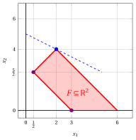

# Fase 0 dell'algoritmo del simplesso

**Parte 2 · L'algoritmo del simplesso · Capitolo 8** · [:material-file-pdf-box: Dispensa, volume 2 (PDF)](../pdf/dispensa-2-simplesso.pdf) · [:material-presentation: Slide](../pdf/slide-08-fase-zero.pdf) · [:material-pencil: Esercizi: Fase 0 dell'algoritmo del simplesso](../esercizi/es-08-fase-zero.md)

## 8.1 Il problema ausiliario del simplesso

- Consideriamo un problema LP in forma standard di massimo con $n+m$ variabili non negative e $m$ vincoli lineari di uguaglianza, ottenuto da un problema LP in forma canonica di massimo con $n$ variabili non negative e $m$ vincoli lineari di minore o uguale aggiungendo $m$ variabili di scarto non negative:

    

    \begin{align*}
    &&   \max \;\;{\boldsymbol c}' \, {\boldsymbol x}  \label{FORM_STANDARD_OBJ} \tag{8.1a}\\[2ex]
    && \text{soggetto a} \quad  {\boldsymbol A} \; {\boldsymbol x}  &= {\boldsymbol b},  & \phantom{j=1111}  \label{FORM_STANDARD_CONS1} \tag{8.1b}\\[2ex]
    && {\boldsymbol x}                        &\ge  {\boldsymbol 0}. \label{FORM_STANDARD_CONS2} \tag{8.1c}
    \end{align*}

- Il <u>Passo $0$</u> dell'algoritmo del simplesso richiede una soluzione di base ammissibile iniziale. Se ${\boldsymbol b} \ge {\boldsymbol 0}$, la partizione

    $$
    \pazocal{B}=\{n+1,n+2,\dots,n+m\} {\rm  ~~~e~~~} \pazocal{N}=\{1,2,\dots,n\}
    $$

    è associata alla base ${\boldsymbol A}_{\pazocal{B}} = {\boldsymbol I}$ e alla soluzione di base ammissibile iniziale ${\boldsymbol x}_{\pazocal{B}} = {\boldsymbol b}$ e ${\boldsymbol x}_{\pazocal{N}} = {\boldsymbol 0}$.

- Se invece $b_i < 0$ per qualche $i \in \{1,2,\dots,m\}$, questa partizione <u>non</u> è associata a una soluzione di base ammissibile, e l'algoritmo del simplesso non può essere avviato. In questo caso eseguiamo la <strong>Fase $0$</strong> dell'algoritmo del simplesso.

!!! definizione "Definizione 8.1: Fase $0$ dell'algoritmo del simplesso"

    La <strong>Fase $0$</strong> dell'algoritmo del simplesso è una procedura che determina una soluzione di base ammissibile del problema LP [(8.1)](#eq-FORM_STANDARD), insieme al dizionario associato, oppure dimostra che il problema LP [(8.1)](#eq-FORM_STANDARD) è <strong>inammissibile</strong>.

!!! definizione "Definizione 8.2: problema ausiliario del simplesso"

    Dato un problema LP [(8.1)](#eq-FORM_STANDARD) in forma standard di massimo, il <strong>problema ausiliario del simplesso</strong> associato è il problema LP in forma standard di massimo ottenuto aggiungendo una variabile non negativa $x_0$, detta <strong>variabile ausiliaria</strong>, sottraendola dal membro sinistro di ogni vincolo lineare e sostituendo la funzione obiettivo:

    

    \begin{align*}
    \label{OBJ_AUX} &&   \max \;\; - \; x_0  \tag{8.2a}\\[1.5ex]
    \label{CONS1_AUX}     && \text{soggetto a} \quad  \sum_{j=1}^{n+m} \; {a_{ij} \; x_j} - x_0  & = b_i,  & \forall \;\; i \in \{1,2,\dots,m\}  \tag{8.2b}\\[1.5ex]
    \label{CONS3_AUX}     && x_0                               &\ge  0, &  \tag{8.2c}\\[1.5ex]
    \label{CONS2_AUX}     && x_j                               &\ge  0, & \forall \;\; j \in \{1,2,\dots,n+m\} \tag{8.2d}
    \end{align*}

- La variabile ausiliaria $x_0$ è posta in <u>prima</u> posizione, e quindi i dati del problema ausiliario del simplesso [(8.2)](#eq-FORM_AUX) sono il vettore colonna ${\boldsymbol x} \in \R^{n+m+1}$ delle variabili, il vettore dei costi ${\boldsymbol c} \in \Z^{n+m+1}$, la cui prima componente è $-1$ e le cui altre componenti sono $0$, la matrice dei vincoli ${\boldsymbol A} \in \Z^{m \times (n+m+1)}$, ottenuta aggiungendo in testa alla matrice dei vincoli originale una colonna di $m$ componenti tutte uguali a $-1$, e il vettore dei termini noti ${\boldsymbol b} \in \Z^{m}$:

    $$
    {\boldsymbol  x}=
    \begin{pmatrix}
    x_{0} \\
    x_{1} \\
    \vdots  \\
    x_{n} \\[1ex]
    x_{n+1} \\
    \vdots  \\
    x_{n+m} \\
    \end{pmatrix}
    \quad
    {\boldsymbol  c}=
    \begin{pmatrix}
    -1\\
    0\\
    \vdots\\
    \vdots \\[1ex]
    \vdots\\
    \vdots\\
    0\\
    \end{pmatrix}
    \quad
    {\boldsymbol  A}=
    \begin{pmatrix}
    -1 & a_{11} & \dots & a_{1n} &1& \dots&0\\
    -1 & a_{21} & \dots & a_{2n}&0& \dots&0\\
    \vdots & \vdots & \dots & \vdots &\vdots& \dots&\vdots\\
    -1 & a_{m1} & \dots & a_{mn}&0& \dots&1\\
    \end{pmatrix}
    \quad
    {\boldsymbol b}=
    \begin{pmatrix}
    b_{1} \\
    b_{2} \\
    \vdots  \\
    b_{m} \\
    \end{pmatrix}
    $$

!!! chiave ""

    Il problema ausiliario del simplesso [(8.2)](#eq-FORM_AUX) non è <u>mai</u> inammissibile e non è <u>mai</u> illimitato:

    1. ammette sempre una soluzione ammissibile, ottenuta ponendo $x_j = 0$ per ogni $j \in \{1,2,\dots,n\}$, $x_0 = \max\{0, -\min_{i} b_i\}$ e le variabili di scarto $x_{n+i} = b_i + x_0 \ge 0$ per ogni $i \in \{1,2,\dots,m\}$;

    2. il suo valore obiettivo è $-x_0 \le 0$ per ogni soluzione ammissibile.

    Di conseguenza, per il Teorema fondamentale della programmazione lineare, ammette sempre una soluzione ottima.

!!! teorema "Teorema 8.3: ammissibilità di un problema LP"

    Il problema LP [(8.1)](#eq-FORM_STANDARD) ammette una soluzione ammissibile se e solo se il valore ottimo del problema ausiliario del simplesso [(8.2)](#eq-FORM_AUX) associato è uguale a $0$.

- L'idea della dimostrazione è che una soluzione ammissibile del problema LP [(8.1)](#eq-FORM_STANDARD) è esattamente una soluzione ammissibile del problema ausiliario del simplesso [(8.2)](#eq-FORM_AUX) in cui la variabile ausiliaria assume il valore $x_0 = 0$.

??? dimostrazione "Dimostrazione"

    Dimostriamo separatamente le due implicazioni.

    $(\Rightarrow)$ Sia $\bar{\boldsymbol x}$ una soluzione ammissibile del problema LP [(8.1)](#eq-FORM_STANDARD). Il punto ottenuto aggiungendo $\bar x_0 = 0$ è una soluzione ammissibile del problema ausiliario del simplesso [(8.2)](#eq-FORM_AUX), poiché

    $$
    \sum_{j=1}^{n+m} a_{ij} \, \bar x_j - \underbrace{\bar x_0}_{=0} = b_i, \qquad \forall i \in \{1,2,\dots,m\},
    $$

    e il suo valore obiettivo è $-\bar x_0 = 0$. Poiché il valore obiettivo di ogni soluzione ammissibile di [(8.2)](#eq-FORM_AUX) è $-x_0 \le 0$, questa soluzione è ottima e il valore ottimo è $0$.

    $(\Leftarrow)$ Sia $0$ il valore ottimo del problema ausiliario del simplesso [(8.2)](#eq-FORM_AUX) e sia $\tilde{\boldsymbol x}$ una soluzione ottima. Allora $\tilde x_0 = 0$ e, per $\eqref{CONS1_AUX}$,

    $$
    \sum_{j=1}^{n+m} a_{ij} \, \tilde x_j = b_i + \underbrace{\tilde x_0}_{=0} = b_i, \qquad \forall i \in \{1,2,\dots,m\} .
    $$

    Di conseguenza, il punto ottenuto eliminando la variabile ausiliaria soddisfa i vincoli di uguaglianza $\eqref{FORM_STANDARD_CONS1}$ e i vincoli di non negatività $\eqref{FORM_STANDARD_CONS2}$, e quindi è una soluzione ammissibile del problema LP [(8.1)](#eq-FORM_STANDARD). □

!!! chiave ""

    Se il valore ottimo del problema ausiliario del simplesso [(8.2)](#eq-FORM_AUX) è <u>strettamente negativo</u>, allora il problema LP [(8.1)](#eq-FORM_STANDARD) è <strong>inammissibile</strong>.

!!! esempio "Esempio 8.1: problema ausiliario del simplesso"

    Consideriamo il seguente problema LP in forma canonica di massimo con $n=2$ variabili non negative e $m=3$ vincoli lineari di minore o uguale (detto [Esempio 8.1](#box-4-ex-aux-1)):

    $$
    \begin{array}{rrrrrrrrrrrrr}
    {\max} & \, {x_1} & {+} & {2} \, {x_2} \\[1ex]
    \text{soggetto a} & {-} \, {x_1} & {-} & \, {x_2} & {\le} & {-3} \\[1ex]
    & {-} \, {x_1} & {+} & \, {x_2} & {\le} & {2} \\[1ex]
    & \, {x_1} & {+} & \, {x_2} & {\le} & {6} \\[1ex]
    & {x_1,} &  & {x_2} & { \ge} & {0}
    \end{array}
    $$

    Aggiungendo $m=3$ variabili di scarto, otteniamo il seguente problema LP in forma standard di massimo con $n+m=5$ variabili non negative:

    $$
    \begin{array}{rrrrrrrrrrrrrrrrrrr}
    {\max} & \, {x_1} & {+} & {2} \, {x_2} &  &  \\[1ex]
    \text{soggetto a} & {-x_1} & {-} & \, {x_2} & {+} \, {x_3} &  &  & {=} & {-3} \\[1ex]
    & {-x_1} & {+} & \, {x_2} &  & {+} \, {x_4} &  & {=} & {2} \\[1ex]
    & {x_1} & {+} & \, {x_2} &  &  & {+} \, {x_5} & {=} & {6} \\[1ex]
    & {x_1,} &  & {x_2,} & \, {x_3,} & \, {x_4,} & \, {x_5} & { \ge} & { 0 }
    \end{array}
    $$

    Poiché $b_1 = -3 < 0$, la partizione $\pazocal{B}= \{3,~~4,~~5\}$ e $\pazocal{N}= \{1,~~2\}$ <u>non</u> è associata a una soluzione di base ammissibile, e dobbiamo eseguire la Fase $0$.

    Il problema ausiliario del simplesso associato, con $n+m+1=6$ variabili non negative, è il seguente:

    $$
    \begin{array}{rrrrrrrrrrrrrrrrrrr}
    {\max} & {-} \, {x_0} &  &  &  &  \\[1ex]
    \text{soggetto a} & {-} \, {x_0} & {-} & \, {x_1} & {-} & \, {x_2} & {+} \, {x_3} &  &  & {=} & {-3} \\[1ex]
    & {-} \, {x_0} & {-} & \, {x_1} & {+} & \, {x_2} &  & {+} \, {x_4} &  & {=} & {2} \\[1ex]
    & {-} \, {x_0} & {+} & \, {x_1} & {+} & \, {x_2} &  &  & {+} \, {x_5} & {=} & {6} \\[1ex]
    & {x_0,} &  & {x_1,} &  & {x_2,} & \, {x_3,} & \, {x_4,} & \, {x_5} & { \ge} & { 0 }
    \end{array}
    $$

## 8.2 Risoluzione del problema ausiliario del simplesso

- Il problema ausiliario del simplesso [(8.2)](#eq-FORM_AUX) si risolve con l'algoritmo del simplesso. Le sue $m$ variabili di scarto danno la partizione

    $$
    \pazocal{B}=\{n+1,n+2,\dots,n+m\} {\rm  ~~~e~~~} \pazocal{N}=\{0,1,2,\dots,n\},
    $$

    che è associata alla base ${\boldsymbol A}_{\pazocal{B}} = {\boldsymbol I}$ e al dizionario

    \begin{equation*}
    \begin{cases} \displaystyle x_{i} = {{ b_i}} - \sum_{j \in \pazocal{N}} \bar{a}_{ij} \; x_{j},~~ \forall i \in \pazocal{B}\\[4ex]
    \displaystyle - w = 0 - x_{0}, \end{cases}
    \end{equation*}

    dove $-w = -x_0$ indica la funzione obiettivo del problema ausiliario del simplesso (cioè $w = x_0$). Questo dizionario <u>non</u> è associato a una soluzione di base ammissibile, poiché $b_i < 0$ per qualche $i \in \pazocal{B}$.

- Basta una sola <strong>operazione di pivot speciale</strong> per ottenere una soluzione di base ammissibile del problema ausiliario del simplesso: la variabile ausiliaria $x_0$ entra in base, e la variabile che esce dalla base è quella con il valore <u>più negativo</u>.

!!! chiave ""

    <strong>Operazione di pivot speciale.</strong> La colonna pivot è la variabile ausiliaria $x_0$ e la riga pivot è la variabile in base $x_r$ con

    $$
    r \in \argmin \{\, b_i : i \in \pazocal{B} \,\} .
    $$

    Dopo questa operazione di pivot, i valori delle variabili sono

    $$
    x_0 = - b_r
    \qquad {\rm e} \qquad
    x_i = b_i - b_r, \quad \forall i \in \pazocal{B} \setminus \{r\} ,
    $$

    e sono tutti non negativi, poiché $b_r \le b_i$ per ogni $i \in \pazocal{B}$.

- A partire dalla soluzione di base ammissibile ottenuta con l'operazione di pivot speciale, l'algoritmo del simplesso viene eseguito sul problema ausiliario del simplesso fino a trovare una soluzione ottima. Poiché il problema ausiliario del simplesso non è mai illimitato, l'algoritmo termina sempre con un dizionario ottimo.

!!! chiave ""

    Al termine della Fase $0$ si verifica esattamente uno dei tre casi seguenti:

    1. il valore ottimo del problema ausiliario del simplesso è <strong>strettamente negativo</strong>: il problema LP [(8.1)](#eq-FORM_STANDARD) è <strong>inammissibile</strong>;

    2. il valore ottimo è $0$ e la variabile ausiliaria $x_0$ è <strong>fuori base</strong>: la base ottima del problema ausiliario del simplesso, dopo aver eliminato $x_0$ da $\pazocal{N}$, è una base del problema LP [(8.1)](#eq-FORM_STANDARD) associata a una soluzione di base ammissibile;

    3. il valore ottimo è $0$ e la variabile ausiliaria $x_0$ è <strong>in base</strong>, necessariamente con valore $x_0 = 0$: un'ulteriore operazione di pivot fa uscire $x_0$ dalla base, riconducendoci al caso precedente.

- Nel terzo caso, la soluzione di base ammissibile del problema ausiliario del simplesso è <strong>degenere</strong>, poiché la variabile in base $x_0$ assume il valore $0$. Si esegue un'operazione di pivot sulla riga di $x_0$, scegliendo come colonna pivot una qualsiasi variabile fuori base $x_j$ con $j \in \pazocal{N}$ tale che $\bar{a}_{0j} \ne 0$: il valore delle altre variabili in base non cambia, poiché il valore di $x_0$ è $0$. Tale variabile esiste sempre: altrimenti la riga di $x_0$ in ${\boldsymbol A}_{\pazocal{B}}^{-1}{\boldsymbol A}$ (senza la colonna di $x_0$) sarebbe nulla, in contraddizione con $\rank({\boldsymbol A}) = m$, che vale poiché ${\boldsymbol A}$ contiene la matrice identità delle variabili di scarto.

!!! esempio "Esempio 8.2: Fase $0$ dell'algoritmo del simplesso"

    Consideriamo il problema ausiliario del simplesso dell'[Esempio 8.1](#box-4-ex-aux-1). Con $\pazocal{B}= \{3,~~4,~~5\}$ e $\pazocal{N}= \{0,~~1,~~2\}$, il dizionario iniziale è:

    \begin{equation*}
    \begin{cases}
    \begin{array}{rrrrrrrrrrrrr}
    {x_3} & {=} & {-3} & {+} & {x_0} & {+} & {x_1} & {+} & {x_2} \\[2ex]
    {x_4} & {=} & {2} & {+} & {x_0} & {+} & {x_1} & {-} & {x_2} \\[2ex]
    {x_5} & {=} & {6} & {+} & {x_0} & {-} & {x_1} & {-} & {x_2} \\[2ex]
    {-w} & {=} & {0} & {-} & {x_0} &  &  &  &
    \end{array}
    \end{cases}
    \end{equation*}

    La soluzione di base associata <u>non</u> è ammissibile, poiché $\bar b_3 = -3 < 0$.

    <strong>Operazione di pivot speciale.</strong> La colonna pivot è $x_0$ e la riga pivot è $x_3$, la variabile in base con il valore più negativo. Risolvendo rispetto a $x_0$ la prima equazione otteniamo $x_0 = 3 + x_3 - x_1 - x_2$, e sostituendola nelle altre equazioni otteniamo il dizionario con $\pazocal{B}= \{0,~~4,~~5\}$ e $\pazocal{N}= \{1,~~2,~~3\}$:

    \begin{equation*}
    \begin{cases}
    \begin{array}{rrrrrrrrrrrrr}
    {x_0} & {=} & {3} & {-} & {x_1} & {-} & {x_2} & {+} & {x_3} \\[2ex]
    {x_4} & {=} & {5} &  &  & {-} & {2\,x_2} & {+} & {x_3} \\[2ex]
    {x_5} & {=} & {9} & {-} & {2\,x_1} & {-} & {2\,x_2} & {+} & {x_3} \\[2ex]
    {-w} & {=} & {-3} & {+} & {x_1} & {+} & {x_2} & {-} & {x_3}
    \end{array}
    \end{cases}
    \end{equation*}

    La soluzione di base ammissibile associata è $\bar x_0 = 3$, $\bar x_4 = 5$, $\bar x_5 = 9$ e $\bar x_1 = \bar x_2 = \bar x_3 = 0$, di valore $-w = -3$.

    <strong>Prima operazione di pivot.</strong> Il costo ridotto di $x_1$ è $\bar c_1 = 1 > 0$, e quindi la colonna pivot è $x_1$. I valori della sua colonna sono $\bar a_{01} = 1$ e $\bar a_{51} = 2$, e quindi

    $$
    t_m = \min \left\{~\frac{3}{1},~\frac{9}{2}~\right\} = 3
    $$

    e la riga pivot è $x_0$. Il nuovo dizionario, con $\pazocal{B}= \{1,~~4,~~5\}$ e $\pazocal{N}= \{0,~~2,~~3\}$, è:

    \begin{equation*}
    \begin{cases}
    \begin{array}{rrrrrrrrrrrrr}
    {x_1} & {=} & {3} & {-} & {x_0} & {-} & {x_2} & {+} & {x_3} \\[2ex]
    {x_4} & {=} & {5} &  &  & {-} & {2\,x_2} & {+} & {x_3} \\[2ex]
    {x_5} & {=} & {3} & {+} & {2\,x_0} &  &  & {-} & {x_3} \\[2ex]
    {-w} & {=} & {0} & {-} & {x_0} &  &  &  &
    \end{array}
    \end{cases}
    \end{equation*}

    Tutti i costi ridotti sono non positivi, e quindi questo dizionario è ottimo: il valore ottimo del problema ausiliario del simplesso è $0$ e la variabile ausiliaria $x_0$ è fuori base. Di conseguenza, il problema LP dell'[Esempio 8.1](#box-4-ex-aux-1) è <strong>ammissibile</strong> e

    $$
    \pazocal{B}= \{1,~~4,~~5\}
    $$

    è una base associata a una soluzione di base ammissibile.

## 8.3 Dalla Fase $0$ all'algoritmo del simplesso

- Al termine della Fase $0$, il dizionario ottimo del problema ausiliario del simplesso fornisce le equazioni delle variabili in base del problema LP [(8.1)](#eq-FORM_STANDARD) in funzione delle sue variabili fuori base, una volta eliminata la variabile ausiliaria $x_0$ da $\pazocal{N}$.

- L'ultima equazione di quel dizionario, tuttavia, è quella della funzione obiettivo $-w$ del problema ausiliario del simplesso, e deve essere sostituita dall'equazione della funzione obiettivo <u>originale</u> $z$.

!!! chiave ""

    L'equazione della funzione obiettivo originale si ottiene <strong>sostituendo</strong>, in

    $$
    z = \sum_{j=1}^{n+m} c_j \; x_j ,
    $$

    l'equazione di ogni variabile in base $x_i$ con $i \in \pazocal{B}$, in modo che $z$ sia scritta in funzione delle sole variabili fuori base. Equivalentemente, si calcola come

    $$
    \bar{z} = {\boldsymbol c}'_{\pazocal{B}} \; {\boldsymbol  A}_{\pazocal{B}}^{-1} \; {\boldsymbol b}
    \qquad {\rm e} \qquad
    {{ \bar{\boldsymbol c}}'}  = {\boldsymbol c}'_{\pazocal{N}} -  {\boldsymbol c}'_{\pazocal{B}} \; {\boldsymbol  A}_{\pazocal{B}}^{-1} \;{\boldsymbol  A}_{\pazocal{N}} .
    $$

- Una volta disponibile il dizionario iniziale del problema LP [(8.1)](#eq-FORM_STANDARD), l'algoritmo del simplesso viene eseguito come di consueto, a partire dal suo <u>Passo $1$</u>.

!!! esempio "Esempio 8.3: dalla Fase $0$ all'algoritmo del simplesso"

    Consideriamo il dizionario ottimo del problema ausiliario del simplesso dell'[Esempio 8.1](#box-4-ex-aux-1), con $\pazocal{B}= \{1,~~4,~~5\}$. Eliminando la variabile ausiliaria $x_0$, le equazioni delle variabili in base del problema LP sono:

    $$
    \begin{cases}
    x_1 = 3 - x_2 + x_3\\[1ex]
    x_4 = 5 - 2\,x_2 + x_3\\[1ex]
    x_5 = 3 - x_3
    \end{cases}
    $$

    La funzione obiettivo del problema LP dell'[Esempio 8.1](#box-4-ex-aux-1) è $z = x_1 + 2 \, x_2$, e in essa compare la variabile in base $x_1$. Sostituendo la sua equazione, otteniamo:

    $$
    z = \underbrace{3 - x_2 + x_3}_{= \, x_1} + 2 \, x_2 = 3 + x_2 + x_3 .
    $$

    Di conseguenza, con $\pazocal{B}= \{1,~~4,~~5\}$ e $\pazocal{N}= \{2,~~3\}$, il dizionario iniziale del problema LP dell'[Esempio 8.1](#box-4-ex-aux-1) è:

    \begin{equation*}
    \begin{cases}
    \begin{array}{rrrrrrrrrrrrr}
    {x_1} & {=} & {3} & {-} & {x_2} & {+} & {x_3} \\[2ex]
    {x_4} & {=} & {5} & {-} & {2\,x_2} & {+} & {x_3} \\[2ex]
    {x_5} & {=} & {3} &  &  & {-} & {x_3} \\[2ex]
    {z} & {=} & {3} & {+} & {x_2} & {+} & {x_3}
    \end{array}
    \end{cases}
    \end{equation*}

    e la soluzione di base ammissibile associata è $\bar x_1 = 3$, $\bar x_4 = 5$, $\bar x_5 = 3$ e $\bar x_2 = \bar x_3 = 0$, di valore $3$.

!!! esempio "Esempio 8.4: esecuzione dell'algoritmo del simplesso dopo la Fase $0$"

    A partire dal dizionario iniziale dell'[Esempio 8.1](#box-4-ex-aux-1) determinato dalla Fase $0$, eseguiamo l'algoritmo del simplesso.

    <strong>Prima operazione di pivot.</strong> Il costo ridotto di $x_2$ è $\bar c_2 = 1 > 0$, e quindi la colonna pivot è $x_2$. I valori della sua colonna sono $\bar a_{12} = 1$ e $\bar a_{42} = 2$, e quindi

    $$
    t_m = \min \left\{~\frac{3}{1},~\frac{5}{2}~\right\} = \frac{5}{2}
    $$

    e la riga pivot è $x_4$. Il nuovo dizionario, con $\pazocal{B}= \{1,~~2,~~5\}$ e $\pazocal{N}= \{3,~~4\}$, è:

    \begin{equation*}
    \begin{cases}
    \begin{array}{rrrrrrrrrrrrr}
    {x_1} & {=} & {\frac{1}{2}} & {+} & {\frac{1}{2}\,x_3} & {+} & {\frac{1}{2}\,x_4} \\[2ex]
    {x_2} & {=} & {\frac{5}{2}} & {+} & {\frac{1}{2}\,x_3} & {-} & {\frac{1}{2}\,x_4} \\[2ex]
    {x_5} & {=} & {3} & {-} & {x_3} &  &  \\[2ex]
    {z} & {=} & {\frac{11}{2}} & {+} & {\frac{3}{2}\,x_3} & {-} & {\frac{1}{2}\,x_4}
    \end{array}
    \end{cases}
    \end{equation*}

    <strong>Seconda operazione di pivot.</strong> Il costo ridotto di $x_3$ è $\bar c_3 = \frac{3}{2} > 0$, e quindi la colonna pivot è $x_3$. L'unico valore positivo della sua colonna è $\bar a_{53} = 1$, e quindi $t_m = \frac{3}{1} = 3$ e la riga pivot è $x_5$. Il nuovo dizionario, con $\pazocal{B}= \{1,~~2,~~3\}$ e $\pazocal{N}= \{4,~~5\}$, è:

    \begin{equation*}
    \begin{cases}
    \begin{array}{rrrrrrrrrrrrr}
    {x_1} & {=} & {2} & {+} & {\frac{1}{2}\,x_4} & {-} & {\frac{1}{2}\,x_5} \\[2ex]
    {x_2} & {=} & {4} & {-} & {\frac{1}{2}\,x_4} & {-} & {\frac{1}{2}\,x_5} \\[2ex]
    {x_3} & {=} & {3} &  &  & {-} & {x_5} \\[2ex]
    {z} & {=} & {10} & {-} & {\frac{1}{2}\,x_4} & {-} & {\frac{3}{2}\,x_5}
    \end{array}
    \end{cases}
    \end{equation*}

    Tutti i costi ridotti sono non positivi, e quindi questo dizionario è ottimo. Una soluzione ottima del problema LP dell'[Esempio 8.1](#box-4-ex-aux-1) è

    $$
    \tilde{\boldsymbol x}(\, LP \,) =
    \begin{pmatrix}
    2 \\[0.5ex]
    4
    \end{pmatrix}
    $$

    e il valore ottimo è $z(\, LP \,) = 10$.

    { .fig .cornice loading=lazy style="width:53%" }

    La regione ammissibile $F$ è delimitata dalle rette $-x_1 - x_2 = -3$ (in basso a sinistra), $-x_1 + x_2 = 2$ (in alto a sinistra), $x_1 + x_2 = 6$ (a destra) e dall'asse $x_1$; in blu tratteggiato l'insieme di livello $x_1 + 2\,x_2 = 10$ passante per il vertice ottimo. In viola la soluzione di base ammissibile $(3,0)$ determinata dalla Fase $0$ e il vertice $(\frac{1}{2},\frac{5}{2})$ raggiunto dopo la prima operazione di pivot, in blu la soluzione ottima raggiunta dall'algoritmo del simplesso.

## 8.4 Riconoscere i problemi LP inammissibili

- Se il valore ottimo del problema ausiliario del simplesso [(8.2)](#eq-FORM_AUX) è strettamente negativo, allora, per il [Teorema 8.3](#box-3-theo-aux), il problema LP [(8.1)](#eq-FORM_STANDARD) è inammissibile. In questo caso il dizionario ottimo del problema ausiliario del simplesso è un <strong>certificato di inammissibilità</strong>.

!!! esempio "Esempio 8.5: problema LP inammissibile"

    Consideriamo il seguente problema LP in forma canonica di massimo con $n=2$ variabili non negative e $m=2$ vincoli lineari di minore o uguale (detto [Esempio 8.5](#box-8-ex-aux-5)):

    $$
    \begin{array}{rrrrrrrrrrrrr}
    {\max} & \, {x_1} & {+} & \, {x_2} \\[1ex]
    \text{soggetto a} & \, {x_1} & {+} & \, {x_2} & {\le} & {2} \\[1ex]
    & {-} \, {x_1} & {-} & \, {x_2} & {\le} & {-4} \\[1ex]
    & {x_1,} &  & {x_2} & { \ge} & {0}
    \end{array}
    $$

    Poiché $b_2 = -4 < 0$, eseguiamo la Fase $0$. Con $\pazocal{B}= \{3,~~4\}$ e $\pazocal{N}= \{0,~~1,~~2\}$, il dizionario iniziale del problema ausiliario del simplesso è:

    \begin{equation*}
    \begin{cases}
    \begin{array}{rrrrrrrrrrrrr}
    {x_3} & {=} & {2} & {+} & {x_0} & {-} & {x_1} & {-} & {x_2} \\[2ex]
    {x_4} & {=} & {-4} & {+} & {x_0} & {+} & {x_1} & {+} & {x_2} \\[2ex]
    {-w} & {=} & {0} & {-} & {x_0} &  &  &  &
    \end{array}
    \end{cases}
    \end{equation*}

    <strong>Operazione di pivot speciale.</strong> La colonna pivot è $x_0$ e la riga pivot è $x_4$, la variabile in base con il valore più negativo. Il nuovo dizionario, con $\pazocal{B}= \{0,~~3\}$ e $\pazocal{N}= \{1,~~2,~~4\}$, è:

    \begin{equation*}
    \begin{cases}
    \begin{array}{rrrrrrrrrrrrr}
    {x_0} & {=} & {4} & {-} & {x_1} & {-} & {x_2} & {+} & {x_4} \\[2ex]
    {x_3} & {=} & {6} & {-} & {2\,x_1} & {-} & {2\,x_2} & {+} & {x_4} \\[2ex]
    {-w} & {=} & {-4} & {+} & {x_1} & {+} & {x_2} & {-} & {x_4}
    \end{array}
    \end{cases}
    \end{equation*}

    <strong>Prima operazione di pivot.</strong> La colonna pivot è $x_1$, poiché $\bar c_1 = 1 > 0$. I valori della sua colonna sono $\bar a_{01} = 1$ e $\bar a_{31} = 2$, e quindi $t_m = \min \left\{~\frac{4}{1},~\frac{6}{2}~\right\} = 3$ e la riga pivot è $x_3$. Il nuovo dizionario, con $\pazocal{B}= \{0,~~1\}$ e $\pazocal{N}= \{2,~~3,~~4\}$, è:

    \begin{equation*}
    \begin{cases}
    \begin{array}{rrrrrrrrrrrrr}
    {x_0} & {=} & {1} & {+} & {\frac{1}{2}\,x_3} & {+} & {\frac{1}{2}\,x_4} &  &  \\[2ex]
    {x_1} & {=} & {3} & {-} & {x_2} & {-} & {\frac{1}{2}\,x_3} & {+} & {\frac{1}{2}\,x_4} \\[2ex]
    {-w} & {=} & {-1} & {-} & {\frac{1}{2}\,x_3} & {-} & {\frac{1}{2}\,x_4} &  &
    \end{array}
    \end{cases}
    \end{equation*}

    Tutti i costi ridotti sono non positivi, e quindi questo dizionario è ottimo. Il valore ottimo del problema ausiliario del simplesso è $-1 < 0$, cioè la variabile ausiliaria assume il valore $\tilde x_0 = 1$ in ogni soluzione ottima. Di conseguenza, il problema LP dell'[Esempio 8.5](#box-8-ex-aux-5) è <strong>inammissibile</strong>.

## 8.5 Pseudocodice dell'algoritmo del simplesso con la Fase $0$

!!! algoritmo "Algoritmo"

    - <strong>Input</strong>

        Un problema LP [(8.1)](#eq-FORM_STANDARD).

    - <strong>Output</strong>

        Una soluzione ottima del problema LP [(8.1)](#eq-FORM_STANDARD), se esiste; altrimenti, un certificato che il problema LP è inammissibile o illimitato.

    - **Passo 0:** <strong>Inizializzazione</strong>

        Se $b_i \ge 0$ per ogni $i\in\{1,2,\ldots,m\}$, allora porre

        $$
        \pazocal B \leftarrow \{n+1,n+2,\ldots,n+m\},
        \qquad
        \pazocal N \leftarrow \{1,2,\ldots,n\},
        $$

        insieme al dizionario associato, e andare al <u>Passo $1$</u>.

        Altrimenti, eseguire la <strong>Fase $0$</strong>:

        - **a.** costruire il problema ausiliario del simplesso [(8.2)](#eq-FORM_AUX) e il suo dizionario iniziale con $\pazocal B \leftarrow \{n+1,\ldots,n+m\}$ e $\pazocal N \leftarrow \{0,1,\ldots,n\}$;

        - **b.** eseguire l'<strong>operazione di pivot speciale</strong>: la colonna pivot è $x_0$ e la riga pivot è $x_r$ con $r \in \argmin \{\, b_i : i \in \pazocal{B} \,\}$;

        - **c.** eseguire il <u>Passo $1$</u> e il <u>Passo $2$</u> sul problema ausiliario del simplesso fino a trovare un dizionario ottimo;

        - **d.** se il valore ottimo è strettamente negativo, allora il problema LP [(8.1)](#eq-FORM_STANDARD) è <strong>inammissibile</strong> e <code>STOP</code>;

        - **e.** se la variabile ausiliaria $x_0$ è in base, eseguire un'operazione di pivot sulla sua riga per farla uscire dalla base;

        - **f.** eliminare $x_0$ da $\pazocal{N}$ e sostituire l'equazione di $-w$ con l'equazione della funzione obiettivo originale $z$, scritta in funzione delle variabili fuori base.

        Andare al <u>Passo $1$</u>.

    - **Passo 1:** <strong>Test di ottimalità</strong>

        Rispetto al dizionario corrente, se $\bar c_j\le 0$ per ogni $j\in\pazocal N$, allora la soluzione di base ammissibile $x_i=\bar b_i$, $\forall i\in\pazocal B$, e $x_j=0$, $\forall j\in\pazocal N$, è una soluzione ottima e $\bar z$ è il valore ottimo. In questo caso <code>STOP</code>.

    - **Passo 2:** <strong>Operazioni di pivot</strong>

        La <strong>colonna pivot</strong> è una variabile fuori base $x_p$ con $p \in \pazocal{N}$ tale che $\bar{c}_{p} > 0$. Se $\bar a_{ip}\le 0$ per ogni $i\in\pazocal{B}$, allora il problema LP [(8.1)](#eq-FORM_STANDARD) è <strong>illimitato</strong> e <code>STOP</code>. Altrimenti calcolare

        $$
        t_m \leftarrow \min \left\{~\frac{\bar b_i}{\bar a_{ip}}: i\in\pazocal{B},~\bar a_{ip}>0 ~\right\} ,
        $$

        determinare la <strong>riga pivot</strong> $x_r$ con $\bar{a}_{rp} > 0$ e $\bar{b}_r  - t_m \; \bar{a}_{rp} = 0$, aggiornare il dizionario e porre $\pazocal{B} \leftarrow \big(\pazocal{B} \setminus \{ r \} \big) \cup \{ p \}$ e $\pazocal{N} \leftarrow \big(\pazocal{N} \setminus \{ p \} \big) \cup \{ r \}$. Andare al <u>Passo $1$</u>.

## 8.6 Il Teorema fondamentale della programmazione lineare

- La Fase $0$ e l'algoritmo del simplesso, eseguiti uno dopo l'altro, dimostrano il seguente teorema, che descrive tutti i possibili esiti di un problema LP e mostra che, ogni volta che esiste una soluzione ottima, una di esse è una soluzione <u>di base</u> ammissibile.

!!! teorema "Teorema 8.4: Teorema fondamentale della programmazione lineare"

    Per ogni problema LP [(8.1)](#eq-FORM_STANDARD) in forma standard di massimo:

    1. se ammette una soluzione ammissibile, allora ammette una soluzione <strong>di base</strong> ammissibile;

    2. se ammette una soluzione ottima, allora ammette una soluzione <strong>di base</strong> ammissibile che è ottima;

    3. è <strong>inammissibile</strong>, è <strong>illimitato</strong>, oppure ammette una <strong>soluzione ottima</strong>.

- L'idea della dimostrazione è che la Fase $0$ e l'algoritmo del simplesso, eseguiti con una regola di pivot anti-ciclaggio, terminano dopo un numero finito di operazioni di pivot, e che ciascuno dei loro possibili esiti è uno dei tre casi dell'enunciato.

??? dimostrazione "Dimostrazione"

    Eseguiamo la Fase $0$ sul problema LP [(8.1)](#eq-FORM_STANDARD), e poi l'algoritmo del simplesso con la regola di pivot di Bland. Entrambi terminano dopo un numero finito di operazioni di pivot, poiché il numero di basi è finito e la regola di Bland impedisce il ciclaggio.

    <strong>Punto 1.</strong> Se il problema LP [(8.1)](#eq-FORM_STANDARD) ammette una soluzione ammissibile, allora, per il [Teorema 8.3](#box-3-theo-aux), il valore ottimo del problema ausiliario del simplesso è $0$. La Fase $0$ termina con un dizionario ottimo del problema ausiliario del simplesso in cui, eventualmente dopo un'ulteriore operazione di pivot, la variabile ausiliaria $x_0$ è fuori base. La partizione associata $\pazocal{B}$ e $\pazocal{N}$ è quindi una base del problema LP [(8.1)](#eq-FORM_STANDARD) la cui soluzione di base ${\boldsymbol x}_{\pazocal{B}} = \bar{\boldsymbol b} \ge {\boldsymbol 0}$ è ammissibile.

    <strong>Punto 3.</strong> Se il problema LP [(8.1)](#eq-FORM_STANDARD) non è inammissibile, per il Punto 1 l'algoritmo del simplesso può essere avviato da una soluzione di base ammissibile. Termina in uno di due modi:

    - **(i)** con un dizionario in cui $\bar c_j \le 0$ per ogni $j \in \pazocal{N}$: per le condizioni sufficienti di ottimalità, la soluzione di base ammissibile associata è una soluzione ottima;

    - **(ii)** con una variabile fuori base $x_p$ tale che $\bar c_p > 0$ e $\bar a_{ip} \le 0$ per ogni $i \in \pazocal{B}$: per il certificato di illimitatezza, il problema LP è illimitato.

    Di conseguenza, il problema LP è inammissibile, illimitato, oppure ammette una soluzione ottima, e i tre casi sono mutuamente esclusivi.

    <strong>Punto 2.</strong> Se il problema LP [(8.1)](#eq-FORM_STANDARD) ammette una soluzione ottima, allora non è né inammissibile né illimitato, e quindi l'algoritmo del simplesso termina nel caso (i) sopra, con una soluzione ottima che è una soluzione di base ammissibile. □

!!! chiave ""

    Il Teorema fondamentale della programmazione lineare ha un'importante conseguenza algoritmica: per risolvere un problema LP basta cercare una soluzione ottima tra le sue soluzioni <strong>di base</strong> ammissibili, il cui numero è finito e al più

    $$
    \binom{n+m}{m} .
    $$

    L'algoritmo del simplesso ne esplora un piccolo sottoinsieme, passando da una soluzione di base ammissibile a un'altra il cui valore obiettivo non è minore.

---

**Esercizi su questo capitolo:** [:material-pencil: Fase 0 dell'algoritmo del simplesso](../esercizi/es-08-fase-zero.md)
